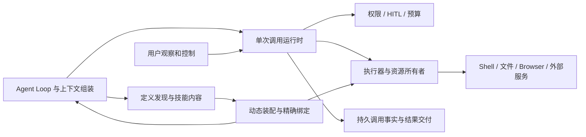

# 工具系统架构草案 v1

状态：**draft，待讨论，未接受**。2026-09-13。本文中的名称、状态与接口均为
候选语义，不是已发布 API、包布局或正式规格；当前规格清单仍以
[catalog](../../../../spec/catalog.json)为准。

## 设计主张

本稿从 Cordis 的动态组合视角出发：能力激活依赖哪些条件，向环境产生哪些
效用，条件消失或卸载时如何撤回自身贡献，已接纳的工作如何处置。工具、skill、
服务、上下文贡献及执行资源都按这组问题建模；tool–skill 是其中一种关系。

在此基础上分别定义精确版本数据、使用激活与受管贡献、模型请求投影以及单次
调用。持久身份不依赖 Cordis 运行时对象；数据库里的关联字段也不能代替真实
依赖变化所触发的失活与撤回。

主要建议如下，均可在后续讨论中调整：

1. 普通工具与多命令工具共享操作定义；多命令工具以一个 CLI 式入口暴露，默认
   使用紧凑参数和按需帮助，每条命令仍有完整输入/输出契约与动作授权。
2. 必需 skill 参与工具或命令的激活生命周期：挂载共同产生调用入口、指引及
   资源等效用，失效则撤回相关贡献。模型请求内容检查是这套组合的一项条件。
3. 每次调用有独立持久身份、控制入口、过程流与结果。支持后台运行的调用从
   启动时就归独立于会话运行实例的执行所有者管理；转后台改变等待关系。
4. 新调用绑定精确版本。更新先准备并验证新装配，再发布给新调用；旧调用继续
   使用原实现及依赖。不能共存的替换显式处理占用和停机，不伪装无缝热更新。
5. Cordis 使用官方包；选定的 DSH tools、agent、jobs 和环境执行基础代码 fork
   到本项目，在真正拥有语义的位置修改，不叠加仅转发的兼容层。

## 阅读顺序

| 正文 | 讨论的问题 |
|---|---|
| [生命周期、效用与撤回](lifecycle.md) | 定义与激活、依赖与所有权、正向贡献/逆向清理、共享使用及在途工作 |
| [定义与技能依赖](definitions.md) | 定义身份、多命令呈现、帮助、tool–skill 关系及上下文装配 |
| [调用运行时](runtime.md) | 接纳、授权、执行、过程流、后台、停止、HITL 和恢复 |
| [内部过程帧](frames.md) | 生产资格、顺序、记录确认、观察回放、终态、媒体与会话交接 |
| [动态装配与复用](assembly.md) | Cordis 映射、版本发布、依赖失效、代码边界、DSH fork 范围 |
| [需求覆盖与验证](validation.md) | 消费范围、组合接口、待验证性质和具体场景 |
| [评审记录](review.md) | 独立只读评审、发现及修订；不构成接受 |

## 能力边界

图中是语义责任，不要求各自成为独立包、数据库、微服务或通用框架。首版可以
在一个进程内装配可信组件，通过公开能力接口访问独立存储；执行边界按插件
信任与环境能力选择。同一个服务可以实现多个相关责任，但不能靠隐藏的全局
状态让会话销毁、权限变化或依赖卸载决定调用的隐式命运。

| 责任 | 拥有的事实 | 不应接管的事实 |
|---|---|---|
| 定义与发现 | 工具/操作契约、呈现摘要、依赖声明与可用性解释 | 资产权益、人类权限授予 |
| 动态装配 | 当前发布选择、贡献激活与撤回、精确绑定、依赖与资源占用、期望和实际状态 | 调用业务结果、模型是否遵守技能 |
| 调用运行时 | 调用与尝试、执行准入、控制意图、过程和结果关联、接续交付 | Session 输入队列、通用决策池的权威状态 |
| 执行器 | 实际工作、外部工作标识、资源使用、可兑现的停止/接续能力 | 任意扩大权限、决定后续模型何时运行 |

Session、Run、Step、租户与资产等身份引用各自能力的同一权威定义。本稿的
`invocation` 指一次逻辑工具调用，`attempt` 指一次实际执行尝试，`binding`
指一次精确实现绑定；不是把旧 Agent 核心草案中的同名对象重新接受。

## 设计依据与适用范围

需求工作区基线：Git `72e5007c874a7dfb82e4b50dc15b33fe05026b9e` 加本工作树已登记的
[PF-024.C1/C2](../../../requirements/product/agent/PF-024-multi-command-tool-definition.md)
及本轮新增的 [PF-014.C6](../../../requirements/product/agent/PF-014-runtime-tool-and-skill-discovery-and-loading.md)、
[SYS-DYNAMIC.C2 的生命周期澄清](../../../requirements/system/fully-dynamic-system.md)。
本稿消费的具体条款和未覆盖能力见[覆盖表](validation.md#需求覆盖)。这只是可识别
的候选工作区快照；正式接受时应固定包含新增条款的完整提交与消费范围。

上游事实依据见下述固定官方来源；DSH 源码为 `c291e7961a515f6d7af9304e7fd1d257929aef26`；对应包元数据
为 `0.1.5-rc.2`，并未证明同号 npm tarball 与该提交完全相同。关键来源已在
[复用章节](assembly.md#dsh-复用选择)提供固定链接，临时报告的存在不是设计的运行依赖。
多命令参考为 `omne-next` 提交 `6263fed545e48ad9efb5714f3fe76a7c1a0af1b5`，
差异与原 ADR 状态沿[来源核对](../../../research/multi-command-tool-sources.md)。
按用户进一步澄清重新核对的 Cordis 依赖与 effect 语义见
[生命周期来源](../../../research/cordis-lifecycle-and-tool-composition.md)。内部过程帧
同时消费用户指定的[过程帧协调候选原件](../../runtime-composition/evidence/inputs/tool-execution-frames-coordination-20260913.md.txt)；[过程帧正文](frames.md)拥有本专题的具体建议与待对齐事项。

本稿遵循 SYS-KERNEL 的维护边界、单机首交付、租户隔离和 OpenRouter 统一模型
出口。暂不选择数据库、进程协议、容器方案、Browser/Computer 库或通用工作流
引擎；这些选型需要具体契约与验证，不能用一个空适配器声称产品能力已完成。

## 优先讨论的取舍

| 问题 | 本稿建议 | 代价与待确定边界 |
|---|---|---|
| 多命令的模型参数形状 | 默认 `command + params`，按需帮助 | 更少常驻定义；参数错误需运行时校验。闭集工具可选完整类型联合，仍占一个槽位 |
| 动态装配的基本单位 | 有所有者的贡献激活，依赖失效时撤回相应效用 | 需要逐项说明清理和共享使用；只过滤调用入口不足以撤回其它贡献 |
| 工具必需 skill 如何生效 | 声明依赖，受控解析，正文随可调用操作进入请求上下文 | 占用上下文预算；正文放不下时需缩小操作集合，不能只记历史已读 |
| 后台调用的所有者 | 从启动起使用会话实例之外的执行所有者 | 需要独立控制和结果路径；并非每项现有实现都自然具备后台资格 |
| skill 或实现更新 | 新接纳使用新选择，在途保留精确旧绑定 | 并存需占用资源；紧急停用要单独发出停止动作 |
| 运行时重建的承诺 | 会话重建能重连仍存活的原工作；执行宿主丢失按能力恢复或报告不确定 | 全机崩溃后任意代码继续运行、跨异构宿主迁移并未被普遍承诺 |
| skill 正文保留成本 | 初版保留发布者标记为必需的完整核心正文，附件按需 | 核心正文的编写上限、是否允许经版本管理的缩写投影需后续定量验证 |

必需 skill 的内容预算、后台生命周期上限与配额、过程流保留长度、实现共存的
资源上限，以及撤回内容后历史读面的保留规则尚待确定。上述数值缺口不阻止
讨论边界，也不允许实现用静默丢内容、丢结果或无期限占用资源填补。
