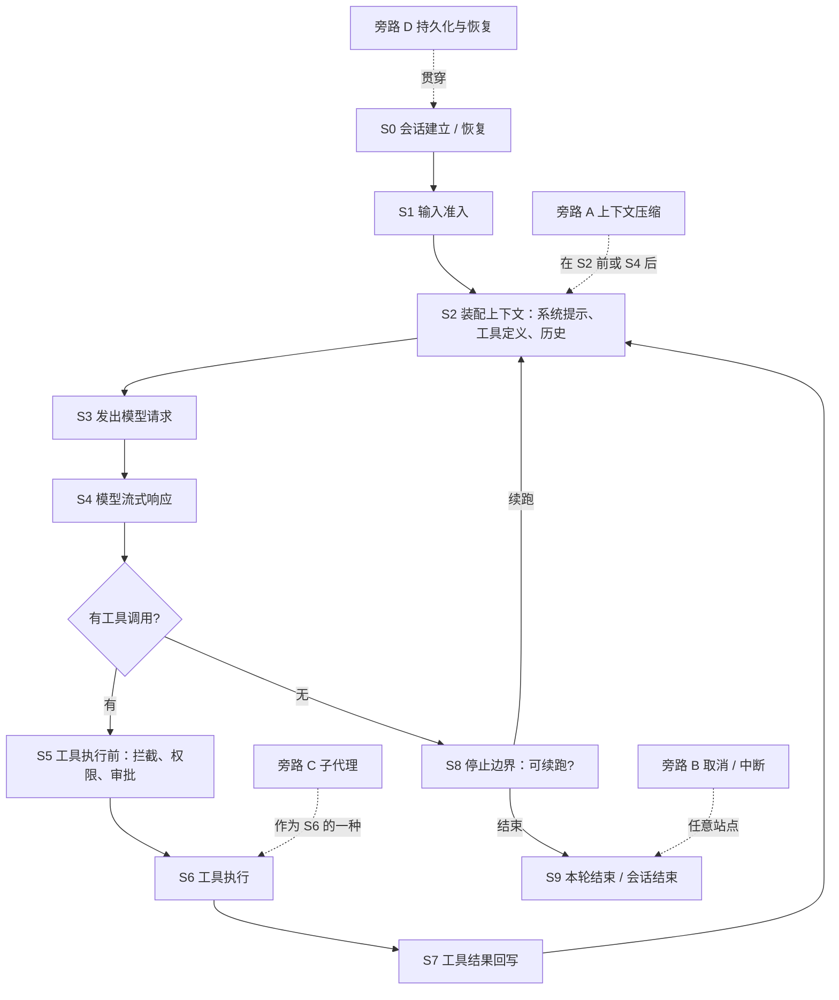

# 六个 Agent 系统的循环、事件与 hooks：从骨架到挂点

[研究索引](../README.md) · [Agent 运行时架构](../../architecture/agent-runtime.md) · [agent-core 提案](../../proposals/agent-core/README.md) · [执行层候选](../../proposals/agent-core/v1/execution.md)

本项目按 [SYS-KERNEL](../../requirements/system/constraints.md#sys-kernel) 只复用 Cordis 与 DSH `agent` 原语，Agent Loop、Harness 层、工具协议和治理都要自己定义。而 [PF-003](../../requirements/product/agent/PF-003-tool-execution-observation-and-control.md)（工具执行观察与控制）、[PF-004](../../requirements/product/agent/PF-004-subagent-delegation-and-supervision.md)（子智能体）、[PF-005](../../requirements/product/agent/PF-005-agent-initiated-human-input-and-approval.md)（主动提问与授权）、[PF-013](../../requirements/product/user/PF-013-session-run-lifecycle-and-pending-input-control.md)（Session/Run 生命周期与排队输入）和 [SYS-OBSERVABILITY](../../requirements/system/observability-and-logging.md) 几乎都落在同一个位置：**循环怎么走、循环里发生了什么、外部能在哪里插手**。这就是本专题要梳理的三件事。

本文是研究证据：只说各系统在固定版本上做了什么、为什么这样做、彼此有何差异，不批准本项目的任何设计选择。带「推断」标记的判断只从源码结构或跨系统比较得出，未经上游文档直述；带「未覆盖」的是本轮没有读到的部分。分系统的逐条核对（含源码行号与 URL）放在 [notes/](notes/) 六份笔记里，正文只保留支持判断所需的事实。

## 0. 结论先行

1. **六家的循环骨架同构。** 都是"接纳输入 → 装配上下文 → 请求模型 → 解析工具调用 → 执行工具 → 回写结果 → 判定继续或停止"的往复，差异不在骨架而在**站点上放了什么钩子、事件是什么性质、状态归谁**。
2. **hook 机制分两大谱系。** Claude Code 和 Codex 是"外部命令式 hook"：进程外的命令/HTTP/MCP 工具通过 stdin/stdout JSON 与退出码参与决策，事件名高度趋同（`SessionStart`、`UserPromptSubmit`、`PreToolUse`、`PermissionRequest`、`PostToolUse`、`Stop`、`SubagentStart/Stop`、`PreCompact`、`SessionEnd`）。DSH、pi、OpenCode、LangChain 是"进程内扩展点"：分别以 Cordis 事件（waterfall/serial）、扩展事件的返回值、插件接口的可变 `output`、图节点与中间件包装来让代码改写循环。DSH 还内置了两个兼容层，把前一谱系的命令式 hook 映射到自己的事件上。
3. **能阻断或改写的点在六家里高度集中**：输入准入、工具执行前、工具结果后、停止边界。提示词与模型请求的改写是第二层；模型流本身几乎没有人允许改写。
4. **"事件是事实日志"与"事件是通知"正在分家。** DSH 的 Session 日志是唯一事实源、活体 `agent/*` 事件只是通知；pi 新的 `AgentHarness` 把 `hooks`（可改写、awaited）和 `events`（被动、不驱动执行、不重放）显式拆开；OpenCode 正在从 V1 的"投影式事件"迁到 V2 的 `session.next.*` durable 事件；LangGraph 用 checkpoint 承担事实、用 `stream_mode`/`astream_events` 承担通知。Claude Code 与 Codex 对外只暴露通知型事件流，事实保存在自己的转录/rollout 里。
5. **停止边界的"续跑"都需要防死循环。** Claude Code 给 Stop hook 设了连续阻止 8 次的上限，Codex 用 `stop_hook_active` 传给下一次 hook 自检，DSH 让 `agent/turn-stopping` 的监听器只能通过向 inbox 投递消息来续跑并声明"数据决定、顺序无关"。
6. **对本项目最有分量的三条观察**：(a) 六家都没有把"后台工具脱离运行时并在运行时重建后重新关联"做成产品级保证，PF-003.C4–C6 要自己设计；(b) 六家里只有 LangGraph 的 `interrupt()` 借 checkpoint 做到了跨进程耐久的人工介入，其余审批都是进程内 promise/oneshot，PF-005.C4 的"先耐久成立再呈现"没有现成参照；(c) DSH 的 durable 日志 + 检查点策略 + 恢复时补齐 `turn/end{interrupted}` 的做法，与本项目 [执行层候选](../../proposals/agent-core/v1/execution.md) 的 durability barrier 与恢复原则最接近，但它没有 Run 这一层。

## 1. 证据基线

| 系统 | 来源与固定版本 | 阅读方式 | 分系统笔记 |
|---|---|---|---|
| DeepSeek Harness（DSH） | `deepseek-ai/deepseek-harness` 提交 `c291e79`（2026-09-10，dsh-agent/agent-loop 0.1.5-rc.2，vendored Cordis 4.0.2）；核对日 `origin/master` 与之相同 | 浅克隆读 `docs/`、`packages/core/{agent,agent-loop,session,tools,scope}`、`vendor/cordis` | [notes/dsh.md](notes/dsh.md) |
| Claude Code 与 Claude Agent SDK | 官方文档 `code.claude.com/docs`（2026-09-14 访问，20 页）；`@anthropic-ai/claude-agent-sdk@0.3.270` 的 `sdk.d.ts` | 闭源，文档 + 类型定义；循环内部细节只能推断 | [notes/claude-code.md](notes/claude-code.md) |
| OpenAI Codex | `openai/codex` 提交 `d77ebc7`（2026-09-14；最近 tag `rust-v0.154.0`） | 浅克隆读 `codex-rs/{protocol,core,hooks,app-server-protocol,rollout}` | [notes/codex.md](notes/codex.md) |
| pi | `badlogic/pi-mono`（已迁至 `earendil-works/pi`）提交 `ceea48f`（2026-09-14，三包均 0.85.1） | 浅克隆读 `packages/{ai,agent,coding-agent}` 源码与 docs | [notes/pi.md](notes/pi.md) |
| OpenCode | `anomalyco/opencode`（原 `sst/opencode`）提交 `228e909`（2026-09-14，1.18.30） | 浅克隆读 `packages/{opencode,plugin,core,schema}` | [notes/opencode.md](notes/opencode.md) |
| LangChain v1、LangGraph、deepagents | `langchain` 1.4.0@`15b5f57`、`langgraph` 1.2.11@`e539ac1`、`deepagents` 0.7.13@`c08cae6`（均 2026-09 上旬） | 浅克隆读 Python 源码；JS 版仅核对文档 | [notes/langchain.md](notes/langchain.md) |

全部为静态阅读，未运行任何上游代码，未做并发、故障或恢复实验。版本只是本次研究基线，不是本项目的依赖声明。三个系统正处于双实现过渡期，阅读时需要分清主线：pi 的经典 `agentLoop` 与新 `AgentHarness` 并存（生产路径仍是前者）；OpenCode 的 V1 `SessionPrompt` 与 V2 事件溯源 runner 并存（HTTP 仍走前者）；Codex 的 `protocol_v1.md` 已落后于源码（`Op::UserTurn` 已不存在）。

## 2. 先统一语言

### 2.1 三个词各指什么

- **Agent Loop（循环）**：把用户输入变成回复的往复过程。它回答"下一步做什么、什么时候停"。循环本身不必包含持久化、权限或恢复，这些是围绕循环的 harness 责任。
- **事件（event）**：循环推进时对外发出的可订阅信号。要分清两种性质：一种是**事实**，写进日志后才算发生，重启后可据此重建状态；另一种是**通知**，告诉观察者"刚才发生了什么"，丢了也不影响循环正确性。同一个名字在不同系统里可能属于不同性质。
- **hook（钩子/扩展点）**：循环在特定站点主动询问外部"要不要改、要不要拦"的机制。判断一个 hook 的能力只看三件事：它在哪个站点被调用、它能返回什么（阻断、改写、追加上下文、只观察）、多个 hook 同时存在时如何合并。

本文把"能阻断或改写"的机制都叫 hook，不论它的实现是外部命令、Cordis waterfall 事件、扩展事件返回值、插件接口还是图中间件。只能观察的机制归入事件。

### 2.2 通用循环骨架

下图是六家共同的骨架，站点编号在后文反复使用。它是跨系统归纳，不对应任何一家的原始图。



读图要点：S1 决定"这条输入是否进入本轮、以什么形式进入"，是 steering 与 HITL 答复的必经之地；S5 与 S7 是工具的"前门"和"后门"，权限判定在前门，结果改写在后门；S8 是唯一允许"本来要停但被要求继续"的地方，也是死循环风险所在。

### 2.3 术语碰撞：turn、step、run 各家所指

| 术语 | DSH | Claude Code | Codex | pi | OpenCode | LangChain/LangGraph |
|---|---|---|---|---|---|---|
| **turn** | 一次输入 drain：`turn/start` 到 `turn/end`，含 0..N 个 step | 双义：`maxTurns` 数的是"模型输出含工具调用 → 执行 → 回写"这一往返；`result` 消息又是每个用户提示恰一条 | `Op::TurnInput` 到 `TurnComplete`，含多次采样请求 | 低层 `turn_start/turn_end` 是一次 assistant 响应 + 其工具批；coding-agent 的压缩文档又用 turn 指两条用户消息之间的整段 | 不是一等术语（V2 内部有 `runTurnAttempt`） | 无此词 |
| **step** | 一次模型请求 + 工具批，重试在 step 内 | 无 | 内部"采样轮"，无独立事件 | 无 | AI SDK 的一次 `streamText`，有 `step-start`/`step-finish` part；`agent.steps` 是上限 | Pregel super-step；`create_agent` 的一次 model 节点调用 |
| **run** | 不是固有日志括号，`whenIdle()` 只表示整体静止 | 无（`session` + `turn`） | `Task`：一个 Session 同时最多一个 | `agent_start` 到 `agent_end` 的一次 `prompt()`/`continue()`；`agent_settled` 才是"真的停了" | `Runner` 状态 Idle/Running/Shell/ShellThenRun，每个 session 一个 | 一次 `invoke()`/`stream()`，`thread_id` 跨 run |

本项目 [执行层候选](../../proposals/agent-core/v1/execution.md) 有意选择"Turn 保留 OMNE 输入接纳语义、Run 是逻辑执行、Step 采用 DSH 的模型-工具周期"。读上游材料时不要把它们的 turn 直接当本项目的 Turn。

## 3. 逐系统梳理

每家按同一顺序讲：定位与分层 → 循环怎么走 → 事件 → hooks → 持久化与恢复 → 值得记住的取舍。细节与出处见对应笔记。

### 3.1 DeepSeek Harness：一切皆插件，事件即扩展点

**定位。** Cordis 是内核：插件是服务，Context 是服务仓库，`inject` 声明依赖，事件有五种分发模式，每次注册都是可逆 effect。DSH 产品是一棵插件树，"没有可供打补丁的特权内核"——模型适配器、工具注册表、Session 日志、Agent Loop 自身都是插件。`core/agent` 只定义 `Agent` 契约与 `agent/*` 事件词汇；`core/agent-loop` 的 `ReactLoopAgent` 是唯一实现，经 `ctx.agents.setFactory()` 注册，扩展插件只依赖 `agent` 不依赖 `agent-loop`，所以循环可替换。一个 `SessionId` 同时是 Agent id 与 Session id。

**循环。** 驱动器是 `kick()` 里的 `while (await this.turn()) {}`：

1. `followup()` 把消息写进 inbox（durable `agent/inbox/spliced` + 活体 `agent/inbox/inserted`），唤醒 driver，`agent/status` 变 `running`。
2. `turn/start`；原子 claim 全部 `next-step` 输入加一条 `next-turn` 消息。
3. `systemPrompt.assemble()` → 投影 runtime context → **`agent/pre-step` waterfall** 决定 `reject | enter(messages)`。
4. `step/start` → **`agent/request` waterfall**（可换 provider/model）→ `prepareCall()` → 把渲染后的提示词对账为 `system/message` 节点、追加 `user/message`（仅首次尝试）→ 从日志派生并冻结请求。
5. **`llm/stream` waterfall** → adapter；每个 chunk 发 `agent/assistant-stream`；结束时追加 `assistant/message`（成功）或 `assistant/attempt`（失败/取消）。
6. 有工具调用：`tool/call` → **`tools/pre-execute`**（allow/deny/ask）→ guards → **`tools/execute`**（环绕）→ 工具体 → **`tools/post-execute`**（accept/block）→ `tools/result` → `tool/result`。
7. `step/end`。若还欠模型响应或 `next-step` 有输入 → 回到 3；否则 **`agent/turn-stopping`**（serial）→ 若无人 steer → `turn/end`。

终止原因是封闭词表 `completed | aborted | blocked | error | max-tokens | interrupted`，其中 `interrupted` 只由崩溃恢复合成。**没有内置 turn 预算或最大步数**，README 明确说限制失控要由 `agent/turn-stopping` 的策略来做。并行工具用 `maxParallelToolCalls`（默认 10）的有界池，只有 `isConcurrencySafe(args)` 明确返回 `true` 才并行，其余一律 exclusive 成屏障；"有序 pre、并发 execute、有序 post"，`tool/result` 按模型顺序落盘。模型失败先记 `assistant/attempt`，再走 `agent/request-error` waterfall，监听器返回 `{kind:'retry'}` 就在**同一 step** 内重试（不重复 assemble 和 pre-step）。取消是 `agent.cancel(cause)`，每 turn 一个 `AbortController`，已流出的前缀以 `interrupted: true` 落盘；循环本身无超时，超时在 adapter 看门狗与工具 `timeoutMs` 层。

Steering 有三档：`followup()` 进 `next-turn` 并唤醒（独占自己的 turn）、`steer()` 进 `next-step` 并唤醒（下一 step 边界消费）、`inject()` 进 `next-step` 不唤醒。三者与普通输入走同一条 `agent/pre-step`。压缩是可选 seam `ctx.compaction`，不在主干：`compaction-basic` 在 `agent/pre-step` 里按 `contextWindow × 0.8` 判断，在 `agent/request-error` 收到 `CONTEXT_WINDOW_EXCEEDED` 时压缩并 `retry`；摘要是一条 `user/message`，用 `surfaceOp: replace{startSeq,endSeq}` 遮蔽旧区间，旧事件不删。子代理经 `ctx.subagents` 的 provider（spawn/fork/acp/claude-code/codex 等），进程内 driver 用宿主工厂创建一个**普通 Agent 跑同一套循环**，父 turn 在工具执行期间保持开放，取消经 signal 以 `kind:'parent'` 传播。

**事件。** 三层要分开：
- Cordis 内核只有 `internal/*`（`plugin`、`status`、`config`、`update`、`get`、`set`、`listener`、`dispatch`）和 loader/hmr 事件；**没有 `ready`/`dispose` 事件**，生命周期看 `internal/status` 与 fiber 状态，清理靠 effect disposer 逆序运行。
- Session durable 事件（写日志、经 `session/event` 广播）：`turn/start|end`、`step/start|end`、`system/message`、`user/message`、`assistant/message|attempt`、`tool/call|result`、`request/header|context`，加上各插件的 log-only 事件（`compaction/*`、`approval/*`、`llm/retry`、`hook/*` 等）。哪些进入模型历史由 `surfaceOp` 决定。`session/flush` 是 parallel 模式的持久化屏障。
- 活体 `agent/*`、`tools/*`、`subagent/*`、`system-prompt/assemble`、`llm/stream`、`approval/request` 按 Agent 作用域过滤：`agent.ctx.on()` 只收本 Agent 及后代的事件，`{global:true}` 绕过。

五种分发模式决定了"能否改写"：`emit`/`parallel` 纯通知；`serial`/`bail` 可短路；`waterfall` 是环绕中间件，**调 `next()` 委托，不调即否决或替换**，仓库纪律要求只观察的 listener 必须调 `next()`。

**hooks。** 原则是"Events are the extension points"。要改循环，就在对应事件上挂监听：`agent/pre-step`（拒绝或改写整批输入）、`agent/request`（换模型）、`llm/stream`（自造流）、`tools/pre-execute`（拒绝或要求审批，不能改参数，因为参数已记录并展示）、`ctx.tools.guard()`（只能收紧）、`tools/execute`（超时/重试/度量，可短路替代体）、`tools/post-execute`（替换内容或值、附加下一步上下文、`block` 成错误）、`agent/request-error`（重试）、`agent/turn-stopping`（用 `steer()` 续跑）。系统提示词用 section/context/variable/tools provider 注册，scoped 遮蔽 global，按 `order` 装配。所有注册返回精确 disposer，随 fiber 卸载逆序清理；工具 schema 变化会开启新的 request series。`dsh-hooks-claude-code`/`dsh-hooks-codex` 两个插件把命令式 hook 映射到这些事件：`SessionStart→agent/session-start`、`UserPromptSubmit→agent/pre-step`、`PreToolUse→tools/pre-execute`、`PostToolUse→tools/post-execute`、`Stop→agent/turn-stopping`（用 `steer()` 强制再跑一步），退出码 2 阻断且 stderr 成为模型可见原因，多个 hook 按 `deny > ask > allow` 合并。

**持久化与恢复。** JSONL 单写者句柄，`append` 解析不等于落盘，只有 `flush` 保证崩溃存活；`dsh-session-checkpoint-policy` 在模型请求前、顶层工具体前、每个 `agent/pre-step` 前 flush，失败 fail-closed。恢复时先抢写权、读全量日志、用 `interruptedTurnClosers` 补齐缺失的工具错误、`step/end` 与合成的 `turn/end{interrupted}`，再作为普通批追加；turn 号、inbox、请求 envelope 全部从日志投影派生，**没有独立的循环状态文件**，未完成的 assistant 流在硬崩溃前没有 durable attempt。

**值得记住的取舍。** "模型可见即已落盘"把事实与通知彻底分开；可改写的点一律用 waterfall 表达，可观察的点一律用 emit，读代码时看模式即知能力；代价是没有 Run 的概念，whole-agent idle 不能归因给某条输入。

### 3.2 Claude Code：闭源循环，开放的命令式 hook 面

**定位。** 三层：Messages API（自己写循环）、Agent SDK（Python/TypeScript 库，捆绑原生 Claude Code 二进制，替你跑循环）、CLI（`claude -p` 就是"经 CLI 使用 SDK"）。从 `sdk.d.ts` 推断，SDK 以 `spawnClaudeCodeProcess` 启动进程并用 `SDKControlRequest/Response` 在 stdio 上通信，所以 SDK 的 hooks 回调、`canUseTool` 都是**宿主进程与 CLI 进程之间的控制协议**，不是进程内调用。

**循环。** 文档口径："A turn is one round trip inside the loop: Claude produces output that includes tool calls, the SDK executes those tools, and the results feed back"，直到输出不含工具调用。完整路径：`Setup`（仅 init/maintenance）→ `SessionStart` → `system/init` → `UserPromptSubmit`（命令或 MCP prompt 先经 `UserPromptExpansion`）→ 装配 → 模型 → 每个内容块一条 `assistant` → `PreToolUse` → 六步权限判定 → 执行 → `PostToolUse`/`PostToolUseFailure` → 一批工具全回来后 `PostToolBatch` → `user`(`tool_result`) → 重复 → `Stop` 或 `StopFailure` → `result` → `SessionEnd`。

权限判定的六步顺序是固定的：hooks（`PreToolUse`）→ deny 规则 → ask 规则 → 权限模式 → allow 规则 → `canUseTool` 回调。`PreToolUse` 的 deny 在 `bypassPermissions` 下也生效，但 hook 的 allow 不能越过 deny/ask 规则、`requiresUserInteraction` 和 critical path。模式取值 `default | acceptEdits | bypassPermissions | plan | dontAsk | auto`，`auto` 由第二个模型（分类器）审查动作。

终止：`result.subtype` 为 `success | error_max_turns | error_max_budget_usd | error_during_execution | error_max_structured_output_retries`；类型里的 `TerminalReason` 枚举暴露了更细的原因（`stop_hook_prevented`、`hook_stopped`、`tool_deferred`、`background_requested`、`rapid_refill_breaker`、`aborted_streaming`、`aborted_tools` 等，推断对应内部分支）。**Stop hook 可阻止停止**，但连续阻止 8 次无进展后被覆盖（`CLAUDE_CODE_STOP_HOOK_BLOCK_CAP`），hook 输入带 `stop_hook_active` 供自检；用户中断不触发 Stop hook，被截断的 assistant 消息带 `aborted: true`。并行：只读工具（`Read`、`Glob`、`Grep`、带 `readOnlyHint` 的 MCP 工具）并发，改状态的工具串行。

压缩：接近上限自动触发（默认 200K 边界，1M 模型约 967K），**先清旧工具输出、再摘要**；压缩后重注入项目根 CLAUDE.md、自动记忆、最近 5 个文件、已调用技能正文（每技能 5,000 tokens，总 25,000），并跑 `SessionStart(source: compact)`；有 thrashing 保护（连续几次压缩仍满就报错而不循环）。事件是 `system/status{compacting}` → `system/compact_boundary{pre_tokens, post_tokens, preserved_segment...}`。

Steering：交互式下工作中回车的消息进队列，"passes it to Claude as soon as those tool calls finish, within the same turn"；turn 结束仍有队列则只取最旧一条开下一 turn；`Esc` 中断当前 turn 但保留队列并立即发送。SDK 的 streaming input 模式支持排队与 `interrupt()`，single message 模式不支持。类型里 `SDKUserMessage.priority: 'now'|'next'|'later'` 与 `shouldQuery` 说明内部是带优先级的命令队列（推断）；`UserPromptSubmit.source` 包含 `loop_wakeup`、`schedule_wakeup`、`poll_event`，说明后台任务完成、定时器、`/loop` 都以机器注入的 turn 从**同一入口**进入循环。

子代理：模型调用 `Agent` 工具（`system/init` 里仍叫 `Task`）；**默认后台运行**，需要结果时模型显式 `run_in_background: false`；前台结果成为 `tool_result`，后台结果"reach Claude as a completion notification in a later turn"；事件 `system/task_started|task_progress|task_notification|task_updated|background_tasks_changed`；子代理上下文全新、转录单独存储；深度默认 3、并发默认 20、预算共享；`SubagentStart/Stop` hook，后者可阻止子代理停止；`bypassPermissions` 永不通过定义下放。

**事件。** `stream-json`/SDK 的顶层类型：`system`（`init`、`compact_boundary`、`status`、`api_retry`、`hook_started|progress|response`、`permission_denied`、`task_*`、`plugin_install` 等）、`assistant`（每个内容块一条，同响应共享 `message.id`，子代理内带 `parent_tool_use_id`）、`user`（`tool_result` 回写与输入回放）、`stream_event`（原始 Messages API 流事件）、`tool_progress`、`tool_use_summary`、`result`（每个用户提示恰一条，带 `terminal_reason`、`permission_denials`、`queued_turn_count`）。`tool_use`/`tool_result` 不是独立事件，是消息内容块。这些全是**通知型**，事实在转录 JSONL 里，且文档明说转录格式是内部的、随版本变化。

**hooks。** `HOOK_EVENTS` 共 33 个。核心 13 个见下表；其余 20 个（`PostToolBatch`、`PermissionDenied`、`Notification`、`MessageDisplay`、`StopFailure`、`PreModelSwitch/PostModelSwitch`、`Elicitation/ElicitationResult`、`ConfigChange`、`InstructionsLoaded`、`CwdChanged`、`DirectoryAdded`、`FileChanged`、`WorktreeCreate/Remove`、`TeammateIdle`、`TaskCreated/Completed`、`Setup`、`UserPromptExpansion`）多数只能注入上下文或只观察，个别可阻断（`PreModelSwitch`、`WorktreeCreate`、`UserPromptExpansion`）。

| 事件 | 站点 | 能阻断 | 能改写 | 注入上下文 |
|---|---|---|---|---|
| `SessionStart` | S0 | exit 2 阻止启动 | `initialUserMessage`、`sessionTitle`、`watchPaths`、`reloadSkills` | 是 |
| `UserPromptSubmit` | S1 | exit 2 阻断并擦除 prompt | `suppressOriginalPrompt` | 是 |
| `PreToolUse` | S5 | `permissionDecision: deny`；exit 2 | `updatedInput`；`ask`/`defer` | 是 |
| `PermissionRequest` | S5（将提示用户时） | `decision.behavior: deny` | `allow` + `updatedInput`/`updatedPermissions`；exit 2 **不**生效 | 否 |
| `PostToolUse` | S7 | exit 2 让模型收不到输出（动作已执行） | `updatedToolOutput` | 是 |
| `PostToolUseFailure` | S7 | 摘要称可 | 否 | 是 |
| `Stop` / `SubagentStop` | S8 | `decision: block` 阻止停止（8 次上限） | 否 | 是 |
| `SubagentStart` | 旁路 C | 否 | 否 | 是 |
| `PreCompact` / `PostCompact` | 旁路 A | 未覆盖（无决定字段） | 否 | 是 |
| `SessionEnd` | S9 | 否（共享 1.5s 预算） | 否 | 否 |

机制要点：五种 hook 类型（`command`、`http`、`mcp_tool`、`prompt`（单轮模型判定，返回 `ok/reason/impossible`）、`agent`（实验性子代理验证））；七种配置作用域（用户、项目、本地、managed、插件、skill frontmatter、subagent frontmatter）加 SDK 回调，各来源**合并**而非替换；**所有匹配的 hook 并行运行**，无顺序保证，`PreToolUse` 决定取最严格 `deny > defer > ask > allow`，`additionalContext` 全部拼接，多个 `updatedInput` 时最后完成者生效；退出码 0 解析 stdout、2 阻断（stderr 为理由）、其他不阻断；`async: true` 的 hook 不等待；命令 hook 超时不阻断，但 SDK 回调超时会让 `PreToolUse` 的工具不执行、让 `UserPromptSubmit` 的 prompt 被阻断。

**持久化与恢复。** 转录在 `~/.claude/projects/<project>/<session-id>.jsonl`，子代理转录单独文件；`--continue`、`--resume`、`--fork-session`/`/branch`；恢复还原完整历史、模型、权限模式、活动 goal、未过期的定时任务，**不还原后台 Bash 与 monitor 任务**，崩溃时仍在运行的工具"不会完成或重跑"；SIGTERM 时当前 turn 记为未完成，resume 时"continues the turn that SIGTERM left unfinished"。文件检查点与转录分离（`/rewind`）。

**值得记住的取舍。** hook 面极宽但每个 hook 的能力被严格枚举；执行并行、合并取最严，换来的是 hook 之间不能互相依赖；一切事实对外不可见、只给通知流。

### 3.3 Codex：Rust 核心、协议先行、hooks 已成一等公民

**定位。** `protocol`（`Op` 与 `EventMsg` 的 serde/ts-rs/JsonSchema 派生）→ `core`（Session/Task/工具/审批/沙箱/hooks 运行时/compaction/多 agent）→ `hooks` crate → `app-server` 把 `EventMsg` 映射为 JSON-RPC 通知、把审批事件变成服务器→客户端请求 → TUI/`exec`。心智模型仍是 SQ/EQ 队列：`Session` 同时最多一个 `Task`。跨进程的稳定契约是 app-server JSON-RPC；`Op` 标了 `#[non_exhaustive]` 且含进程内通道，不是 wire 契约。

**循环。** `Op::TurnInput{mode: StartOrSteer | StartIfIdle | Steer{expected_turn_id}}` → `spawn_task`（先 `abort_all_tasks(Replaced)`）→ `RegularTask::run` → `run_turn`：
1. 排空异步 hook 结果；采样前 compaction（模型切换、comp_hash 变化、降配或 token 上限）。
2. 注入世界状态与 skills；`SessionStart`/`SubagentStart` hooks（可让整 turn 直接结束）。
3. 对每条用户输入跑 `UserPromptSubmit` hooks 并记入历史；全部被 block 则结束 turn。
4. 采样循环：取 pending 输入（steering 与 agent 间邮件）→ 构造 prompt → Responses API 流式；**收到 `OutputItemDone` 的工具调用立刻派发**成 future 放进 `FuturesOrdered`，不等 `response.completed`；`Completed` 后 `drain_in_flight`。
5. 采样后：需要 follow-up 且触及上限 → 中途 compaction 后 `continue`；不需要 follow-up → `Stop`/`SubagentStop` hooks，`decision: block` 且有 continuation prompt 就把它作为 `HookPrompt` 项记入历史并 `continue`（`stop_hook_active` 传给下一次）；否则跑 legacy `notify` 后 `break`。

终止原因 `TurnAbortReason { Interrupted, Replaced, ReviewEnded, BudgetLimited }`，`TurnComplete.error` 携带终端错误。并行：`ToolCallRuntime` 持一把 `RwLock`，`supports_parallel_tool_calls()` 为真的工具取读锁并发，其余取写锁串行，结果按 `FuturesOrdered` 顺序回写。重试：`stream_max_retries`，`UnboundedConnectionRetries` 特性下无限重连（5s 起退避至 60s，每次发 `StreamError`），可从 WebSocket 回退 HTTPS；每次重试重发完整 prompt。

打断与 steering：`Op::Interrupt` → 取消 token、100ms 优雅期、`handle.abort()`、可选写入"turn 被打断"标记、跑 `Interrupt` hooks、发 `TurnAborted{Interrupted}`，然后 `maybe_start_turn_for_pending_work`；**后台终端不被 Interrupt 终止**。`Steer` 把输入放进当前 turn 的 `pending_input`，采样循环每轮取出、跑 `UserPromptSubmit`、记入历史后再采样；`NotSubmittedReason` 枚举了拒绝原因（`NotIdle`、`ExpectedTurnMismatch`、`ActiveTurnNotSteerable` 等）。若流中完成的是评论或推理项而 mailbox 有 agent 间消息，会提前 `break` 让消息先进上下文。`SuspendTurnAndShutdown`/`RecoverTurn` 可挂起未完成 turn 并在之后恢复。

审批与沙箱**不在采样循环层，而在每个工具调用的执行路径上**（`ToolOrchestrator::run`）：`AskForApproval { UnlessTrusted, OnRequest, Granular, Never }` × 文件系统沙箱 → `ExecApprovalRequirement { Skip, NeedsApproval, Forbidden }` → `PermissionRequest` hook → Guardian 自动复审（可选）→ 用户：发 `ExecApprovalRequest` 事件、`oneshot` 等待 `Op::ExecApproval{decision: ReviewDecision}`，通道关闭则默认 `Abort`；沙箱拒绝且工具允许升级时再次请求审批并提权重试一次。压缩阈值 `min(model_auto_compact_token_limit, 90% 窗口)` 或 95% 窗口，PreTurn/MidTurn/手动三处触发，本地/远端 V2/token-budget 三种实现，`PreCompact`/`PostCompact` hook 可 abort。多 agent 有 V1（`spawn_agent/send_message/resume_agent/wait_agent/close_agent`）与 V2（`spawn_agent/send_message/wait_agent/interrupt_agent/list_agents/followup_task`）两套工具，子 agent 是独立线程，`AgentRegistry` 限制 `max_threads` 与 `max_depth`，agent 间消息进 mailbox 由空闲时的 turn 消费。`unified_exec` 的 `exec_command`/`write_stdin` 提供进程内后台终端（最多 64 个、默认 5 分钟）。

**事件。** `EventMsg` 共 83 个成员（笔记按源码顺序全录）。与循环直接相关的：`TurnStarted`（wire 名 `task_started`）、`TurnComplete`、`TurnAborted`、`TokenCount`、`AgentMessage`/`AgentMessageContentDelta`、`AgentReasoning*`、`ItemStarted`/`ItemCompleted`（`TurnItem` 含 `UserMessage | FunctionCallOutput | HookPrompt | AgentMessage | Plan | Reasoning | CommandExecution | McpToolCall | FileChange | ContextCompaction | ...`）、`ExecCommandBegin/OutputDelta/End`、`ExecApprovalRequest`、`ApplyPatchApprovalRequest`、`RequestUserInput`、`RequestPermissions`、`ElicitationRequest`、`ContextCompacted`、`StreamError`、`HookStarted/HookCompleted`、`Collab*`/`SubAgentActivity`。app-server 侧对应 `thread/*`、`turn/*`、`item/*`、`hook/*` 通知与 `item/commandExecution/requestApproval` 等服务器请求。`Op` 共 28 个成员。这些同样是通知型；哪些持久化由 `rollout/src/policy.rs` 单独决定（`TurnStarted/TurnComplete/TurnAborted/TokenCount` 总是持久化，审批请求、`Error`、`Raw*` 不持久化）。

**hooks。** 12 个事件：`PreToolUse, PermissionRequest, PostToolUse, PreCompact, PostCompact, SessionStart, SessionEnd, UserPromptSubmit, SubagentStart, SubagentStop, Stop, Interrupt`。配置来自 managed `requirements.toml`、各层 `hooks.json` 或 `config.toml [hooks]`、插件；handler 类型 `command` 与 `mcp_tool`（`prompt`/`agent` 仅声明，引擎未见实现，推断未接线）；9 个事件支持 matcher；每个 handler 有 `hook_key` 与信任状态。输入/输出 JSON 契约与 Claude Code 几乎同形（`decision`、`hookSpecificOutput.permissionDecision/updatedInput/additionalContext`、`continue`；退出码 2 阻断、理由取 stderr）。两点关键差异：**同一事件的 hooks 串行**而非并行；**`async: true` 的 hook 不能施加任何控制效果**，其结果在下次采样前后被收集并作为 developer 消息注入。`PermissionRequest` 在问 Guardian/用户之前触发，`allow` 直接跳过用户提示。legacy `notify` 只能观察。此外还有编译期的 contributor trait（`on_turn_start/stop/abort/error`、`admit_turn_start` 可拒绝启动），与用户 hooks 是两回事。

**持久化与恢复。** rollout JSONL（可 `.zst`）按年/月/日分目录，`RolloutItem` 枚举（`SessionMeta | ResponseItem | Compacted | TurnContext | TokenUsageRecord | EventMsg | ...`）；SQLite 状态库做索引与对账；每个 task 结束前后 flush。`thread/resume`、`thread/fork`（`forked_from_id` + `forked_from_ordinal_exclusive`）、`thread/revert`；hooks 输入的 `transcript_path` 即 rollout 路径。

**值得记住的取舍。** 把协议放在最前面，事件与操作都是可序列化枚举，跨语言客户端天然可写；hooks 与 Claude Code 对齐但更保守（串行、异步不可控）；审批走协议层请求而非 hook，hook 只是审批链的第一环。

### 3.4 pi：最小循环、扩展事件的返回值决定一切

**定位。** 三层：`pi-ai`（provider 目录与 `streamSimple`）→ `pi-agent-core`（`agentLoop` + 有状态 `Agent`）→ `pi-coding-agent`（`AgentSession`、JSONL 树会话、扩展、TUI/RPC）。消息流是 `AgentMessage[] → transformContext()（可选） → convertToLlm()（必需） → Message[] → LLM`。`StreamFn` 契约：**不得抛错**，失败必须编码进流与 `stopReason: "error" | "aborted"`。当前提交里 `packages/agent` 还并存一套新的 durable `AgentHarness`（lane、操作状态机、显式 `hooks`/`events` 分离），但生产 `AgentSession` 仍建在经典 `Agent` 上，本节以后者为主。

**循环。** 外层由 follow-up 驱动、内层由工具调用与 steering 驱动：

```
runLoop:
  pendingMessages = getSteeringMessages()
  loop:                                    # 外层
    while (hasMoreToolCalls || pending):   # 内层
      非首轮: prepareNextTurn() 可换 context/model；再取一次 steering；emit turn_start
      注入 pending 消息 → streamAssistantResponse()
      stopReason ∈ {error, aborted} → turn_end + agent_end，return
      有工具调用 → stopReason=="length" ? 全部失败 : executeToolCalls
      emit turn_end；shouldStopAfterTurn() → agent_end，return
      pending = getSteeringMessages()
    followUps = getFollowUpMessages()；有则继续外层，否则 break
  emit agent_end
```

作者明确不提供"max steps 之类的旋钮"。工具默认并行（任一工具声明 `sequential` 则整批顺序）：预检按源顺序发 `tool_execution_start`，`Promise.all` 并发执行，`tool_execution_end` 按**完成顺序**，但 toolResult 消息按**源顺序**落盘；只有批内**每个**结果都 `terminate` 才提前退出。`beforeToolCall` 返回 `{block, reason, terminate}` 变成错误结果；`afterToolCall` 字段级覆盖 `content/details/usage/terminate/isError`。`Agent.abort()` 用一个 `AbortController` 传给流、工具与回调；`AgentSession.abort()` 还会取消重试、压缩与分支摘要。错误分层：核心回调"must not throw"；`AgentSession` 负责自动重试（`maxRetries`、退避、`auto_retry_start/end`）与一次性的溢出恢复（压缩后 `continue()`）。

Steering 与 follow-up 是两种队列：steer 在当前 assistant 的工具**全部执行完后**、下一次 LLM 调用前注入；follow-up 只在 agent 本来要停时注入再跑一轮；第三种 `nextTurn` 随下一次用户 `prompt()` 一起发送。队列模式 `one-at-a-time | all`。`Agent.prompt()` 已有 `activeRun` 则抛错，`continue()` 用于重试与压缩后续跑。压缩不在核心：coding-agent 在 `prepareNextTurnWithContext` 里按 `contextWindow - reserveTokens(16384)` 做轮间阈值压缩（"inside the same agent run"），运行后再检查溢出/阈值，发送前也检查；切点保证不在 toolResult 上切，单轮超预算则"split turn"；`session_before_compact` 可取消或整体替换压缩结果。**子代理不内建**：作者认为 Claude Code 的子代理是"a black box within a black box"，示例扩展用 `spawn` 起 `pi --mode json -p --no-session` 子进程并解析 JSON 事件流。

**事件。** `AgentEvent` 只有 10 个成员：`agent_start`、`agent_end{messages}`、`turn_start`、`turn_end{message, toolResults}`、`message_start/update/end{message}`、`tool_execution_start/update/end`。`Agent.processEvents` 先归约内部状态，再按注册顺序 `await` 所有订阅者，所以订阅者虽是"观察"，却构成结算屏障（`waitForIdle` 在 `agent_end` 的监听器完成后才 resolve）。`AgentSession` 另发 `queue_update`、`compaction_start/end`、`auto_retry_*`、`summarization_retry_*`、`agent_settled`、`extension_error`。新 `AgentHarness` 的 `HarnessEvent` 有 30 余种（`run_start/resume/suspend/end`、`retry_*`、`tool_*`、`entry_added`、`config_update`、`compaction_*`、`navigation_*`、`usage` 等），文档明确它们是"passive committed-state/lifecycle observations: they never drive execution and are not replayed from durable history"，总线对载荷 `structuredClone`、监听器异常转 `handler_error` 不回滚。

**hooks。** coding-agent 只有一个 `pi.on(event, handler)` 机制，不区分 hook 与 event 的称呼，**能否阻断/改写完全由该事件的返回值类型决定**。40 余个扩展事件里能改循环的：

| 事件 | 站点 | 返回值与合并规则 |
|---|---|---|
| `input` | S1 | `{action:"continue"|"transform"|"handled"}`；`handled` 首个获胜，`transform` 链式 |
| `before_agent_start` | S1/S2 | `{message?, systemPrompt?}`；消息累积、systemPrompt 链式覆盖 |
| `context` | S2 | `{messages?}` 链式替换（深拷贝后交给扩展） |
| `before_provider_headers` / `before_provider_request` | S3 | 原地改 headers / 替换 payload |
| `message_end` | S4 | `{message?}` 链式替换，须保持 `role`，原地覆盖以保证状态与持久化一致 |
| `tool_call` | S5 | `{block?, reason?, terminate?}`；首个 `block` 立即返回；`input` 可原地改写（不重新校验）；处理器异常等价于阻断 |
| `tool_result` | S7 | `{content?, details?, isError?, usage?}` 字段级链式 |
| `session_before_compact` / `session_before_switch` / `session_before_fork` / `session_before_tree` | 旁路 A / 会话 | `{cancel?}` 首个取消获胜；压缩可返回替代结果 |
| `agent_end` | S8 | 不能直接阻断，但处理器可入队消息触发续跑 |

其余（`session_start`、`agent_settled`、`turn_start/end`、`model_select`、`session_compact` 等）只观察。扩展还能注册工具、命令、快捷键、渲染器、provider、UI 组件，从全局目录、项目目录（需信任）、npm/git 包、CLI 标志加载；会话切换时旧扩展实例 `session_shutdown` 后重新加载。新 `AgentHarness` 则显式分离：`harness.hooks.on()` 有 11 个 hook（`before_run`、`before_drive`、`before_run_end`、`transform_context`、`before_request`、`before_payload`、`after_response`、`before_tool`、`after_tool`、`before_compaction`、`before_navigation`），awaited、可改写、`before_drive`/`before_tool` 抛错即 fail-closed；并声明"No external hook is globally exactly-once"。

**持久化与恢复。** v3 JSONL 树（`id/parentId`），9 种条目：`message`、`thinking_level_change`、`model_change`、`compaction{summary, firstKeptEntryId, tokensBefore}`、`branch_summary`、`custom`（不进上下文）、`custom_message`（进上下文）、`label`、`session_info`。只在 `message_end` 后一次性写入，不写部分消息。上下文重建从 leaf 走到根，遇最新 `compaction` 条目则用它替换更早区间。**恢复没有事件重放**：扩展在 `session_start` 里自己遍历条目重建状态。

**值得记住的取舍。** 核心循环只做一件事，把压缩、重试、队列、持久化全推到上层；扩展事件"返回值即能力"读起来直白，代价是合并规则散落在各事件里（首个取消、首个阻断、字段链式各不相同）。

### 3.5 OpenCode：服务端进程内插件，事件经总线投影再上 SSE

**定位。** client-server：`opencode serve` 承载 session、agent、tool、permission、plugin、MCP、LSP、事件总线，服务层用 Effect（`HttpApi` + `NodeHttpServer`，该提交已无 Hono）；TUI/Web/Desktop 经 SDK 走 HTTP，经 SSE `/event` 或 `/global/event` 收事件；**插件在 server 进程内加载**，拿到一个回连本机的 SDK client。当前处于 V1（`packages/opencode/src/session/*`，HTTP 生效路径）与 V2（`packages/core/src/session/*`，事件溯源 runner，未完成）并存期。

**循环（V1 `runLoop`）。** 每轮：`status busy` → **重读全部消息**并按最近压缩裁剪 → 退出判定（`lastAssistant.finish` 不在 `tool-calls/unknown`、无待处理 tool part、`parentID` 指向最新 user）→ `tasks.pop()` 处理 `subtask`/`compaction` part → 溢出预检 → `agent.steps` 上限（最后一步注入 `MAX_STEPS_PROMPT`）→ 建 assistant 消息 → 解析工具（内置 + 自定义 + MCP，每个经 `tool.definition` hook）→ `experimental.chat.messages.transform` → 装配 system → `LLMRequestPrep.prepare`（`experimental.chat.system.transform` → `chat.params` → `chat.headers` → 权限过滤工具）→ AI SDK `streamText`（`maxRetries: 0`，重试自己做）→ `handleEvent` 把流事件变成 part（`text-*`、`reasoning-*`、`tool-*`、`step-start/finish`）→ 工具在 AI SDK 的 `execute` 内跑（`tool.execute.before` → `ctx.ask` 权限 → 执行 → `tool.execute.after`）→ 返回 `compact | stop | continue`。

终止：正常 finish；`agent.steps`；doom loop（同一 assistant 最近 3 个 part 同名同参 → `doom_loop` 权限，默认 ask，拒绝即停）；权限或提问被拒 → `blocked` → stop（`experimental.continue_loop_on_deny` 可关）；模型错误 `halt`；结构化输出与 content-filter；abort。并行由 AI SDK 决定（推断），V2 用 `FiberSet` 每个 tool-call 立即启动。重试最多 5 次，优先 `retry-after` 头，否则指数退避，期间发 `session.status{retry}`。`session.abort` 递归取消子 session 的 BackgroundJob 再中断 Runner，未完成工具标 `interrupted`。

权限在**工具体内部**主动 `ctx.ask({permission, patterns, always})`：规则集 `allow|ask|deny` 取最后匹配，来源顺序 agent 默认 → agent 规则 → 用户配置 → session 级；需要询问时发 `permission.asked` 并 `Deferred.await` 到 HTTP 答复；`always` 累积到会话内 `approved`；`deny *` 的工具从工具列表移除。Steering 在 V1 没有显式概念：运行中再次 `prompt` 只是加入等待，由于每轮重读历史、退出判定看 `parentID`，新消息会在下一轮被当作最新用户输入（推断）；V2 才有 `delivery: "steer" | "queue"`，`promoteSteers` 并入当前上下文、`promoteNextQueued` 一次一条。压缩四路触发（预检、`step-finish` 时溢出、provider 溢出错误、手动），用隐藏的 `compaction` agent 生成 `summary: true` 的 assistant 消息，`filterCompacted` 从最新往回遇 summary 即截断并可把 tail 段重排到摘要后；另有 `prune` 把旧工具输出标记为 `time.compacted`。子代理是 `task` 工具创建的 child session（`parentID`），权限从父 session 派生、默认深度 1、结果取最后 text part；后台模式（实验特性）完成后以 synthetic user 消息 `prompt` 回父 session；`BackgroundJob` 注册表进程内、非持久。

**事件。** `Event.define({type, durable?, schema})`，全部清单在 `event-manifest.ts`。总线 `EventV2`：durable 事件先在 SQLite 事务内分配 `seq`、跑投影器写表，再 `notify`；非 durable 只 `notify`。V1 的 `Session.updateMessage/updatePart` **不直接写表而是发布 durable 事件**（`session.created/updated/deleted`、`message.updated/removed`、`message.part.updated/removed`）由 `SessionProjector` 投影，所以这些既是事实又是通知；`message.part.delta`、`session.status`、`session.error`、`session.diff`、`session.compacted`、`permission.asked/replied`、`question.*`、`file.edited`、`todo.updated`、`tui.*`、`server.*` 等非 durable。V2 的 `session.next.*`（`prompt.admitted`、`prompted`、`step.started/ended/failed`、`tool.called/progress/success/failed`、`compaction.started/ended`、`revert.*` 等）是纯 durable 事件溯源。事件经 `EventV2Bridge` 进 `GlobalBus`，durable 事件额外发一条 `sync` 载荷，供跨节点 `replay`。

**hooks。** `@opencode-ai/plugin` 的 `Hooks` 接口 21 个成员，`Plugin.trigger` 对全部插件**按加载顺序串行 `await`**，`output` 对象原地可变、后者看到前者的修改：

| Hook | 站点 | `output` 可改 | 阻断 |
|---|---|---|---|
| `chat.message` | S1 | `message`、`parts` | 抛错则 prompt 失败（推断） |
| `command.execute.before` | S1 | `parts` | 抛错则命令失败 |
| `experimental.chat.messages.transform` | S2（也用于压缩前） | `messages` | — |
| `experimental.chat.system.transform` | S2 | `system[]`（超过 2 段折回 2 段） | — |
| `tool.definition` | S2 | `description`、`parameters` | — |
| `chat.params` / `chat.headers` | S3 | 采样参数 / 请求头 | 抛错则该步失败 |
| `experimental.text.complete` | S4 | 最终 `text` | — |
| `tool.execute.before` | S5 | `args` | 抛错 → 工具不执行、模型收到错误、循环继续（推断） |
| `shell.env` | S6 | `env` | — |
| `tool.execute.after` | S7 | `title`、`output`、`metadata` | 抛错视同工具错误（推断） |
| `experimental.session.compacting` / `experimental.compaction.autocontinue` | 旁路 A | `context[]`、`prompt` / `enabled` | 可阻止自动续跑 |
| `permission.ask` | S5 | `status: ask|deny|allow` | **该提交无任何触发点**，仅类型定义 |
| `event`、`config`、`tool`、`auth`、`provider`、`experimental.provider.small_model`、`dispose` | 横切 | 只读事件 / 改 config / 注册工具与认证 / 覆盖模型表 | `event` 与 `config` 的错误被忽略 |

加载顺序：内置插件 → 全局配置 → 项目配置 → 全局插件目录 → 项目插件目录；npm 插件用 Bun 安装并校验兼容版本。其他扩展面（agents、commands、skills、custom tools、MCP、`AGENTS.md`/`CLAUDE.md` 指令、formatter）分别在 S2 或 S6 介入。

**持久化与恢复。** SQLite（drizzle）表 `session/message/part/todo/event/event_sequence`，写入全部经 durable 事件投影；`Storage` 文件 JSON 仅剩 `session_diff`。**服务端没有"恢复运行"概念**：`prompt` 总是基于表中历史重新进入 `runLoop`；`Runner` 与 `BackgroundJob` 进程内非持久。`fork` 复制截止某消息的全部 message/part；`revert` 先记 git 快照与 `session.revert`，下一次 `prompt` 时才真正删除被回退的消息。

**值得记住的取舍。** 把"事件写表再通知"做成总线原语，让 V1 在不改业务代码的情况下逐步迁向事件溯源；插件同进程串行、`output` 可变，简单直接但没有隔离；权限放在工具体内部，灵活但让"哪些工具会问"变成每个工具的自觉。

### 3.6 LangChain v1、LangGraph 与 deepagents：循环是一张图，hook 是图上的节点与包装

**定位。** deepagents（harness，装配默认中间件栈、backend、子代理、skills、memory，**不引入新运行时**）→ LangChain `create_agent`（把 model + tools + middleware 编成 LangGraph `StateGraph`）→ LangGraph Pregel（状态通道、checkpoint、`interrupt()`、流式）→ langchain-core Runnable 回调。

**循环。** `create_agent` 生成的图：

```
START → {before_agent}（正序，仅一次）→ {before_model}（正序）→ model（wrap_model_call 洋葱）
     → {after_model}（逆序）→ 条件边 model_to_tools：
         jump_to? / 无 AIMessage → end / 无 tool_calls → end / structured_response 已产出 → end /
         tool_calls 全被人工 ToolMessage 回填 → 回循环入口 / 否则每个 tool call 一个 Send("tools")
     → tools（ToolNode：wrap_tool_call 洋葱，线程池或 gather 并行）
     → 条件边 tools_to_model：全部 return_direct → end；否则回循环入口
     … → {after_agent}（逆序，仅一次）→ END
```

编译后 `recursion_limit` 设为 9,999。终止：无 `tool_calls`、结构化输出完成、全部 `return_direct`、任何节点式 hook 返回 `jump_to="end"`（须先声明 `can_jump_to`）、`ModelCallLimitMiddleware`/`ToolCallLimitMiddleware`（`exit_behavior` 可 `end | error | continue`）、`GraphRecursionError`。错误：`ToolNode` 默认只把模型给出的非法参数转成错误 `ToolMessage`，**其他异常直接抛出**；`ToolErrorMiddleware`、`ToolRetryMiddleware`、`ModelRetryMiddleware`、`ModelFallbackMiddleware` 用 `wrap_*` 补齐。

HITL 是 `HumanInTheLoopMiddleware.after_model`：对命中 `interrupt_on` 的 tool call 生成一份 `HITLRequest`，**一次 `interrupt()`** 覆盖本轮所有需审工具；`interrupt()` 抛 `GraphInterrupt`、状态入 checkpoint；客户端用 `Command(resume={"decisions": [...]})` 恢复，决策 `approve | edit | reject | respond`；**恢复时节点从头重跑**。这是六家里唯一天然跨进程耐久的人工介入。Steering：源码里没有向运行中的图注入消息的 API，只有中断后 `update_state` 再继续、`RunControl.request_drain` 协作式排空、v3 `abort`（推断：主循环层面 steering = 中断后 resume）。压缩：`SummarizationMiddleware`（`before_model`，用 `RemoveMessage(REMOVE_ALL_MESSAGES)` **重写状态**，默认 `trigger=None` 即永不触发）、`ContextEditingMiddleware`（`wrap_model_call`，只编辑本次请求不改状态）；deepagents 自己的摘要中间件走 `wrap_model_call`，`("fraction", 0.85)` 触发、被驱逐消息写到 backend 文件、不重写 `state["messages"]`。子代理是 deepagents 的 `task` 工具：装配期把每个 `SubAgent` 编译成独立图，工具内 **同步 `invoke`** 子图（在 tools 节点的一个任务里，不是父图节点），`isolated` 模式只给 `HumanMessage(description)`，`fork` 模式继承父消息且不许再派生；`AsyncSubAgentMiddleware` 依赖远程 LangGraph Server 才有后台运行。

**事件。** LangGraph `stream_mode` 七种：`values`、`updates`、`messages`（逐 token 二元组，metadata 带 `langgraph_node`、`langgraph_step`）、`custom`（`StreamWriter`）、`checkpoints`、`tasks`、`debug`。`astream_events` v2 是 Runnable 回调的投影：`on_{chat_model|llm|chain|tool|retriever|prompt}_{start|stream|end}` 加 `on_tool_error`、`on_custom_event`，每个带 `run_id`、`parent_ids`、`tags`、`metadata`。实验性 v3 `stream_events` 用 `ProtocolEvent` + 一组 `StreamTransformer` 投影成 `run.messages`、`run.tool_calls`（`tool-started/-output-delta/-finished/-error`）、`run.subagents`、`run.interrupts` 等通道，回调侧新增 `on_stream_event`。`BaseCallbackHandler` 全表见笔记；`on_agent_action/on_agent_finish` 是旧 `AgentExecutor` 的回调，新图不调用（推断）。deepagents 未新增事件类型。事实在 checkpoint 里，事件全是通知。

**hooks。** `AgentMiddleware` 六个 hook，各有 sync/async 版：

| Hook | 站点 | 输入 | 可返回 | 能力 |
|---|---|---|---|---|
| `before_agent` | S0/S1（每次 invoke 一次，tools 回环不再经过） | `state, runtime` | 状态更新 / `Command` / `jump_to` | 改状态、跳过整轮 |
| `before_model` | S2 | 同上 | 同上 | 重写 messages、`jump_to="end"` 阻断 |
| `wrap_model_call` | S3/S4 | `ModelRequest{model, messages, system_message, tools, tool_choice, response_format, state, runtime}` + `handler` | `ModelResponse` / `AIMessage` / `ExtendedModelResponse(command)` | 改写请求（`request.override`）、短路、重试、改写响应；**不能 `goto`** |
| `after_model` | S4 后、路由前 | `state, runtime` | 同 `before_*` | 改 `tool_calls`、注入人工 `ToolMessage`、`interrupt()`、`jump_to` |
| `wrap_tool_call` | S5/S6/S7（每个 tool call 独立） | `ToolCallRequest{tool_call, tool, state, runtime}` + `handler` | `ToolMessage` / `Command` | 改参数、短路、拦截未注册工具、异常转 `ToolMessage` |
| `after_agent` | S8/S9（一次） | `state, runtime` | 同 `before_*` | 清理、评分；`jump_to="model"` 可重入循环 |

顺序：`before_*` 正序、`after_*` 逆序、`wrap_*` 列表首个为最外层；`jump_to` 只有声明了 `can_jump_to` 才会建条件边；中间件可贡献 `tools` 与 `state_schema`；装饰器 `@before_model`、`@wrap_model_call`、`@dynamic_prompt` 等。内置 16 个中间件与 deepagents 默认栈（Skills → Filesystem → SubAgent → 摘要 → PatchToolCalls → AsyncSubAgent → 用户中间件（同名替换原位）→ profile extras → PromptCaching → Memory → HITL → ToolExclusion）见笔记；`TodoListMiddleware` 已不在默认栈；`FilesystemMiddleware` 与 `SubAgentMiddleware` 不可剔除。

**持久化与恢复。** checkpointer（`InMemorySaver`、`SqliteSaver`、`PostgresSaver` 及 async/shallow 变体）按 `thread_id` 分线程，每步写 checkpoint；`durability = "sync" | "async" | "exit"`；`get_state_history`、`update_state(as_node=)` 做 time travel 与 fork。deepagents 的文件与记忆走 backend（`StateBackend`、`FilesystemBackend`、`StoreBackend`、`CompositeBackend` 按路径前缀路由），`DeltaChannel` 让 checkpoint 增长线性。

**值得记住的取舍。** 把"循环"降格为图的一种形状，hook 就是节点与包装器，顺序、跳转、状态贡献都有静态结构可查；代价是没有运行中的 steering，人工介入必须走"中断 → 重跑节点"。

## 4. 横向比较

### 4.1 循环结构

| 维度 | DSH | Claude Code | Codex | pi | OpenCode | LangChain/deepagents |
|---|---|---|---|---|---|---|
| 循环单元 | turn → step；同 step 内重试 | turn（工具往返）；user turn 恰一条 `result` | turn（`TurnInput`→`TurnComplete`）内多次采样 | run → 低层 turn（响应 + 工具批） | 每轮重读历史、一步一 `streamText` | 图的 super-step；`invoke` 为一次 run |
| 步数/预算上限 | **无内置**，靠 `agent/turn-stopping` 策略 | `maxTurns`、`maxBudgetUsd`；Stop hook 8 次上限 | 无显式步数；`BudgetLimited` 中止原因 | **无**，作者有意不提供 | `agent.steps`（最后一步注入提示）；doom loop 阈值 3 | `recursion_limit` 9,999；`ModelCallLimit`/`ToolCallLimit` 中间件 |
| 并行工具 | 有界池 10；只有明确 `isConcurrencySafe===true` 才并行；有序 pre/post | 只读并行、写串行；`readOnlyHint` | `RwLock`：声明支持者读锁并行，否则写锁串行；`FuturesOrdered` | 默认并行；任一 `sequential` 则整批顺序；结束事件按完成序、消息按源序 | 交给 AI SDK（推断）；V2 `FiberSet` | 每 tool call 一个 `Send`；`ToolNode` 线程池/`gather` |
| 模型失败 | `agent/request-error` waterfall，同 step 重试（默认 5 次） | `api_retry` 事件，内部重试 | `stream_max_retries`；可无限重连；传输回退 | `StreamFn` 不抛错；`AgentSession` 自动重试 + 退避 | 自己重试 5 次；`retry-after` 优先 | `ModelRetry`/`ModelFallback` 中间件（可选） |
| 工具失败 | 结构化 `isError` 结果，不结束 turn；插件自身抛错结束 turn | `PostToolUseFailure`；错误回给模型 | 错误文本作 `FunctionCallOutput` | 抛错 → `isError` 结果 | `tool-error` part；权限拒绝默认 stop | 默认只吞参数错误，其余抛出；`ToolError` 中间件 |
| 取消 | `cancel(cause)`，每 turn 一个 `AbortController`；前缀落盘 | `interrupt()`；Stop hook 不触发；`aborted: true` | `Op::Interrupt` 100ms 优雅期；后台终端不受影响 | `abort()` 同一 signal 全链 | `session.abort` 递归取消子 job | `abort()`/`request_drain`；节点级 |
| Steering | `followup`（next-turn）/ `steer`（next-step）/ `inject`（不唤醒） | 队列；工具结束即送入同一 turn；`priority now/next/later` | `Steer{expected_turn_id}` 进 `pending_input`，每采样轮消费；`thread/queue` | `steer`（工具后）/ `followUp`（要停时）/ `nextTurn` | V1 无显式概念；V2 `steer | queue` | **无运行中注入**；中断后 `update_state` |
| 压缩位置 | 可选 seam；pre-step 压力 + request-error 溢出 + 手动 | 自动近上限；先清工具输出再摘要；thrash 保护 | PreTurn/MidTurn/手动；90%/95% 阈值；三种实现 | 轮间阈值 + 运行后溢出 + 发送前 + 手动 | 预检 + step-finish + 溢出错误 + 手动；另有 prune | `before_model` 重写状态 或 `wrap_model_call` 只改请求 |
| 压缩落盘形态 | 摘要为 `user/message` + `surfaceOp replace`，旧事件保留 | `compact_boundary{preserved_segment}`；转录内部格式 | `RolloutItem::Compacted`；`replace_compacted_history` | `compaction{firstKeptEntryId}` 条目，树保留 | summary assistant 消息 + `filterCompacted` 裁剪 | `RemoveMessage` 重写 messages（checkpoint 历史仍在） |
| 子代理 | provider seam；进程内子 Agent 跑同一循环；深度持久化 | `Agent` 工具，默认后台；结果为 `tool_result` 或后续 turn 通知 | 独立线程 + mailbox；V1/V2 工具集 | **不内建**；示例扩展起子进程 | `task` 工具建 child session；后台完成注入 synthetic prompt | `task` 工具同步 `invoke` 子图 |
| 终止原因词表 | 6 值封闭 | `subtype` 5 值 + `TerminalReason` 19 值 | `TurnAbortReason` 4 值 + `error` | `stopReason` + 会话事件 | `finish` reason + `error` | 边的走向；无词表 |

### 4.2 事件模型

| 维度 | DSH | Claude Code | Codex | pi | OpenCode | LangChain |
|---|---|---|---|---|---|---|
| 事实与通知是否分层 | **是**：durable session 事件 vs 活体 `agent/*` | 否：只暴露通知流，事实在转录 | 部分：`EventMsg` 是通知，`RolloutItem` 单独决定持久化 | 经典路径否；`AgentHarness` **是**（events 不驱动执行、不重放） | V1 混合（durable 事件即投影源）；V2 **是** | 是：checkpoint 为事实，`stream_mode` 为通知 |
| 事件定义方式 | TS 接口 + 五种分发模式 | `SDKMessage` 联合类型 | Rust 枚举（serde/ts-rs/JsonSchema） | TS 联合类型 | `Event.define({durable?, schema})` + manifest | `stream_mode` 字面量 + 回调方法 |
| 粒度 | 每 chunk（活体）、每消息/工具（durable） | 每内容块一条 `assistant`；可选原始流事件 | 每 item 的 started/completed + delta | 每消息 start/update/end + 工具三段 | 每 part 更新 + delta | 每节点 update / 每 token / 每 task |
| 传播 | 进程内 Cordis 分发，按 Agent 作用域过滤 | 进程 stdio NDJSON | 进程内 channel → app-server JSON-RPC | 进程内 `subscribe`（awaited） | 进程内总线 → SQLite → GlobalBus → SSE | 进程内生成器 |
| 是否可跨节点回放 | 日志可读 | 否 | rollout 可读 | 会话文件可读；harness 声称可恢复 | durable 事件 `replay` 同步 | checkpoint 可读 |
| 观察者失败 | `session/event` 容纳失败；waterfall 抛错结束 turn | hook 失败非阻断 | — | 扩展异常转 `extension_error`；harness 转 `handler_error` | `event` hook 错误忽略 | 回调异常传播（推断） |

### 4.3 hook 机制

| 维度 | DSH | Claude Code | Codex | pi | OpenCode | LangChain |
|---|---|---|---|---|---|---|
| 实现形态 | Cordis 事件（waterfall/serial）+ 注册表 | 外部命令/HTTP/MCP 工具/模型判定/子代理 | 外部命令/MCP 工具 | 扩展事件返回值 + 核心配置回调 | 插件接口方法，`output` 可变 | 图节点 + 包装器 |
| 运行位置 | 进程内 | 进程外（stdin/stdout JSON） | 进程外 | 进程内（jiti 加载 TS） | 进程内（server） | 进程内 |
| hook 数量（可改循环的） | 约 10 个 waterfall + 注册表 | 33 事件中约 12 个可阻断/改写 | 12 事件中 9 个可阻断/改写 | 40 余事件中约 10 个可改写 | 21 成员中约 12 个可改写 | 6 个 |
| 多 hook 合并 | 注册顺序；waterfall 环绕；prepend 前置 | **并行**；最严格获胜；上下文拼接 | **串行**；最严格合并 | 按加载顺序串行；各事件规则不同（首个取消/首个阻断/字段链式） | 按加载顺序串行；后者见前者修改 | before 正序、after 逆序、wrap 洋葱 |
| 失败语义 | waterfall 抛错结束 turn；观察者被容纳 | 非零退出码不阻断（2 除外）；超时视事件而定 | 失败记录不阻断；exit 2 阻断（仅同步） | `tool_call` 异常即阻断；其他转 `extension_error` | `tool.execute.before` 抛错即阻断；`event`/`config` 忽略 | 异常传播 |
| 异步 hook | 不适用（都是 await） | `async: true` 不等待，`asyncRewake` 可唤醒 | `async: true` **不能控制**，结果注入下轮 | — | `event` 不等待 | — |
| 作用域/隔离 | Agent scope；随 fiber 卸载 | 用户/项目/本地/managed/插件/skill/subagent | 用户/项目/插件/managed；信任哈希 | 全局/项目（需信任）/包/CLI | 全局/项目配置与目录 | 每次 `create_agent` 的中间件列表 |
| 卸载清理 | 精确 disposer 逆序 | 会话结束 | 会话结束 | `session_shutdown` 后重载 | `dispose` | 图重建 |

### 4.4 按站点看六家的挂点

| 站点 | DSH | Claude Code | Codex | pi | OpenCode | LangChain |
|---|---|---|---|---|---|---|
| S0 会话建立 | `setup()`、`agent/created`（同步抛错可否决）、`agent/session-start` | `SessionStart`（阻断/注入） | `SessionStart`（阻断/注入） | `session_start`、`resources_discover`、`project_trust` | `config`、`session.created` 事件 | `before_agent` |
| S1 输入准入 | `agent/pre-step`（reject/改写批）、inbox 操作 | `UserPromptSubmit`、`UserPromptExpansion` | `UserPromptSubmit`（block/注入） | `input`（handled/transform）、`before_agent_start` | `chat.message`、`command.execute.before` | `before_agent`/`before_model`（`jump_to`） |
| S2 装配 | prompt section/context/variable/tools 注册、`system-prompt/assemble`、`tools.register/restrict` | 无 hook（`InstructionsLoaded` 观测） | 无 hook（contributor 进程内） | `before_agent_start.systemPrompt`、`context`、`registerTool` | `system.transform`、`messages.transform`、`tool.definition` | `@dynamic_prompt`、`wrap_model_call` 的 `request.override`、中间件 `tools` |
| S3 请求 | `agent/request`（换模型）、`llm/stream`（环绕） | `PreModelSwitch`/`PostModelSwitch`（仅切换） | 无 | `before_provider_headers/request` | `chat.params`、`chat.headers` | `wrap_model_call` |
| S4 模型流 | `agent/assistant-stream`（观测） | `stream_event`、`MessageDisplay`（显示层） | delta 事件（观测） | `message_update`（观测）、`message_end`（可替换） | `message.part.delta`（观测）、`text.complete`（改文本） | `messages` 模式（观测） |
| 请求失败 | `agent/request-error`（retry） | `StopFailure`（观测）、`api_retry` | `StreamError`（内部） | `auto_retry_*`（观测） | `session.status{retry}`（观测） | `ModelRetry`/`ModelFallback` |
| S5 工具前 | `tools/pre-execute`（allow/deny/ask）→ guards → `approval/request` | `PreToolUse` → 六步权限 → `PermissionRequest` | `PreToolUse` → `PermissionRequest` → Guardian → `ExecApprovalRequest` | `tool_call`（block、原地改 input） | `tool.execute.before`（改 args）；`ctx.ask` 在工具体内 | `wrap_tool_call`；HITL 在 `after_model` `interrupt()` |
| S6 执行环绕 | `tools/execute`（超时/重试/替代） | 无 | 沙箱策略；`escalate_on_failure` | 无 | `shell.env` | `wrap_tool_call` |
| S7 工具后 | `tools/post-execute`（替换/附加上下文/block） | `PostToolUse`、`PostToolUseFailure`、`PostToolBatch` | `PostToolUse`（block/反馈包裹） | `tool_result`（字段级改写） | `tool.execute.after`（改 output） | `wrap_tool_call` 返回值；`ToolError` |
| S8 停止边界 | `agent/turn-stopping`（serial；`steer()` 续跑；`concludesTurn`） | `Stop`/`SubagentStop`（block 续跑，8 次上限） | `Stop`/`SubagentStop`（block → `HookPrompt`；`stop_hook_active`） | `agent_end`（入队续跑）、`shouldStopAfterTurn` 回调 | 无（`agent.steps` 上限） | `after_agent`（`jump_to="model"` 重入） |
| 旁路 A 压缩 | `ctx.compaction` seam | `PreCompact`/`PostCompact`/`SessionStart(compact)` | `PreCompact`/`PostCompact`（可 abort） | `session_before_compact`（取消/替换） | `session.compacting`、`compaction.autocontinue` | `Summarization`/`ContextEditing` 中间件 |
| 旁路 B 取消 | `agent.cancel(cause)` | `interrupt()` | `Op::Interrupt`、`Interrupt` hook（观测） | `abort()` | `session.abort` | `abort()`/`request_drain` |
| 旁路 C 子代理 | `subagent/start|end`、provider 注册 | `SubagentStart/Stop`、`task_*` 事件 | `SubagentStart/Stop`、`Collab*` | 无内建 | child session 事件 | `task` 工具、`run.subagents` |
| S9 会话结束 | `agent/disposed`、`session/disposed` | `SessionEnd` | `SessionEnd` | `session_shutdown` | `dispose` | `after_agent` |

## 5. 脉络与规律

以下是跨系统归纳，属于**推断**；每条都能回到第 3 节的事实，但不等于任何一家的自我表述。

**5.1 两条谱系源于两种边界假设。** Claude Code 与 Codex 假设扩展者是"用户的脚本"，不可信、可能是任意语言，所以 hook 走进程外 JSON 协议，能力被逐事件枚举，失败默认不阻断（只有退出码 2 例外），异步 hook 干脆剥夺控制权。DSH、pi、OpenCode、LangChain 假设扩展者是"同一代码库的插件"，可以拿到对象、改写请求、短路调用，能力由类型或返回值决定。前者安全边界清楚但表达力受限（例如 Claude Code 的 `PreToolUse` 不能改写模型请求，`PermissionRequest` 连退出码 2 都不认）；后者表达力强但没有隔离（OpenCode 插件同进程、pi 用 jiti 加载任意 TS、DSH 明言 Context 不提供恶意代码隔离）。DSH 用两个兼容插件把前一谱系翻译到自己的事件上，说明两者可以分层共存：进程内事件是权威扩展点，命令式 hook 是它的一个适配器。

**5.2 事件正在被拆成"事实"与"通知"两种。** 三个信号：DSH 把"模型可见"定义为"已写入日志"，活体事件只是通知且按作用域过滤；pi 的新 harness 写明事件"never drive execution and are not replayed"，把能驱动执行的东西全部改叫 hook；OpenCode 把 V1 的写表改成"发布 durable 事件 → 投影器写表"，再用 V2 的 `session.next.*` 做纯事件溯源。反例是 Claude Code 与 Codex：对外只有通知流，事实格式被声明为内部实现。对本项目而言，这印证了 [执行层候选](../../proposals/agent-core/v1/execution.md) 里"事件名叫 end 不等于已经 flush"与"durability barrier"的区分是有先例的，也提示事件契约应先回答"这是事实还是通知"。

**5.3 能阻断的点集中在四个站点，改写能力按层递减。** 六家都把阻断权放在 S1（输入准入）、S5（工具前）、S7（工具后）、S8（停止边界）；S2/S3（装配与请求）多数允许改写但不允许阻断（DSH `agent/request` 只能抛错、LangChain `wrap_model_call` 不能 `goto`）；S4（模型流）只有 DSH 的 `llm/stream` 允许以 waterfall 环绕方式包裹或替换整个流；其余系统都不改写正在流出的内容，最多在结束后替换整条消息（pi `message_end`、OpenCode `text.complete`）。工具参数的改写权各家态度不同：Claude Code、Codex、pi、OpenCode、LangChain 允许，**DSH 明确不允许**，理由是参数已经记录并展示给用户，改写会让日志与用户所见不一致。

**5.4 停止边界的续跑必须有刹车。** 允许 hook 在 S8 说"不许停"的四家（Claude Code、Codex、DSH、LangChain 的 `after_agent` 重入）都面对同一风险：hook 每次都说不许停。刹车有三种做法：计数上限（Claude Code 8 次）、把状态交给下一次 hook 自检（Codex 与 Claude Code 的 `stop_hook_active`）、把续跑改成"往队列里放数据"而不是"返回一个布尔"（DSH `agent/turn-stopping` 只能 `steer()`，"data decides, so listener order cannot change the outcome"）。pi 和 OpenCode 干脆不提供这个 hook。本项目 [SYS-LONG-RUNNING](../../requirements/system/long-running-and-evolving.md) 要求长期稳定运行，这一站点的政策需要显式设计而不是默认放开。

**5.5 steering 的三档投递几乎是共识。** DSH（`next-step` / `next-turn` / 不唤醒）、pi（`steer` / `followUp` / `nextTurn`）、Claude Code（同 turn 工具后送入 / 下一 turn 取最旧 / `priority`）、Codex（`Steer` 进 `pending_input` / `thread/queue`）都区分"插进当前执行的下一个模型周期"与"等本轮结束再作为新一轮"，且没有一家在正在发送的请求里原位注入。LangChain 是唯一没有运行中注入的，只能中断后 `update_state`。这与本项目 PF-013 的 `queue` / `interrupt_then_run` 划分和候选里"steering 安排到下一 Step、不在正在发送的请求里原位注入"一致；但六家都没有 `interrupt_then_run` 那种"可转后台者保留、不可转者中断、已后台者继续"的复合语义，最接近的只是 Claude Code 的"Esc 中断但保留队列并立即发送"和 Codex 的 `StartOrSteer` 替换任务。

**5.6 权限判定的位置决定了它能保证什么。** Claude Code 把判定做成循环层的固定六步，hook 只是第一步，所以"deny 规则在 bypass 下也生效"是循环保证的；Codex 把判定放在每个工具调用的编排器里，hook → Guardian → 用户是一条链，沙箱拒绝还能触发二次审批；DSH 是 `pre-execute` → guards（只能收紧）→ `approval/request`，同样在循环层；OpenCode 把 `ctx.ask` 交给工具体自己调用，循环层只知道结果（`blocked`）；LangChain 把审批做成 `after_model` 的中间件，判定对象是 `tool_calls` 而不是执行。可见"授权门在效果之前"这条本项目原则（[PF-005](../../requirements/product/agent/PF-005-agent-initiated-human-input-and-approval.md)、[live-agent v1 AR-1](../../../spec/capabilities/live-agent/v1/contract.md)）在前四家都由循环或编排器兑现，只有 OpenCode 依赖工具自觉。

**5.7 hook 的失败语义分成 fail-closed 与 fail-open 两派。** fail-closed：DSH waterfall 抛错结束 turn、checkpoint 失败 fail-closed；pi `tool_call` 异常即阻断、harness `before_drive`/`before_tool` 抛错即拒绝；OpenCode `tool.execute.before` 抛错即不执行。fail-open：Claude Code 非零退出码"doesn't block on its own"、命令 hook 超时不阻断；Codex 失败"记为失败但不阻断"；OpenCode `event`/`config` 错误忽略。两派各有道理（前者保护不变量，后者保护可用性），但本项目防御指导里"禁止静默吞错"意味着即使选择 fail-open，也要让失败可观察，Codex 的 `HookStarted/HookCompleted{status: Failed}` 与 Claude Code 的 `system/hook_response{outcome}` 是可参照的形式。

**5.8 并行工具的三条共同规则。** (a) 并行资格由工具声明而不是循环猜（DSH `isConcurrencySafe`、Claude Code `readOnlyHint`、Codex `supports_parallel_tool_calls`、pi `executionMode`）；除 pi 缺省并行外，其余缺省一律串行（fail-closed）；(b) 执行可以乱序完成，但**写回模型历史的顺序必须与模型发出的顺序一致**（DSH "ordered post"、Codex `FuturesOrdered`、pi toolResult 按源序；LangChain 每个 tool call 一个 `Send` 后经 reducer 合并，其顺序保证本轮未核对）；(c) 取消时未派发的调用要得到合成结果而不是凭空消失（DSH `ABORTED_BEFORE_DISPATCH`、pi "Operation aborted"、OpenCode `interrupted`）。

**5.9 压缩的分歧在"改状态"还是"改视图"。** DSH（`surfaceOp replace`）、pi（`compaction` 条目 + `firstKeptEntryId`）、Codex（`RolloutItem::Compacted`）保留原始事件、只改模型看到的投影；LangChain `SummarizationMiddleware` 直接 `RemoveMessage` 重写状态（checkpoint 历史仍可回溯），deepagents 为此改成 `wrap_model_call` 只改请求并把驱逐内容卸载到文件；OpenCode 用 summary 消息加读取时裁剪。前一种与本项目"压缩保留历史证据和摘要覆盖锚"的候选一致。

## 6. 对本项目的观察

以下按已确认要求逐条对照，只列事实与缺口，不做选择。选择归 [proposals](../../proposals/README.md) 与 [decisions](../../decisions/README.md)。

| 本项目要求 | 六家提供了什么 | 缺口或需自行设计 |
|---|---|---|
| [PF-003.C1/C2](../../requirements/product/agent/PF-003-tool-execution-observation-and-control.md) 执行状态与内部帧 | 六家都有工具三段事件（start/update/end 或 `ItemStarted/Completed` + delta）；pi `onUpdate`、Codex `ExecCommandOutputDelta`、Claude Code `tool_progress`、OpenCode `message.part.updated` 提供过程帧 | 状态、过程帧、结果的分别表达与按需披露权限均未见产品级定义；DSH 的 `tool/result` 不落盘 `value` 是一个"结果与日志副本分离"的先例 |
| PF-003.C3 单独中断一次调用 | 六家的取消都是**整个 turn/run 级**的 signal；Codex `unified_exec` 的后台终端可单独终止，Claude Code 后台 Bash 可单独管理 | 没有一家提供"中断某一个前台工具调用而不影响同批其他调用"的产品能力 |
| PF-003.C4–C6 转后台与恢复后重新关联 | Codex 后台终端与 Claude Code 后台任务/子代理均**进程内、不随 resume 恢复**；OpenCode `BackgroundJob` 明言非 durable；DSH 无后台工具概念 | 后台执行脱离会话运行时并跨重建重新关联，六家均未做到；这是本项目要从零设计的部分 |
| [PF-004](../../requirements/product/agent/PF-004-subagent-delegation-and-supervision.md) 三种关系与耐久派发 | Codex V2（spawn/send/wait/interrupt/followup）最接近 `delegate` 的双向消息；DSH `fork` 与 Claude Code `Agent` 工具接近 `spawn` 的一次性快照；Claude Code 后台子代理"结果在后续 turn 以通知回流"接近 `handoff` 的观察面 | 稳定工作身份、重试不重复创建、结果回到正确 master、运行时丢失后重新关联，六家均未见产品级保证；pi 明确拒绝内建子代理 |
| [PF-005](../../requirements/product/agent/PF-005-agent-initiated-human-input-and-approval.md) 主动提问与耐久 HITL | LangGraph `interrupt()` + checkpoint 是唯一跨进程耐久的介入；Codex `oneshot`（通道关闭即 `Abort`）、Claude Code `canUseTool`/`PermissionRequest`、DSH `approval/request`（审计 log-only）、OpenCode `Deferred` 都是进程内等待 | "请求先耐久成立再呈现""多个请求独立存在""待办池作答"没有直接参照；LangGraph 的做法要求节点重跑，与本项目 Step/LogicalAction 模型需要对照 |
| [PF-013](../../requirements/product/user/PF-013-session-run-lifecycle-and-pending-input-control.md) Run 控制与排队输入 | steering 三档投递见 5.5；Codex `NotSubmittedReason`、`ExpectedTurnMismatch` 是"控制需辨认当时实际运行"的先例；Claude Code `queued_turn_count`、pi `queue_update` 提供队列可见性 | 调序、原位编辑、合批、`interrupt_then_run` 的复合语义均无直接参照；DSH `Inbox.replace/remove/splice` 是最接近"可编辑待处理输入"的原语 |
| [SYS-OBSERVABILITY](../../requirements/system/observability-and-logging.md) 全链路可诊断 | DSH 生成的 `event-producer-consumer.md` 矩阵、Codex 的持久化策略表、Claude Code `TerminalReason` 词表、OpenCode `event-manifest.ts` 都是"事件目录可枚举"的做法 | 跨边界关联（`prompt_id`、`parent_tool_use_id`、`parent_thread_id`、`run_id/parent_ids`）各家都有但语义不同；本项目需先定义身份再定义事件 |
| [live-agent v1](../../../spec/capabilities/live-agent/v1/contract.md) 与 [执行层候选](../../proposals/agent-core/v1/execution.md) | DSH 的 durable 日志、检查点策略、恢复补齐 `turn/end{interrupted}`、`assistant/attempt` 不进历史，与候选的 durability barrier、attempt 与 slot 分离最接近；Codex `SuspendTurnAndShutdown/RecoverTurn` 是"挂起未完成 turn"的先例 | DSH 没有 Run，"whole-agent idle 不能归因给某条输入"是候选已识别的差异；六家都没有 tenant 维度 |

不能自动继承的东西：上游的事件名、hook 名、退出码约定、配置文件格式、并发阈值和压缩阈值都是各自产品的选择；DSH 的 `agent/*` 事件虽在本项目 fork 的原语范围内，其 Agent Loop 与应用策略按 [SYS-KERNEL](../../requirements/system/constraints.md#sys-kernel) 不自动成为本项目契约。

待决问题（供后续提案消费）：
- 本项目的事件契约是否显式区分"事实事件"（进入耐久日志、决定恢复）与"通知事件"（可丢、按租户/作用域过滤），以及两者的命名与传播是否共用一套机制。
- 哪些站点允许阻断、哪些只允许改写；工具参数是否允许在 S5 改写（DSH 拒绝的理由是否适用本项目的"用户所见与日志一致"要求）。
- S8 续跑的刹车采用计数、自检状态还是"数据决定"；与 SYS-LONG-RUNNING 的预算如何衔接。
- hook 失败默认 fail-closed 还是 fail-open，以及失败如何进入 SYS-OBSERVABILITY 的记录。
- 外部命令式 hook（用户脚本）是否作为进程内事件的一个适配器提供，其信任与执行边界如何与 live-agent v1 的"执行信任前提"对齐。

## 7. 验证范围与局限

- 全部为静态阅读，未运行上游代码，未验证并发、崩溃恢复、超时与合并规则的实际行为；各笔记第 7 节列出了逐系统的"推断"与"未覆盖"。
- Claude Code 闭源，循环内部、队列优先级调度、`TerminalReason` 各值的触发条件只能从 `sdk.d.ts` 与文档推断；本轮抓取的 TypeScript 参考页是二次摘要，字段名以 `.d.ts` 为准。
- pi、OpenCode、Codex 都处于实现或文档过渡期：pi 的 `AgentHarness`、OpenCode 的 V2 runner 未成为生产主线，Codex 的 `protocol_v1.md` 落后于源码；本文以当时生效路径为准，后续采用前须重新固定版本。
- LangChain 只读 Python 源码，JS 版仅按文档核对；LangGraph Platform/Server 的后台运行未覆盖。
- 第 5 节的规律与第 6 节的对照是本文作者的归纳，不是上游声明；它们只用于帮助后续提案定位问题，不构成接受依据。

## 8. 来源

分系统笔记（含源码路径、行号、URL 与访问日期）：[DSH](notes/dsh.md) · [Claude Code](notes/claude-code.md) · [Codex](notes/codex.md) · [pi](notes/pi.md) · [OpenCode](notes/opencode.md) · [LangChain/deepagents](notes/langchain.md)。

主要上游入口：

- DSH：[架构](https://github.com/deepseek-ai/deepseek-harness/blob/c291e7961a515f6d7af9304e7fd1d257929aef26/docs/architecture.md)、[Agent 生命周期](https://github.com/deepseek-ai/deepseek-harness/blob/c291e7961a515f6d7af9304e7fd1d257929aef26/docs/agent-lifecycle.md)、[core 子系统](https://github.com/deepseek-ai/deepseek-harness/blob/c291e7961a515f6d7af9304e7fd1d257929aef26/docs/subsystems/core.md)、[Session](https://github.com/deepseek-ai/deepseek-harness/blob/c291e7961a515f6d7af9304e7fd1d257929aef26/docs/subsystems/session.md)、[Tools](https://github.com/deepseek-ai/deepseek-harness/blob/c291e7961a515f6d7af9304e7fd1d257929aef26/docs/subsystems/tools.md)、[Cordis Primer](https://github.com/deepseek-ai/deepseek-harness/blob/c291e7961a515f6d7af9304e7fd1d257929aef26/docs/cordis-primer.md)、[agent-loop 源码](https://github.com/deepseek-ai/deepseek-harness/blob/c291e7961a515f6d7af9304e7fd1d257929aef26/packages/core/agent-loop/src/agent.ts)
- Claude Code：[Hooks reference](https://code.claude.com/docs/en/hooks)、[Hooks guide](https://code.claude.com/docs/en/hooks-guide)、[Agent loop](https://code.claude.com/docs/en/agent-sdk/agent-loop)、[Permissions](https://code.claude.com/docs/en/agent-sdk/permissions)、[Subagents](https://code.claude.com/docs/en/agent-sdk/subagents)、[Sessions](https://code.claude.com/docs/en/sessions)、[Headless](https://code.claude.com/docs/en/headless)；`@anthropic-ai/claude-agent-sdk@0.3.270` 的 `sdk.d.ts`
- Codex：[仓库](https://github.com/openai/codex)（`d77ebc7`）中 `codex-rs/protocol/src/protocol.rs`、`codex-rs/core/src/session/turn.rs`、`codex-rs/hooks/`、`codex-rs/app-server-protocol/src/protocol/common.rs`；[hooks 文档](https://learn.chatgpt.com/docs/hooks)
- pi：[仓库](https://github.com/earendil-works/pi)（`ceea48f`）中 `packages/agent/src/agent-loop.ts`、`packages/agent/src/types.ts`、`packages/coding-agent/docs/extensions.md`、`packages/agent/docs/harness.md`；[作者博文](https://mariozechner.at/posts/2025-11-30-pi-coding-agent/)
- OpenCode：[仓库](https://github.com/anomalyco/opencode)（`228e909`）中 `packages/opencode/src/session/{prompt,processor,llm,compaction}.ts`、`packages/plugin/src/index.ts`、`packages/schema/src/event-manifest.ts`、`packages/core/src/event.ts`
- LangChain：[factory.py](https://github.com/langchain-ai/langchain/blob/15b5f57/libs/langchain_v1/langchain/agents/factory.py)、[middleware/types.py](https://github.com/langchain-ai/langchain/blob/15b5f57/libs/langchain_v1/langchain/agents/middleware/types.py)、[中间件文档](https://docs.langchain.com/oss/python/langchain/middleware/custom)、[LangGraph 中断](https://docs.langchain.com/oss/python/langgraph/interrupts)、[LangGraph 流式](https://docs.langchain.com/oss/python/langgraph/streaming)、[deepagents graph.py](https://github.com/langchain-ai/deepagents/blob/c08cae6/libs/deepagents/deepagents/graph.py)

本项目内部对照：[PF-003](../../requirements/product/agent/PF-003-tool-execution-observation-and-control.md)、[PF-004](../../requirements/product/agent/PF-004-subagent-delegation-and-supervision.md)、[PF-005](../../requirements/product/agent/PF-005-agent-initiated-human-input-and-approval.md)、[PF-013](../../requirements/product/user/PF-013-session-run-lifecycle-and-pending-input-control.md)、[SYS-OBSERVABILITY](../../requirements/system/observability-and-logging.md)、[live-agent v1](../../../spec/capabilities/live-agent/v1/contract.md)、[执行层候选](../../proposals/agent-core/v1/execution.md)、[术语映射](../../proposals/agent-core/v1/sources.md)、[DSH 动态能力研究](../dsh-cordis-dynamic/README.md)。
