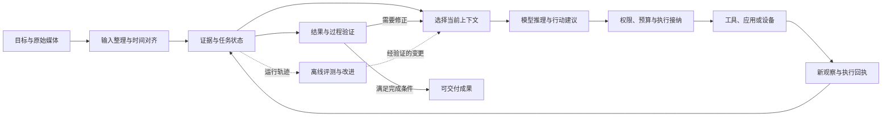

# 端到端多模态 Harness：2026 年系统设计与工程实践

多模态模型能看图、听声音，并不意味着围绕它构建的智能体能可靠地完成多模态任务。决定任务能否走完的，还有图片能否被后续工具再次使用、语音打断后哪些工作仍在运行、动作是否真正改变了环境，以及最终产物是否有可核对的证据。2026 年一批明确以 harness 为研究对象的工作，正在把这些问题从模型外围的辅助代码，提升为独立的系统设计与实验对象。[^01][^02][^03]

本文的核心判断是：**端到端多模态 harness 的价值，在于把感知证据、任务状态、工具行动和结果验证连接成可持续运行的闭环。** 它通常由多个模型、确定性程序和执行环境组合而成；“端到端”可以描述整个任务的覆盖范围，不要求系统必须是一个统一训练的神经网络。这个区分能够解释为什么视觉记忆、运行恢复、异步调度和轨迹评测，会成为近期工作的共同关注点。

报告以 2026 年首次公开的论文和当年发布的官方工程材料为主体，分别讨论多模态检索与研究、创作、计算机操作、实时交互及具身执行。最后将跨文献观察转化为可供 `omne-harness-lite` 验证的工程建议。相关建议属于研究归纳，不构成已接受架构、正式契约或上线承诺。

## 1. 先把三个概念分清

### 1.1 Harness 管的是什么

本文采用一个工作性定义：**harness 是围绕模型组织一次或多次任务执行的运行支撑系统，负责模型看见什么、可以做什么、工作状态如何延续、发生错误后如何处理，以及何时可以判定任务完成。** 这不是行业统一标准，也不与某个框架的产品名称绑定。

可以把模型想成会判断和提出行动的工作人员。Harness 则同时提供工作台、材料库、工具权限、进度记录和验收办法。只交给工作人员一张图片与一句提示词，可以得到回答；要让它连续查资料、编辑图表、操作应用并交付可追溯的成果，就需要把这些环节组织起来。

| 概念 | 主要回答的问题 | 容易混淆之处 |
| --- | --- | --- |
| 多模态模型 | 能处理哪些输入、生成哪些输出？ | 能接收图片，不等于能保存跨轮视觉证据 |
| Agent loop | 下一步观察、推理、行动怎样循环？ | 循环本身未必包含持久化、权限和恢复 |
| Agent framework | 提供哪些可复用组件和编程接口？ | 框架可用于实现多种不同 harness |
| Harness | 整次任务如何被组织、约束、延续和验证？ | 工具数量多，不代表端到端行为完整 |
| 评测 harness | 如何装配环境、执行任务和判分？ | 与生产运行 harness 有重叠，二者不天然等同 |

### 1.2 三种不同的“端到端”

**任务端到端**是从用户目标和原始材料出发，经过感知、计划、执行与验证，交付用户可用的结果。Ptah 的“问题到渲染后的研究报告”，就是这类系统范围。[^03]

**模型端到端**是训练和推理路径的概念，例如从音频输入到音频输出，或从视觉输入到动作输出。需要进一步核对哪些模块参与训练、哪些被冻结、哪些仍是外部工具。“用了强化学习”也不意味着整套系统都通过同一目标函数训练。[^20]

**生命周期端到端**是数据生成、轨迹采集、训练、评测和部署共用或对齐交互环境。ODE 与 WeAgent-MMSearch 把运行环境同时用作数据和训练基础；这种一致性有利于降低训练时学到的行为与实际工具语义之间的差距，但不自动带来生产级可靠性。[^01][^02]

阅读论文时，应先问它覆盖的是哪一种，再比较它的证据。三者可能同时出现，也可能只有其中一种。

### 1.3 多模态闭环增加了哪些系统责任

图 1 是跨文献归纳的职责图，不代表任何单篇论文的原始架构，也不规定一格必须对应一个进程或服务。媒体读取、模型输入与对外交付各有授权边界；图中的权限节点仅表示行动接纳，并非全部授权检查的唯一位置。

文本与多模态系统都需要状态管理；多模态让状态的含义更加具体。一张裁剪图要能追溯到原图和裁剪区域，一句语音要关联到当时的画面，一次屏幕点击要知道依据的是哪一版界面。丢掉这些关系，即使文本摘要仍然流畅，系统也可能已经失去行动所需的信息。

## 2. 范围与证据口径

### 2.1 时间、主题和纳入标准

文献截止范围为 **2026 年 9 月 12 日**。年份按首次公开日期判断，并记录采用版本；仅在 2026 年会议发表、但此前已经公开的工作，不作为当年新工作的主要证据。无固定发布日期的在线文档按访问快照使用，不能反推其功能在整个 2026 年都已可用。

主体来源满足至少一个条件：明确研究多模态 harness；覆盖从输入到执行或产物验收的闭环；提供能解释该闭环的状态、调度、训练或评测机制。单一视觉问答模型、纯感知榜单，以及只把“harness”用作泛义动词的材料，不足以单独支撑系统结论。具身工作只用于检验通用思路进入物理世界后哪些边界需要改变。

本报告是有明确筛选范围的研究综述，不声称穷尽所有公开工作。大部分前沿论文仍为预印本，文中的实验结果均指作者在其声明配置下的报告值；本文没有重新训练模型或复现完整基准测试（benchmark）。

### 2.2 证据不能互相替代

| 证据 | 可以支持什么 | 还不能支持什么 |
| --- | --- | --- |
| 同模型、同任务、固定预算下的模块消融 | 某项机制在该配置中的增量价值 | 跨模型、跨领域普遍有效 |
| 完整系统间的 benchmark 比较 | 两套配置的总体表现差异 | 把差异全部归给其中一个机制 |
| 公开实现及运行示例 | 机制有可检查的实现入口 | 已被独立复现，或达到生产稳定性 |
| 技术报告、案例与演示 | 架构形态及可行性线索 | 长期成功率和故障恢复保证 |
| 官方 SDK 或产品文档 | 当前公开接口、配置和限制 | 不同提供方完整语义等价 |

同样需要分开“论文已公开”“项目页可访问”“完整实现已发布”和“独立复现成功”。下文会在涉及采用判断时保留这些差别。

### 2.3 2026 年代表工作地图

下表按任务类型组织，日期为首次公开日期；详细采用版本和原文位置见文末参考文献。

| 方向 | 代表工作与首发日期 | 最值得读的系统问题 |
| --- | --- | --- |
| 视觉检索 | ODE，05-11；WeAgent-MMSearch，08-28 | 工具返回的图片怎样继续参与推理和行动？ |
| 研究报告 | Ptah，05-28 | 图文证据、引用与渲染产物怎样一起验证？ |
| 创作与记忆 | CMA，07-09；JarvisHub，07-26 | 如何维持图片身份、编辑版本与共享项目状态？ |
| 自动改进 | AutoDesign，08-13 | 如何区分改进当前作品与改进生成系统？ |
| 图形界面（GUI）系统 | ClawGUI，04-13；StateAct，07-24；Qwen-UI-Agent，07-30 | 环境、程序状态、视觉操作与完成检查怎样组合？ |
| 实时交互 | DuplexOmni，06-08；Gander，09-08 | 持续交流如何与后台任务协作？ |
| 具身闭环 | CaP-X，03-23；Guava，06-16；Show-Harness，09-09 | 模型、工具与快速控制器各决定到什么粒度？ |
| 上下文与记忆 | WorldMemArena，05-28；VERA，08-30 | 写入、更新、检索和使用分别在哪里失败？ |
| 任务与媒体评测 | WildClawBench，05-11；AgenticVBench，05-26；WeaveBench，06-08 | 最终结果、媒体内容和执行路径如何共同判分？ |
| 训练基础设施 | OpenForgeRL，07-23；SpeechGym，08-26 | 如何在真实交互语义下学习，同时保留独立测试？ |

这组工作呈现出的变化，是更多研究把模型外围的状态、动作接口和验收条件作为明确对象来设计和测量。不能据此宣称闭环、记忆或混合工具都是 2026 年才出现的发明。

## 3. 多模态检索与研究：让视觉证据贯穿任务

### 3.1 ODE：图片应该能够再次成为工具输入

Huang 等人的 ODE 工作提出 image bank：初始图片和工具返回的图片都登记为可引用对象，后续工具可以继续裁剪、旋转或进行视觉搜索。关键改变是中间图像从一次性展示内容变成可继续操作的证据。[^01]

其针对训练后的 ODE-8B-RL 模型的消融保留工具图片的可见性，仅移除供后续工具复用的引用；完整版本在 MMBC、HLE-VL、MMSearch+ 上分别提高 4.9、2.9、3.2 个百分点。这比比较不同模型更直接地支持“可操作的视觉状态有价值”。8B 平均分从 24.9 到 39.0 则包含数据生成、监督微调（SFT）和强化学习（RL）的综合作用，不能全部记为 image bank 的收益。[^01]

**工程含义**：“模型看过这张图”和“后续工具能取得同一张图”是两个条件。系统可为媒体建立稳定引用和变换关系，再按当前任务选择把哪些内容送入模型；没有必要把全部原始字节不断塞回对话。

### 3.2 WeAgent-MMSearch：看得见、取得到，还要能从局部错误继续

WeAgent-Harness 为检索图片保存带来源的磁盘引用，并在后续模型回合中重新提供视觉内容。它还把局部错误恢复与训练样本接纳分开：部分过长输出和无效工具调用可以修正，超过整条轨迹的上下文或时间上限则排除出训练。[^02]

表 2 的同模型消融显示，WeAgent-MMSearch-RL 保持相同工具接口时，去掉图像重新输入后，八项基准的平均分由 55.97 降到 46.89；表中该组结果为三次运行的均值。它支持后续回合持续获得像素证据的重要性。仍需注意，这是同一研究体系中的消融，不能据此承诺任意业务都获得相同提升。[^02]

**工程含义**：媒体引用解决可寻址问题，上下文选择解决本轮模型实际能看见什么，两者需要配合。恢复策略也应说明错误发生在哪一层；允许重新生成一次模型回复，不等于可以重放任意外部操作。

### 3.3 Ptah：把图像、论点和最终版面一起验证

Ptah 将研究报告生成分成计划、证据收集和写作，并在阶段间加入规则检查与模型评审。它的 Visual Working Memory 同时保存图片、来源、周边语境及预期用途，使写作阶段能够使用前面收集的视觉证据。其完整范围延伸到报告的网页渲染。[^03]

论文表 3 报告完整系统引用准确率为 87.53%，无 verifier 为 30.29%；但后者只统计原始 100 个任务中成功生成的 68 份报告。平均搜索调用也不同：无 verifier 为 5.13，完整系统为 12.82。这不是同一完整样本、相同搜索成本的纯质量对照。附录的去图消融还显示，文本总分几乎不变，而视觉呈现评分下降，说明不同指标测量的是不同质量。[^03]

**工程含义**：生成图、解释图和原始证据图需要区分用途。配图能帮助理解，不会因为出现在专业版面中就变成事实依据；验收应分别检查来源、论点支持关系与呈现可读性。

## 4. 多模态创作：让工作台、记忆和改进过程成为系统的一部分

### 4.1 CMA-Harness：记住的是具体图片及其演变

CMA 组合感知摘要、外部视觉记忆、检索与执行控制。它保留语义描述和缩略图，必要时读取原图；扩展的 CMA-Harness 进一步组织会话、图库及编辑版本关系，覆盖理解、生成、编辑和组合。[^04]

其 8B 核心代理在英文 20 轮 M2CA-Bench 上的 91.4%，是图像索引检索准确率，包含模型训练贡献，并非开放任务完成率。摘要附近的 23.1 秒降至 12.7 秒，实际对应附录中的 32B 配置比较，不能合并成 8B 完整部署系统的速度。固定作者仓库中已见论文与演示，尚未见完整可运行复现资产。[^04]

**工程含义**：在近似图片和多次编辑并存时，描述、缩略图、原件和版本身份可以互补。只有一句“用户喜欢上一张图”的摘要，不足以支撑下一轮精确编辑。

### 4.2 JarvisHub：让项目状态成为共享工作对象

JarvisHub 用画布承载资产、版本、生成依赖和反馈，使人和代理操作同一项目状态；协议桥检查更新并把结果与失败写回，运行时负责调用模型和工具。画布因此既是界面，也是可以检查的工作状态。[^05]

作者展示了叙事媒体、网站和演示文稿三类定性案例，并明确承认尚不是完整 benchmark。公开实现提供前端、协议桥、代理运行时及轨迹查看入口，但“协议检查通过”不能证明创作内容正确。其设计价值应与总体性能证据分开讨论。[^05]

**工程含义**：当任务围绕多个资产和版本长期推进时，聊天记录适合作为交互历史，项目状态则承载当前工作对象。画布是其中一种产品呈现方式，通用系统不必因此强制采用画布。

### 4.3 AutoDesign：作品迭代与 Harness 迭代是两层循环

AutoDesign 的内循环修改当前作品，外循环依据多次轨迹修改 harness，并用开发集约束接受变更。正式实验主要针对学术海报；它把来源处理、可编辑生成、确定性检查和视觉批评组合为 DesignHarness。[^06]

在 10 篇固定论文子集的七组匹配配置中，加入学得的 DesignHarness 后平均 PosterBench Score 从 54.99 升至 67.39，即 **增加 12.40 分**，不是相对提升 12.4%。论文中的长运行成本案例也不是平均成本；网站、视频等媒介尚未获得同等正式评测。[^06]

**工程含义**：应区分“当前作品变好了”和“生成系统更适合未来任务了”。外循环需要独立的开发与测试证据；如果允许系统同时修改自己的判分标准，就难以判断进步是否真实。

三项工作的互补关系很清楚：CMA 关注跨轮图片身份与检索，JarvisHub 关注共享项目，AutoDesign 关注可测量的生成与改进。它们并非同一 benchmark 下的竞争模型，适合比较设计，不适合合并成性能排行榜。

## 5. GUI 与跨应用操作：把真实状态接回循环

### 5.1 ClawGUI：训练、评测与部署的一致性

ClawGUI 将 Android 模拟器和真实设备接入统一环境接口，并把任务重置、清理、推理、判分与指标计算纳入框架。模拟环境可检查应用状态，缺少相应权限的真机则更多依赖视觉判分；相同接口并没有消除底层证据差异。[^07]

作者以 MAI-UI-2B 为起点，在 MobileWorld GUI-Only 的 117 个任务、最多 50 步下，将成功率从 11.1% 提升至 17.1%。这是包含训练方法的结果，不能仅归因于接口统一。官方仓库提供训练、评测和 agent 目录，是较直接的实现参考；本文只检查其公开内容，没有运行复现。[^07]

**工程含义**：如果训练时环境重置不完整、判分漂移或截图坐标处理不同，模型就会从失真的反馈中学习。因此，环境生命周期和评测配置也是模型能力形成条件的一部分。

### 5.2 Qwen-UI-Agent：从屏幕操作到跨端持续任务

Qwen-UI-Agent 的系统部分区分通知事件、持续事务和具体待执行任务，并为跨端观察保留应用、设备与显示屏信息；动作通道同时覆盖 GUI 与 Bash 命令行。它所展示的方向是围绕持续任务组织跨设备状态，而非只把截图映射为点击坐标。[^08]

读其结果需要特别留意口径：自建真机任务集中的环境错误被排除出成功率分母；OSWorld-v2 的 40.0% 是部分进度分，完整完成率为 13.9%。跨端主动服务则主要通过案例说明，尚不能支持跨天可靠运行的统计结论。同名 GitHub 仓库仅是网站源码；本次未确认新模型完整权重与训练栈已公开。[^08]

**工程含义**：事件发生、事务仍然有效和下一步行动，具有不同的状态含义。它们的关联值得显式描述，尤其是在用户跨设备修改目标、任务条件变化或通知重复到达时。

### 5.3 StateAct：直接读取程序状态，同时保留必要视觉判断

StateAct 让主代理优先操作文件、数据库等程序状态，将确实需要视觉判断的子目标交给 GUI 代理，并设置独立、只读的完成检查。检查者依据原任务和机器状态，而不依赖执行者对“已经完成”的自述。[^09]

这是一种有价值的证据分工，但结果也展示了限制：在 76 个到达完成检查、实际未获满分的任务中，检查器错误放行了 68 个。文件存在、路径正确等结构事实，仍然不能证明数据值或内容推理正确。该反例说明独立检查需要配合明确的检查能力范围。[^09]

**工程含义**：多模态不要求每一步都通过像素。读取表格公式时结构化接口更直接，判断海报布局时视觉观察更必要；harness 应让这些通道共享任务状态，并说明各自能确认什么。

## 6. 实时交互与具身执行：时间和行动粒度决定边界

### 6.1 Gander：把持续交流与后台执行连接起来

Gander 的《Omni Interaction Agent Technical Report》在截止日前数日公开。它将连续视听交互与后台长任务分开，通过 Gateway 管理任务、运行、事件和交付。用户插话可以修订任务、询问进度或提出新要求；后端默认主要接收转写及相关末帧，并非完整连续媒体流。[^10]

其 FDB-v3 的 100 个场景中，接话率为 100%，过早开口率为 8%，而工具调用组合及全部参数都正确的一次通过率（Pass@1）为 40%；后台推理与执行代理的独立文本条件为 52%。该通过率并非完整外部业务效果的验收率。分差提示可能有信息损失或协调问题，但实验没有分离任务委派策略与语音评分链路的影响，不能断定唯一原因。[^10]

**工程含义**：交流顺畅和办事正确应分别测量。用户听见了一句及时回应，并不说明工具已经完成；后台成功取得结果，也需要判断它是否仍符合最新意图。

### 6.2 DuplexOmni：快速交互层与较慢思考层

DuplexOmni 以约 480 毫秒切片组织音频、视频帧和后台结果，由交互层维持听说节奏，思考层异步处理较慢任务。论文报告的 0.506 秒是响应延迟，480 毫秒则是切片粒度，二者都不是复杂任务完成时间。它为不同时间尺度的协作提供了实现样本，但未完整验证持久任务恢复和外部操作事务。[^11]

还应区分生成进度与实际播放进度。模型已经生成的后半句话，如果尚未播放就被用户打断，不能当作用户已经听到并据此作出了回应。媒体链路的状态需要进入任务解释。

### 6.3 投机工具调用：先行动的收益需要真实口语检验

Speculative Interaction Agents 用异步 I/O 接收增量输入与工具结果，并对有副作用的工具设置提交条件。它主要处理流式转写文本，不能称为原生视听模型。标准任务中的加速结果较好，但自然口语测试暴露出反例。[^12]

附录 D.4 的 177 条 Human Instructions 上，Qwen2.5-3B 的正确率由普通 SFT 的 22.0% 降至 SI-SFT 的 13.6%；延迟从 9.3 秒增至 14.3 秒，其中延迟只抽测了 10 个样本。重复动作等退化提示：系统允许并发，不代表模型已经学会稳定使用并发。[^12]

**工程含义**：可以先在依赖清楚、结果可丢弃的只读查询上测试投机；是否扩大，要看自然输入中的正确率、重复动作、资源浪费和实际完成延迟，而不只看合成任务加速比。

### 6.4 LiveKit 的实践：媒体时间与打断辨识

LiveKit 在 2026 年 7 月公开的视频帧 metadata 支持附加帧 ID、用户时间戳和用户数据，便于把视觉帧与采集时钟联系起来；该发布文中音频帧支持仍列为后续工作。3 月的自适应打断处理则区分真正抢话、附和和噪声。两者都是媒体运行层的具体工程能力，不能直接代替任务权限、取消或结果一致性。[^13][^28]

从系统角度，可以分别记录“何时采集”“何时到达”“模型依据哪一帧判断”和“何时播放或执行”。网络到达顺序不保证等于事情发生的顺序，用户插话也不一定意味着取消全部后台工作。这些时间关系应在实际用例中验证。

### 6.5 机器人边界：模型究竟决定到多细

具身方向提供了三种动作粒度的对照。这里比较的是责任分配，不是跨论文成功率排名。

| 工作 | 模型主要选择什么 | 工具与控制层承担什么 | 验证边界 |
| --- | --- | --- | --- |
| CaP-X / CaP-Agent0 | 在有状态交互式编程环境（REPL）中生成、执行和修订程序 | 感知与运动控制原语 | 已有多轮视觉反馈和失败重试；技能演化范围仍有限[^16] |
| Guava | 抓取等语义动作，也可使用较细移动工具 | 分割、抓取估计与具体执行 | 错误分割、抓取提议和遮挡仍会限制上层恢复[^14] |
| Show-Harness | 方向移动、旋转、夹爪开合等较小动作 | 将指令映射为受限运动并由控制器跟踪 | 覆盖特定机械臂和夹爪设置，不能外推全部机器人[^15] |

这里出现了一处值得保留的来源分歧：Guava 将 CaP-Agent0 概括为单次代码生成，但 CaP-X 的首版已明确包含多轮反馈与重试。因此，不能把 Guava 的贡献说成首次引入闭环；应依据各自原文讨论不同动作抽象。[^14][^16]

Show-Harness 的固定提交还提供恢复等插件钩子，但这不等于已具备本项目要求的完全动态生命周期。更一般的启示是：需要明确模型决策频率、工具内部行为和反馈时机。机器人重新选择动作或回退计划，不表示物理世界已撤销此前动作。[^15]

## 7. 记忆与安全：保留信息之后，还要正确使用

### 7.1 WorldMemArena：分别检查写入、更新、检索和使用

WorldMemArena 将多模态记忆评估拆成 Write、Maintain、Retrieve、Use 四个阶段。在其一组结果中，记忆正确率达到 98.15%，最终问答正确率仍只有 51.86%。两个指标不是同一事件的转化率，却清楚说明某一阶段得分高不能替代整条链路有效。[^22]

它包含合成的长期状态演变和模型判分，不能直接视为真实多年记忆的实证。对工程更有价值的是诊断思路：究竟是没有记下来、没有更新旧状态、没找回来，还是找到后用错了。审计历史和当前有效记忆也应区分，更新结论不一定意味着删除历史事实。

### 7.2 VERA：压缩历史时保留原生视觉证据

VERA 将历史按时间和角色组织成视觉画布，保留图像及局部观察，近期内容较清晰、较早内容适当降采样。在固定 Gemini-3.5-flash-thinking 及相关 harness 配置、取三次运行平均值（avg@3）的实验中，MM-BrowseComp 得分由不压缩的 23.3% 提升至 28.5%，累计非缓存 token 由 374 万降至 138 万。token 是模型处理的信息单位，这里统计整次任务累计量，并非一次请求的上下文长度。[^23]

这支持在特定视觉任务中保留图像结构的压缩方式，也说明“更完整地塞入历史”未必最好。不过，其超时恢复协议、模型视觉能力和任务范围都是前提；结果未覆盖无限历史、音频或长视频。工程上应分别测试信息保留和压缩成本，不能预设把任何结构化状态渲染为图片都有收益。[^23]

### 7.3 AgentCIBench：没有攻击者，也可能发出不该分享的信息

AgentCIBench 研究界面并列信息、含糊任务和收件人不匹配导致的过度分享，同时测量必须分享与不得分享的内容。15 个模型在受控状态场景中的平均泄漏率为 67.9%；受控 OpenApps 渲染界面的端到端实验仅涉及两个模型、各 50 个场景，不能把前者写成生产系统泄漏率。[^24]

**工程含义**：信息被模型看见、能够用于当前任务、允许向某个对象发出，是不同授权问题。只靠“不要泄漏”的提示不足以定义完整信息流边界，合法任务效用和过度分享需要一起评估。

### 7.4 AudioAgentSecurity：声音来源不能由语义流畅程度决定

AudioAgentSecurity 研究第三方声音与合法用户语音重叠的提示注入，并提出声轨分离与声学、语义核验。它把持续感知中的“谁有权发命令”具体化为可测试问题。[^25]

防护也存在明显代价：尽管引言使用近零误报的概括，正文多人办公室会议场景报告了 35% 误报。因此，不能把说话人识别或源分离当作可靠授权系统。声音来源核验、工具权限和最终披露检查各自保护不同边界，也需要测正常任务被错误阻止的情况。[^25]

## 8. 评测与训练：衡量完整组合，保留失败证据

### 8.1 Benchmark 得分属于一套配置

一个可解释的实验对象至少包含：模型及版本、harness 及版本、工具和模态通道、环境、预算、任务集合与判分器。改动其中几项后获得更高分，说明这套组合变好了；要说明哪个机制有效，还需要有针对性的消融。

| 2026 工作 | 补充了什么评测对象 | 读分数时的关键限制 |
| --- | --- | --- |
| WildClawBench | 60 个长任务，含 26 个多模态任务；结合产物与服务审计 | overall 是量规得分均值；仅一次初始请求，未覆盖运行中用户修订[^17] |
| WeaveBench | 114 个 GUI 与命令行接口（CLI）混合跨应用任务，审计执行轨迹 | PassRate 定义为最终得分至少 0.8，不能无说明地称为全部条件完成率[^18] |
| AgenticVBench | 100 个视频后期任务，检查文件、时序、音画与编辑要求 | 平均 score 不等于二元成功率；各 harness 原生工具及采样配置不同[^19] |

WeaveBench 对同批 GPT-5.5 轨迹重新判分时，只看产物的 PassRate 为 53.5%，加入轨迹审计后为 33.3%。这个差异说明完成判据会改变结论，也提醒系统不能凭产物表面正确就忽略执行路径。轨迹审计本身仍依赖模型裁判，需要保留可复查证据。[^18]

AgenticVBench 的价值在于将媒体文件本身纳入验收：视频可以格式合法，却剪错时间窗、镜头顺序不对或仍存在音频缺陷。其正文与附录对工具及采样控制的描述不完全一致，因而宜用于理解完整配置与故障类型，不宜据其跨 harness 得分断定单个调度机制的因果收益。[^19]

### 8.2 训练环境和部署环境应对齐，但测试必须独立

OpenForgeRL 通过模型调用代理记录真实 harness 的交互，再重建训练轨迹，远程环境承担交互轨迹采样（rollout）。其多模态实验使用固定 30 步预算比较 SFT 与 SFT+RL，说明已有运行系统可以成为训练环境；“any environment”应理解为框架目标，而非对任意未知环境都已验证。[^21]

SpeechGym 直接在音频交互中训练工具使用。其模型在 τ-Voice 的独立交互管线中，训练前后 pass@1 从 24% 提升至 53%；但只有 Thinker 推理模块的 LoRA（低秩参数适配）被更新，语音生成路径冻结，迁移实验仍使用同一任务集。它支持音频交互训练的价值，不能被描述为全部模块联合训练或未见任务的普遍泛化。[^20]

两类工作的共同启示是：训练轨迹应该反映部署时真实的观察和工具语义。共用环境与终局条件，并不意味着可以共用全部训练、验证和盲测任务；塑形奖励也不能悄悄替代用户真正要求的结果。

### 8.3 一套适合起步的指标

下表是综合文献提出的评测建议。每项都应说明分母、失败处理和预算，不能把不同意义的百分数汇成一个排行榜。

| 指标组 | 建议记录的事实 | 主要定位什么问题 |
| --- | --- | --- |
| 任务结果 | 完整成功、部分完成、错误交付、未产生结果 | 用户目标是否真正实现 |
| 感知与证据 | 关键视觉区域或音频片段召回、来源匹配、过期证据 | 原始信息是否在闭环中丢失或用错 |
| 行动与恢复 | 无效参数、重复写入、结果未知、恢复后的成功 | 工具调用与世界状态是否一致 |
| 交互时间 | 首次有效反馈、实际完成时间、尾延迟、误打断 | 是否及时且准确地响应用户 |
| 成本与资源 | 模型、媒体和工具成本，token、内存、并发工作 | 收益是否值得复杂度和资源 |
| 授权与披露 | 越权操作、过度分享、合法任务误阻止 | 安全约束与任务效用是否同时满足 |

超时、崩溃和没有产物的运行应进入结果统计，并单列原因。若业务上确需排除环境不可用样本，也应同时报告原始分母、排除数量及排除规则，避免把环境脆弱性隐藏成模型或 harness 的高成功率。

## 9. 对通用 Harness 的工程归纳

本节从文献中提炼待验证的工程方向。它们不是对所有系统的强制分层，也不意味着第一版要实现全部功能。

### 9.1 先明确几类状态的含义

| 状态 | 典型内容 | 应回答的问题 |
| --- | --- | --- |
| 原始媒体与来源 | 图片、音频片段、视频、网页快照 | 属于谁，何时取得，允许谁读取，保存到什么时候？ |
| 派生证据 | OCR、转录、裁剪、关键帧、特征或摘要 | 从哪个原件和哪个版本产生，丢失了什么信息？ |
| 任务工作状态 | 当前目标、约束、待办、已确认结论 | 哪些是用户要求，哪些是模型推测，什么会使它失效？ |
| 执行状态 | 调用身份、工具版本、在途操作、结果回执 | 是否被接纳、是否开始、是否完成，结果是否仍适用？ |
| 交付与验收状态 | 成果版本、验证结果、未解决问题 | 验证针对哪一版成果，谁拥有最终完成判定？ |

这种划分的目的是让故障可以解释，而不是制造五套数据库。原始媒体通常适合按需读取，任务状态适合结构化保存，模型上下文则是面向当前回合的选择性表示。具体哪些内容需要持久化，取决于承诺跨越怎样的重启和故障边界。

一个相邻的官方工程例子是 Anthropic Managed Agents：它将持久 session log、harness 和 sandbox 分开，模型上下文可以从记录重建，执行环境故障通过工具错误暴露。它为状态与执行环境解耦提供参考，但不是多模态性能论文，也没有证明外部副作用自动回滚。[^26]

### 9.2 把媒体来源和时间关系保留下来

一个最小媒体记录可以表达：稳定标识、内容版本、模态、所有者、来源、取得时间、父媒体及变换描述。对于音视频，还要区分媒体中的时间位置与系统收到事件的时间。以上是描述维度，不是本文发布的数据 Schema。

例如用户说“把刚才那张图中的红色部分放大”，系统需要回答“刚才”对应哪次展示、“那张图”是哪一版、“红色部分”来自哪次定位。如果只保留一句“用户希望放大图片”的摘要，后续推理再强也无法补回这些绑定关系。

对长媒体可先采用低成本预览，再按需读取高分辨率区域或时间段。是否需要专门的向量索引、图存储或多级缓存，应由真实检索错误和资源测量决定；论文提出一个媒体库，并不意味着所有实现都需要复杂基础设施。

### 9.3 将感知反应和任务推进分开计量

实时系统至少存在两种节奏：一类工作需要快速决定是否接话、暂停播放、采集新画面；另一类工作需要检索、计算、操作工具并确认结果。把它们放进同一个串行等待链，容易互相阻塞；完全放任它们并发，又容易让过时结果影响当前任务。

可验证的方向是让在途工作携带所属任务和上下文版本，迟到结果在进入当前状态前检查适用性。用户打断可以立即停止某个输出通道，但后台操作的取消、结果保留或继续执行，需要由具体操作契约决定。打断语音与撤销业务操作之间没有天然等号。

### 9.4 恢复应按失败位置处理

| 失败位置 | 可以验证的处置方向 | 必须避免的错误推断 |
| --- | --- | --- |
| 感知或参数生成 | 重读原媒体、请求更清晰局部、反馈格式错误 | 重新生成的文字一定更真实 |
| 可重做的只读检索 | 在预算内重试，保留来源时间和缓存身份 | 新旧结果可以不加区分地混合 |
| 已产生外部写入但回执丢失 | 查询目标状态、核对操作身份，按业务规则对账 | 超时就等于未执行，可以直接再做一次 |
| 任务上下文发生变化 | 验证旧结果是否仍然适用 | 已开始的任务永远符合当前目标 |
| 超出总预算或遇到不可恢复故障 | 明确输出失败、部分成果或待处理状态 | 生成一个流畅答案就算成功结束 |

举例说，点击“发送”后网络超时，只能说明客户端没有获得确定回执，不能说明消息没有发出。恢复工作的第一步是识别真实状态；是否有幂等键、状态查询或补偿操作，取决于被调用系统。搜索任务中的轨迹自恢复不能直接外推为这些业务保证。

### 9.5 验证既要看成果，也要看路径

成果检查回答“最终文件、页面或业务状态是否正确”；过程检查回答“是否使用了允许的数据、操作和费用范围”。二者都应绑定到具体成果或任务版本。视觉评审可以判断布局和可读性，结构化检查可以核对字段、数值和文件性质，业务系统回执可以确认外部状态；它们适用于不同事实。

增加 verifier 也有成本。有效做法是先识别最常见、最昂贵的失败，再选择能测量它的检查；如果仅靠同一个模型重复表达自己的结论，未必获得独立证据。评测应保留成本、延迟和误报，而不是只记录修正后的最好输出。

## 10. 对 omne-harness-lite 的参考与验证路径

### 10.1 与当前项目边界的关系

当前项目要求包括：复用 Cordis 与 DSH `agent` 原语，Agent Loop 与 Harness 由本项目定义；第一版交付单机系统；从第一天支持租户隔离；模型请求统一通过 OpenRouter；精确行为应由语言无关规格表达。具体权威范围见[跨系统要求](../../requirements/system/constraints.md)和[当前架构](../../architecture/README.md)。本文不对上游 Cordis API 的具体生命周期作额外推断。

| 项目关切 | 本次研究带来的参考 | 尚需明确或验证 |
| --- | --- | --- |
| 完全动态能力 | 媒体处理、上下文选择、工具和验证器可按真实替换需要组合 | 提供者变化时在途任务、旧媒体引用与迟到结果的政策 |
| 超长期运行 | 将长期证据、任务状态与单轮模型上下文分开 | 重启边界、恢复点、状态过期及任务继续条件 |
| 租户隔离 | 媒体、派生缓存、记忆和执行回执都需要保留访问边界 | 跨组织切换时历史上下文、缓存和在途工作的适用范围 |
| 单机起步 | 先用直接、可观察的进程内组合建立闭环 | 哪些资源与失败边界真的需要独立部署 |
| 形式规格 | 将接纳、取消、迟到结果和完成条件写成可检查性质 | TLA+ 行为范围、Alloy 结构范围、数据 Schema 与执行证据的对应 |

这里尤其需要区分插件的运行生命周期、持久媒体的保存期限和外部业务操作的存续。三者可能有关联，但不能仅凭插件被卸载就推导后两者应当删除、取消或回滚。

### 10.2 OpenRouter 约束需要单独做能力核验

OpenRouter 官方文档列出了图片、PDF、音频、视频等输入输出能力，也明确指出支持范围因模型和提供方而异。音频输出文档中的流式返回，不能单凭“streaming”一词推导为支持连续双向输入、会话打断、时钟同步和异步工具的完整实时协议。[^27]

因此，在采用实时交互架构前，应针对拟用模型与提供方核验：输入输出模态、工具调用组合、流式行为、取消语义、媒体格式和容量限制。如果某项能力没有可用证据，就将该组合标为未验证；不能为了复用论文系统而绕开项目统一路由要求。

### 10.3 用薄而完整的实验推进

以下为建议的实验顺序，不是已批准实施计划。每一步先形成可观察的端到端结果，再决定是否扩大基础设施。

| 实验 | 最小任务 | 关键对照 | 继续扩展的依据 |
| --- | --- | --- | --- |
| A：视觉证据闭环 | 从网页或图片找到细节，经过裁剪再回答并附来源 | 原图可见但不可复用；可复用引用；引用加按需重新输入 | 能定位视觉证据丢失，并观察质量与成本的变化 |
| B：产物闭环 | 将证据组织成含表格或图像的报告并检查最终文件 | 无验证；结构检查；结构加视觉评审 | 发现各检查捕获的不同错误，计入额外调用成本 |
| C：行动闭环 | 在受控应用中完成操作并确认真实结果 | 正常、工具超时、回执丢失、界面变化 | 能区分失败与结果未知，避免重复产生外部写入 |
| D：跨轮和跨重启 | 用户修改目标后继续任务；在固定故障点终止并重启真实进程 | 不压缩；纯文字摘要；保留原媒体引用的摘要，并分别验证重启后的媒体与任务恢复 | 区分上下文重建与跨重启恢复，明确必须保存的信息和应失效的结果 |
| E：实时交互 | 语音输入伴随画面，后台执行一个可控工具 | 串行处理；异步处理；异步加打断 | 同时测任务正确率、响应延迟和打断后的状态一致性 |

这些实验应固定模型、工具、环境快照、任务集合、判分规则与资源预算。能控制随机种子时记录种子；不能控制时记录采样设置并重复运行，报告波动。发生新故障后再增加相应反例，避免仅为提高一个平均分而不断堆叠提示和组件。

## 11. 尚未被现有证据解决的问题

**长期与动态。** 许多工作中的“长任务”是几十轮或一次较长交互。它们对跨天、跨月目标变化，以及能力升级时在途工作的语义，没有提供充分验证。长期运行系统仍需自行定义何时继续、何时失效、由谁决定完成。

**开放世界可重复性。** 网页、模型端点、桌面应用和价格都会变化。保存轨迹可以帮助诊断，却不保证再次执行得到同一环境。复现应说明是重放观察、重跑工具，还是重新完成整个任务。

**安全与效用的联合衡量。** 限制工具和上下文可能降低攻击面，也可能损害合法任务。单独降低攻击成功率不足以说明系统更好，需要同时测量正常任务表现与被错误阻止的比例。

**多模态状态的可迁移性。** 媒体引用、摘要、模型内表示和外部业务状态处于不同层次。更换模型后哪些记忆仍可用、旧感知结论是否需要重算，尚不能从“支持同一模态”直接推导。

**改进机制自身的可信度。** 自动修改提示、工具选择、记忆规则或 harness 代码，可能同时改变任务难度、判分器和真实行为。需要把训练反馈与独立保留的评测分开，并保留改动与结果之间的证据链。

对下一阶段工程而言，最有用的研究问题是：在一个完整任务中，哪一段证据会丢失，哪一种状态会过期，哪一次行动无法确认，以及哪条验收规则能把它暴露出来。2026 年的相关工作提供了具体机制和局部实验；它们仍需要在目标系统的约束下组合并验证。

## 参考文献

若先阅读少量原文，建议按 **ODE → WeAgent-MMSearch → Ptah → JarvisHub → Gander → WeaveBench** 的顺序进入，分别理解视觉证据、恢复、产物验证、共享项目、实时任务及评测。准备阅读实现时，优先检查文献条目中的固定仓库版本；仅有论文或项目页的工作用于设计研究。

以下编号引用给出原始标题、作者、首次公开时间、采用版本和关键证据位置。除明确标为官方工程文章或文档者外，按所列预印本版本使用；不据 arXiv 收录推断已经通过同行评审。所有来源的访问范围截至 2026-09-12。

[^01]: Shijue Huang、Hangyu Guo、Guanting Dong 等. [Towards On-Policy Data Evolution for Visual-Native Multimodal Deep Search Agents](https://arxiv.org/html/2605.10832v2). arXiv:2605.10832；首发 2026-05-11，采用 v2，2026-06-05。证据：§2.1、§3.3、附录 B.3；图像引用消融与统一评测预算。[提交记录](https://arxiv.org/abs/2605.10832).

[^02]: Zongkai Liu、Hui Zhang、Liqiang Niu 等. [WeAgent-MMSearch: Native Text-Vision Interaction for Multimodal Search Agents](https://arxiv.org/html/2608.28062v2). arXiv:2608.28062；首发 2026-08-28，采用 v2，2026-08-31。证据：§3、§7.3 表 2–3、附录 B 表 5；图像重新输入、恢复与训练排除规则。[提交记录](https://arxiv.org/abs/2608.28062).

[^03]: Chenghao Zhang、Guanting Dong、Yufan Liu、Tong Zhao、Xiaoxi Li、Zhicheng Dou. [Towards Verifiable Multimodal Deep Research: A Multi-Agent Harness for Interleaved Report Generation](https://arxiv.org/html/2605.29861v2). 中国人民大学. arXiv:2605.29861；首发 2026-05-28，采用 v2，2026-06-03。证据：§4、§6.4、表 3、附录 F.2；阶段验证、68 份成功产物的消融口径及去图实验。[作者仓库](https://github.com/SnowNation101/Ptah).

[^04]: Feng Wang、Canmiao Fu、Zhipeng Huang、Chen Li、Jing Lyu、Ge Li. [Cognitive-structured Multimodal Agent for Multimodal Understanding, Generation, and Editing](https://arxiv.org/html/2607.08497v1). 北京大学、腾讯 WeChat Vision. arXiv:2607.08497v1，2026-07-09。证据：§3–5、表 3、附录 C–D；核心代理、扩展 harness 与效率实验的边界。[作者仓库固定提交](https://github.com/caseclose/cma-harness/tree/8096fb6b23ae442f6fc84120a681b88bd3afc983)（2026-09-02）：公开材料状态的核查依据。

[^05]: Yunlong Lin、Zixu Lin、Zhaohu Xing 等，JarvisX Team. [JarvisHub: An Open Harness for Canvas-Native Multimodal Creative Agents](https://arxiv.org/html/2607.23588v1). arXiv:2607.23588v1，2026-07-26。证据：§2、§3、§5；共享项目、协议桥及定性案例限制。[作者仓库固定提交](https://github.com/LYL1015/JarvisHub/tree/6c0f123119d9ffe1a6bae5140721f0b84ea3bbaa)（2026-08-03）。

[^06]: Yaxin Luo、Haobin Jiang、Jialv Zou 等. [AutoDesign: Meta-Harness Optimization for Long-Horizon Agentic Design](https://arxiv.org/html/2608.13560v1). arXiv:2608.13560v1，2026-08-13。证据：§2–6、表 3、附录 A.4–A.5；双层改进、匹配配置和评价边界。[作者仓库固定提交](https://github.com/Yaxin9Luo/AutoDesign/tree/bd635851ef8a2ae257e2bf4c8cd4e984ea3fff1e)（2026-08-25）。

[^07]: Fei Tang、Zhiqiong Lu、Boxuan Zhang、Weiming Lu、Jun Xiao、Yueting Zhuang、Yongliang Shen. [ClawGUI: A Unified Framework for Training, Evaluating, and Deploying GUI Agents](https://arxiv.org/html/2604.11784v1). 浙江大学. arXiv:2604.11784v1，2026-04-13。证据：§3.2–3.4、§4.1 表 1–2；环境接口、判分与 117 任务实验。[作者仓库](https://github.com/ZJU-REAL/ClawGUI)，公开状态为访问时快照。

[^08]: Hanzhang Zhou、Panrong Tong、Xu Zhang 等，Alibaba MAI-UI Team. [Qwen-UI-Agent Technical Report: Toward Next-Generation Real-World Centric Foundation GUI Agents](https://arxiv.org/html/2607.28227v1). arXiv:2607.28227v1，2026-07-30。证据：§2.5、§3.2–3.4；跨端状态与不同成功指标。[同名网站仓库说明](https://github.com/Tongyi-MAI/Qwen-UI-Agent/blob/main/README.md)、[实现关联入口](https://github.com/Tongyi-MAI/MAI-UI)，均为访问时快照。

[^09]: Yan Yang、Xiangru Jian、Ziyang Luo 等，Salesforce AI Research. [StateAct: Program State, before Pixels, for Long-Horizon Computer-Use Agents](https://arxiv.org/html/2607.22798v1). arXiv:2607.22798v1，2026-07-24。证据：§4、§6.1；状态优先、独立完成检查及 68/76 错放行反例。本条不是 2024 年的同名 StateAct 工作。

[^10]: Orantqing、Shengpeng Ji、Junlong Tong、Jialong Zuo 等. [Omni Interaction Agent Technical Report](https://arxiv.org/html/2609.08977v2). arXiv:2609.08977；首发 2026-09-08，采用 v2，2026-09-09。证据：§3.2.1–3.2.3、§5.2 表 3；Gander 运行边界与交互、任务指标。[作者项目](https://github.com/Omni-Interaction-Gander/Omni-Interaction-Agent).

[^11]: Muye Huang、Lingling Zhang、Xingyu Yu、Lei Shi、Zhanyu Ma、Jun Xu、Jiuchong Gao、Jinghua Hao、Renqing He、Jun Liu. [DuplexOmni: Real-Time Listening, Seeing, Thinking, and Speaking for Full-Duplex Interaction](https://arxiv.org/html/2606.09186v1). arXiv:2606.09186v1，2026-06-08。证据：§3.1、§3.3、表 1；交互与思考分离、切片和延迟口径。

[^12]: Coleman Hooper、Minwoo Kang、Suhong Moon 等. [Speculative Interaction Agents: Building Real-Time Agents with Asynchronous I/O and Speculative Tool Calling](https://arxiv.org/html/2605.13360v2). UC Berkeley 等. arXiv:2605.13360；首发 2026-05-13，采用改题后的 v2，2026-05-14。证据：§3–5、附录 D.4 表 3；异步调用及自然口语退化。

[^13]: David Chen，LiveKit. [Introducing Video Frame Metadata](https://livekit.com/blog/frame-metadata). 官方工程发布，2026-07-13。证据：帧标识、采集时间、传输时间与音频支持范围。不是任务成功率实验。

[^14]: Haowen Liu、Xirui Li、Shaoxiong Yao、Peng Shi、Tianyi Zhou、Jia-Bin Huang、Furong Huang、Jiayuan Mao. [Guava: An Effective and Universal Harness for Embodied Manipulation](https://arxiv.org/html/2606.18363v1). arXiv:2606.18363v1，提交记录为 2026-06-16；HTML 内部另显示 2026-08-24，首发日期按[提交史](https://arxiv.org/abs/2606.18363)记录。证据：§3、§4.1、§5、附录 B；语义动作与恢复限制。

[^15]: Yanzhe Chen、Zechen Bai、Zhijun Cao、Wenzheng Zeng 等，NUS Show Lab. [Show-Harness: Just a VLM Agent Can Play Robots](https://arxiv.org/html/2609.10522v1). arXiv:2609.10522v1，2026-09-09。证据：§3、§6；小步动作与控制边界。[固定提交的插件文档](https://github.com/showlab/Show-Harness/blob/137d5718c3b7af0150764d8f9beeb252c9f2794a/plugins/README.md)（2026-09-10）：恢复钩子及装配方式。

[^16]: Letian Fu、Justin Yu、Karim El-Refai 等. [CaP-X: A Framework for Benchmarking and Improving Coding Agents for Robot Manipulation](https://arxiv.org/html/2603.22435v2). arXiv:2603.22435；首发 2026-03-23，采用 v2，2026-07-02。证据：§2、§4、附录 E.2.1。另核对[首版](https://arxiv.org/html/2603.22435v1)同节，确认多轮反馈不是后续才增加的描述。

[^17]: Shuangrui Ding、Xuanlang Dai、Long Xing 等. [WildClawBench: A Benchmark for Real-World, Long-Horizon Agent Evaluation](https://arxiv.org/html/2605.10912v1). arXiv:2605.10912v1，2026-05-11。证据：§3–4、附录 B/G/H；任务组成、预算、评分与覆盖缺口。[作者仓库](https://github.com/internlm/WildClawBench).

[^18]: Wanli Li、Bowen Zhou、Yunyao Yu、Zhou Xu、Yifan Yang、Dongsheng Li、Caihua Shan. [WeaveBench: A Long-Horizon, Real-World Benchmark for Computer-Use Agents with Hybrid Interfaces](https://arxiv.org/html/2606.09426v1). arXiv:2606.09426v1，2026-06-08。证据：§3–4；混合交互、PassRate 定义及轨迹审计。附录 E 的另一组 CLI/视觉比较使用不同判分器，本文未将其作为因果比较。[作者仓库](https://github.com/weavebench/WeaveBench).

[^19]: Zongheng Cao、Yi Zheng、Rui Song、Xinyu Hu，Philo Labs Research. [AgenticVBench: Can AI Agents Complete Real-World Post-Production Tasks?](https://arxiv.org/html/2605.27705v1). arXiv:2605.27705v1，2026-05-26。证据：§2.4–2.8、§3、附录 A；媒体验收、平均 score 与配置口径。[作者站点](https://agenticvbench.com).

[^20]: Jiajun Fan、Jingyuan Li、Prashanth Gurunath Shivakumar 等. [SpeechGym: An Audio-Native Gym for Training Voice Agents via Reinforcement Learning](https://arxiv.org/html/2608.26432v1). UIUC、Amazon AGI Foundations. arXiv:2608.26432v1，2026-08-26。证据：§3.2–3.6、§4、表 1–4；训练模块、终局条件和跨交互管线测试。

[^21]: Xiao Yu、Baolin Peng、Ruize Xu 等. [OpenForgeRL: Train Harness-native Agents in Any Environment](https://arxiv.org/html/2607.21557v1). Columbia University、Microsoft Research、Dartmouth College. arXiv:2607.21557v1，2026-07-23。证据：§3、§5、附录 B/C；模型调用记录、轨迹重建及 GUI 训练设置。[作者仓库](https://github.com/MSR-Orchard/OpenForge-RL).

[^22]: Chengzhi Liu、Yuzhe Yang、Sophia Xiao Pu 等. [WorldMemArena: Evaluating Multimodal Agent Memory Through Action–World Interaction](https://arxiv.org/html/2605.29341v1). arXiv:2605.29341v1，2026-05-28。证据：§3–7、表 2；记忆生命周期及阶段指标。[作者项目页](https://worldmemarena-mem.github.io/).

[^23]: Jiaqi Su、Cong Pang、Jiawei Hong、Tiankuo Yao、Zixuan Chen、Xin Lou、Lewei Lu. [When History Is Multimodal: Rethinking Context Management for Long-Horizon Agents](https://arxiv.org/html/2608.29897v2). arXiv:2608.29897；首发 2026-08-30，采用 v2，2026-09-01。证据：§3.2、§4.1–4.4、表 2、局限及附录 B；VERA 的视觉历史压缩、累计 token 和恢复协议。

[^24]: Anmol Goel、Iryna Gurevych. [Capable but Careless: Do Computer-Use Agents Follow Contextual Integrity?](https://arxiv.org/html/2606.23189v1). TU Darmstadt UKP Lab、ATHENE. arXiv:2606.23189v1，2026-06-22。证据：§3–8、附录 C/M；AgentCIBench 的受控场景、披露指标与 UI 子样本。[作者仓库](https://github.com/UKPLab/arxiv2026-agentcibench).

[^25]: Mingxiao Liu、Yitong Li、Haoren Zhao 等. [Piggybacking on Perception: Stealthy Concurrent Audio Prompt Injections against Multimodal LLM Agents](https://arxiv.org/html/2607.28165v1). arXiv:2607.28165v1，2026-07-30。证据：§III–VI、§VI-C 表 5；AudioAgentSecurity、CADV 与多人会议误报。[作者代码入口](https://github.com/Limax666/AudioAgentSecurity).

[^26]: Lance Martin、Gabe Cemaj、Michael Cohen，Anthropic. [Scaling Managed Agents: Decoupling the brain from the hands](https://www.anthropic.com/engineering/managed-agents). 官方工程文章，2026-04-08。证据：持久 session log、harness 与 sandbox 的职责分离。用于通用运行基础设施对照，不作为多模态性能证据。

[^27]: OpenRouter. [Multimodal Capabilities](https://openrouter.ai/docs/guides/overview/multimodal/overview)、[Audio](https://openrouter.ai/docs/guides/overview/multimodal/audio)、[Video Inputs](https://openrouter.ai/docs/guides/overview/multimodal/videos). 官方持续更新文档，2026-09-12 访问。证据：模态及提供方限制、文件输入和流式输出；这些页面不足以证明完整全双工任务协议。

[^28]: Chenghao Mou、Leigh Weston、David Zhao，LiveKit. [Solving unwanted interruptions with Adaptive Interruption Handling](https://livekit.com/blog/adaptive-interruption-handling). 官方工程文章，2026-03-19。证据：区分抢话、附和和噪声。辅助现行[轮次文档](https://docs.livekit.io/agents/logic/turns/)解释已播放内容与对话历史的关系，文档按访问态使用。
