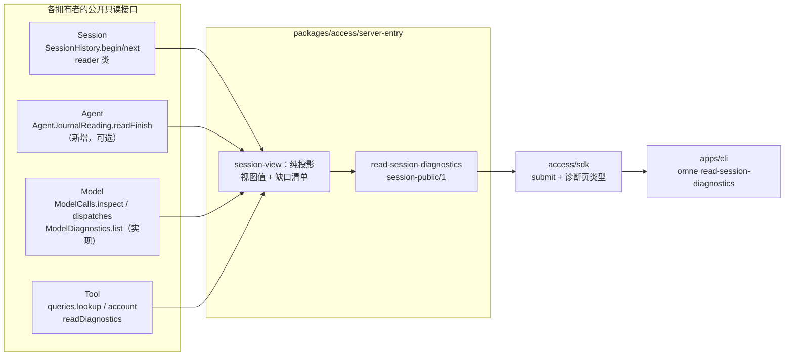
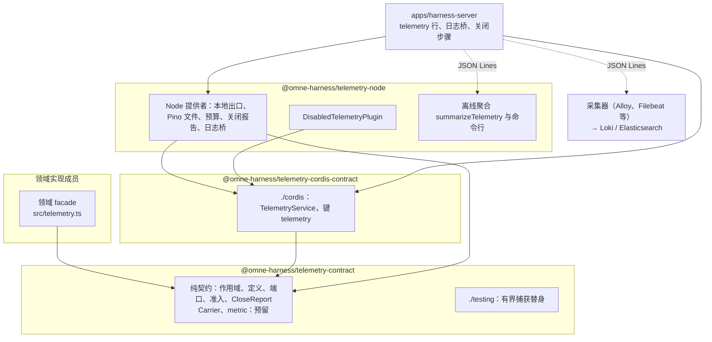

# RFC-0013：可替换的工程遥测

规则与维护责任见[RFC入口](README.md)。本页记录第一版本地 A/B 路径的采用决定，见[#1140 接续采用记录](https://github.com/nemori-ai/omne-harness-lite/issues/1140#issuecomment-6703474020)。现行行为以文末所列拥有者正文为准；后续设计不随本次采用。提案采用、规范写回、实现和交付接受分别判断。来源是 [#1140](https://github.com/nemori-ai/omne-harness-lite/issues/1140) 的设计、[第一份决定记录](https://github.com/nemori-ai/omne-harness-lite/issues/1140#issuecomment-6663579066)与[范围变更记录](https://github.com/nemori-ai/omne-harness-lite/issues/1140#issuecomment-6665535851)（卡 r2）。过程材料（设计稿、评审记录、调研、实施计划）由负责人保存，需要时向负责人索取。另一份输入是用户提供的交接包 omne-observability-handoff-2026-11-05（调查基线 `443bf66`），下文称「交接包」，它是候选，本提案不采用它的全文。CLI 与 Server 的设计交接包（2026-11-05 修订 2）下文称「CLI/Server 交接包」。

本页用的名词见统一语言：[工程遥测](../../.meta_harness/design/ubiquitous_language/terms/record-and-context.md#ul-engineering-telemetry--工程遥测--engineering-telemetry)、[遥测记录](../../.meta_harness/design/ubiquitous_language/terms/record-and-context.md#ul-telemetry-record--遥测记录--telemetry-record)、[遥测段](../../.meta_harness/design/ubiquitous_language/terms/record-and-context.md#ul-telemetry-segment--遥测段--telemetry-segment)、[输出代](../../.meta_harness/design/ubiquitous_language/terms/execution-and-outcome.md#ul-output-generation--输出代--output-generation)。遥测段与输出代的形态未定，见 [C-73](../../.meta_harness/design/ubiquitous_language/conflicts.md#c-73遥测段是不是对象)、[C-74](../../.meta_harness/design/ubiquitous_language/conflicts.md#c-74输出代是不是对象)。A 线的产物是[会话诊断投影](../../.meta_harness/design/ubiquitous_language/terms/record-and-context.md#ul-session-diagnostics-projection--会话诊断投影--session-diagnostics-projection)（DA8）。

## 问题与有效输入

顶层要求、观测约定和技术路线都已接受，但系统还没有把一次工作的失败原因、耗时和用量交到开发者、运维者和 agent 手里。第一版是本机单机部署，主要服务开发、运维和迭代。负责人在 2026-11-05 收窄了范围：第一版只做两条线。

- **A 线：会话日志诊断投影。** 组合各拥有者的公开只读接口，产出 Run 时间线、失败及其原因、模型调用的耗时与用量、工具调用统计，做成 CLI 命令，人和 agent 都能用。按调用方的租户授权取数，不读存储内部。
- **B 线：日志收集与热点分析。** 结构化 JSON 日志、Cordis 日志桥、入口诊断，输出到本机；Session 与 Agent 的 measure 写成本地计时记录；离线聚合工具按操作统计 p50、p95；写明怎样用 Node 自带的 CPU profile。

OTel 链路与指标、Collector、运行中换输出、出口分区与撤权围栏、两套后端对账、产品化遥测推迟，只出设计（见[后续](#后续推迟项只出设计)）。

已观察的事实（基线 `f65f50f33`）：

1. 2026-11-05 开工前冒烟时，两次 Run 失败的真实原因（Model 以 `capacity` 拒绝受理，上游在流里返回 504）只能在本机存储的 SQLite blob 里查到。CLI `read-history` 只显示 `run.terminal` 的 `cause.record`，形如 `<execution>/<step>/model-refused` 或 `<execution>/<step>/model-failed/<cause>/<诊断>`（Agent 的[原因记录](../../packages/agent/agent/SPEC.md)）。拒绝的种类（`capacity`）与上游状态码（504）不在记录里。
2. Agent 把结构化的失败候选（`FailureCandidate`：`model-refused` 带 `failure.kind`，`no-reply` 带 `fault` 含 `cause` 与 `upstreamStatus`）写进 Journal 的 F1 提交（`JournalCommit.finish`），`run.terminal` 的 `cause` 以摘要引用它。执行结束后，Agent 的公开读面（`AgentJournalReading.load`、`output.read`、`query`；`AgentJournalEntries.read`）只给出 `conclusion.cause`，不给出失败候选。`FinishIntent.failure` 只在 `settling` 状态的快照里可见。
3. Model 契约声明了 `ModelDiagnostics.list`（`packages/model/model-contract/src/diagnostics.ts`）和服务键 `modelDiagnostics`（`model-cordis-contract`），没有实现，没有提供者行，也没有消费者。`ModelCalls.dispatches` 已实现，返回 `DispatchRecord`（`send`、`firstContent`、`terminal` 含 `fault.cause` 与 `upstreamStatus`、`account`）。存储的派发文档（`md_dispatch`：`record`、`logical_terminal`、`windows`、`events`、`diagnostics`）没有阶段时间，`DispatchRecord` 也没有。
4. Tool 契约有 `readDiagnostics`，运行时把它转交账本；账本在当前增量对 `diagnostics`、`process`、`wait` 都答 `unsupported`（`packages/tool/tool/src/ledger.ts`）。`lookup`、`queryOperation`、`readResult`、`account` 可用。
5. Session 历史读面 `SessionHistory.begin/next/since` 按种类分页；`call.bound`（SE18）的载荷带稳定调用引用文本，这是[外部读者取得稳定调用引用的唯一公开路径](../../packages/session/session-contract/SPEC.md#稳定调用引用的读取)。`HistoryEntry` 有 `id`、`revision`、`kind`、`schema`、`payload`、`origin`，不公开提交时间。公开 `read-history` 只披露部署配置列出的种类；本机单用户档列出 `message.user`、`message.assistant`、`message.tool`、`message.system_reminder`、`run.started`、`run.terminal`。
6. 提案之前，`apps/harness-server` 的 `serve` 在根上登记日志导出器，把 Cordis 消息写成 stdout `log` 记录：只有 `level`、`name`、`text`，DEBUG 不导出，写出失败时这一条静默丢弃。B 线已把它改为日志桥，原来的 `log` 记录不再写出，见下文「B 线」与 [harness-server 进程输出](../../apps/harness-server/SPEC.md#进程输出与退出码)。
7. `packages/access/server-entry` 定义了 10 种结构化诊断和可选的 `DiagnosticSink`。应用的 `server-entry` 行没有传入 sink，这些诊断全部丢弃。
8. `session-cordis` 只把 `measure` 交给 Session 核心，不交 `diagnose`。应用的 `agent-host` 行注明 `measure` 本波不接。`SessionMeasure` 与 `AgentMeasure` 的事件不带租户。
9. `@omne-harness/telemetry-contract` 与 `@omne-harness/telemetry-node` 已实现并合回（候选状态）。`@omne-harness/diagnostic` 已删除，关闭报告的三段语义进入 `CloseReport`。carrier 与 metric 有形状、有测试，没有消费者。
10. 仓库已把「观察」用于面向用户的会话观察（`observe-session`、`observation-frame`）。

不处理的后果：开发者和 agent 无法从记录判断一次工作在哪里失败、为什么失败、花了多少时间与 token；SYS-OBSERVABILITY 的「缺口可见」与「获准主体可查询」没有兑现；后续每个领域会各自发明日志格式与输出方式。

推断与未知：`CallAccount.duration` 已核对，生产中唯一的产生者 `pi-ai-transport` 的解码器是纯函数，没有时钟，恒写 `unknown`，所以它现在不能充当 `timing.execution`；要变成已知值，需要 model 线决定由谁、用哪个时钟测量（DA6）；生产预算数值、两套后端的产品版本和保留政策没有输入（D11）；「租户可以逐个拒绝遥测外传」是不是产品要求没有人回答（D06 的前提）；macOS 上能否执行形式模型工具没有核对。读口对 `server-entry` 行的可见性已经核对：`agentJournal`、`modelRuntime`、`modelDiagnostics` 在根上可见，作为普通 `inject` 接上；`toolRuntime` 按调用现取；[受信可见性表](../architecture/runtime/application-assembly.md#受信子树)不变。

| 当前要求或承诺 | 核对修订与条款 | 本提案受什么约束 |
| --- | --- | --- |
| [项目要求](../requirements.md#全链路可观测可遥测与日志完备sys-observability) | `f65f50f33`，SYS-OBSERVABILITY 七项义务 | 跨边界保留作用域、主体、工作与因果；缺口可见；获准主体可查询；观测读取不重新执行动作；不指定后端或拓扑 |
| [项目要求](../requirements.md#数据保护sys-data-protection) | SYS-DATA-PROTECTION | 凭据不进普通日志或遥测；已有读取权限不自动授予对外传送；向观测端发送须核对接收方、内容与目的 |
| [项目要求](../requirements.md#完全动态目标sys-dynamic) | SYS-DYNAMIC；Tool 以外的动态验收判据尚待明确 | 换输出不得造成系统性停机；第一版只能重启换输出，是受限交付（D09） |
| [项目要求](../requirements.md#当前研发阶段sys-experiment) | SYS-EXPERIMENT | 同步迁移消费者并删除被替代实现（D03，已执行） |
| [跨系统技术约定](../architecture/cross-cutting-concepts.md#观测与遥测) | 观测与遥测；[消息、记录与流](../architecture/cross-cutting-concepts.md#消息记录与流)；[当前承接与后续设计](../architecture/cross-cutting-concepts.md#当前承接与后续设计)的「观测基础契约」 | 注入的结构化接口；纯能力不导入 Node SDK；OTel 不取得事实权威；Pino 不承担耐久；有界与缺口可见；不建全局事件流 |
| [系统技术基础](../architecture/technical-foundations.md#共同技术选择) | Pino 10.4.0；OTel 版本组 | 第一版只用 Pino 做文件出口；OTel 推迟 |
| [数据保护与隐私](../architecture/security/data-and-privacy.md#模型工具与遥测的对外传送) | 对外传送 | 采集时裁剪，导出时再核；第一版不外传 |
| [Cordis 集成约定](../architecture/cordis-integration-conventions.md) | IC-1～IC-19 | 一个接缝一个服务定义；`inject` 即换代重跑；配置只放数据；系统作用域不代表租户 |
| [应用装配](../architecture/runtime/application-assembly.md#插件树) | 插件树；受信可见性 | 运行时对象不进树；行按 `entry → business → composition → storage` 阶段关闭 |
| [系统分层](../architecture/layers-and-dependencies.md#依赖关系与禁止方向) | `DIR-ACCESS-MODEL`、`DIR-ACCESS-TOOL` | public-contract、sdk、stream-arrival 不得依赖 Model 与 Tool 契约；server-entry 不在禁止方向里 |
| [Session 契约](../../packages/session/session-contract/SPEC.md#日志读取投影及恢复) | SL10～SL14；[稳定调用引用的读取](../../packages/session/session-contract/SPEC.md#稳定调用引用的读取) | 每次读取核资格；游标绑定范围；空页不等于读完；读者不推测调用是否存在 |
| [Agent 契约](../../packages/agent/agent-contract/SPEC.md#托管协调与运行实例) | Journal 读面；失败诊断只写身份与状态 | 只做可加扩展；不披露私有权限块、秘密与无权内容 |
| [Model 契约](../../packages/model/model-contract/SPEC.md#诊断查询与保留) | 诊断查询与保留 | 诊断读取资格单独核对；白名单字段；游标不代替权限；已知时长用同一单调时基 |
| [Tool 契约](../../packages/tool/tool-contract/SPEC.md) | 读取面与具名失败 | `unsupported` 是具名失败，投影如实表达 |
| [公开契约](../../packages/access/public-contract/SPEC.md#会话公开操作) 与 [服务端接入](../../packages/access/server-entry/SPEC.md#会话位置) | `session-public/1` 的判断次序；接入是 Session 调用的唯一调用方 | 新操作沿同一判断次序；`denied` 不披露存在性 |
| [CLI 规格](../../apps/cli/SPEC.md#命令结果与退出码) | 命令名等于操作名；结果对象；退出码 0～5 | 新命令沿同一约定 |
| CLI/Server 交接包 | §1.2 完整会话视图是跨拥有者的只读组合；§3「读取完整会话视图」行；接手说明 §2 | access 与 apps 允许该工作做破坏性修改，本提案在那里只做加法；核心领域只做可加扩展 |
| [#1140 的决定记录](https://github.com/nemori-ai/omne-harness-lite/issues/1140#issuecomment-6663579066)与[范围变更](https://github.com/nemori-ai/omne-harness-lite/issues/1140#issuecomment-6665535851) | chenyize 2026-11-05 | D01、D09、D13、D16 已采用；范围收窄为 A、B 两线；其余见「决定范围」 |

## 建议与改变范围

### 两条线与后续

| 线 | 端到端行为 | 真实消费者 | 状态 |
| --- | --- | --- | --- |
| A 会话日志诊断投影 | 一条 CLI 命令读一个会话的 Run 时间线、失败原因、模型调用的耗时与用量、工具调用统计；缺口写「未知」 | 开发者、运维者；读自己会话的 agent | 已实现；本地范围已采用。Model 阶段时长（DA6）与 Session 提交时间（DA7）没有做，投影写 `unknown` |
| B 日志收集与热点分析 | `serve` 的 Cordis 消息与入口诊断成为结构化记录，写到 stdout 或本地文件；Session 与 Agent 的操作成为计时记录；离线工具按操作统计分位数 | `serve` 的运维者；做热点分析的开发者 | 已实现；本地范围已采用：契约、Cordis 定义、Node 提供者、应用接线、计时记录与离线聚合 |
| 后续 | OTel、Collector、输出代、出口分区与撤权、两套后端、产品化遥测 | 待具名 | 只出设计，见[后续](#后续推迟项只出设计) |

### A 线：会话日志诊断投影

#### 投影是什么，归谁，放在哪里

会话诊断投影是一个会话的只读组合视图：Session 历史给出 Run 的骨架与调用登记，Agent 给出 Run 怎样结束，Model 与 Tool 给出每次调用实际发生了什么。它不拥有任何事实，不改变任何状态，不重新执行动作。

它与 CLI/Server 交接包 §1.2 的「完整会话视图」是同一种需要。那份交接包把「来源组合与可复核的视图版本发布」定为公开接入所消费的外部组合责任，具体成员归属待正式技术采用，并要求「沿现有接入适配的能力扩展即可承载时，不再增加通用转发层」。本提案按这一条放置：

- **组合承担者是服务端接入** `packages/access/server-entry`。它已经是 Session 调用的唯一调用方，已经组合 Model 的 `current` 与 stream-arrival 的观察；`DIR-ACCESS-MODEL`、`DIR-ACCESS-TOOL` 只禁止 public-contract、sdk 与 stream-arrival 依赖 Model 与 Tool 契约，不限制 server-entry。
- **纯投影是一个可独立测试的模块** `server-entry/src/session-view/`：输入是各来源的页与答复，输出是视图值与缺口清单。它不认识 HTTP、Cordis 或 CLI。CLI/Server 工作以后要让 Web UI、Desktop 或 ACP 复用它时，可以把这个模块提成 `packages/access/` 的成员；本提案不预先建包（DA1）。
- **公开操作与 CLI 命令各一个**，沿现有的 `session-public/1` 位置与 CLI 命令目录加入。SDK 不加专门方法：SDK 的会话客户端对每个会话操作只有一个 `submit`，`read-history` 也没有专门方法，所以调用者同样用 `submit` 发 `read-session-diagnostics`；SDK 只转出诊断页的类型。



#### 数据来源与读取路径

| 要回答的问题 | 来源与读取路径 | 现状 | 授权 |
| --- | --- | --- | --- |
| Run 时间线：开始、attempt、控制、终态 | `SessionHistory.begin({ kinds, from: null, direction, pageBytes })` 与 `next`，种类取 `run.started`、`run.attempt-started`、`run.attempt-released`、`run.attempt-exited`、`control.requested`、`control.progress`、`run.terminal`、`call.bound`、`call.execution-fact`、`message.*`（只计数） | 已实现。attempt 按开始、按原因的释放与退出分别计数；`call.execution-fact` 按事实种类计数，带 `consumption` 且与某次投影调用相同的归到该调用，其余归到 Run。条目按日志位置排序；`HistoryEntry` 不公开提交时间，载荷带拥有者报告的发生时间时才显示时刻 | Session 的读取资格，`reader` 类，租户为目标会话的租户 |
| 调用登记与稳定引用 | `call.bound` 载荷的 `kind`、`reference`、`purpose`（SE18） | 已实现 | 同上 |
| Run 怎样结束、为什么 | `run.terminal` 的 `outcome` 与 `cause.record`；结构化原因经 Agent 的 `readFinish`（新增，见下节） | 记录已实现；结构化原因经 `readFinish` 读到（本提案新增，已实现；本地范围已采用） | Agent Journal 的读取资格 |
| 每次模型调用：发出、首内容、结局、原因、状态码、用量、耗时 | `ModelCalls.inspect(reference)` 解析稳定引用，得到调用；`ModelDiagnostics.list({ call, after, limit })` 给出每次派发的白名单字段；`ModelCalls.dispatches(call)` 给出每次派发记录的 `CallAccount`（用量、费用、时长），按派发身份与诊断条目对上 | `inspect`、`dispatches` 已在 mainline；`ModelDiagnostics` 由本提案实现（已实现；本地范围已采用）。耗时见 DA6 | Model 的调用访问与诊断读取资格 |
| 每次工具调用：状态、账目 | `ToolInvocationQueries.lookup(reference)`、`account(reference)` | 已实现 | Tool 的调用访问资格 |
| 工具调用的诊断 | `readDiagnostics({ after: null })`，只读第一页 | 已接上。账本现在答 `unsupported`，投影写 `unknown` 与缺口；有下一页时另写缺口 `truncated`；条目只取 `operation`、`phase`、`code`，不带证据 | 同上 |

组合规则：

1. 先读 Session 历史，按 Run 聚合条目。Run 的骨架只来自 Session。
2. 每个 Run 的 `call.bound` 给出调用引用。Model 分支经 `inspect` 与 `ModelDiagnostics.list` 读派发；Tool 分支经 `lookup` 与 `account` 读状态与账目。一次 Tool 调用可以有两条 `call.bound`（先是没有生产者的 `tool-intent` 登记，再是关联登记），投影把它们算作同一个调用。引用解析不到时写 `unknown`，原因 `not-accepted` 或 `not-found`，不推测调用没有发生。
3. 终态为失败或被取消的 Run，再读 Agent 的结束原因。读不到时保留 `cause.record`，结构化原因写 `unknown`。
4. 每个来源的拒绝、不可用、不支持都成为缺口条目，带来源、对象与原因。缺口不改变其他来源的结果。
5. 组合不跨来源推断。Session 没有登记的调用不出现；Model 有派发而 Session 没有登记时，这条派发不出现，因为投影以 Session 的会话为范围。

#### 失败原因从哪里读

本提案之前，没有公开接口能读到结构化的失败原因。证据见事实 2：`run.terminal.cause` 是 `DurableEvidence`，`record` 是人读文本，`digest` 绑定失败候选的载荷；失败候选本身在 Agent Journal 的 F1 提交里，执行结束后没有读面给出它。`capacity` 拒绝没有 Model 调用行，所以 `ModelDiagnostics` 也读不到它；504 的 `upstreamStatus` 在 Model 的派发记录里，也在 Agent 的 `fault` 里。

最小的兼容扩展归 Agent（agent-contract 与 session-adapters 的 Journal 提供者，session-run 线）：

- `AgentJournalReading` 增加可选方法 `readFinish?(input: Access<P> & { execution }): Reply<FinishIntent | null>`。执行处于 `settling` 或 `ended` 时返回当前或最终的 `FinishIntent`（含 `candidate`、`conclusion`、`failure`）；没有结束候选时返回 `null`。
- 资格沿 Journal 已有的读取资格；另一租户的执行答 `denied`，与不存在不区分。
- 旧提供者可以不实现。消费者把缺席当作 `unknown`，原因 `unsupported`。这符合 CLI/Server 交接包 §2.2 对可加的定义：既有构造者、读取者与实现者不变。
- 投影只取 `failure` 的闭合字段：`kind`、`model-refused.failure.kind`、`no-reply.fault.cause`、`no-reply.fault.upstreamStatus`、`request-rejected`、`cannot-fit.reason`、`compaction-invalid`、`message-rejected`、`extension-stop`、`guard`。`model-refused.failure.kind` 或 `cannot-fit.reason` 出现投影不认识的值时写 `{ kind: 'unknown', reason: 'unsupported' }`，不改写成表内的值。`fault.diagnostic` 是自由文本，不进投影；`cause.record` 已经带它的前 120 个字符，照原样显示。

备选是让 Session 的 `run.terminal` 载荷带结构化摘要。Session 从 Agent 的 `ended` 事件派生 SE26，而该事件只带 `conclusion.cause`，所以这条路要同时改 Agent 事件与 Session 载荷，不是最小改动。见「实质备选」。

#### `ModelDiagnostics` 怎样实现

数据来源是 `model-storage-sql` 的派发文档：`md_dispatch.record`（`DispatchRecord`：`dispatch`、`supplier`、`send`、`firstContent`、`terminal`、`account`、`materialization`）、`md_dispatch.logical_terminal`、`md_dispatch.diagnostics`（`ProviderDiagnostic[]`），以及 `md_call.row_version`。字段映射如下。

| `ModelAttemptDiagnostic` 字段 | 来源 | 说明 |
| --- | --- | --- |
| `id` | `call` 与 `dispatch` 的确定编码 | 不另存 |
| `call`、`dispatch`、`revision` | `md_call.call`、`md_dispatch.dispatch`、`md_call.row_version` | |
| `adapter` | `record.supplier.adoption` | |
| `send` | `record.send`：`started` → `sent`，`prepared` 与 `not-sent` → `not-sent`，`unknown` → `unknown` | 本地意图不证明 sent |
| `firstContent` | `record.firstContent` | 同值 |
| `outcome` | `logical_terminal`，缺席时 `record.terminal`，都缺席时 `pending` | `failed` 带 `fault.cause` 与 `upstreamStatus`；`fault.diagnostic` 不进 |
| `timing.materialize`、`timing.sendToFirstContent`、`timing.execution` | 存储没有阶段时间 | 三项都答 `unknown`。`CallAccount.duration` 为已知值时能否充当 `execution`，由写者核对它的测量者后决定（DA6） |
| `snapshot` | 调用行的 `DurableEvidence` | |
| `retention` | 部署配置的采用 | 缺少采用时整个查询面 `unavailable`（Model 契约） |
| `coverage` | 当前没有清理，恒为 `complete-through-snapshot` | 清理实现后改为按实际前缀 |

服务由 `model-records` 行提供：`model-storage-sql` 提供 `createSqlModelDiagnostics`；应用用 `ModelDiagnosticsService` 包装每次读取的异步资格，提供 `modelDiagnostics`；行的 `provides` 加这个键，与 `modelCommands` 同一提供者组，因为它读同一个租户域的同一份文档。worker 半边增加读处理器 `model.diagnostics`，按 `(tenant, call)` 读 `md_call` 与按 `seq` 排序的 `md_dispatch`，支持 `after` 与 `limit`。

资格：Model 契约要求「没有调用级诊断权限时整次拒绝」，且普通调用读取资格不自动授予它。本提案建议第一版在本机单用户档里显式采用一条映射：代租户行事的主体对自己租户的调用持有诊断读取资格（配置字段 `diagnosticsRead: 'tenant-self'`）。这是部署的显式采用，不是隐式授予。映射按[#1140 接续采用记录](https://github.com/nemori-ai/omne-harness-lite/issues/1140#issuecomment-6703474020)的 DA2 范围采用，行为归 Model 与应用资格映射。

应用显式为经核验的本租户登录主体提供诊断只读资格：调用身份/状态读使用 `inspect`，派发账目读使用 `read-account`。旧 `facts`、`account` 仍用于原业务路径，不向登录主体开放。每次读取独立取得资格，返回前复核；入口在释放整页响应前复核原登录和租户成员资格。此保证截止于该检查点，不声称撤权与网络最后一个字节原子。

`timing` 要变成已知值，需要 Model 核心在 prepare、materialize、start、首内容、收场的事实点用同一单调时钟记录时长，写进派发文档（可加字段）。这归 model 线，是可选闭包（DA6）。没有它时，投影如实写 `unknown`。

#### 公开操作的形状

操作名 `read-session-diagnostics`，位置与 `read-history` 相同（`session-public/1`，HTTP 走同一路径）。命名由 CLI/Server 工作最终裁定（DA5），本提案只加不改。

信封：`loginProof` 必填，`actingTenant` 禁止。body 字段：

| 字段 | 要求 |
| --- | --- |
| `tenant` | 目标会话的租户，规则同 `read-history` |
| `session` | 会话标识文本 |
| `cursor` | 键必须出现。null 读首页；否则是上一页 `next` 的原文 |
| `run` | 只在 `cursor` 为 null 时出现。null 表示全部 Run，从最新开始；否则是一个 Run 标识文本 |
| `pageBytes` | 只在 `cursor` 为 null 时出现。规则同 `read-history`，超出部署上界答 `invalid` |

判断次序沿公开契约的[会话判断次序](../../packages/access/public-contract/SPEC.md#会话判断次序)。第 6 步的 Session 判断是历史读取的资格判断；之后的 Agent、Model、Tool 读取各自核资格，它们的拒绝不改变操作的 `outcome`，只成为缺口。`outcome` 取 `succeeded`、`denied`、`invalid`、`basis-unavailable`。`denied` 与 `read-history` 一样不披露会话是否存在。

响应 body `SessionDiagnosticsPage`：

| 成员 | 内容 |
| --- | --- |
| `runs` | `RunDiagnostic[]`，按日志位置从新到旧 |
| `next`、`exhausted`、`scannedThrough` | 规则同历史页：空页不表示读完 |
| `basis` | `{ upper }`：本页依据的 Session 修订 |
| `gaps` | `Gap[]`：`{ source: 'session' \| 'agent' \| 'model' \| 'tool', subject, reason }`。`reason` 取 `unsupported`、`unavailable`、`denied`、`not-disclosed`、`not-accepted`、`not-found`、`not-recorded`、`retention-expired`、`truncated` |

`RunDiagnostic`：`run`、`entry`、`execution`、`started`（位置与可选时刻）、`attempts`（开始数、按原因的释放数、退出数）、`facts`（没有归到投影调用的执行事实，按种类计数）、`controls`（`control.requested` 与 `control.progress` 的闭合字段）、`terminal`（`null` 表示未终结；否则 `{ outcome, cause: { record, structured } }`，`structured` 是上一节的闭合字段或 `{ kind: 'unknown', reason }`）、`modelCalls`、`toolCalls`、`messages`（按种类计数）。

`ModelCallDiagnostic`：`reference`、`purpose`、`call`（解析到的调用或 `unknown`）、`dispatches`（每次派发的诊断字段，加该次派发的 `account`：`CallAccount` 的用量、费用与时长的来源与数值状态，不折算金额，读不到写 `unknown`）、`coverage`、`facts`。`ToolCallDiagnostic`：`reference`、`state`（`lookup` 的结果或 `unknown`）、`account`（`CallAccount` 或 `unknown`）、`diagnostics`（诊断页第一页的条目或 `unknown`）、`facts`。

分页与上限：每页至多 `maxRuns` 个 Run，每个 Run 至多 `maxCallsPerRun` 次调用进入扇出，超出的调用计数并写缺口 `truncated`；两项是部署配置。游标不可猜测，绑定租户、会话、`run` 过滤、`basis.upper` 与扫描位置，规则同 SL10、SL11。续页重新核每个来源的资格。续页从封存的位置向更早处读，读不到上界之后的新追加，所以续页响应的 `basis.upper` 取封存的上界，整轮遍历只有一个依据。

完整性：缺少记录时写 `unknown` 与原因，不写「没有发生」。`exhausted` 为假的空页不表示没有 Run。投影不从 Model 或 Tool 的空页推断调用不存在。时刻只在载荷带发生时间时显示，否则写 `unknown`；要显示提交时间需要 Session 在 `HistoryEntry` 增加可选的提交时间（DA7，session-run 线，可选）。

授权与递归：取数按调用方的租户。agent 用这条命令读自己会话的诊断是「查询自身」，是只读操作，不创建 Session、Run 或调用，不消耗派生额度（CLI/Server 交接包 §8.3 先区分读取与产生执行）。操作不重新执行任何动作（SYS-OBSERVABILITY）。

部署披露：投影读取的种类清单是部署配置（`diagnosticsKinds`），与 `read-history` 的 `historyKinds` 分开；本机单用户档列出上表的全部种类。没有列出的种类写缺口 `not-disclosed`（DA4）。

#### CLI 命令

命令名等于操作名：`omne read-session-diagnostics --session <id> [--run <id>] [--tenant <tenant>] [--page-bytes <n>] [--json] [--server <url>]`。规则沿 [CLI 规格](../../apps/cli/SPEC.md#命令)：`tenant` 的来源次序同 `read-history`；命令按页读到 `exhausted` 为真；`--json` 是开关。

人读输出每个 Run 一段，全部 Run 之后集中列出缺口（每个缺口一行，写来源、对象与原因），规则以 [CLI 规格](../../apps/cli/SPEC.md#读诊断投影)为准：

```text
Run <run> (entry <entry>, execution <execution>): failed
  started: position <position> at unknown
  attempts: 1 (released: ended 1)
  cause: <execution>/step-1/model-refused
  reason: model-refused capacity
  model calls: 1
    main <reference> -> call unknown (not-accepted), 0 dispatches, coverage unknown
  tool calls: 0
gaps: 1
  model <reference>: not-accepted
```

失败收场的派发一行形如 `<dispatch> <adapter>: sent, first content none-proven, failed upstream-unavailable http 504`。账目另起一行，写每项用量与费用的数值、单位与状态（`known`、`provisional`、`unknown`）。时长写 `unknown` 或毫秒；时长未知不另写缺口。带原因的未知写作 `unknown (<原因>)`。

`--json` 输出结果对象，键同[命令结果与退出码](../../apps/cli/SPEC.md#命令结果与退出码)：`body` 是 `{ runs, gaps, complete }`，`request` 有 `messageId`（首页）与 `tenant`。

退出码沿 CLI 规格：读完为 `0`，缺口不改变退出码；停在某页的 `outcome` 按映射（`denied` 等为 `3`，`basis-unavailable` 为 `4`）；没有可信答复为 `5`；读不完整的本地原因为 `1`。凡是没读完（退出码 `1`、`3`、`4`、`5`），标准错误都写 `omne read-session-diagnostics: incomplete after <n> runs: <原因>`，并照常输出已经读到的 Run 与缺口。

#### 与 CLI/Server 工作的接缝

| 交叉点 | 本提案现在做 | 留给 CLI/Server 工作 | 怎样避免两份 |
| --- | --- | --- | --- |
| 完整会话视图的组合承担者 | `server-entry/src/session-view/` 纯投影与来源适配；只组合已提交历史与各拥有者的只读事实 | 在途内容（生产者保管的流）、人工事项状态、视图版本发布（ViewCore）、多端同版本一致性（TH08）、ACP 映射 | 同一模块向外扩展；本提案不建第二个组合层，也不在 CLI 侧再组合一次 |
| 公开操作与命令名 | `read-session-diagnostics`，只加 | 可以改名、合并进最终命令树或拆成子命令（access 与 apps 允许破坏性修改） | 本次采用沿现有命令面；后续修改按前发布演进政策同步消费者并替换原条款 |
| 来源契约的可加扩展 | Agent `readFinish?`、Model `ModelDiagnostics` 实现、Model 阶段时长（可选）、Session 提交时间（可选） | 对方需要的其他来源扩展（输入与工作的关联认回、历史尾部读取） | 扩展都在原拥有者，形状不随客户端变化 |
| 装配 | `server-entry` 行新增注入；`model-records` 行提供 `modelDiagnostics` | 新装配入口的阶段表与受信可见性表 | 接入点集中记录在应用文档，对方重构时带走 |
| `apps/harness-server` 的 B 线接线 | `run.ts`、`shutdown.ts`、`rows/server-entry/index.ts`、日志桥的接入点压到最小，集中记录在 `apps/harness-server/docs/rows/telemetry.md` | 合入时机 | 同上 |
| stdout 归属 | `serve` 的 stdout 仍只有应用的记录写函数一个写者。原来的 `log` 记录不再写出，Cordis 消息成为遥测记录（`kind: 'telemetry'`、`signal: 'log'`），这是本应用输出的破坏性变化；出口是配置字段，默认 `stdout` | ACP 走 stdio 时把出口改为 `stderr` 或文件（D05） | 不改契约 |

#### 验收

接受级别 L3：本轮改变租户读取资格和跨成员生命周期。至少复现冒烟的两个失败，投影要把原因直接显示出来：

1. 同租户两个并发会话触发 `capacity`。依据是本机单用户档的 `model-records.limits.capacity.bytes`（1000000）与 `agent-context.resultCapacity.bytes`（524288）：两个并发调用的预留超过上限，第二个 `admit` 答 `capacity`，Agent 以 `model-refused` 结束 Run。投影显示 `terminal.outcome` 为 `failed`，`cause.record` 以 `model-refused` 结尾，`cause.structured` 为 `{ kind: 'model-refused', failure: 'capacity' }`；`modelCalls` 里该引用的 `call` 为 `unknown`，原因 `not-accepted`。
2. 替身供应商在流里返回 504。投影显示 `cause.record` 含 `model-failed/<cause>/...`，`cause.structured` 带 `fault.cause` 与 `upstreamStatus: '504'`。同一调用的派发 `outcome` 为 `failed`，`upstreamStatus` 为 `504`，与 Agent 一致。不得以登录主体没有资格为由将这一必验路径降成缺口。

其他验收：

- 另一租户读这个会话：`denied`，响应逐字节同其他 `denied`。
- 账本答 `unsupported` 时，Tool 调用的 `diagnostics` 写 `unknown`（原因 `unsupported`），不写空数组。
- `readFinish` 缺席的 Journal 替身：`cause.structured` 为 `unknown`，原因 `unsupported`，命令退出 `0`。
- `ModelDiagnostics` 的 `retention` 没有采用时：模型调用整体写缺口 `unavailable`，Run 骨架照常显示。
- 超过 `maxCallsPerRun` 的 Run：计数正确，缺口 `truncated`。
- 续页用篡改的游标：`invalid`，不换范围。
- 人读与机读输出对同一页给出相同的事实。`--json` 的 `body` 能被脚本解析，字段名与本页一致。

### B 线：日志收集与热点分析

#### 分层、成员与依赖方向



箭头是代码依赖方向，虚线是运行时的数据流。领域实现成员只依赖 `telemetry-contract` 的根入口。`telemetry-cordis-contract` 依赖纯契约，拥有服务定义。`telemetry-node` 依赖两者并实现服务。`apps/harness-server` 选择提供者并接线。`telemetry-contract` 只依赖 `@omne-harness/legal-identity`，不依赖任何领域成员，也不依赖 Cordis。三个成员已实现；本地范围已采用，理由与分层见下表。

| 层 | 拥有什么 | 不拥有什么 | 位置与状态 |
| --- | --- | --- | --- |
| 领域 facade | 本域的事件目录、测量起止点、从业务事实到允许字段的投影 | 输出格式、队列、后端 | Session 与 Agent 的 `src/telemetry.ts`；server-entry 的入口诊断 facade 在应用行。已实现；本地范围已采用 |
| 纯契约 | 作用域与关联值、声明式定义、端口操作、准入结果、Carrier 编解码、关闭报告、测试替身 | Node、Cordis、领域状态 | `packages/telemetry/telemetry-contract`，已实现；本地范围已采用 |
| 稳定服务 | 唯一 Cordis 服务 `telemetry` | 输出实现的选择、领域状态 | 定义在 `packages/telemetry/telemetry-cordis-contract` 的 `./cordis`，实现在 `telemetry-node/cordis`，已实现；本地范围已采用 |
| Node 提供者 | 本地出口、Pino 文件出口、预算、自监控、关闭报告、日志桥、离线聚合 | 领域语义、查询权限、OTel | `packages/telemetry/telemetry-node`，含离线聚合，已实现；本地范围已采用 |
| 采集与后端 | 把本机 JSON Lines 送进 Loki 或 ELK 的采集器配置 | 领域构建产物 | 运维者资产，第一版不随仓库交付 |

建三个成员，不建一个成员加几个入口（D02）：纯契约 `telemetry-contract`、Cordis 定义 `telemetry-cordis-contract`、Node 提供者 `telemetry-node`，照 `model-contract` 与 `model-cordis-contract` 的仓库约定。每个领域实现成员都只消费纯契约，它的生产安装闭包不能含 Pino，也不能含 Cordis；Agent 的公开入口测试守着后一条。

#### 公共契约形状

完整类型在 `telemetry-contract` 的公开类型与 [SPEC](../../packages/telemetry/telemetry-contract/SPEC.md)（TC-1～TC-15），不在本页重复。要点如下。

- **作用域与绑定**：`Binding` 带 `scope`（`ActingScope`：某个租户，或 `system`）、`component`、`instance`，以及可缺席的 `work`、`attempt`、`call`、`adopted`、`links`。
- **声明式定义**：`defineEvent`、`defineMetric`、`defineSegment`。字段规则只有枚举、布尔值、有界有限数、不透明引用四种。没有自由文本入口。
- **准入结果**：`admitted`，或带原因的 `dropped`（`disabled`、`sampled`、`invalid`、`policy`、`capacity`、`expired`、`closed`）。`admitted` 只是本地准入。
- **端口**：`TelemetryPort.bind(binding)` 返回 `Emitter`；`TelemetryPort.discard(definition, reason)` 登记一条调用方没能组成的记录被丢弃（例如 TC-4 拿不到租户），只计入关闭报告，不写出，调用方只能声称 `invalid`、`policy`、`capacity`；`Emitter` 有 `event`、`record`、`startSegment`、派生 `bind(patch)`；`Segment` 有 `carrier`、`event`、幂等的 `end(outcome?)`。
- **关闭报告**：`CloseReport` 写准入数、按原因分列的丢弃数、未决数、flush 结果、确认边界与 transport 结果。四个确认边界不混同。丢弃总数恒等于各原因之和；准入后在出口写失败的记录计入 `output`，它只出现在关闭报告里，不是准入结果。
- **预留**：`Carrier`（W3C traceparent 子集）与 `defineMetric`、`Emitter.record` 有形状、有校验、有测试，第一版没有消费者。它们为后续的 OTel 链路与指标预留，第一版不扩展也不删除。成员文档标为「预留」。
- **作用域规则**（TC-4）：`scope` 表达事实属于谁。属于某租户工作的事实拿不到租户就丢弃并计数，不改标 `system`；服务进程自身的事实用 `system` 加 `component`。

`health()` 随 OTel 推迟。第一版的计数只进 `CloseReport` 与应用关闭报告，限频的 stderr 摘要读内部计数。

#### Cordis 承载与应用装配

服务与插件已实现：`TelemetryService`（键 `telemetry`）、`createTelemetryNodePlugin`、`createDisabledTelemetryPlugin`。禁用是在场的实现（D04）。运行时资源在应用创建，插件只借用端口。

应用装配（已实现；本地范围已采用，`apps/harness-server`）：

- 新增一行 `telemetry`。行配置只放数据：实现名（`node` 或 `disabled`）、本地出口（`stdout`、`stderr` 或 `file` 带路径）、预算字段；`disabled` 时出口与预算可以省略。遥测关闭没有单独的期限字段，用停服期限剩下的部分，停服的期限只有一个拥有者。配置用 Zod 在装载前校验，形状非法时以 `invalid-config` 拒绝整棵树，退出码 2，没有行装载；`file` 出口的文件打不开时运行时创建失败，本行 `FAILED`，退出码 3。
- 发射行把 `telemetryKey` 写进 `inject`，在行体里构造 facade，再交给成员工厂已有的可选参数。发射行必需注入 `telemetry`（D04）；遥测缺席是启动失败。第一版的发射行是 `server-entry`（入口诊断）、`session-provider` 与 `agent-host`（计时记录）。
- **stdout 只有一个写者。** 应用入口的记录写函数是唯一向 fd 1 写记录的函数。遥测的 `stdout` 出口经它写出；`stderr` 出口经应用的 stderr 行写函数写出，每条记录是一行完整 JSON，不带前缀。`file` 出口由提供者持有（Pino 同步 destination）。`shutdown-result` 是 stdout 的最后一行：写出它之后 stdout 封口，之后才到的记录（例如超期之后才结束的阶段日志）改写到 stderr。
- **Cordis 日志桥有四个状态**（已实现，TN-9）：引导（经写函数直接写出并放进有界引导缓冲）、就绪（交给 `telemetry` 服务，出口不是写函数时回放引导缓冲并标 `bootstrap: true`）、直写（`telemetry` 行为 `disabled` 时，直接写出，不缓冲，不计溢出）、关闭后（直接写出并计 `afterClose`）。行 FAILED 或缺席时桥留在引导状态，消息照常直接写出。引导缓冲上限是发行常量，初值 256 条。
- **关闭顺序。** 四个关闭阶段之后、撤根之前，增加显式的遥测关闭步骤。步骤先把日志桥切到关闭后状态，再关闭运行时，所以期限耗尽时撤根阶段的消息也走关闭后路径。它返回 `CloseReport`，协调者并入 `ShutdownReport`。
- 对 IC 的兑现：唯一服务定义与键（IC-1～3）；根入口不导入 Cordis（IC-4、5）；一个提供者，键是能力名词（IC-6、7）；`inject` 字面量，禁用是在场实现（IC-8、9）；不新增 Cordis 事件（IC-10、11）；`Emitter` 不可变，随行撤除消失（IC-12、13）；配置是数据，行 id 是承诺（IC-14～16）；会话不是 Cordis 根，`scope` 不授权（IC-17、18）；配对与计数只在同一进程内成立（IC-19）。

#### 计时记录与离线聚合

两项新增，都在 B 线（已实现；本地范围已采用）：

- **计时记录。** `SessionMeasure` 与 `AgentMeasure` 的事件增加可选字段 `tenant`，产生事件的位置知道租户时填上。Session 的 facade 把段开始与结束投影为遥测段 `omne.session.<操作>`（每种操作一个定义；facade 至多缓存 64 个定义，超出的不缓存、照常发出；聚合时按操作分组），Session 实例自己的提交写下 `run.terminal` 时，`round-complete` 为事件 `omne.session.round-complete`（`session-ad02` 解读 Agent 事实写下的终态不发，这是 Session SPEC 的现行触发点，要不要扩到解读提交由 Session 拥有者裁定），`diagnose` 为事件 `omne.session.diagnostic`（`owner`、`step`、`reason` 是枚举，`reason` 含 Session 端口的全部失败种类，不输出 `detail` 文本）。Agent 的 facade 把 pass 投影为段 `omne.agent.pass.accept` 与 `omne.agent.pass.run`。目录读里，`pending` 的输入带租户，段按该租户作用域；`references` 与 `releasedScopes` 在 Session 契约里是系统作用域，段按 `system` 加 `component: 'session'` 记录。其余拿不到租户的事件按 TC-4 丢弃，经遥测端口计入关闭报告的 `droppedBy.invalid`，正常运行时这个计数应为 0。`session-cordis` 的插件输入增加可选的 `diagnose`。改动都是兼容的加法。段的时长由提供者用单调时钟计算，facade 不自己计时。配对表只放提供者已准入的段，所以它的大小不超过提供者的 `maxOpenSegments`；提供者在结束、过期、关闭与启动回退时同步通知释放，facade 删除相应条目。
- **离线聚合。** `telemetry-node` 增加纯函数 `summarizeTelemetry` 与命令行 `omne-telemetry-summary`：读 JSON Lines（`serve` 的 stdout 抓取或 `file` 出口的文件），按 `(owner, name)` 统计 `segment-end` 的计数、结局分布与 `durationMs` 的 min、p50、p95、p99、max（最近秩法）；只有开始没有结束的段计为 `unfinished`；事件与 `log` 按种类与级别计数；非法行跳过并计数；可以按租户文本与时间窗过滤；`--json` 输出机读报告，缺省输出按 p95 降序的人读表格。
- **CPU profile。** 成员文档写明用 Node 自带的 `--cpu-prof` 对 `serve` 取样，与计时记录对照定位热点。它不是遥测记录，不经本管线。

#### 内容保护与多租户

内容在两处检查：领域 facade 只从事实生成允许字段；提供者按声明校验实际载荷。

- 默认不记录 prompt、completion、工具参数与结果正文、思维链、凭据、用户路径、原始异常文本或任意对象。字段规则里没有它们的入口。`log` 记录的 `text` 是唯一的自由文本例外，由各行自由写出，遥测只限制长度。
- 租户身份只作为记录的作用域。离线聚合按租户过滤是本机操作，不是外传。
- **第一版不外传。** 只有本地出口（stdout、stderr、本地文件），配置 schema 没有远端目的地字段。采集器把文件送到哪里，是部署拥有者在遥测之外的决定，受 SYS-DATA-PROTECTION 约束。
- A 线的投影按调用方的租户授权取数，每个来源各自核资格；投影不缓存跨请求的结果。

#### 资源预算

预算是 `telemetry` 行的配置字段（IC-14）。代码里的数只是初值，初值旁写来源。生产数值由部署拥有者给出（D11）。

| 对象 | 字段 | 超限行为 |
| --- | --- | --- |
| 单条记录 | `maxRecordBytes`；`log` 记录的 `maxLogTextLength` | 超过 `maxRecordBytes` 时 `dropped(invalid)` 并计数；日志文本截断到上限 |
| 单条记录的结构上限 | `maxFields`、`refMaxBytes`、`maxLinks` 是契约常量 `TELEMETRY_LIMITS`，不是部署预算：定义与绑定的校验必须对所有提供者相同 | 定义或绑定时拒绝，记录时 `dropped(invalid)` |
| 队列 | `maxQueueItems`、`maxQueueBytes` | `dropped(capacity)` |
| 段 | `maxOpenSegments`、`maxSegmentLifetimeMs` | 超过打开上限的开始答 `dropped(capacity)`；打开超过最长存活期的段计入 `expired`，之后的结束答 `dropped(expired)` 且不写出 |
| 自监控 | `summaryIntervalMs` | 限频的 stderr 摘要，不递归写回本管线 |
| A 线投影 | `maxRuns`、`maxCallsPerRun`、`pageBytes` 上界 | 分页与 `truncated` 缺口 |

### 后续（推迟项，只出设计）

每项写重开条件、要点与必须遵守的约束。详细设计稿由负责人保存，重开时作为输入提供。重开任一项都要先回到本提案或新提案取得接受。

#### OTel 链路与指标、本地 Collector

- 重开条件：出现跨进程关联的需要，或部署选定了指标后端，或两套后端对账开工。
- 要点：`telemetry-node` 加 OTel traces 与 metrics 出口与 `health()`；Model、Tool、执行环境的 facade；`Carrier` 与 `defineMetric` 从预留转为使用；GenAI 语义约定的映射放在 `telemetry-node`，版本钉死。
- 约束：OTLP 目的地在 D06 裁定前只能是回环地址，非回环让行 `FAILED`；本地 Collector 不配远端 exporter；不默认全量 auto instrumentation；导出不跟随重定向、不走 `HTTP(S)_PROXY`、不带 ambient 凭据，在回环接收替身上核对实际字节（G6）；Run 与 Session 结束后配对表释放条目（G7）；导出超时后在途槽位仍计入预算（G8）。

#### 输出代与关闭

- 重开条件：系统负责人给出 SYS-DYNAMIC 对遥测的验收判据，或运维者需要运行中切换输出而不重启。
- 要点：状态是 `preparing → active → draining → closed`，准备失败为 `failed`；任一时刻最多一代 `active`，另外最多一代 `preparing` 或 `draining`；管理面 `prepare`、`activate`、`retire`、`close` 带期望代号串行执行，重复操作认回已有结果；新记录与新段用新代，已开始的段留在原代；旧代排空有期限，超期截断并计数；管理面的触发入口待定（D14）。
- 约束：准备先建立准备作用域（PreparationScope：取消信号、绝对期限、清理登记口），工厂把每项部分资源的清理登记到作用域；失败、超时、晚到的 ready 与根关闭走同一个幂等清理；未确认的资源仍占预算槽位；激活在进程内的串行提交点核对期望代与政策修订；旧代的释放不关闭新代的资源（G9）；这是自定义的代际替换协议，交付时附行为模型（TLA+ 或 Alloy），负控制要能触发命名的不变量（L3）；交付前仍是受限交付，说明写明不满足 SYS-DYNAMIC 的最终目标（D09）。
- 正常关闭的次序保持：停接入、停业务、关会话存储组合、关存储、停遥测准入、排空与 flush、关 transport、写关闭报告、撤根。`forceFlush` 返回、本地写回调、Collector 确认、后端可查询是四个边界，报告只写实际取得的那个。

#### 出口分区、撤权围栏与受信绑定

- 重开条件：出现任何非回环目的地之前；产品负责人回答「租户级外传同意」是不是产品要求之后。
- 要点：提供者按作用域分区缓冲；部署 profile 声明每个目的地可接收的作用域类别；政策修订变更时，尚未发送的被撤销分区丢弃并计数，已发起的在途发送保持未知；指标改为聚合前分区；每作用域的公平配额随分区一起做。
- 约束（来自交接包，保留）：撤权与真实发送共同排序，撤销先于实际发送时不发，发送先于撤销时保留在途或未知；缺少受控出口组合时拒绝相应租户数据外传；指标在聚合前保留授权分区，不混租户后再删一方贡献；一旦存在按作用域分区的目的地，归属错误的记录就是跨租户的元数据泄露，所以 `Binding` 是否受信铸造（D07）必须在分区目的地出现之前与 D06 一起裁定；`omne.cordis.log` 的自由文本要么不外传，要么由各行的日志规则另行保证。
- 本提案对 D06 的建议仍是 B（以部署政策修订为围栏，不接身份撤权），理由不变：遥测记录按构造不含正文与秘密，身份撤权不改变组织对自己后端的政策。若裁定租户级外传同意是产品要求，按交接包的 R/S 围栏承接。这是对交接包的偏离，只影响推迟项。

#### 两套部署 profile 与对账

- 重开条件：部署拥有者选定 Grafana 套件或 Elastic，并给出版本、保留政策与目的地（D10、D11）。
- 要点：同一应用产物分别接两套后端，对账同一工作的因果、字段、单位、缺口和作用域拒绝；查询与面板差异单列；传统 ELK 只声明 log-only。
- 约束：日志只走一条主路径，改为 OTLP logs 时显式替换，避免双重采集；面板、告警、查询语法与保留政策允许随部署不同，不承诺零迁移；部署资产的位置待裁（D10，建议 `apps/harness-server/deploy/`）。

#### 产品化遥测

- 重开条件：产品负责人提出面向租户的账单、缓存命中率或仪表盘需要。
- 要点：这些数据从会话日志与账目拥有者聚合，不走遥测；A 线的投影是它们的工程前身，不是产品承诺。
- 约束：遥测估计与采样不能冒充完整账单（SYS-OBSERVABILITY 第 3 项）；租户不直接访问共享后端。

#### 投影读到 Agent 停在失败上

- 已观察的事实：同一租户并发两个 Run 时，第二个 Run 的 Agent 在节点 P1 以 `unavailable`（`agent-context: call-input-busy`）停下，Session 的 `receive` 失败，这个 Run 一直没有终态。这是 Agent 与 agent-context 的既有缺陷，不在本提案范围内。
- 现状：投影只能显示这个 Run 未结束（`terminal` 为 `null`）、零调用。原因只能从遥测记录查：Session 的 `omne.session.diagnostic` 事件与 Cordis 的 WARN 日志。投影还读不到 Agent 停在失败上的事实，这是后续改进项。
- 重开条件：session-run 线处理上述缺陷，或决定让这类停顿成为拥有者可读的事实。
- 要点：由事实的拥有者（Agent 或 Session）给出可加的只读读面，投影按现有组合规则读它，并显示停下的位置与原因。
- 约束：投影不跨来源推断；遥测记录不取得事实权威，投影不读遥测记录来补这个事实。

### 与现有成员的关系与已实现部分

| 成员或文件 | 状态 | 处置 |
| --- | --- | --- |
| `packages/telemetry/telemetry-contract` | 已实现；本地范围已采用 | 保留。carrier 与 metric 标「预留」 |
| `packages/telemetry/telemetry-cordis-contract` | 已实现；本地范围已采用 | 保留。唯一服务定义 `telemetry` |
| `packages/telemetry/telemetry-node` | 已实现；本地范围已采用：运行时、禁用实现、日志桥、两个插件、离线聚合 | 保留 |
| `packages/telemetry/diagnostic` | 已删除（D03） | 关闭报告三段语义进入 `CloseReport`；有界队列与 sink 故障的测试进入 `telemetry-node` |
| `apps/harness-server/src/log-exporter.ts` | 已删除 | 由 `telemetry-node` 的日志桥替换 |
| `server-entry` 的 `DiagnosticSink` | 形状不变 | 应用的 `server-entry` 行传入 facade 构造的 sink |
| Session 的 `SessionDiagnose`、`SessionMeasure`；Agent 的 `AgentMeasure` | 已实现；本地范围已采用 | 事件加可选 `tenant`；facade 投影为段与事件；`span` 编号只做进程内配对键 |
| `ModelDiagnostics`、`modelDiagnostics` | 已实现；本地范围已采用 | 由 `model-records` 行提供 |
| Tool 的 `readDiagnostics` | 账本答 `unsupported` | 不改；投影如实写 |
| `AgentJournalReading` | 已加可选 `readFinish?`；已采用 | 旧提供者可以不实现 |

### 交付分期

两条线的工作项并行，写范围不相交。所有工作分支从 `integration/mainline` 创建（D12）。接受级别与环境：A 线 L2，全部本机可跑；B 线 L2，全部本机可跑。工作项之间的依赖、写范围与验收要点记在负责人保存的实施计划里。

| 线 | 工作项 | 端到端行为 | 主要写范围 | 依赖 | 状态 |
| --- | --- | --- | --- | --- | --- |
| B | 契约与 Node 提供者 | 纯契约、Cordis 定义与 Node 提供者三个成员可以独立消费 | `packages/telemetry/*` | 无 | 已实现；本地范围已采用 |
| B | 应用接线 | `serve` 的 stdout 出现 `omne.entry.diagnostic` 与 `omne.cordis.log` 记录；关闭报告带 `CloseReport` | `apps/harness-server` | 契约与提供者 | 已实现；本地范围已采用 |
| B | 计时记录 | Session 与 Agent 的操作成为带租户的遥测段 | `packages/session/session`、`session-cordis`、`packages/agent/agent` | 契约；应用接线之后再接行 | 已实现；本地范围已采用 |
| B | 离线聚合 | `omne-telemetry-summary` 对一份 JSON Lines 给出分位数表 | `packages/telemetry/telemetry-node` | 契约 | 已实现；本地范围已采用 |
| A | Model 诊断实现 | `modelDiagnostics` 对一个调用给出每次派发的白名单字段 | `packages/model/model-storage-sql` | 无 | 已实现；本地范围已采用 |
| A | Agent 结束候选读面 | `readFinish` 对已结束执行返回 `FinishIntent` | `packages/agent/agent-contract`、`agent-cordis-contract`、`packages/session/session-adapters` | 无 | 已实现；本地范围已采用 |
| A | 会话诊断投影与公开操作 | `read-session-diagnostics` 对一个会话返回 `SessionDiagnosticsPage` | `packages/access/public-contract`、`packages/access/server-entry` | Agent 结束候选读面的契约类型；现有 `ModelDiagnostics` 类型 | 已实现；本地范围已采用 |
| A | SDK 与 CLI | `omne read-session-diagnostics` 的人读与机读输出 | `packages/access/sdk`、`apps/cli` | 公开操作的契约 | 已实现；本地范围已采用 |
| A | 应用接线与验收 | 本机单用户档复现两个冒烟失败，投影显示原因 | `apps/harness-server` | Model 诊断实现、会话诊断投影；B 线的应用接线 | 已实现；本地范围已采用；租户诊断采用 DA2 的只读资格 |
| A | Model 阶段时长（可选） | `timing` 三项给出已知值 | `packages/model/model`、`model-storage-sql` | Model 诊断实现 | 没有做（DA6） |

### 受影响拥有者

| 受影响拥有者 | 现行保证或机制 | 拟改变内容 | 必须保持的条件与例外 |
| --- | --- | --- | --- |
| 系统负责人：跨系统技术约定 | [当前承接与后续设计](../architecture/cross-cutting-concepts.md#当前承接与后续设计)的「观测基础契约」待承接 | 改为由 `telemetry-contract` 承接，指向成员 SPEC | 不建全局事件流；OTel 不取得事实权威 |
| 联调轨道：应用装配 | [插件树](../architecture/runtime/application-assembly.md#插件树)没有 `telemetry` 行 | 新增 `telemetry` 行与遥测关闭步骤；`server-entry` 行新增注入；`model-records` 行提供 `modelDiagnostics` | 运行时对象不进树；受信可见性表同步 |
| 包组织拥有者 | [目标目录](../package-organization.md#目标目录)的 `telemetry/` 组 | `telemetry-contract`、`telemetry-cordis-contract`、`telemetry-node` 三个成员；`diagnostic` 已删除 | 新成员有具名消费者 |
| app-access 线 | [harness-server 进程输出](../../apps/harness-server/SPEC.md#进程输出与退出码)；[服务端接入会话位置](../../packages/access/server-entry/SPEC.md#会话位置)；[公开契约会话操作](../../packages/access/public-contract/SPEC.md#会话公开操作)；[CLI 命令](../../apps/cli/SPEC.md#命令) | 日志桥、`telemetry` 行、关闭步骤；新操作 `read-session-diagnostics`、SDK 转出诊断页类型、CLI 命令；`session-view` 模块 | stdout 唯一写者；`denied` 不披露存在性；只做加法 |
| session-run 线（Session、Agent） | 各成员已有的诊断与测量回调；[Agent Journal 读面](../../packages/agent/agent-contract/SPEC.md#托管协调与运行实例) | measure 事件加可选 `tenant`，facade；`AgentJournalReading.readFinish?` | 回调形状不变；只做可加改动；失败诊断不带正文 |
| model 线 | [诊断查询与保留](../../packages/model/model-contract/SPEC.md#诊断查询与保留)已接受字段与协议 | 实现 `ModelDiagnostics`；采用诊断读取资格映射与保留；可选的阶段时长 | 白名单字段；`timing` 证据不足时 `unknown`；游标不代替权限 |
| tool-exec 线 | 账本对 `diagnostics` 答 `unsupported` | 不改 | 投影如实写 `unsupported` |
| 数据保护拥有者 | [对外传送](../architecture/security/data-and-privacy.md#模型工具与遥测的对外传送) | 第一版不外传；诊断读取资格映射的采用 | 已有读取权限不自动授予外传 |
| 统一语言与领域对象 | 四个词条已立；遥测段与输出代形态待裁 | 新词条「会话诊断投影」，已立 | 先词条后正文 |

### 与交接包推荐稿的差异

相同的部分直接沿用交接包，不在本页重抄：分层与替换承诺、四种信息分责、声明式 schema 与低开销要求、长工作短段与 links、指标与 token 口径、Collector 边界与 profile 表、DSH 的九组验证输入。

| 差异 | 交接包 | 本提案 | 理由 |
| --- | --- | --- | --- |
| 名词与键 | `observation` | `telemetry`、`TelemetryService`（D01） | 本仓库已把「观察」用于面向用户的会话观察 |
| 第一版范围 | 五个切片，含 OTel、输出代、两套后端 | 两条线：会话日志诊断投影与日志收集；其余推迟只出设计 | 负责人 2026-11-05 的范围变更：第一版服务本机开发、运维与迭代 |
| 诊断的入口 | 自诊断只读工具放第五片 | A 线：组合各拥有者只读接口的 CLI 命令，人和 agent 都能用 | 冒烟暴露的真实需要；与 CLI/Server 的完整会话视图共用一份 |
| 绑定的受信铸造 | `TrustedBinding` | 第一版普通校验值；分区目的地出现之前与 D06 一起裁定（D07） | 第一版没有分区目的地 |
| stdout 写者 | 未规定 | 应用的记录写函数是唯一写者 | 进程级测试逐行解析 stdout |
| 就绪前与关闭后的 Cordis 日志 | 未规定 | 日志桥（引导、就绪、直写、关闭后），引导缓冲有界并回放，丢失计数 | 行 `FAILED` 与撤根阶段的消息最关键 |
| 无租户记录的作用域 | 未规定 | 作用域表达事实属于谁；部件自身事实用 `system` 加 `component` | 入口诊断与 Cordis 消息都不带租户 |
| 事件定义目录 | 应用安装的发行目录 | 无全局目录（D08） | 字段规则已封闭 |
| 出口围栏 | 与身份撤权共同 R/S 排序 | 建议以部署政策修订为围栏（D06 选项 B）；推迟 | 只影响推迟项；偏离已登记 |
| `Emitter.bind` 派生、`Segment.end(outcome)` | 无 | 有 | 逐调用关联；现有 measure 已给出结局 |
| `diagnostic` 包 | 迁移后删除 | 已删除（D03） | SYS-EXPERIMENT |
| 每租户公平配额 | 首版要求 | 随出口分区推迟 | 第一版只有本地出口 |

## 实质备选

| 方案 | 如何满足目标 | 代价、风险和失败后果 | 推荐或放弃理由 |
| --- | --- | --- | --- |
| 本提案：两条线；A 线由 server-entry 组合各拥有者只读接口；B 线纯契约、Cordis 定义与 Node 提供者三个成员加本地出口 | 见「建议与改变范围」 | A 线新增一个公开操作与两处可加扩展；B 线只能重启换输出 | 推荐。与范围变更、CLI/Server 交接包 §1.2 与 IC 一致 |
| A 线组合放在 CLI 侧：CLI 分别调 Session、Model、Tool 的公开操作再拼 | 服务端不新增操作 | Model 与 Tool 没有公开操作；每个客户端各自对账；public-contract 与 sdk 不得依赖 Model、Tool 契约（`DIR-ACCESS-*`） | 放弃 |
| A 线新建成员 `packages/access/session-view` | 纯投影可被多端复用 | 第一版只有一个消费者；包准入要求具名消费者 | 第一版放在 server-entry 的模块里，提成成员的时机交 CLI/Server 工作（DA1） |
| A 线失败原因经 Session `run.terminal` 载荷带结构化摘要 | 只读历史就够 | Agent 的 `ended` 事件只带 `conclusion.cause`，要同时改 Agent 事件与 Session 载荷，两个核心契约都动 | 放弃；选 Agent 的可选读面 `readFinish?`（DA3） |
| A 线不实现 `ModelDiagnostics`，直接用 `ModelCalls.dispatches` | 少一个提供者 | `dispatches` 是消费者面；没有诊断读取资格、分页、保留与 `coverage`；与 Model 契约的诊断协议分叉 | 放弃；实现 `ModelDiagnostics`，第一版 `timing` 如实 `unknown` |
| A 线读 Agent 的 F1 提交内容而不加读面（私读存储） | 不改 Agent 契约 | 绕过拥有者，违反「不读存储内部」 | 放弃 |
| 一个成员 `telemetry`，分 `./cordis` 与 `./node` 入口 | 少两个成员 | 领域实现成员的安装闭包含 Pino 与 Cordis | 放弃（D02） |
| 纯契约与 Cordis 定义同在 `telemetry-contract`，分根入口与 `./cordis` | 少一个成员 | `dependencies` 属于整个包：只用根入口的领域实现成员，安装闭包仍含 Cordis，Agent 的公开入口测试变红 | 放弃（D02）；已按 `model-cordis-contract` 的先例拆出 `telemetry-cordis-contract` |
| 名词沿用 `observation` | 与交接包一致 | 与面向用户的会话观察同名不同义 | 放弃（D01） |
| 发射行按调用可选现取 `telemetry`，缺席即 no-op | 替换 `telemetry` 行不重跑发射行 | 运维者看不出遥测有没有装 | 放弃（D04） |
| 第一版就带 OTel 与输出代 | 更接近最终目标 | 第一版膨胀；没有真实需要与 Collector 证据 | 放弃；进「后续」 |
| 出口围栏与身份撤权共同排序（D06 选项 A） | 严格排序 | 扩大到身份、授权、存储契约拥有者 | 建议 B，推迟裁定 |

## 验证与消费者切换

必须保留的反例与对应的线：

| ID | 反例 | 线 |
| --- | --- | --- |
| G1 | 写函数持续抛错时，遥测自身的失败不经 Cordis logger 回到本管线；只累加计数，限频的 stderr 摘要每个间隔最多一条 | B |
| G2 | 同一批里一条记录非法，其余记录照常写出 | B |
| G3 | 把 `Error` 对象或含秘密样式文本的字符串放进非引用字段，答 `dropped(invalid)`；逐字节读取真实 stdout，秘密不出现 | B |
| G7 | Run 与 Session 结束后，配对表不再保留它们的条目；配对表有界 | B |
| G10 | 编译、fixture、机制探针、完整装配、独立 QA、生产与 mainline 准入分别报告，不合并成一个「通过」 | 全部 |
| A1 | 同租户两个并发会话触发 `capacity`，投影显示 `model-refused` 与 `capacity` | A |
| A2 | 替身供应商返回 504，投影的 Agent 结束原因显示 `fault.cause` 与 `upstreamStatus` 504；Model 分支与它一致；实际拒绝的其他读取写缺口 `denied`，不伪造数据 | A |
| A3 | 另一租户读该会话答 `denied`，逐字节相同 | A |
| A4 | 来源答 `unsupported`、`unavailable`、`denied` 时，投影写缺口，不写空数组，不推断「没有发生」 | A |
| A5 | 篡改的游标答 `invalid`，不换范围；续页重新核资格 | A |
| A6 | 命令是只读操作：执行前后 Session 历史、Model 调用与 Tool 调用的计数不变 | A |
| G4、G5、G6、G8、G9 | 取消后迟到结果的归属、扇出、OTLP 导出边界、在途槽位、旧代释放 | 随推迟项保留 |

其他验证：

- 三个遥测成员各有快层测试、类型检查和独立消费测试。`pnpm run lint:deps` 证明 `telemetry-contract` 的根入口没有 Cordis 与 Pino 边。
- harness-server 的进程级测试读真实子进程的 stdout，逐行解析，`shutdown-result` 是最后一行。
- A 线的纯投影用各来源的替身测试缺口语义；端到端用本机单用户档跑真实 `serve`、真实 CLI 与替身供应商。
- 每个闭包附 `pnpm run check`、`metrics`、`mutation` 的计划与结果。未执行与受阻的项如实写明。

成立前提：单机、单进程。A 线以 Session 的会话为范围，不覆盖无 Session 的独立调用。跨进程只保留 Carrier 的可序列化边界。

尚未覆盖：Agent 停在失败上而 Run 没有终态的原因（见[后续](#投影读到-agent-停在失败上)）；Model 阶段时长（DA6 前为 `unknown`）；Session 提交时间（DA7 前只按位置排序）；Tool 诊断（账本未实现）；生产预算数值；Context、HITL、日程、通知与 MCP 的覆盖；推迟项的全部验证。

消费者切换责任：

| 消费者 | 切换内容 | 责任 |
| --- | --- | --- |
| `apps/harness-server` 的 `serve` 运维者与进程级测试 | 原 `log` 记录不再写出，Cordis 消息经日志桥成为遥测记录；新增 `telemetry` 行与关闭报告字段 | app-access 线 |
| `server-entry` 行 | 注入 `telemetry` 并传 `diagnostics`；注入 `agentJournal`、`modelDiagnostics`、`modelRuntime`，局部取得 `toolRuntime` | app-access 线 |
| `model-records` 行 | 提供 `modelDiagnostics`；配置诊断读取资格映射与保留采用 | app-access 线接线，model 线提供插件 |
| `session-cordis`、`agent-host` 行 | 接受 `diagnose` 与 `measure` 输入，构造 facade | session-run 线提供，app-access 线接线 |
| 公开契约、SDK、CLI 的消费者 | 新操作与新命令；旧操作不变 | app-access 线 |
| Agent Journal 的实现者（session-adapters、测试替身） | 可选 `readFinish` | session-run 线 |
| `pnpm-workspace.yaml` 的 catalog | `pino` 已加入；OTel 包组推迟 | engineering-toolchain 线知情 |

## 与联调核心事实的衔接

#1153 的 Tools/TodoItems 与异步计量沿原身份和账目读取，不新建遥测副本。#1160 的 `node-failed` 由原 Journal 结束候选提供，投影只取节点、分类与失败种类。发送前失败沿 Model 的 `not-sent` 和零内容证据，不将缺少网络响应当成成功。不能可靠完成原责任收尾的执行仍可能没有终态，诊断保持未知。

provider 拥有段的预算、过期和释放。门面消费同步释放通知清理配对，不复制时钟，不以开始曾被准入推断未来仍占有容量。关闭报告中的排空结果与实际到达的输出边界分别成立：没有成功写出记录时，边界是 `none`。

## 决定范围

- 有权决定者：负责人 chenyize（本卡与名词、分期、载体、验收环境、范围）；集成负责人 PanQiWei（成员准入、包组织、platform 线与轨道路线）；系统负责人（`docs/architecture`、出口围栏、SYS-DYNAMIC 判据）；app-access、session-run、model、tool-exec 线拥有者（各自路径）；CLI/Server 工作负责人（access 与 apps 的命令面与组合归属）；数据保护拥有者（出口政策、诊断读取资格映射）；产品负责人（租户级外传同意，遥测段与输出代的对象性）。
- 决定日期及对应revision：2026-11-07，revision 2。本次采用由 PanQiWei 的接续授权和局部裁定形成，见[#1140 接续采用记录](https://github.com/nemori-ai/omne-harness-lite/issues/1140#issuecomment-6703474020)；2026-11-05 chenyize 的四项决定及范围收窄保持。
- 采用范围：第一版本地 A/B 路径及本轮生命周期、只读资格和 node-failed 投影修正。OTel、远端、输出热换与逐领域覆盖的后续设计未采用。
- 不采用范围及必要理由：下列事项不在本提案范围内：全域耐久事件总线（重复拥有业务事实）；用 `required` 让普通遥测取得耐久性（耐久归原记录拥有者）；默认全量 auto instrumentation（技术基础不默认）；把 Session 设为全系统 trace 根，或为无 Session 的工作伪造 Session（IC-17）；统一查询 DSL 或面板产品（没有具名消费者）；租户直接访问共享后端；跨进程与集群的收集（第一版单机）；迁移 `apps/cli` 的 stderr 诊断（CLI 不装服务端 Cordis 树）；A 线读存储内部或私有实现。
- 未决与依赖停止点：见下表。DA1～DA5 按本轮采用记录执行。DA6、DA7 不阻塞 A 线，缺席时投影写 `unknown`；推迟项的决定随推迟项一起推迟。

| ID | 问题 | 建议 | 裁定者 | 状态 |
| --- | --- | --- | --- | --- |
| D01 | 名词用 `telemetry` 还是 `observation` | `telemetry` | chenyize；统一语言区 | 已采用（chenyize 2026-11-05） |
| D02 | 新建 `telemetry-contract`、`telemetry-cordis-contract` 与 `telemetry-node` 三个成员 | 三个成员，纯契约与 Cordis 定义分开 | PanQiWei；包组织拥有者 | 已采用（PanQiWei 2026-11-07；见接续采用记录） |
| D03 | `@omne-harness/diagnostic` 的处置 | 迁移后删除 | PanQiWei（platform 线） | 已采用（PanQiWei 2026-11-07；见接续采用记录） |
| D04 | 稳定服务的注入方式 | 必需注入加 `DisabledTelemetryPlugin` | app-access 线拥有者 | 已采用（PanQiWei 2026-11-07；见接续采用记录） |
| D05 | 默认日志出口与 stdout 归属 | 维持 stdout，出口是配置字段 | app-access 线拥有者；CLI/Server 工作负责人 | 已采用（PanQiWei 2026-11-07；见接续采用记录） |
| D06 | 出口围栏是否与身份撤权共同排序 | B；产品负责人先回答前提 | 系统负责人；数据保护拥有者；产品负责人 | 随推迟项一起推迟 |
| D07 | `Binding` 是否受信铸造 | 分区目的地出现前重新裁定 | 系统负责人 | 随推迟项一起推迟 |
| D08 | 是否设全局事件定义目录 | 不设 | platform 线拥有者 | 已采用（PanQiWei 2026-11-07；见接续采用记录） |
| D09 | 第一版只能重启换输出，能否作为受限交付合入 | 可以，交付说明写明 | chenyize；系统负责人 | 已采用（chenyize 2026-11-05） |
| D10 | 部署资产的仓库位置 | `apps/harness-server/deploy/` | workspace 拥有者；app-access 线拥有者 | 随推迟项一起推迟 |
| D11 | 生产预算数值、后端版本与保留政策 | 部署拥有者提供 | 部署拥有者 | 预算数值第一版用本机单用户档初值；后端部分随推迟项推迟 |
| D12 | 路线与轨道 | 沿用 #1144 进入 integration/mainline，经独立验收与 gate | PanQiWei；chenyize | 已采用（PanQiWei 2026-11-07；见接续采用记录） |
| D13 | 新承诺的接受载体 | 正式 RFC（本提案） | chenyize；系统负责人 | 已采用（chenyize 2026-11-05） |
| D14 | 管理面的触发入口 | 倾向本地管理操作 | app-access 线拥有者；CLI/Server 工作负责人 | 随推迟项一起推迟 |
| D15 | 执行环境诊断改为事件还是走日志桥 | 改为事件 | tool-exec 线拥有者 | 随逐领域覆盖推迟 |
| D16 | Linux 验收环境 | 负责人提供 | chenyize | 已采用（chenyize 2026-11-05）；第一版两线全部本机可跑 |
| DA1 | A 线组合承担者的位置 | `server-entry/src/session-view/` 模块；提成成员的时机交 CLI/Server 工作 | app-access 线拥有者；CLI/Server 工作负责人 | 已采用（PanQiWei 2026-11-07；见接续采用记录） |
| DA2 | 第一版 Model 诊断读取资格的映射与提供者行 | 本机档 tenant-self；inspect/read-account 只读动作，model-records 提供独立资格包裹 | model 线拥有者；数据保护拥有者 | 已采用（PanQiWei 2026-11-07；见接续采用记录） |
| DA3 | Agent 结束候选的可加读面 | `AgentJournalReading.readFinish?` | session-run 线拥有者（Agent） | 已采用（PanQiWei 2026-11-07；见接续采用记录） |
| DA4 | 投影披露的种类清单与每页上限 | 部署配置 `diagnosticsKinds`、`maxRuns`、`maxCallsPerRun`；本机单用户档列出全部骨架种类 | app-access 线拥有者；部署拥有者 | 已采用（PanQiWei 2026-11-07；见接续采用记录） |
| DA5 | 公开操作与命令的名字 | `read-session-diagnostics` | CLI/Server 工作负责人 | 已采用（PanQiWei 2026-11-07；见接续采用记录） |
| DA6 | Model 记录阶段时长 | 可加字段，同一单调时钟；`CallAccount.duration` 的语义先核对 | model 线拥有者 | 未决，不阻塞 A 线 |
| DA7 | `HistoryEntry` 公开提交时间 | 可选字段 | session-run 线拥有者 | 未决，不阻塞 A 线 |
| DA8 | 「会话诊断投影」词条 | 先立词条 | 统一语言区 | 已立词条[会话诊断投影](../../.meta_harness/design/ubiquitous_language/terms/record-and-context.md#ul-session-diagnostics-projection--会话诊断投影--session-diagnostics-projection) |

## 写回现行正文

本次本地 A/B 范围的采用依据是 #1140 接续采用记录。下表定位现行拥有者；采用不表示独立验收或集成已经完成。推迟项与对象形态仍保持原状态。

| 采用条款范围 | 规范拥有者与目标源 | 写回定位状态 | 切换或解除依据及确认者 |
| --- | --- | --- | --- |
| 观测基础契约改为由 `telemetry-contract` 承接 | `docs/architecture/cross-cutting-concepts.md` 的「当前承接与后续设计」 | 已写回 | PanQiWei 2026-11-07 接续采用 |
| `telemetry` 行、遥测关闭步骤、`server-entry` 行的新增注入、`model-records` 行提供 `modelDiagnostics` | `docs/architecture/runtime/application-assembly.md` 的插件树与受信可见性 | 已写回 | PanQiWei 2026-11-07 接续采用 |
| 三个遥测成员与 `diagnostic` 的删除 | `docs/package-organization.md` 目标目录；`packages/telemetry/README.md` | 已写回 | PanQiWei 2026-11-07 接续采用 |
| 公共契约形状；carrier 与 metric 标预留 | `packages/telemetry/telemetry-contract` 的 SPEC、README | 已写回 | PanQiWei 2026-11-07 接续采用 |
| Node 提供者、预算、自监控、关闭报告、日志桥、离线聚合 | `packages/telemetry/telemetry-node` 的 SPEC、README、`docs/flows.md` | 已写回 | PanQiWei 2026-11-07 接续采用 |
| `telemetry` 行、日志桥、stdout 唯一写者、关闭步骤、接入点清单 | `apps/harness-server/SPEC.md`、`apps/harness-server/docs/rows/telemetry.md` | 已写回 | PanQiWei 2026-11-07 接续采用 |
| Session 与 Agent 的 measure `tenant` 与 facade | `packages/session/session`、`session-cordis`、`packages/agent/agent` 的 SPEC 与公开说明 | 已写回 | PanQiWei 2026-11-07 接续采用 |
| `ModelDiagnostics` 的实现、读处理器、资格映射与保留采用 | `packages/model/model-storage-sql` 的 SPEC；`model-contract/docs/context.md` 的诊断段 | 已写回 | PanQiWei 2026-11-07 接续采用 |
| `AgentJournalReading.readFinish?` | `packages/agent/agent-contract` 的 SPEC 与公开接口页；`session-adapters` 的 SPEC | 已写回 | PanQiWei 2026-11-07 接续采用 |
| `read-session-diagnostics` 操作、判断次序、响应形状 | `packages/access/public-contract/SPEC.md` 与 `docs/http-binding.md` | 已写回 | PanQiWei 2026-11-07 接续采用 |
| 会话诊断投影的组合规则、缺口语义、分页与上限 | `packages/access/server-entry/SPEC.md` | 已写回 | PanQiWei 2026-11-07 接续采用 |
| SDK 方法与 CLI 命令、输出、退出码 | `packages/access/sdk/SPEC.md`、`apps/cli/SPEC.md` | 已写回 | PanQiWei 2026-11-07 接续采用 |
| 推迟项的设计要点 | 本提案「后续」；重开时另立提案或修订 | 不适用（未采用） | 未切换 |
| 遥测段、输出代、会话诊断投影的词条与对象性 | `.meta_harness/design/ubiquitous_language/`、`domain_objects/pending.md` | 词条已立；遥测段与输出代的形态待产品负责人裁定 | 未切换 |

## 后继关系与维护

| 后继提案或更正依据 | 部分或全部取代的精确范围 | 当前规范入口 |
| --- | --- | --- |
| 无 | 无 | [跨系统技术约定 观测与遥测](../architecture/cross-cutting-concepts.md#观测与遥测) |
