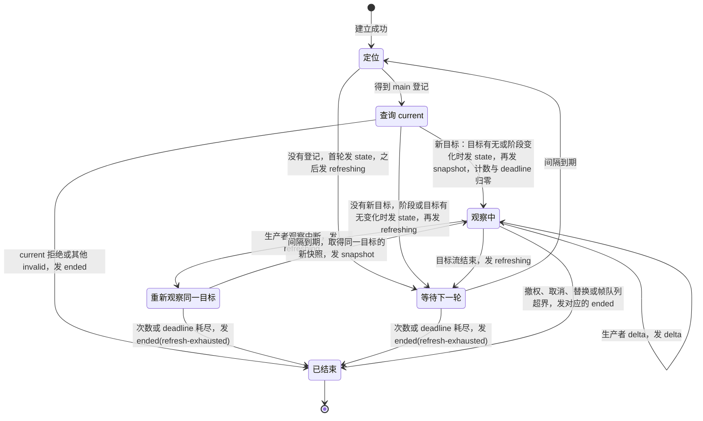

# 服务端接入行为规格

本页拥有治理协议的入口职责。消息字段和 `outcome` 的含义只归[公开契约](../public-contract/SPEC.md)。观察接入的组合责任见[观察脱离与重附着](#观察脱离与重附着746)。各小节的采用依据见该节开头。

## 入口职责

服务端接入接受已经完成传输保护的字节。传输保护失败时，调用者没有可信答复，对外是 `unknown`，不是 `basis-unavailable`，也不是业务结果。远程字节流必须具备保密和完整。传输路线沿[技术基础的共同技术选择](../../../docs/architecture/technical-foundations.md#共同技术选择)：HTTP JSON 控制与查询，fetch SSE 单向观察。公开操作、认证、端点与订阅语义由公开契约拥有。本页不选定具体保护协议。

接入用公开契约指定的严格 JSON 读取这些字节。读取失败是 `protocol-rejected`。它不挑选重复的 `protocolVersion`。

接入按公开契约的判定次序处理。前一步已经给出终端结果时，不再做后面的步骤。版本不是 `governance-public/1` 时是 `protocol-rejected`。版本是 `governance-public/1` 时，`disable-subject`、`restore-subject`、`end-subject` 和 `reopen-after-media-loss` 在封闭字段和登录核验之前返回 `stage-not-provided`。

必填登录证明的缺失、空字符串、未签发、已撤销，以及不是本部署签发的证明，交给 identity。对外是同一份 `denied`。时间或权威记录不可得时，identity 返回 `basis-unavailable`。接入不改写这两个结果，也不另持一份登录表。

发起者只取证明核验出的账号。请求体里的账号、组织和租户是目标。通过协议检查的请求交给 identity 与 authorization 的公开入口。接入不把存储对象放进公开响应。

## 依赖

服务端接入的依赖边以公开契约的[三个成员](../public-contract/SPEC.md#三个成员)为唯一来源。

公开契约不依赖服务端接入。SDK 不依赖服务端接入。

## 设计签名

下面的类型和函数是设计形状。本包不导出它们。它们不是已经可安装的调用。共同消息和 `outcome` 只引用公开契约。

```ts
type GovernanceEntry = {
  receive(protectedBytes: Uint8Array): Promise<unknown>;
};
```

`receive` 的输入是已经完成传输保护的字节。返回值是公开契约的响应。传输保护失败时，调用者没有这份响应，对外保持 `unknown`。

```ts
function receiveRevoke(
  entry: GovernanceEntry,
  protectedBytes: Uint8Array,
): Promise<unknown> {
  return entry.receive(protectedBytes);
}
```

接入先按公开契约做严格 JSON 读取。读取失败时返回 `protocol-rejected`，没有业务效果。协议检查通过后，接入把登录证明交给 identity 的公开入口，把通过身份检查的请求交给 authorization 的公开入口。它们返回的 `denied` 和 `basis-unavailable` 原样成为响应的 `outcome`。接入不改写这两个结果，也不把存储对象放进响应。

## 验证

入口不另写结果含义。入口在坏 JSON 上没有业务效果。版本不是 `governance-public/1` 时是 `protocol-rejected`。版本是 `governance-public/1` 时，`disable-subject`、`restore-subject`、`end-subject` 和 `reopen-after-media-loss` 不核验登录。登录证明的结果不被入口改写。下列输入的结果以公开契约为准。

- 字段表要求登录证明时，缺失或空字符串只有 `denied`。字段表禁止该字段时，出现该字段是 `protocol-rejected`。
- 留存期内的接续在激活完成时是 `succeeded`。已经激活后再注册是 `not-loginable`。
- 陌生账号接受邀请是 `not-visible`。过期且有权看见的邀请返回已有的过期终结。看不见时是 `not-visible`。
- `query-current-tenant` 不带行事租户。
- `issue-login` 的 `basis-unavailable` 不来自凭据已匹配的分支。
- 版本是 `governance-public/1` 时，`disable-subject`、`restore-subject`、`end-subject` 和 `reopen-after-media-loss` 在坏正文和坏证明下都是 `stage-not-provided`。版本不是 `governance-public/1` 时是 `protocol-rejected`。

## 观察脱离与重附着（#746）

本节的「组合责任与输入边界」「重附着与脱离」「失败交接与未覆盖」三个小节是 [#746 revision 2](https://github.com/nemori-ai/omne-harness-lite/issues/746) 的技术设计，已由 PanQiWei [接受](https://github.com/nemori-ai/omne-harness-lite/issues/746#issuecomment-6443957269)。「[刷新策略与资源](#刷新策略与资源)」小节的依据见该小节开头。本节不增加导出接口或运行实现。观察的公开操作、帧与连接生命周期归公开契约的[会话观察](../public-contract/SPEC.md#会话观察)。

### 组合责任与输入边界

服务端接入承担观察的脱离与重附着组合。它消费 Session 的公开日志读面、Model 的 `current` 与内容观察端口，不读取它们的内部状态。Session 拥有已提交日志事实，Model 拥有调用状态与当前观察目标。Agent 不参与这条重附着路径，也不签发观察资格。调用、结果保管与业务控制仍由原拥有者承担。

接入从已授权读取的会话日志取得稳定 `ModelInvocationRef`。日志中的稳定调用引用是重附着的事实依据。会话日志不保存瞬时流引用。首次挂接与重附着都经稳定调用引用查询 `current`。读取路径见 Session 的[稳定调用引用的读取](../../session/session-contract/SPEC.md#稳定调用引用的读取)。公开日志读面在能力上不提供这条读取路径时，接入停止该组合并交接 Session 拥有者，不从 Agent 实例、私有存储或旧流目录补造引用。读面提供这条路径、但运行时暂时没有所需登记时，接入按[刷新策略](#刷新策略)第 1 种触发刷新，不停止该组合。

登录识别、主体签发与目标租户的关系沿[登录到 Access](../../../docs/architecture/runtime/runtime-contract-handoff.md#登录到-access)。接入只在登录识别与账号关系核对成功后取得代租户行事主体，不接受请求体自报主体。接入为每个参与边界提供该观察者自己的显式 `Access`，不借用 Agent 或生产者的主体。会话归属、调用引用和流引用的租户须一致。持有任一种引用都不授予权限。

Session 日志读路径核其读取资格。Model `current` 核当前 facts/read 资格与引用。生产者观察端口核其观察资格及租户。接入不以某一步成功代替其他边界核权，也不以登录识别时的允许结果维持持续许可。等待后的受保护输出须遵守原端口重核规则。撤权、核权依据不可用与读取失败保持各边界原含义，不转换为观察成功或成功的 null。

### 重附着与脱离

1. 接入在当前登录与租户边界下读取日志中的稳定调用引用，携带自己的 `Access` 查询 Model `current`。定位或读取失败按原失败交回，不猜调用是否存在或执行。
2. 接入使用同一确认边界给出的 `CallState` 与当前目标。`current` 为 null 时，只呈现这份调用状态，不观察不存在的 ref。null 不表示未执行、终局或永久无目标。
3. 目标非 null 时，接入向该 ref 的生产者观察端口取得快照，再消费增量。快照与订阅衔接沿原观察端口的保证，不采用先普通读取再普通订阅来补造连续性。成功只表示取得有权读取的快照并建立该目标的观察，不表示业务工作完成。
4. 查询不提供可达性租约。旧 ref 失效时结束旧观察，再从稳定调用引用查询 `current`。目标改变后从新 ref 的快照开始，不能沿用旧 cursor、旧快照基线或把旧观察偷偷转向后继。
5. 接入串行查询，或只应用最新已发查询的响应。观察路径采用串行，见[在途读取的取消与迟到隔离](#在途读取的取消与迟到隔离)。切换目标或脱离后，迟到的旧查询、快照与增量不能覆盖当前观察。接入释放它们占用的本地观察资源。
6. 接入拥有有界刷新策略及其计时、在途读取与观察资源。null 窗口或 ref 失效后按该策略再查，不能无界忙轮询。刷新边界耗尽或依赖持续不可用时，明确交回尚未建立或维持观察的事实，不能改写调用结局。策略参数与资源上界见[刷新策略与资源](#刷新策略与资源)，对外表示见公开契约的[会话观察](../public-contract/SPEC.md#会话观察)。
7. 观察者主动脱离、连接结束或登录撤销时，接入停止该观察的刷新，取消本地等待并释放订阅、计时与队列资源。取消能力不足或清理失败须保留诊断，不声称已经清理。迟到的受保护输出不得继续披露。重新进入观察须重新经过各边界核权。

观察取消只结束观察。上述全部步骤都不得发起、取消、重试或重发 Model 或 Tool 业务调用，不触发 Session 推进，不改变结果保管或 ACK。目录为空、null、断线与观察失败均不能成为重发原调用的依据。

### 刷新策略与资源

本小节由 [#839](https://github.com/nemori-ai/omne-harness-lite/issues/839#issuecomment-6444555742) 按 [#746 接受评论](https://github.com/nemori-ai/omne-harness-lite/issues/746#issuecomment-6443957269)的委托由 reduce 拍定，待 PanQiWei 复核。本小节是接入的策略与资源规则，不是公开协议规则。帧、取消与连接生命周期归公开契约的[会话观察](../public-contract/SPEC.md#会话观察)，各来源结果的对外表示见公开契约的[来源与对外表示](../public-contract/SPEC.md#来源与对外表示)。

#### 刷新策略

刷新策略是部署配置的对象。下列数值都只是默认初值，不是契约承诺。

```text
ObservationRefreshPolicy {
  interval:       等待多久再定位或再查询一次（默认初值 1000 ms，下限初值 100 ms。下限不能低于不可配置的底线 100 ms）
  backoff:        每次空结果后间隔的放大系数（默认初值 1.5，间隔上限初值为 interval 的 30 倍）
  maxAttempts:    没有取得新目标时最多刷新几次（默认初值 60。null 表示不设次数上界，只受 deadline 约束）
  deadline:       刷新等待的累计时长上界，观察期间不计（默认初值 30 分钟）
  currentTimeout: 每次 current 读取的本地等待上界（默认初值 5 s）
}
```

- 策略对象由部署装配提供，接入不写死数值。没有配置时，接入使用默认初值。
- 配置值越出下限或上限时，接入把它钳到边界内，并记诊断 `observation.policy-clamped`。
- `interval` 的下限有一条不可配置的底线 100 ms。部署配置的下限与 `interval` 初值都不能低于这条底线，低于时接入同样钳制并记诊断。
- `deadline` 只累计刷新等待的时长。观察期间（有目标且流未结束）不计入。取得新目标时，尝试计数与 `deadline` 计时都归零。
- `maxAttempts` 与 `deadline` 两条上界先到者为准。默认初值下，间隔在第 10 次尝试前后到达上限 30 s，60 次尝试的等待共约 27 分钟，与 `deadline` 初值 30 分钟相近，两条上界大致同时到达。
- 工具可能运行很久，期间没有模型流。上界耗尽后，调用者重新建立观察即可，已落盘的内容不丢失。

刷新在下列四种情况下触发：

1. 定位没有得到用途为 `main` 的 Model 调用登记。翻页预算耗尽、Session 读取 `unavailable` 与接入自己的游标 `invalid` 也属于这一种。生产者观察的迭代器抛出，或没有交来 `ended` 就结束时，接入视为目标不可用，也按这一种处理。
2. `current` 没有给出新目标：返回 null、`unavailable` 或 `invalid(reference, not-accepted)`，或返回同一个已关闭的流引用。
3. 目标流结束：生产者交来 `ended(source-closed)`、`ended(stale-stream)`、`ended(producer-ended)`、stream-arrival 以后新增的结束原因，或 `buffer` 以外的 `gap`。
4. 生产者观察中断，但目标仍有效：生产者交来 `ended(capacity)`、`ended(unavailable)` 或 `gap(buffer)`。这一种不重新定位，只重新观察同一流引用并取新快照。它计为一次尝试，先按同一退避间隔等待，再重新观察。接入不做无等待的循环。

- 第 1 至 3 种的每轮刷新包括重新定位稳定调用引用与查询 `current`。
- 新目标按流引用判定。重新定位得到同一个已关闭的流引用时，接入把它当作空结果，按退避继续，不发 `snapshot`，也不将尝试计数归零。
- 目标有效且生产者仍在交付帧时，接入不刷新。
- 每轮刷新前，接入向调用者发一次 `refreshing` 帧。上界耗尽时，接入发 `ended(refresh-exhausted)`，明确交回尚未建立或维持观察的事实，不改写调用结局。
- 建立成功后的第一条帧是 `state` 或 `ended`。`state` 先于一切 `snapshot`、`delta`、`gap`、`refreshing`。首次查询被拒、建立后立即取消或替换、撤权时，第一条帧也可以是 `ended`。连接在首帧之前关闭时，可以没有帧。
- 首帧之后，接入只在调用阶段变化或目标有无变化时发 `state` 帧。

每个观察的状态与转换如下。转换上标出接入发出的帧。



任一状态遇到取消、替换、撤权或连接关闭都进入已结束。连接关闭时发不出 `ended` 帧。

#### 在途读取的取消与迟到隔离

- `current` 没有 signal。接入对每次 `current` 读取设本地等待上界 `currentTimeout`，它是[刷新策略](#刷新策略)对象的一个字段。超时只放弃等待，不证明底层读取已停止。接入记诊断 `observation.current-timeout`，并把这次超时计为一次空结果。它不向调用者声称成功或失败。
- 观察路径采用串行，不采用「只应用最新已发查询的响应」。接入对同一观察的定位与 `current` 读取串行执行。上一轮未返回时不发下一轮，超时视为已返回。
- 切换目标或观察结束后到达的旧快照与旧增量，接入丢弃它们，并记诊断 `observation.late-discarded`。
- 生产者观察使用 `StreamObserver.observe({ ref, access, signal })`。`signal` 是接入的本地取消。观察结束或目标切换时，接入中止该 signal 并释放迭代器。中止不取消原调用。

#### 资源上界

资源上界也是部署配置的对象。下列数值都只是默认初值。

```text
ObservationResourceLimits {
  perLogin:          每个登录同时最多几个观察（默认初值 4）
  perInstance:       每个部署实例同时最多几个观察（默认初值 1000）
  frameQueueBytes:   每个观察的本地帧队列字节上界（默认初值 1 MiB）
  locatePages:       每轮刷新的定位最多读几页 call.bound（默认初值 4）
  cancelRetention:   观察结束后观察记录的保留期（默认初值 60 s）
}
```

- 达到 `perLogin` 或 `perInstance` 时，`observe-session` 返回 `basis-unavailable`。计数时，同一登录下同一会话中同一 `observationId` 的旧观察不计入，建立成功时它被替换。
- 调用者消费过慢而超出 `frameQueueBytes` 时，接入发 `ended(capacity)`。接入不丢弃中间帧冒充连续。
- 定位读满 `locatePages` 页仍未见用途为 `main` 的 Model 登记时，按没有稳定引用处理。本版不建索引。
- 观察结束后，接入在 `cancelRetention` 内保留观察记录，供 `cancel-observation` 重放得到 `ended`。保留期过后得到 `not-found`。
- 清理失败时，接入记诊断 `observation.cleanup-failed` 并计数，不声称已经清理。

### 失败交接与未覆盖

Model `current` 的 denied、invalid、unavailable 保持[原失败与读取顺序](../../model/model-contract/SPEC.md#current-的失败与读取顺序)，不得折成成功 null。生产者拒绝、快照失败、流结束与连接丢失按原观察和传输边界交回。流结束只结束该次观察，调用结局仍取权威调用状态。传输中没有可信答复时，调用者不能据此声称观察或业务成功。

Session 公开日志读面的引用定位、分页与读取资格见[稳定调用引用的读取](../../session/session-contract/SPEC.md#稳定调用引用的读取)。公开观察消息、取消表达、连接生命周期与传输恢复规则见公开契约的[会话观察](../public-contract/SPEC.md#会话观察)。实际刷新、撤权、迟到响应隔离与资源清理的实现及验证由接入实现卡（待立）承担。观察连续的组合运行证据归 [#790](https://github.com/nemori-ai/omne-harness-lite/issues/790) H3。宿主身份、启停及归属等、模型选择分责与旧实例数据调查归 [#803](https://github.com/nemori-ai/omne-harness-lite/issues/803)。
