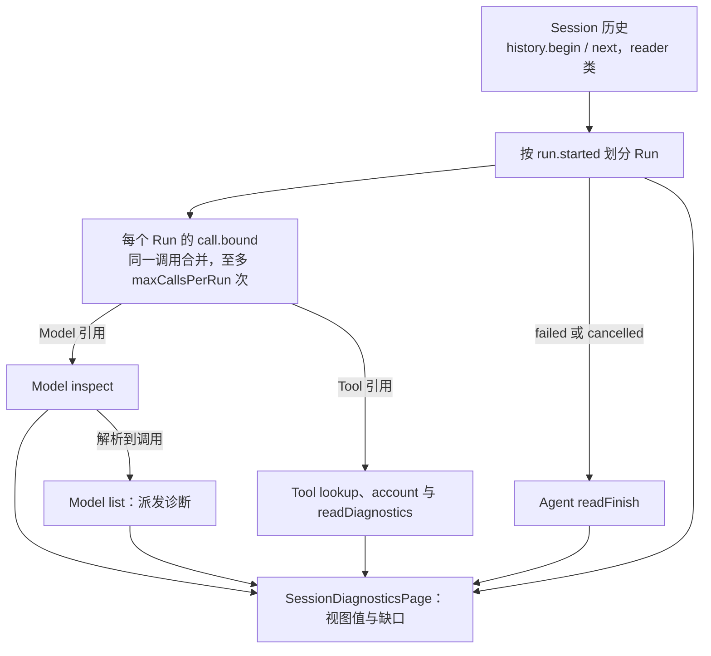
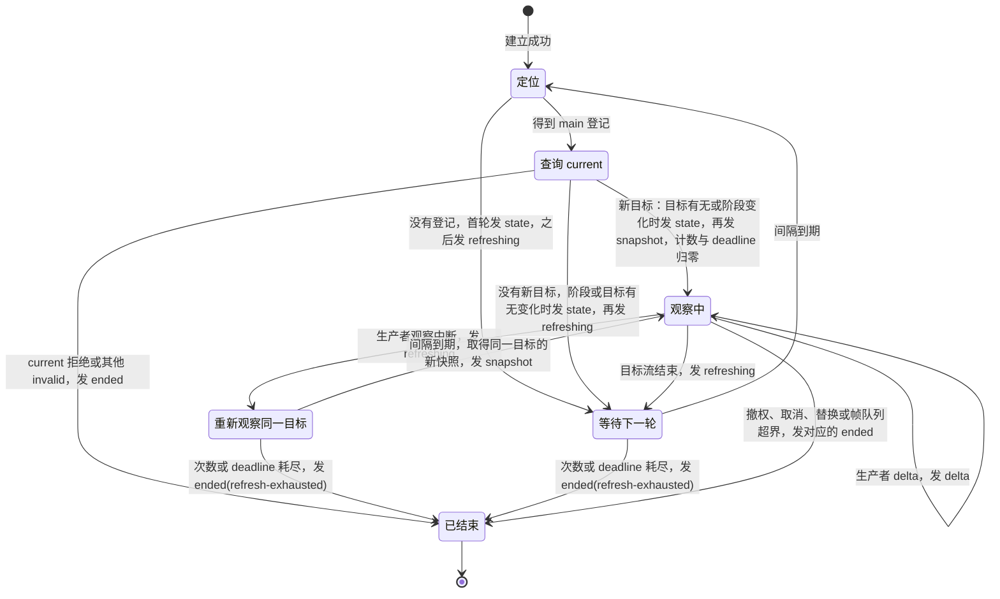

# 服务端接入行为规格

本页拥有治理位置、会话位置与 HITL 位置的入口职责。消息字段和 `outcome` 的含义只归[公开契约](../public-contract/SPEC.md)。路径、方法、状态码、请求体上限和 SSE 格式只归[承载绑定表](../public-contract/docs/http-binding.md#承载绑定表)。观察接入的组合责任见[观察脱离与重附着](#观察脱离与重附着746)。各小节的采用依据见该节开头。

下列条款由 #978 波 1 设计点 DP-2 采用，依据是 DP-2 决策记录（评论 6561904972）与 R1-D27（评论 6562041248）：本段第一段对会话位置和承载页的引用、「[位置与操作范围](#位置与操作范围)」整节（含各小节）、「[验证](#验证)」一节中会话位置与 HTTP 层的验证义务。其余条款保持各自原有的采用状态。「[会话诊断投影](#会话诊断投影)」小节，「会话位置」一节里写 `read-session-diagnostics` 的句子与表格内容，以及「[依赖](#依赖)」「[验证](#验证)」中会话诊断投影的条款，不在 DP-2 的采用范围内：它们由 [RFC-0013](../../../docs/rfcs/RFC-0013-engineering-telemetry.md) revision 2 的本地范围另行采用。

「[治理位置](#治理位置)」「[成功业务访问的报告](#成功业务访问的报告)」「[登录失效时结束观察](#登录失效时结束观察)」三个小节，以及「[服务端的 HTTP 层责任](#服务端的-http-层责任)」与「[验证](#验证)」中治理端口的条款，按 Reduce 的 R2-D203、R2-D204 与身份治理交付规格的 F2、F3、C4、C5 修订。

「[HITL 位置](#hitl-位置)」「[HITL 提交身份的派生规则](#hitl-提交身份的派生规则)」两个小节，以及「[服务端的 HTTP 层责任](#服务端的-http-层责任)」与「[验证](#验证)」中 HITL 位置的条款，不在 DP-2 的采用范围内。它们按系统架构的[领域能力的公开位置](../../../docs/architecture/layers-and-dependencies.md#领域能力的公开位置)写定。

## 入口职责

服务端接入接受已经完成传输保护的字节。传输保护失败时，调用者没有可信答复，对外是 `unknown`，不是 `basis-unavailable`，也不是业务结果。远程字节流必须具备保密和完整。传输路线沿[技术基础的共同技术选择](../../../docs/architecture/technical-foundations.md#共同技术选择)：HTTP JSON 控制与查询，fetch SSE 单向观察。公开操作、认证、端点与订阅语义由公开契约拥有。本页不选定具体保护协议。

接入用公开契约指定的严格 JSON 读取这些字节。读取失败是 `protocol-rejected`。它不挑选重复的 `protocolVersion`。

接入按公开契约的判定次序处理。前一步已经给出终端结果时，不再做后面的步骤。版本不是 `governance-public/1` 时是 `protocol-rejected`。版本是 `governance-public/1` 时，`disable-subject`、`restore-subject`、`end-subject` 和 `reopen-after-media-loss` 在封闭字段和登录核验之前返回 `stage-not-provided`。

必填登录证明的缺失、空字符串、未签发、已撤销，以及不是本部署签发的证明，交给 identity。对外是同一份 `denied`。时间或权威记录不可得时，identity 返回 `basis-unavailable`。接入不改写这两个结果，也不另持一份登录表。

发起者只取证明核验出的账号。请求体里的账号、组织和租户是目标。治理操作交给 identity 的治理入口。只有 `judge-admission` 交给 authorization，本部署不提供它。接入不把存储对象放进公开响应。

## 位置与操作范围

接入有三个位置。治理位置读写 `governance-public/1`，会话位置读写 `session-public/1`，HITL 位置读写 `hitl-public/1`。接入按请求路径选择位置和读取函数，不按消息里的版本文本分派。路径、方法、内容类型、状态码与请求体上限在[承载绑定表](../public-contract/docs/http-binding.md#承载绑定表)。本页不复制那张表。

每个位置的 HTTP 层先于公开契约的判断次序。HTTP 层的步骤和次序见[请求与响应规则](../public-contract/docs/http-binding.md#请求与响应规则)。HTTP 层的失败不调用 identity、authorization、Session 和 HITL。

状态码不替代消息里的 `outcome`。接入只由 `outcome` 决定状态码，映射见[状态码映射](../public-contract/docs/http-binding.md#状态码映射)。同一个 `outcome` 总是得到同一个状态码和同样形状的响应体。

### 治理位置

接入按公开契约的[判断次序](../public-contract/SPEC.md#判断次序)处理治理消息。治理位置的操作分四组：

- `register-and-activate` 和 `issue-login`：接入把消息交给 identity 的公开入口，不核验登录证明。`issue-login` 成功时，响应带新登录的 `loginId`。
- 18 个治理操作：`create-organization`、`query-create-organization`、`issue-member-invitation`、`accept-member-invitation`、`reject-member-invitation`、`withdraw-member-invitation`、`query-invitation`、`query-received-invitations`、`query-issued-invitations`、`query-own-memberships`、`query-organization-members`、`leave-organization`、`remove-member`、`change-member-role`、`switch-current-tenant`、`query-current-tenant`、`revoke-login`、`query-own-valid-logins`。接入把它们交给 identity 的治理端口（identity ID-18）。
- 4 个设置操作：`list-settings`、`set-setting`、`describe-setting`、`clear-setting`。接入把它们交给装配给的 `settings` 端口，规则见[设置项](#设置项)。
- 部署声明不提供的 14 个操作：`public-health`、`replace-credential`、`query-organization`、隶属的 8 个操作、`judge-admission`、`submit-authorization-expression` 与 `withdraw-authorization-expression`。声明是成员常量 `NOT_PROVIDED_GOVERNANCE_OPERATIONS`（`src/governance.ts`）。规则见公开契约的[部署声明不提供的操作](../public-contract/SPEC.md#部署声明不提供的操作)：请求通过第 3 步的封闭字段检查之后，接入答 `stage-not-provided`，`body` 为空，不识别登录，也不读取账号库。

识别登录不是公开操作。它是各位置判断次序里的内部步骤。

#### 设置项

本节兑现公开契约的[设置项](../public-contract/SPEC.md#设置项)。接入只做登录与行事租户的步骤，资格、声明与保管归 `settings` 端口。端口类型 `SettingsGovernance` 由本成员声明（`src/settings.ts`），只有管理语义：列出、写入、查看与清除，不取用秘密。

1. 装配没有给 `settings` 端口时，这 4 个操作按[部署声明不提供的操作](../public-contract/SPEC.md#部署声明不提供的操作)处理：通过第 3 步之后答 `stage-not-provided`，不识别登录，也不读取账号库。
2. 第 4 步：把 `loginProof` 交给 identity 的登录识别，`denied` 与 `basis-unavailable` 原样对外。
3. 第 6 步：`actingTenant` 不等于识别出的当前选择时答 `denied`，不调用端口。这一份 `denied` 与其他原因的 `denied` 除 `messageId` 外逐字节相同，不披露对方租户有没有配置。`body` 没有目标租户字段，带上它是 `protocol-rejected`。
4. 用签发者为行事租户签发代租户行事主体，`work.owner` 是 `identity-login`，规则同会话位置的第 4 步。账号不等答 `denied`，签发失败答 `basis-unavailable`。
5. 把主体与行事租户，以及请求里的 `asset`、`item` 和 `secret` 交给端口。`list-settings` 省略 `asset` 时，端口收到的输入也没有 `asset`。端口的结果按公开契约对外表示。接入只把成功体的字段写进响应：`set-setting` 只写 `configuredAt`，`describe-setting` 写端口给出的两层 `own` 与 `official`。端口给出的状态或条目不合公开契约时，编码失败，接入写出响应体为空的状态 500，记诊断 `encode.fault`。
6. 端口拒绝（Promise 被拒绝）时，`set-setting` 与 `clear-setting` 答 `unknown`，因为写入可能已经发生。`list-settings` 与 `describe-setting` 答 `basis-unavailable`。接入记诊断 `settings.fault`，诊断只带操作名。

秘密只在 `set-setting` 的请求里。接入把它原样交给端口，不写进响应、诊断或错误文本。这 4 个操作不报告成功业务访问。

接入对 18 个治理操作的职责如下。

| 步骤                | 接入的职责                                                                                                     |
| ------------------- | -------------------------------------------------------------------------------------------------------------- |
| 1 至 3 协议读取     | 用 `readGovernanceRequest` 读取。不合规是 `protocol-rejected`。声明不提供的操作在这之后答 `stage-not-provided` |
| 4 登录识别          | 把 `loginProof` 交给 identity 的登录识别。接入不改写 `denied` 与 `basis-unavailable`，也不另持登录表           |
| 6 行事租户          | 要求行事租户的操作：核对 `actingTenant` 等于识别出的当前选择。不等是 `denied`，响应不含实际选择                |
| 7、8 业务判断与提交 | 把识别出的登录原样交给治理端口。identity 在提交时再核对登录有效、选择未变，并判断资格。结果按公开契约对外表示  |

补充规则如下。

- `issue-member-invitation` 的 `duration` 是线上文本，接入用 `parseDuration` 读取。读不出 SI 秒时长时，结果是 `denied`，不建立邀请。这一步在第 6 步之后。
- `query-own-valid-logins` 的端口给出空名单时，结果是 `basis-unavailable`，没有登录数组。
- `revoke-login` 答 `succeeded` 或 `no-change` 时，目标登录已经失效。接入按[登录失效时结束观察](#登录失效时结束观察)结束它在本实例上的观察。
- 治理端口是必需依赖，必须与 `identity` 用同一份记录，撤销与切换才对登录识别生效（R2-D235 S1）。装配按调用现取治理服务时，服务缺席由端口答 `basis-unavailable`，18 个治理操作原样对外答 `basis-unavailable`。
- 治理位置的 `denied` 在各个原因下，响应除 `messageId` 外逐字节相同。原因包括登录缺失、空、无效或已失效，行事租户不符，以及 identity 的业务拒绝。`not-visible` 不区分对象不存在、属于其他账号与看不见。
- 治理操作不报告成功业务访问，所以不刷新空闲计时。

### 成功业务访问的报告

接入为下面两类成功调用 identity 治理端口的 `reportBusinessAccess({ login })`，`login` 是这次请求识别出的登录：

- 会话位置的 7 个操作答 `succeeded`。编码失败时没有答复，不报告。
- `observe-session` 建立成功，即认领到名额之后。

其他请求都不报告：失败的请求、治理操作、HITL 位置的操作、`cancel-observation`、声明不提供的操作和仅完成识别的请求。

接入先写出答复，再报告。`observe-session` 在流附着、连接关闭的监听登记之后再报告。接入不等报告结束，也不给报告设时限。报告永不结束时，答复照常写出，名额照常释放，`stop()` 照常结束。报告答 `basis-unavailable` 或 Promise 被拒绝时，接入记诊断 `identity.fault`，答复不变。

先写答复的代价是一个竞态：调用者收到答复后立刻发出的下一次请求，可能先于这次刷新到达 identity。空闲期限以分钟计，所以这个竞态只在空闲截止时刻前的极短时间内有影响。

### 登录失效时结束观察

观察记录绑定建立它的登录。登录失效后，接入在两种时机结束这份登录的观察，原帧流发 `ended(denied)`：

1. 本实例上的 `revoke-login` 答 `succeeded` 或 `no-change` 时，接入立刻结束目标登录在本实例上的全部观察。
2. 每一轮，接入用建立时的登录证明再识别一次登录。空闲期限或最长期限已到、登录已在别处撤销时，识别答 `invalid`，接入结束该观察。识别答 `basis-unavailable` 或抛出时，接入发 `ended(unavailable)`。

本阶段的观察不定位，也不刷新，所以一轮是一个心跳间隔 `heartbeatIntervalMs`。同一观察的登录重核串行执行。观察结束后到达的重核结果不改变任何东西。与撤销并发建立的观察，最迟在下一轮结束。

### 会话位置

会话位置提供公开契约的八个会话操作和两个观察操作。接入按公开契约的[会话判断次序](../public-contract/SPEC.md#会话判断次序)处理会话操作。下表写接入在每一步的职责。操作 `read-session-diagnostics` 的组合规则另见[会话诊断投影](#会话诊断投影)。

| 步骤             | 接入的职责                                                                                                                                                                                                                                                                                                                                                                                                                                            |
| ---------------- | ----------------------------------------------------------------------------------------------------------------------------------------------------------------------------------------------------------------------------------------------------------------------------------------------------------------------------------------------------------------------------------------------------------------------------------------------------- |
| 1 协议读取       | 按承载页的[会话路径的读取分派](../public-contract/docs/http-binding.md#会话路径的读取分派)读取。两个观察操作按承载页的手写读取规则，其他操作用 `readSessionRequest`。另按 message 包完整解码 `message`。任一不合规是 `protocol-rejected`，Session 不被调用                                                                                                                                                                                            |
| 2 登录识别       | 把 `loginProof` 交给 identity 的登录识别，得到账号、登录和当前租户。接入不改写 `denied` 与 `basis-unavailable`，也不另持登录表                                                                                                                                                                                                                                                                                                                        |
| 3 行事租户       | 只对 `create-session`：核对 `actingTenant` 等于该登录的当前选择，不等是 `denied`，响应不含实际选择                                                                                                                                                                                                                                                                                                                                                    |
| 4 目标租户与主体 | 目标租户的账号等于识别出的账号时，用签发者签发代租户行事主体，规则见[登录到 Access](../../../docs/architecture/runtime/runtime-contract-handoff.md#登录到-access)。账号不等是 `denied`。签发者未安装或签发失败是 `basis-unavailable`                                                                                                                                                                                                                  |
| 5 部署范围       | 用 `definitionMappings` 解析 `definition`。定义名不在映射内，或 `pageBytes` 超出部署上界，是 `invalid`。`create-session` 的映射条目没有 `initialModelSelection` 时，是 `basis-unavailable`，不调用 Session，记诊断 `session.definition-incomplete`。`read-session-diagnostics`：部署没有配置投影（`diagnosticsKinds`、`maxRuns`、`maxCallsPerRun`）时是 `basis-unavailable`，不调用 Session；游标不是本实例为该租户与会话签发的，是 `invalid` |
| 6 Session 判断   | 按[操作到 Session 的映射](../../../docs/architecture/runtime/runtime-contract-handoff.md#操作到-session-的映射)调用 Session 的面。结果按公开契约的映射表对外表示。`read-session-diagnostics`先读 Session 历史，再读其他来源；其他来源的拒绝不改变 `outcome`                                                                                                                                                                                   |

补充规则如下。

- `cancel-run` 和 `stop-call` 调用 Session 的 `cancelRun` 与 `stopCall`，调用方类是 `intake`。它们没有行事租户，第 3 步不适用。
- `stop-call` 的 `producer.kind` 为 `tool` 时，接入在 Session 的访问裁定之后、会话存在核对之前答 `unsupported`。接入不写任何记录。该结果与会话是否存在、`controlId` 是否用过无关。
- 接入从识别出的登录和请求标识派生 `SessionOperationId`，规则见[SessionOperationId 的派生规则](#sessionoperationid-的派生规则)。客户端不填它。
- `initialModelSelection` 对公开创建是必需项：客户端不填它，公开操作也没有切换模型的入口。缺它的会话永远读不到当前模型选择，Run 无法启动。接入因此不创建这样的会话，缺口属于部署配置，不属于调用者的消息，所以答 `basis-unavailable`，不答 `invalid`。
- `definitionMappings` 的选择是部署装配的配置。接入只读取已装配的映射，不自己选择。同一份映射数据交给 Agent 采用和 Session 采用来源。
- 映射条目可带可选的 `residentCapabilities`，列出该定义的会话在 `create` 时纳入的常驻工具能力名，形状是 Session 采用点输入的 `capabilities`。接入不读这一项，也不在创建里声明常驻工具。常驻工具的材料由 Session 采用来源按这一项从部署的工具来源解出，解不出时创建失败。没有这一项的条目不纳入常驻工具。
- 会话位置的 `denied` 不披露会话是否存在。接入对所有 `denied` 原因给出逐字节相同的响应，见[denied 的一致性](../public-contract/docs/http-binding.md#denied-的一致性)。
- 观察操作的建立点、帧与取消沿公开契约的[会话观察](../public-contract/SPEC.md#会话观察)。承载格式见[SSE 观察](../public-contract/docs/http-binding.md#sse-观察)。观察消息的读写见承载页的[观察消息的手写读写](../public-contract/docs/http-binding.md#观察消息的手写读写)。

### 会话诊断投影

本节按 RFC-0013 revision 2 的本地范围采用。设计依据是 [RFC-0013 的 A 线](../../../docs/rfcs/RFC-0013-engineering-telemetry.md#a-线会话日志诊断投影)。它的裁定 DA1（组合承担者是本成员的 `session-view/` 模块）与 DA5（操作名 `read-session-diagnostics`）按 RFC revision 2 的接续采用记录执行。线上形状归公开契约的[会话诊断页](../public-contract/SPEC.md#会话诊断页)。

接入是这个投影的组合承担者。投影只读：它不创建 Session、Run 或调用，不重新执行任何动作，不消耗派生额度，也不缓存跨请求的结果。它只经各拥有者的公开读口取数，不读存储内部。

来源与读取路径：

| 来源    | 读口                                                                                     | 端口                                   | 取什么                                               |
| ------- | ---------------------------------------------------------------------------------------- | -------------------------------------- | ---------------------------------------------------- |
| Session | `history.begin`，`reader` 类，反向，种类取 `diagnosticsKinds`；页内续读用 `history.next` | `session.history`，必需                | Run 的骨架、调用登记、控制、终态与消息计数           |
| Agent   | `readFinish`                                                                             | `agentJournal`，可选；读口本身也可选   | 以 `failed` 或 `cancelled` 终结的 Run 的结束候选     |
| Model   | `inspect`，然后 `list`，再 `dispatches`                                                  | `modelCalls`、`modelDiagnostics`，可选 | `call.bound` 的 Model 引用解析到的调用、它的派发诊断与每次派发的账目 |
| Tool    | `lookup`、`account` 与 `readDiagnostics`                                                 | `toolQueries`，可选                    | `call.bound` 的 Tool 引用的状态、账目与诊断页第一页  |

组合规则：

1. Run 的骨架只来自 Session。接入从最新一条反向读历史，按 `run.started` 划分 Run：两个 `run.started` 之间的条目属于较新的那个 Run。`run` 为 null 时每页至多 `maxRuns` 个 Run；给了 `run` 时只投影那个 Run，扫到它就停。
2. 每个 Run 至多 `maxCallsPerRun` 次调用进入扇出，按日志顺序取前面的。超出的只计数，并记缺口 `truncated`，`subject` 是 Run。一次 Tool 调用可以有两条 `call.bound`：先是没有生产者的 `tool-intent` 登记，再是关联登记。投影把它们算作同一个调用，只计一次：以带生产者的那条为准，位置取首次登记的位置。所以这样的调用不会被多计，也不会提前触发 `truncated`。
3. Model 分支先 `inspect`。解析到调用才 `list` 它的派发，一次最多 64 条；还有下一页时记缺口 `truncated`；`coverage` 为 `expired-prefix` 时记缺口 `retention-expired`。`not-accepted` 写成 `unknown`，原因 `not-accepted`。`list` 给出至少一条派发时，再读同一调用的 `dispatches`，按派发标识把记录对到诊断条目上，给每次派发写 `account`：记录的 `account` 为 null 时写 `unknown`，原因 `not-recorded`；诊断条目的派发在记录里找不到时写 `unknown`，原因 `not-found`；`dispatches` 读失败时每次派发都写 `unknown` 带该读的原因，并只记一条缺口，对象是该调用引用。没有派发条目时不读 `dispatches`。Tool 分支的 `lookup`、`account` 与 `readDiagnostics` 各自独立；一个的缺口不影响另一个。`readDiagnostics` 只读第一页（`after` 为 null）：条目只取 `operation`、`phase`、`code`，不带证据；`next` 不为 null 时不读下一页，记缺口 `truncated`；读失败时 `diagnostics` 写 `unknown` 带原因并记缺口。
   Session 骨架另有两类计数：`run.attempt-started`、`run.attempt-released`（按载荷 `reason` 分计五种）与 `run.attempt-exited` 计入 `attempts`；`call.execution-fact` 按载荷 `fact.kind` 计数。`reason` 不在五种之内，或没有 `fact.kind` 的条目不计。

   一条 `call.execution-fact` 的归属只用这条条目自身的字段，按下面的次序找它指向的调用：

   - 先取载荷顶层的 `consumption`。观察路径这样写。
   - 顶层没有时，取 `fact.consumption`。`release` 事实这样写。
   - 两处都没有、且条目带 `fact.producer` 时，取生产者。接收路径的 `execution` 事实只带生产者。

   条目有消费标识时，它等于某次进入扇出的调用的消费标识，事实就计入该调用的 `facts`。这时不再按生产者找。条目只有生产者时，某次进入扇出的调用在 `call.bound` 登记的生产者（`registration.binding.producer`，或旧形状的 `binding.producer`）的 `kind` 与 `call` 都与它相同，事实就计入该调用的 `facts`；有几次调用相同时取日志中最先登记的那次。其余事实计入 Run 的 `facts`。计数与条目在日志中的先后无关。
4. 只对 `failed` 或 `cancelled` 的 Run 读 Agent 的 `readFinish`。`completed` 的 Run 的 `structured` 是 `none`。读到的结束候选只取闭合字段；`node-failed` 取原候选的 `node`、`category` 和 `failureKind`，不取异常原文；没有候选时是 `unknown`，原因 `not-recorded`。
5. 每个来源的拒绝、不可用、不支持、找不到都成为缺口，带来源、对象与原因；对应的值写 `unknown` 并带同一原因。端口缺席或 `readFinish` 缺席是 `unsupported`。端口抛出异常是 `unavailable`，页照常返回。同一（来源、对象、原因）只记一条。 来源失败到缺口原因的映射：`denied`、`unavailable`、`unsupported` 照原名；`invalid` 出在引用字段上时是 `not-found`，出在其他字段（例如 limit、租户）上时是 `unavailable`；`not-settled` 是 `not-recorded`；其余失败种类（容量、冲突、提交未知、过期游标等）是 `unavailable`。只有 `modelCalls` 没有 `modelDiagnostics` 时，派发的缺口是 `unsupported`。
6. 投影不跨来源推断：Session 没有登记的调用不出现；Model 或 Tool 的空答复不说明调用不存在。
7. 部署不披露的种类（`PROJECTED_KINDS` 中不在 `diagnosticsKinds` 里的）记缺口 `not-disclosed`，`subject` 是种类名。接入只向 Session 请求披露的种类。
8. `fault.diagnostic`、消息正文、工具参数、账目的 `place` 与任何供应商错误原文都不进视图。公开契约的编码把这些字段挡在页外。

分页与游标：

- 首页用 `begin`，`from` 为 null。续页用 `begin`，`from` 是上一页停下的那个 `run.started` 的条目标识，反向不含它自己。
- 游标由本实例用随机密钥封印，绑定租户文本、会话、`run` 过滤、`pageBytes` 与本页的 `basis.upper`。被篡改、另一会话、另一实例签发或不是本实例形状的游标都是 `invalid`。接入不按猜测的位置继续。
- 续页重新经 Session 核资格。撤权后续页是 `denied`，与首页一样逐字节相同。
- `exhausted` 为真表示没有更多 Run 可读；给了 `run` 时扫到那个 Run 或读完历史都是真。`scannedThrough` 是停下的 `run.started` 条目标识，或 Session 最后一页的 `scannedThrough`。
- 时刻只在载荷带发生时间时显示。Session 的历史载荷不带发生时间，所以在 RFC-0013 DA7 采用之前，`started.at` 恒为 `unknown`。`timing` 的三项按 Model 诊断原样给出。
- 续页的 `basis.upper` 是游标里封存的首页上界，不是续页这次读到的当前上界。续页向更早的位置读，读不到首页上界之后追加的条目，所以整轮遍历的依据是首页的上界（Session 契约 SL10「固定读取上界」）。续页签发的下一个游标封存同一个上界。新的首页读当前上界。

授权：取数按调用方的租户。Session 的资格判断先于一切，`denied` 不披露会话是否存在。Agent、Model 与 Tool 各自核资格，它们的 `denied` 只成为缺口。

读取时点：各来源在不同的时刻读取。`basis.upper` 只说明 Session 历史部分依据的修订；Agent、Model 与 Tool 在读完 Session 历史之后各自读取，没有共同的读取边界。所以同一页里可以出现 Session 显示 Run 已终结、而 Model 派发仍是 `pending` 的组合。读者把每个来源的值当作该来源被读取时的状态，不当作同一时间点的快照。

下图是一页的读取次序。每个读口的失败只在自己那一支成为缺口。



已知限制：

- Model 读面按部署显式采用的租户只读资格返回；未授权、不支持或不可用仍形成缺口。应用的资格映射和登录返回检查归 [server-entry 行](../../../apps/harness-server/docs/rows/server-entry.md)。
- Agent 已保存 `node-failed` 结束候选并完成原责任收尾时，投影读取其节点、分类与失败种类。原责任尚未得到可靠终态时，`terminal` 仍为 `null`；投影不据遥测日志推断业务结束。

### SessionOperationId 的派生规则

本节是 `SessionOperationId` 派生规则的现行源。公开契约的[控制标识与重试](../public-contract/SPEC.md#控制标识与重试)把派生规则分给服务端接入，本节兑现它。摘要算法、族的文本和字段编码归 Session 的 [`deriveIngressOperation`](../../session/session-contract/docs/public-api.md)。接入调用它，不另写算法。

1. 派生是确定性的。同一业务意图在崩溃前后得到同一个身份。
2. 需要操作身份的操作各属于一个族，族与字段取法如下表。字段按表中的次序传入。

| 族      | 适用操作                                 | 字段                                      |
| ------- | ---------------------------------------- | ----------------------------------------- |
| create  | `create-session`、`query-create-session` | 租户文本、`createCallId`                  |
| accept  | `send-input`、`query-send-input`         | 租户文本、会话文本、`acceptId`            |
| control | `cancel-run`、`stop-call`                | 登录文本、租户文本、会话文本、`controlId` |

3. create 与 accept 的字段取法同[派生身份](../../../docs/architecture/runtime/runtime-contract-handoff.md#派生身份)已有的两行。control 一行待 Reduce 并入那张表。并入后，本表删去这一行，只引用那张表。登录文本是识别出的登录的 loginStateCodec 文本。
4. control 含登录文本，因为不同登录不共享中断回执。create 与 accept 不含登录文本，因为租户文本已经含账号。
5. `messageId` 不进入任何身份。换新的 `messageId` 或重连不产生新身份。
6. `cancel-run` 和 `stop-call` 共用 control 族，所以共用 `controlId` 的唯一范围。同一登录在同一会话里，同一 `controlId` 跨两个操作复用，由 Session 得到 `conflict`。
7. `body` 中出现 `login` 或 `operation` 一类字段时，公开契约已经规定为 `protocol-rejected`。客户端不能填写身份。

碰撞测试分两层。接入的碰撞测试归接入，见[验证](#验证)：每个族只改一个字段，身份就变。摘要算法本身的碰撞测试归 Session，已在 Session 的 `deriveIngressOperation` 测试中。

### HITL 位置

本节兑现公开契约的[HITL 公开操作](../public-contract/SPEC.md#hitl-公开操作)。接入是这个位置的组合承担者：它经 HITL 声明的公开查询与命令调用 HITL，不另核资格。读者、答复者、当前成员资格与一卡一决都由 HITL 判断。

接入按公开契约的[HITL 判断次序](../public-contract/SPEC.md#hitl-判断次序)处理 HITL 消息。下表写接入在每一步的职责。

| 步骤 | 接入的职责 |
| --- | --- |
| 1 协议读取 | 用 `readHitlRequest` 读取。不合规是 `protocol-rejected`，HITL 不被调用。部署声明不提供的 HITL 操作在这之后答 `stage-not-provided`，不识别登录 |
| 2 登录识别 | 把 `loginProof` 交给 identity 的登录识别，得到账号与登录。接入不改写 `denied` 与 `basis-unavailable`，也不另持登录表 |
| 3 目标租户与入口主体 | 目标租户的账号不等于识别出的账号时答 `denied`，不调用持有者。账号相等时，把识别出的账号与目标租户交给装配给的入口主体持有者 `hitlEntryPrincipals`，取得入口主体。持有者缺席、拒绝签发或抛出时答 `basis-unavailable` |
| 4 HITL 判断 | 以入口主体作为 `Access`，调用 HITL 入口面的对应方法。结果按公开契约的映射表对外表示 |

入口主体是 `{ kind: 'acting-for-tenant', actor, tenant, work }`：`actor` 是本成员的系统主体，`component` 为 `server-entry`；`tenant` 是目标租户；`work` 是 `{ owner: 'harness.hitl', work: 'cards' }`。`work` 是固定文本，所以同一租户的每次请求都得到同一个主体引用，与这次请求用哪一份登录无关。出卡方登记卡片时，用这个引用固定读者与答复者，规则见 HITL 的[公开入口与受众](../../human-intervention/human-intervention/docs/protocol.md#公开入口与受众)。签发者与关系核对见 identity 的[持有者与关系核对位置](../../identity/identity/SPEC.md#持有者与关系核对位置)。

接入只声明下面这个窄入口面，真实的 HITL 应用在结构上满足它。下面是设计形状：

```ts
type HitlIngressFaces<P> = Readonly<{
  queries: Pick<HumanInterventionQueries<P>, 'listPool' | 'getCard' | 'getOperation'>
  commands: Pick<HumanInterventionCommands<P>, 'submitReply'>
  /** HITL 提供者对一条 submitReply 命令的绑定：原操作身份与输入摘要。 */
  bindSubmitReply(command: SubmitReply): Readonly<{ operationRef: OperationRef; inputDigest: string }>
}>
```

公开操作到入口面的映射如下。四次调用的 `protocol` 都是 `hitl/1`。

| 公开操作 | 入口面的方法 | 输入 |
| --- | --- | --- |
| `list-cards` | `queries.listPool` | `tenantRef` 为目标租户的租户文本；`locationRef` 为部署配置 `hitlLocationRef`；`filter` 与 `limit` 取 body；`cursor` 为 null 时省略，否则取 body |
| `read-card` | `queries.getCard` | `cardRef` 取 body 的 `card` |
| `submit-reply` | `commands.submitReply` | `operation` 为派生的提交身份；`cardRef`、`expectedRevision` 与 `reply` 取 body |
| `query-submit-reply` | `queries.getOperation` | 按上一行组成同一条 `submitReply` 命令，交给 `bindSubmitReply`，取得 `operationRef` 与 `inputDigest`。接入不另写摘要算法 |

补充规则如下。

- 位置引用 `hitlLocationRef` 是部署配置，与装配给 HITL 查询的固定位置相同。客户端不填它。
- 装配没有给 HITL 入口面时，四个操作都按[HITL 部署声明不提供的操作](../public-contract/SPEC.md#hitl-部署声明不提供的操作)处理：通过第 1 步之后答 `stage-not-provided`，不识别登录。声明的其余部分是成员常量，列出本部署不提供的 HITL 操作。四个操作的接入都已实现，所以这份常量是空的。
- `list-cards` 带不带 `sessionRef` 都调用同一个 `listPool`，`filter` 原样交给 HITL。接入不按来源或会话自行过滤结果。
- 接入把 HITL 的池项按公开契约的[卡片视图](../public-contract/SPEC.md#卡片视图)编码。`origin` 只取 `kind`、`sessionRef`、`runRef` 与 `toolCallRef`，其余成员原样编码。
- HITL 位置的 `denied` 不披露卡片是否存在。接入对所有 `denied` 原因给出逐字节相同的响应，见[denied 的一致性](../public-contract/docs/http-binding.md#denied-的一致性)。
- HITL 位置的操作不报告成功业务访问，所以不刷新登录的空闲计时。
- HITL 入口面的 `listPool` 或 `getCard` 抛出时，结果是 `basis-unavailable`。接入记诊断 `hitl.read-fault`，`operation` 是抛出的方法名。`bindSubmitReply` 或 `getOperation` 抛出时，结果同样是 `basis-unavailable`，诊断的 `operation` 是 `getOperation`。HITL 给出的 `unavailable` 答复不是故障，不记这个诊断。
- `query-submit-reply` 认回的原操作不是答复命令时，同一提交身份对应了不同内容，结果是 `conflict`。

### HITL 提交身份的派生规则

本节兑现公开契约[答复的提交与认回](../public-contract/SPEC.md#答复的提交与认回)分给服务端接入的派生规则。`submit-reply` 与 `query-submit-reply` 用同一个派生。

1. 派生是确定性的。同一次提交在崩溃前后、换一份登录之后，得到同一个身份。
2. `tenantRef` 是目标租户的租户文本，取法同[派生身份](../../../docs/architecture/runtime/runtime-contract-handoff.md#派生身份)。
3. `actorRef` 是 identity 的 `standingPrincipalRef` 对入口主体的结果。入口主体对同一租户稳定，所以它也稳定。
4. `operationId` 是字符串数组 `["hitl-public/1-reply", 租户文本, replyId]` 的摘要。编码与摘要同[派生身份](../../../docs/architecture/runtime/runtime-contract-handoff.md#派生身份)：不带 replacer 与缩进的 `JSON.stringify`，取 UTF-8 字节的 SHA-256，写成小写十六进制，不加前缀。
5. 身份不含登录文本，也不含 `messageId`。换新的 `messageId`、重连或换登录都不产生新身份。
6. 同一 `replyId` 对应不同内容时，HITL 的输入摘要不同，HITL 答 `conflict`。

### 服务端的 HTTP 层责任

下面的规则属于服务端自己，不是两端共用的承载保证。

- 监听地址只能是 `127.0.0.1`，使用明文 HTTP/1.1。部署配置给出其他地址时，服务启动失败并报配置错误。`0.0.0.0`、`::`、主机名和其他网卡地址都属于其他地址。接入不静默改写地址。
- 监听端口是部署配置，名字是 `listenPort`。初值归装配配置。
- `maxInFlightRequests` 是必需的正安全整数配置，装配初值为 64。路径、方法、Host 与媒体类型通过后，接入在读 body 前预留槽位。用尽时返回空正文的 429，头 `x-omne-limit: in-flight-requests`，并关闭连接。不调用 Identity 或 Session。
- 槽位覆盖 body 读取与该请求处理，成功、拒绝、断连与异常都释放，断连与处理完成竞争时只释放一次。断连不撤销已受理的业务调用；这些调用继续受既有关闭排空和原操作认回规则约束。SSE 建立后释放请求槽位，长期连接继续使用独立 observation 预算。普通输入队列满时，Session 的查询、控制与恢复仍可用。
- Session 的 `limited` 保留 `resource` 与 `limit`，映射为带公开响应正文的 429。单体 body 超限仍为 413。
- 接入不发 CORS 头。`OPTIONS` 请求按承载页[请求与响应规则](../public-contract/docs/http-binding.md#请求与响应规则)的第 2 步得到 405。
- 接入的日志和诊断不记录请求体和响应体。登录证明、凭据和签发者不出现在任何输出里。诊断里的路径不带查询串。
- 新地址的判断次序、预算的时机、超限的答复与关连接的规则见[管道](#管道)。本节其余条款说的是现有三个位置。
- M2 不提供 TLS，见承载页的[已知限制](../public-contract/docs/http-binding.md#已知限制)。

依赖抛出异常或不可达时，对外结果按调用的类别决定。接入不把它们写成接入自身的故障。

- 读取类依赖：identity 的登录识别、签发者，以及 Session 的读取类调用（`queryOperation`、日志读取与历史页读取）。它们抛出异常或不可达时，结果是 `basis-unavailable`，状态 503。读取没有提交任何效果，所以「现在不能得出允许」成立。
- Session 的提交类调用：`create`、`accept`、`cancelRun` 与 `stopCall`。调用开始之后抛出异常或不可达时，结果是 `unknown`，状态 500，带 `unknown` 的响应体。提交可能已经发生，所以接入不答 `basis-unavailable`。依据是公开契约：只有存储提交之前来源不可读才是 `basis-unavailable`（[Session 结果与线上结果](../public-contract/SPEC.md#session-结果与线上结果)），`commit-unknown` 映射为 `unknown`（[结果](../public-contract/SPEC.md#结果)）。调用者用原标识原样再送，或用查询操作认回。
- 治理位置的 `register-and-activate` 与 `issue-login`：identity 的公开入口抛出异常或不可达时，签发或激活可能已经提交。公开契约[结果闭合与关联](../public-contract/SPEC.md#结果闭合与关联)给这两个操作的结果集没有线上 `unknown`，丢失回执只是调用者本地未知。所以接入不构造业务结果，写出响应体为空的状态 500，并关闭连接。
- 治理位置的 18 个治理操作：治理端口的 Promise 被拒绝时，结果对接入未知（identity ID-18）。`create-organization` 的结果集有线上 `unknown`，接入答 `unknown`，状态 500，带响应体。其余 17 个操作的结果集没有线上 `unknown`，接入写出响应体为空的状态 500，并关闭连接。接入不答 `basis-unavailable`。
- HITL 位置：入口主体持有者，以及 HITL 的 `listPool`、`getCard`、`getOperation` 与 `bindSubmitReply` 是读取类依赖。它们抛出异常或不可达时，结果是 `basis-unavailable`，状态 503。`submitReply` 是提交类调用。调用开始之后它抛出异常或不可达时，结果是 `unknown`，状态 500，带响应体。调用者用同一 `replyId` 原样再送，或用 `query-submit-reply` 认回。

响应体为空的状态 500 表示接入没有可信答复。它只用于接入自身的故障和上面治理位置的两种情况。接入写出它之后关闭连接。接入不把这类情况写成 `denied`、`succeeded` 或 `basis-unavailable`。`unknown` 的状态 500 带响应体，不属于这一条。

## 登记表

登记表记着「现在挂着哪些协议」。设计依据是 [RFC-0015](../../../docs/rfcs/RFC-0015-access-dynamic-registration.md#登记表与贡献) 第 5 节与第 13 节「登记表里的一个协议」；领域看到的形状（贡献、`mount`）归 [access-cordis-contract](../access-cordis-contract/SPEC.md)。本节的代码在 `src/registry/`：`registry.ts` 是不认识 Cordis 的纯状态，`cordis.ts` 是 Cordis 提供者 `AccessRegistryProvider`。登记表经[管道](#管道)接到新地址上，操作交给[收场与宽限](#收场与宽限)，观察交给[观察中枢](#观察中枢)。前提是构造入口时给了 `access`。入口启动时自己在这份登记表上挂上[内置协议](#内置协议与可用性) `access/v1`，停止时最后撤下。现有三个位置不经过登记表。

登记表不认识任何领域。表项按协议名与主版本存，处理函数只当函数调用。`src/registry/` 与 `src/settle/` 不导入任何领域的成员，也不导入本成员现有三个位置的文件，依赖方向的门禁 `entry-registry-knows-no-domain` 守这一条。

| 操作 | 协议未挂上 | 协议已挂上 |
| --- | --- | --- |
| `mount`，同名同主版本 | 加表项，修订号加一，同步回调订阅者 | 抛 `AccessAssemblyError`，已挂的那份不动 |
| `mount`，同名、主版本不同 | 是另一个协议，按左栏 | 是另一个协议，按左栏 |
| 撤下 | 不可达：撤下只随成功挂上的那一次发生。再调一次撤下函数，返回同一个 Promise | 一个同步段：移除表项，触发这份贡献的中止信号，修订号加一，同步回调订阅者。返回排空的 Promise |
| `enter(key, name)`，名字是契约里的操作或观察 | 返回 `undefined` | 同步登记成在途，返回 `Entered`：成员、这份贡献的中止信号、`leave` |
| `enter(key, name)`，名字不在契约里 | 返回 `undefined` | 返回 `undefined`，不登记 |
| `leave` | 不可达 | 从在途集合移除；第二次没有效果。撤下之后在途集合空了，排空完成 |
| `subscribe(listener)` | 同步返回快照（修订号与挂着的协议）并登记订阅者 | 同左 |

- **两个同步段。** `enter` 与 `subscribe` 是同步方法，签名里就不是 Promise（`RegistryForPipeline`）。「查表并登记成在途」「读快照并登记订阅者」各是一步，中间不让出执行权（RFC-0015 §15「两条硬要求」）。
- **撤下完成。** 「撤下完成」是登记表自己的状态，由这份贡献最后一个 `leave` 触发：调用与观察都算。`AccessRegistryService.mount` 把撤下函数作为调用者 Cordis 作用域上效应的收回函数，Cordis 4.0.4 的卸载等它返回的 Promise，所以插件的卸载在最后一个在途工作结束之后才完成。
- **订阅者。** 订阅者回调在挂上或撤下的同步段里被调用，看到的修订号是变化之后的修订号。订阅者回调抛出时，登记表与别的订阅者照常，错误交给构造时注入的 `onListenerError`。Cordis 提供者总是注入它：每次抛出记一条 `access.listener-fault`，交给提供者配置里的 `diagnostics`（与 `access.diagnostics` 同一种事件）。退订第二次没有效果。
- **提供者给出登记表本身。** `AccessRegistryProvider` 的 `registry` 是它里面那份完整的登记表（`AccessRegistry`，带 `mount`）。装配把它作为 `access.registry` 交给入口，入口才能在上面挂内置协议。
- **管道看得到、领域看不到。** `enter`、`subscribe` 只在提供者与 `createAccessRegistry` 的返回值上，不在 `AccessRegistryService` 上。

## 管道

管道是新地址 `/api/<协议名>/v<主版本>/<名字>` 上的判断次序第 1 到 9 步。设计依据是 [RFC-0015](../../../docs/rfcs/RFC-0015-access-dynamic-registration.md#管道与判断次序) 第 4 节、第 5 节「管道与判断次序」与第 14 节 I-10 到 I-14，交付卡 #1233。线上的形状归[承载页的新地址](../public-contract/docs/http-binding.md#新地址)。第 10 到 14 步归[收场与宽限](#收场与宽限)。代码在 `src/pipeline/`。

### 开关：`access`

`createServerEntry` 的入参在 `config`、`dependencies` 旁边有一份可选的 `access`（类型 `ServerEntryAccess`）：

| 字段 | 含义 |
| --- | --- |
| `registry` | 完整的登记表 `AccessRegistry`：管道用 `enter` 与 `subscribe`，入口用 `mount` 挂内置协议 |
| `identity` | 身份端口 `AccessIdentity`，类型归 [access-cordis-contract](../access-cordis-contract/SPEC.md#身份端口) |
| `graceMs` | 收场的宽限，毫秒，交给 `settleCall`；观察中枢等结束帧写出也用它 |
| `frameQueueBytes` | 一个观察的帧还没写出去的字节数的上界，见[观察中枢](#观察中枢)。成员里没有缺省值 |
| `availabilityBacklog` | 一个可用性订阅者最多积压几帧变化，按帧数计，见[内置协议与可用性](#内置协议与可用性)。成员里没有缺省值 |
| `clock` | 可选。宽限用的时钟，缺省 `systemClock` |
| `diagnostics` | 可选。管道与观察中枢的诊断出口，事件类型 `AccessDiagnostic`，见[诊断](#诊断) |

前五样必填，所以只给一部分编不过。不给 `access` 时，`/api/...` 和别的未知路径一样答空正文的 404。给了，路径不是现有三个位置之一的请求都交给管道。现有三个位置的判断次序与行为不变。

本成员不写 `access` 的值。正式的服务端应用在入口那一行给它，那里的新地址只有内置协议，见 [`apps/harness-server` 的入口行](../../../apps/harness-server/docs/rows/server-entry.md)。

### 判断次序第 1 到 9 步

前一步给出答复时，不做后面的步骤。

| 步 | 判断 | 不成立时的答复 |
| --- | --- | --- |
| 1 | 路径合文法（见下） | 404 |
| 2 | 方法是 POST | 405，带 `Allow: POST` |
| 3 | `Host` 合规（[头的比较](../public-contract/docs/http-binding.md#头的比较)） | 421 |
| 4 | `Content-Type` 合规（同上） | 415 |
| 5 | `enter(协议名与主版本, 名字)` 返回一个操作或观察 | 404 |
| 6 | 在途请求的预算没满 | 调 `leave`，429，带 `x-omne-limit: in-flight-requests` |
| 7 | 消息编号合规（见下） | `protocol-rejected`，不回写消息编号 |
| 8 | 按身份规则确立调用者（见下） | `denied` 或 `basis-unavailable` |
| 9 | 按契约的上限读消息体，严格读成 JSON，再用契约的编解码读成类型：操作用 `body`，观察用 `open` | `protocol-rejected` |

- 第 1 到 5 步在同一个同步函数 `admit` 里，签名不是 Promise（`tests/pipeline.spec-d.ts`）。查表并登记成在途是一步，中间不让出执行权。
- 第 1 到 6 步的答复只有状态码，正文为空，不带消息编号。第 5 步之前不读消息体。
- 第 6 步的预算是 `maxInFlightRequests`，与现有三个位置共用一个计数。
- 第 9 步之后按种类分派：操作的主体、消息编号与消息体交给 `settleCall`，观察的交给[观察中枢](#观察中枢)。观察不经 `settleCall`（#1249 spec 已定 3）。

路径的文法：恰好四段 `/api/<协议名>/v<主版本>/<名字>`。协议名与名字各是一个或多个小写字母、数字或连字符。主版本是不带前导零的正整数。末尾的斜杠、百分号编码、多出或缺少的段都不合文法。路径里出现 `?` 就不合文法，空的查询串也算。

消息编号：请求恰好有一个 `Omne-Message-Id` 头，值是 1 到 128 个可见的 ASCII 字符（0x21 到 0x7E，不含空格）。第 7 步通过之后写出的每一个答复都回写这个值。

消息体上限：名字取自契约的 `limit` 一栏，数值取自 `maxBodyBytes` 里同名的一项。观察契约的这一栏可以不写，不写时取 `small`。声明的 `Content-Length` 超限时不读，其余按实际读到的字节数计。超限答 `protocol-rejected`，状态 400，不是 413。严格读取的结构上限是 `jsonBudgets` 加上这个字节上限。

### 身份规则

第 8 步按操作或观察契约的 `identity` 一栏，两者规则相同：

| `identity` | 情形 | 管道做什么 |
| --- | --- | --- |
| `none` | 任何 | 不读 `Authorization` 与 `Omne-Acting-Tenant`，不调身份端口。主体是 `undefined` |
| `login`、`acting-tenant` | `Authorization` 头不是恰好一个，或值不是 `Bearer`、一个空格、再加一段非空而且不含空白的登录证明 | `denied`。不调身份端口 |
| `login`、`acting-tenant` | 头合规 | 调 `identifyLogin(登录证明)`。它答 `denied` 就答 `denied`。它答 `basis-unavailable`、抛出或返回失败的 Promise，就答 `basis-unavailable` |
| `login` | 认出了登录 | 主体是这个登录。不读 `Omne-Acting-Tenant` |
| `acting-tenant` | 认出了登录，`Omne-Acting-Tenant` 头不是恰好一个，或值为空 | `denied`。不调 `actFor` |
| `acting-tenant` | 认出了登录，头合规 | 调 `actFor(登录, 头的原文)`。它给出主体就用这个主体，失败同 `identifyLogin` |

- `Bearer` 不分大小写。「恰好一个」按原始请求头计数。
- 登录证明与行事租户的原文都原样交给身份端口。这段文本是不是合规的租户、这个登录能不能代它，由身份端口的实现判断。
- 管道不读登录与主体里的任何字段，原样交给处理函数。它也不看消息体里的租户（RFC-0015 I-12）。
- 身份的结果不缓存，每次调用都重新识别（I-11）。
- 凡是没能确立调用者是谁的，都答 `denied`。调用者分不出是哪一种原因（I-13）。

### 答复

从第 7 步起，答复的字节是 `{"outcome":"<结果>","body":<答复体>}`，由 `writeJsonText` 写出。固定结果的答复体是 `{}`。头是 `Content-Type: application/json; charset=utf-8`、`Cache-Control: no-store`、`Content-Length` 与 `Omne-Message-Id`。状态码取自[状态码映射](../public-contract/docs/http-binding.md#状态码映射)，代码里只有一份表（`src/pipeline/status.ts`），现有三个位置经 `src/status.ts` 读它。处理函数的答复体用不设限的结构上限写出（`OUTPUT_LIMITS`）。

下面两类答复带 `Connection: close`：

- 消息体还没读完就写出的答复：第 1 到 8 步的全部答复，第 9 步的超限，以及第 8、9 步里因为中止答的 `basis-unavailable`。不关连接的话，Node 会为了复用连接把没读的消息体读完再丢掉，没有身份的调用者就能让服务端读入任意多的数据（I-14）。
- 每一个 `denied`，不论它出自身份规则还是处理函数，所以两者的头也相同（I-13）。

消息体读完之后写出的其余答复不关连接：第 9 步因为不是合规的 JSON、编解码不收而答的 `protocol-rejected`，以及第 10 步之后的答复。所以同一种结果的头只在 `Connection` 与 `Omne-Message-Id` 两个上可能不同：前者看消息体读没读完，后者看消息编号认没认出。

### 中止与断开

第 8、9 步等的每一件事（身份端口的两个方法、读消息体）都同时等两样：`enter` 给的中止信号与响应对象的 `close` 事件（调用者断开）。

| 情形 | 管道做什么 |
| --- | --- |
| 第 8、9 步里收到中止 | 不再等，答 `basis-unavailable`，调 `leave`，不调处理函数 |
| 第 8、9 步里调用者断开 | 不再等，不答，调 `leave`，不调处理函数 |
| 处理函数开始之后调用者断开 | 不给处理函数发中止。处理函数照常跑完，答复写不出就丢弃，`leave` 照常调用 |

中止与某一步自己的结果同时到达时，答哪一个都符合规定。这段竞争在管道里，因为 `settleCall` 只在开始时查一次中止。新地址上在途的调用计入入口的在途计数，所以 `stop()` 等它们结束。

### 业务访问的报告

答复是 `succeeded`、操作契约标了 `countsAsAccess`、而且这次调用认出了登录时，管道在 `settleCall` 写出答复并调 `leave` 之后调一次 `reportAccess(登录)`，不等它。它抛出或返回失败的 Promise 时，答复不变，只记一条诊断。`identity` 是 `none` 的操作没有登录，标了 `countsAsAccess` 也不报告。

### 诊断

管道与观察中枢的每个出错点记一条诊断，交给 `access.diagnostics`。事件类型是 `AccessDiagnostic`，代码以 `access.` 开头。它不进 `ServerEntryDiagnostic`：装配的遥测按代码逐项对应 `ServerEntryDiagnostic`，往里加代码就要同时改装配。出口抛出时答复不变。

| 代码 | 出错点 |
| --- | --- |
| `access.path-rejected`、`access.method-rejected`、`access.host-rejected`、`access.content-type-rejected` | 第 1 到 4 步 |
| `access.not-mounted` | 第 5 步 |
| `access.busy` | 第 6 步 |
| `access.message-id-rejected` | 第 7 步 |
| `access.identity-denied`、`access.identity-unavailable`、`access.identity-fault` | 第 8 步：拒绝、端口答依据不可用、端口抛出或返回失败的 Promise |
| `access.body-over-limit`、`access.body-rejected` | 第 9 步 |
| `access.aborted`、`access.caller-gone` | 第 8、9 步里的中止与断开 |
| `access.report-fault` | 业务访问的报告失败 |
| `access.listener-fault` | 登记表的订阅者回调抛出。由 Cordis 提供者记，不对应请求，没有路径 |
| `access.observation-full` | 观察中枢：每登录或每实例的名额满了 |
| `access.frame-source-fault` | 观察中枢：帧来源决定时抛出，迭代时抛出，或给出契约之外的结束原因 |
| `access.frame-rejected` | 观察中枢：帧不合契约 |
| `access.frame-queue-full` | 观察中枢：帧队列超了字节上限 |

一条诊断只带代码、路径、协议名与主版本（`protocol`、`major`）、操作名；路径只在出错点对应一个请求时才有。它不带任何请求头的值、消息体、答复体、主体或依赖的错误文本。路径不带查询串。

### 依赖方向

`src/pipeline/` 不导入任何领域的契约，也不导入 `src/` 根下的文件。它只导入公开契约、access-cordis-contract、`packages/common` 下的成员、`src/registry/` 与 `src/settle/`。依赖方向的门禁 `entry-registry-knows-no-domain` 守这一条。管道要用的配置值（本机地址、在途预算、两档消息体上限、结构上限）由 `http.ts` 在构造时传进来，诊断的出口在 `access` 里。

现有三个位置与管道共用的只有几个与领域无关的函数（`src/pipeline/headers.ts` 的头比较与计数、`src/pipeline/body.ts` 的读消息体）、状态码对应表与在途预算。现有三个位置不调用管道，管道也不调用它们。

## 观察中枢

观察中枢是新地址上对每个观察都一样的那一段：名额、帧队列、心跳、复核登录、同编号替换、结束。设计依据是 [RFC-0015](../../../docs/rfcs/RFC-0015-access-dynamic-registration.md#观察中枢) 第 5 节「观察中枢」与第 14 节 I-4、I-10 到 I-14，交付卡 #1249。代码在 `src/observation-hub/`：

| 文件 | 内容 |
| --- | --- |
| `records.ts` | 登记观察：先占名额后附着、每登录与每实例两个上限、同一个键替换、每轮复核登录、按登录结束、停止时全部结束。从现有会话位置搬来，结束帧的文本、键与要计数的登录改由调用方给 |
| `sse.ts` | 写流：一个串行的写队列，事件与心跳都经它写出。从 `src/sse.ts` 搬来，多了三样：打开时可以不带第一条事件，响应头可以多带几个，`queuedFrameBytes` 给出已交给写队列、还没写出去的事件的字节数（心跳不计） |
| `hub.ts` | 中枢：占名额、让帧来源决定建不建立、写帧、守字节上限、收场 |

现有会话位置上的观察经 `src/observation.ts` 里的适配用 `records.ts` 与 `sse.ts`：键里带会话，结束帧是会话协议的 `observation-frame`，取消与取消保留照旧。它的行为不变。

### 建立

管道走完第 9 步之后把这些交给中枢：`entered`、观察契约与帧来源、主体、消息编号、读好的建立值、登录。

1. 占名额。每实例的上限对所有观察都算。`identity` 不是 `none` 的观察还计入它那个登录的上限，按请求头里登录证明的原文认「同一个登录」（#1249 spec 已定 27）。这段原文只在内存里，不进帧、日志与诊断。名额满了答 `basis-unavailable`。
2. 同一个键已有观察时，旧的以 `observer-replaced` 结束，新的占它的名额。键是登录证明、地址与消息编号三样。`identity` 是 `none` 的观察认不出观察者是谁，每个都有自己的键，不被替换。
3. 调帧来源，给它主体、消息编号与一个中止信号。等它的同时等撤下的中止与调用者断开，做法同管道的第 8、9 步。帧来源答 `denied`、`invalid`、`basis-unavailable` 时按这个结果答复，`denied` 带 `Connection: close`；抛出时答 `basis-unavailable`；撤下时答 `basis-unavailable`；调用者断开时不答。这些都不建立观察，名额还回去。
4. 帧来源答 `succeeded`：写出响应头，开始写帧。

名额的上限与心跳间隔取自部署配置的 `observation.perLogin`、`observation.perInstance` 与 `heartbeatIntervalMs`，帧队列的字节上限取自 `access.frameQueueBytes`。

### 线上的字节

建立成功的响应：状态 200，`Content-Type: text/event-stream; charset=utf-8`，`Cache-Control: no-store`，回写 `Omne-Message-Id`。之后每个 SSE 事件只有一行 `data`：

- 一帧：`{"kind":"frame","frame":<帧>}`，帧由观察契约的 `frame` 编解码写出。
- 结束：`{"kind":"ended","reason":"<原因>"}`。写完结束帧就结束响应。
- 连续 `heartbeatIntervalMs` 毫秒没有写出任何字节时，写一行注释 `: heartbeat`。

### 结束

`leave` 只在一个地方调用，每个观察恰好一次：结束帧写出之后，或者等了宽限 `graceMs` 还写不出去、断开连接之后。所以协议撤下要等它的每个观察都写出结束帧（I-4），一个不读的观察者拖住撤下不会超过宽限。每一种结束都同时中止给帧来源的信号，并调一次帧来源迭代器的 `return()`，不等它。

| 情形 | 结束帧的原因 | 诊断 |
| --- | --- | --- |
| 帧来源走完，给出契约 `ends` 里的原因，或 `denied`、`unavailable` | 那个原因 | 无 |
| 帧来源走完，给出别的原因；或迭代时抛出 | `unavailable` | `access.frame-source-fault` |
| 帧不合契约 | `unavailable` | `access.frame-rejected` |
| 帧队列超了字节上限：观察者没在读，帧写不出去 | `capacity`，写不出去，连接随即断开 | `access.frame-queue-full` |
| 协议撤下 | `unavailable` | 无 |
| 入口停止 | `unavailable` | 无 |
| 复核登录：身份答登录无效 | `denied` | 无 |
| 复核登录：身份答依据不可用或抛出 | `unavailable` | 无 |
| 同一个键又建立了一个观察 | `observer-replaced` | 无 |
| 观察者断开 | 不写（中枢里记作 `observer-cancelled`） | 无 |

复核登录：一轮是一个心跳间隔。每轮只调 `identifyLogin(登录证明)`，不再调 `actFor`（#1249 spec 已定 28）。租户这一层许不许，由领域在帧来源里拿着主体判断（I-12）。`identity` 是 `none` 的观察不复核。

### 业务访问的报告

观察契约标了 `countsAsAccess`、这次建立认出了登录时，中枢在第一帧交给写队列之后调一次 `reportAccess(登录)`，不等它。它失败只记一条 `access.report-fault`，已写出的帧不变。

### 依赖方向

`src/observation-hub/` 和 `src/pipeline/` 一样，不导入任何领域的契约，也不导入 `src/` 根下的文件。它只导入公开契约、access-cordis-contract、`packages/common` 下的成员、`src/pipeline/` 里写答复与等待的两个函数、`src/registry/` 与 `src/settle/` 的类型。它要用的值由管道在构造时传入。

## 内置协议与可用性

入口自己提供一个协议 `access/v1`，用来回答「现在挂着哪些协议」。设计依据是 [RFC-0015](../../../docs/rfcs/RFC-0015-access-dynamic-registration.md#内置协议与可用性) 第 5 节「内置协议与可用性」、第 13 节「可用性」与第 14 节 I-6、I-15，交付卡 #1249。协议的定义（名字、观察、帧的形状）在共同契约 [`accessProtocol`](../public-contract/SPEC.md#内置协议-accessv1)，两端共用；实现在 `src/availability/`。

- **挂上与撤下。** 给了 `access` 时，`start` 在开始监听之前把它挂到 `access.registry` 上，`stop` 在结束全部观察、等完在途请求之后最后撤下它。所以入口在监听的整段时间里都挂着它，订阅者看到的修订号至少是 1。装配已经挂了一个 `access/v1` 时，`start` 以 `AccessAssemblyError` 拒绝。监听失败时撤下。
- **不要登录。** 它唯一的观察 `availability` 的契约写 `identity: 'none'`。管道按这一栏走身份规则，不问身份端口，不按协议名或路径放行；它不计入每登录的名额，只计入每实例的名额。对所有调用者给出同样的字节。

可用性的帧来源是登记表的投影：

| 事件 | 帧来源做什么 |
| --- | --- |
| 有人订阅（帧来源被调用） | 在同一个同步段里调 `subscribe`，拿到修订号与挂着的协议，登记回调；第一帧是快照 |
| 挂上或撤下一个协议 | 回调更新这个订阅者知道的集合与修订号，排一帧变化：`added` 或 `removed` 各一项，修订号是变化后的修订号，基础是修订号减一 |
| 第一帧还没被取走时登记表又变了 | 不排变化帧：取走时的快照已经包含它 |
| 排着的变化帧多于 `access.availabilityBacklog` | 丢掉这个订阅者排着的全部变化帧，下一帧改发它知道的完整快照 |
| 断线后重新订阅 | 是一次新的调用，第一帧是当时的快照 |
| 观察结束（中止或 `return`） | 退订，不再排帧 |

每个订阅者各有自己的队，没有全局锁。积压收在帧来源这一层：中枢对这个帧来源按写出的节奏取帧，上一帧没写出去之前不取下一帧，变化留在帧来源的队里，超了积压预算就并成快照，所以走不到中枢的字节上限。这个节奏只对入口自己的帧来源生效：中枢认一个不从包入口导出的标记，领域拿不到它，领域的观察仍是有帧就取，积压由字节上限收住。

## 收场与宽限

收场是判断次序的第 10 到 14 步（RFC-0015 §5「管道与判断次序」），代码在 `src/settle/settle.ts` 的 `settleCall`。它不碰 HTTP：管道把 `Entered`、主体、读好的消息体交给它，并给一个 `respond` 写出答复。它只收操作；观察由观察中枢收场，给了观察是编程错误，抛 `TypeError`。

| 情形 | 答复 |
| --- | --- |
| 收场开始时已经中止（第 10 步） | 不调用处理函数，答 `basis-unavailable` |
| 处理函数返回结果集里的结果，编解码写得出 | 用契约的编解码写出，原样答复。中止之后、宽限之内返回的也一样 |
| 处理函数返回结果集之外的结果，或编解码写不出 | 读取类答 `basis-unavailable`，提交类答 `unknown` |
| 处理函数抛出 | 同上 |
| 中止之后过了宽限还没返回 | 同上。之后它再返回的结果丢弃，不写第二次答复 |

- 失败时的答复只由操作契约的 `effect` 决定：处理函数开始之后，提交可能已经发生，所以提交类答 `unknown`，不答 `basis-unavailable`（RFC-0015 I-8）。
- 每种情形都是先 `respond`，再调一次 `leave`。`respond` 抛出时也调 `leave`，错误交还调用者。
- 答复是 `succeeded` 且契约标了 `countsAsAccess` 时，`leave` 之后调注入的 `reportAccess`，不等它，它出错不改答复。管道只在认出了登录时传它，见[业务访问的报告](#业务访问的报告)。
- 宽限只在中止之后计时。没有中止时，收场等处理函数返回。

**宽限的配置。** 宽限是 `SettleConfig.graceMs`（毫秒），必填，由装配在构造时给出；本成员不写初值，这是[入口配置](src/config.ts)的现行约定。时钟由调用者注入（`Clock`），装配用 `systemClock`。给装配的推荐值是 5000 毫秒。理由：领域的处理函数收到中止后应当在一次存储提交的时间内返回，5 秒覆盖一次本机 SQLite 提交的长尾，又远小于客户端会放弃一次请求的时间；宽限越长，插件卸载被一个不理会中止的处理函数拖住的时间越长。这个值随接进装配的那一程写进服务端应用的配置。

## 依赖

服务端接入的依赖边以公开契约的[三个成员](../public-contract/SPEC.md#三个成员)为唯一来源。

公开契约不依赖服务端接入。SDK 不依赖服务端接入。

[登记表](#登记表)、[管道](#管道)与[收场](#收场与宽限)另依赖 [access-cordis-contract](../access-cordis-contract/SPEC.md) 的贡献类型、身份端口与服务定义。access-cordis-contract 不依赖本成员。

[会话诊断投影](#会话诊断投影)让本成员以只读方式消费 agent-contract、model-contract 与 tool-contract 的类型与读口。`DIR-ACCESS-MODEL` 与 `DIR-ACCESS-TOOL` 只约束公开契约、SDK 与 stream-arrival，不约束本成员。公开契约仍不依赖这三个成员：诊断页的形状在公开契约里以自己的词声明。

[HITL 位置](#hitl-位置)让本成员消费 human-intervention 公开的查询、命令与值类型。本成员不依赖 HITL 的提供者包：输入摘要由装配经入口面给出。公开契约仍不依赖 human-intervention：HITL 消息的形状在公开契约里以自己的词声明。

## 设计签名

下面的类型和函数是设计形状。本包不导出它们。它们不是已经可安装的调用。共同消息和 `outcome` 只引用公开契约。

```ts
type GovernanceEntry = {
  receive(protectedBytes: Uint8Array): Promise<unknown>
}
```

`receive` 的输入是已经完成传输保护的字节。返回值是公开契约的响应。传输保护失败时，调用者没有这份响应，对外保持 `unknown`。

```ts
function receiveRevoke(entry: GovernanceEntry, protectedBytes: Uint8Array): Promise<unknown> {
  return entry.receive(protectedBytes)
}
```

接入先按公开契约做严格 JSON 读取。读取失败时返回 `protocol-rejected`，没有业务效果。协议检查通过后，接入把登录证明交给 identity 的登录识别，把通过第 6 步的请求交给 identity 的治理端口。它们返回的 `denied` 和 `basis-unavailable` 原样成为响应的 `outcome`。接入不改写这两个结果，也不把存储对象放进响应。

## 验证

入口不另写结果含义。入口在坏 JSON 上没有业务效果。版本不是 `governance-public/1` 时是 `protocol-rejected`。版本是 `governance-public/1` 时，`disable-subject`、`restore-subject`、`end-subject` 和 `reopen-after-media-loss` 不核验登录。登录证明的结果不被入口改写。下列输入的结果以公开契约为准。

- 字段表要求登录证明时，缺失或空字符串只有 `denied`。字段表禁止该字段时，出现该字段是 `protocol-rejected`。
- 留存期内的接续在激活完成时是 `succeeded`。已经激活后再注册是 `not-loginable`。
- 陌生账号接受邀请是 `not-visible`。过期且有权看见的邀请返回已有的过期终结。看不见时是 `not-visible`。
- `query-current-tenant` 不带行事租户。
- `issue-login` 的 `basis-unavailable` 不来自凭据已匹配的分支。
- 版本是 `governance-public/1` 时，`disable-subject`、`restore-subject`、`end-subject` 和 `reopen-after-media-loss` 在坏正文和坏证明下都是 `stage-not-provided`。版本不是 `governance-public/1` 时是 `protocol-rejected`。

治理位置另有下列验证义务。

- 18 个治理操作的每种端口结果映射到公开契约的 `outcome`、`body` 与状态码。
- 声明不提供的 14 个操作答 `stage-not-provided`，登录识别没有被调用。负控：治理操作用同一份证明时，登录识别被调用。
- 4 个设置操作把登录识别出的主体与行事租户交给端口。端口缺席时答 `stage-not-provided`，登录识别没有被调用。端口拒绝时，写入答 `unknown`，读取答 `basis-unavailable`。响应与诊断里没有 `set-setting` 的秘密。
- 治理位置的 `denied` 在各个原因下，响应除 `messageId` 外逐字节相同。属于其他账号的目标与不存在的目标得到相同的 `not-visible`。
- 登录识别抛出时是状态 503 和 `basis-unavailable`。`create-organization` 的端口被拒绝时是带响应体的 `unknown`，其余操作是空响应体的状态 500 并关闭连接。
- 诊断里没有登录证明、凭据、登录标识与登录的 `loginId`。
- 只有会话位置的 `succeeded` 与建立成功的观察报告成功业务访问。报告失败不改变答复。
- `revoke-login` 成功时，目标登录的观察立刻得到 `ended(denied)`。登录到期后，观察在下一轮得到 `ended(denied)`。
- 其他登录用同一 `observationId` 的 `cancel-observation` 答 `succeeded` 与 `state: not-found`，不结束原观察，也不调用 Session。

会话位置与 HTTP 层另有下列验证义务。实现闭包用测试兑现它们。

- 状态码映射覆盖公开契约的全部 `outcome`，少一个就变红。
- 会话位置的 `denied` 在各个原因下，响应除 `messageId` 外逐字节相同。
- 超限的请求体得到 413 和该位置的 `protocol-rejected`，没有业务调用。
- 配置了非回环监听地址时，启动失败。
- Tool 目标的 `stop-call` 得到 `unsupported`，会话存在与否都一样，没有记录写入。
- 负控：让 identity 的登录识别抛出异常，响应是状态 503 和 `basis-unavailable`，不是状态 500。
- 负控：让 Session 的 `accept` 在调用开始后抛出异常，`send-input` 的响应是状态 500 和带响应体的 `unknown`，不是 503 和 `basis-unavailable`。
- `OPTIONS` 请求得到 405，不调用任何成员。
- 会话路径上一份大于治理路径上限、不大于会话路径上限的 `create-session` 进入公开契约的判断次序，不得到 413。
- 两个观察操作的手写读取拒绝每一条封闭规则的违例，结果是 `protocol-rejected`，Session 不被调用。
- 接入的碰撞测试：每个会话族只改一个字段，`SessionOperationId` 就变。只换 `messageId`，它不变。

HITL 位置另有下列验证义务。

- HITL 位置的 `denied` 在各个原因下，响应除 `messageId` 外逐字节相同。原因包括登录缺失或无效、目标租户的账号不是识别出的账号、HITL 的资格拒绝、卡片不存在与卡片属于其他租户。
- 部署声明不提供的 HITL 操作，以及装配没有给 HITL 入口面时的四个操作，都答 `stage-not-provided`，登录识别没有被调用。
- 同一租户的两份不同登录得到同一个入口主体引用。两个租户的入口主体引用不同。
- `list-cards` 带与不带 `sessionRef` 调用同一个 `listPool`。`locationRef` 来自部署配置。客户端在 body 写位置引用时是 `protocol-rejected`。
- 卡片视图的 `origin` 不含原等待的路由字段。
- 负控：让 `listPool` 抛出异常，响应是状态 503 和 `basis-unavailable`。让 `submitReply` 在调用开始后抛出异常，响应是状态 500 和带响应体的 `unknown`。
- 提交身份的碰撞测试：只改 `tenant` 或 `replyId`，`operationId` 就变。只换 `messageId` 或登录，它不变。

新地址的管道另有下列验证义务（`tests/pipeline-*.spec.ts`、`tests/pipeline.spec-d.ts`、`tests/secrets.spec.ts`），都从真实的 HTTP 请求测，用不在发行里的测试协议与测试里的身份实现。

- 第 1 到 6 步各自的答复，路径文法的每一条反例，相邻两步同时违反时答前一步。协议没挂着时不读消息体就答 404。
- 身份规则的表逐行，反面用例在内。同一个登录连调两次，身份端口被调两次。
- 没有登录的调用声明了 10 MB 消息体而一个字节都不发，照样得到 `denied` 并关闭连接。
- 消息体上限按操作取，声明的长度超限时不读。
- 身份端口不返回、消息体只发了一半时撤下协议，调用马上得到 `basis-unavailable`，撤下完成。这两条在不同时等中止的缺陷下变红。
- 管道因为登录无效答的 `denied` 与处理函数返回的 `denied` 逐字节相同（日期除外）。
- 管道每个出错点的答复与全部诊断里搜不到登录证明、行事租户头的原文与消息体。

会话诊断投影另有下列验证义务。纯投影用各来源的替身验证；操作层用 HTTP 层替身验证。

- Run 骨架只来自 Session；`call.bound` 的 Model 分支与 Tool 分支各自解析。
- `model-refused` 的结构化原因是 `{ kind: 'model-refused', failure: 'capacity' }` 一类的闭合字段；`no-reply` 带 `cause` 与 `upstreamStatus`。Model 替身放行读取时，它与同一调用的派发结局一致。
- 一次 Tool 调用的 `tool-intent` 登记与关联登记合成一个调用，只计一次，不触发 `truncated`。
- 来源答 `unsupported`、`unavailable`、`denied` 或抛出异常时，生成对应缺口，其他来源的结果不受影响。
- `readFinish` 缺席时结构化原因为 `unknown`，原因 `unsupported`。
- 超过 `maxCallsPerRun` 的调用计数正确并记 `truncated`；不披露的种类记 `not-disclosed`。
- `fault.diagnostic`、消息正文、工具参数不出现在视图里。
- 判断次序与 `read-history` 一致；`denied` 与 `read-history` 的 `denied` 逐字节相同；`pageBytes` 越界是 `invalid`；篡改过的游标是 `invalid`；续页重新核 Session 资格。
- 操作前后，Session、Model、Tool 替身的写计数不变。

## 观察脱离与重附着（#746）

本节的「组合责任与输入边界」「重附着与脱离」「失败交接与未覆盖」三个小节是 [#746 revision 2](https://github.com/nemori-ai/omne-harness-lite/issues/746) 的技术设计，已由 PanQiWei [接受](https://github.com/nemori-ai/omne-harness-lite/issues/746#issuecomment-6443957269)。「[刷新策略与资源](#刷新策略与资源)」小节的依据见该小节开头。本节不增加导出接口或运行实现。观察的公开操作、帧与连接生命周期归公开契约的[会话观察](../public-contract/SPEC.md#会话观察)。

### 组合责任与输入边界

服务端接入承担观察的脱离与重附着组合。它消费 Session 的公开日志读面、Model 的 `current` 与内容观察端口，不读取它们的内部状态。Session 拥有已提交日志事实，Model 拥有调用状态与当前观察目标。Agent 不参与这条重附着路径，也不签发观察资格。调用、结果保管与业务控制仍由原拥有者承担。

接入从已授权读取的会话日志取得稳定 `ModelInvocationRef`。日志中的稳定调用引用是重附着的事实依据。会话日志不保存瞬时流引用。首次挂接与重附着都经稳定调用引用查询 `current`。读取路径见 Session 的[稳定调用引用的读取](../../session/session-contract/SPEC.md#稳定调用引用的读取)。公开日志读面在能力上不提供这条读取路径时，接入停止该组合并交接 Session 拥有者，不从 Agent 实例、私有存储或旧流目录补造引用。读面提供这条路径、但运行时暂时没有所需登记时，接入按[刷新策略](#刷新策略)第 1 种触发刷新，不停止该组合。

登录识别、主体签发与目标租户的关系沿[登录到 Access](../../../docs/architecture/runtime/runtime-contract-handoff.md#登录到-access)。接入只在登录识别与账号关系核对成功后取得代租户行事主体，不接受请求体自报主体。接入为每个参与边界提供该观察者自己的显式 `Access`，不借用 Agent 或生产者的主体。会话归属、调用引用和流引用的租户须一致。持有任一种引用都不授予权限。

Session 日志读路径核其读取资格。Model `current` 核当前 facts/read 资格与引用。生产者观察端口核其观察资格及租户。接入不以某一步成功代替其他边界核权，也不以登录识别时的允许结果维持持续许可。等待后的受保护输出须遵守原端口重核规则。撤权、核权依据不可用与读取失败保持各边界原含义，不转换为观察成功或成功的 null。

### 重附着与脱离

1. 接入在当前登录与租户边界下读取日志中的稳定调用引用，携带自己的 `Access` 查询 Model `current`。定位或读取失败按原失败交回，不猜调用是否存在或执行。
2. 接入使用同一确认边界给出的 `CallState` 与当前目标。`current` 为 null 时，只呈现这份调用状态，不观察不存在的 ref。null 不表示未执行、终局或永久无目标。
3. 目标非 null 时，接入向该 ref 的生产者观察端口取得快照，再消费增量。快照与订阅衔接沿原观察端口的保证，不采用先普通读取再普通订阅来补造连续性。成功只表示取得有权读取的快照并建立该目标的观察，不表示业务工作完成。
4. 查询不提供可达性租约。旧 ref 失效时结束旧观察，再从稳定调用引用查询 `current`。目标改变后从新 ref 的快照开始，不能沿用旧 cursor、旧快照基线或把旧观察偷偷转向后继。
5. 接入串行查询，或只应用最新已发查询的响应。观察路径采用串行，见[在途读取的取消与迟到隔离](#在途读取的取消与迟到隔离)。切换目标或脱离后，迟到的旧查询、快照与增量不能覆盖当前观察。接入释放它们占用的本地观察资源。
6. 接入拥有有界刷新策略及其计时、在途读取与观察资源。null 窗口或 ref 失效后按该策略再查，不能无界忙轮询。刷新边界耗尽或依赖持续不可用时，明确交回尚未建立或维持观察的事实，不能改写调用结局。策略参数与资源上界见[刷新策略与资源](#刷新策略与资源)，对外表示见公开契约的[会话观察](../public-contract/SPEC.md#会话观察)。
7. 观察者主动脱离、连接结束或登录撤销时，接入停止该观察的刷新，取消本地等待并释放订阅、计时与队列资源。取消能力不足或清理失败须保留诊断，不声称已经清理。迟到的受保护输出不得继续披露。重新进入观察须重新经过各边界核权。

观察取消只结束观察。上述全部步骤都不得发起、取消、重试或重发 Model 或 Tool 业务调用，不触发 Session 推进，不改变结果保管或 ACK。目录为空、null、断线与观察失败均不能成为重发原调用的依据。

### 刷新策略与资源

本小节由 [#839](https://github.com/nemori-ai/omne-harness-lite/issues/839#issuecomment-6444555742) 按 [#746 接受评论](https://github.com/nemori-ai/omne-harness-lite/issues/746#issuecomment-6443957269)的委托由 reduce 拍定，待 PanQiWei 复核。本小节是接入的策略与资源规则，不是公开协议规则。帧、取消与连接生命周期归公开契约的[会话观察](../public-contract/SPEC.md#会话观察)，各来源结果的对外表示见公开契约的[来源与对外表示](../public-contract/SPEC.md#来源与对外表示)。

#### 刷新策略

刷新策略是部署配置的对象。下列数值都只是默认初值，不是契约承诺。

```text
ObservationRefreshPolicy {
  interval:       等待多久再定位或再查询一次（默认初值 1000 ms，下限初值 100 ms。下限不能低于不可配置的底线 100 ms）
  backoff:        每次空结果后间隔的放大系数（默认初值 1.5，间隔上限初值为 interval 的 30 倍）
  maxAttempts:    没有取得新目标时最多刷新几次（默认初值 60。null 表示不设次数上界，只受 deadline 约束）
  deadline:       刷新等待的累计时长上界，观察期间不计（默认初值 30 分钟）
  currentTimeout: 每次 current 读取的本地等待上界（默认初值 5 s）
}
```

- 策略对象由部署装配提供，接入不写死数值。没有配置时，接入使用默认初值。
- 配置值越出下限或上限时，接入把它钳到边界内，并记诊断 `observation.policy-clamped`。
- `interval` 的下限有一条不可配置的底线 100 ms。部署配置的下限与 `interval` 初值都不能低于这条底线，低于时接入同样钳制并记诊断。
- `deadline` 只累计刷新等待的时长。观察期间（有目标且流未结束）不计入。尝试计数只计连续没有取得新内容的尝试：取得新目标，或重新观察后收到新的快照或增量时，尝试计数与 `deadline` 计时都归零。
- `maxAttempts` 与 `deadline` 两条上界先到者为准。默认初值下，间隔在第 10 次尝试前后到达上限 30 s，60 次尝试的等待共约 27 分钟，与 `deadline` 初值 30 分钟相近，两条上界大致同时到达。
- 工具可能运行很久，期间没有模型流。上界耗尽后，调用者重新建立观察即可，已落盘的内容不丢失。

刷新在下列四种情况下触发：

1. 定位没有得到用途为 `main` 的 Model 调用登记。翻页预算耗尽、Session 读取 `unavailable` 与接入自己的游标 `invalid` 也属于这一种。生产者观察的迭代器抛出，或没有交来 `ended` 就结束时，接入视为目标不可用，也按这一种处理。
2. `current` 没有给出新目标：返回 null、`unavailable` 或 `invalid(reference, not-accepted)`，或返回同一个已关闭的流引用。
3. 目标流结束：生产者交来 `ended(source-closed)`、`ended(stale-stream)`、`ended(producer-ended)`、stream-arrival 以后新增的结束原因，或 `buffer` 以外的 `gap`。
4. 生产者观察中断，但目标仍有效：生产者交来 `ended(capacity)`、`ended(unavailable)` 或 `gap(buffer)`。这一种不重新定位，只重新观察同一流引用并取新快照。它计为一次尝试，先按同一退避间隔等待，再重新观察。重新观察后收到新的快照或增量时，尝试计数归零，所以一条仍在交付的长流不会因多次中断而耗尽上界。接入不做无等待的循环。

- 第 1 至 3 种的每轮刷新包括重新定位稳定调用引用与查询 `current`。
- 新目标按流引用判定。重新定位得到同一个已关闭的流引用时，接入把它当作空结果，按退避继续，不发 `snapshot`，也不将尝试计数归零。
- 目标有效且生产者仍在交付帧时，接入不刷新。
- 每轮刷新前，接入向调用者发一次 `refreshing` 帧。上界耗尽时，接入发 `ended(refresh-exhausted)`，明确交回尚未建立或维持观察的事实，不改写调用结局。
- 建立成功后的第一条帧是 `state` 或 `ended`。`state` 先于一切 `snapshot`、`delta`、`gap`、`refreshing`。首次查询被拒、建立后立即取消或替换、撤权时，第一条帧也可以是 `ended`。连接在首帧之前关闭时，可以没有帧。
- 首帧之后，接入只在调用阶段变化或目标有无变化时发 `state` 帧。

每个观察的状态与转换如下。转换上标出接入发出的帧。



任一状态遇到取消、替换、撤权或连接关闭都进入已结束。连接关闭时发不出 `ended` 帧。

#### 在途读取的取消与迟到隔离

- `current` 没有 signal。接入对每次 `current` 读取设本地等待上界 `currentTimeout`，它是[刷新策略](#刷新策略)对象的一个字段。超时只放弃等待，不证明底层读取已停止。接入记诊断 `observation.current-timeout`，并把这次超时计为一次空结果。它不向调用者声称成功或失败。
- 观察路径采用串行，不采用「只应用最新已发查询的响应」。接入对同一观察的定位与 `current` 读取串行执行。上一轮未返回时不发下一轮，超时视为已返回。
- 切换目标或观察结束后到达的旧快照与旧增量，接入丢弃它们，并记诊断 `observation.late-discarded`。
- 生产者观察使用 `StreamObserver.observe({ ref, access, signal })`。`signal` 是接入的本地取消。观察结束或目标切换时，接入中止该 signal 并释放迭代器。中止不取消原调用。

#### 资源上界

资源上界也是部署配置的对象。下列数值都只是默认初值。

```text
ObservationResourceLimits {
  perLogin:          每个登录同时最多几个观察（默认初值 4）
  perInstance:       每个部署实例同时最多几个观察（默认初值 1000）
  frameQueueBytes:   每个观察的本地帧队列字节上界（默认初值 1 MiB）
  locatePages:       每轮刷新的定位最多读几页 call.bound（默认初值 4）
  cancelRetention:   观察结束后观察记录的保留期（默认初值 60 s）
}
```

- 达到 `perLogin` 或 `perInstance` 时，`observe-session` 返回 `basis-unavailable`。计数时，同一登录下同一会话中同一 `observationId` 的旧观察不计入，建立成功时它被替换。
- 调用者消费过慢而超出 `frameQueueBytes` 时，接入发 `ended(capacity)`。接入不丢弃中间帧冒充连续。
- 定位读满 `locatePages` 页仍未见用途为 `main` 的 Model 登记时，按没有稳定引用处理。本版不建索引。
- 观察结束后，接入在 `cancelRetention` 内保留观察记录，供 `cancel-observation` 重放得到 `ended`。保留期过后得到 `not-found`。
- 清理失败时，接入记诊断 `observation.cleanup-failed` 并计数，不声称已经清理。

### 失败交接与未覆盖

Model `current` 的 denied、invalid、unavailable 保持[原失败与读取顺序](../../model/SPEC.md#公共观察与当前目标)，不得折成成功 null。生产者拒绝、快照失败、流结束与连接丢失按原观察和传输边界交回。流结束只结束该次观察，调用结局仍取权威调用状态。传输中没有可信答复时，调用者不能据此声称观察或业务成功。

Session 公开日志读面的引用定位、分页与读取资格见[稳定调用引用的读取](../../session/session-contract/SPEC.md#稳定调用引用的读取)。公开观察消息、取消表达、连接生命周期与传输恢复规则见公开契约的[会话观察](../public-contract/SPEC.md#会话观察)。实际刷新、撤权、迟到响应隔离与资源清理的实现及验证由接入实现卡（待立）承担。观察连续的组合运行证据归 [#790](https://github.com/nemori-ai/omne-harness-lite/issues/790) H3。宿主身份、启停及归属等、模型选择分责与旧实例数据调查归 [#803](https://github.com/nemori-ai/omne-harness-lite/issues/803)。
