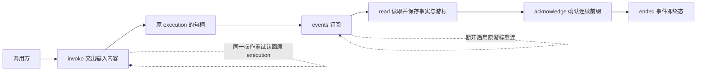
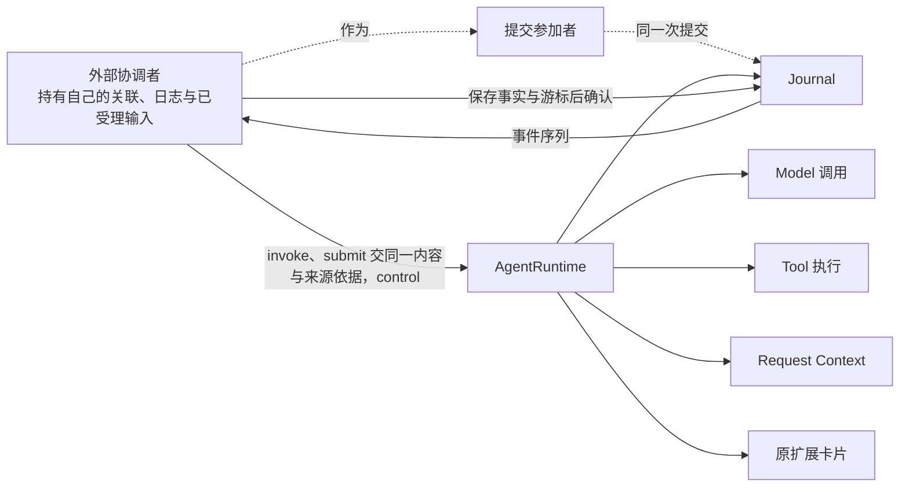
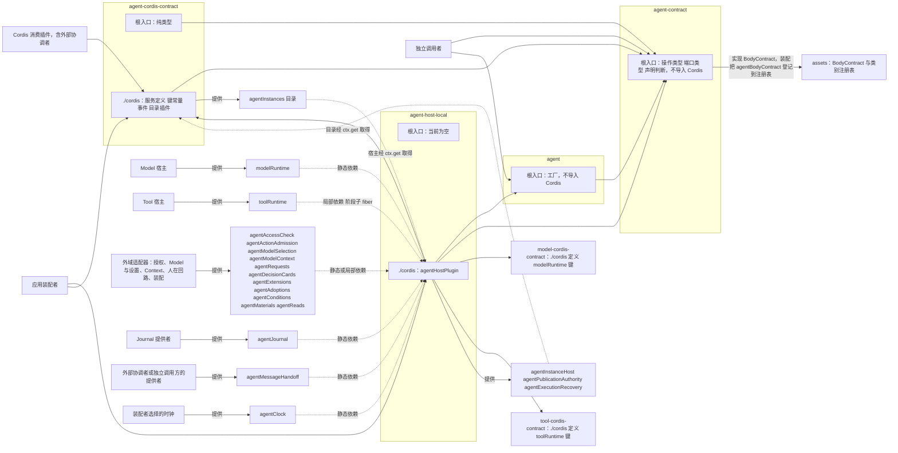
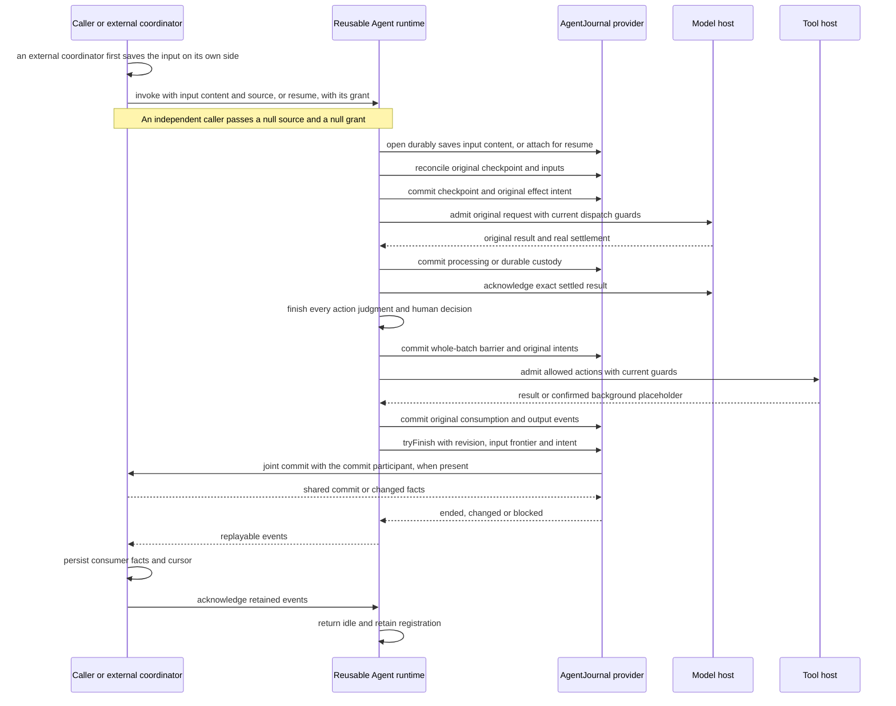
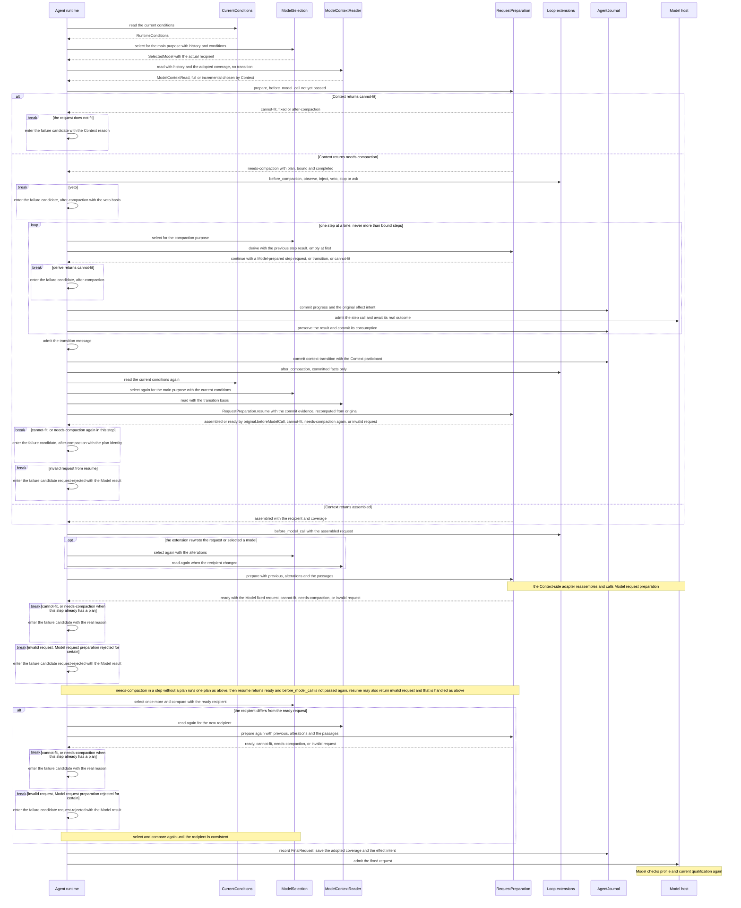
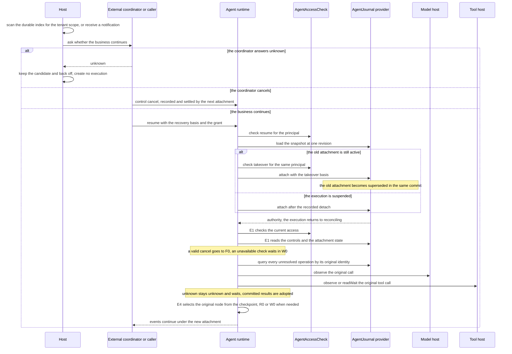

# Agent 消费与系统定位

本页描述 Agent 的两种消费位置：独立调用者和外部协调者。图表投影已接受的公开契约，不表示运行实现或真实提供者验证已完成。

## 系统位置与消费入口

本包面向应用装配者、独立调用者、外部协调者和使用纯求值的消费者，承担纯 Loop 求值、扩展经过、整批动作判断及跨成员推进。以下图示只投影本包消费关系，系统保证仍归[运行架构](../../../../docs/architecture/runtime/README.md)，组内责任归[组入口](../../README.md)。

### 独立调用者

独立调用者没有任何外部协调者。它只使用 invoke、事件订阅、读取、确认和终态事件。

图中没有任何外部协调者的对象。调用方只需要提供租户、主体、操作身份、execution 身份和受理输入。受理输入带完整内容，来源依据为 null。Journal 提供者在受理时保存内容。

### 外部协调者

外部协调者持有自己的业务关联与日志，自己受理输入，并在需要共同成立事实时作为提交参加者。Agent 只看到通用端口。

独立消费与 Harness 接入的设计形状见[公开接口页](public-api/README.md)，它导航到导出这些类型的源码。包只导出类型，没有提供者实现。需要托管状态的路径必须具备相应提供者，纯独立路径不创建任何外部协调者的对象。装配依赖和资源撤除见 [Cordis](../../agent-cordis-contract/docs/cordis.md)。

### 装配与包依赖

下图画四个成员的依赖方向、根入口与 `./cordis` 入口、agent-contract 到 assets 的依赖，以及 Cordis 服务键和提供者归属。它投影 [Cordis 服务定义](../../agent-cordis-contract/docs/cordis.md)，不独立定义键、提供者或依赖，两者不一致时以 Cordis 页为准。

契约消费者不拉入提供者：只依赖 agent-contract 的调用方和只依赖 agent-cordis-contract 的消费插件，都不依赖 agent-host-local。纯契约与通用实现的根入口都不导入 Cordis。

## 原消费场景的前提

本页消费 [Agent 公开接口](public-api/README.md)、[Model 公开接口](../../../model/model-contract/docs/public-api.md)和 [Tool 公开接口](../../../tool/tool-contract/docs/public-api.md)。外部协调者的公开契约由其拥有者维护，本页只写 Agent 一侧的前提。顺序是协议要求。尚未运行生产提供者，不能把图当作耐久或外部效果验证。

## 从输入到原结果

每次变更使用独立操作身份。同一原操作的重试保持身份及语义参数。Agent 的每个 PendingCall 保存生产者 admission，回执丢失先 inspect 或 lookup，不用新 operation 重新受理。Model 一次内部重试仍是同 call，策略回原 Model，主 Loop 继续等待整调用真实收场。

压缩分支和请求的准备见下一小节。压缩的内部模型调用不作为主流程回复，也不与主流程共用 action。

### 一次模型请求的准备

下图投影一次主请求从选择模型到记录最终请求的消费顺序。它是派生说明，不独立定义转换，节点次序由 Loop 算法页拥有。各方的分工、拉取时点、压缩与失败规则见 SPEC 的“[请求、扩展和材料接缝](../SPEC.md#请求扩展和材料接缝)”。

图中的 assembled 与 ready 都带有实际收件模型和覆盖，Agent 核对二者与本次选择和读取一致。full 或 incremental 由 Context 决定。记录最终请求之前再选择一次并比较，不一致时重新读取、重新准备，这次重新准备也可能按装不下失败。每个 break 都进入失败候选，再由统一的终态出口收束：Agent 不换模型，不删除历史，不无限压缩。同一 step 内再次返回的 needs-compaction 以 after-compaction 失败，不进入第二个计划。图中的调用对应 [Loop 完整算法](../../agent/docs/architecture/loop-algorithm.md)的 I1、C0 至 C4、P0、P1 与 M0。

### 宿主发现之后的恢复与接管

下图投影推进实例失联之后，从宿主发现到回归原节点的消费顺序。它是派生说明，不独立定义转换。谁发现、何时扫描与候选退避归外部协调者或装配宿主。Agent 只拥有 resume、对账与一次执行之内的等待。行为见 SPEC 的“[恢复与接管](../SPEC.md#恢复与接管)”，切点与回归见[机制页的恢复切点表](../../agent/docs/architecture/mechanisms.md#恢复切点表)与[算法页的恢复入口](../../agent/docs/architecture/loop-algorithm.md#恢复入口与回归点)。

两个发现者同时发现同一候选时，由 attach 的条件提交与 takeover 资格裁定唯一的合法推进者。被取代一方的后续提交返回 stale-advance，它交出本地资源后回 idle。恢复不经过执行开始之后位置。图中的调用对应 [Loop 完整算法](../../agent/docs/architecture/loop-algorithm.md)的 E0、E1、E2、E4、R0 与 W0。

## 两条交接路径

custody 路径先经 AgentMaterials 独立保管内容或可靠引用，再经 Journal 的 custody 交接，由原拥有者保存原版本、位置和责任，之后才请求解除生产侧交付责任。Model 的交付责任解除生效后，后续读取从材料拥有者取得内容，不再要求 Model 给全文。Tool 结果的 custody 路径可以使用 Tool 自身长期保留的原全文引用，交付责任解除不删除全文。

processed 路径在生产者仍保管结果时完成必要判断和业务处理，Journal 的 processed 交接由原拥有者共同保存完成依据及后续位置，之后才解除交付责任。必要处理尚未完成、保存未知或当前资格失效时不得提前解除。完成依据无需包含业务不再需要的全文。

Tool 的失联结果与晚到原全文是同一 consumption 下的两个结果版本，分开保管，分开解除交付责任。两个版本共享原消费绑定，各有自己的结果项与交付责任。旧版本的解除回执晚到不解除新版本的责任，已成立的终态不改变。两条路径的条件归 SPEC 的“[持久性与交付责任](../SPEC.md#持久性与交付责任)”。

## 独立消费与外部协调

### 独立调用者

独立调用者直接 invoke，按需要 submit、control 和消费 output。调用方不返回完成批准，也不创建或模拟任何外部协调者的对象。输入受理与条件终结的排序见 SPEC 的“[条件终结](../SPEC.md#条件终结)”。独立调用的装配要自备工厂表中的全部必需依赖，最小提供者集合的拥有者登记在[开放问题](../../agent/docs/architecture/open-questions.md#独立调用路径的最小装配由谁拥有)。

从 invoke 到终态的走读路径如下。

1. 调用方为本次执行分配 execution 身份和操作身份，准备受理输入：输入身份、完整的消息内容、来源依据 null 和优先级。
2. 调用 runtime.invoke。推进资格依据为空，执行挂接由 Journal 提供者授予。Journal 提供者在受理时保存输入内容。得到原 execution 的句柄。
3. 用句柄的 output.events 订阅事件。订阅断开后，用最后处理的序号重连。
4. 用 output.read 按序读取事件页，保存事件事实与消费游标。
5. 用 output.acknowledge 确认已保存的连续前缀。
6. 读到 ended 事件，表示终态已成立。ended 之后只能读取、确认，不能再推进。
7. 需要追加输入或控制时，在 ended 之前使用 input.submit 与 control。

### 外部协调者的前提

外部协调者要让 Agent 按自己的业务工作推进，须满足下列前提。

1. 先保存再交出：协调者在自己的可靠受理边界保存输入之后，才以同一内容和自己的来源依据调用 invoke 或 submit。同一输入重试时使用同一输入身份和同一内容，Journal 提供者按输入身份认回原受理。规则见 SPEC 的“[输入内容与水位线](../SPEC.md#输入内容与水位线)”。
2. 提交参加者：协调者需要与 Agent 的输入受理和终结共同成立自己的事实时，作为提交参加者，按 SPEC 的“[提交参加者协议](../SPEC.md#提交参加者协议)”以参加、失败、冲突、不支持四种响应参加。
3. 按事件身份去重：协调者消费事件时，按 execution 加序号去重，把事件事实与消费游标共同保存之后，再确认。
4. 关联自行保存：协调者保存自己的业务关联与 Agent 返回的 execution、执行挂接和操作身份之间的映射。Agent 不读取这些关联。
5. 推进资格依据：协调者在 invoke 与 resume 中传入自己的推进资格依据，保证同一 execution 同一时刻至多一个有效推进者。

前提不满足时，Agent 的行为如下。各条的规则分别见 SPEC 的“[提交参加者协议](../SPEC.md#提交参加者协议)”“[恢复与接管](../SPEC.md#恢复与接管)”“[输入内容与水位线](../SPEC.md#输入内容与水位线)”和“[事件流与读取](../SPEC.md#事件流与读取)”，这里只列协调者能观察到的结果。

- 装配不合格：Journal 提供者没有声明协调者需要的共同提交时，创建返回 unsupported。运行时遇到未声明的提交种类也返回 unsupported，并且不保存任何一半。这样的装配不可装配，不退化为只比较 Agent 本地队列。
- 推进资格依据缺失或核对失败：invoke 与 resume 返回 denied。
- 接管仍在推进的 execution 而主体没有 takeover 资格：resume 返回 denied，不写入任何状态。宿主的失联判断可随恢复依据提交，不替代资格核验。
- 同一输入身份配不同内容：submit 返回 conflict，不保存第二份内容。
- 来源依据不能被提交参加者认回：按参加者的响应处理，不保存一半。
- 事件游标落在保留起点之前：读取返回缺口，不跳过事件。
- 协调者不确认事件：Agent 不因此阻止自己结束，事件与责任继续保留。

### 输入与终结的竞争

输入与终结竞争时，Agent 一侧的排序与结果由 SPEC 的“[条件终结](../SPEC.md#条件终结)”和“[提交参加者协议](../SPEC.md#提交参加者协议)”定义。外部协调者一侧须满足下列前提。

1. 待交输入可见：协调者已受理而尚未交给 Agent 的输入，必须在条件终结的同一次提交中由它的提交参加者报告。这样 tryFinish 不会越过这些输入。
2. 一个权威提交序列：协调者与 Journal 提供者在一个权威提交序列内兑现共同提交，不用两次 RPC 或普通事件模拟。做不到时，这样的装配不可装配。
3. 终结之后的输入：终结先成立时，后来的 submit 返回 terminal。协调者按自己的规则把后来的输入路由到新的工作。
4. 业务取消：协调者取消自己的业务工作时，先经 control 发出取消，再由合法的挂接以取消授权收束 execution。协调者不要求旧执行挂接恢复有效。
5. 协调者的终态先成立：协调者按“提交参加者协议”记录自己的终态，并为 Agent 留下可用的取消依据。协调者不要求 Agent 提出新的业务终态。
6. 终态后：协调者以原事件身份去重读取末事件。终态后观察由长期协调者经 recordTerminalObservation 记完成，不需要已撤销的推进权。

### 交接清单

外部协调者与 Agent 之间有五项交接。每项写协调者交给 Agent 什么，Agent 交还协调者什么，以及行为的拥有者。独立调用者同样使用这五项，只有“结果保管”中提交参加者的那一部分对独立调用者不适用。“当前资格”对两类调用方都适用。

1. **调用。** 协调者用 `invoke` 开始新的 execution，用 `submit` 追加输入，用 `resume` 恢复或接管原 execution，用 `control` 发出控制。每次调用交出 Access、操作身份、受理输入（完整内容与来源依据）、推进资格依据和恢复依据。Agent 交还原 execution 的句柄或命令回执。accepted 只表示已可靠保存，applied 或 unresolved 由事件或原操作查询给出。行为见 SPEC 的“[托管协调与运行实例](../SPEC.md#托管协调与运行实例)”和“[四种控制](../SPEC.md#四种控制)”。
2. **事件。** 协调者用 `output.read` 或 `output.events` 按 execution 与序号读取事件，把事件事实与游标共同保存之后，再用 `output.acknowledge` 确认连续前缀。Agent 交还有序的事件页。读取起点早于保留起点时，Agent 交还缺口与恢复入口，不跳过事件。订阅结束不是终态，协调者不确认也不阻止 Agent 结束。行为见 SPEC 的“[事件流与读取](../SPEC.md#事件流与读取)”。
3. **结果保管。** 生产者的结果有两条交付责任解除路径。custody 路径先经 `AgentMaterials` 保管内容或可靠引用，再经 Journal 的 custody 交接，才请求生产者解除交付责任。processed 路径在生产者仍保管结果时完成必要处理，经 Journal 的 processed 交接保存完成依据，再请求解除。协调者作为提交参加者时，在这两种交接的同一次提交中登记自己的保管或处理依据。协调者自己的外发消息和外部交付的身份、幂等与回执归协调者，Agent 不解释它们。行为见 SPEC 的“[持久性与交付责任](../SPEC.md#持久性与交付责任)”和“[提交与保管](../SPEC.md#提交与保管)”。
4. **当前资格。** 协调者在每次操作的 Access 中交出主体与租户。Agent 在实际执行处用 `AgentAccessCheck` 核验该主体对这个操作的当前资格，unavailable 不放行。`AgentAccessCheck` 判断主体能否调用 Agent 的某个公开操作。`ActionAdmission` 判断某个 Model 或 Tool 动作能否发起，只由执行动作之前这条链末尾的受信系统扩展使用。两个端口不合并。接管仍在推进的 execution 需要 takeover 资格，它不包含在 resume 之内。行为见 SPEC 的“[主体资格核验](../SPEC.md#主体资格核验)”和“[整批判断屏障与动作准入](../SPEC.md#整批判断屏障与动作准入)”。
5. **恢复。** runtime 失联后，怎样发现需要恢复的 execution、何时扫描、以及候选失败后怎样退避，归外部协调者或装配宿主，Agent 不定义。Agent 为此提供两样能力并要求一项核验：`AgentExecutionRecovery` 的 query 与 load 按 execution 查到并读取原记录，`resume` 为原 execution 取得新的执行挂接（必要时以 takeover 接管）；每一步都以授权领域实现的 `AgentAccessCheck` 核验主体资格。在 Cordis 装配中，恢复入口的服务键是 [`agentExecutionRecovery`](../../agent-cordis-contract/docs/cordis.md#服务键与提供者)。Agent 自己只拥有一次 execution 之内的[等待](../../agent/docs/architecture/loop-algorithm.md#恢复入口与回归点)：保存等待与检查时刻、唤醒、重读，以及每段处理的限额。执行之内的退避和限额是具名配置项 `denialBackoffMs`、`reconciliationDelayMs` 与 `reconciliationBatchLimit`（[通用工厂的配置](../../agent/docs/public-api.md#工厂配置)），默认值只是配置初值。协调者一侧候选失败后的退避与此无关，归协调者。行为见 SPEC 的“[恢复与接管](../SPEC.md#恢复与接管)”。

### Agent 自有的结束条件

Agent 的执行结束只由本域的条件提交成立，不依赖协调者的业务终态回调，也不依赖读取方在线或确认。条件见 SPEC 的“[条件终结](../SPEC.md#条件终结)”。终态之后 runtime 回 idle 并保持登记，规则见 SPEC 的“[终态后与 ended](../SPEC.md#终态后与-ended)”。协调者对 Agent 实例的引用通过自己的可信映射指向执行挂接，不能只填 runtime 身份。

## 反例与验收

反例和验收场景归[持续验证场景](../verification/scenarios.md#反例)，交错与失败场景归[同一页](../verification/scenarios.md#交错与失败)。

## 当前证据的意义

公开声明的类型消费只能证明所核版本的静态连接，不证明运行接口或提供者已经实现。已有 Model 交接、首内容、推进资格及 Tool 名额的有限模型覆盖其具名交错。整批扩展、真实提供者、实际消息准入、HITL 与 Cordis 需要分别验证。未跑的场景保留为后继实现验收的输入。
