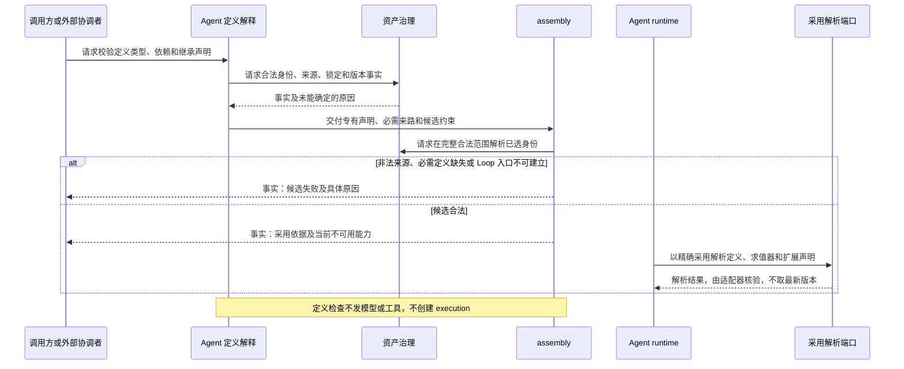
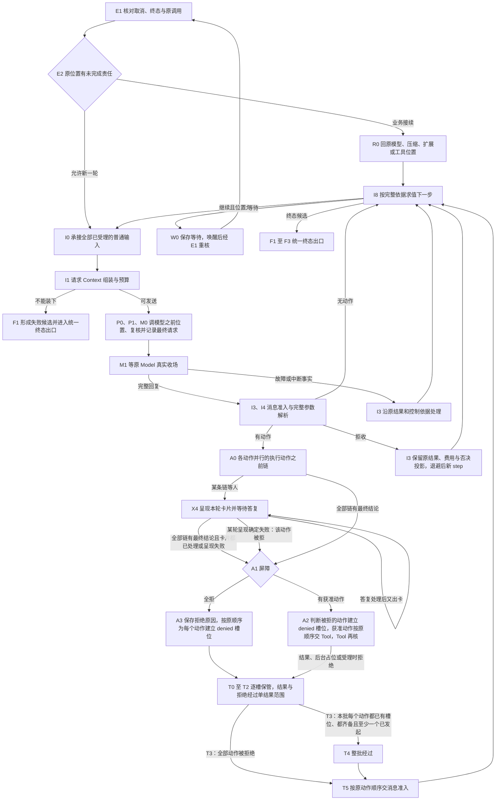
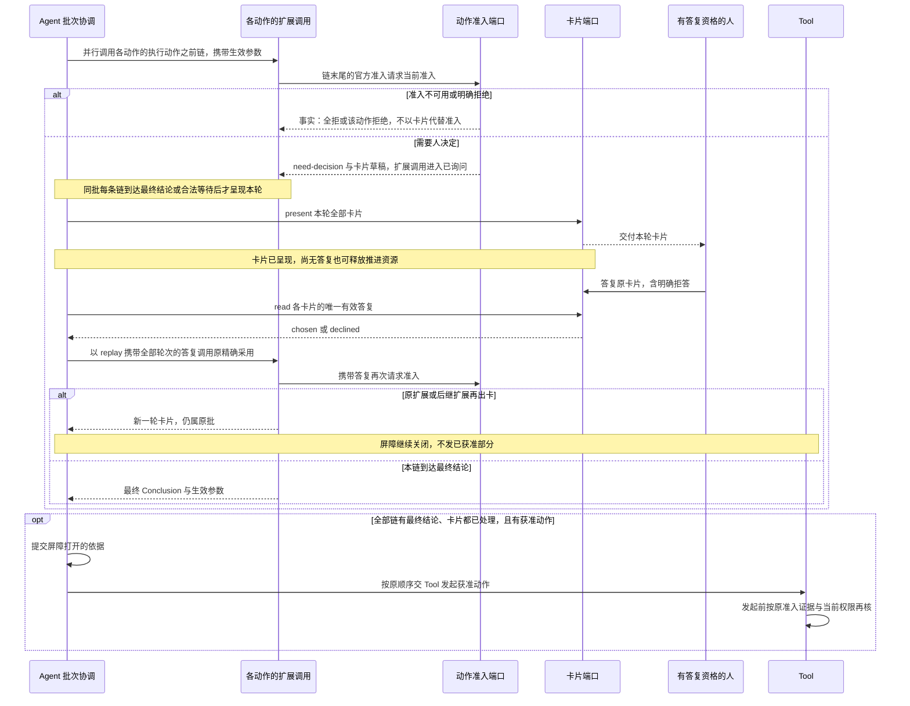
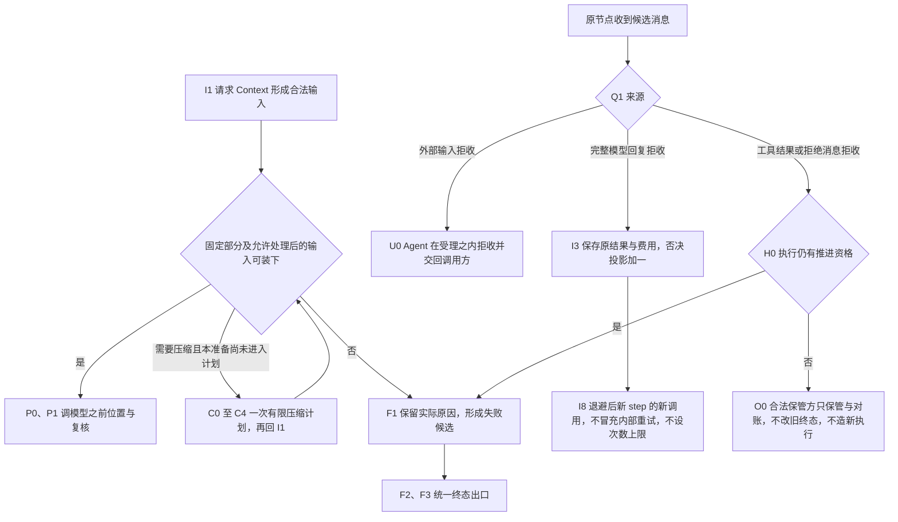
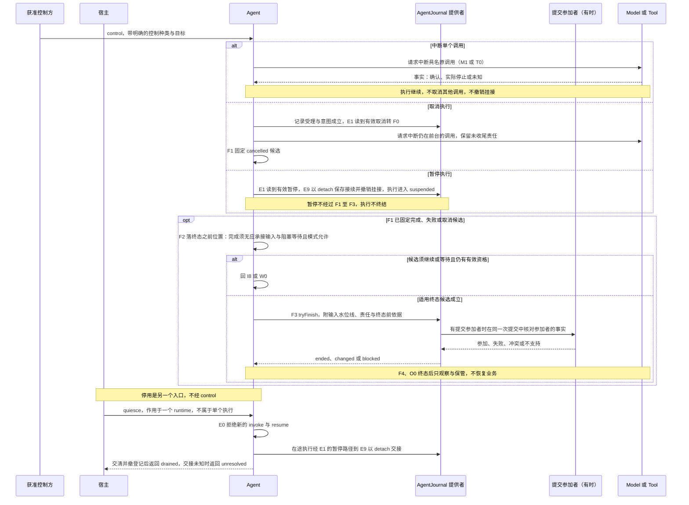
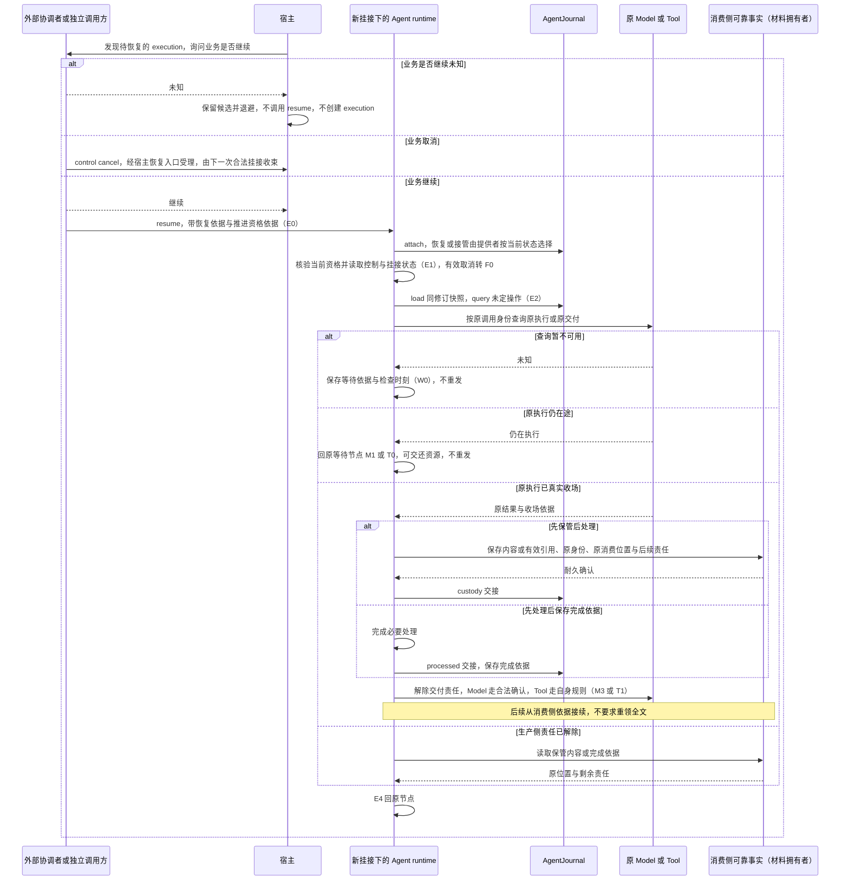
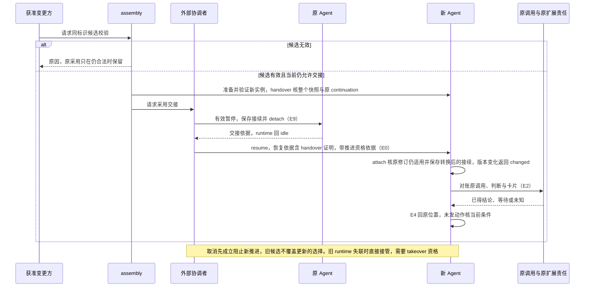
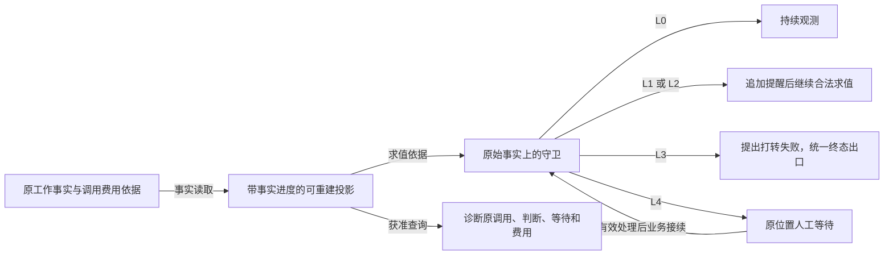

# Agent 推进的关键协作流程

状态：设计已由[技术接受与产品采用决定](https://github.com/nemori-ai/omne-harness-lite/issues/384#issuecomment-6258475204)接受。本页把[产品旅程](../../../../../.meta_harness/design/product/agent-progression/design.md#关键用户旅程)落实为逻辑角色间的次序和交接。Agent 拥有 Loop 下一步、扩展调用、参数绑定和整批判断。外部协调者拥有自己的业务关联、输入受理与业务终态；Model、Tool 拥有原执行；Context 拥有输入投影与预算；HITL 拥有卡片和唯一答复；authorization 解释授权；assembly 拥有候选采用和结构交接。

共同规则由[主架构](../../../../../docs/domains/agent-progression/architecture.md)、[成员 SPEC](../../SPEC.md)及三个主题拥有。图中出现的节点 ID 指 [Loop 完整算法](../../../agent/docs/architecture/loop-algorithm.md)的节点，节点的定义、次序与转移只在该页维护。本页只展示消费顺序，不创建状态机或公开阶段枚举。

图表达逻辑请求、事实、控制、保管与业务接续，箭头文字区分用途。异步答复和原调用没有共同物理寿命。flowchart 仅为活动示意，不是严格 UML 或算法证明。所有新推进都以有效资格为前提；取消和既有终态先于新发起，迟到事实仍可按原责任保管。

本页的外部协调者箭头表达系统集成责任。Agent 通过 Journal 的具名交接取得回执，外部协调者经提交参加者参加同一次提交；Agent 不直接注入外部协调者的服务。runtime、execution 和执行挂接的寿命及外部映射归[对象模型](../object-model.md)。

## F-AG01 定义选入和装配结果

对应 [J-AG01](../../../../../.meta_harness/design/product/agent-progression/design.md#j-ag01)，行为归[定义专题](../public-api/definition.md)，验收场景见[持续验证场景](../../verification/scenarios.md)的 SC-AG-58、SC-AG-76、SC-AG-77、SC-AG-78 与 SC-AG-79。调用方或外部协调者提供具有合法来源的选择和声明，Agent 解释其专有含义，assembly 求值采用。采用解析端口是 Agent runtime 消费的注入端口 AgentAdoptions，由适配器实现。创建 execution 不由本图代办。

继承来源仅决定额外身份，已选身份的实现仍在完整合法范围解析。候选失败不能发布混合构成；恢复对账原候选，不以旧采用证明新条件成立。合法定义存在但执行不可用时保留已知身份，后续动作可取得逻辑不可用结果。精确校验与来源版本协议由 Agent 定义、assets 和 assembly 对齐，缺项见[协议细化拥有者](#protocol-gaps)。

## F-AG02 正常推进及全批拒绝

对应 [J-AG02](../../../../../.meta_harness/design/product/agent-progression/design.md#j-ag02)。下图从已经具备推进资格的 Agent 开始，只展示消费顺序。原等待优先于新输入；只有原位置允许时，Agent 才经 Journal 承接当时全部已受理的普通输入。图中标注的节点 ID 归 [Loop 完整算法](../../../agent/docs/architecture/loop-algorithm.md)，本图不定义节点。行为归 SPEC 的“[整批判断屏障与动作准入](../../SPEC.md#整批判断屏障与动作准入)”“[工具执行与结果承接](../../SPEC.md#工具执行与结果承接)”与“[消息准入](../../SPEC.md#消息准入)”。

模型在真实收场之前的单次发出失败可以进入调模型之后的失败分支（M2），有效的重试结论交回原 Model。原调用尚未真实收场时，Agent 不交最终结果，不确认，不解析动作。流结束或完整块到达都不证明原调用已收场。最终失败和用户中断沿各自原因处理。

A2 之后，每个槽位消费前台结果或符合 Tool 声明的后台占位。后台是等待方式，不是第二次工具执行。后台占位不经过单结果范围 T2。逻辑不可用结果使用原动作，不假报物理启动。结果先按原动作身份保管（T1），再经过单结果范围（T2）；一个槽位的单结果经过与外发不等待其他槽位。被拒绝的动作也有槽位，并经过单结果范围。全部动作都被拒绝时，T3 绕过 T4，直接转 T5 交消息准入。解除生产责任按 [F-AG06](#f-ag06) 的两条合法路径判断。跨实例恢复时经 R0 回原节点，不一律回 I0。验收场景见[持续验证场景](../../verification/scenarios.md)的 SC-AG-43、SC-AG-50、SC-AG-53、SC-AG-56、SC-AG-57、SC-AG-114、SC-AG-115、SC-AG-120、SC-AG-122、SC-AG-125 与 SC-AG-130。

## F-AG03 整批判断、人工答复和后继出卡

对应 [J-AG03](../../../../../.meta_harness/design/product/agent-progression/design.md#j-ag03)。同一动作的链按声明顺序判断，不同动作的链并行。下图只展示消费顺序，以一批动作进入执行动作之前位置为起点。参与者中的卡片端口与动作准入端口是 Agent 定义的端口，形状见[公开接口页](../public-api/README.md#扩展人工卡片与材料)，行为归 SPEC 的“[整批判断屏障与动作准入](../../SPEC.md#整批判断屏障与动作准入)”。

出卡、答复交回和扩展接续是异步三段，不要求共同一次提交。卡片答完不等于整批已经处理完成。只有全部链到达最终结论、全部卡片处理完成，屏障（A1）才打开。屏障打开后的发起（A2）还受当前推进资格、环境与资源的约束。全拒时回 [F-AG02](#f-ag02) 的 A3，被拒绝的动作在 T2 经过单结果范围后由 T3 直接转 T5 交消息准入，不经过 T4。参数只在同链官方准入之前被改写，或经卡片的 `proposedRewrite` 改写，见 SPEC 同节第 7 条。

明确拒答返回没有答案，不授予动作，不重复原问题。当前参数、绑定或相关授权依据已变则不能复用旧批准；无关变更不机械重问。暂停、物理退出和查询失败不使卡片失效，原逻辑执行确定终局才失效。撤除扩展仍须保留原语义，具体接续见[精确采用接续](../../../agent/docs/architecture/mechanisms.md#扩展经过与精确采用接续)。作者可见的整批语义见扩展作者协议的[整批判断屏障与动作准入](../public-api/extensions.md#整批判断屏障与动作准入)，不可用、报错与系统兜底见其[不可用与报错](../public-api/extensions.md#不可用与报错)。验收场景见[持续验证场景](../../verification/scenarios.md)的 SC-AG-43、SC-AG-44、SC-AG-45、SC-AG-48、SC-AG-111 至 SC-AG-119、SC-AG-128 与 SC-AG-129。

## F-AG04 输入失败与按来源拒收

对应 [J-AG04](../../../../../.meta_harness/design/product/agent-progression/design.md#j-ag04)。Context 拥有预算与压缩，Agent 消费它的明确结论并形成自己的失败候选。扩展在压缩之前位置拒绝压缩时可以不压，但不能因此发送仍超限的请求。图中标注的节点 ID 归 [Loop 完整算法](../../../agent/docs/architecture/loop-algorithm.md)。行为归 SPEC 的“[请求准备与压缩](../../SPEC.md#请求准备与压缩)”“[无法装下](../../SPEC.md#无法装下)”与“[消息准入](../../SPEC.md#消息准入)”。

固定部分超限与处理后仍超限保留不同原因，不自动分叉、改模型、删除历史或循环压缩。同一次准备至多进入一个压缩计划。新模型调用前仍核当前资格，取消先成立则不得继续。Tool 原结果、效果和费用由原拥有者保管，拒收不重跑工具。必要保存未知时按原身份对账，不把图上的下一条箭头当作已经成功提交。验收场景见[持续验证场景](../../verification/scenarios.md)的 SC-AG-55、SC-AG-56、SC-AG-57、SC-AG-72、SC-AG-73、SC-AG-74、SC-AG-124 至 SC-AG-127、SC-AG-130、SC-AG-141 至 SC-AG-144。

## F-AG05 统一终态出口及控制范围

对应 [J-AG05](../../../../../.meta_harness/design/product/agent-progression/design.md#j-ag05)。Agent 提出本域完成意图，经 `tryFinish` 条件终结。有提交参加者的装配由该参加者在同一次提交中保护外部协调者的事实；独立调用没有提交参加者。图中标注的节点 ID 归 [Loop 完整算法](../../../agent/docs/architecture/loop-algorithm.md)。四种控制与六个阶段归 SPEC 的“[取消、退出与结构变更](../../SPEC.md#取消退出与结构变更)”，终结归“[条件终结](../../SPEC.md#条件终结)”。

落终态之前位置由 Agent 在提交前协调（F2）。完成候选可被要求继续、等待或否决；失败与取消按其适用检查和依据收束，扩展不能借否决恢复已撤销的推进资格。没有活体 runtime 时，已保存的取消意图由下一次合法挂接从 E0 开始收束；外部协调者自己的业务取消与终态由它自己记录。

取消作用于该执行仍在前台的模型与工具调用，不自动停止已确认转后台的工具、同一 runtime 的其他执行或无关调用。真实停止和逻辑取消分别记录。输入与终结的竞争见[消费与系统定位](../context.md#输入与终结的竞争)。验收场景见[持续验证场景](../../verification/scenarios.md)的 SC-AG-20 至 SC-AG-27、SC-AG-60 至 SC-AG-66、SC-AG-140、SC-AG-147 至 SC-AG-152。

## F-AG06 接手原工作及可靠交付两条路径

对应 [J-AG06](../../../../../.meta_harness/design/product/agent-progression/design.md#j-ag06)。宿主发现待恢复的 execution 后，外部协调者判定业务是否继续。新推进者以 resume 取得新的执行挂接与当前资格，先对账原调用和消费责任，再回原节点。协调者判定业务不再继续，或当前资格已撤时，不继续业务推进，但获准的保管者仍可保存真实结果。独立调用方不制造任何外部协调者的对象。节点 ID 归 [Loop 完整算法](../../../agent/docs/architecture/loop-algorithm.md#节点表)。

任一路径都须能在停机后判明谁负责，不能让双方都丢弃责任。先处理后保存完成依据不强制再保存一份可重领全文；尚未处理完且依赖后续消费则须可靠保管必要内容。Model 的交付责任解除（ACK）只针对真实收场且有当前合法消费者的调用。观察、开始处理或单次发出失败都不能提前解除。解除生效、清理和费用结算分别可见；工具全文不套用模型清理规则。两条路径的条件见 SPEC 的[持久性与交付责任](../../SPEC.md#持久性与交付责任)。

若生产方确认自身失联，按 Model 或 Tool 自己的恢复结论回原位置。Agent 退出或查询失败不证明失联，工具未知效果不自动重放。对账与提交未知沿 Journal 契约，每个切点的处置见[机制页的恢复切点表](../../../agent/docs/architecture/mechanisms.md#恢复切点表)。外部协调者一侧的资格与交接提供者的共同边界归该协调者，Agent 所需的保证与在途展示内容的耐久缺项登记在[外域依赖](../../../agent/docs/architecture/open-questions.md#外域依赖)。验证见 [SPEC 旅程验证入口](../../SPEC.md#旅程验证入口)与[持续验证场景](../../verification/scenarios.md#流式失败崩溃与控制竞争后接续)。

## F-AG07 定义换代与在途语义交接

对应 [J-AG07](../../../../../.meta_harness/design/product/agent-progression/design.md#j-ag07)。定义身份固定，版本采用可变。普通恢复保持原采用，新的 execution 采用当时的合法胜出者。显式 reload 的逻辑次序如下，验收场景见[持续验证场景](../../verification/scenarios.md)的 SC-AG-78。

模型选择、模式、权限、Context 或稳定入口内部数据变化不自动换定义或执行挂接，已发请求保持原固定内容。旧模型建议与当前工具约定不兼容时，Agent 返回具体原因供新的决定使用，不暗换实现或参数。已得扩展结论不重跑，不同语义新判断不冒用旧结论。Agent 的活动扩展调用按原精确采用接续，缺原实现时保留等待和责任；assembly 仍裁定合法可用性。换代与取消的竞争见[机制页](../../../agent/docs/architecture/mechanisms.md#控制与故障交接)。外部协调者一侧的候选采用、推进映射与换代提交归该协调者自己的文档，Agent 所需的保证见[外域依赖](../../../agent/docs/architecture/open-questions.md#外域依赖)。验证见[定义专题](../public-api/definition.md#旅程与持续验证)与[扩展专题](../public-api/extensions.md#旅程与持续验证)。

## F-AG08 长期读取、守卫及因果解释

对应 [J-AG08](../../../../../.meta_harness/design/product/agent-progression/design.md#j-ag08)。守卫只读原事实与可重建投影，压缩后的模型输入不成为计数权威。

上述阶梯是既有行为含义，不规定算法、阈值或必经每一级。取消仍先撤新推进，恢复继续使用原事实范围，不以重启或压缩清零。投影落后或查询未知须可识别，不能以缓存为空证明没有工作。诊断不默认复制正文、附件或秘密；账目由原执行拥有者记账，Agent 保持原用途关联，遥测采样不是费用全量依据。主回复准入历史与投影协议沿[机制](../../../agent/docs/architecture/mechanisms.md#事实投影与长期读取)，实际性能尺度和策略配置采用仍须各拥有者验证，验证见[Loop 旅程验证](loop.md#旅程与持续验证)。

## 协议细化拥有者

以下缺项限定实现与验证接受，不阻止表达以上已明业务路径。公开操作、Schema、提供者和锁未在图中选定。

| 流程中的待细化点 | 责任及原问题 | 必须保留的可观察后果 |
| --- | --- | --- |
| F-AG01、F-AG07 的定义校验、版本读取与候选采用接口 | Agent 定义与 assembly，见[定义规格末段](../public-api/definition.md#交接结果与验证义务) | 非法候选不采用，标识固定，合法旧采用与失效旧条件可区分 |
| F-AG02、F-AG04、F-AG08 的 step、连续回复否决与策略边界 | Agent Loop，[AGENT-M01](../../../../../.meta_harness/design/product/agent-progression/design.md#agent-m01) | 新调用不冒充内部重试，更换执行挂接或推进实例不清零 |
| F-AG03、F-AG07 的稳定经过、非确定输入、卡片接续及撤除 | Agent 扩展与 assembly，HITL 和 authorization 提供原决定，[AGENT-M02](../../../../../.meta_harness/design/product/agent-progression/design.md#agent-m02) | 三段异步责任可认回，旧结论不重跑，后继卡片不越过批屏障 |
| F-AG02、F-AG05、F-AG06 的围栏、认领、跨域有效边界、控制传播与交付责任解除的对账 | Agent 推进协调、外部协调者、原执行及保管拥有者，[AGENT-M03](../../../../../.meta_harness/design/product/agent-progression/design.md#agent-m03) | 旧资格不推进，原事实可迟到保存，确认未知不重做副作用 |
| F-AG04 的后台、原工作已终结后的结果拒收后果 | 原消费拥有者与 Agent 的消息准入，见 SPEC 的[消息准入](../../SPEC.md#消息准入) | 不造新执行，不改终态，不为取消的业务重授入队资格 |
| F-AG06 的在途展示内容跨生产 runtime 失联耐久 | Model 流式与消费存储拥有者，[AGENT-N01](../../../../../.meta_harness/design/product/agent-progression/design.md#agent-n01) | 不从收场后的交付责任解除推断逐片耐久，不宣布允许丢失 |
| F-AG08 的长期读取尺度、策略配置资格和生效协议 | Agent Loop 策略、事实与查询拥有者，[AGENT-M01](../../../../../.meta_harness/design/product/agent-progression/design.md#agent-m01)、[AGENT-M03](../../../../../.meta_harness/design/product/agent-progression/design.md#agent-m03) | 缓存进度可查且可重建，守卫及账目不因优化丢失 |

本页只有逻辑流程和持续验证入口。没有运行真实装配、故障或性能实验，没有据 Mermaid 图授予行为正确性。
