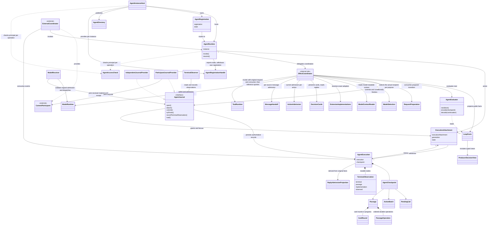
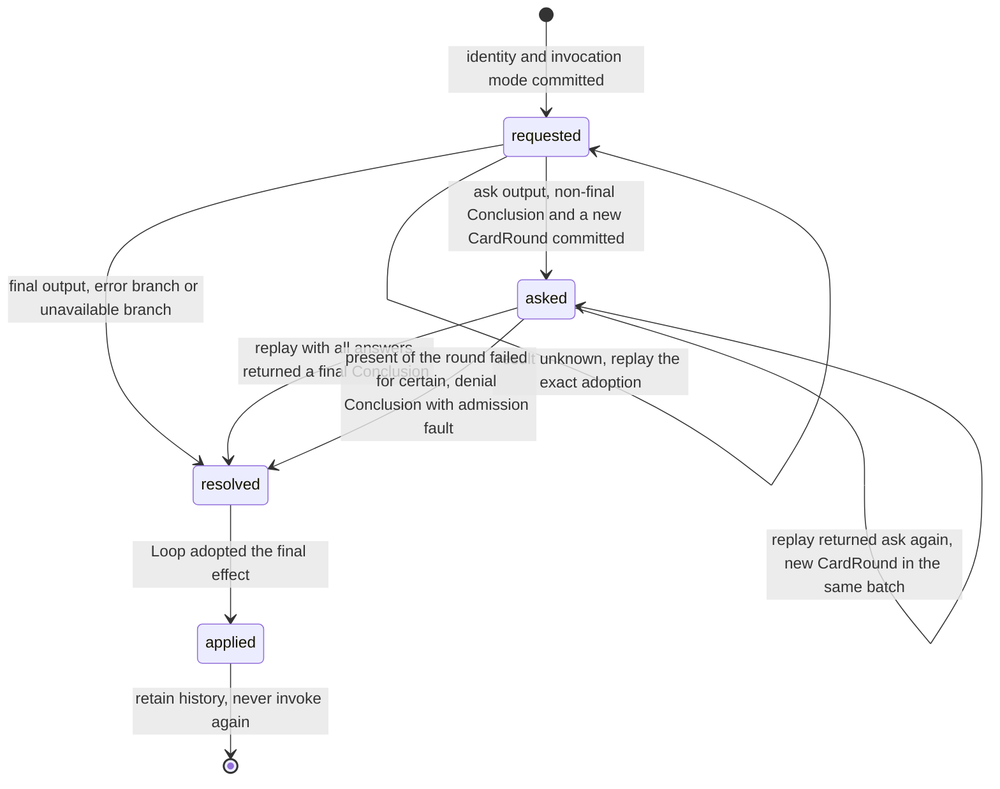
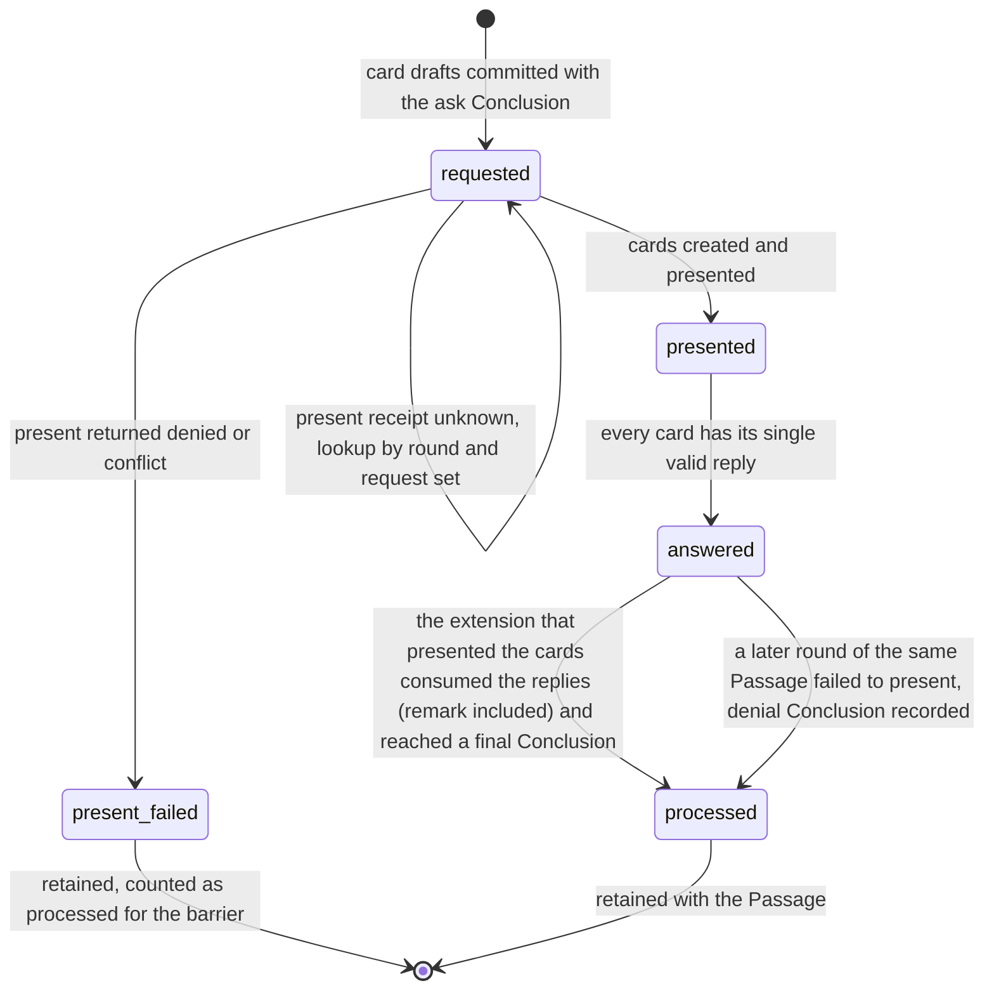
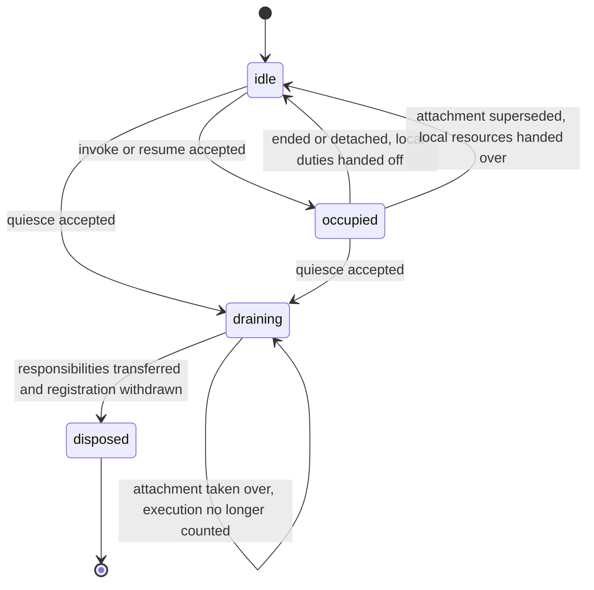
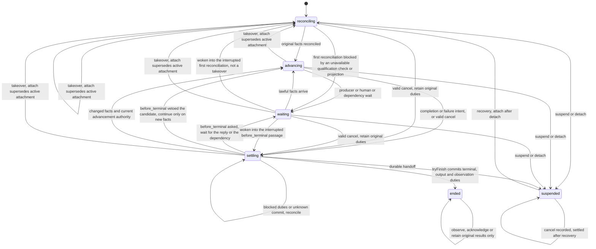
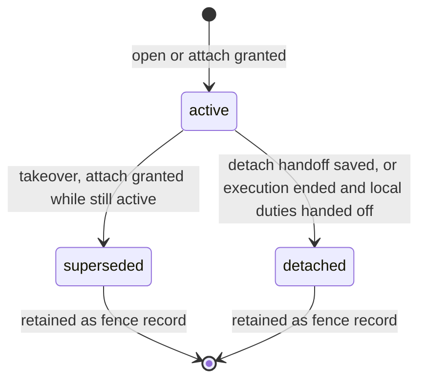
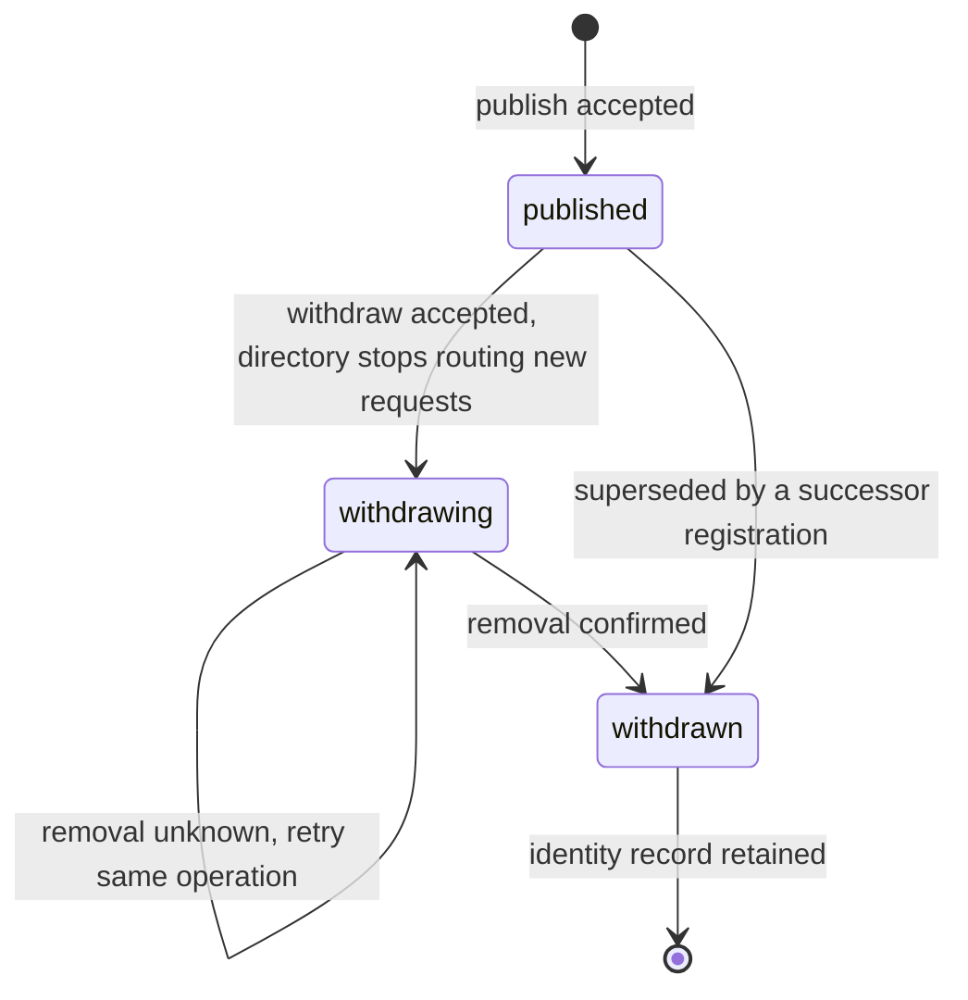
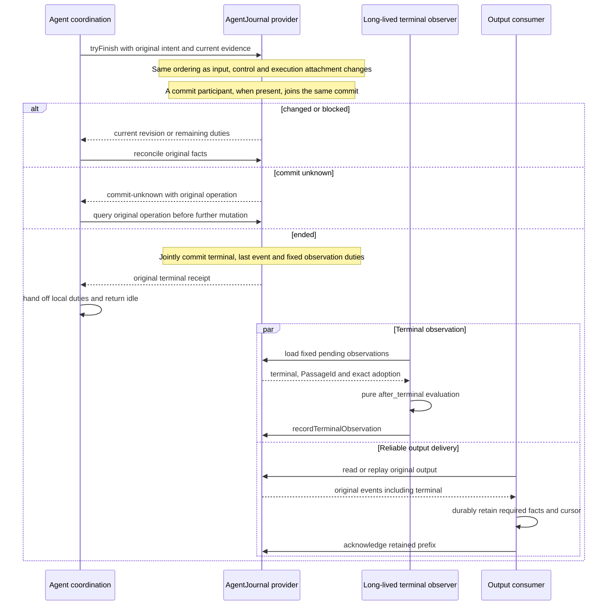

# Agent 对象模型

AgentRuntime 是可复用的推进实例。AgentExecution 保存一次逻辑执行。ExecutionAttachment 表示这个执行当前由哪个实例推进。AgentEvaluator 根据完整事实计算下一步。外部协调者在 Agent 之外协调这些能力，拥有自己的业务关联、输入受理和日志。

本页拥有对象的身份、构造、状态、合法转换、所有者以及销毁或保留条件。精确签名归[公开接口页](public-api/README.md)，行为归 [SPEC](../SPEC.md)。运行接口的类型已在源码，实现尚未提供，也不将产品全部能力自动纳入 0.1.0。图中的技术对象不自动新增产品领域对象。

## 调用方怎样使用

下例是职责伪代码。每个操作均需处理成功、拒绝及未知，不表示当前包已有运行导出。

```text
装配者创建并登记 runtime，固定租户、安全范围和定义采用
调用方把输入内容交给 runtime.invoke，Journal 受理并保存内容，返回原 execution 句柄
Agent 根据当前事实推进，输出保存在可靠事件记录中
调用方持续读取 events，保存所需事实并确认交付

Agent 满足完成条件并通过适用的终态前扩展
    通过 Journal.tryFinish 条件提交自己的结束
    输入或控制先成立，则重读原事实继续处理
    成功结束后由长期协调者处理终态后观察
    runtime 交清本实例责任即可回 idle 并保持注册

独立调用者无需返回终态批准，也不创建任何外部协调者的对象
外部协调者先在自己一侧保存输入，再交同一内容与来源依据，
并作为提交参加者，在输入受理与终结的边界内兑现自己的业务规则
```

事件的提交、读取与确认规则见 SPEC 的“[事件流与读取](../SPEC.md#事件流与读取)”。

## 跨域概念与内部可见范围

Agent 建模自己承担的推进和协作责任。只有决定下一步、恢复原位置或履行已接下责任所需的外部事实进入其模型。对方的原身份和契约含义保持，不复制对方完整状态机。

| 分类 | Agent 内的表示 | 原拥有者保留的责任 |
| --- | --- | --- |
| 本域对象 | Execution、ExecutionAttachment、Checkpoint、Step、Action 与 Batch、Passage、自己的等待与控制 | Agent 解释规则、顺序和接续，不替调用方治理逻辑工作 |
| Model 消费事实 | 实际收件模型、首次 admit 前保存的 ModelInvocationRef、固定请求、model-active 与 model-settled、结果与消费责任 | 供应商请求、tokenizer、Dispatch 重试和模型资源生命周期 |
| Tool 消费事实 | 原动作及调用、工具运行、等待与结果、可用控制、确认的后台占位 | Tool executor、内部 wait schema、响应校验、执行与结果保留状态机 |
| Context 消费事实 | 请求准备阶段、容量结果、压缩计划的进度、模型可读上下文的读取与已采用覆盖、实际派生消息及提交承诺引用 | 覆盖范围与保留名单的选择规则、压缩算法、token 计算及上下文内部结构 |
| HITL 消费事实 | Agent 自己的 Passage、原卡、答复与处理进度 | 答复资格、唯一决定、展示和通知。Tool 内部等待仍归 Tool |
| 身份与授权 | 显式 tenant、主体依据、AgentAccessCheck 每次返回的结论、拒绝与可核验证据 | 组织与角色关系、权限模式解释、授权算法 |
| 资产与装配 | 本域 Definition 语义、实际采用、所需能力及兼容接续依据 | 来源选优、资产版本发布、装配求值和插件加载图 |
| 共享值 | Message、ToolPart、ContentBlock 与 ref、TenantId | 复用公共契约，不建立 Agent 版本的同义类型 |
| 外部协调者 | 可信的业务关联映射，以及提交参加者适配。两者都不进入纯求值事实 | 外部协调者的业务关联、输入渠道、日志组织、业务取消和它自己的业务生命周期规则，以及 Cordis |

本域内部也分层。纯 Evaluator 只读有判别的决策事实。效果协调层消费原 Model 与 Tool 的操作、控制与确认协议。宿主集成层适配持久提供者和 Cordis。外域原引用可供追溯，不能让 Evaluator 根据 opaque JSON、外部协调者的状态或插件树分支。

Agent 可以读取工具公开声明用于理解和动作判断，但不复制 ToolDefinition 的管理规则。模型工具建议来自共享的 ToolPart。实际参数、调用方式和当前许可仍由工具准入核验，脚本来源不因转调而改成 direct。

Agent 扩展产生的人工等待在 Passage 中建模。Tool 内部 wait 仅向 Agent 投影等待状态及控制能力，答复回 Tool 原等待。外部协调者在调用 Agent 之前形成的人工等待，由该协调者与 HITL 协调，不伪造一个 Agent Passage。

模型内部重试对主 Loop 仍是原调用在途。扩展若参与重试判断，只消费 Model 公开策略请求并返回决定，不接管 Dispatch 或厂商重试。选择新模型影响尚未记录为最终请求的候选，已记录的请求、结果和费用继续按原采用解释。

## 对象与生命周期

下表列出需要区分的主对象。AgentDefinition 是定义本身，采用结果是某个精确版本被选入后解析出的结果，Runtime 是可复用的推进实例，Execution 是一次逻辑执行，ExecutionAttachment 是 runtime 对 execution 的一次物理承接，扩展经过与具体调用是 execution 内的对象。扩展经过与具体调用在这里只写身份与寿命，作者协议归[扩展规格](public-api/extensions.md)。

| 对象 | 身份 | 构造 | 状态与合法转换 | 所有者 | 销毁或保留 |
| --- | --- | --- | --- | --- | --- |
| AgentDefinition | 定义身份，含 owner、name、revision 与 digest | 资产拥有者发布，装配选入，Agent 校验专有声明 | 不可变值，没有状态。新版本是新身份 | 资产拥有者持有版本，Agent 契约解释专有声明 | Agent 不销毁定义。采用它的 execution 保留其精确身份与摘要 |
| 采用结果 | 精确的 Adoption | AgentAdoptions.resolve 按精确采用解析出 definition、evaluator 与扩展声明，不取最新版本 | 值，没有状态 | 装配提供采用依据，Agent 使用解析结果 | execution 只保存 Adoption 引用，不保存解析出的运行对象。解析缓存可以丢弃并重建 |
| AgentRuntime | AgentInstanceId | 装配者调用工厂创建，固定租户、安全作用域、定义采用、配置和依赖，初始为 idle，由宿主发布 | idle、occupied、draining、disposed。转换见下文状态图 | 装配者创建，宿主发布与撤登记 | draining 交清本实例责任并撤登记后进入 disposed。已 disposed 的实例身份不再用于新实例。失联后重新启动的进程也使用新的实例身份 |
| AgentExecution | AgentExecutionId，由调用方在受理前分配，只在租户内唯一。Journal 以（租户，execution）为键，见 SPEC 的“[执行身份的范围](../SPEC.md#执行身份的范围)” | invoke 被 Journal 受理时创建 | reconciling、advancing、waiting、settling、suspended、ended。转换见下文状态图 | Journal 保存权威记录，内存对象只是当前投影 | ended 不复活。记录、事件和结果按 Journal 的保留政策保留，有未交清责任时不得删除 |
| ExecutionAttachment | ExecutionAttachmentId，加 runtime 实例、execution 与围栏代次 | open 或 attach 被 Journal 提供者授予。授予依据是调用方的推进资格依据，该依据为空时由提供者单独授予 | active、superseded、detached。转换见下文状态图 | Journal 提供者保存围栏 | 状态终止后作为围栏记录保留，直到所属 execution 的保留期结束，用于归属晚到回执与事件因果 |
| AgentExecutionHandle | 没有独立身份，绑定原 execution | invoke、resume 或宿主的恢复入口返回 | 没有状态 | 调用方持有 | 调用方丢弃句柄不影响 execution。句柄不指向 runtime 后来承接的其他 execution |
| AgentHandle | 没有独立身份，绑定 AgentInstanceId | 宿主发布时提供受限观察 | 没有状态 | 宿主 | 登记撤除或被拒绝时观察以 ended 结束 |
| AgentRegistration | AgentRegistrationId | AgentInstanceHost.publish 受理时创建。宿主重新发布同一个存活实例时创建后继登记 | published、withdrawing、withdrawn。转换见下文状态图 | 宿主。runtime 只经 AgentRegistrationHandle 报告状态和撤除本实例当前的登记 | withdrawn 之后保留身份记录，使同一撤除操作可认回，旧身份不能作用于后继登记 |
| AgentDirectory 与 AgentInstanceHost | 目录键是租户加 AgentInstanceId，宿主没有自己的对象身份 | 由装配者选择的宿主提供 | 状态属于登记，目录没有独立状态 | 宿主 | 目录不授业务权，不保存恢复真相。目录条目缺席不证明工作结束 |
| Passage | PassageId，固定位置、维度、用途、扩展采用、动作和链序号 | Loop 到达位置时由 Journal 提交 requested 后产生，一次扩展调用一个 | requested、asked、resolved、applied。其中的每项能力操作经历 requested、resolved、applied，每轮卡片 CardRound 经历 requested、presented、answered、processed，呈现确定失败时为 present-failed。转换见下文状态图 | Agent，由 Journal 保存 | 随 execution 保留。已有最终 Conclusion 后不再调用扩展，不迁移到新版语义，也不重判 |
| PendingCall | ActionId、ConsumptionId、原位置与 fixed。Model 为原 reference；Tool 为 intent 或保存 ToolInvocationRef 的 associated，无旧 call/admission | Model 在 admit 前保存引用。Tool 在 invoke 前保存完整原请求材料与 intent，已证明引用后保存 associated | unresolved 允许 intent；Tool active/result/background 只接受 associated | 生产者拥有执行，Agent 拥有关联、原请求材料绑定与消费责任 | 不随挂接更换重建，原责任未释放不删除 |

下表列出 execution 内保存的值与台账。

| 对象 | 身份 | 构造 | 状态与合法转换 | 所有者 | 销毁或保留 |
| --- | --- | --- | --- | --- | --- |
| AcceptedInput | InputId，由调用方分配 | invoke 或 submit 携带内容、来源依据与优先级，Journal 提供者受理时保存 | 不可变值。受理后进入 execution 的输入集合，按水位线分批承接 | Journal 提供者保存内容 | 随 execution 保留。同一身份配不同内容被拒绝 |
| AgentCheckpoint | 没有自己的身份，属于 execution 的某个修订 | 随建立新 execution 事实的提交保存；一个 revision 标识 execution 的完整已提交事实视图，只保存认回索引的操作不分配新 revision，规则见 SPEC 的“[执行修订](../SPEC.md#执行修订)”。初始 checkpoint 的 `position` 是执行开始之后位置，`guard` 为 null | 不可变快照，没有状态。`guard` 是 Agent 自持的守卫事实，只由循环判断这一受信系统扩展的判断更新，压缩、换挂接与换代不清零 | Agent，由 Journal 保存 | 只保留最新已提交的一版，被后继提交取代的可以立即删除；不含 Promise、句柄、锁或依赖容器。规则见 SPEC 的“[终态后与 ended](../SPEC.md#终态后与-ended)” |
| ActionBatch | ActionBatchId | 已准入的模型完整回复形成动作批，每个合法的 tool_call 一个 Action，调用部件的三种形状见 SPEC 的“[整批判断屏障与动作准入](../SPEC.md#整批判断屏障与动作准入)” | 屏障 closed 转为 open 或 all-denied，不回转。open 或 all-denied 时，判断被拒的动作建立 denied 槽位；获准动作交 Tool 后，受理建立 dispatched，确定拒绝且无历史受理或未决才建立 denied；否则保留原 pending 与 effect intent，缺槽位保持未决，dispatched 再转为 result 或 background。全拒时每个动作也有槽位。转换见下文合法转换表 | Agent，由 Journal 随 checkpoint 保存 | 全部槽位的候选消息经消息准入后随 checkpoint 更新。后台槽位的占位在最终结果到达后仍保留 |
| TerminalObservation | 终态加 PassageId | tryFinish 提交终态时固定全部待观察项 | 待观察转为已观察 | Journal 台账，由长期协调者处理 | 随 execution 保留，观察完成后仍可读取 |
| ResultResponsibility | ConsumptionId | Tool 结果经 recordResult 登记时建立 | 待释放，保管或处理依据已保存，已释放 | Journal，由合法的保管方推进 | 已释放后记录保留到 execution 保留期结束 |
| ControlRecord | AgentOperationId，原 command。Tool 另存 toolInvocation 与 nullable toolOperation | control 受理时将原 associated 引用、accepted 阶段、control 事件与原操作结果在同一原子边界共同保存 | 阶段独立记录 reached 或 unresolved，每个新适用阶段事实与其 control 事件原子保存；后得引用由新 recording operation 附加。合法 ended 之后只接受 producer-confirmed、physically-stopped 与 duty-released 三种真实迟到事实，不追加事件 | Journal | 随 execution 保留。checkpoint 前进后仍校验原调用快照。与已成立阶段或原终结前提矛盾的证据按持久拒绝保存审计 |

Model 接收不经过上述 ResultResponsibility 的 recordResult/release 状态链。独立接收方共同保存 received 与完整材料，并据此返回 saved；Model 自行推进其确认。Agent Loop 从 received 采用材料。

AgentJournal 是提供者端口，没有对象身份。EffectCoordinator 与 TerminalObserver 是内部责任角色，不新增公开类或服务键。

`execution_started` 位置只在 invoke 受理新的逻辑 execution 时经过一次。初始 checkpoint 的 `position` 就是该位置，所以该位置的扩展调用提交之前崩溃时，恢复者接续同一次经过，不算第二次。resume、执行挂接更换和 runtime 换代都不创建新的逻辑 execution，所以不再经过该位置。位置的触发边界归[扩展位置系统页](../../../../docs/architecture/runtime/loop-extensions.md)，经过的次序归 Loop 算法页。

ended 执行的事件与结果保留多久，是 Journal 提供者声明的可配置政策。Agent 只规定下限：存在未确认的事件、未交清的结果责任、待观察的终态后观察，或未释放的材料保管时，不得删除对应记录。规则见 SPEC 的“终态后与 ended”。



AgentExecution 表示逻辑记录，权威数据由 Journal 保存。AgentAccessCheck 与 AgentRegistrationHandle 是注入的端口，前者由授权领域的适配器实现，后者由宿主为每个实例提供。DecisionCards、ActionAdmission 与 MessageHandoff 也是 Agent 定义的注入端口：卡片端口由人在回路领域的适配器实现，动作准入由授权领域的适配器实现，消息准入由外部协调者或独立调用方的提供者实现。三者的形状见[公开接口页](public-api/README.md#扩展人工卡片与材料)。纯 Evaluator 只读 LoopFacts。Model 与 Tool 的调用、查询与确认由协调角色承担。RequestPreparation 交回 Context 的准备结果，Agent 不接管其排除规则。

两种 Journal 提供者按装配选择：独立提供者单独保护输入受理和执行结束，有提交参加者的提供者在同一次提交中同时保护外部协调者的事实。ExternalCoordinator 与 CommitParticipant 属于外部协调者一侧，独立调用者不需要它们。关联不表示 Model 与 Tool 是 Agent 的子资源，Agent 的控制、卸载和空闲回收不自动取消它们。TerminalObserver 由长期宿主承接，其责任不随 runtime 空闲而丢失。

<a id="扩展调用与卡片轮次"></a>

Passage 的 `purpose` 区分调模型前后两个位置上的主请求与压缩步骤。`operations` 只记录扩展经注入能力产生的 producer、read 与 guard 操作，每项经历 requested、resolved、applied。guard 操作只出现在循环判断这一受信系统扩展的 Passage 中，applied 时其守卫事实成为 checkpoint 的 `guard`。卡片不是能力操作：每轮卡片是 `progress` 中的一个 CardRound，经历 requested、presented、answered、processed，呈现确定失败时以 present-failed 结束。提交次序、卡片处理与屏障的规则见 SPEC 的“[扩展、卡片与材料](../SPEC.md#扩展卡片与材料)”与“[整批判断屏障与动作准入](../SPEC.md#整批判断屏障与动作准入)”。





第一张图是一次扩展调用的状态，第二张图是一轮卡片的状态。附言不另有迁移：它计入 answered，之后与 chosen、declined 一样，由 Agent 以 replay 交回出卡的扩展。官方准入是链末的受信系统扩展，它出的卡片同样交回它。规则见 SPEC 的“[整批判断屏障与动作准入](../SPEC.md#整批判断屏障与动作准入)”第 11 条。两张图都不代替生产者确认或卡片有效性协议。回放返回的卡片草稿与上一轮已答复的草稿相同时，不开新一轮，该扩展调用按 `replayInconsistent` 形成最终 Conclusion。不能携带回放绑定的方言返回 `ask` 时按不合法输出处理，不出卡，所以不产生卡片轮次，规则见 SPEC 的“[扩展、卡片与材料](../SPEC.md#扩展卡片与材料)”。能力操作的 requested、resolved、applied 与前文事件、结果对象的规则相同。原实现不可用时的处置见[扩展作者协议](public-api/extensions.md#结构换代与未完成判断)。主回复准入事实与否决投影的保存规则见 SPEC 的“[身份、原位置与纯求值](../SPEC.md#身份原位置与纯求值)”。

## 无状态性与有状态性

Evaluator 是纯计算。同一完整事实及精确采用产生相同决定。扩展经过的内部状态归约可以是纯函数，作者调用则是有副作用的调用，作者协议归[扩展规格](public-api/extensions.md)。当前条件和外部读取先由协调层取得，影响后继的非确定输入先可靠保存。权限治理模式由原授权端口解释。Evaluator 消费当前推进事实和实际动作准入结果。

Runtime 有实例状态，包括调度循环、当前执行挂接、临时订阅及可重建缓存。execution 之间不沿用的状态和可以复用的内容见 SPEC 的“[创建、登记与复用](../SPEC.md#创建登记与复用)”。借用共享依赖的 runtime 不拥有其销毁权。

Execution 有业务推进状态。AgentJournal 提供者保存权威记录，内存对象是当前投影。调用方自己的历史和业务事实仍归调用方。外部协调者的提交参加者可以把 execution 编码进自己的接续，不能再维护一份互不协调的 Agent 工作状态库。

租户核对与主体资格核验的规则见 SPEC 的“[租户与作用域绑定](../SPEC.md#租户与作用域绑定)”和“[主体资格核验](../SPEC.md#主体资格核验)”。核验结论不保存为实例状态。恢复取得新的执行挂接和当前资格。旧句柄只能访问原执行仍允许读取或保管的事实，不能凭历史授权发新效果。

## 状态与转移

下列三张图分别描述 runtime、execution 和 ExecutionAttachment 的状态，随后是登记的状态图和合法转换表。



同一 runtime 至多一个有效执行挂接。单执行槽、busy 与同一操作认回的规则见 SPEC 的“受理与单执行槽”。挂接被接管的 runtime 不再推进该执行，去向见 SPEC 的“恢复与接管”。



各状态的含义如下。条件与排序归 SPEC，本页不重复。

- reconciling：新挂接正在对账原事实。恢复与接管都回到这里。
- waiting：等待生产者、人或依赖。它不创建新的 execution，也不创建新的执行挂接。唤醒后回到进入等待时所在的状态：新挂接后首次认回期间的等待回 reconciling，落终态之前位置的等待回 settling，其余回 advancing。唤醒不是新挂接，也不是接管。
- settling：正在完成本域经过、条件终结或建立可靠交接。落终态之前位置返回 ask 时转 waiting。该位置否决候选时回 advancing，只有否决之后出现的新依据才算继续依据，没有新依据时再转 waiting，不重提同一候选，也不当作完成。
- suspended：已保存接续并撤销挂接，待合法接手，不是取消。对 suspended 的取消先记录意图，收束在下一次恢复之后进行，见 SPEC 的“六个阶段”。
- ended：完成、失败或取消的处置已提交。ended 不复活。业务终结不等于输出责任释放，也不证明工具已物理停止。settling 与 ended 的提交和释放执行槽的条件见 SPEC 的“条件终结”与“终态后与 ended”。

图中的取消路径要求已保存且当前适用的取消依据，不恢复旧挂接的推进资格。ended 的自环只表示原责任的登记与保管，不能转回 advancing。图中省略普通状态下的重复观察和查询，不省略控制优先级。

控制通道独立于普通输入队列。调度与让出的实现机制见[机制设计](../../agent/docs/architecture/mechanisms.md#待细化范围)。接到控制不等于执行端已中断。四种控制、插队与六个阶段的定义归 SPEC 的“取消、退出与结构变更”。



ExecutionAttachment 的 superseded 与 detached 都是终止状态。superseded 只由接管产生：持有 takeover 资格的后继挂接在旧挂接仍是 active 时取得推进资格。旧挂接的 runtime 可能仍在运行，也可能已经消失，它不再被允许发新动作，晚到回执只归原操作。detached 只由 active 进入，表示本 runtime 主动交接了责任。恢复从 detached 之后开始，不改变旧挂接的状态。同一 execution 同一时刻至多一个 active 挂接。



登记与执行互相独立。execution 结束不改变登记状态，runtime 回 idle 后登记仍是 published。runtime 状态的变化只更新活体观察投影，不产生新的登记。登记只在宿主撤除或被后继登记取代时离开 published。后继登记由宿主在重新发布同一个存活实例时发起，规则见 SPEC 的“创建、登记与复用”。旧登记身份只能作用于它自己，不能撤掉后继。

### 合法转换表

| 对象 | 起点 | 触发 | 终点 | 条件 |
| --- | --- | --- | --- | --- |
| AgentRuntime | 无 | 工厂创建成功 | idle | 配置、安全作用域、采用和提供者能力通过校验 |
| AgentRuntime | idle | invoke 或 resume 被 Journal 受理 | occupied | 单执行槽预约成功 |
| AgentRuntime | occupied | execution ended，或 detach 交接成功 | idle | 本实例责任已交清 |
| AgentRuntime | occupied | 挂接被接管：提交返回 stale-advance | idle | 交出本地资源，不再推进该执行 |
| AgentRuntime | draining | 在途执行的挂接被接管 | draining | 该执行不再计入剩余的交接 |
| AgentRuntime | idle 或 occupied | quiesce 被受理 | draining | 开始拒绝新的 invoke 与 resume |
| AgentRuntime | draining | 交接未知或未交清 | draining | 报告剩余的 execution |
| AgentRuntime | draining | 本实例责任全部交接 | disposed | 登记已撤除 |
| AgentExecution | 无 | invoke 被受理 | reconciling | 同一操作认回原 execution |
| AgentExecution | reconciling | 原事实对账完成 | advancing | 当前挂接有推进资格 |
| AgentExecution | advancing | 等待生产者、人或依赖 | waiting | 等待已保存 |
| AgentExecution | waiting | 合法事实到达 | advancing | 当前挂接有推进资格 |
| AgentExecution | advancing | 完成或失败意图成立，或有效取消成立 | settling | 意图或取消依据已保存 |
| AgentExecution | reconciling 或 waiting | 有效取消成立 | settling | 保留原责任 |
| AgentExecution | settling | tryFinish 返回 changed | advancing | 当前挂接仍有推进资格 |
| AgentExecution | settling | blocked 或提交未知 | settling | 继续对账 |
| AgentExecution | reconciling | 新挂接后首次认回期间，资格核验不可用或投影缺页、查询不可用 | waiting | 等待依据已保存。唤醒后回到被打断的首次认回 |
| AgentExecution | waiting | 唤醒后回到被打断的首次认回 | reconciling | 不是接管，不授予新挂接，挂接状态不变 |
| AgentExecution | settling | 落终态之前位置返回 ask，或其经过等待依赖 | waiting | 卡片或依赖等待已保存。唤醒后回到该位置的经过 |
| AgentExecution | waiting | 唤醒后回到被打断的落终态之前位置 | settling | 候选与 FinishIntent 不变 |
| AgentExecution | settling | 落终态之前位置否决候选 | advancing | 候选不成立。只有否决之后出现的新依据才算继续依据，没有新依据时转 waiting，不重提同一候选 |
| AgentExecution | settling | tryFinish 成功 | ended | 终态、最后事件与观察责任共同提交 |
| AgentExecution | reconciling、advancing 或 waiting | suspend 或 detach 交接保存成功 | suspended | 原位置与责任已保存 |
| AgentExecution | settling | 持久交接成功 | suspended | 原位置与责任已保存 |
| AgentExecution | suspended | 恢复：resume 经 attach 授予新挂接 | reconciling | 旧挂接已 detached 且保持不变，新挂接 active |
| AgentExecution | reconciling、advancing、waiting 或 settling | 接管：resume 经 attach 授予新挂接 | reconciling | 主体具有 takeover 资格。旧挂接仍是 active，在同一次提交中转为 superseded，新挂接 active |
| AgentExecution | suspended | control 受理取消 | suspended | 取消的受理与意图成立已记录。收束在下一次恢复之后，由 reconciling 进入 settling |
| AgentExecution | ended | 观察、确认、保管 | ended | 只处理原事实，不回 advancing。attach 返回 terminal |
| ExecutionAttachment | 无 | open 或 attach 授予 | active | 推进资格依据成立，或提供者单独授予 |
| ExecutionAttachment | active | 接管：同一 execution 的 attach 在本挂接仍 active 时授予，且带有 takeover 依据 | superseded | 本挂接立即失去推进资格 |
| ExecutionAttachment | active | detach 交接保存成功，或 execution ended 且本地责任交清 | detached | 交接依据已保存 |
| ExecutionAttachment | superseded 或 detached | detach | 不变 | superseded 返回 stale-advance，detached 只认回既有交接 |
| AgentRegistration | 无 | publish 被受理 | published | Access 的租户与实例一致 |
| AgentRegistration | published | withdraw 被受理 | withdrawing | 目录停止路由新的 resolve 与 connect |
| AgentRegistration | withdrawing | 撤除确认 | withdrawn | 撤除结果已确认 |
| AgentRegistration | published | 宿主重新发布同一个存活实例，后继登记发布 | withdrawn | 旧登记被取代，后继不受影响 |
| AgentRegistration | withdrawing | 撤除结果未知 | withdrawing | 同一操作重试 |
| TerminalObservation | 无 | tryFinish 提交终态 | 待观察 | 完整集合在提交时固定 |
| TerminalObservation | 待观察 | recordTerminalObservation 成功 | 已观察 | 核对终态、经过、采用与证据 |
| ResultResponsibility | 无 | Tool 结果被登记 | 待释放 | 结果版本与消费位置已记录 |
| ResultResponsibility | 待释放 | recordResult 的 transfer 为 custody 或 processed | 依据已保存 | 提供者的共同提交成功 |
| ResultResponsibility | 依据已保存 | recordResult 的 release 为 confirmed | 已释放 | 含原生产者确认依据 |
| PendingCall.tool | 无 | 完整原请求材料保存并提交原意图 | intent | fixed、consumer 投影与 effect intent 已保存，无 call/admission/reference |
| PendingCall.tool | intent | accepted 或 commit-unknown 证明引用并保存 | associated | 原 consumer 与完整请求保持，associated 不证明受理已提交 |
| ControlRecord | 无 | control 被受理 | accepted 阶段 reached | 受理事实、control 事件与原操作结果在同一原子边界成立。Tool control 共同保存原 toolInvocation 与初始 null 的 toolOperation，非 Tool 无引用字段 |
| ControlRecord | 任一阶段未成立 | recordControl，execution 未 ended | 该阶段 reached 或 unresolved | 阶段适用于该控制；阶段事实、control 事件与原结果原子保存，unresolved 到 reached 是新事实 |
| ControlRecord | producer-confirmed、physically-stopped 或 duty-released 未成立 | recordControl，execution 已合法 ended | 该阶段 reached | 当前处理方有资格，事实在原责任范围内真实迟到。不追加事件，不改终态；新建立意图、撤销资格或其他终态前效力返回 terminal，与原终结前提矛盾的证据返回 conflict 并保存审计 |
| ControlRecord（Tool） | toolOperation 为 null | 新 recording operation 在相同阶段附原调用的操作引用 | 原阶段不变，操作引用已保存 | 真实写入 revision 与新回执，不重发阶段事件或替换原阶段回执。原 recording operation 改输入 conflict |
| Passage | 无 | Loop 到达位置，Journal 提交扩展调用的身份与调用模式 | requested | 原实现按精确采用解析成功 |
| Passage | requested | 调用返回 ask 以外的合法输出，或形成报错分支、不可用分支 | resolved | 最终 Conclusion 已提交 |
| Passage | requested | 调用返回合法的 ask | asked | 非最终 Conclusion 与新一轮 CardRound 在同一次提交中保存 |
| Passage | asked | 最后一轮 answered 后以 replay 调用，返回最终输出 | resolved | 全部轮次记为 processed |
| Passage | asked | 以 replay 调用又返回 ask | asked | 新一轮有新的 round，仍属原批 |
| Passage | asked | 该轮 present 确定失败 | resolved | 带系统准入故障依据的拒绝 Conclusion 已提交，不再回放 |
| Passage | resolved | Loop 采纳该链的最终效果 | applied | 效果已提交 |
| CardRound | 无 | 扩展调用进入 asked | requested | 卡片草稿已入台账 |
| CardRound | requested | DecisionCards.present 成功，或 lookup 返回 presented | presented | 卡片与请求逐项对应 |
| CardRound | presented | 每张卡片 read 返回 chosen、declined 或 remark | answered | 答复唯一且有效。remark 是附言，计入已答复，Agent 不把它读成批准 |
| CardRound | answered | 原扩展以 replay 消费答复并得到最终 Conclusion。官方准入的卡片收到附言时，官方准入在 replay 中经 `ActionAdmission.admit` 取得授权对附言的解释结果 | processed | 同一扩展调用的全部轮次一起进入 processed |
| CardRound | requested | present 返回 denied 或 conflict | present-failed | 失败原因已保存；屏障条件把它计为已处理 |
| CardRound | answered | 同一扩展调用后来的一轮 present 确定失败 | processed | 以该拒绝 Conclusion 为处理依据，全部早先轮次一起进入 processed |
| ActionBatch | 无 | 模型完整回复被消息准入接纳且含合法的 tool_call | 屏障 closed | 每个动作的链已建立 |
| ActionBatch | 屏障 closed | SPEC“[整批判断屏障与动作准入](../SPEC.md#整批判断屏障与动作准入)”第 4 条的打开条件成立 | 屏障 open | 打开依据已随 checkpoint 提交 |
| ActionBatch | 屏障 closed | 同节第 9 条的全拒条件成立 | 屏障 all-denied | 拒绝原因已保存，不经过整批范围 |
| ActionBatch | 屏障 closed | 官方准入返回 unavailable，或 admit 返回 denied、unavailable 的 Failure | 屏障 all-denied | 准入不可用的依据已保存。同批未呈现的卡片轮次不再呈现，已呈现且尚无答复的卡片已作废，仍在运行的链不再被等待 |
| ActionBatch | 屏障 closed | 一轮卡片的 present 确定失败 | 该轮为 present-failed，同一扩展调用早先已答复的轮次为 processed，所属扩展调用为 resolved，该动作的判断为 denied；屏障按 open 与 all-denied 两行重新判定 | 拒绝依据标明系统准入故障及原因，原扩展调用不再回放 |
| ActionSlot | 无 | 屏障 open 或 all-denied，该动作的判断为 denied | denied | 拒绝依据已保存 |
| ActionSlot | 无 | 屏障 open，获准动作交 Tool，Tool 受理 | dispatched | Tool 受理时的再核通过 |
| ActionSlot | 无 | 屏障 open，获准动作交 Tool，Tool 确定拒绝且无历史受理或未决尝试 | denied | 带再核的拒绝依据，没有 Tool 调用；历史未知后再拒绝不满足本行 |
| ActionSlot | dispatched | 真实结果到达并按原动作身份保管，含启动围栏拒绝后 Tool 的 unavailable 终局 | result | 保管依据已保存 |
| ActionSlot | dispatched | Tool 确认转后台并给出耐久占位 | background | 占位已保管，只释放占位的前台交付。最终结果到达时占位不改写 |
| ActionSlot | 缺槽位或 dispatched、result、background | 较早尝试未决或已知受理，后来 invoke 返回 rejected | 保留原状态、pending、完整请求、consumer 与 effect intent | 原 open 屏障不变。缺槽位是未决，认回原受理后沿原槽位恢复，不产生竞争 denied |
| ActionBatch | 槽位逐个建立 | 本批每个动作都已有槽位，且全部槽位为 denied、result 或 background | 整批经过可以运行（若至少一个槽位曾为 dispatched） | 等待并发名额的获准动作尚无槽位时不成立 |
| ActionSlot | denied、result 或 background | 单结果经过结束（后台槽位不经过），候选消息形成，再经消息准入 | 同一状态，`each`、`candidate`、`handoff` 依次记入 | 进度随 checkpoint 提交，恢复时不重复调用与提交 |

### AdvancementFact 与状态的对应

AdvancementFact 的四个取值不是独立状态。它们是 Evaluator 对执行挂接状态、执行状态和控制记录的只读投影。多个条件同时成立时，按 ended、superseded、stopping、current 的顺序取第一个。

| 取值 | 成立条件 | 对应的对象状态 |
| --- | --- | --- |
| ended | execution 已 ended | 执行 ended，挂接 detached 或 superseded |
| superseded | 读取者持有的执行挂接已不是 active，不再被允许推进 | 挂接 superseded 或 detached。execution 可以仍在另一个挂接下推进，也可以是 suspended |
| stopping | 读取者的执行挂接仍是 active，但当前适用的取消已经意图成立，execution 尚未 ended | 挂接 active，执行 reconciling、advancing、waiting 或 settling，取消控制的意图成立阶段已 reached |
| current | 读取者的执行挂接是 active，且没有适用的取消意图 | 挂接 active，执行 reconciling、advancing、waiting 或 settling |

## 值、参数与依赖

输入按“谁决定、何时变化、是否可序列化、是否授权”分为四类。

| 分类 | 内容 | 决定时点 | 是否可序列化 | 与授权的关系 |
| --- | --- | --- | --- | --- |
| 构造身份绑定 | instance、tenant、安全作用域 scope、精确的定义采用 | 创建时。改变其中任何一项都必须换实例 | 是，但它们是身份，不是可调整的配置 | 身份参数不是授权证明 |
| 可序列化配置 | observerBufferBytes、reconciliationDelayMs、denialBackoffMs 及其他取值项 | 创建时校验。默认值只是配置初值 | 是，不含业务身份、权限、秘密或运行对象 | 无。不新增否决次数上限 |
| 单次操作参数 | Access 的 principal 与 tenant、操作身份、目标 execution、输入（内容为 Message）或控制命令、推进资格依据 grant、恢复依据、观察 signal 与订阅 | 每次操作 | 除 signal 与订阅外是 | 每次操作核对租户，并以 AgentAccessCheck 核验主体资格。裸文本不冒充已受理的输入 |
| 注入依赖 | Journal、接收面条目端口 AgentJournalEntries、账目出站端口 AgentAccountOutlet、主体资格核验 AgentAccessCheck、当前条件、请求准备、模型选择、模型可读上下文读取、Model、Tool、扩展实现 ExtensionImplementations、卡片端口 DecisionCards、动作准入 ActionAdmission、消息准入 MessageHandoff、材料、具名读取、采用解析、本实例的登记句柄、时钟 | 构造注入，能力对象 | 否 | AgentAccessCheck 本身是资格的来源。其他依赖的使用同样受每次操作的资格约束 |

租户核对的规则见 SPEC 的“[租户与作用域绑定](../SPEC.md#租户与作用域绑定)”。接口不隐式读取全局当前的外部关联。操作期间的临时资源，如观察 signal、订阅和单次发出凭据，属于单次操作，不进入配置、依赖或持久记录。观察取消不传播业务取消。

AgentDependencies 是具名能力的只读记录，不是服务容器，也不提供按名称动态取用的方法。工厂不接受 Cordis Context 或任何可按键取用的容器。注入依赖逐项的必需、局部必需或可选，以及缺席与换代时的行为，由[通用工厂](../../agent/docs/public-api.md#依赖逐项分类)拥有。遥测与时钟的约束见 SPEC 的“[逐操作及输入分类](../SPEC.md#逐操作及输入分类)”末段与“[性能、诊断与维护](../SPEC.md#性能诊断与维护)”。

配置项及单位、校验规则由[通用工厂](../../agent/docs/public-api.md#工厂配置)拥有。其中 observerBufferBytes 是每个活体订阅的内存缓冲字节上界，单位是字节。

## 领域特有的结果与提交

### 事件、结果与共同提交

事件、结果保管、终态后观察和共同提交涉及的对象只在下表写状态名。条件、排序与确认规则归 SPEC，本页不重复。

| 对象 | 状态 | 条件与排序的拥有者 |
| --- | --- | --- |
| 事件 | 一经提交不可变，身份是 execution 加序号 | SPEC 的“事件流与读取” |
| 共同提交 | CallerCommit 的种类：none、message、context-transition、custody、processed。提交参加者以参加、失败、冲突、不支持响应 | SPEC 的“提交参加者协议” |
| ResultResponsibility | 待释放，依据已保存，已释放 | SPEC 的“托管协调与运行实例”的“提交与保管” |
| TerminalObservation | 待观察，已观察 | SPEC 的“托管协调与运行实例”的“终态后与 ended” |
| 条件终结 | prepareFinish 发行责任清单；tryFinish 返回 ended、changed 或 blocked（inputs、controls、operations、passages、custody） | SPEC 的“托管协调与运行实例”的“条件终结”与“终结责任清单” |
| 原操作查询 | committed、rejected、excluded、unknown | SPEC 的“并发与提交”的“查询的四种结论与持久拒绝” |
| Journal 绑定 | `coordination` 为 standalone 或 coordinated，使用期内不变 | SPEC 的“提交参加者协议” |
| ControlRecord | 各阶段 reached 或 unresolved | SPEC 的“取消、退出与结构变更” |
| 接收面条目 AgentJournalEntry | 一经提交不可变。种类有 start-fence、received，联合事先声明开放 | SPEC 的“生产者接收面”的“日志条目” |

生产者结果确认的条件归 SPEC 的“持久性与交付责任”和“事件交付的四个层次”，本页不重复。

### 完成、插队与重装配

Agent 将自己的完成意图交给 Journal.tryFinish。该操作与输入、控制及执行挂接变化处于同一排序中。条件与排序归 SPEC 的“条件终结”。下图投影 Agent 原生终结及后续责任，不要求输出消费者批准结束。



终态后观察和输出确认可以独立推进，均不重新取得业务推进权。

插队沿原 execution 进行，不创建新的对象，只在原 execution 上增加 urgent 输入和中断类 ControlRecord。规则见 SPEC“取消、退出与结构变更”的“插队”。

重装配与失联接管不创建新的 execution，只为原 execution 授予新的 ExecutionAttachment，旧挂接按路径保持 detached 或转为 superseded。两条路径、旧 runtime 的去向，以及围栏与撤权的顺序，见 SPEC“托管协调与运行实例”的“恢复与接管”和“受理与单执行槽”。

## 外部协调者关联与独立消费

外部协调者在自己一侧保存业务关联与 Agent 身份的映射：它的哪项工作对应哪个 execution，它的哪次推进尝试对应哪个执行挂接与 runtime。这些身份互不要求相等，也不进入 Agent 的纯求值。一个协调者工作对应一个 execution，还是多个顺序的 execution，是协调者的选择，不是 Agent 基础对象的不变量。一个 runtime 可以先后承接多个协调者的工作。

Agent 返回下列身份，供外部协调者自行关联：

- execution 身份：由调用方在受理前分配，随句柄返回。
- 执行挂接身份：随 Authority 与每个事件返回。
- 操作身份：由调用方分配，用于去重与对账。
- 事件序号：同一 execution 内连续，用于读取与确认。

Agent 不接收也不返回外部协调者的业务身份。协调者引用一个正在推进的 Agent 实例时，通过可信映射指向执行挂接，不能只填可复用的 runtime 身份。

Agent 自己保证：执行身份、条件推进、操作去重、等待、结果保管和终态唯一。这些保证不依赖调用方授予终结许可。

外部协调者需要提供下列两项：

- 输入的内容与来源依据：协调者先在自己的可靠受理边界保存输入，再以同一内容和自己的来源依据调用 invoke 或 submit。Journal 提供者保存内容，按输入身份去重。
- 提交参加者：协调者需要与 Agent 的受理和终结共同成立自己的事实时，按 SPEC 的“提交参加者协议”以四种响应参加。

这两项的前提与 Agent 在前提不满足时的行为，见[消费与系统定位](context.md#独立消费与外部协调)。

独立调用者直接使用 Agent 的输入、控制及输出能力。其 Journal 只保存执行事实并履行必要的持久保证，不需要实现外部协调者的业务生命周期规则、业务终态或返回完成批准。具体的 Message、Context 转换和结果保管端口按实际使用的能力装配。无消费需要的外域对象不制造。纯 evaluator 消费者只提供不可变事实。完整快照和事实投影的范围要求归[读取机制](../../agent/docs/architecture/mechanisms.md#事实投影与长期读取)。

## SOLID 与扩展边界

| 原则 | 具体选择 | 必须防止的反例 |
| --- | --- | --- |
| 单一职责 | Runtime 管调度，Execution 管原进度，Evaluator 管决定，外部协调者管自己的业务工作 | Runtime 解释外部协调者的业务终态或权限模式 |
| 开闭原则 | 请求准备、扩展、材料和存储沿已有变化点替换 | 每种 Agent 建子类，任意 effect bus 绕过准入 |
| 里氏替换 | 替代实现保留耐久、未知、控制和释放语义 | 只验证类型，不验证崩溃和撤权行为 |
| 接口隔离 | 输入、控制、可靠读取、观察、宿主管理分别授予。runtime 只取得本实例的登记句柄，不取得整个宿主。Journal 按开启与挂接、提交与记录、终结、终态后观察登记、读取五组分开，读取组只含读操作 | 观察者能 unregister、取消、终结或确认事件；runtime 能预约实例或解析其他实例 |
| 依赖倒置 | Agent 定义窄端口，集成层适配外部协调者与 Cordis | 复制外域治理模型或要求调用者批准每次结束 |

采用组合和状态联合，不建 Runtime 业务父类。纯 evaluator 留在主干内部。不提供让每个消费者反复 next、发效果、存位置的公共调度协议，因为这会重复交付屏障和保管责任。顺序复用不需要对象池，跨安全范围池化没有业务依据。

## 产品能力覆盖与验收

能力到对象、公开操作、Loop 节点、异常路径和验收场景的追踪，归[产品能力与设计覆盖](../verification/coverage.md)，本页不另列。必须验证的交错、反例和交付责任场景归[持续验证场景](../verification/scenarios.md)。这些场景是后继实现的验收义务，文档检查不证明运行行为。
