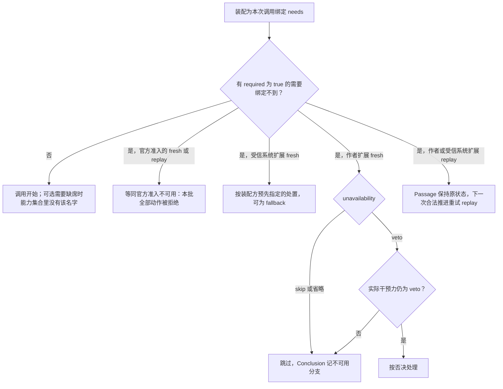

# 扩展作者协议

状态：设计已由[技术接受与产品采用决定](https://github.com/nemori-ai/omne-harness-lite/issues/384#issuecomment-6258475204)接受。作者接口的类型在 [src/extensions.ts](../../src/extensions.ts) 实现，输出判断 `judgeExtensionOutput` 与位置输出表的机读形式 `POSITION_OUTPUTS` 在 [src/judge-output.ts](../../src/judge-output.ts) 实现。扩展的调用、聚合与台账尚未实现。本页面向扩展作者。它拥有三件事：作者看到的输入与输出形状，各位置的输出合法性表，以及整批判断屏障的作者可见语义。扩展的位置集合、名称与触发边界由系统页[Loop extensions](../../../../../docs/architecture/runtime/loop-extensions.md#扩展位置与干预力)拥有，本页只引用位置名，不重述位置表。Agent 对扩展的行为保证归[成员 SPEC](../../SPEC.md#扩展卡片与材料)，内部实现机制归[扩展经过与精确采用接续](../../../agent/docs/architecture/mechanisms.md#扩展经过与精确采用接续)。

扩展只看到 Agent 自己的执行事实和按声明注入的能力。它不取得外部协调者的业务关联、日志句柄、环境句柄、Tool 内部的等待对象或供应商调度器。独立调用者和外部协调者路径使用同一份作者协议，位置集合不因调用方而变化。

本页区分两个词：

- 一次经过：Loop 到达某个位置的一次，见词表[一次经过](../../../../../.meta_harness/design/ubiquitous_language/terms/agent-runtime-loop.md#ul-extension-point-pass--一次经过--extension-point-pass)。同一次经过里，该位置的扩展按链序各调用一轮。
- 扩展调用：Agent 在一次经过里对一个扩展发起的调用，见词表[拓展件调用](../../../../../.meta_harness/design/ubiquitous_language/terms/agent-runtime-loop.md#ul-extension-invocation--拓展件调用--extension-invocation)。Agent 用 `Passage` 记录一次扩展调用，用 `PassageId` 标识它。一次扩展调用可以包含多次 `invoke`：结果未知之后的回放与答复到达之后的回放，都属于原扩展调用。

本页规定扩展作者接口类型的含义与规则，类型的唯一声明在 [src/extensions.ts](../../src/extensions.ts)。公开接口页只列名称并链接到这里。本页引用的其他 Agent 类型，例如 `Subject`、`PassageId`、`CardRoundId` 与 `CardAnswer`，由[公开接口页](README.md)导航到的源码声明。`Message` 来自 `@omne-harness/message`，`JsonValue` 来自 `@omne-harness/json-text`。`M.*` 指 `@omne-harness/model-contract` 的导出，见 [Model 契约公开接口](../../../../model/model-contract/docs/public-api.md)。`T.*` 指 `@omne-harness/tool-contract` 的导出，见 [Tool 契约公开接口](../../../../tool/tool-contract/docs/public-api.md)。

## 位置与作者可见的 subject

每个位置给作者一个固定形状的 `subject`。调模型之后与执行动作之后两个位置的维度由系统页定义。作者在 `dimension` 中用 `ending`（`complete_reply` 或 `failure`）与 `scope`（`each` 或 `batch`）表示它们。其他位置没有维度。

本页的前置位置是 `before_compaction`、`before_model_call`、`before_action` 与 `before_terminal`。后置位置是 `execution_started`、`after_compaction`、`after_model_call`、`after_action` 与 `after_terminal`。`execution_started` 在新执行开始之后经过，所以属于后置位置。

调模型之前与调模型之后两个位置另带 `purpose`：主请求的调用为 `main`，压缩步骤的调用为 `compaction`。扩展经注入能力发起的模型调用（用途 `extension`）不经过这两个位置，规则见下文“压缩用途与扩展用途的模型调用”。

下表是“位置与维度”到 `subject` 形状这一对应关系的权威。形状本身的权威是 [src/passages.ts](../../src/passages.ts) 的 `Subject` 联合：表中每一行的形状照抄联合的一个变体。[public-api-names.spec-d.ts](../../tests/public-api-names.spec-d.ts) 逐行断言表中每一行恰好等于联合的一个变体，十二行合起来等于整个联合。该测试不读取本页，它在源码里保存这十二行的抄本。所以改表中的任何一行时，必须同时改该测试中对应的那一行断言。

| 位置与维度 | `subject` 字段 | 可改写字段 |
| --- | --- | --- |
| `execution_started` | `{ execution: AgentExecutionId; conditions: DurableEvidence }`。新的逻辑执行及其当下条件的依据 | 无 |
| `before_compaction` | `{ preparation: Extract<Preparation, { kind: 'needs-compaction' }> }`。触发压缩的原准备与 Context 给出的计划进度 | 无 |
| `after_compaction` | `{ transition: PreparedContextTransition }`。已提交的压缩转换 | 无 |
| `before_model_call`，`purpose: 'main'` | `{ purpose: 'main'; preparation: Extract<Preparation, { kind: 'assembled' }> }`。Context 组装完成、尚未交给 Model 准备的请求 | `preparation.input` 的 `system`、`messages`、`tools`、`toolChoice`、`parameters` |
| `before_model_call`，`purpose: 'compaction'` | `{ purpose: 'compaction'; step: Extract<Preparation, { kind: 'ready' }>; progress: CompactionProgress }`。Model 已固定的压缩步骤请求 | 无 |
| `after_model_call`，`ending: 'complete_reply'` | `{ purpose: 'main' \| 'compaction'; call: M.ModelCallId; result: ProducedResult; reply: Message; termination: M.Termination; account: CallAccount \| null }` | 无 |
| `after_model_call`，`ending: 'failure'` | `{ purpose: 'main' \| 'compaction'; call: M.ModelCallId; request: M.FixedModelRequest; fault: M.ModelFault; dispatches: readonly M.DispatchRecord[]; retry: M.RetryResolution \| null }` | 无 |
| `before_action` | `{ action: ActionId; original: Action['original']; effectiveArguments: string; definition: T.ToolDefinition; batch: readonly ActionId[] }`。`batch` 列出同批全部动作，含本动作 | `effectiveArguments` |
| `after_action`，`scope: 'each'` | `{ action: ActionId; outcome: Readonly<{ kind: 'denied'; evidence: DurableEvidence }> \| Readonly<{ kind: 'executed'; result: ProducedResult; terminal: T.ToolTerminal }>; candidate: Message }`。`candidate` 是将交消息准入的候选消息：executed 时是工具结果消息，denied 时是拒绝消息 | `candidate.blocks` |
| `after_action`，`scope: 'batch'` | `{ batch: ActionBatchId; outcomes: readonly Readonly<{ action: ActionId; outcome: 'denied' \| 'executed'; terminal: T.ToolTerminal \| null }>[] }`。`outcomes` 按原动作顺序列出本批全部动作，含被拒绝的动作；转后台的动作为 executed 且 `terminal` 为 null | 无 |
| `before_terminal` | `{ proposed: AgentConclusion; basis: DurableEvidence }`。候选终态及其完整依据 | 无 |
| `after_terminal` | `{ terminal: AgentConclusion; disposition: DurableEvidence }`。已成立的终态 | 无 |

`Message` 的 `reply` 的角色是 `assistant`，`candidate` 的角色是 `tool`。`CallAccount` 来自 `@omne-harness/call-account`。表中没有列为可改写的字段都不可改写。改写不能改变已发生的事实，也不能撤销工具的实际效果。

执行动作之后整批范围的触发边界由[系统页](../../../../../docs/architecture/runtime/loop-extensions.md#扩展位置与干预力)拥有。系统页的位置表写明这条边界。作者可见的后果是：整批范围的 `outcomes` 至少有一项为 `executed`。本批全部动作都被拒绝时，不经过整批范围，拒绝事实经回复消息与执行事实到达后续位置。

调模型之后位置的 `failure` 维度在一次调用内有两种触发：每次首内容前的发出失败触发一次，`subject.retry` 为 Model 交来的重试请求；原调用最终失败时再触发一次，这时原调用已经收场。这两种触发的边界同样由系统页拥有，系统页的位置表写明这两种触发。

## 声明

扩展作者提交一份声明。装配按声明选择实现、注入能力并确定链序。

声明的类型是 `Position`、`Dimension`、`Power`、`ErrorPolicy`、`UnavailabilityPolicy`、`ExtensionImplementationDeclaration` 与 `LoopExtensionDeclaration`，都在 [src/extensions.ts](../../src/extensions.ts)。同一文件的常量 `POSITIONS` 是九处位置，`POWERS` 是三档干预力。

字段约束如下。

| 字段 | 约束 |
| --- | --- |
| `name` | 能力名。同一装配内同一位置可以有多个扩展，名称不是位置身份 |
| `position`、`dimension` | `after_model_call` 必须带 `dimension.ending`。`after_action` 必须带 `dimension.scope`。其他位置不带 `dimension` |
| `power` | 声明的干预力上限。任何位置都可以声明三档中的任一档，位置不限制声明。实际能力再按位置输出表与来源收窄，见下文“输出”。来源为工作区的扩展上限是 `observe` |
| `needs` | 非空的需要声明列表。每项 `NeedDeclaration` 对应装配在调用时交付的一项能力或一项命名读取，带 `name`（交付时的键，列表内互不相同）、`schema`（交付物所遵守的契约的精确采用）与 `required`（是否必需，布尔值，没有默认）。装配只按这个列表注入能力，见下文“输入”。官方准入按同一组名字收到读取，见 SPEC 的“[整批判断屏障与动作准入](../../SPEC.md#整批判断屏障与动作准入)”第 2 条。必需性在调用开始之前判定，必需需要缺席与可选需要缺席的处置见 SPEC 的“[声明判断](../../SPEC.md#声明判断)” |
| `implementation` | `builtin` 由装配按名称解析到受信的内建实现。`command` 由宿主与方言适配器执行，适配器把命令结果转成本页的输出形状。`timeout` 是 ISO 8601 时长 |
| `onError` | `observe` 只允许 `ignore`。`rewrite` 允许 `ignore` 或 `record`。`veto` 允许三种。省略时，`observe` 按 `ignore`，`rewrite` 按 `record`，`veto` 按 `treat_as_veto`。后置位置的扩展只允许 `ignore`，省略时也按 `ignore`，声明其他值被拒绝 |
| `unavailability` | 省略时按 `skip`。`veto` 只允许 `power` 为 `veto`、且位置为前置位置的扩展 |

声明里没有 `fallback` 字段。指定兜底只属于受信系统扩展，由装配方预先指定，作者不能声明，见下文“不可用与报错”。不可用处置是声明的一部分，不是各层可以逐项配置的设置或权限。更具体的层若要改变它，走合法的定义替换，不给同一资产私配值。

声明判断 `judgeLoopExtensions` 按上表接受九处位置、三档干预力和全部字段，返回具名拒绝原因。判断规则与限额见 [SPEC 的声明判断](../../SPEC.md#声明判断)。

## 输入

作者在每次调用中收到一个 `ExtensionInput`，类型在 [src/extensions.ts](../../src/extensions.ts)。

`subject` 按上文的位置表取形状。`earlier` 是同一次经过里、同一条链上前序扩展已校验的 Conclusion，按链序排列。后一个扩展读到的 `subject` 已经包含前序扩展的有效改写。`execution` 是 Agent 的逻辑执行身份。`passage` 是本次扩展调用的身份，是本次调用全部效果的幂等依据。输入里没有外部协调者的业务关联，没有日志句柄，没有环境句柄。

历史、Runtime Context 的私有块与模型调用由能力提供，不在输入里。装配按 `needs` 注入能力，并按来源收窄：来源上限为 `observe` 的扩展只能注入两项读取能力，声明需要模型调用能力时，装配拒绝该声明。每项能力在注入时绑定执行、扩展调用与操作序号。能力每次使用都核验当前资格。持有 `execution` 或 `passage` 不授予任何访问。

| 能力 | 作者取得什么 | 幂等身份 | 结果去向 |
| --- | --- | --- | --- |
| 执行历史读取 | 本执行已可靠保存的消息与事实的只读视图 | `PassageId` 加操作序号。读到的值先耐久保存再返回，重放时认回同一值 | 记入 Passage 的 `read` 操作 |
| Runtime Context 私有块读取 | 标为扩展可读的块，含权限输入 | 同上 | 记入 Passage 的 `read` 操作。私有块不进入模型请求、事件与诊断，规则见 [Runtime Context 的消费](../../SPEC.md#runtime-context-的消费) |
| 模型调用 | 以用途 `extension` 发起一次模型调用并取得结果 | `PassageId` 加操作序号。重放时认回原调用，不重复计费 | 记入 Passage 的 `producer` 操作，结果回原扩展调用，不进入主回复序列 |
| 守卫判断记录 | 作者取不到。它只注入给调模型之后位置上的循环判断这一受信系统扩展，用来记录一份守卫事实（`GuardFact`，形状见[公开接口页](README.md#身份原位置与纯求值)）。作者声明 `needs` 含它时，装配拒绝该声明 | `PassageId` 加操作序号。重放时认回同一值 | 记入 Passage 的 `guard` 操作。效果采纳时 Agent 把它写入 checkpoint 的守卫事实 |

守卫判断记录不改变作者协议：八种输出与位置输出表对受信系统扩展同样适用，守卫 L1、L2 的干预消息仍由该扩展以 `inject` 给出，L4 的请求人处理以 `ask` 给出，L4 不记为守卫事实。

能力不出卡。卡片只由 `ask` 输出产生，见下文“输出”。

扩展不能直接发起工具调用。工具效果只经主 Loop 的整批判断屏障与官方动作准入发起。扩展需要工具效果时，以 `inject` 或 `ask` 影响主 Loop。重新提供这项能力的前提登记在[外域依赖](../../../agent/docs/architecture/open-questions.md#扩展发起工具调用的准入)。

回放时，能力把同一序号上的请求与已记录的操作比对，比对项是操作种类与原输入依据。

1. 种类与输入依据都相同，原操作已有结果：能力返回原结果，不发第二次调用。
2. 种类与输入依据都相同，原操作仍在途：能力按原 `PendingCall` 等待原操作的结果，不另发调用。
3. 种类与输入依据都相同，原操作的查询结果未知或查询不可用：操作保持已请求，能力向扩展返回暂不可用的失败。Agent 把本次 `invoke` 的结果锁存为 `controlUnavailable`。
4. 种类或输入依据不同：能力向扩展返回失败，Agent 把本次 `invoke` 的结果锁存为 `replayInconsistent`。扩展捕获这个失败也不能消除锁存。
5. 序号超出已记录的操作：这是新操作。只有在 `fresh` 调用中，或回放绑定的 `control` 为 `valid` 时，能力才发出新操作。

第一次锁存之后，本次 `invoke` 内的能力对后续每个请求一律返回失败：不记入 `operations`，不发出新操作，不再比对，也不再锁存。本次调用的结果是第一次锁存的值，Agent 不采纳扩展返回的其他结果。

能力之外的任何副作用由作者自己负责幂等。作者必须用 `passage` 作为去重键，使同一扩展调用的再次 `invoke` 不重复产生该副作用。Agent 不能替作者认回这类效果。

## 输出

作者返回八种输出之一。`ExtensionOutput`、`DecisionCardDraft` 与 `CardOption` 的类型在 [src/extensions.ts](../../src/extensions.ts)。

各种输出的含义如下。

- `observed`：只留痕，不改候选，不影响推进。
- `inject`：追加一条系统提醒消息。Agent 把它交消息准入一次。前置位置的提醒在受保护的操作之前进入，后置位置的提醒在下一次主请求之前进入。同一提醒只进入历史一次。
- `rewrite`：返回同位置的 `subject`，只改表中列为可改写的字段。Agent 把改写记为改写依据。调模型之前的改写交 Context 重新组装并复核，规则见[调模型之前的复核与最终请求](../../SPEC.md#调模型之前的复核与最终请求)。改写不触发同一次经过再次运行。
- `select_model`：给出路由名。Agent 把它作为改写依据交模型选择端口。选择端口按锁定、模态与外传条件核验，不因此启用被禁用的模型，规则见[模型选择](../../SPEC.md#模型选择)。
- `veto`：阻止候选状态变化。该链结束。各位置的否决后果见下文“否决、停止与终态”。
- `stop`：请求停止后续推进。`terminal` 缺省为 `cancelled`。`stop` 不结束链：Agent 先保存这个 Conclusion，链按声明顺序继续运行，后继扩展在 `earlier` 中读到它。`earlier` 中的 `stop` 表示原扩展提出停止，不表示取消成立；后继仍可以 `inject`、`rewrite`、`ask`，或给出另一个合法的 `stop` 或 `retry`。链结束后，Agent 记录一条以该扩展为真实来源的控制请求，再按[取消、退出与结构变更](../../SPEC.md#取消退出与结构变更)核权与处理。`stop` 不是已取消的回执，也不撤销已发生的动作。`stop` 不改写 `subject`。作者要接受这项延迟：停止请求的处置可能发生在后继扩展的能力调用、费用、提醒与人工等待之后。外部的有效控制、授权撤销、挂接取代与实例停用不被这项延迟阻塞，它们一旦生效，`signal` 立即适用。
- `retry`：只在调模型之后的失败分支，并且只在首内容前发出失败的触发中合法。原调用最终失败的触发中返回 `retry` 按不合法输出处理，因为已经没有可以继续的调用。它要求原 Model 调用仍持有对应的重试请求。`retry` 不结束链：Agent 先保存这个 Conclusion，链继续运行。`observed` 与 `inject` 不清除已保存的 `retry`；后继的 `ask` 暂停原调用的重试决定，人的等待没有超时答案。链结束后，没有成立的停止意图、没有 `veto`、也没有系统的不再重试兜底时，Agent 选择链序最后一个合法的 `retry`，整体采用它的 `plan` 与 Conclusion 的 `at`，不拼接多个计划的 supplier、basis 或 `notBefore`。胜出的计划作为策略建议交重试策略协调者，由它按 Model 的[重试契约](../../../../model/model-contract/docs/public-api.md#重试失联与恢复)形成该调用的唯一重试决定，Model 核验来源后继续发出或收场；协调者与 Agent 的分工见 SPEC 的“[作为 Model 调用方](../../SPEC.md#作为-model-调用方)”第 4 条。`plan` 对应 Model 重试决定的 `retry` 分支。`notBefore` 是 null 或 RFC 3339 的 UTC 时刻文本。文本不能被 `@omne-harness/utc-instant` 的 `parseInstant` 解析时，输出被拒收，原因 `malformed`；解析成功时 Agent 以 `UtcInstantText` 保留原文本，不规范化。`notBefore` 为 null 表示不另设等待，Agent 以胜出 Conclusion 的 `at` 作为 Model 重试决定的 `notBefore`，恢复时不重算时间；`at` 由 Agent 写入，见“作为 Model 调用方”第 3 条。主 Loop 不提前消费结果。链上没有合法的 `retry`，或合法的 `stop` 已确定放弃该调用时，协调者保存不再重试的决定并保留原失败，Model 按不再重试收场。作者的 Conclusion、链末的重试效果、协调者的决定、Model 的决定提交与实际发出是不同的事实。
- `ask`：请求人处理。`ask` 的 Conclusion 不是最终结论。Agent 保存它，并按卡片草稿出一轮卡片。卡片绑定原 `PassageId`。本轮答复齐备后，Agent 以 `replay` 模式携带答复重新调用原扩展的原精确采用，取得下一个结论。卡片只由 `ask` 输出产生。

### 按干预力的上限

| 声明 `power` | 允许的输出 |
| --- | --- |
| `observe` | `observed` |
| `rewrite` | `observed`、`inject`、`rewrite`、`select_model`、`retry` |
| `veto` | 全部八种 |

实际能力取声明上限、位置输出表与来源收窄三者的交集。来源为工作区的扩展只能 `observed`。扩展不能通过返回值升级能力。

### 位置输出表

下表是输出合法性的唯一表。每一格先按位置，再按干预力收窄。“可改写字段”列重复上文位置表的结论，其余字段不可改写。`POSITION_OUTPUTS` 是这张表的机读形式：每个位置行给出位置允许的输出和可改写字段，三档干预力的上限由上文的表给出。`judgeExtensionOutput` 用它判断作者的返回值。

| 位置与维度 | 位置允许的输出 | `observe` 实际 | `rewrite` 实际 | `veto` 实际 | 可改写字段 |
| --- | --- | --- | --- | --- | --- |
| `execution_started` | `observed`、`inject`、`stop`、`ask` | `observed` | `observed`、`inject` | `observed`、`inject`、`stop`、`ask` | 无 |
| `before_compaction` | `observed`、`inject`、`veto`、`stop`、`ask` | `observed` | `observed`、`inject` | `observed`、`inject`、`veto`、`stop`、`ask` | 无 |
| `after_compaction` | `observed`、`inject`、`stop`、`ask` | `observed` | `observed`、`inject` | `observed`、`inject`、`stop`、`ask` | 无 |
| `before_model_call`，`main` | `observed`、`inject`、`rewrite`、`select_model`、`veto`、`stop`、`ask` | `observed` | `observed`、`inject`、`rewrite`、`select_model` | 全部七种 | `preparation.input` 的 `system`、`messages`、`tools`、`toolChoice`、`parameters` |
| `before_model_call`，`compaction` | `observed`、`veto`、`stop`、`ask` | `observed` | `observed` | `observed`、`veto`、`stop`、`ask` | 无 |
| `after_model_call`，`complete_reply` | `observed`、`inject`、`stop`、`ask` | `observed` | `observed`、`inject` | `observed`、`inject`、`stop`、`ask` | 无 |
| `after_model_call`，`failure` | `observed`、`inject`、`stop`、`retry`、`ask` | `observed` | `observed`、`inject`、`retry` | `observed`、`inject`、`stop`、`retry`、`ask` | 无 |
| `before_action` | `observed`、`inject`、`rewrite`、`veto`、`stop`、`ask` | `observed` | `observed`、`inject`、`rewrite` | 全部六种 | `effectiveArguments` |
| `after_action`，`each` | `observed`、`inject`、`rewrite`、`stop`、`ask` | `observed` | `observed`、`inject`、`rewrite` | `observed`、`inject`、`rewrite`、`stop`、`ask` | `candidate.blocks` |
| `after_action`，`batch` | `observed`、`inject`、`stop`、`ask` | `observed` | `observed`、`inject` | `observed`、`inject`、`stop`、`ask` | 无 |
| `before_terminal` | `observed`、`inject`、`veto`、`stop`、`ask` | `observed` | `observed`、`inject` | `observed`、`inject`、`veto`、`stop`、`ask` | 无 |
| `after_terminal` | `observed` | `observed` | `observed` | `observed` | 无 |

本表逐格兑现[系统页](../../../../../docs/architecture/runtime/loop-extensions.md#扩展位置与干预力)对干预力与位置的限制，包括只有调模型之前、执行动作之前和执行动作之后的单结果范围提供改写、后置位置不否决、后置位置的停止与请求人处理，以及落终态之后只观察。压缩之后面对的是已提交的转换，所以没有任何位置能改写压缩候选。压缩步骤的请求已由 Model 固定且不再重新准备，所以压缩用途的调模型之前位置不提供 `inject`、`rewrite` 与 `select_model`。

### Conclusion

Agent 把校验通过的输出包装为 Conclusion 并保存。作者不返回 Conclusion。`ActionIdentity` 与 `Conclusion` 的类型在 [src/extensions.ts](../../src/extensions.ts)。

| 分支 | 含义 |
| --- | --- |
| 输出 | 调用返回了合法输出。`power` 是实际生效的干预力。输出为 `ask` 时，这个 Conclusion 不是最终结论 |
| 不可用 | 调用没有开始。`unavailability` 记录采用的处置：`skip`、`veto`，或系统扩展的 `fallback` |
| 报错 | 调用开始后失败，或返回被拒收。`output` 是按 `onError` 得到的替代输出，见下文“不可用与报错” |

最终结论指 `ask` 以外的全部 Conclusion。

`ActionIdentity` 的规则：`before_action` 与 `after_action/each` 必须带 `action`。`after_model_call/failure` 必须带 `call`。其他位置与维度都不带这两个字段。调模型前后两个位置的用途记在 Passage 的 `purpose`，Conclusion 不另带用途。

输出被拒收时，拒收原因只有下列之一：`malformed`、`position_unknown`、`power_unknown`、`dimension_missing`、`dimension_not_allowed`、`output_not_allowed_for_power`、`output_not_allowed_at_position`、`ask_at_forbidden_position`、`rewrite_touches_immutable`、`inject_source_mismatch`。被拒收的输出按报错处理，分类为 `bad_output`。`judgeExtensionOutput` 返回这十种拒收原因，类型是 `OutputRefusalReason`。判断顺序、限额，以及本页没有写明之处的取舍，见 [SPEC 的扩展输出判断](../../SPEC.md#扩展输出判断)。

## 调用协议

每个实现提供一个 `invoke`。它有副作用：它可以经注入能力调模型、调工具、读取，也可以返回 `ask` 请求出卡。Agent 不把它当纯函数重跑。`ExtensionInvocationMode`、`ExtensionReplayBinding`、`ExtensionInvocationResult` 与 `LoopExtensionImplementation` 的类型在 [src/extensions.ts](../../src/extensions.ts)。

`fresh` 是本扩展调用的第一次 `invoke`。`replay` 用于两种情形：上一次 `invoke` 的结果未知，或 `ask` 的本轮答复已经齐备。`output.value` 必须校验为 `ExtensionOutput`。

回放绑定的内容如下。

- `passage`：原扩展调用的身份。
- `rounds`：本扩展调用已出的全部卡片轮次，按次序排列，每轮带卡片与已到的答复。结果未知之后的回放带已有的轮次，可以为空。答复到达之后的回放带全部轮次，最后一轮的答复齐备。每张卡片的 `response` 在尚无答复时为 null。有答复时，作者按 `answer` 读取人的处理：`chosen` 带所选选项与可选的值，`declined` 表示人明确拒答，`remark` 带人的原话 `text`，表示人有话说但没有给出准驳。`evidence` 是该答复的依据，作者不解析它。`CardAnswer` 与 `CardRemark` 的形状见[公开接口页](README.md#扩展人工卡片与材料)。
- `control`：Agent 在本次调用开始时按台账判定的状态。`valid` 表示原输入依据、已记录的操作与各轮答复都已认回。`unavailable` 表示认回所需的查询暂时不可用。`replayInconsistent` 表示台账中的记录与本次回放的输入不一致。

`control` 不是 `valid` 时，能力只认回已记录的操作，不发出新操作。作者应对 `unavailable` 返回 `controlUnavailable`，对 `replayInconsistent` 返回 `replayInconsistent`。Agent 按 `control` 处置本次调用，不采纳扩展返回的其他结果。调用期间的锁存由能力比对产生，第一次锁存生效，之后能力不再发出新操作，规则见上文“输入”。

`signal` 由 Agent 在当前推进失效时中止：取消已经生效、执行挂接被取代，或实例停用。中止后，实现应停止新的工作并尽快返回。Agent 不采纳本次 `invoke` 的返回，Passage 保持原状态。下一个合法推进者以 `replay` 接续。执行已终结时不再调用。

`command` 实现由宿主方言适配器调用，不当作内建函数调用。适配器把 `ExtensionInput`（含 `passage`）、调用模式与回放绑定按方言编码后交给命令，再把命令结果转为同一结果联合。命令以 `passage` 作为自有副作用的去重键。适配器声明它的方言能否携带回放绑定。方言不能携带时，有两条后果。第一，该实现返回的 `ask` 按不合法输出处理，原因是方言不支持回放。Agent 不出卡，所以没有人的答复会被转成其他结论。第二，结果未知之后的 `replay` 调用由适配器返回 `replayInconsistent`，Agent 按报错依 `onError` 形成最终 Conclusion，原扩展不会再执行一次。这是单一回放模式对这类实现的代价，作者选择方言与干预力时按此权衡。

调用结果的处置如下。

| 结果 | Agent 的处置 |
| --- | --- |
| `output` | 校验输出。不合法按报错处理。合法且为 `ask` 时，包装为非最终 Conclusion，Passage 进入已询问。合法且为其他输出时，包装为最终 Conclusion，Passage 进入已结论 |
| `errored` | 按 `onError`（省略时按缺省值）形成报错分支的最终 Conclusion |
| `notStartedUnavailable` | 调用没有开始，没有副作用。`fresh` 下按不可用处置形成最终 Conclusion。`replay` 下 Passage 保持原状态，由下一次合法推进重试 `replay` |
| `replayInconsistent` | 回放绑定或能力比对与原记录不一致。按报错处理，再依 `onError` 形成最终 Conclusion。扩展捕获异常不能改变这一结果 |
| `controlUnavailable` | 认回所需的查询暂不可用。它专指原回放控制查询，不用于取消、宿主失联或启动未知。Passage 保持原状态，不形成 Conclusion，由下一次合法推进重试 `replay` |
| `invocationUnresolved` | 宿主已经交还控制，但不能判明这次物理调用是否开始，或已开始而不能判明收场。不形成 Conclusion。Passage 保持已请求或已询问，已有的 `operations` 与轮次保留。Agent 把 `recovery` 随自己的接续保存，进入具名的依赖等待；下一次合法推进以 `replay` 与原精确采用接续。重复的未知不触发 `fresh`，也不换新版本 |

`invocationUnresolved` 的形状如下。

```ts
type InvocationUnresolved = Readonly<{
  kind: 'invocationUnresolved'
  start:
    | Readonly<{ kind: 'unknown' }>
    | Readonly<{ kind: 'started'; evidence: Evidence }>
  recovery: Evidence
}>
```

`recovery` 绑定原 execution、Passage、精确 `implementation`、调用模式、宿主的执行记录与待认回的责任，由宿主解释与保管；它不能只引用已经释放的闭包、临时 PID 或日志文本。`started` 的 `evidence` 只证明真实进入，不证明执行完成或没有外部效果；`started` 与 `unknown` 只区分已有证据，处置相同。宿主在任何可能启动之前，先持久登记原 execution、Passage、精确 `implementation`、物理调用身份与启动、收场责任，并能从 execution 或 Passage 扫描认回这份记录；返回丢失或 Agent 尚未保存接续就失去资格时，宿主仍持有索引、原记录与资源，重启先从该索引恢复。只有确认 Agent 或另一合格保管者已耐久承接全部责任后，宿主才释放本地责任。不能证明开始的任意异常没有资格返回 `invocationUnresolved`：宿主必须能指明尚未结算的原启动或执行记录，否则这是宿主缺陷，上交宿主拥有者并停止依赖路径，不捏造业务结果。这个分支不新增 Conclusion 分类，也不新增 Passage 状态。宿主的启动门、撤回协议与真实进入证据归宿主页面，本页只规定作者与协调器可以依赖的含义。

宿主把“已请求”“准备完成”“启动已允许”“真实进入”“返回已知”分开，前三项都不是真实进入的证据。实际开始的界线按运行方式确定。

| 运行方式 | 实际开始的界线 | 未开始的证据 | 已开始的证据 |
| --- | --- | --- | --- |
| 受信 `builtin` | 宿主把控制交给该精确采用的作者函数，作者代码取得执行机会 | 该入口没有被调用，宿主的启动围栏排除之后的迟到调用，准备阶段没有调用作者的 getter、能力或有副作用的工厂 | 同步调用栈确认进入并返回或抛出，或作者执行已产生可认回的操作记录。“准备进入”的标志不够 |
| `command` | 方言指定的命令执行入口真正启动。方言使用 shell 时，shell 是命令入口，shell 已开始后找不到脚本是执行失败 | 宿主确认命令入口未启动，并排除排队启动、延迟创建与独立 helper 产生的效果 | 启动提供者对原调用给出可归属的真实启动回执，或原命令的执行结果证明它曾运行。只分配句柄或排队成功不够 |

宿主的预处理只做没有作者效果的解析、采用解析与编码。预处理需要运行作者代码、脚本 helper 或外部能力时，它已经跨过开始界线，不能再承诺 `notStartedUnavailable` 的无副作用。活进程里的确定进入证据可以用于当次的分类；崩溃恢复不能把那份内存证据当作耐久事实。持久化启动意图之后、真实调用之前的窗口，与真实调用之后、启动回执保存之前的窗口，都保留 unknown。

结果按下列优先级采纳。第一，当前推进已经失效或 execution 已终结时，不采纳本次 `invoke` 的返回，沿 `signal` 与终态规则保留 Passage，只处理允许的事实保管；同时得到 `notStartedUnavailable` 或 `errored` 也不改变这一条。第二，推进仍有效时，回放绑定与能力操作的第一次 `controlUnavailable` 或 `replayInconsistent` 锁存优先于作者返回。第三，没有上述优先事实时，宿主按真实开始、已知收场与输出校验映射结果。原调用尚未开始时，单纯的采用替换不使合法的 `fresh` 自动失去资格：宿主证实旧采用已经不能进入并满足无副作用保证，才返回 `notStartedUnavailable`。`replay` 即使证实本次物理进入没有开始，也保持原 Passage，不跳过此前未完成的扩展调用。`fresh` 的未开始返回在本地形成但尚未保存就崩溃时，恢复仍按已请求的 `replay` 规则，不补造不可用的 Conclusion。

下表假定推进仍有效且没有优先锁存。不存在的证据不能用异常的名字猜测。

| 观测事实 | 返回 | Passage 与原效果的责任 |
| --- | --- | --- |
| `fresh` 在作者入口前撤回，已排除进入与迟到效果 | `notStartedUnavailable` | 形成不可用的最终 Conclusion，按原 `unavailability` 或系统兜底 |
| `replay` 的本次入口前缺失原实现，已排除本次进入 | `notStartedUnavailable` | 保留已请求或已询问，缺实现具名等待，不替换新版本 |
| `builtin` 作者函数确定进入后同步抛出 | `errored`，分类 `ordinary` | 保存真实异常，按 `onError`。保留全部已记录的操作与作者自有效果 |
| `builtin` 作者函数确定进入后，返回的 Promise 明确拒绝 | `errored`，分类 `ordinary` | 同上。Promise 拒绝不撤销此前效果 |
| 解析实现、输入编码或命令准备失败，确定没有进入、没有作者效果且排除迟到启动 | `notStartedUnavailable`，宿主另存诊断，不新增返回字段 | 按 `fresh` 或 `replay` 的原规则。宿主缺陷同时报告给宿主拥有者，不伪造作者报错 |
| `command` 的启动提供者确定拒绝，命令入口未启动，且排除 helper 与迟到启动 | `notStartedUnavailable` | 不制造 `nonzero_exit`。按 `fresh` 或 `replay` 分别处理 |
| shell 已运行，内部命令不存在或命令非零退出 | `errored`，分类 `nonzero_exit` | 命令已经开始。保留实际退出与效果，不转不可用 |
| 命令确认开始，宿主按声明的 `timeout` 得到确定的调用超时结果 | `errored`，分类 `timeout` | 按 `onError`。超时不证明物理停止，仍在运行的进程与迟到效果由宿主继续负责 |
| 启动等待超时，但不能排除原启动 | `invocationUnresolved`，`start` 为 `unknown` | 不走超时报错，不形成 Conclusion。查询原启动记录 |
| 命令确认开始，结果通道断开，无法判明命令收场 | `invocationUnresolved`，`start` 为 `started` | 不把失联当作普通拒绝。保管原命令与后续责任 |
| 传输层的 Promise 拒绝，不能判明开始或收场 | 有原恢复责任时为 `invocationUnresolved` | Promise 的类型不决定业务类型，不默认 `errored` |
| 已知返回，但输出形状或位置不合法 | `errored`，分类 `bad_output` | 按 `judgeExtensionOutput` 与 `onError` |
| 调用中只撤除登记或发布新采用 | 不据此生成任何结果 | 保留原精确采用与资源，等待原结果。真实的后续失败才按事实分类 |
| 取消、挂接取代或实例停用使 `signal` 中止 | 按采纳优先级第一条不采纳返回。返回事实按原身份保存，取消后的落终态之前调用经 record-legacy-return 登记 | 不改成 `controlUnavailable` 或 `errored`，不复活业务 |

`errored` 的最终 Conclusion 终结的是该扩展调用的判断，不证明所有能力调用已经结束，也不证明能力外的效果可撤销；宿主或对应生产者仍保存未交清的结果、费用与操作责任。不能携带回放绑定的方言保持原规则：结果未知后的 `replay` 由适配器返回 `replayInconsistent`，按 `onError` 终结判断，不再次启动命令；`invocationUnresolved` 不赋予这类方言原本没有的回放能力。`replayInconsistent` 是宿主对原方言能力的已知结论，只能在原记录与不支持的事实可核时形成，不能拿查询失败代替。方言连原执行记录、启动排除或迟到保管都不能保留时，装配在新受理前拒绝为 unsupported；已受理而不可恢复的原工作保持具名未交清与人工处理责任，不自动 `fresh` 重启，也不报告没有效果。

协调器把一条链的 Conclusion 聚合为一个效果：`proceed`（带有效的 `subject`）、`vetoed`、`stopped`、`asked`、`retry`。链上出现 `ask` 时，聚合效果是 `asked`，链在该扩展处暂停，后续扩展尚未开始。每次聚合为 `asked`，Loop 采纳一次并进入人工等待；原扩展得到最终结论之后，链继续运行，Loop 再采纳该链的最终效果。同一条链因多轮询问或后继扩展的询问可以多次聚合为 `asked`。`veto` 结束链，后继扩展从未开始。`stop` 与 `retry` 不结束链，也不要求位于链尾：它们先保存，链继续；链完成或被 `veto` 截断后，协调器只对实际形成的 Conclusion 前缀归约，不为未运行的后继制造 `observed`、不可用或已采纳。归约先认回或采用前缀的独立效果（提醒准入、改写依据、守卫事实），每项沿自己的 Passage 与操作身份处理一次，`stop` 不撤销这些真实效果与费用；再逐项处置停止请求；最后选择路由。处置与优先级见[否决、停止与终态](#否决停止与终态)。聚合是纯归约，但它只是协调器的内部实现手段，不是作者协议，见[机制页](../../../agent/docs/architecture/mechanisms.md#扩展协议的边界)。

### 扩展调用的台账

一次扩展调用有四个状态。每轮卡片另有四个状态与一个失败终态。状态的生灭与全部迁移由[对象模型](../object-model.md#扩展调用与卡片轮次)拥有，行为由 [SPEC](../../SPEC.md#整批判断屏障与动作准入) 拥有；本节只写作者可见的含义。

| 台账 | 状态 | 含义 |
| --- | --- | --- |
| 扩展调用 | 已请求（requested） | 扩展调用的身份与调用模式已提交，尚未得到 Conclusion |
| 扩展调用 | 已询问（asked） | 扩展返回了 `ask`。非最终 Conclusion 与本轮卡片草稿已提交，等待有效答复 |
| 扩展调用 | 已结论（resolved） | 最终 Conclusion 已提交 |
| 扩展调用 | 已采纳（applied） | Loop 已按最终 Conclusion 推进 |
| 卡片轮次 | 已请求（requested） | 本轮卡片草稿已入台账，呈现回执未知 |
| 卡片轮次 | 已呈现（presented） | 卡片端口已创建并呈现本轮全部卡片 |
| 卡片轮次 | 已答复（answered） | 本轮每张卡片的唯一有效答复都已交回。明确不回答也是答复 |
| 卡片轮次 | 已处理（processed） | 原扩展已以 `replay` 消费答复并得到最终 Conclusion；或同一扩展调用后来的一轮呈现失败，Agent 以拒绝 Conclusion 结束该扩展调用 |
| 卡片轮次 | 呈现失败（present-failed） | 卡片端口对本轮返回确定失败。该扩展调用以带系统准入故障依据的拒绝 Conclusion 进入已结论，不再回放 |

作者可见的要点：已询问的扩展调用在最后一轮答复齐备后被 `replay`，得到最终 Conclusion 时全部轮次记为已处理；回放又返回 `ask` 则开新一轮，仍属原批次，之前的轮次保持已答复；任一轮呈现失败则该扩展调用由 Agent 以拒绝结束，不再回放。完整迁移见对象模型。

Agent 保证以下几点。

1. 已有最终 Conclusion 的扩展调用永不再调用扩展。换执行挂接、换 runtime、换代都不改变这一点。`ask` 的 Conclusion 不是最终结论，已询问的扩展调用在答复齐备之后以 `replay` 调用。
2. 调用结果未知时，Agent 以 `replay` 重新调用原精确采用，不以 `fresh` 重新开始。
3. 经注入能力产生的操作按 `PassageId` 加操作序号认回。重放时能力返回原结果，不重复计费，不重复执行。
4. 卡片按原 `round` 与完整请求身份认回。同一轮卡片不重复呈现。
5. 已答复不等于已处理。整批判断屏障在全部必要卡片处理完成之前保持关闭。
6. 后继扩展可以再出卡。新卡片有新的轮次，仍属原批次。

### 压缩用途与扩展用途的模型调用

压缩步骤的请求（用途 `compaction`）只经过压缩用途的调模型之前与之后两次经过。它不经过主请求的那一次调模型之前位置。主请求在压缩提交后重新准备时也不重跑同一次经过。压缩用途的模型选择使用触发压缩的那次主请求准备所用的同一份历史依据。

扩展经注入能力发起的模型调用（用途 `extension`）不经过任何调模型之前或之后位置。它的请求准备以用途 `extension` 调用 `RequestPreparation.prepare`，`beforeModelCall` 传空列表，装得下的结果直接是 `ready`。准备返回 `needs-compaction` 时，能力不进入本 step 的压缩计划，也不另开计划。它把 Context 的原结果作为装不下的失败交回扩展，由扩展自行处置。扩展用途的模型选择与请求准备使用同一份历史依据，即该扩展调用被请求时记录的历史依据，所以重放时得到同一结果。

## 否决、停止与终态

| 位置与用途 | `veto` 的后果 |
| --- | --- |
| `before_compaction` | 不压缩。请求仍装不下时，按压缩后仍超限失败并记录否决依据，见[无法装下](../../SPEC.md#无法装下) |
| `before_model_call`，`main` | 不发出该请求。否决之后出现新的合法继续依据（新输入、条件变化、控制或迟到结果）时，Loop 继续推进。没有时 Loop 等待，不重新提出同一请求，也不把否决当作完成 |
| `before_model_call`，`compaction` | 不发出该步骤请求。该压缩计划按压缩失败收场：以 cannot-fit（after-compaction）进入失败候选，并附否决依据，见[无法装下](../../SPEC.md#无法装下)。Loop 不回到同一步重新求值 |
| `before_action` | 不执行该动作。该动作的结果为 `denied`，候选消息进入消息准入 |
| `before_terminal` | 该完成候选或失败候选不成立。否决之后出现新的合法继续依据时，Loop 继续推进。没有时 Loop 等待，不重新提出同一候选 |

`stop` 的后果在全部位置与用途下相同：链结束后，Agent 为每个 `stop` 保存一个稳定的处置操作身份，记录以该扩展为真实来源的控制请求。`terminal` 为 `cancelled` 时走取消，为 `failed` 时形成失败终态候选。两者都经条件终结提交，见[条件终结](../../SPEC.md#条件终结)。扩展没有独立的落账通道，也不能否决已生效的取消来恢复工作。链上有多个停止请求时，处置按下列规则进行。

- 当前已有有效取消、已终态、挂接被取代或实例停用时，这些事实优先。链上的输出不能覆盖它们，已发生的事实继续保管。
- 每个 `stop` 保留原来源与请求身份，按声明顺序提交或认回。不同扩展的请求不共用身份，也不伪造人的来源。多个 `stop` 不是“后一个覆盖前一个”：一个被拒绝的后继请求不能消除已经成立的前序取消。
- 某个 `stop` 的受理或核权未知时，Agent 先查原请求。未知期间不发出受保护的操作或重试，只阻塞依赖该判断的推进，控制与保管继续。
- 至少一个 `cancelled` 请求的意图实际成立时，有效取消优先，Agent 按原控制次序认回当前取消依据并进入取消收束。其余失败建议、`veto` 与 `retry` 都不能恢复业务。受理只是受理，不等于意图成立。
- 取消请求都被拒绝，且至少一个 `failed` 请求合法时，形成 `extension-stop` 失败候选。多个合法的 `failed` 请求以链序最早者为主因，其余作为同次处置的相关依据，不合并字符串冒充一个来源。
- 没有停止意图成立而有 `veto` 时采用 `vetoed`，保留前序提醒、费用与被拒绝的 `stop`，没有运行的后继不参与判断。没有停止意图、没有 `veto` 而有 `retry` 时，在没有系统不再重试兜底的前提下选择链序最后一个合法的 `retry`。上述都没有时 `proceed`，使用按序形成的有效 `subject`。
- `veto` 结束链，但不擦除此前已经提出的 `stop`：前序的取消请求仍须核权，前序合法的 `failed` 请求可以使普通操作不再继续而进入失败候选。`veto` 不授予失败，`failed` 也不授予取消。被拒绝的 `stop` 不改写为 `observed`，合法的 `stop` 不套 `onError`。
- `failed` 是由扩展提出、需 control 资格核验的失败候选请求。它不产生取消控制，不自动中断生产者，也不声称推进资格已经撤销。失败终态仍以当前推进授权提交。

`before_terminal` 返回 `failed` 时有两种情形。当前候选已经是失败候选时，同类请求不创建第二个同类候选：Agent 保存扩展来源依据，继续采用本次经过的结论，有 `veto` 则按否决处理，没有才进入终结。当前候选是完成候选时，合法的 `failed` 请求替代完成候选，形成一个 `extension-stop` 失败候选；新候选需要自己的落终态之前经过，旧完成候选的判断不充当新候选的判断。新候选上的 `failed` 输出适用前一句，所以没有自触发循环。改变候选不是多次输出，一个 `invoke` 仍只返回一个输出。同一个 `stop` Conclusion 不自动重提被 `veto` 的失败候选，否决之后只有新依据才算继续依据。

取消候选不经过本位置。execution 的取消意图成立并撤销推进资格之后，Agent 对取消做一次受信的只读判断：读取各拥有者的现有事实，核对取消与撤权是否成立、原输入怎样处置、已发出的调用与未知效果、结果与材料由谁保管、原卡片和外部参加者的状态，并保存判断记录。这次判断不发起新的模型调用、消息、卡片或人工等待，其他扩展不能阻止它；事实不明、责任未交清或收束一方缺少当前资格时 execution 不结束，保留未收尾责任。取消生效后，原有扩展不再向模型、消息或人发起新的请求；已发出的请求、已取得的判断、已有的答复与结果保留，迟到的结果仍按原身份接收。按旧规则在取消后仍停在已请求或已询问的落终态之前扩展调用不再被回放：其 Passage、卡片轮次与已有答复完整保留并进入终结责任清单，迟到的作者返回经 Journal 的 record-legacy-return 登记而不采纳输出。规则归 SPEC 的“[取消判断与路线](../../SPEC.md#取消判断与路线)”。

`ask` 使受保护的操作等待答复。压缩用途的调模型之前位置返回 `ask` 时，最终 Conclusion 形成之前不发出该步骤请求，最终 Conclusion 的后果按上表与本节处理。

后置位置不撤销已成立的状态。落终态之后只观察：不能停止，也不能登记等待，规则见[终态后与 ended](../../SPEC.md#终态后与-ended)。

## 整批判断屏障与动作准入

本节写执行动作之前这个位置上作者看得到的整批语义。Agent 对整批的行为保证归[成员 SPEC](../../SPEC.md#整批判断屏障与动作准入)，节点次序归 Loop 算法页。

一个模型完整回复中只有合法的 `tool_call` 组成动作批，三种调用部件的形状见[成员 SPEC](../../SPEC.md#整批判断屏障与动作准入)。作者在 `subject.batch` 中看到同批全部动作的身份，含本动作。同一动作的链按声明顺序串行：后一个扩展读到的 `effectiveArguments` 是前序扩展改写后的值。不同动作的链并行：作者不能假设另一个动作的链已经开始、已经结束或与本链有固定的先后。作者不能从 `earlier` 读到另一条链的 Conclusion。

### 出卡时机

扩展返回 `ask` 之后，本链在该扩展处暂停。Agent 不立即呈现这张卡。同批每条链都到达最终 Conclusion 或合法等待（该链返回了 `ask`）之后，Agent 才把本轮全部链上的卡片一起呈现。所以作者返回 `ask` 之后，可能先等待同批其他动作的判断，再等待人的答复。等待时长没有上界。

### 屏障何时打开

屏障打开的条件与全拒的条件只由[成员 SPEC](../../SPEC.md#整批判断屏障与动作准入) 第 4 条与第 9 条拥有，本页不另写。作者需要知道的是：每条链的最终 Conclusion、每张卡片所属轮次的处理结果与至少一个动作被允许，三者都影响屏障，已答复不等于已处理。

屏障打开之前，Agent 不发起任何已获准的动作。一个动作的链已经结束并得到允许，不能越过其他动作尚未完成的判断。屏障打开后，Agent 按原动作顺序把获准动作交 Tool 发起。发起前，Tool 按原准入证据与当前权限再核一次，见 Tool 的[发起的完整前提](../../../../tool/tool-contract/SPEC.md#发起的完整前提)。作者看不到这次再核。Tool 受理时的拒绝以 `after_action/each` 的 `outcome.kind` 为 `denied` 到达后续位置。Tool 受理之后在启动围栏处的拒绝以 `outcome.kind` 为 `executed` 到达，`terminal` 是 Tool 的 unavailable 终局。两段的区分见[成员 SPEC](../../SPEC.md#整批判断屏障与动作准入) 第 8 条。

### 多轮卡片

原扩展消费答复后可以再次返回 `ask`，本链的后继扩展也可以返回 `ask`。两者都开出新一轮卡片。新一轮有新的 `round`，仍属原批，屏障继续关闭。整批不因某一轮答复齐备而部分打开。人明确拒答是答复：原扩展在 `replay` 的回放绑定中读到 `answer.kind` 为 `declined`。它表示没有答案，不是批准，也不等于人不同意。作者据此决定本链的最终 Conclusion。官方准入出的卡片被拒答时，由授权领域按 [AU-05](../../../../identity/authorization/SPEC.md#au-05-人工决定参数改写与重新核验) 判定后果。人有话说但没有给出准驳时，答复是附言：原扩展在 `replay` 的回放绑定中读到 `answer.kind` 为 `remark`，处置见 SPEC 的“[整批判断屏障与动作准入](../../SPEC.md#整批判断屏障与动作准入)”第 11 条。Agent 不因没有批准而重问同一张卡。

回放必须在 `ask` 之前确定：同一回放绑定与同一能力结果得到同一输出。原扩展回放后返回的卡片草稿与上一轮已答复的草稿相同时，Agent 按 `replayInconsistent` 处置，不开新一轮。所以作者回放的不确定不会让人被重问同一问题。

### 参数变化与旧批准

生效参数只在两处改变。

1. 同链在官方动作准入之前的扩展改写它。例如作者扩展出卡，人答复之后，该扩展在 `replay` 中返回 `rewrite`，链末的官方准入按新参数判断。官方准入返回 need-decision 时，同批开出新一轮卡片。
2. 卡片草稿带 `proposedRewrite`，人选中它绑定的那个选项。卡片来自官方准入时，官方准入在 `replay` 中先换成改写后的参数，再带答复按新参数判断；卡片来自作者扩展时，由该扩展在 `replay` 中以 rewrite 输出这一改写，这是作者的义务：Agent 以扩展的实际输出为准，不核对它是否等于 `effectiveArguments`，扩展不输出 rewrite 则参数不变；人选中其他选项时不改写。链末官方准入按实际生效参数判断。

已有最终 Conclusion 的扩展调用不再调用，所以另一条链的答复不能触发本链改写，官方准入之后也没有同链扩展可以改写参数。动作、生效参数、工具定义采用或影响批准的授权依据改变时，旧批准失效，官方动作准入按新值重新判断，可能再次出卡。无关的配置变化不重问。这条规则归授权的[人工决定、参数改写与重新核验](../../../../identity/authorization/SPEC.md#au-05-人工决定参数改写与重新核验)。准入检查、人看到的卡片与实际执行使用同一份生效参数。

### 官方动作准入

官方动作准入是执行动作之前这条链末尾的受信系统扩展。它不可替换、不可禁用、不可收窄，这些规则见系统页[不可用、报错与系统扩展](../../../../../docs/architecture/runtime/loop-extensions.md#不可用报错与系统扩展)。作者可见的后果如下。

- 作者的扩展总在它之前运行。作者的 `veto` 使该动作不到达官方准入。作者的 `rewrite` 改变官方准入看到的生效参数。
- 作者的扩展只能增加约束。作者不能把官方准入的询问改成放行，也不能替人回答它的卡片。
- 官方准入不可用时，本批全部动作被拒绝，不放行，也不出卡。作者的扩展已经形成的 Conclusion 保留。同批尚未呈现的卡片不再呈现，已呈现且尚无答复的卡片被作废，已询问的扩展调用不再被回放；仍在运行的链不再被等待，进行中调用的 Conclusion 只记录不采纳，尚未开始的扩展不再开始。
- 官方准入的四类结果由授权领域解释，见 [AU-04](../../../../identity/authorization/SPEC.md#au-04-当前准入与结果)。它消费的端口形状见[公开接口页](README.md#扩展人工卡片与材料)的 `ActionAdmission`。

### 全拒

本批全部动作都被拒绝时，没有工具执行可等待。每个被拒绝的动作仍各自经过 `after_action/each`，`outcome.kind` 为 `denied`，`candidate` 是该动作的拒绝消息。Agent 不经过 `after_action/batch`，拒绝事实经回复消息与执行事实到达后续位置，Loop 沿已有事实重新求值。作者的 `before_action` Conclusion 全部保留。屏障打开后全部获准动作都在 Tool 受理时被拒绝时，后果相同。至少一个动作被 Tool 受理时，即使它随后在启动围栏处被拒绝，本批也经过 `after_action/batch`。

卡片端口与动作准入端口的形状见[公开接口页](README.md#扩展人工卡片与材料)的 `DecisionCards` 与 `ActionAdmission`。卡片的唯一有效答复归 HITL 的 [INV-HI06](../../../../human-intervention/human-intervention/SPEC.md#inv-hi06-一张卡片只有一个有效人的处理)。批次只阻塞其原等待范围归 [INV-HI10](../../../../human-intervention/human-intervention/SPEC.md#inv-hi10-批次只阻塞其原等待范围)。扩展接续复用已发生判断而不重跑效果归 [INV-HI13](../../../../human-intervention/human-intervention/SPEC.md#inv-hi13-扩展接续复用已发生判断而不重跑效果)。

## 不可用与报错

不可用与报错的区分、等人不共用超时，以及受信系统扩展的指定兜底，都由系统页[不可用、报错与系统扩展](../../../../../docs/architecture/runtime/loop-extensions.md#不可用报错与系统扩展)拥有。本节只写作者的声明怎样决定处置。`onError` 省略时按上文“声明”的缺省值。

| 情形 | 处置 |
| --- | --- |
| 非系统扩展不可用，`unavailability` 为 `skip` 或省略 | 跳过该扩展，Conclusion 记不可用分支与处置 |
| 非系统扩展不可用，`unavailability` 为 `veto` | 实际干预力仍为 `veto` 时按否决处理。实际干预力被收窄时跳过 |
| 前置位置的 `observe` 扩展报错 | 不改变推进。Conclusion 记报错分支，输出为 `observed` |
| 前置位置的 `rewrite` 扩展报错，`onError` 为 `ignore` | 不应用本次改写。Conclusion 记报错分支，输出为 `observed` |
| 前置位置的 `rewrite` 扩展报错，`onError` 为 `record` 或省略 | 不应用本次改写。Conclusion 记报错分支，输出为 `observed`，另保存错误原文 |
| 前置位置的 `veto` 扩展报错，`onError` 为 `ignore` | 不改变推进。Conclusion 记报错分支，输出为 `observed` |
| 前置位置的 `veto` 扩展报错，`onError` 为 `record` | 不改变推进。Conclusion 记报错分支，输出为 `observed`，另保存错误原文 |
| 前置位置的 `veto` 扩展报错，`onError` 为 `treat_as_veto` 或省略 | 实际干预力为 `veto` 时按否决处理，输出为 `veto`。实际干预力被收窄时按 `record` 处理 |
| 后置位置的扩展报错 | 不论干预力与 `onError`，按 `ignore` 处理：不改变推进，Conclusion 记报错分支，输出为 `observed` |

必需需要的判断发生在每次调用开始之前，`fresh` 与 `replay` 都判定一次。规则归 SPEC 的“[声明判断](../../SPEC.md#声明判断)”的 `needs` 一段，下图只画处置的走向：



`execution_started` 按位置名属于后置位置：该执行已经开始，所以它的扩展报错只按 `ignore` 处理，`onError` 只允许 `ignore`。这不限制它的合法输出。`stop` 与 `ask` 是调用成功时作者给出的显式输出，不是报错的替代输出，两者互不影响。

每一种处置都可查。缺少记录不能伪装为扩展通过。依赖恢复后扩展重新可用，但已有最终 Conclusion 的扩展调用不重跑。受信系统扩展采用兜底时，Conclusion 的不可用分支记为 `fallback`，作者不能声明兜底。

## 结构换代与未完成判断

已开始的扩展调用保留精确采用。普通恢复按原 `implementation` 的精确采用接续，不按名称加载最新实现。名称相同不代表采用相同。

本表只适用于当前合法的普通恢复。三类规则先于本表的 `replay`：取消已生效的 execution 上，落终态之前位置的作者扩展调用不再被调用或回放，见上文“否决、停止与终态”；官方准入不可用的全拒使尚未开始的扩展不再开始、已询问的扩展调用不再回放，见下文“全拒”；重试策略协调者已确定结束策略后，该失败分支链只保留真实前缀，前缀中尚未处置的 `stop` 由当前有资格的控制或收束者按原身份处置，已保存待采用的 `inject` 不再新增采纳。活动中的策略、链与组件仍按自身采用恢复，新的采用只用于新的策略位置。多个停止请求部分已处理时，协调器从原事实接续，不重复停止请求或重试决定。恢复已请求时回放原采用，恢复已询问时遵循原轮次与答复，恢复已结论时只采用原 Conclusion，恢复已采纳时只认回原效果与位置。

恢复时按下表的次序判定，取第一条匹配的行。

| 次序 | 原扩展调用的状态 | 处置 |
| --- | --- | --- |
| 1 | 执行已终结 | 不调用扩展。卡片失效，不伪造人的答复，不恢复工作 |
| 2 | 当前推进失效（取消已生效、执行挂接被取代或实例停用），执行未终结 | 本推进者不调用扩展，不改变台账与卡片。挂接被取代或实例停用时，下一个合法推进者按本表接续；取消已生效时，落终态之前位置的扩展调用不再接续，其他位置的扩展调用只由合法的收束者保管，不回放 |
| 3 | 已询问，最后一轮已答复 | 以 `replay` 携带全部轮次的答复调用原精确采用。`ask` 的 Conclusion 不是最终结论，第 6、7 行的“不再调用”不适用于它 |
| 4 | 已询问，最后一轮未答复 | 不调用扩展。该轮为已请求时，按原 `round` 与完整请求身份查询原呈现。该轮为已呈现时，等待答复 |
| 5 | 已请求 | 以 `replay` 调用原精确采用。能力先认回已记录的操作 |
| 6 | 已结论 | 采纳原最终 Conclusion。不再调用 |
| 7 | 已采纳 | 使用原最终 Conclusion。不再调用 |
| 8 | 尚未开始 | 按当前合法采用建立新的扩展调用 |

第 3 行与第 5 行需要调用原精确采用。原精确采用或必要材料不可用时，保持具名等待，报告缺失的实现与材料。不按未开始的可选扩展跳过，不迁移到新版语义，不重问卡片。

撤除或替换一个扩展时，新采用只影响尚未开始的扩展调用。换代目标必须能解释原扩展调用的全部恢复闭包。具体步骤与拒绝分支见[精确采用接续](../../../agent/docs/architecture/mechanisms.md#扩展经过与精确采用接续)，采用交接见[采用交接](../../SPEC.md#采用交接)。

## 验证与作者义务

作者给出完整的前提、依赖、可用性、报错策略、真实效果和幂等去重键，并保证回放确定：同一回放绑定与同一能力结果得到同一输出。等待前只留在本地内存的变量不能成为恢复后的唯一依据。声明可插拔不证明在撤除、恢复和并发下仍满足本协议。

作者协议的可观察判据登记为[持续验证场景](../../verification/scenarios.md#扩展整批动作与消息准入)。接续情形与压缩用途的否决是 SC-AG-100 至 SC-AG-104，位置输出表的拒收反例是 SC-AG-105 至 SC-AG-110，整批判断屏障与卡片是 SC-AG-111 至 SC-AG-119、SC-AG-128 与 SC-AG-129。本页不复制场景表。

## 旅程与持续验证

本页承接 [J-AG03](../../../../../.meta_harness/design/product/agent-progression/design.md#j-ag03)、[J-AG06](../../../../../.meta_harness/design/product/agent-progression/design.md#j-ag06)、[J-AG07](../../../../../.meta_harness/design/product/agent-progression/design.md#j-ag07)，以及产品页[能力定义与实现状态记录表](../../../../../.meta_harness/design/product/agent-progression/design.md#能力定义与实现状态记录表)中的 CAP-AG05、CAP-AG06 与 CAP-AG09。能力与旅程到设计的追踪、实施差异归[产品能力与设计覆盖](../../verification/coverage.md)。整批正常与后继出卡的消费顺序见 [F-AG03](../flows/scenarios.md#f-ag03-整批判断人工答复和后继出卡)，恢复与换代见 [F-AG06](../flows/scenarios.md#f-ag06-接手原工作及可靠交付两条路径)、[F-AG07](../flows/scenarios.md#f-ag07-定义换代与在途语义交接)。上述判据是持续验证义务，不是已运行的证据。
