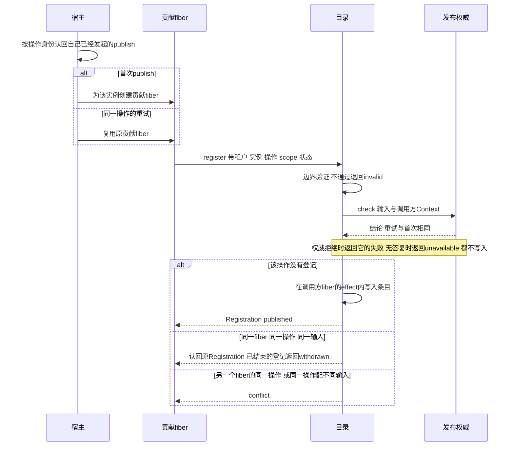
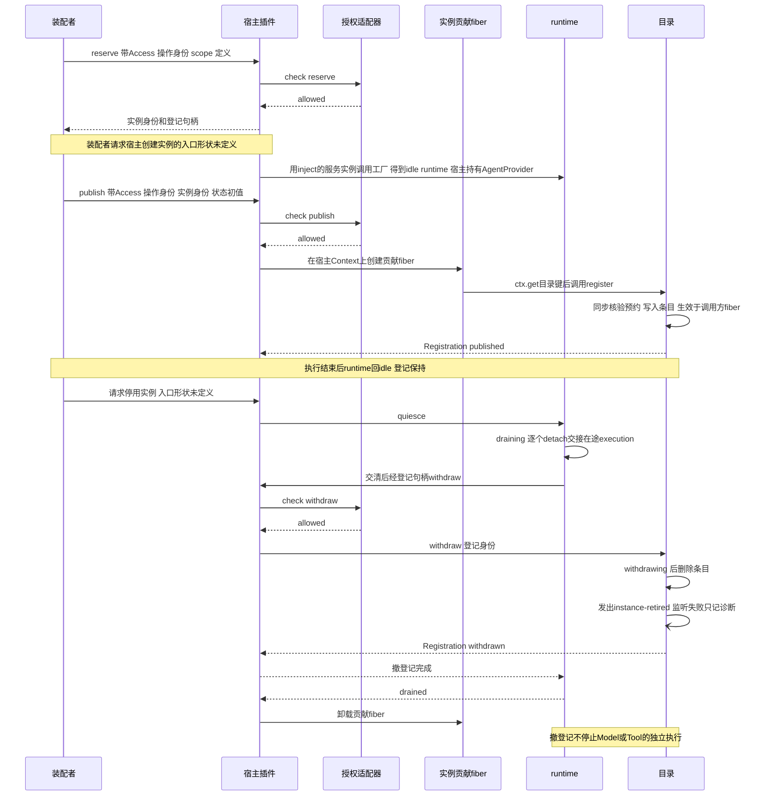

# Agent 的 Cordis 集成

状态：设计已由[技术接受与产品采用决定](https://github.com/nemori-ai/omne-harness-lite/issues/384#issuecomment-6258475204)接受。本页的服务定义、键常量、`Context` 与 `Events` 增补、目录服务和目录插件已经在 `./cordis` 实现，并在真实 Cordis 4.0.4 上测试。根入口只导出三个类型。`agentInstances` 的提供者是本包的目录插件 `agentInstancesPlugin`，其他服务键的提供者与宿主插件尚未实现，没有用真实提供者做过运行验证。

本页消费[根操作定义](../../agent-contract/docs/public-api/README.md)。该定义的类型已在 agent-contract 实现，它的运行实现尚未提供。共同生命周期、事件、树和IC对账归[四成员集成](../../../../docs/architecture/runtime/runtime-contract-integration.md)。本页确定本成员独有的定义、依赖、登记与换代协议和事件，并给出本域对 [IC-1 至 IC-19](../../../../docs/architecture/cordis-integration-conventions.md) 的符合性映射。具体插件的装载、停止准入和撤除归 [agent-host-local](../../agent-host-local/docs/cordis.md)。本页不以加载成功宣称业务就绪。

## 服务定义与入口

`@omne-harness/agent-cordis-contract/cordis` 唯一拥有下列抽象门面及表中本域接缝的服务定义、键常量、Context 增补和事件增补。它还导出目录插件 `agentInstancesPlugin`。宿主插件由 [agent-host-local](../../agent-host-local/docs/cordis.md) 提供。源码是 [src/cordis.ts](../src/cordis.ts)，它是唯一定义，本页不复制类声明。服务类不得复制方法形状，索引类型随根契约同步。

`./cordis` 导出下列内容，根入口 `.` 只导出类型 `AgentLocalRoute`、`AgentRegistrationInput` 与 `AgentWithdrawalInput`。三个类型的定义在 [src/index.ts](../src/index.ts)，`./cordis` 再导出它们。

- 20 个抽象 Service 类，每个 `extends Service`，在 `static readonly provide` 写键一次。除 `AgentPublicationAuthorityService` 外，每个都 `implements` 同名的契约端口。另有这些类的键常量，命名是服务键加 `Key`，例如 `agentAccessCheckKey`。
- 具体类 `AgentInstancesService` 与键常量 `agentInstancesKey`。它是实例目录，含 `register`、`withdraw`、`resolve` 与 `connect`，登记状态放在构造函数的闭包里。`register` 与 `withdraw` 是普通函数，使 Cordis 把 `this.ctx` 绑到调用方，登记随调用方 fiber 撤除。
- `AgentInstanceHostService` 另有进程内的 `route(tenant, instance)`。目录用它向宿主取已发布实例的 `AgentLocalRoute`。它不是契约操作。
- 接口 `AgentPublicationAuthority`：宿主对一次登记或撤除的同步最终核验，`check` 收调用方的 Cordis `Context`。它带 Cordis 类型，所以只从 `./cordis` 导出，根入口不导出它。
- 目录插件 `agentInstancesPlugin`，静态 `inject` 是 `agentPublicationAuthority` 与 `agentAccessCheck`。
- `Context` 对 21 个键的增补，以及 `Events` 对 `agent-cordis-contract/instance-retired` 的增补。

每个抽象 Service 按同一写法声明，键、类名和契约类型见下表。抽象 Service 把每个操作声明为 `readonly` 函数属性，所以提供者用箭头函数属性实现操作。提供者写成类方法时，TypeScript 报 TS2425。表中的服务类有两个例外，其余每个都 `implements` 根契约的同名端口，方法类型取自该端口。第一个例外是 `AgentPublicationAuthorityService`：它实现本页定义的 Cordis 接口 `AgentPublicationAuthority`，不是根契约的端口，因为它的 `check` 要接收调用方的 Cordis `Context`。第二个例外是 `AgentInstancesService`：它实现根契约的 `AgentDirectory`，是含登记逻辑的具体注册表，不是抽象类。定义入口把 Context 的各个键增补为对应的服务类。主体类型由装配的可信身份适配器专化，运行时仍核验输入。接口同形不证明授权。具体插件不得再次 ctx.provide 这些键。消费者导入定义入口的键常量，提供者选择归应用装配。

`AgentRuntime` 描述一个实例的运行能力。同一个 isolate 内一个键只有一个提供者（[IC-6](../../../../docs/architecture/cordis-integration-conventions.md#ic-6)），而一个宿主可以同时承载多个实例。所以本成员不为 `AgentRuntime` 定义 Context 键。消费者经 `agentInstances` 的 `resolve` 按显式租户和实例身份取得 `AgentRuntime`，目录不将 Context 层级当租户或工作身份。

### 服务键与提供者

每个键对应一个定义，键只在定义类的 `static readonly provide` 写一次。所有类的 `@owner` 都是 `packages/agent/agent-cordis-contract`：这些接缝出自本域的协议形状，没有已登记的契约 ID，所以不写 `@contract`（[IC-3](../../../../docs/architecture/cordis-integration-conventions.md#ic-3)）。

| 服务键 | 服务类 | 契约类型 | 提供者归属 |
| --- | --- | --- | --- |
| agentJournal | AgentJournalService | AgentJournal | 外域适配器：独立 Journal 提供者，或带提交参加者的外部协调者适配器。独立提供者只保护本域受理与终结。有提交参加者的提供者在同一次提交中同时保护外部协调者的事实。两类提供者的包都尚未建立 |
| agentAccessCheck | AgentAccessCheckService | AgentAccessCheck | 外域适配器：授权领域。该领域尚无提供者 |
| agentModelSelection | ModelSelectionService | ModelSelection | 外域适配器：Model 与设置。尚无提供者 |
| agentModelContext | ModelContextReaderService | ModelContextReader | 外域适配器：Context。尚无提供者 |
| agentActionAdmission | ActionAdmissionService | ActionAdmission | 外域适配器：授权领域。尚无提供者 |
| agentDecisionCards | DecisionCardsService | DecisionCards | 外域适配器：人在回路领域。该领域尚无公开契约 |
| agentMessageHandoff | MessageHandoffService | MessageHandoff | 外部协调者或独立调用方的提供者，由装配者选择 |
| agentExtensions | ExtensionImplementationsService | ExtensionImplementations | 外域适配器：装配领域。尚无提供者 |
| agentAdoptions | AgentAdoptionsService | AgentAdoptions | 外域适配器：装配与资产领域。尚无提供者 |
| agentConditions | CurrentConditionsService | CurrentConditions | 外域适配器：协作设置与装配，只投影当前推进要求与采用依据，不计算守卫。尚无提供者 |
| agentRequests | RequestPreparationService | RequestPreparation | 外域适配器：Context。有限多步压缩计划的接缝缺口见[实施差异](../../agent-contract/verification/coverage.md#实施差异) |
| agentMaterials | AgentMaterialsService | AgentMaterials | 外域适配器：材料保管提供者。包尚未建立 |
| agentReads | RegisteredReadsService | RegisteredReads | 外域适配器：各具名读取协议的拥有者 |
| agentClock | AgentClockService | AgentClock | 装配者选择的时钟提供者，提供 now 读取与 waitUntil 等待 |
| agentInstanceHost | AgentInstanceHostService | AgentInstanceHost | 宿主：agent-host-local |
| agentPublicationAuthority | AgentPublicationAuthorityService | AgentPublicationAuthority（本页定义的 Cordis 接口） | 宿主：agent-host-local。目录据此核验登记与撤除 |
| agentExecutionRecovery | AgentExecutionRecoveryService | AgentExecutionRecovery | 宿主：agent-host-local |
| agentJournalEntries | AgentJournalEntriesService | AgentJournalEntries | 与 agentJournal 相同的 Journal 提供者，两者在同一权威排序中兑现。两个排序域分别提供时不具备接收面保证，见 [SPEC](../SPEC.md#生产者接收面的服务)。提供者尚未建立 |
| agentAccountOutlet | AgentAccountOutletService | AgentAccountOutlet | 外域适配器：Request Context 一侧的账目收件适配器。Agent 拥有端口与键。尚无提供者 |
| agentExecutionControl | AgentExecutionControlService | AgentExecutionControl | 宿主的长期 Journal 适配器，没有活体 runtime 时受理控制。实现归 [#502](https://github.com/nemori-ai/omne-harness-lite/issues/502) |
| agentInstances | AgentInstancesService（具体） | AgentDirectory | 目录插件 `agentInstancesPlugin`，由本成员的 `./cordis` 导出，候选发行行是 `agent-instances` |

另有三个键属于外域定义，本成员只引用，不再声明：`modelRuntime` 归 [Model 的 Cordis 定义](../../../model/model-cordis-contract/docs/cordis.md)，`toolRuntime` 与 `toolStartFence` 归 [Tool 的 Cordis 定义](../../../tool/tool-cordis-contract/docs/cordis.md)。Agent 宿主以静态依赖取得 `toolStartFence`，不取得 `toolStartAuthority`，规则见 [SPEC](../SPEC.md#生产者接收面的服务)。

下列契约类型没有服务键，使用方按下表取得。

| 契约类型 | 取得方式 |
| --- | --- |
| AgentRuntime | 经 `agentInstances` 的 `resolve` |
| AgentHandle | 经 `agentInstances` 的 `connect` |
| AgentExecutionHandle | invoke 或 resume 的返回值 |
| AgentRegistrationHandle | 宿主在 `reserve` 时为该实例返回，只交给该实例的 runtime |
| AgentRuntimeControl | 宿主插件调用工厂时得到的 `AgentProvider.control`，只由宿主持有，不交给执行的调用方 |

`agentExecutionRecovery` 是宿主恢复入口。它不要求有活体 runtime，每个操作先以 `agentAccessCheck` 核验主体资格。无活体时按 execution 取得输入、控制和输出视图的入口，公开接口页没有定义，本页不另造键。这个缺口登记在开放问题的“[无活体 runtime 时怎样按 execution 取得执行视图](../../agent/docs/architecture/open-questions.md#无活体-runtime-时怎样按-execution-取得执行视图)”。

### 包入口与依赖对照

纯契约和通用实现的根入口不导入 Cordis。消费者只依赖契约与定义，不依赖被选中的提供者（[IC-4](../../../../docs/architecture/cordis-integration-conventions.md#ic-4)、[IC-5](../../../../docs/architecture/cordis-integration-conventions.md#ic-5)）。

| 成员 | 根入口 | `./cordis` | 清单现在声明的依赖 | 设计要求 |
| --- | --- | --- | --- | --- |
| agent-contract | 领域类型、操作类型、判定、身份解码与结构判定、正文契约。不导入 Cordis | 无 | assets、call-account、content-block、json-text、legal-identity、message、model-contract、operation-result、schema-provider、tool-contract、zod | 生产依赖闭包不含 Cordis、具体宿主、Model 或 Tool 的实现包 |
| agent | 工厂，当前为空。不导入 Cordis | 无 | agent-contract | 同上。设计页引用的类型依赖尚未声明，见[实施差异](../../agent-contract/verification/coverage.md#实施差异) |
| agent-cordis-contract | 三个类型，不导出值，到 Cordis 没有边 | 服务定义、键常量、增补、事件、目录服务、目录插件、`AgentPublicationAuthority` | `@deepseek-ai/cordis`、agent-contract、content-block、legal-identity、operation-result | 不依赖 agent 和 agent-host-local。清单已声明源码导入的全部依赖 |
| agent-host-local | 当前为空 | 宿主插件 | `@deepseek-ai/cordis`、agent-contract、agent-cordis-contract、agent | 还需要 Model 的 Cordis 定义（`modelRuntime` 键）、Tool 的 Cordis 定义（`toolRuntime` 键）和 `kernel-basis`，清单尚未声明 |

安装 agent-cordis-contract 明确带入 Cordis。只需领域值或纯接口的消费者安装 agent-contract，独立调用者安装 agent 的工厂。选择具体宿主的应用才安装 agent-host-local。

## 登记输入与撤除协议

登记、目录和撤除的操作形状归公开接口页的 AgentInstanceHost、AgentRegistrationHandle 与 AgentDirectory。行为归 SPEC 的“[创建、登记与复用](../../agent-contract/SPEC.md#创建登记与复用)”和“[交接与停用](../../agent-contract/SPEC.md#交接与停用)”。本节只写这些操作的 Cordis 承载。登记输入只含 Access、操作身份和可序列化的身份与状态，不含运行对象。运行对象由宿主在本进程内持有，不进入登记输入。

| 操作 | Cordis 承载 | 主体资格核验 | 结果 |
| --- | --- | --- | --- |
| reserve | `agentInstanceHost.reserve`。宿主预约实例身份，创建该实例的 `AgentRegistrationHandle` 和一条预约记录。它不登记目录，也不创建 execution | 宿主核验 reserve | 同一操作同一输入返回原结果 |
| publish | `agentInstanceHost.publish`。宿主在该实例的贡献 fiber 内调用目录的 `register` | 宿主核验 publish | 返回 Registration，状态初值是 published |
| withdraw（宿主） | `agentInstanceHost.withdraw`。宿主按登记身份调用目录的 `withdraw` | 宿主核验 withdraw | 已被取代的登记返回 withdrawn，不影响后继 |
| withdraw（句柄） | `AgentRegistrationHandle.withdraw`。只作用于本实例当前的登记 | 宿主核验 withdraw | 本实例没有当前登记时返回 null |
| report | `AgentRegistrationHandle.report`。更新宿主持有的活体观察投影 | 不核验主体 | 不改变登记，不是耐久操作，不发事件 |
| resolve | `agentInstances.resolve` | 目录核验 resolve | 只解析 published 登记 |
| connect | `agentInstances.connect` | 目录核验 connect | 没有活体路由时返回 no-live-route |

目录在边界验证身份文本与 `DurableEvidence`，验证不通过的请求不交给发布权威，也不交给资格核验。四个操作先核对租户是 legal-identity 解析得到的 `TenantId`。然后目录用 agent-contract 的函数验证输入成员：

- `register` 用 `decodeAgentInstanceId`、`decodeAgentOperationId` 验证 `instance` 与 `operation`，用 `judgeEvidence` 验证 `scope`。
- `withdraw` 用 `decodeAgentInstanceId`、`decodeAgentOperationId`、`decodeAgentRegistrationId` 验证 `instance`、`operation` 与 `registration`。
- `resolve` 与 `connect` 用 `decodeAgentInstanceId` 验证 `instance`。

成员不通过时返回 invalid，`field` 是该成员名，`reason` 带解码函数或结构判定的失败。租户不合法、输入无法读取，或 `register` 的数据无法写成 JSON 时，`field` 是 `input`。宿主仍在 reserve 与 publish 核验资格。

目录对没有条目的 resolve 与 connect 一律返回 denied。没有条目指别的租户的实例、从未登记的实例和已经结束的登记。目录键是显式租户加实例身份，它无法区分这三种情形，也不应当区分：跨租户的拒绝不区分对象不存在与无权访问，不返回对象状态。调用方在自己租户的实例被撤除之后，resolve 得到 denied，诊断要靠调用方自己的记录。

AgentInstancesService 是包含 register 实现的具体服务。目录插件静态 inject `agentPublicationAuthority` 与 `agentAccessCheck`，用当前 Context 和发布权威构造服务。目录返回 unavailable 时，`owner` 取服务键名：agentInstances、agentAccessCheck、agentInstanceHost 或 agentPublicationAuthority。设计没有规定 `owner` 的取值。发布权威属于本域消费接缝，由宿主提供；它不是任意调用者可实现后传入的准入回调。

register 的输入逐项复用根 publish 参数。authority.check 核两件事。第一，宿主为该租户、实例和 scope 预约过实例，预约的操作身份与输入一致，预约仍然有效。第二，调用 fiber 是宿主为该实例创建的贡献 fiber。预约不存在或不属于该宿主返回 denied。不能取得判断依据返回 unavailable。check 是同步最终核验，与 effect 内目录写入在同一不可让出的本地动作中完成；预约的变更沿同一排序域生效。主体资格是异步核验，宿主在调用 register 之前以 `agentAccessCheck` 完成，此处只核当前预约。不能提供同步当前核验的适配器返回 unavailable，不先放行再异步补核。调用 fiber 已退出时不再登记，返回 unavailable。

对 withdraw，authority.check 也核两件事。第一，输入的登记身份是目录为输入中的租户和实例分配的身份。第二，调用 fiber 是宿主自己的长期 Context，或宿主为该实例创建的贡献 fiber。任何插件都能经 `ctx.get` 取得目录（[inject-has-no-optional-form](../../../../.meta_harness/design/basis/cordis/inject-has-no-optional-form.md)），所以登记身份不可猜测不能代替第二项核验。调用方不是宿主时返回 denied。调用方 fiber 卸载引起的删除不经 withdraw，也不经 check。根操作仍逐次核业务权限，登记从不授发起权。connect 核观察权，resolve 另核获取发起接口的资格；得到 AgentRuntime 后 invoke 仍核每次执行的资格。

目录在成功的调用方 fiber effect 内分配登记身份，回执复用本域 publish 的 Registration。登记身份不可猜测，同时是该贡献的 token。目录先请发布权威核验，核验通过后才按操作身份认回，所以重试同样要先通过核验。宿主的发布权威对同一操作的重试必须给出与首次相同的结论，否则已经成立的登记或撤除无法认回。相同 fiber、相同操作身份和相同输入重复登记认回同一 Registration。认回已经结束的登记时，返回它当前的状态 withdrawn，不返回旧的 published，因为旧状态已经不成立。同一操作身份配不同输入返回 conflict。同一操作身份、同一输入，但来自另一个调用方 fiber 时，同样返回 conflict。所以 SPEC 的“同一操作同一输入返回原结果”要靠宿主的两项义务兑现。第一，宿主在创建贡献 fiber 之前，先按操作身份认回自己已经发起的 publish。第二，同一操作的 publish 重试复用原贡献 fiber，不新建 fiber。目录对来自另一个 fiber 的同一操作返回 conflict，作为宿主错误使用的信号。键为显式租户和实例身份，来自核验的输入，不从 Context 推断。同一实例已有 published 登记时，新登记按 SPEC 取代它：新登记的写入与旧登记转入 withdrawn 在同一个本地动作内完成，旧登记保留自己的身份。新登记的发布代次比旧登记大一。发布代次是目录为同一实例分配的登记序号，从 1 起连续，已释放的序号不复用。目录不以覆盖 Map 的方式接管。idle 实例保持登记。execution 的外部关联由外部协调者保存，不写入目录键。

下图画 publish 的首次调用与重试，以及目录对一次 register 的几种答复。

撤除只经 withdraw 或调用方 fiber 的卸载。目录不向调用者返回释放函数，目录条目的撤除函数由目录自己持有，条目被删除时一并移除。withdraw 先把登记状态改为 withdrawing。此后 resolve 返回 unavailable，connect 返回 no-live-route，活体观察以 retired 结束。随后目录删除条目。删除完成时返回 withdrawn。删除尚未确认时返回 withdrawing，调用方按同一登记身份重试，目录认回结果。重复撤除认回原结果。撤除同样先请发布权威核验，再按登记身份认回。目录不保存撤除的操作身份。同一撤除操作配不同输入时，conflict 由宿主返回，因为宿主持有操作身份与预约。真实 Cordis 4.0.4 的 effect 立即结束，删除同步完成，所以 withdraw 返回时登记已经是 withdrawn，“删除尚未确认”的分支没有触发条件。只有调用方上下文的撤除函数抛错时，删除才没有完成，withdraw 才返回 withdrawing。旧登记身份只能撤除自己的登记。晚到的旧撤除先比较登记身份，不会删除后继。fiber 卸载使用同一个幂等删除。撤除不取消原工作，也不撤销 execution。每次删除后，目录发出 `instance-retired`，见“配置、通知和撤除”。

### 换代与恢复

换一个实例的次序如下。新实例先 reserve、创建 runtime 并 publish。然后宿主对旧实例调用 quiesce。quiesce 交清责任后，经登记句柄 withdraw 旧登记，再返回 drained。quiesce 的行为见 SPEC 的“[交接与停用](../../agent-contract/SPEC.md#交接与停用)”。两个实例使用不同的实例身份，在目录里各有一条登记。新工作路由到哪个实例，由装配者决定。旧实例 draining 期间仍是 published，目录照常解析它，由它的 runtime 对新的 invoke 与 resume 返回 unavailable。withdraw 开始后目录不再解析它。

执行的恢复和接管不经登记表。新 runtime 经 `resume` 走 Journal 的 attach 取得执行挂接，路径选择和资格核验见 SPEC 的“[恢复与接管](../../agent-contract/SPEC.md#恢复与接管)”。登记表不参与挂接裁决，只经 `report` 反映活体状态。no-live-route 不证明工作结束，目录撤除也不证明执行已经停止。runtime 失联后重新启动的进程不是原实例，它使用新的实例身份，不继承原登记。

## 依赖与定义拥有者

上文服务键表中每个本域键对应一个唯一的 Service 定义，类命名为所实现的接口名加 Service。除“[服务定义与入口](#服务定义与入口)”所列的两个例外，所实现的接口都是根契约中的同名操作端口。静态 provide 只在定义类声明，导出键取自它。目录采用含 register 逻辑的具体 Service，不用抽象接口冒充登记机制。跨域行引用原定义拥有者，不在本成员再声明同键。键与类的逐对相等由 `cordis-entry.spec.ts` 对源码验证。每个键的取得方式是对宿主插件与提供者的要求，由宿主插件实现时逐项核对，当前表不冒称宿主的源码事实。

每个键的必需性、必需的条件、缺席与换代的业务结果只归工厂的[依赖逐项分类](../../agent/docs/public-api.md#依赖逐项分类)，本页不复述。下表只写每个键在 Cordis 中的取得方式与本键特有的 Cordis 事实，没有特有事实的写“无”。取得方式与必需性的对应是：必需依赖静态取得，局部必需依赖经阶段适配器取得，可选依赖现取。宿主插件怎样写 `inject` 由[本地宿主页](../../agent-host-local/docs/cordis.md#注入配置与生命周期)拥有。取得方式有三种。

1. 静态必需：写进宿主插件的 `inject` 数组字面量（[IC-8](../../../../docs/architecture/cordis-integration-conventions.md#ic-8)）。
2. 局部必需：阶段适配器在阶段开始时先用 `ctx.get` 预检提供者是否在场，再以 `ctx.inject([键], cb)` 开阶段子 fiber，在 `cb` 内使用该依赖（[IC-8](../../../../docs/architecture/cordis-integration-conventions.md#ic-8)）。预检通过后、`cb` 开始前提供者离场时，`cb` 不会开始；适配器在有界等待后撤掉子 fiber 并返回 unavailable，不停在 PENDING（这一行为未验证，内核核验记录中没有 `ctx.inject` 条目）。
3. 可选：不写进 `inject`，调用点用 `ctx.get` 现取并接受 undefined（[IC-9](../../../../docs/architecture/cordis-integration-conventions.md#ic-9)）。

| 服务键 | 取得方式 | 本键特有的 Cordis 事实 |
| --- | --- | --- |
| agentJournal | 静态 inject | 无 |
| agentAccessCheck | 静态 inject | 宿主、目录、宿主恢复入口和工厂使用同一个服务实例 |
| modelRuntime | 静态 inject | 键由 Model 的 Cordis 定义拥有 |
| agentAdoptions | 静态 inject | 无 |
| agentConditions | 静态 inject | 无 |
| agentRequests | 静态 inject | 无 |
| agentModelSelection | 静态 inject | 无 |
| agentModelContext | 静态 inject | 无 |
| agentMessageHandoff | 静态 inject | 这是 Agent 定义的端口，由外部协调者或独立调用方的提供者实现。宿主照常以静态 inject 取得 |
| agentClock | 静态 inject | 无 |
| toolRuntime | 阶段适配器，`ctx.get` 预检后开子 fiber | 键由 Tool 的 Cordis 定义拥有 |
| agentExtensions | 阶段适配器，`ctx.get` 预检后开子 fiber | 无 |
| agentDecisionCards | 阶段适配器，`ctx.get` 预检后开子 fiber | 无 |
| agentActionAdmission | 阶段适配器，`ctx.get` 预检后开子 fiber | 无 |
| agentMaterials | 阶段适配器，`ctx.get` 预检后开子 fiber | 材料不能只存在 Agent 的 fiber 内存中，子 fiber 撤除不带走材料 |
| agentReads | 阶段适配器，`ctx.get` 预检后开子 fiber | 无 |
| 登记句柄 | 宿主在 `reserve` 时经 `ctx.get(agentInstances)` 现取目录，目录在场才返回句柄 | 目录缺席时 reserve 返回 unavailable。装配者可以不经宿主，把工厂的 `registration` 设为 null 创建不发布的实例 |

静态必需依赖有共同的 Cordis 结果。依赖缺席时，宿主插件停在 PENDING，插件体不运行，不 reserve，不 publish，这不是业务失败。装配者把 PENDING 当作清单错误诊断。任一静态依赖换提供者时，Cordis 4.0.4 卸载并重新运行宿主插件体，旧实例的登记随贡献 fiber 撤除（[plugin-body-reruns-on-provider-change](../../../../.meta_harness/design/basis/cordis/plugin-body-reruns-on-provider-change.md)）。这不是热替换，相当于原 runtime 失联。计划换代先 quiesce 并交接，见 [agent-host-local](../../agent-host-local/docs/cordis.md)。

局部必需依赖不使宿主插件重跑。依赖不在 runtime 之下热替换：局部必需依赖按阶段在子 fiber 内重新取得，已进入的阶段不换。预检发现提供者缺席时，阶段适配器立即返回 unavailable，不等待 Cordis 的 PENDING。已进入阶段的提供者换代或离场时，阶段适配器不把该阶段转到新提供者上，未完成操作的结果见工厂的[依赖逐项分类](../../agent/docs/public-api.md#依赖逐项分类)。下一阶段在新的子 fiber 内取得当时的提供者。`ctx.inject` 子 fiber 在所注入依赖换代时卸载，这一点按 IC-8 与插件体同一 inject 机制推断，basis 没有子 fiber 的单独条目：未验证。

下列插件之间的依赖不是 Agent 工厂的依赖。目录插件静态 inject `agentPublicationAuthority` 与 `agentAccessCheck`。目录在每次 resolve 与 connect 时，用 `ctx.get(agentInstanceHost)` 取得宿主，再调用 `route`。宿主缺席时返回 unavailable。`route` 只在进程内有效，不是契约操作。

### 主体资格核验的调用位置

每次调用只在实际执行它的一个位置核验主体资格。同一个操作名可以出现在两个位置，例如 read 可以经 runtime 或经宿主恢复入口发生，但一次调用只经过其中一个。resume 遇到旧挂接仍 active 时，同一位置另以 takeover 核验一次，见 SPEC 的“[恢复与接管](../../agent-contract/SPEC.md#恢复与接管)”。各位置用同一个 `agentAccessCheck` 服务和同一个操作名。逐操作的授权要素归 SPEC 的“[逐操作及输入分类](../../agent-contract/SPEC.md#逐操作及输入分类)”，主体资格核验的规则归“[主体资格核验](../../agent-contract/SPEC.md#主体资格核验)”。

| 调用位置 | 操作名 |
| --- | --- |
| runtime 的公开操作 | invoke、resume、takeover、submit、control、read、events、acknowledge、observe、quiesce。takeover 在 resume 之内，只在快照显示旧挂接仍 active 时另核 |
| 宿主 `agentInstanceHost` | reserve、publish、withdraw，包括登记句柄的 withdraw |
| 目录 `agentInstances` | resolve、connect |
| 宿主恢复入口与长期执行记录适配器 | query、load、reconcile、detach、record-terminal-observation，以及经恢复入口发生的 read、events、acknowledge、submit、control |

runtime 在已核验的公开操作之内调用 Journal 时不再次核验主体。宿主恢复入口和长期保管者直接调用执行记录操作时，由宿主的长期执行记录适配器核验。适配器和宿主以静态 inject 取得 `agentAccessCheck`，不从其他位置传入。授权领域没有提供者时，这些操作都得不到 allowed，系统组合不具备资格核验，该外域依赖登记在[开放问题](../../agent/docs/architecture/open-questions.md#外域依赖)。

## 配置、通知和撤除

### 配置

宿主插件的 `Config` 是 Standard Schema，校验[通用工厂的配置项](../../agent/docs/public-api.md#工厂配置)的全部取值项。取值项的名称、单位、默认值和校验规则只写在那一节，本页不复制。默认值只是配置初值，可以由装配者替换。配置只含可序列化数据，不含租户、安全作用域、定义采用、主体、登记句柄、取消信号和回调（[IC-14](../../../../docs/architecture/cordis-integration-conventions.md#ic-14)、[IC-16](../../../../docs/architecture/cordis-integration-conventions.md#ic-16)）。配置错误导致插件加载失败，fiber 进入 FAILED，插件体不运行。缺必需依赖导致 fiber 停在 PENDING。两种状态分别诊断，await 插件的返回不是业务就绪。本包的抽象服务没有配置。目录插件没有取值项，它的 `Config` 是空对象，拒绝未知键。

### Journal 提供者

同一个 agentJournal 定义可由独立提供者或带提交参加者的提供者兑现。应用装配明确选择实际绑定，不能以有同名 Service 证明后者的共同提交能力。后者的提供者消费外部协调者的提交参加者，在受理时共同登记 Agent 输入引用，在 tryFinish 时共同裁定。这些依赖属于集成适配器，不传给纯 Agent。提供者在 `capabilities.participants` 中声明它能兑现的提交种类，工厂创建时与配置的 `jointCommits` 逐种比对，缺一种返回 unsupported，见 SPEC 的“[提交参加者协议](../../agent-contract/SPEC.md#提交参加者协议)”和[公开接口页](../../agent-contract/docs/public-api/README.md#执行记录与调用方交接端口)。条件投影和 Context 参加者同样只从原拥有者取得当前事实。

### 通知

定义入口唯一声明 `agent-cordis-contract/instance-retired`，载荷为 tenant、AgentInstanceId、发布代次、原因。原因取三个值：withdrawn 表示登记被撤除，contributor-removed 表示调用方 fiber 卸载使登记消失，superseded 表示后继登记取代了它。JSDoc写`@mode parallel`及每项`@param`。

声明在 [src/cordis.ts](../src/cordis.ts) 的 `Events` 增补里。参数依次是 `tenant`、`instance`、`generation` 与 `reason`。

通知不带消息正文、凭据或附件地址；发送者捕获监听失败，保留原提交结果，由权威扫描恢复通知遗漏。通知先按显式租户和实例过滤，数据动作再核权。通知可以丢失和重复，它只唤醒观察与路由刷新，不作为恢复事实源，也不表示 execution 终态。发送者在 `try` 中等待 `parallel` 的结果，监听者的失败只记安全诊断，不改变已经提交的操作结果。诊断用 error 级，因为 Cordis 的默认日志丢弃 warn 级（[IC-12](../../../../docs/architecture/cordis-integration-conventions.md#ic-12)）。本版没有用于授权、取消、受理或提交的 Cordis 控制事件，控制一律调用根操作。将来新增可否决的异步控制事件时，必须另定义 `serial` 协议和当前资格，不使用 `bail`。

### 撤除与在途责任

Cordis 撤除的是登记、监听和具名可释放资源。execution 的状态、结果保管、交付责任和未知结果是跨重启仍须成立的 Agent 事实，按 SPEC 保存在 Journal，不放进 effect 闭包，也不让 disposer 改写业务终局。需要先停止准入、交接、再撤资源时，由宿主显式等待。宿主对实例调用 quiesce。quiesce 交清责任后经登记句柄 withdraw，再返回 drained。宿主收到 drained 之后才卸载贡献 fiber。装配者经宿主请求停用，不直接持有 `AgentRuntimeControl`；停用入口的形状见[宿主怎样创建并持有实例的 AgentProvider](../../agent/docs/architecture/open-questions.md#宿主怎样创建并持有实例的-agentprovider)。多个 effect 的卸载不提供这种完成顺序。Model 与 Tool 的独立执行不因 Agent 的登记撤除或 fiber 卸载而取消。外部操作已发出或结果未知时，撤除不能声称回滚。

上述机制沿固定采用的 Cordis 4.0.4 核对。[调用方 effect 归属](../../../../.meta_harness/design/basis/cordis/service-method-ctx-is-caller.md)、[提供者换代与插件重跑](../../../../.meta_harness/design/basis/cordis/plugin-body-reruns-on-provider-change.md)、[释放顺序与持久事实的边界](../../../../.meta_harness/design/basis/cordis/effect-disposal-concurrent-not-ordered.md)、[抽象 Service 的键](../../../../.meta_harness/design/basis/cordis/service-subclass-provides-its-key.md)、[inject 没有可选形式](../../../../.meta_harness/design/basis/cordis/inject-has-no-optional-form.md)、[配置与插件体失败](../../../../.meta_harness/design/basis/cordis/plugin-throw-fails-fiber.md)分别拥有机制依据。业务兑现仍须由本域提供者验证。

## 符合性映射

本节是本域对 IC-1 至 IC-19 的唯一映射。性质列区分四类：机制事实指已按 Cordis 4.0.4 核验的内核行为，业务协议前提指 Agent 设计对提供者和装配者的要求，未验证保证指目前没有证据支持的主张，偏离指 Agent 的设计与该条约定不同的地方，每处写理由并交 IC 拥有者裁定。本映射目前没有偏离项。

| IC | Agent 的处置 | 位置 | 性质 |
| --- | --- | --- | --- |
| [IC-1](../../../../docs/architecture/cordis-integration-conventions.md#ic-1) | 每个 Agent 接缝只有一个服务定义，由本成员拥有。`modelRuntime` 与 `toolRuntime` 引用 Model 与 Tool 的定义，本成员不再声明同键 | [服务键与提供者](#服务键与提供者) | 业务协议前提。定义已实现：`cordis-entry.spec.ts` 逐对核对 21 个键与类的 `provide`，类集合恰为 21 个。`tool-start-fence.spec.ts` 核对本成员不重新声明 `toolStartFence`。提供者尚未实现 |
| [IC-2](../../../../docs/architecture/cordis-integration-conventions.md#ic-2) | 键只在定义类的 `static readonly provide` 写一次，键常量取自它。宿主插件在一个插件体内逐个 new 各键的子类，登记落在同一条 fiber 上，子类不另写键 | [服务定义与入口](#服务定义与入口)；[插件与入口](../../agent-host-local/docs/cordis.md#插件与入口) | 机制事实：[service-subclass-provides-its-key](../../../../.meta_harness/design/basis/cordis/service-subclass-provides-its-key.md) |
| [IC-3](../../../../docs/architecture/cordis-integration-conventions.md#ic-3) | 抽象 Service `implements` 根契约的端口，不复制签名。`agentInstances` 是含登记逻辑的具体注册表。JSDoc 写 `@owner`，没有已登记的契约 ID，所以不写 `@contract` | [服务定义与入口](#服务定义与入口) | 业务协议前提 |
| [IC-4](../../../../docs/architecture/cordis-integration-conventions.md#ic-4) | 四个成员的根入口都不导入 Cordis。Cordis 值只从 agent-cordis-contract 与 agent-host-local 的 `./cordis` 导出。agent-contract 的 `src` 没有 Cordis 引用。agent-cordis-contract 的根入口在值与声明两层都没有到 Cordis 的边，因为带 Cordis `Context` 的 `AgentPublicationAuthority` 只从 `./cordis` 导出 | [包入口与依赖对照](#包入口与依赖对照) | 业务协议前提。已验证：`agent-cordis-contract/tests/public-entry.spec.ts`（根入口无值导出，`dist/index.js` 没有导入，`dist/index.d.ts` 及其传递的声明到 Cordis 没有边，到别的包的 `/cordis` 入口、`agent` 与 `agent-host-local` 也没有边）；`agent-contract/tests/dependency-direction.spec.ts`（`dist/index.js` 与 `dist/index.d.ts` 的导入图不含 Cordis）。源码图没有单独遍历，遍历器只读构建产物：未验证。`agent` 与 `agent-host-local` 的根入口仍是空导出，没有可测对象 |
| [IC-5](../../../../docs/architecture/cordis-integration-conventions.md#ic-5) | 消费者按键取用，不依赖 agent-host-local。agent-cordis-contract 不依赖 agent 与 agent-host-local。别的成员所需的编解码、校验和比较函数留在 agent-contract 的根入口 | [包入口与依赖对照](#包入口与依赖对照) | 业务协议前提。已验证：`agent-cordis-contract/tests/cordis-entry.spec.ts`（`./cordis` 的 js 与 d.ts 导入图沿 `@omne-harness/*` 的 exports 传递，不含 `agent` 与 `agent-host-local`，`package.json` 也不声明它们）与 `agent-contract/tests/dependency-direction.spec.ts`。其他成员对本包的消费没有测试：`agent-host-local` 仍是空导出 |
| [IC-6](../../../../docs/architecture/cordis-integration-conventions.md#ic-6) | 一个 isolate 内每个 Agent 接缝只有一个提供者。本版只定义单 isolate，不定义多份实现并存，也不把 isolate 当租户隔离 | [服务定义与入口](#服务定义与入口) | 机制事实：[isolate-hides-instances-not-data](../../../../.meta_harness/design/basis/cordis/isolate-hides-instances-not-data.md) |
| [IC-7](../../../../docs/architecture/cordis-integration-conventions.md#ic-7) | 服务键用 camelCase 名词表达能力，不写实现名。包名表达职责，`agent-host-local` 的 `local` 是限定名 | [服务键与提供者](#服务键与提供者) | 业务协议前提 |
| [IC-8](../../../../docs/architecture/cordis-integration-conventions.md#ic-8) | 宿主插件的必需依赖写成 `inject` 数组字面量。六项局部必需依赖只在某段工作需要：阶段适配器先用 `ctx.get` 预检，再以 `ctx.inject([键], cb)` 开阶段子 fiber | [依赖与定义拥有者](#依赖与定义拥有者)；[注入、配置与生命周期](../../agent-host-local/docs/cordis.md#注入配置与生命周期) | 机制事实：[plugin-body-reruns-on-provider-change](../../../../.meta_harness/design/basis/cordis/plugin-body-reruns-on-provider-change.md)、[inject-has-no-optional-form](../../../../.meta_harness/design/basis/cordis/inject-has-no-optional-form.md)。`ctx.inject` 子 fiber 随依赖换代卸载：未验证 |
| [IC-9](../../../../docs/architecture/cordis-integration-conventions.md#ic-9) | 宿主插件唯一的可选依赖是目录，它是登记句柄的来源。宿主在 reserve 时用 `ctx.get` 现取目录并接受 undefined。目录插件对 `agentInstanceHost` 也是可选依赖：每次 resolve 与 connect 现取，不保留旧引用，宿主缺席返回 unavailable。类型增补用 `import type` 从 `agent-cordis-contract/cordis` 取得，不从具体插件入口取得。换代时已持有的旧引用不继续用 | [依赖与定义拥有者](#依赖与定义拥有者) | 机制事实：[ctx-property-is-not-ctx-get](../../../../.meta_harness/design/basis/cordis/ctx-property-is-not-ctx-get.md)、[inject-has-no-optional-form](../../../../.meta_harness/design/basis/cordis/inject-has-no-optional-form.md) |
| [IC-10](../../../../docs/architecture/cordis-integration-conventions.md#ic-10) | 事件名是 `agent-cordis-contract/instance-retired`，用过去分词表示已发生的事实。本版没有控制事件 | [通知](#通知) | 业务协议前提 |
| [IC-11](../../../../docs/architecture/cordis-integration-conventions.md#ic-11) | 本成员在 `./cordis` 唯一增补 Events，JSDoc 写 `@mode` 与每项 `@param` | [通知](#通知) | 业务协议前提。已验证：`cordis-entry.spec-d.ts`（事件参数元组与 `ctx.parallel` 的类型检查，错误的身份与原因字面量被拒）、`cordis-entry.spec.ts`（构建后的声明含 `@mode parallel` 与四个 `@param`）、`registration.spec.ts`（真实 `parallel` 派发给监听者的参数次序是 tenant、instance、generation、reason，三个原因值都出现）。JSDoc 与派发模式的一致性只靠这些文本与行为断言，没有静态检查器：未验证 |
| [IC-12](../../../../docs/architecture/cordis-integration-conventions.md#ic-12) | 通知用 `parallel`。发送者在 `try` 中等待，监听失败只记诊断。控制走根操作，不用 `bail`，也没有 `serial` 事件 | [通知](#通知) | 机制事实：[async-control-not-bail](../../../../.meta_harness/design/basis/cordis/async-control-not-bail.md)、[emit-listener-throw-propagates](../../../../.meta_harness/design/basis/cordis/emit-listener-throw-propagates.md)，覆盖 `bail` 与 `emit`。`parallel` 在监听失败时返回 AggregateError，只有四成员集成页“[采用来源与证据](../../../../docs/architecture/runtime/runtime-contract-integration.md#采用来源与证据)”的探针记录，没有 basis 条目：未验证。目录行为已测（`registration.spec.ts`）：监听者同步抛出、异步拒绝或两者并存时，register、withdraw 与卸载的结果不变，全部监听者都运行，慢监听者不拖住卸载。诊断只写失败的监听者个数、撤除原因与发布代次，不含监听者错误的内容，也不含租户与实例身份。测试没有直接断言 `AggregateError`：未验证 |
| [IC-13](../../../../docs/architecture/cordis-integration-conventions.md#ic-13) | 目录的 `register` 用 `this.ctx.effect` 登记在调用方 fiber 上。宿主必须经自己 fiber 的 `ctx.get(agentInstances).register` 登记，不经缓存的目录引用，也不用 `ctx.provide` 的普通对象。贡献者卸载后登记已撤除。符合修订后的 IC-13，约定允许下面三处写法。第一，`register` 返回 `Reply<Registration>`，不返回撤除函数。第二，撤除函数由目录持有，显式 withdraw 与调用方 fiber 卸载共用同一个幂等删除。第三，同一实例的后继登记在同一个本地动作内原子取代旧登记。理由：登记是业务事实，要能被显式撤销和接替，不能只随调用方 fiber 自动消失。这一对应已闭合，见开放问题“[目录登记的撤除方式怎样对应 IC-13](../../agent/docs/architecture/open-questions.md#目录登记的撤除方式怎样对应-ic-13)” | [登记输入与撤除协议](#登记输入与撤除协议) | 机制事实：[service-method-ctx-is-caller](../../../../.meta_harness/design/basis/cordis/service-method-ctx-is-caller.md)。已验证（`registration.spec.ts`）：`this.ctx.effect` 挂在调用方 fiber，贡献者卸载后条目消失并发 `contributor-removed`，显式撤除与卸载共用同一个幂等删除，后继在同一动作内取代旧登记，旧身份的晚到撤除不删后继。`withdrawing` 作为返回值的分支只用调用方上下文替身测试，真实 Cordis 4.0.4 下没有触发条件 |
| [IC-14](../../../../docs/architecture/cordis-integration-conventions.md#ic-14) | 宿主插件的 `Config` 是 Standard Schema，字段来自工厂配置表。配置错误导致加载失败 | [配置](#配置) | 机制事实：[plugin-throw-fails-fiber](../../../../.meta_harness/design/basis/cordis/plugin-throw-fails-fiber.md)。类形式的静态 `Config` 路径没有单独核验：未验证 |
| [IC-15](../../../../docs/architecture/cordis-integration-conventions.md#ic-15) | 候选发行行 `agent-host` 与 `agent-instances`，运维者层按行 id 整行替换配置、停用或插入 | [候选发行行](../../agent-host-local/docs/cordis.md#候选发行行) | 业务协议前提。装配入口尚未实现：未验证 |
| [IC-16](../../../../docs/architecture/cordis-integration-conventions.md#ic-16) | 行含行 id、插件标识（包名加 `./cordis` 导出名）和可序列化配置。授权适配器、时钟等运行对象由装配入口 provide，插件 inject | [候选发行行](../../agent-host-local/docs/cordis.md#候选发行行) | 业务协议前提。装配入口尚未实现：未验证 |
| [IC-17](../../../../docs/architecture/cordis-integration-conventions.md#ic-17) | runtime 实例不是插件，不进插件树。作用域是租户加实例身份，再加挂在调用方 fiber 上的登记。事件按这个身份过滤。Model 与 Tool 不挂成 Agent 的子 fiber | [登记输入与撤除协议](#登记输入与撤除协议)；[实例作用域与复用](../../agent-host-local/docs/cordis.md#实例作用域与复用) | 机制事实：[service-method-ctx-is-caller](../../../../.meta_harness/design/basis/cordis/service-method-ctx-is-caller.md)。撤除 Agent 后 Model 与 Tool 的贡献仍在：未验证 |
| [IC-18](../../../../docs/architecture/cordis-integration-conventions.md#ic-18) | 租户是每次操作的 Access 参数。目录键是显式租户加实例身份，不从 ctx、isolate 标签或插件实例推断。“不 inject 就够不着”不当访问控制 | SPEC 的“[租户与作用域绑定](../../agent-contract/SPEC.md#租户与作用域绑定)”；[租户](../../agent-host-local/docs/cordis.md#租户) | 机制事实：[inject-has-no-optional-form](../../../../.meta_harness/design/basis/cordis/inject-has-no-optional-form.md)。目录的跨租户拒绝已验证（`registration.spec.ts`）：resolve 与 connect 对别的租户的实例返回 denied。目录键先拒绝，核验在键命中后进行，所以资格核验放行、拒绝、不可用或抛出时结果都是 denied，核验与宿主都没有被问；withdraw 用别的租户的登记身份返回 denied；同名操作在两个租户下互不认回。授权领域的真实资格核验没有提供者，只测了目录在放行与不放行下的行为 |
| [IC-19](../../../../docs/architecture/cordis-integration-conventions.md#ic-19) | 靠同进程成立的保证有七项：单执行槽、idle 复用、stale-advance 发现、登记投影与 resolve、登记随调用方 fiber 撤除、发布权威的同步核验、`instance-retired` 通知。每项现在靠什么兑现，以及拆成多进程时由哪条协议重兑现，见下一小节。写“本版未定义”的部分没有协议，拆进程前必须先补 | [同进程保证与拆进程时的重兑现](#同进程保证与拆进程时的重兑现) | 业务协议前提。跨进程协议：未验证 |

### 同进程保证与拆进程时的重兑现

下表列出靠同一进程、同一 Context 才成立的保证。左列是保证，中列是现在靠什么兑现，右列是拆成多进程时由什么重新兑现。右列写“本版未定义”的项没有协议，拆进程前必须先补。

| 保证 | 现在靠什么兑现 | 拆进程时的重兑现 |
| --- | --- | --- |
| 单执行槽 | runtime 内的本地预约，加 Journal 的条件提交与围栏 | 本地预约只对本进程可见。权威是 Journal 的 attach 围栏与条件提交，见 SPEC 的“[受理与单执行槽](../../agent-contract/SPEC.md#受理与单执行槽)”。把新 execution 路由到哪个进程的协议，本版未定义 |
| idle 复用 | 同一个 runtime 对象和可重建缓存在多个 execution 之间复用，execution 的状态按执行新建 | 每个进程有自己的 runtime，缓存不共享。跨进程的路由，本版未定义 |
| stale-advance 发现 | Journal 提供者的条件提交返回 stale-advance，与进程无关 | 不变。前提是 Journal 提供者在跨进程时仍是一个权威提交序列，见 SPEC 的“[提交参加者协议](../../agent-contract/SPEC.md#提交参加者协议)” |
| 登记投影与 resolve | 进程内的目录表和宿主的 `route`，resolve 返回本进程的对象 | 需要跨进程的目录协议和可序列化的路由。本地对象不能序列化冒充句柄。no-live-route 只对本进程成立，本版未定义 |
| 登记随调用方 fiber 撤除 | Cordis 的调用方 fiber effect | 没有对应机制，需要租约或心跳类协议，本版未定义 |
| 发布权威的同步核验 | 预约表与目录写入在同一个不可让出的本地动作内 | 需要预约的一致性协议，本版未定义 |
| `instance-retired` 通知 | 进程内的 `parallel` 派发 | 需要运输协议，本版未定义。通知可丢失和重复，由 Journal 与目录的权威状态恢复 |

## 验证义务

本包的测试已经验证：根入口不加载绑定，定义入口不引具体提供者，键唯一，贡献者 fiber 卸载后登记消失，旧登记身份的晚到撤除不删除后继，目录每次现取宿主，目录插件缺少 inject 时停在 PENDING、换发布权威提供者时重载，目录插件拒绝非空配置且不提供服务。文件清单见[测试说明](../tests/README.md)。仍须由宿主插件与真实提供者验证：必需/局部/可选依赖的实际撤除范围，必需依赖缺席时宿主插件停在 PENDING 且不 reserve，宿主插件的配置错误使其进入 FAILED，以及旧引用拒绝与当前身份核验。这些验证对应[持续验证场景](../../agent-contract/verification/scenarios.md)中 SC-AG-200 至 SC-AG-215 的装配场景，这组场景需要宿主插件，目前没有运行。当前真实4.0.4探针仅支持共同页所列机制，根操作的持久性、跨进程、外部效果和业务接受须另由实际提供者证明。

具体注入、阶段 fiber 与卸载交接由 [agent-host-local](../../agent-host-local/docs/cordis.md) 拥有。
