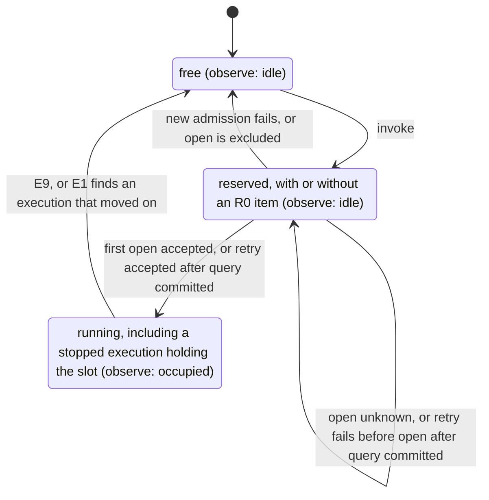

PACKAGE_TEMPLATE_DRAFT

# agent

## Responsibility and status

This package provides reusable implementation mechanisms and factories. It does not include Cordis. The design is [accepted](https://github.com/nemori-ai/omne-harness-lite/issues/384#issuecomment-6258475204). The root entry exports the public construction types and `createAgentRuntime`. The factory checks the configuration, the binding, the registration handle, the required dependencies and the joint commits. On success it returns an idle provider. Each public operation of the four faces checks the tenant first and then calls `access.check` once. `invoke` runs the skeleton of the normal Loop path (#502 1.2), and `observe` shows each new state of the instance. The other operation bodies are not implemented: after `allowed` they return a named `unavailable`. The root entry also exports the generic evaluator `agentEvaluator`. An assembly adopts it for the bound definition through `AgentAdoptions`. The `./testing` entry gives a test assembly: a memory Journal, scriptable doubles of the ports, a manual clock with current-time reads and waits, and `createTestAgentDependencies`.

### Support scope

The tiers are defined in the [member documentation requirements](../../../docs/member-documentation.md). The table follows the [tool support scope](../../tool/tool/README_ZH.md#支持范围). The verification column states only what the tests check. It does not state that behavior outside the tests holds.

| Tier                                | Status in this package                                                                                                                                                                                                                                                                                                                                                                                                                                                                                                                                                                                                                                                                                                                                                                                                                                                                                                                                                                                                                                                                                                                                                                                                                                                                                                                                                                           | Entry                                         | Verification scope                                                                                                                                                                                                                                                                                                                                                                                                                                                                                                                                                                                                                                                                                                                                                                                                                                                                                                                                                                                                                                                                                                                                                                                                                                                                                                                                                  |
| ----------------------------------- | ------------------------------------------------------------------------------------------------------------------------------------------------------------------------------------------------------------------------------------------------------------------------------------------------------------------------------------------------------------------------------------------------------------------------------------------------------------------------------------------------------------------------------------------------------------------------------------------------------------------------------------------------------------------------------------------------------------------------------------------------------------------------------------------------------------------------------------------------------------------------------------------------------------------------------------------------------------------------------------------------------------------------------------------------------------------------------------------------------------------------------------------------------------------------------------------------------------------------------------------------------------------------------------------------------------------------------------------------------------------------------------------------ | --------------------------------------------- | ------------------------------------------------------------------------------------------------------------------------------------------------------------------------------------------------------------------------------------------------------------------------------------------------------------------------------------------------------------------------------------------------------------------------------------------------------------------------------------------------------------------------------------------------------------------------------------------------------------------------------------------------------------------------------------------------------------------------------------------------------------------------------------------------------------------------------------------------------------------------------------------------------------------------------------------------------------------------------------------------------------------------------------------------------------------------------------------------------------------------------------------------------------------------------------------------------------------------------------------------------------------------------------------------------------------------------------------------------------------- |
| Public types exported               | Exported: `AgentRuntimeBinding`, `AgentConfiguration`, `AgentRuntimeOptions`, `AgentDependencies` (17 dependencies) and `AgentProvider`. Exported values: `agentEvaluator`, an implementation of the contract's `AgentEvaluator`, and `agentCheckpointSchema`, the schema adoption of the checkpoint that it writes. The shapes are in the [API design](docs/public-api.md)                                                                                                                                                                                                                                                                                                                                                                                                                                                                                                                                                                                                                                                                                                                                                                                                                                                                                                                                                                                                                      | Root entry                                    | `tests/public-entry.spec.ts` checks the export names of the root and `./testing` entries, the import graphs of source and build output, the manifest dependencies and the Cordis routes                                                                                                                                                                                                                                                                                                                                                                                                                                                                                                                                                                                                                                                                                                                                                                                                                                                                                                                                                                                                                                                                                                                                                                             |
| Pure contract functions implemented | None in this package. The contract functions are in `agent-contract`                                                                                                                                                                                                                                                                                                                                                                                                                                                                                                                                                                                                                                                                                                                                                                                                                                                                                                                                                                                                                                                                                                                                                                                                                                                                                                                             | None                                          | None                                                                                                                                                                                                                                                                                                                                                                                                                                                                                                                                                                                                                                                                                                                                                                                                                                                                                                                                                                                                                                                                                                                                                                                                                                                                                                                                                                |
| Independent execution implemented   | None                                                                                                                                                                                                                                                                                                                                                                                                                                                                                                                                                                                                                                                                                                                                                                                                                                                                                                                                                                                                                                                                                                                                                                                                                                                                                                                                                                                             | None                                          | None                                                                                                                                                                                                                                                                                                                                                                                                                                                                                                                                                                                                                                                                                                                                                                                                                                                                                                                                                                                                                                                                                                                                                                                                                                                                                                                                                                |
| Runtime paths implemented           | The creation checks of `createAgentRuntime`. A configuration item out of range or a malformed binding field returns `invalid`, and `field` gives the item path. A registration handle for another instance returns `denied`. An absent required dependency (10 of them) returns `unavailable`, and `diagnostic` names it. A configured `coordination` that differs from the Journal binding's `capabilities.coordination`, or a `jointCommits` kind that the Journal does not declare, returns `unsupported`. A failure builds no runtime and calls no dependency method. A success gives an idle provider. The access guard: each public operation of the four faces first checks the tenant of the Access. A missing tenant, or a tenant that legal-identity did not mint, is `invalid`. Another tenant is `denied`. None of them calls `access.check`. `observe` is the exception: the contract gives it no `invalid` end reason, so a missing or malformed tenant ends it with `denied` (see the 待拥有者 item below). Then the operation calls `access.check` once. It does not cache `allowed`, and `denied` or `unavailable` stops the operation. After `allowed`, `observe` shows the current state, then each new state, and ends with `closed` when the signal aborts. The operations other than `invoke` and `observe` return `unavailable` with the `diagnostic` "<operation> is not implemented until #502 stage N". This answer is temporary for the stage. It is not a contract result | Root entry                                    | `tests/factory.spec.ts` checks each of the four creation failures and the idle success. `tests/provider-access.spec.ts` checks, for each public operation, the tenant check, the three results of `access.check` and the single call. `tests/assembly.spec.ts` builds an idle provider from the test assembly and checks that the creation calls no dependency. The checks listed below as not implemented have no test                                                                                                                                                                                                                                                                                                                                                                                                                                                                                                                                                                                                                                                                                                                                                                                                                                                                                                                                             |
| Normal Loop path and admission      | `invoke` takes one input through the normal path without tools or extensions. It returns the handle when `open` accepts the execution. The Loop then runs to ended by itself. The same operation with the same input gets the original handle. A remembered operation with another input gets `conflict` while its execution holds the slot. A new operation meets `busy` when the slot is held. An unsupported outcome stops the run, and the stopped run holds the slot. E1/E2, recovery destination selection, I0 input batches, I1 preparation, W0 waiting and R0 original-operation reconciliation are implemented. See [Recovery routing](#recovery-routing). See [Normal Loop path](#normal-loop-path) for the steps, the diagrams, the admission, the stops and the slot rules                                                                                                                                                                                                                                                                                                                                                                                                                                                                                                                                                                                                                                             | Root entry                                    | `tests/loop-transitions.spec.ts` checks the normal path against the node table (C1). It also checks the temporary E1 `found-existing` row. `tests/loop-evaluator.spec.ts` checks the decisions at E4 and I8, the encoder and `unsupported` off the normal path. It runs 500 seeded `LoopFacts`. For each, it checks that the same facts give the same `Next`, that the input does not change and that each step has a row (C1). `tests/loop-invoke.spec.ts` runs one input to ended against the scripted Model and the memory Journal (C2). It also checks the guarded event reads, a reply of several pages and the minted identities. `tests/loop-admission.spec.ts` checks the admission: the same operation again (C1), the lost receipt of `prepare` (C2), `busy` and the R0 item. Each test name starts with its row of the node acceptance table. `tests/loop-slot.spec.ts` checks the slot release, `observe` and the projection to the registration handle. `tests/loop-port-failures.spec.ts` checks saved waits at E1/E2/I1/M1 and stops at the other tested path nodes. `tests/loop-intake-prepare.spec.ts` checks I0/I1 and preparation failures. It checks the saved checkpoint position. `tests/loop-recovery.spec.ts` checks E1/E2, pure recovery routing, original-operation reconciliation and saved waits. Public resume and wakeups have no test |
| Main-call boundary                  | I2/M0 fix the original call, final request and effect before admission. M6 normally admits directly, M1 waits for received, and M3 reads its complete material before committing producer. A final failure without a valid reply reaches a no-reply candidate through M4/M5/I3. Partial failures authorize no tools. Agent stream and reasoning results without producer tags remain unsupported. See [Main calls and result consumption](#main-calls-and-result-consumption)                                                                                                                                                                                                                                                                                                                                                                                                                                                                                                                                                                                                                                                                                                                                                                                                                                                                                | `invoke`; the narrow continuation is internal | `tests/loop-main-call.spec.ts` checks identities, lost admission receipts, original Authority, waiting, in-flight input, received adoption and the independent producer ACK. `tests/loop-recovery.spec.ts` retains committed/excluded checks at real commit points. These tests use scripted Model and memory Journal only                                                                                                                                                                                                                                                                                                                                                                                                                                                                                                                                                                                                                                                                                                                                                                                                                                                                                                                                                                                                                                   |
| Reply admission and iteration close | I3 admitted fact, message and continuation share one revision. I4 saves an empty batch. I8 chooses F1, a new step or one saved wait. | `invoke`; direct Journal.submit in tests | `tests/loop-reply-close.spec.ts` and the original-operation matrix in `tests/loop-recovery.spec.ts`. Scripted Model and memory Journal only. |
| Terminal exit | F1 fixes its intent. F3 reconciles changed, blocked and uncertain outcomes. F4 retains the observation ledger. O0 leaves received custody with the host. E9 releases the slot and retains registration. | `invoke`; Journal records and internal coordinators | `tests/loop-terminal.spec.ts`: competing input, original finish query, custody, nonempty observation recovery and late event reads. Same memory Journal only. |
| Phase 1 executable acceptance | Complete ordinary reply admission, the empty action batch and completion. Controlled continuation after the execution process dies. | `pnpm --filter @omne-harness/agent acceptance` | [Acceptance](acceptance/README.md) kills execution subprocesses at I2, M6, M1, M4 and F4. The same Journal, scripted Model and materials survive in the parent. No Journal-host durability, public resume, tools or extension evaluation is established. |
| Test assembly (`./testing`)         | `createMemoryAgentJournal`: a single-process, non-durable `AgentJournal`. It implements all 18 members by the [same-shape list](docs/architecture/mechanisms.md#两种实现必须同形的事实). Options set the declared `coordination` mode and participants; a coordinated binding takes coordinator hooks and scripted participant responses. A test can script `unavailable` and three kinds of `commit-unknown` on chosen operations. Scriptable doubles of the other ports, `createManualAgentClock` and a hand-written `ToolRuntime` double. `createTestAgentDependencies` returns the 17 dependencies (`registration` is null) and the control handle of each double. `models` is the scripted provider of `model-contract/testing`                                                                                                                                                                                                                                                                                                                                                                                                                                                                                                                                                                                                                                                                                                                                                      | `./testing`                                   | `tests/memory-journal.spec.ts` checks each fact of the same-shape list. Each test name has the fact number. `tests/fixtures.spec.ts` has one test for each scripting interface. There is only one process. Durability, crashes and cross-process use are not covered                                                                                                                                                                                                                                                                                                                                                                                                                                                                                                                                                                                                                                                                                                                                                                                                                                                                                                                                                                                                                                                                                                |
| Hosts and providers not delivered   | The operation bodies of the four faces other than `invoke` and `observe`. The handle's `submit` (no stage assigned in #502 yet), `control` and `acknowledge`. The nodes off the normal path: the A, T, C and X subgraphs, F0, H0, M2, Q5 from the H0, T5, C3 and X5 sources, and Q5 as a recovery destination. The evaluator's `decode` (stage 5). The durable Journal provider `agent-journal-local`. Real Context, HITL, authorization, external coordinator adapters and material storage                                                                                                                                                                                                                                                                                                                                                                                                                                                                                                                                                                                                                                                                                                                                           | None                                          | No evidence                                                                                                                                                                                                                                                                                                                                                                                                                                                                                                                                                                                                                                                                                                                                                                                                                                                                                                                                                                                                                                                                                                                                                                                                                                                                                                                                                         |

### Normal Loop path

The runtime admits one input and runs the normal Loop path. It also handles the final failures and partial results described below. Tools, extensions and complete recovery remain undelivered.

`invoke` does these steps:

1. It passes the access guard.
2. A held slot gives `busy` to a new `invoke` (see Admission below). Otherwise `invoke` reserves the slot.
3. It resolves the evaluator of the bound definition through `adoptions.resolve`. An adopted extension returns `unavailable` (extensions are #502 stage 3).
4. It runs U0, Q1, Q2, Q4, U0 and E0. `handoff.prepare` fixes the admission of the input, and `open` accepts the execution with that original acceptance.
5. It returns the handle. It does not wait for the Loop.

The Loop then runs by itself:

- It goes from E1 to E9. After E9 the runtime is idle again.
- Only the transition table in `src/loop/nodes.ts` decides where a node goes. Normal path rows follow the node table or its pseudocode. The E1 `found-existing` row is a phase 1 exception. See [Temporary choices](#temporary-choices).
- E4 uses the recovery route described below. The evaluator decides at input boundaries and I8.
- I2 encodes the `ModelInvocationRef` of the main call with the contract's `encodeModelInvocationRef`. The M0 commit saves the PendingCall with the final request adoption and effect before the first admit at M6. M6, M1 and M3 read the call back from it with `resolveModelInvocationRef`.
- The coordinator admits the Model call, waits on Journal and reads the jointly saved received material. Model owns its ACK.
- The external input writes no P at Q1 (NA-Q1-1). A Model reply writes its P at Q1 before `prepare`: the commit with `handoff.prepare` sets `currentHandoff` to H. The candidate type binds its source to its call position: external input to U0, Model reply to I3. Q4 returns each admission to that position once. A rejected external input returns `invalid` (field `value`) from `invoke`. A rejected Model reply writes its Ja at Q5 with the rejected admission fact and no message, and I3 goes to I8.
- The handle's `output.read` and `output.events` read the Journal events under the guard. The normal path events are input-taken, producer, message and ended. A saved wait emits waiting. Their sequence numbers start at 1.

The normal path in the diagram below has thick borders on the nodes that write one commit. The Q1, Q2 and Q4 loop runs two times: once for the input before `open`, and once for the reply. The diamonds are the decision points E4 and I8.

```mermaid
flowchart TD
    U0a[U0] --> Q1a[Q1] --> Q2a[Q2] --> Q4a[Q4] --> U0b[U0] --> E0[E0 open]
    E0 -->|invoke returns the handle| E1 --> E2 --> E4a{{E4}}
    E4a -->|position E3| E3[E3]:::commit --> E4b{{E4 evaluator}}
    E4b -->|take-inputs| I0[I0]:::commit --> I1[I1]:::commit --> P0[P0]:::commit --> P1[P1]:::commit
    P1 --> I2[I2] --> M0[M0]:::commit --> M6[M6] --> M1[M1]
    M1 --> M3[M3]:::commit --> M4[M4] --> M5[M5] --> I3a[I3]
    I3a --> Q1b[Q1] --> Q2b[Q2]:::commit --> Q4b[Q4]:::commit --> I3b[I3]:::commit
    I3b --> I4[I4]:::commit --> I8{{I8 evaluator}}:::commit
    I8 -->|take-inputs| I0
    I8 -->|try-finish| F1[F1]:::commit --> F2[F2]:::commit --> F3[F3 tryFinish]
    F3 --> F4[F4] --> O0[O0] --> E9[E9 idle]
    classDef commit stroke-width:3px
```

#### Input batches and preparation

I0 takes the complete batch at the snapshot watermark after E4 or I8 permits an input boundary.
One commit saves the batch identity, a new step and one input-taken event.
It clears the previous preparation and compaction state. Previously taken inputs do not enter the next batch.

I1 reads conditions, selects the model, reads context and calls prepare in that order.
The first call passes previous=null and beforeModelCall=null. A fitting result is assembled and goes to P0.
The same commit saves requestPreparation and the condition source for the next read.
A new execution reads context with adopted=null. The existing M0 commit adopts the ready coverage.
An unavailable I1 port saves one W0 wait with the original owner and I1 continuation.
An illegal first ready stops with owner requestPreparation and starts no call.

A real cannot-fit commits the original preparation and goes to F1.
F1 reads the injected AgentClock.now when it first constructs the failure candidate.
It saves the original reason and Context source. Its cause binds that complete candidate.
An unavailable clock keeps the preparation and F1 continuation without a candidate write.
The same coordinator retains the candidate and its timestamp across an excluded F1 commit, without reading the clock again.
The tests cover committed and excluded unknown commits at I1 and F1, the clock read count and a failed read followed by successful retry.

Under the [revision 2 decision](https://github.com/nemori-ai/omne-harness-lite/issues/513#issuecomment-6310398942), needs-compaction saves its original preparation and returns unsupported at I1.
It creates no failure candidate and starts no compaction call. Stage 4.5 owns the compaction path and its F1 result.
The runtime keeps its execution slot. Public observation does not expose this internal stop reason.

The input tests call the memory Journal's submit directly. Public input.submit remains undelivered.
An input during a live Model call leaves the fixed request unchanged.
If M3 returns changed, the coordinator reloads the attachment and revision, then retries the original business commit. It does not prepare or admit again.
The main-call seam test stops at I8. The reply-close tests continue into step-2 and verify that the original input is not taken again.
Finish races remain later work.

#### Main calls and result consumption

I2 constructs the original PendingCall and M0 commits it with the fixed request and effect before admission. M6 normally calls admit directly. An unknown admission or a restored coordinator can inspect the original reference to reconcile it. This lookup cannot create a result.

M1 waits for a committed received result in the same Journal. M3 reads its complete facts material, validates the schema and the original tenant/reference/consumer/consumption, interprets reply, partial or no-reply, then commits the producer event. I3 and restored coordinators use that same material. The Agent loop does not open a Model observer, paginate results, call Model consumption or record a Model result responsibility. A receiver-only revision causes a reload and a conditional commit with the current revision; it does not revoke a valid attachment.

The independent `createAgentModelReceiver` uses a single `AgentReceivedProvider`, an access check, stable original targets, Model inspect/dispatches, an account outlet, explicit tenant limits and host-owned state. It copies the full typed delivery before any await, checks current qualification and the original Model facts on every push, then commits entry/material/saved together. Unknown writes query the original operation; excluded operations never acquire a new identity. The schema is `agentModelDeliverySchema`; `readModelDeliveryMaterial` decodes and checks the original binding. These checks alone do not prove durable storage.

The host retains `createModelReceiverState()` across receiver reassembly. `recover` reads saved entries and materials; `retry` drives unresolved commits and pending accounts. All non-null dispatch accounts enter the outbox only after joint publication. Unknown or unavailable delivery preserves the same handoff; denied, invalid and conflict remain blocked with diagnostics. Saved is independent of the producer's later ACK. Model's public testing pusher performs that ACK in tests.

Without extensions, M4/M5 proceed without commits. A final failure without a reply forms a no-reply candidate. Partial output starts no tool action. Reasoning-state or thinking output without the required replay metadata remains unsupported; the already saved received material remains readable. Public resume and cross-process durability remain outside this implementation.

#### Reply admission and iteration close

I3 reads the Journal-bound received result. Q2 writes the Ja: the commit with `handoff.resolve` carries the fixed outcome, the ModelReplyAdmission, the message event and the Q4 continuation at one revision, and clears `currentHandoff`.
Q4 returns to I3, which closes the main call and advances to I4. The handoff receipt remains tied to the original operation and candidate.
A lost Journal receipt reconciles that same operation. An excluded write admits no second logical reply.
I4 saves the complete empty ActionBatch before I8. Tool actions remain a later stage.

I8 reloads the snapshot, revision, input boundary, admission projection and current conditions under the original attachment.
With no input or outstanding wait, it proposes completion at F1. It writes no terminal state itself.
An accepted new input starts a new step with new action/call identities. An unfinished producer or unprocessed responsibility saves one W0 wait retaining I8.
Ready results that need the later consumption nodes remain unsupported. Real wakeups and complete recovery remain undelivered.
An empty batch is cleared when I8 chooses the next step or candidate.

Ordinary completed/limit output with legal sealed parts can enter reply admission. Original trims and settlement remain in received materials. Agent synthesizes no trim or reminder.
Partial output and interrupted results return to I8 without reply admission or executable actions. Their presence alone does not decide completion.
Interruption retains the original control identity. The control request protocol and phase recording remain later work.

Tests use Journal.submit while a call is in flight to demonstrate step-2 in the same execution.
After terminal release, another public invoke starts a new execution at its first step. Public submit remains undelivered.
These tests do not authorize a new invoke while the slot is held.

#### Terminal exit and retained responsibilities

F1 commits the business content of the finish candidate only while its decision revision remains current. The Journal builds the candidate and its FinishIntent projection from that content. It retains the intent and timestamp when a commit is excluded.
F2 binds the terminal passage once. The memory Journal rejects a missing passage or an intent different from the fixed settling candidate.
An earlier input invalidates the old candidate. R0 reads the latest facts before I8 or a new failure candidate.
I8 closes the consumed no-reply call continuation; the received material remains retained.
It processes the new input in the same drive. The original release remains with O0.

F3 calls tryFinish as the only terminal commit. The Journal saves ended, the final event, the fixed observation responsibilities and the original operation result together.
Changed and blocked outcomes return through R0. An unavailable tryFinish also returns through R0. After an unavailable, changed or blocked tryFinish, R0 waits in memory when it cannot read the facts. It writes no waiting checkpoint, and the execution stays settling. The wake is a change of the execution or the check time, and the next pass retries the terminal. Custody must actually transfer before another completion succeeds.
An uncertain finish queries its original operation before loading its outcome. Excluded permits the same operation to retry.
Unknown or an unavailable query retains the original responsibility. It does not write a waiting checkpoint that could invalidate the original finish.

F4 recognizes existing observation registrations and retains pending items in the long-lived Journal.
It does not execute an extension or invent observed evidence. A qualified host observer can register the remaining item after runtime becomes idle.
O0 leaves received materials and account outbox state with the host receiver.

O0 does not acknowledge output for the reader. Unconfirmed events and other retained result responsibilities remain readable in Journal.
E9 releases the execution slot and retains registration. An ended execution cannot reopen. A new execution identity can reuse the idle runtime.
The tests use a new coordinator over the same non-durable memory Journal. They do not simulate process death or prove cross-process recovery.

#### Recovery routing

The public guard checks access once before acceptance (J1).
Denied or unavailable qualification returns failure without writes and does not enter the coordinator.
E1 reads the terminal state, attachment and revision of an already accepted operation.
A terminal execution goes to F4. A replaced attachment goes to E9.
A newer revision uses `found-existing`, unless this coordinator has its own unknown commit to reconcile.
An unavailable internal snapshot read goes to W0 under the original Authority and expected revision.
A wakeup of the same execution does not create a new public operation.
A later public `resume` must perform its own access check when that operation is delivered.

E2 loads one atomic snapshot. It queries each unresolved operation with its original identity.
It reads inputs at that snapshot's watermark and all reply admission pages through the fixed range.
It builds `LoopFacts` without changing the revision.
Unavailable reads or a projection gap go to W0. They do not produce empty facts.
Pending calls become unresolved producer views.
If the latest snapshot is terminal or its attachment is replaced, business fact reads stop.
E4 gives F4 or E9 priority over business continuation, including after an R0 reload.
E1 and E2 do not interpret controls or query public Model or Tool status (J4, stage 5).

E4 has two pure decisions (J5). The coordinator routes recovery from the checkpoint, execution state and unresolved operations.
`LoopFacts` has no execution state or unresolved Journal operations, so `next` cannot make that decision.
The evaluator handles input boundaries and iteration decisions.
The transition table uses `resume-<node>` labels for recovery destinations.
The A and T graphs return named `unsupported` for stage 2.
The X graph belongs to stage 3. The C graph and compaction calls belong to stage 4.
These routes do not implement public `resume`, attachment recovery or general restoration of transient handler frames (stage 5). Only the narrow I2/M6 continuation above is implemented.

R0 queries the original operation slot. Unknown retains that slot and its expected revision without another waiting commit.
A committed result reloads the saved successor, preserving request admission and result consumption stages.
An excluded result re-evaluates the original node in the same coordinator.
The local record holds only the unknown operation and its original node. Journal query decides its outcome.
M3 reuses the received result of that same call. I3 retains admission until its commit is known to hold.
These local facts support re-entry into the same coordinator. They do not survive process exit.

W0 commits waiting state and one waiting event together (J2).
It preserves the checkpoint position and yields one drive segment. The provider owns one serial driver.
The driver starts Journal observation, then rereads the snapshot and original slots. Model admission reconciliation is used only for an unresolved admission.
Only unchanged progress sleeps until the configured `reconciliationDelayMs` check time through `AgentClock`.
A notification or elapsed check time returns through E1. Neither proves settlement or nonexecution.
The execution keeps its slot, and `observe` shows occupied.
The local wait aborts and joins its observations and timer before returning. It sends no producer control and releases no business responsibility.
Zero delay yields the event loop. Clock failure or an unrepresentable check time remains an explicit failure.
It stores no check time or backoff time. Recovery rereads immediately under [#558 M04-6](https://github.com/nemori-ai/omne-harness-lite/issues/558#issuecomment-6307768802).
The internal `waitForWake` signal stops only that local window. Public quiesce and complete recovery remain undelivered.

#### Admission

The table keeps the tenant and execution identity fixed. A same-operation match requires both operation and execution identities. A remembered match takes precedence over an R0 item of another operation. Otherwise the R0 item column takes precedence over the column for this execution holding the slot.

| Input                         | This execution holds the slot                                                                             | Another execution holds the slot                                                                    | Slot free                                                                                                                                                                                           | R0 item exists                                                                                                                                               |
| ----------------------------- | --------------------------------------------------------------------------------------------------------- | --------------------------------------------------------------------------------------------------- | --------------------------------------------------------------------------------------------------------------------------------------------------------------------------------------------------- | ------------------------------------------------------------------------------------------------------------------------------------------------------------ |
| Same operation, same input    | Remembered: handle, slot unchanged. Admission still in progress: busy, reservation unchanged.             | Remembered: handle. Otherwise Journal lookup. Current slot unchanged.                               | Remembered: handle, still free. Otherwise Journal result after reservation. Success: running, or free if E1 finds an advanced execution. Failure: release reservation. Unknown open: keep reserved. | Matching operation and execution: R0 query. Return and reservation follow [R0 retries](#r0-retries). A remembered handle leaves the reservation unchanged.   |
| Same operation, another input | Remembered: conflict, no query, slot unchanged. Admission still in progress: busy, reservation unchanged. | Journal lookup returns conflict for different input in the original record. Current slot unchanged. | Journal admission returns conflict for different input in the original record. It releases the temporary reservation.                                                                               | Matching operation and execution: R0 query. The Journal checks the input after a committed or excluded query. Reservation follows [R0 retries](#r0-retries). |
| New operation                 | Busy, slot unchanged.                                                                                     | Journal lookup. No original record: busy, current slot unchanged.                                   | Journal admission. Success: handle, slot becomes running. Failure: release reservation. Unknown open: keep reserved.                                                                                | This execution: busy. Another execution: Journal lookup. Original reservation unchanged.                                                                     |

Journal lookup calls `query` first. A committed result repeats idempotent `handoff.prepare` and `open` to return the original handle or a port result. An excluded or denied query gives `busy`. Other failures pass through unchanged. An unknown query gives `commit-unknown` with this invoke's operation. Lookup neither reserves the slot nor drives the original execution.

The access guard checks the tenant and principal before lookup. SPEC line 61 hides a missing object as `denied`. Here that means no original record, so new work meets a held slot and receives `busy` under SPEC 646.

Journal admission reserves the slot and runs U0 through E0. Success returns the handle and sets the slot to running. A failure before `open` releases a new reservation. An unknown `open` keeps it reserved. An idempotent open can find an execution that already advanced. See the E1 reading in [Temporary choices](#temporary-choices).

#### R0 retries

An unknown E0 `open` leaves an R0 item with its operation and execution identities. Only a retry matching both identities enters this R0 path. A different execution goes through Journal lookup and leaves the original reservation unchanged.

- `committed`: repeat the same `open` to obtain the original receipt and Authority. Continue at E1. A retry failure before `open` preserves the R0 item and reservation.
- `excluded`: admit again under the same identity. A retry failure before `open` releases the reservation.
- `unknown`: return `commit-unknown` with the invoke operation and preserve the reservation. A failed query returns that failure and also preserves the reservation.

The pre-acceptance open reservation is still retried by its caller. In-execution W0/R0 waiting does not change that admission protocol.

At Q1, an unknown `handoff.prepare` receipt of the external input returns `commit-unknown` with the invoke operation. A new admission releases the slot because no execution exists yet. Calling again with the same operation is the query: U0 repeats `prepare` with the same request to obtain the original result. For a Model reply, Q2 reads the same H back with `lookup`, or prepares it again with the same request while it is unknown.

This is the phase 1 reading of the node table's Q2 `commit-unknown` edge to R0, where an unknown result waits. The caller performs this pre-execution admission retry. The external input has no P and no Ja: its real acceptance is the original `open` (SPEC "消息准入").

Stops:

- An outcome off the normal path stops the run at its node. No stop becomes a success.
- After a stop the slot stays occupied, and `observe` shows occupied. The Journal keeps the `position` of the last commit. A new `invoke` gets `busy`.
- The coordinator returns the failure and its `owner` internally (#558 S-14). A port failure keeps its owner. `@omne-harness/agent` marks an outcome outside current support. `@omne-harness/agent#defect` marks a coordinator defect. There is no public stop reason. Waits are not delivered.

Slot rules:

- The slot has three states: free, reserved and running. A reservation may contain an R0 item. A stopped execution keeps the slot occupied. Its slot state remains `running`.
- `observe` shows only an execution that exists. Free and reserved show idle. Running shows occupied.
- Admission failures and uncertain receipts follow [R0 retries](#r0-retries).
- The registration handle only receives a projection. A `report` that throws is dropped. `invoke` returns as usual, and the slot and `observe` do not change. Waiting for the owner (待拥有者): `report` returns void, and the contract gives its failure no channel.

The diagram below shows the states of the slot. Each state shows in brackets what `observe` shows.

The factory does not implement these creation checks, because no input of the factory can decide them. They stay with the owner or a later card.

- Waiting for the owner (待拥有者): whether the binding tenant matches the security scope (`denied`). The `scope` is a `DurableEvidence` and carries no tenant. No dependency port can decide the match at creation.
- Waiting for the owner (待拥有者): whether the exact adoptions `binding.definition` and `loopGuardPolicy` resolve (`unavailable`). Through the definition, this also decides whether tools, admission and extensions are required. `AgentAdoptions.resolve` requires an `Access`, and the factory takes no Access. The loop judgment, a trusted system extension, resolves `loopGuardPolicy`. #502 step 3.7 only connects an empty implementation at that position. Step 7.1 (stage 7) implements the real guard.
- Waiting for the owner (待拥有者): the contract gives `observe` no `invalid` end reason for an Access with a missing or malformed tenant. The current code does not call `access.check` and ends with `denied`, so the failure stays closed.

#### Temporary choices

These choices describe phase 1 readings and mechanisms not delivered. The node table owns the target behavior. [tests/README](tests/README.md) states the test coverage.

- 临时简化，1.3–1.9 按节点表收紧 (temporary simplification): the skeleton commits once at the end of each node that writes a checkpoint. Each commit moves `position` to the next node. The remaining nodes do not yet follow every exact commit point. I2 is local, and M0 commits once. M6, M1 settlement, extension-free M4 and M5 do not commit. U0 to Q4 run before the execution exists and do not commit. E1, E2 and E4 only read. A commit there would overwrite the `position` that E4 reads. F3 uses `tryFinish`. After ended the Journal refuses commits, so F4, O0 and E9 use their own record methods only.
- Only the I0 commit carries the input-taken event; `open` writes no event (same-shape fact 7).
- In a standalone binding `recordResult.transfer` is custody or processed without a declared participant; the provider establishes the evidence itself.
- The Q1 receipt of the external input uses the phase 1 reading in [R0 retries](#r0-retries): calling `prepare` again with the same request is the query.
- E1 returns `found-existing` when the Journal revision advanced beyond the original open receipt. The transition table ends coordination successfully to avoid a second Loop for an accepted operation. The node table's E1 row has no such edge. This is a phase 1 reading.
- An execution opened without any later revision can still run under its original Authority in a new runtime. Two live runtimes can therefore drive it. Fencing with `attach` is not delivered.
- In free, reserved and running slots, phase 1 does not recognize the same operation naming another execution as the same admission. A free slot can admit a second execution. A held slot follows normal routing and usually returns busy. Detecting this reuse requires an index across executions. The Journal provider owns that index. Phase 1 does not provide it.
- I1 accepts assembled on the first prepare and stops on an illegal first ready (#558 S-11). P0/P1 remain the existing straight-through path without extensions. Changed selections, recipient/coverage consistency retries and the final extra selection remain undelivered.
- M0 inherits the ready `requestPreparation`, which holds the final request (#558 M04-2). The loop judgment, a trusted system extension, does not run at M4 (stages 3 and 7).

The memory Journal follows the readings that #558 decided:

- `commit` and the six record methods (`submit`, `control`, `acknowledge`, `recordResult`, `recordControl`, `recordTerminalObservation`) advance the revision by exactly one for each write that establishes a new execution fact. A retry of the same operation, and a commit that changes nothing, return the original or current receipt and do not advance it (same-shape fact 6).
- When `recordResult.transfer` is custody or processed under a standalone binding, the provider sets up the custody or completion evidence itself. A non-none `commit.caller` kind that is not declared returns `unsupported` and saves nothing.
- `open` and `attach` append no event. The first event comes from a later commit.
- `control` and `recordControl` project each stage fact as a control event, as SPEC [six stages](../agent-contract/SPEC.md#六个阶段) states. When the same stage is recorded again with the same evidence under a new operation, the Journal returns the original receipt. It does not advance the revision or project the event again. After ended, `recordControl` records only producer-confirmed, physically-stopped and duty-released without an event; intent-established and qualification-revoked return `terminal` when the stage has no reached fact. Evidence that contradicts a reached fact of any stage takes the refusal below, also after ended. A reached stage recorded again with a different state or source is refused durably: the audit advances one revision without an event, and `query` answers `rejected` with the original conflict.
- A standalone binding refuses a non-null grant or input source with `unsupported` before any write. A coordinated binding asks the coordinator hooks and the scripted participant responses inside the same write: a conflict is `denied` on `open`, `attach` and `submit`, and `changed` on `tryFinish`.

Finishing follows SPEC [条件终结](../agent-contract/SPEC.md#条件终结), [取消判断与路线](../agent-contract/SPEC.md#取消判断与路线), [终结责任清单](../agent-contract/SPEC.md#终结责任清单) and [commitSettlement 的变体](../agent-contract/SPEC.md#commitsettlement-的变体):

- A settling commit with `finish` is F1: the Journal establishes the candidate under that operation (another operation with the same content keeps the first candidate; other content supersedes it with a link), its author route and the FinishIntent projection. The first plain settling commit after it, with no before-terminal passage left open, is F2: the Journal sets `beforeTerminal` of the author route from it. `prepareFinish` issues the obligations from the Journal's own records (accepted inputs, controls, pending writes, handoffs, calls, passages and card rounds, results, output, the observation plan) with one new revision and no event.
- The conditions and order of the `tryFinish` results are owned by the result table of SPEC [条件终结](../agent-contract/SPEC.md#条件终结) and by [取消判断与路线](../agent-contract/SPEC.md#取消判断与路线). The memory Journal reads it as follows. `tryFinish` checks, in this order: a superseded advancement (stale-advance), ended (terminal), the cancel authorization (a control that is not saved with its intent reached, or a caller without `settle`, is denied; a source that is not the source of that control, or a control that is not the control of the current route, is invalid) or an advancement under an effective cancel (changed), the kind of the authorization against the conclusion of the candidate (denied), an execution that is not settling (changed), expected (changed), that `intent.obligations` is an issued list of this candidate (invalid otherwise), that the intent equals the projection (changed otherwise), that the responsibility projection of the list rebuilt now is the issued one (changed otherwise). On the author route it then reads the dispositions of the rebuilt list: the first pending item in the fixed order inputs (an accepted input no batch took), controls (a cancel intent or a revocation recorded unresolved; the three late stages do not block), operations (a prepared H no Ja published, of a complete candidate), passages (a passage not applied; a route without its F2 proof counts here), custody (a result with neither custody nor completion) is blocked with the source of that item; without a pending, an unknown item (a pending write; a call with neither a result, a received delivery, a final failure of the producer nor an accepted association) is unavailable. On the cancellation route: no judgment is blocked with passages; a judgment whose criteria (the items with their dispositions and the participant condition) differ from the current closure is changed; a blocked judgment is blocked with its first reason; an unknown judgment is unavailable.
- `commitSettlement` needs the installed cancellation policy (`cancellation` option) for the candidate, migration and judgment variants and answers unavailable without it; the three custody variants read the host records of the `hostRecords` option by the record text of the source and answer unavailable for a source no record answers. The coordinator's cancellation route (F0, the cancelled F1) is not implemented (#502 stage 5).

The memory Journal stores no backoff or next check time (#558 M04-6). The ready `requestPreparation` holds the final request (#558 M04-2). The Journal does not generate stream or producer events itself. The M3 commit carries the producer event. No method appends an event after the ended event. Each call that returns `commit-unknown` leaves a record that `query` can decide: committed when the write took effect, excluded when it did not, and undecided while nobody knows (listed in `unresolved`, fenced out by `attach` or decided by `settle`). Operation records and pending writes are kept per tenant. A write from another tenant returns denied before any scripted fault and never becomes pending. `unresolved`, the fence of `attach`, the operations check of `tryFinish` and `settle` look only at records of the execution's own tenant. `query` does not tell another tenant whether an execution exists.

## Usage

The root entry gives `createAgentRuntime` and `agentEvaluator`. An assembly adopts `agentEvaluator` for the bound definition in `AgentAdoptions`. The factory checks the assembly and returns an idle provider. `invoke` takes one input and returns the handle, and the caller reads the events through it. Only the normal path without tools and extensions runs now. The [API design](docs/public-api.md) describes the shapes. Tests use `@omne-harness/agent/testing`. `createTestAgentDependencies()` returns `dependencies` and `controls`. A test sets the answers of each double through its `Script`: `always` sets the standing answer, `once` sets the next answer, and `calls` logs each input. `controls.journal.failNext` makes a chosen write return `unavailable` or `commit-unknown`. The doubles are for tests only. Do not assemble them into production.

## Contracts

The [SPEC](SPEC.md) owns behavior. The [API page](docs/public-api.md) separates actual exports from designed interfaces.

## Design

The [architecture](docs/architecture/README.md) owns mechanisms and dependency decisions. Use the [topic index](docs/index.md) for other responsibilities.

## Configuration and operation

Pass business identities as operation inputs. Pure contract and implementation packages do not install Cordis. [Cordis integration](docs/cordis.md) describes binding ownership and lifecycle rules.

## Verification

The [executable acceptance](acceptance/README.md) covers the phase 1 slice of J-AG02 and the terminal-ledger recovery branch of SC-AG-65. Its SIGKILL evidence records the old PID, exit signal, replacement PID and original responsibilities. The node table links the existing node tests and these process cuts. Product acceptance remains a separate decision.

Run `pnpm turbo run test --filter=@omne-harness/agent` from the repository root, and `pnpm typecheck` in this directory. turbo builds this package and its dependencies first. `pnpm turbo run test:fast --filter=@omne-harness/agent` runs only the fast tier. `pnpm test` in this directory runs Vitest only and does not build, and the import-graph tests read the built output of this package and its dependencies. The tests check these items:

- the public entries, the import graphs and the manifest dependencies
- the four creation failures and the idle success of the factory
- the access guard of the four faces
- the same-shape facts, the finishing candidate projection and the blocked order of the memory Journal
- the scripting interface of each double
- the transition table, the evaluator and one input to ended on the normal Loop path
- main-call intent and fixed-request submission, original-reference recovery, final failures, partial results, joint received publication and unknown receipts
- retained producer responsibility without reasoning replay metadata, and read failures and closure
- admission: repeated operations (C1), conflicting inputs, busy, commit-unknown and the R0 retry routes
- canonical input equality and successful completion of E1 found-existing coordination

The tests establish only the listed paths. Scripted Model and memory Journal tests do not establish real-provider behavior, process durability or complete recovery. [tests/README](tests/README.md) describes how the tests are organized.

## Maintenance

Update actual consumers, the SPEC, and verification when a public contract changes. Implementation details do not redefine domain contracts. The [group](../README.md) owns the member relationships.

## Directory structure and documentation roles

The package follows the source template skeleton. [docs](docs/README.md) lists six documentation topics. Source, tests, schemas, verification, ADRs, examples, resources, and acceptance each have an index. Draft resource slots do not establish template adoption or business acceptance.
