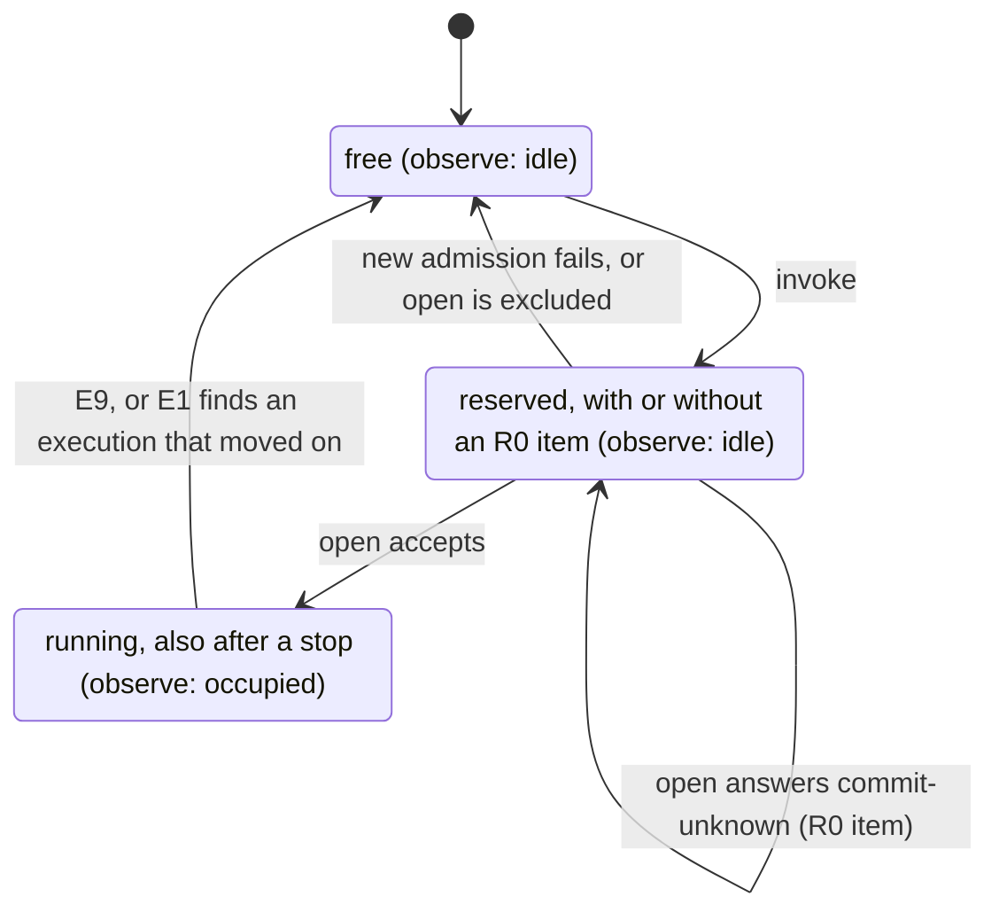

PACKAGE_TEMPLATE_DRAFT

# agent

## Responsibility and status

This package provides reusable implementation mechanisms and factories. It does not include Cordis. The design is [accepted](https://github.com/nemori-ai/omne-harness-lite/issues/384#issuecomment-6258475204). The root entry exports the public construction types and `createAgentRuntime`. The factory checks the configuration, the binding, the registration handle, the required dependencies and the joint commits. On success it returns an idle provider. Each public operation of the four faces checks the tenant first and then calls `access.check` once. `invoke` runs the skeleton of the normal Loop path (#502 1.2), and `observe` shows each new state of the instance. The other operation bodies are not implemented: after `allowed` they return a named `unavailable`. The root entry also exports the generic evaluator `agentEvaluator`. An assembly adopts it for the bound definition through `AgentAdoptions`. The `./testing` entry gives a test assembly: a memory Journal, scriptable doubles of the ports, a manual clock and `createTestAgentDependencies`.

### Support scope

The tiers are defined in the [member documentation requirements](../../../docs/member-documentation.md). The table follows the [tool support scope](../../tool/tool/README_ZH.md#支持范围). The verification column states only what the tests check. It does not state that behavior outside the tests holds.

| Tier | Status in this package | Entry | Verification scope |
| --- | --- | --- | --- |
| Public types exported | Exported: `AgentRuntimeBinding`, `AgentConfiguration`, `AgentRuntimeOptions`, `AgentDependencies` (17 dependencies) and `AgentProvider`. Exported values: `agentEvaluator`, an implementation of the contract's `AgentEvaluator`, and `agentCheckpointSchema`, the schema adoption of the checkpoint that it writes. The shapes are in the [API design](docs/public-api.md) | Root entry | `tests/public-entry.spec.ts` checks the export names of the root and `./testing` entries, the import graphs of source and build output, the manifest dependencies and the Cordis routes |
| Pure contract functions implemented | None in this package. The contract functions are in `agent-contract` | None | None |
| Independent execution implemented | None | None | None |
| Runtime paths implemented | The creation checks of `createAgentRuntime`. A configuration item out of range or a malformed binding field returns `invalid`, and `field` gives the item path. A registration handle for another instance returns `denied`. An absent required dependency (10 of them) returns `unavailable`, and `diagnostic` names it. A `jointCommits` kind that the Journal does not declare returns `unsupported`. A failure builds no runtime and calls no dependency method. A success gives an idle provider. The access guard: each public operation of the four faces first checks the tenant of the Access. A missing tenant, or a tenant that legal-identity did not mint, is `invalid`. Another tenant is `denied`. None of them calls `access.check`. `observe` is the exception: the contract gives it no `invalid` end reason, so a missing or malformed tenant ends it with `denied` (see the 待拥有者 item below). Then the operation calls `access.check` once. It does not cache `allowed`, and `denied` or `unavailable` stops the operation. After `allowed`, `observe` shows the current state, then each new state, and ends with `closed` when the signal aborts. The operations other than `invoke` and `observe` return `unavailable` with the `diagnostic` "<operation> is not implemented until #502 stage N". This answer is temporary for the stage. It is not a contract result | Root entry | `tests/factory.spec.ts` checks each of the four creation failures and the idle success. `tests/provider-access.spec.ts` checks, for each public operation, the tenant check, the three results of `access.check` and the single call. `tests/assembly.spec.ts` builds an idle provider from the test assembly and checks that the creation calls no dependency. The checks listed below as not implemented have no test |
| Normal Loop path (skeleton, #502 1.2) | `invoke` takes one input through the normal path without tools or extensions. It returns the handle when `open` accepts the execution. The Loop then runs to ended by itself. The same operation again gets the original handle, and a held slot gives `busy` (#502 1.3). An outcome off the normal path stops the run, and the stopped run holds the slot. See [Normal Loop path](#normal-loop-path) for the steps, the diagrams, the admission, the stops and the slot rules | Root entry | `tests/loop-transitions.spec.ts` checks each row of the transition table against the node table (C1). `tests/loop-evaluator.spec.ts` checks the decisions at E4 and I8, the encoder and `unsupported` off the normal path. It runs 500 seeded `LoopFacts`. For each, it checks that the same facts give the same `Next`, that the input does not change and that each step has a row (C1). `tests/loop-invoke.spec.ts` runs one input to ended against the scripted Model and the memory Journal (C2). It also checks the guarded event reads, a reply of several pages and the minted identities. `tests/loop-admission.spec.ts` checks the admission: the same operation again (C1), the lost receipt of `accept` (C2), `busy` and the R0 item. Each test name starts with its row of the node acceptance table. `tests/loop-slot.spec.ts` checks the slot release, `observe` and the projection to the registration handle. `tests/loop-port-failures.spec.ts` checks that a port failure at each node of the path stops the run with the Journal `position` at that node. Failure branches, waits and recovery have no test |
| Test assembly (`./testing`) | `createMemoryAgentJournal`: a single-process, non-durable `AgentJournal`. It implements all 18 members by facts 1 to 15 of the [same-shape list](docs/architecture/mechanisms.md#两种实现必须同形的事实). Options set the declared participants. A test can script `unavailable` and three kinds of `commit-unknown` on chosen operations. Scriptable doubles of the other ports, `createManualAgentClock` and a hand-written `ToolRuntime` double. `createTestAgentDependencies` returns the 17 dependencies (`registration` is null) and the control handle of each double. `models` is the scripted provider of `model-contract/testing` | `./testing` | `tests/memory-journal.spec.ts` checks each fact of the same-shape list. Each test name has the fact number. `tests/fixtures.spec.ts` has one test for each scripting interface. There is only one process. Durability, crashes and cross-process use are not covered |
| Hosts and providers not delivered | The operation bodies of the four faces other than `invoke` and `observe`. The handle's `submit` (no stage assigned in #502 yet), `control` and `acknowledge`. The exact commit points, waits and failure branches of the Loop nodes from E1 on (#502 1.4 to 1.9). The nodes off the normal path: the A, T, C and X subgraphs, F0, H0, Q5, M2 and W0, and R0 other than the retry of an unresolved `open`. The evaluator's `decode` (stage 5). The durable Journal provider `agent-journal-local`. Real Context, HITL, authorization, Session adapters and material storage | None | No evidence |

### Normal Loop path

The skeleton of #502 1.2 runs one input through the normal path. It has no tools, no extensions, no failure branches and no waits. #502 1.3 adds the exact admission.

`invoke` does these steps:

1. It passes the access guard.
2. A held slot gives `busy` to a new `invoke` (see Admission below). Otherwise `invoke` reserves the slot.
3. It resolves the evaluator of the bound definition through `adoptions.resolve`. An adopted extension returns `unavailable` (extensions are #502 stage 3).
4. It runs U0, Q1, Q2, Q4, U0 and E0. `handoff.accept` admits the input, and `open` accepts the execution.
5. It returns the handle. It does not wait for the Loop.

The Loop then runs by itself:

- It goes from E1 to E9. After E9 the runtime is idle again.
- Only the transition table in `src/loop/nodes.ts` decides where a node goes. Each row comes from the row of its node in the node table, normally from the column 如何返回.
- At E4 and I8 the pure evaluator's `Next` decides.
- I2 encodes the `ModelInvocationRef` of the main call with the contract's `encodeModelInvocationRef`. The I2 commit saves it in the PendingCall before the first admit at M6. M6, M1 and M3 read the call back from it with `resolveModelInvocationRef`.
- The coordinator admits the Model call and observes it until it settles. Then it reads the result in full. It records the result on the processed path with `recordResult` and acknowledges it.
- The handle's `output.read` and `output.events` read the Journal events under the guard. The events are input-taken, producer and ended only. Their sequence numbers start at 1.

The normal path in the diagram below has thick borders on the nodes that write one commit. The Q1, Q2 and Q4 loop runs two times: once for the input before `open`, and once for the reply. The diamonds are the decision points E4 and I8.

```mermaid
flowchart TD
    U0a[U0] --> Q1a[Q1] --> Q2a[Q2] --> Q4a[Q4] --> U0b[U0] --> E0[E0 open]
    E0 -->|invoke returns the handle| E1 --> E2 --> E4a{{E4}}
    E4a -->|position E3| E3[E3]:::commit --> E4b{{E4 evaluator}}
    E4b -->|take-inputs| I0[I0]:::commit --> I1[I1]:::commit --> P0[P0]:::commit --> P1[P1]:::commit
    P1 --> I2[I2]:::commit --> M0[M0]:::commit --> M6[M6]:::commit --> M1[M1]:::commit
    M1 --> M3[M3]:::commit --> M4[M4]:::commit --> M5[M5]:::commit --> I3a[I3]
    I3a --> Q1b[Q1] --> Q2b[Q2]:::commit --> Q4b[Q4]:::commit --> I3b[I3]:::commit
    I3b --> I4[I4]:::commit --> I8{{I8 evaluator}}:::commit
    I8 -->|take-inputs| I0
    I8 -->|try-finish| F1[F1]:::commit --> F2[F2]:::commit --> F3[F3 tryFinish]
    F3 --> F4[F4] --> O0[O0] --> E9[E9 idle]
    classDef commit stroke-width:3px
```

Admission (#502 1.3):

- The same operation with the same input gets the original handle back. This applies while the run continues, after it stops and after it ends. The runtime remembers its last accepted operation and returns that handle without another `open` or Loop.
- If another execution holds the slot, the runtime first queries the earlier operation in the Journal. A committed operation gets an idempotent `open` to return its original handle or `conflict`. This lookup neither reserves the slot nor drives the earlier execution. Other query results give `busy`.
- A new runtime over the same Journal calls `open` to find the original receipt and Authority. If the execution revision already advanced, E1 returns `found-existing`. The transition table ends this coordinator, and the runtime returns to idle without driving the execution. Recovery of that execution belongs to #502 stage 5.
- If the execution is open but its revision did not advance, E1 drives it with the original Authority. Two live runtimes can therefore try to drive that execution. Fencing between live runtimes belongs to `attach` in #502 stage 5.
- The same operation with another input gets `busy` while its execution holds the slot. When the slot is free or another execution holds it, the Journal gives `conflict`. `invoke` returns that failure unchanged.
- A held slot gives `busy` to an `invoke` of a new operation. This is true while the slot is reserved, while `open` is unresolved, while the run continues and after the run stopped. `invoke` does not queue it.
- A commit-unknown of `handoff.accept` at Q2 makes `invoke` return `commit-unknown` with the operation of the `invoke`. No execution exists yet, so the slot is free again. The same operation again is the query: U0 and Q2 call `accept` again with the same operation and the same candidate and get the original result. The receipt of an external input is not kept elsewhere (#558 S-13).
- A commit-unknown of `open` at E0 makes `invoke` return `commit-unknown`. The runtime keeps the reservation as an R0 item: the operation and the execution. The same operation again first calls `query` with that operation. `committed`: the same `open` gives back the original receipt, and the run continues at E1. `excluded`: the operation is admitted again with the same identity. `unknown`: `invoke` returns `commit-unknown` again, and the reservation stays. A retry that fails before `open` keeps the R0 item when the query says `committed`. If the query says `excluded`, that failure frees the slot. No timer checks the R0 item (waits are #502 1.9).
- Q1 does not commit. The type of the candidate ties each source to its call position: an external input to U0 and a Model reply to I3. Q4 returns each admission to that position one time and does not retry. A rejected candidate (Q5) is #502 4.1. Until then it stops with a named `unavailable`.

Stops:

- An outcome off the normal path stops the run at its node. No stop becomes a success.
- After a stop the slot stays occupied, and `observe` shows occupied. The Journal keeps the `position` of the last commit. A new `invoke` gets `busy`.
- The coordinator returns a stop with the failure and its `owner` internally (#558 S-14): a port failure keeps the `owner` of the port, `@omne-harness/agent` marks an outcome that a later card handles, and `@omne-harness/agent#defect` marks a defect of the coordinator. The waits of #502 1.9 make the stop readable.

Slot rules:

- The slot has three states: free, reserved and running. A reservation includes an R0 item. A stopped run is still running.
- `observe` shows only an execution that exists. Free and reserved show idle. Running shows occupied.
- A new admission that fails before `open` gives the slot back. A commit-unknown of `open` keeps the reservation until a query decides it. A committed query keeps the R0 item if the retry fails. An excluded query permits release.
- The registration handle only receives a projection. A `report` that throws is dropped. `invoke` returns as usual, and the slot and `observe` do not change. Waiting for the owner (待拥有者): `report` returns void, and the contract gives its failure no channel.

The diagram below shows the states of the slot. Each state shows in brackets what `observe` shows.

The factory does not implement these creation checks, because no input of the factory can decide them. They stay with the owner or a later card.

- Waiting for the owner (待拥有者): whether the binding tenant matches the security scope (`denied`). The `scope` is an `Evidence` and carries no tenant. No dependency port can decide the match at creation.
- Waiting for the owner (待拥有者): whether the exact adoptions `binding.definition` and `loopGuardPolicy` resolve (`unavailable`). Through the definition, this also decides whether tools, admission and extensions are required. `AgentAdoptions.resolve` requires an `Access`, and the factory takes no Access. The loop judgment, a trusted system extension, resolves `loopGuardPolicy`. #502 step 3.7 only connects an empty implementation at that position. Step 7.1 (stage 7) implements the real guard.
- Waiting for #558 M04-3: how an external coordinator declares its participation. The factory compares only the `CallerCommit` kinds that `capabilities.participants` can name. An independent assembly (`jointCommits` empty) is created as before.
- Waiting for the owner (待拥有者): the contract gives `observe` no `invalid` end reason for an Access with a missing or malformed tenant. The current code does not call `access.check` and ends with `denied`, so the failure stays closed.

The Loop skeleton uses these temporary choices. The source comments, the test names and [tests/README](tests/README.md) name each one. Later #502 cards or the #558 decisions tighten them.

- 临时简化，1.3–1.9 按节点表收紧 (temporary simplification): from E3 on, every node writes one commit when it ends, and the commit moves `position` to the next node. The exact commit points of the node table are not followed. U0 to Q4 run before the execution exists and do not commit. Q1 never commits (NA-Q1-1). E1, E2 and E4 only read. A commit there would overwrite the `position` that E4 reads. F3 uses `tryFinish`. After ended the Journal refuses commits, so F4, O0 and E9 use their own record methods only.
- Waiting for #558 M04-1: the commit that follows `recordResult` at M3 carries the producer event.
- Waiting for #558 M04-8 (this reading): the I0 commit carries the input-taken event.
- Waiting for #558 M04-7: `open` writes no event.
- Waiting for #558 M04-5: in an independent assembly `recordResult.transfer` is processed without a declared participant.
- Waiting for #558 S-13: the coordinator does not keep the handoff acceptance receipt of the external input. Q2 runs before `open`, and no write carries the receipt.
- I1 sends what `prepare` returns, assembled or ready, to P0 (pseudocode `prepareRequest`). The I1 row of the node table names ready only for `resume`.
- `JournalCommit` has no field for the final request record (M04-2), so M0 does not write it. E1 does not check the Access again (1.4). The loop judgment, a trusted system extension, does not run at M4 (stages 3 and 7).

The memory Journal uses these temporary choices for three open facts. The source comments, the test names and this table mark each one as 「临时做法，待 #558 裁定」 (temporary, waiting for the #558 decision). They change in the same wave as the decision.

- M04-4: `commit` and the six record methods (`submit`, `control`, `acknowledge`, `recordResult`, `recordControl`, `recordTerminalObservation`) advance the revision on each successful write. A retry of the same operation returns the original receipt and does not advance it.
- M04-5: when `recordResult.transfer` is custody or processed, the provider sets up the custody or completion evidence itself, also without a declared participant. A non-none `commit.caller` kind that is not declared returns `unsupported` and saves nothing.
- M04-7: `open` appends no event. The first event comes from a later commit.

These choices are also marked 「临时做法，待 #558 裁定」:

- The M04-1 reading: `control` and `recordControl` project each stage fact as a control event, as SPEC [six stages](../agent-contract/SPEC.md#六个阶段) states. When the same stage is recorded again with the same evidence under a new operation, the Journal returns the original receipt. It does not advance the revision or project the event again. After ended, `recordControl` records the stage fact but projects no event, because the ended event is the last event of an execution.
- The blocked reasons of `tryFinish`: the Journal checks, in this order, operations (a write of the execution is still undecided), controls (an applicable stage is recorded unresolved), inputs (an ordinary end leaves accepted inputs that no taken batch covers. A cancel is not blocked by them), and custody (a result has neither custody nor completion evidence). Where SPEC does not state the condition, the Journal takes the stricter reading. It does not check passages: whether the before-terminal passages are complete and bound to the candidate is a fact of the coordinator, and the Journal cannot judge it from its own records.

The memory Journal does not implement writes that no type carries (final request record, backoff instant and next check instant, see M04-2). It does not project stream and producer events (M04-1). No method appends an event after the ended event. Each call that returns `commit-unknown` leaves a record that `query` can decide: committed when the write took effect, excluded when it did not, and undecided while nobody knows (listed in `unresolved`, fenced out by `attach` or decided by `settle`). Operation records and pending writes are kept per tenant. A write from another tenant returns denied before any scripted fault and never becomes pending. `unresolved`, the fence of `attach`, the operations check of `tryFinish` and `settle` look only at records of the execution's own tenant. `query` does not tell another tenant whether an execution exists.

## Usage

The root entry gives `createAgentRuntime` and `agentEvaluator`. An assembly adopts `agentEvaluator` for the bound definition in `AgentAdoptions`. The factory checks the assembly and returns an idle provider. `invoke` takes one input and returns the handle, and the caller reads the events through it. Only the normal path without tools and extensions runs now. The [API design](docs/public-api.md) describes the shapes. Tests use `@omne-harness/agent/testing`. `createTestAgentDependencies()` returns `dependencies` and `controls`. A test sets the answers of each double through its `Script`: `always` sets the standing answer, `once` sets the next answer, and `calls` logs each input. `controls.journal.failNext` makes a chosen write return `unavailable` or `commit-unknown`. The doubles are for tests only. Do not assemble them into production.

## Contracts

The [SPEC](SPEC.md) owns behavior. The [API page](docs/public-api.md) separates actual exports from designed interfaces.

## Design

The [architecture](docs/architecture/README.md) owns mechanisms and dependency decisions. Use the [topic index](docs/index.md) for other responsibilities.

## Configuration and operation

Pass business identities as operation inputs. Pure contract and implementation packages do not install Cordis. [Cordis integration](docs/cordis.md) describes binding ownership and lifecycle rules.

## Verification

Run `pnpm turbo run test --filter=@omne-harness/agent` from the repository root, and `pnpm typecheck` in this directory. turbo builds this package and its dependencies first. `pnpm turbo run test:fast --filter=@omne-harness/agent` runs only the fast tier. `pnpm test` in this directory runs Vitest only and does not build, and the import-graph tests read the built output of this package and its dependencies. The tests check these items:

- the public entries, the import graphs and the manifest dependencies
- the four creation failures and the idle success of the factory
- the access guard of the four faces
- the same-shape facts and the three temporary choices of the memory Journal
- the scripting interface of each double
- the transition table, the evaluator and one input to ended on the normal Loop path

The tests do not establish runtime support off the normal path. [tests/README](tests/README.md) describes how the tests are organized.

## Maintenance

Update actual consumers, the SPEC, and verification when a public contract changes. Implementation details do not redefine domain contracts. The [group](../README.md) owns the member relationships.

## Directory structure and documentation roles

The package follows the source template skeleton. [docs](docs/README.md) lists six documentation topics. Source, tests, schemas, verification, ADRs, examples, resources, and acceptance each have an index. Draft resource slots do not establish template adoption or business acceptance.
