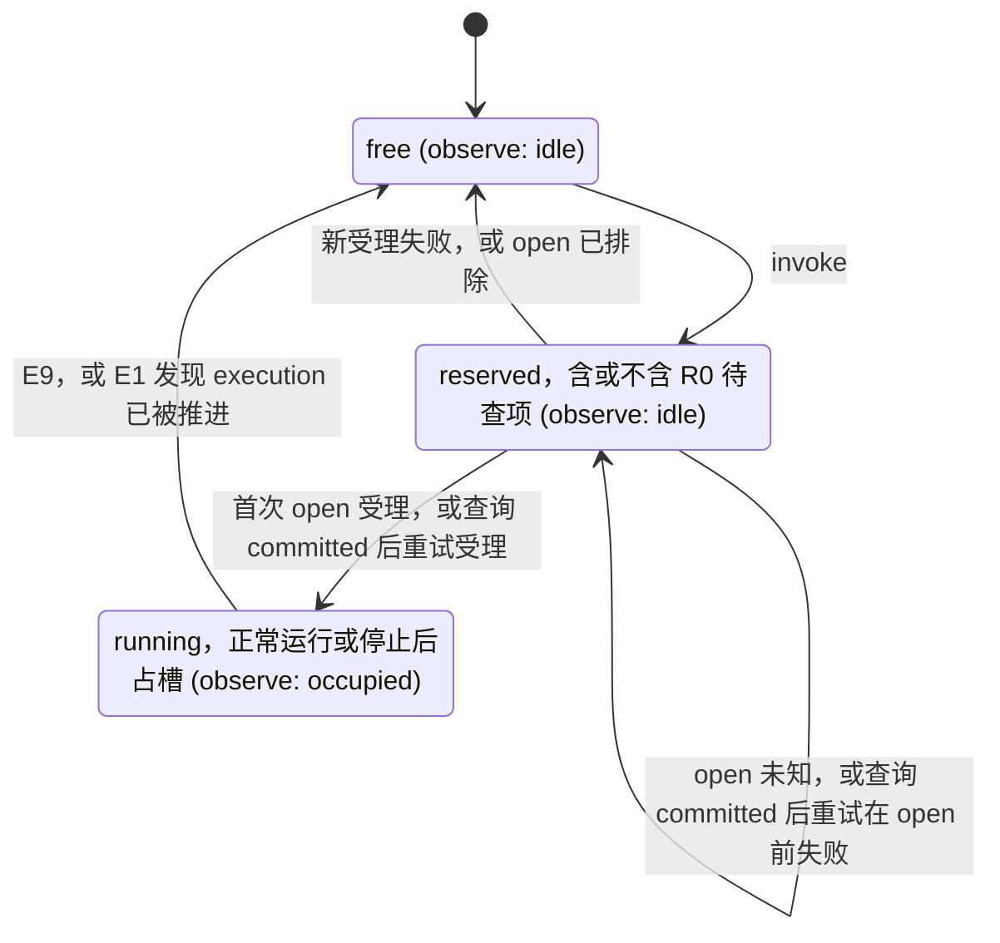

PACKAGE_TEMPLATE_DRAFT

# agent

## 职责与状态

不含 Cordis 的通用实现机制、配置与依赖聚合。设计已由[技术接受与产品采用决定](https://github.com/nemori-ai/omne-harness-lite/issues/384#issuecomment-6258475204)接受。根入口导出工厂的公开类型与 `createAgentRuntime`。工厂校验配置、绑定、登记句柄、必需依赖与共同提交，成功时返回 idle 的 provider。四个面的公开操作都先核对租户、再调用一次 `access.check`；`invoke` 走 Loop 正常路径的骨架（#502 1.2），`observe` 随实例状态的变化给出新状态；其他操作本体尚未实现，放行后返回具名的 `unavailable`。根入口另导出通用评估器 `agentEvaluator`，装配经 `AgentAdoptions` 为绑定的定义采用它。`./testing` 入口给测试装配：内存 Journal、各端口的可编排替身、提供当前时刻读取与等待的可控时钟，以及 `createTestAgentDependencies`。

### 支持范围

档位的定义见[成员文档要求](../../../docs/member-documentation.md)，写法沿 [tool 的支持范围](../../tool/tool/README_ZH.md#支持范围)。验证范围只说明测试核对了什么，不说明测试范围之外的行为已成立。

| 档                      | 本包的状态                                                                                                                                                                                                                                                                                                                                                                                                                                                                                                                                                                                                                                                                                                                                                                                                                                                                                                                                                       | 入口                         | 验证范围                                                                                                                                                                                                                                                                                                                                                                                                                                                                                                                                                                                                                                                                                                                                                                                                                                                                                                                                             |
| ----------------------- | ---------------------------------------------------------------------------------------------------------------------------------------------------------------------------------------------------------------------------------------------------------------------------------------------------------------------------------------------------------------------------------------------------------------------------------------------------------------------------------------------------------------------------------------------------------------------------------------------------------------------------------------------------------------------------------------------------------------------------------------------------------------------------------------------------------------------------------------------------------------------------------------------------------------------------------------------------------------- | ---------------------------- | ---------------------------------------------------------------------------------------------------------------------------------------------------------------------------------------------------------------------------------------------------------------------------------------------------------------------------------------------------------------------------------------------------------------------------------------------------------------------------------------------------------------------------------------------------------------------------------------------------------------------------------------------------------------------------------------------------------------------------------------------------------------------------------------------------------------------------------------------------------------------------------------------------------------------------------------------------- |
| 公开类型已导出          | 已导出：`AgentRuntimeBinding`、`AgentConfiguration`、`AgentRuntimeOptions`、`AgentDependencies`（17 项依赖）与 `AgentProvider`，以及值 `agentEvaluator`（契约 `AgentEvaluator` 的实现）与它写入的 checkpoint 的 schema 采用 `agentCheckpointSchema`，形状见[入口设计](docs/public-api.md)                                                                                                                                                                                                                                                                                                                                                                                                                                                                                                                                                                                                                                                                        | 根入口                       | `tests/public-entry.spec.ts` 核对根导出名与 `./testing` 导出名、源码与产物的导入图、清单依赖与 Cordis 路径                                                                                                                                                                                                                                                                                                                                                                                                                                                                                                                                                                                                                                                                                                                                                                                                                                           |
| 纯契约函数已实现        | 本包没有。契约函数在 `agent-contract`                                                                                                                                                                                                                                                                                                                                                                                                                                                                                                                                                                                                                                                                                                                                                                                                                                                                                                                            | 无                           | 无                                                                                                                                                                                                                                                                                                                                                                                                                                                                                                                                                                                                                                                                                                                                                                                                                                                                                                                                                   |
| 独立执行已实现          | 无                                                                                                                                                                                                                                                                                                                                                                                                                                                                                                                                                                                                                                                                                                                                                                                                                                                                                                                                                               | 无                           | 无                                                                                                                                                                                                                                                                                                                                                                                                                                                                                                                                                                                                                                                                                                                                                                                                                                                                                                                                                   |
| runtime 已实现的路径    | `createAgentRuntime` 的创建校验：配置七项越界或绑定字段非法返回 `invalid`（`field` 写配置项路径），登记句柄的 instance 与绑定不一致返回 `denied`，十项必需依赖缺席返回 `unavailable`（`diagnostic` 指名缺席的依赖），`jointCommits` 有一种未被 Journal 声明返回 `unsupported`。失败时不创建 runtime，不调用任何依赖的方法。成功得到 idle 的 provider。访问守卫：四个面的每个公开操作先核对 Access 的租户：缺租户或租户不是 legal-identity 签发的 `TenantId` 时返回 `invalid`，跨租户返回 `denied`，都不调用 `access.check`。`observe` 例外：契约没有 `invalid` 的结束原因，缺租户或租户非法都以 `denied` 结束（见下文待拥有者一项），再调用一次 `access.check`，不缓存 allowed，`denied` 与 `unavailable` 不放行。`observe` 放行后给出当前状态，状态变化时给出新状态，signal 中止时以 `closed` 结束。`invoke` 与 `observe` 之外的操作放行后返回 `unavailable`，`diagnostic` 写「<操作> is not implemented until #502 stage N」：这是阶段性临时做法，不是契约结果 | 根入口                       | `tests/factory.spec.ts` 逐项核对四种创建失败与成功的 idle。`tests/provider-access.spec.ts` 对每个公开操作核对租户核对、`access.check` 三态与恰一次。`tests/assembly.spec.ts` 用测试装配得到 idle 的 provider，核对创建没有调用任何依赖。没有覆盖下面列出的未实现校验                                                                                                                                                                                                                                                                                                                                                                                                                                                                                                                                                                                                                                                                                 |
| Loop 正常路径与受理     | `invoke` 让一条输入走无工具、无扩展的正常路径，`open` 受理后返回句柄。Loop 随后自行推进到 ended。同一操作以同一输入再次 `invoke` 取回原句柄。已记住的操作配另一输入时，若原 execution 占槽则返回 `conflict`。槽被占用时，新操作返回 `busy`。未支持的结果使运行停止，停止的运行占住执行槽。E1/E2、恢复节点选择、I0 输入批、I1 准备、W0 等待与 R0 原操作对账已实现，见[恢复路由](#恢复路由)。步骤、图、受理、停止与槽的规则见 [Loop 正常路径](#loop-正常路径)                                                                                                                                                                                                                                                                                                                                                                                                                                                                                                                 | 根入口                       | `tests/loop-transitions.spec.ts` 核对正常路径与节点表（C1），另核对 E1 的临时 `found-existing` 行。`tests/loop-evaluator.spec.ts` 核对评估器在 E4 与 I8 的决定、编码与正常路径之外的 `unsupported`，并以 500 个种子生成的 `LoopFacts` 核对同事实同结果、不改输入、每个步骤在表中有行（C1）。`tests/loop-invoke.spec.ts` 对脚本化 Model 与内存 Journal 走一条输入到 ended（C2），另核对受守卫的事件读取、多页回复与派生身份。`tests/loop-admission.spec.ts` 核对受理：同一操作再次调用（C1）、`accept` 回执丢失（C2）、`busy` 与 R0 待查项，用例名以节点验收表的行号开头。`tests/loop-slot.spec.ts` 核对槽的释放、`observe` 与登记投影。`tests/loop-port-failures.spec.ts` 核对 E1/E2/I1/M1 的端口失败保存等待，其余受测节点的端口失败使运行停止。`tests/loop-intake-prepare.spec.ts` 核对 I0/I1 与准备失败，Journal 的 `position` 停在该节点。`tests/loop-recovery.spec.ts` 核对 E1/E2、纯恢复路由、原操作认回与保存等待。公开 resume 与唤醒没有用例 |
| 主调用接缝              | I2/M0 在首次受理前固定原调用、最终请求与效果意图。M6 先查原 reference，M1 等待真实收场。M3 以 processed 路径处理并解除 Model 责任，随后条件提交 producer。最终失败且无有效回复经 M4/M5/I3 形成 no-reply；部分失败不执行工具建议。Agent stream 与缺元数据的推理结果仍未支持，见[主调用与结果消费](#主调用与结果消费)                                                                                                                                                                                                                                                                                                                                                                                                                                                                                                                                                                                                                                              | `invoke`；窄接续仅为内部入口 | `tests/loop-main-call.spec.ts` 核对原调用身份、受理回执丢失、原 Authority、M1 等待、在途输入、processed/ACK 次序、费用关联与 Read 收尾。`tests/loop-recovery.spec.ts` 保留真实提交点的 committed/excluded 矩阵。只用脚本化 Model 与内存 Journal                                                                                                                                                                                                                                                                                                                                                                                                                                                                                                                                                                                                                                                                                                      |
| 回复准入与 iter 收口 | I3 接纳事实、message 与接续同 revision。I4 保存空动作批。I8 选择 F1、新 step 或一次等待保存。 | `invoke`；测试直接 Journal.submit | `tests/loop-reply-close.spec.ts` 与 `tests/loop-recovery.spec.ts` 的原操作矩阵。仅脚本化 Model 与内存 Journal。 |
| 终态出口 | F1 固定意图，F3 对账 changed、blocked 与未知结果。F4 保留观察台账，O0 认回原 ACK release，E9 回 idle 保持登记。 | `invoke`；Journal 记录与内部协调者 | `tests/loop-terminal.spec.ts`：新输入竞争、原终结查询、custody、非空观察台账恢复与迟读事件。只覆盖同一内存 Journal。 |
| 阶段 1 可执行验收 | 完整普通回复准入、无工具空动作批与完成。执行进程退出后的受控窄接续。 | `pnpm --filter @omne-harness/agent acceptance` | [验收入口](acceptance/README.md)在 I2、M6、M1、M4 与 F4 杀死执行子进程。父进程中同一个 Journal、脚本 Model 与材料存活。不证明 Journal 宿主死亡耐久、公开 resume、工具或扩展求值。 |
| 测试装配（`./testing`） | `createMemoryAgentJournal`：单进程、非耐久的内存 `AgentJournal`，按[同形清单](docs/architecture/mechanisms.md#两种实现必须同形的事实)第 1 至 15 条实现全部 18 个成员，参加者集合由选项给定，可在指定操作上编排 `unavailable` 与三种 `commit-unknown`。各端口的可编排替身、`createManualAgentClock` 与手写的 `ToolRuntime` 替身。`createTestAgentDependencies` 返回 17 项依赖（`registration` 为 null）与各替身的控制手柄，`models` 是 `model-contract/testing` 的脚本化提供者                                                                                                                                                                                                                                                                                                                                                                                                                                                                                    | `./testing`                  | `tests/memory-journal.spec.ts` 按同形清单逐条核对，用例名带条目号。`tests/fixtures.spec.ts` 为每个编排接口各有一条用例。只有一个进程，耐久性、崩溃与跨进程没有覆盖                                                                                                                                                                                                                                                                                                                                                                                                                                                                                                                                                                                                                                                                                                                                                                                   |
| 尚未交付的宿主与提供者  | 四个面中 `invoke`、`observe` 之外的操作本体，句柄的 `submit`（#502 的阶段表尚未分配）、`control` 与 `acknowledge`。正常路径之外的节点：A、T、C、X 子图，F0、H0、Q5、M2。评估器的 `decode`（阶段 5）。耐久 Journal 提供者 `agent-journal-local`。真实的 Context、HITL、授权、外部协调者的适配器与材料存储                                                                                                                                                                                                                                                                                                                                                                                                                                                                                                                                      | 无                           | 没有证据                                                                                                                                                                                                                                                                                                                                                                                                                                                                                                                                                                                                                                                                                                                                                                                                                                                                                                                                             |

### Loop 正常路径

runtime 受理一条输入，再推进 Loop 的正常路径。主调用也处理下述最终失败与部分结果。当前不运行工具或扩展，完整恢复尚未交付。

`invoke` 依次做下列步骤：

1. 过访问守卫。
2. 槽被占用时，新的 `invoke` 返回 `busy`（见下文「受理」）。否则预约单执行槽。
3. 经 `adoptions.resolve` 取绑定定义的评估器。采用了扩展时返回 `unavailable`（扩展属 #502 阶段 3）。
4. 走 U0、Q1、Q2、Q4、U0、E0：`handoff.accept` 准入输入，`open` 受理 execution。
5. 返回句柄，不等 Loop 结束。

Loop 随后自行推进：

- 从 E1 走到 E9。E9 之后 runtime 回 idle。
- 节点的去向只取 `src/loop/nodes.ts` 的转移表。正常路径的行依据节点表或其伪代码。E1 的 `found-existing` 行是阶段 1 的例外，见[临时做法](#临时做法)。
- E4 按下文的恢复路由选择去向。评估器处理输入边界与 I8 的决定。
- I2 以契约的 `encodeModelInvocationRef` 编码主调用的 `ModelInvocationRef`，M0 在 M6 首次 admit 之前把它随 PendingCall、最终请求采用与效果意图一次保存。M6、M1、M3 经 `resolveModelInvocationRef` 从它读回调用身份。
- 协调者向 Model 受理调用，观察到真实收场后读完结果，以 `recordResult` 走 processed 路径保管，再 `acknowledge`。
- Q1 不提交（NA-Q1-1）。候选的类型把来源与调用位置绑在一起：外部输入对应 U0，模型回复对应 I3。Q4 把每个接纳结果交回该位置一次。被拒收的候选（Q5）尚未交付，当前以具名的 `unavailable` 停止。
- 句柄的 `output.read` 与 `output.events` 经守卫读 Journal 的事件。正常路径的事件为 input-taken、producer、message、ended，序号从 1 连续。

下图是正常路径。粗边框的节点各写一次提交。Q1、Q2、Q4 走两次：一次在 `open` 之前准入输入，一次准入回复。菱形是决定点 E4 与 I8。

```mermaid
flowchart TD
    U0a[U0] --> Q1a[Q1] --> Q2a[Q2] --> Q4a[Q4] --> U0b[U0] --> E0[E0 open]
    E0 -->|invoke 返回句柄| E1 --> E2 --> E4a{{E4}}
    E4a -->|position E3| E3[E3]:::commit --> E4b{{E4 evaluator}}
    E4b -->|take-inputs| I0[I0]:::commit --> I1[I1]:::commit --> P0[P0]:::commit --> P1[P1]:::commit
    P1 --> I2[I2] --> M0[M0]:::commit --> M6[M6] --> M1[M1]
    M1 --> M3[M3]:::commit --> M4[M4] --> M5[M5] --> I3a[I3]
    I3a --> Q1b[Q1] --> Q2b[Q2]:::commit --> Q4b[Q4]:::commit --> I3b[I3]:::commit
    I3b --> I4[I4]:::commit --> I8{{I8 evaluator}}:::commit
    I8 -->|take-inputs| I0
    I8 -->|try-finish| F1[F1]:::commit --> F2[F2]:::commit --> F3[F3 tryFinish]
    F3 --> F4[F4] --> O0[O0] --> E9[E9 idle]
    classDef commit stroke-width:3px
```

#### 输入批与请求准备

I0 只在 E4 或 I8 允许的输入边界承接快照水位线以内的完整输入批。
一次提交保存输入批身份、新 step 与一条 input-taken 事件，并清空上一步的准备与压缩状态。
已经承接的输入不再进入下一批。

I1 依次读条件、选择模型、读 Runtime Context、调用 prepare。
首次调用传 previous=null 与 beforeModelCall=null，装得下时以 assembled 转 P0。
同次提交保存 requestPreparation 与已用于准备的条件依据。
新 execution 读取时 adopted=null；既有 M0 提交采用 ready 的覆盖。
四个端口任一不可用时，W0 保存原 owner 与 I1 续点的一次等待。
首次返回 ready 属提供者违约，以 owner=requestPreparation 停止，不启动调用。

真实 cannot-fit 先提交原准备，再转 F1。
F1 首次构造候选时从注入的 AgentClock.now 取时，保存原原因与 Context 来源，cause 绑定完整候选。
取时不可用时保留准备与 F1 续点，不写候选。
同一协调者在 F1 提交被排除后保留同一个候选及其时刻，不再次取时。
测试分别覆盖 I1、F1 未知提交的 committed/excluded 接续、取时次数，以及不可用后重试成功。

按 [revision 2 决定](https://github.com/nemori-ai/omne-harness-lite/issues/513#issuecomment-6310398942)，needs-compaction 在 I1 保存原准备后返回 unsupported。
它不构造失败候选，也不发起压缩调用。压缩路径与相应 F1 结果归 4.5。
runtime 继续占用执行槽。公开 observe 不呈现这一内部停止原因。

输入测试直接调用内存 Journal.submit，不表示公开 input.submit 已交付。
主调用真实在途时，新输入不改已固定请求。M3 的条件提交因新输入返回 changed 时，协调者重读当前挂接与修订号，复用原结果再提交，不重新准备或受理。
主调用接缝用例在 I8 停止，回复收口用例继续到 step-2，并核对原输入不再承接。终结竞争仍由后续卡闭合。

#### 主调用与结果消费

I2 只构造主调用的 PendingCall，返回位置为 I3。M0 的一次条件提交保存该调用、ready 最终请求采用、adoptedContext 与 EffectIntent。
M6 先 inspect 已保存的 reference。found 接续原调用，不再 admit。
可信 not-accepted 必须对应原 admission；M6 重读当前 Authority 后，才以原身份受理固定请求。
受理回执未知时仍查询原 reference，不分配第二个逻辑调用。

M1 先 inspect 原调用。已收场时直接采用原 settlement，不要求活体连接。
仍在途时继续 observe。观察连接结束后重查原调用，不把断线当作模型失败。
查询未知、重试未结束或没有活体路由时保存等待，不提前消费结果。
按 [#514 revision 2 范围决定](https://github.com/nemori-ai/omne-harness-lite/issues/514#issuecomment-6311420823)，本阶段不发布 Agent stream。
原生产者 schema 与来源映射、可靠接受后的透传仍属后续责任。

M3 按原 call/resultVersion/consumption 读取全部结果页，并关闭读取关系。
完整回复形成候选，最终失败的部分内容不成为新工具动作，无有效回复则保留明确的 no-reply 结果。
本实现先经 AgentMaterials 保存已解释的 reply/partial/no-reply facts，再以 recordResult 绑定完成依据。
精确的 agentProcessedResultSchema 保存原 tenant、execution、call/version、consumption、consumer 位置、settlement、结果项、dispatch/费用与 I3 后续责任。费用未知保持未知，不另造账目。
材料须不可变且可读取，稳定 identity 配同输入认回原回执、异值冲突。必须直接采用材料回执；其 owner 与原受理 consumer.owner 不符时具名失败、零 ACK，不改写 owner。
材料保存与 Journal processed 绑定都成立后才 ACK。绑定失败或未知时保留材料与 Model 原责任，未知 Journal 操作用原身份查询。材料缺席时，本实现的 processed 路径不能 ACK。
I3 与窄接续从 Journal.results[].completion 读材料，核对精确 schema 与原关联。导出的 readProcessedModelMaterial 只判断这些数据，不证明实际保存、Journal 绑定或当前资格。
受信 Model 证据适配器仍须读取实际材料、核验 Journal 绑定与当前资格。测试适配组合实际执行这些检查，材料存入真实的非耐久内存存储。
producer 由之后的条件提交携带。ACK 或 producer 回执丢失后认回原操作，不再索取 Model 全文。

完整读取的结果页在账目读取或材料保存失败后仍保留。不完整读取先关闭原 Read，再用新的确定读取身份重领同一 call/version/consumption；这不增加逻辑调用或受理。
closeRead 失败保留原 Read，重入先重试关闭，再决定是否重新读取。

没有扩展时，M4/M5 直通且不提交。首内容前最终失败且无有效回复由 I3 生成 no-reply 候选，再交 F1 固定终态意图。
候选时刻来自 AgentClock.now。取时失败不写候选，同一已形成候选重试不再次取时。
部分失败回 I8，完整的工具参数也不因失败收场而获准执行。

按 [推理结果支持边界](https://github.com/nemori-ai/omne-harness-lite/issues/514#issuecomment-6311593067)，缺原产出 scope/format 的 reasoning_state、完整或未封 thinking 返回 unsupported。
此时不写 processed，不 ACK，也不接纳消息，Model 继续承担原结果责任。
已有 Read 会被关闭。关闭失败明确返回失败，不声称已经关闭或释放责任。
原结果中的 replayCarried 不触发新调用，关闭回放再试仍由后续规则决定。

内部 continueExecution 只供原 runtime 在旧驱动停止后串行使用，须携带原 Access/Authority。
它核对当前挂接与已存 ready。在 I2，须尚无已存调用或未决 Journal 操作，再由已存 step 按原规则派生调用身份。在 M6，须有相符的 ready 与 PendingCall，已有结果必须带 processed completion。它也接受该调用已保存 completion 时的 M3/M4/M5/I3 位置。随后从 Journal 重建固定调用帧。
它不传旧 iteration，不重新 prepare，不新分配 call/admission，也不把 inputBatch ID 配新水位线冒充旧批。
测试丢弃旧协调者，但保留同一内存 Journal、Model 和原 Authority。
该入口覆盖意图提交前后、受理回执丢失，以及 processed completion 已存而尚未完成 I3 的切点。ACK 后只从消费侧材料接续，不向 Model 索全文；它不证明公开 resume、挂接恢复或进程耐久。
producer 已提交后，M4/M5 不再经过 M3，统一在 I3 接续。原 ACK 回执缓存丢失时，I3 以原 reference 查询真实 acknowledged 事实，核原结果版本、consumer、ACK 操作和 completion 回执，恢复原确认依据；不再次 ACK。
既有 O0 以稳定的原 consumption 操作记录结果 release。写入未知时查询原操作，unknown 不当作 excluded 或成功；ACK 未确认或不可读时停止接续并保留责任。终态 O0 接续见下文。其他生产者与 custody 路径继续归后续卡。

#### 回复准入与 iter 收口

I3 读取 Journal 绑定的 processed 结果。Q2 在同一 revision 提交 admitted 的 ModelReplyAdmission、message 事件与 Q4 接续。
Q4 回 I3 后关闭主调用，再进入 I4。回执保持原操作与原候选关联。
Journal 回执未知时认回原操作。excluded 后重评不增加第二次逻辑回复。
I4 在进入 I8 前保存完整空 ActionBatch。工具动作仍属后续阶段。

I8 在原挂接下重读快照、revision、输入边界、准入投影与当前条件。
没有输入或未完等待时，I8 只提出 F1 完成候选，不自行写终态。
已受理的新输入开启新 step，并分配新 action/call 身份。在途生产者或尚无保管与完成依据的结果保存一次 W0 等待，续点保留 I8。
已有结果需要后续消费节点时保持 unsupported。完整恢复尚未交付。
I8 选择下一 step 或候选时清除已消费的空批。

ordinary completed/limit 的合法全 sealed 内容可以准入为回复。原 trims 与 settlement 保存在 processed 材料中，不合成 trim 或提醒。
部分内容与 interrupted 结果无回复准入、无可执行动作，回 I8 按事实分流，不直接决定完成。
interrupted 保留原控制身份。控制请求协议与阶段记录仍由后续卡交付。

测试通过在途 Journal.submit 证明同一 execution 的 step-2。
终态释放后，新公开 invoke 在新 execution 开启首 step。公开 submit 尚未交付。
这些用例不允许占槽时用新 invoke 绕过输入边界。

#### 终态出口与保留责任

F1 只在候选依据的修订未变时固定完整 FinishIntent。提交被排除后保留原意图与时刻。
F2 只绑定一次终态前经过。内存 Journal 拒绝缺少经过依据、或与已固定 settling 意图不同的终结。
先受理的新输入使旧候选无效。R0 重读事实后回 I8，或重新固定失败候选。
no-reply 结果已消费时，I8 只关闭 completion 与原 ACK 匹配的原调用续点，同次驱动承接新输入。原 release 仍由 O0 负责。

F3 只调用 tryFinish 创建终态。Journal 一次保存 ended、最后事件、固定观察责任与原操作结果。
changed 与 blocked 回 R0。custody 必须真实移交后，下一次完成才能成立。
终结回执未知时，先查原操作再读取原结果。excluded 才以相同操作重试。
unknown 或查询不可用保留原责任，不写可能使原终结失效的 waiting checkpoint。

F4 认回已有观察登记，把未登记项留在长期 Journal。
它不执行扩展、不虚构 observed。合法宿主观察者可在 runtime 回 idle 后登记剩项。
O0 从原 completion 材料与 Model 的真实 ACK 确认恢复本实现主调用的 release。
它核对原 call、version、source、consumer、ACK operation 与 receipt，不重读 Model 正文、不重复 ACK。

O0 不替读取方确认输出。未确认事件与其他已保管结果责任继续留在 Journal。
E9 释放执行槽并保持登记。原 ended execution 不重开，新 execution 身份可以复用 idle runtime。
测试以同一非耐久内存 Journal 上的新协调者模拟内存丢失，不证明真实杀进程或跨进程恢复。

#### 恢复路由

公开守卫在受理之前核验一次资格（J1）。
资格为 denied 或 unavailable 时返回失败、零写，不进入协调者。
E1 读取已合法受理操作的终态、挂接和修订号。
终态转 F4。被取代的挂接转 E9。
修订号已推进时返回 `found-existing`，但本协调者仍有自己的未知提交待查时先认回该操作。
内部快照读取不可用时，W0 使用原 Authority 和 expected revision 保存等待。
唤醒同一执行不新增公开操作。
后续公开 `resume` 实现时须自行核验该次操作的资格。

E2 读取一个原子快照。它按原身份查询每个未定操作。
它按该快照的水位线读输入，并读完固定范围内的回复准入页。
它组装 `LoopFacts`，不改变修订号。
读取不可用或投影缺页时转 W0，不产生空事实。
在途调用投影为 unresolved 生产者视图。
最新快照已终态或挂接被取代时，停止读取业务事实。
E4 在业务接续前优先转 F4 或 E9，R0 重读后也适用。
E1、E2 不解释控制记录，也不查询 Model 或 Tool 的公开状态（J4，阶段 5）。

E4 分两处进行纯决定（J5）。协调者按 checkpoint、执行状态和未定操作选择恢复节点。
`LoopFacts` 不含执行状态和 Journal 未定操作，因此 `next` 无法完成这项决定。
评估器处理输入边界和迭代决定。
转移表用 `resume-<node>` 标签区分恢复去向。
A、T 子图返回具名的阶段 2 `unsupported`。
X 子图归阶段 3。C 子图及压缩调用归阶段 4。
这些路由不实现公开 `resume`、恢复挂接或通用处理器状态恢复（阶段 5）。本阶段只有上述 I2/M6 窄接续入口。

R0 查询原操作槽。未定时保留原槽与 expected revision，不另写 waiting 提交。
committed 后重读已保存的后继，保留请求受理与结果消费的实际阶段。
excluded 后在同一协调者内回原节点重新求值。
本地记录只保存未知操作与原节点，操作结果由 Journal query 决定。
M3 复用同一原调用的已处理结果。I3 在其提交已知成立前保留准入事实。
这些本地事实只支持同一协调者再入，不跨进程保存。

W0 在一次提交中保存 waiting 状态和一条 waiting 事件（J2）。
它保留 checkpoint 的原 position，并让出本次推进段。provider 持有唯一串行驱动。
驱动启动 Journal 与原 Model 观察，再重读快照、原操作槽及相关生产者状态。
进度未变才通过 AgentClock 等待配置 reconciliationDelayMs 对应的检查时刻。
通知或检查时刻到达后回 E1。二者都不证明生产者收场或原操作未执行。
执行仍占槽，`observe` 显示 occupied。
本地等待在返回前中止并等待观察任务与计时任务退出，不发生产者控制，不解除业务责任。
零间隔仍让出事件循环。时钟失败或检查时刻无法表示时，明确返回失败。
检查与退避时刻不持久化，恢复时立即重读，依据 [#558 M04-6](https://github.com/nemori-ai/omne-harness-lite/issues/558#issuecomment-6307768802)。
内部 waitForWake 的 signal 只结束这段本地等待，不表示公开 quiesce 或完整恢复已交付。

#### 受理

表内固定租户与 execution 身份。「同一操作」要求操作与 execution 两个身份都相同。内存中已记住的匹配优先于另一操作的 R0 待查项。其余情形存在 R0 待查项时，优先读该列，不读「本 execution 占槽」列。

| 输入               | 本 execution 占槽                                                                    | 另一 execution 占槽                                          | 槽空闲                                                                                                                                                 | 存在 R0 待查项                                                                                                   |
| ------------------ | ------------------------------------------------------------------------------------ | ------------------------------------------------------------ | ------------------------------------------------------------------------------------------------------------------------------------------------------ | ---------------------------------------------------------------------------------------------------------------- |
| 同一操作，同一输入 | 已记住时返回 handle，槽不变。首次受理尚未返回时答 busy，预约不变。                   | 已记住时返回 handle。否则走 Journal 查找。当前槽不变。       | 已记住时返回 handle，槽仍为空闲。否则预约后返回 Journal 结果。成功变为 running，E1 发现修订号已推进则回 free。失败释放预约。open 未知则保留 reserved。 | 操作与 execution 都匹配时查 R0。返回与预约见 [R0 重试](#r0-重试)。已记住的原句柄仍可直接返回，预约不变。         |
| 同一操作，另一输入 | 已记住时返回 conflict，不查询 Journal，槽不变。首次受理尚未返回时答 busy，预约不变。 | 走 Journal 查找。原记录输入不同时返回 conflict。当前槽不变。 | 走 Journal 受理。原记录输入不同时返回 conflict，释放临时预约。                                                                                         | 操作与 execution 都匹配时查 R0。查询为 committed 或 excluded 后由 Journal 核对输入。预约见 [R0 重试](#r0-重试)。 |
| 新操作             | Busy，槽不变。                                                                       | 走 Journal 查找。没有原记录时答 busy，当前槽不变。           | 走 Journal 受理。成功返回 handle，槽变为 running。失败释放预约。open 未知则保留 reserved。                                                             | 本 execution 答 busy。另一 execution 走 Journal 查找。原预约不变。                                               |

Journal 查找先调用 `query`。查询为 committed 时复用幂等 `handoff.accept` 与 `open`，返回原句柄或端口结果。查询为 excluded 或 denied 时答 `busy`。其他失败原样返回。查询为 unknown 时返回带本次 invoke 操作身份的 `commit-unknown`。查找不预约槽，也不驱动原 execution。

查找前，访问守卫已核对租户与主体资格。SPEC 第 61 行把对象「不存在」隐藏为 `denied`。这里将其读作没有原记录，新 invoke 遇到占用的槽，按 SPEC 646 答 `busy`。

Journal 受理先预约槽，再走 U0 至 E0。成功返回句柄，槽变为 running。新受理在 `open` 之前失败时释放预约。`open` 未知时保留预约。幂等 open 可能认回修订号已推进的 execution。E1 的处理见[临时做法](#临时做法)。

#### R0 重试

E0 `open` 未知时留下 R0 待查项，包含操作与 execution 身份。只有两个身份都匹配的重试才进入这条 R0 路径。换一个 execution 时走 Journal 查找，原预约不变。

- `committed`：再次调用同一 `open`，取回原回执与 Authority，从 E1 继续。重试在 `open` 之前失败时保留 R0 待查项与预约。
- `excluded`：以同一身份重新受理。重试在 `open` 之前失败时释放预约。
- `unknown`：返回带 invoke 操作身份的 `commit-unknown`，预约保留。查询失败时原样返回失败，同样保留预约。

受理前的 open 预约仍由调用方重试。执行内 W0/R0 等待不改变这个受理协议。

Q2 `handoff.accept` 回执未知时，invoke 返回带本次操作身份的 `commit-unknown`。新受理此时尚无 execution，因此释放槽。同一操作再次调用即是查询。U0、Q2 以同一操作身份与同一候选再次调用 `accept`，取回原结果（#558 S-13）。

这是阶段 1 对节点表「Q2 的 commit-unknown 转 R0，未定则等待」的读法。这次执行建立之前的受理由调用方重试。外部输入的接纳回执按 #558 S-13 不另存。

停止：

- 正常路径之外的结果使运行停在该节点。停止不当作成功。
- 停止之后执行槽保持占用，`observe` 显示 occupied。Journal 保留最后一次提交的 `position`。新的 `invoke` 返回 `busy`。
- 协调者在内部返回停止及其失败，保留失败的 `owner`（#558 S-14）：端口失败保留端口的 `owner`，`@omne-harness/agent` 表示由后续卡处理的结果，`@omne-harness/agent#defect` 表示协调者自身的缺陷。停止后没有可读原因。本地等待与唤醒已实现，完整恢复尚未交付。

槽的规则：

- 槽只有三种状态：空闲、预约、运行。预约可携带 R0 待查项。停止的运行仍占住槽，槽状态仍为 `running`。
- `observe` 只投影已存在的 execution。空闲与预约显示 idle，运行显示 occupied。
- 受理失败与回执未知的槽变化见 [R0 重试](#r0-重试)。
- 登记句柄只接收投影。`report` 抛出时被丢弃，`invoke` 照常返回，槽与 `observe` 不变。待拥有者：`report` 返回 void，契约没有给它的失败通道。

下图是执行槽的状态，括号里是 `observe` 显示的状态。

工厂没有实现下列创建校验，因为工厂收到的输入判定不了它们。它们留给拥有者或后续的卡：

- 待拥有者：绑定的租户与安全作用域是否一致（`denied`）。`scope` 是 `Evidence`，不携带租户，也没有依赖端口能在创建时判定它。
- 待拥有者：精确采用 `binding.definition` 与 `loopGuardPolicy` 能否解析（`unavailable`），以及经定义判定 tools、admission 与 extensions 是否必需。`AgentAdoptions.resolve` 要求 `Access`，工厂不接收 Access。`loopGuardPolicy` 由循环判断这一受信系统扩展解析。#502 的 3.7 只在该位置接空实现，真实守卫由 7.1（阶段 7）实现。
- 待 #558 M04-3：外部协调者的参加怎样声明。工厂只比对 `capabilities.participants` 能表达的 `CallerCommit` 种类。独立装配（`jointCommits` 为空）照常创建。
- 待拥有者：`observe` 的 Access 缺租户或租户非法时，契约没有 `invalid` 的结束原因。当前实现不调用 `access.check`，以 `denied` 结束（失败即关闭）。

#### 临时做法

以下条目说明阶段 1 的读法与尚未交付的机制。完整行为由节点表拥有。测试覆盖见 [tests/README](tests/README.md)。

- 临时简化，1.3–1.9 按节点表收紧：骨架对写 checkpoint 的节点，在结束时各提交一次。提交把 `position` 前移到下一节点，剩余节点尚未全部按节点表收紧。I2 仅构造调用帧，M0 一次提交，M6、M1 收场、无扩展 M4 与 M5 不提交。U0 至 Q4 在 execution 存在之前运行，不提交；E1、E2、E4 只读，不提交，否则会覆盖 E4 要读的 `position`；F3 用 `tryFinish`；ended 之后 Journal 拒绝提交，F4、O0、E9 只用各自的记录方法。
- 按 #558 M04-1，producer 事件由 M3 的 `recordResult` 之后紧随的一次条件提交承载。
- 按 #558 M04-8，input-taken 只由 I0 的提交承载。
- 待 #558 M04-7：`open` 不写事件。
- 待 #558 M04-5：独立装配下 `recordResult.transfer` 取 processed，没有声明参加者。
- Q2 回执采用 [R0 重试](#r0-重试)中的阶段 1 读法。按 #558 S-13，以同一操作与同一候选再次调用 `accept` 即是查询。
- E1 发现 Journal 修订号已超过原 open 回执时返回 `found-existing`。转移表正常结束本次协调，避免为已受理的同一操作启动第二个 Loop。节点表 E1 行没有这个去向。这是阶段 1 的读法。
- 已 open 而修订号尚未推进的 execution，仍会由新 runtime 使用原 Authority 驱动。两个存活 runtime 因此可能同时驱动它。`attach` 围栏尚未交付。
- 阶段 1 在 free、reserved、running 三种槽状态下，都不将同一操作换 execution 识别为同一次受理。槽空闲时可建立第二个执行。槽被占用时按现有路由处理，通常答 busy。识别这种复用需要跨 execution 的操作索引。索引属 Journal 提供者，不在阶段 1。
- I1 首次 prepare 接受 assembled，非法的首次 ready 使运行停止（#558 S-11）。P0/P1 仍是没有扩展的直通路径。选择变化、收件模型与覆盖不一致时的重新准备，以及记录之前额外的一次选择尚未交付。
- M0 的提交继承 ready 的 `requestPreparation`，它保存最终请求（#558 M04-2）。循环判断这一受信系统扩展不在 M4 运行（阶段 3、7）。

内存 Journal 对三项待裁定的事实取下列临时做法。每项在源码注释、测试名与本表都写明「临时做法，待 #558 裁定」，裁定后同波修改。

- M04-4：`commit` 与六个记录方法（`submit`、`control`、`acknowledge`、`recordResult`、`recordControl`、`recordTerminalObservation`）成功写入时都推进 revision。同操作的重试认回原回执，不推进。
- M04-5：`recordResult.transfer` 为 custody 或 processed 时，没有声明对应参加者，提供者也自行建立保管或完成依据。`commit.caller` 的非 none 种类没有声明时返回 `unsupported`，不保存任何部分。
- M04-7：`open` 不追加事件。第一个事件来自之后的一次提交。

下列做法同样是「临时做法，待 #558 裁定」：

- M04-1 的读法：`control` 与 `recordControl` 按 SPEC [六个阶段](../agent-contract/SPEC.md#六个阶段)把阶段事实投影为 control 事件。同一阶段以同一依据在新的操作身份下再次登记时，认回原回执，不推进 revision，不重复投影。ended 之后，`recordControl` 照常记录阶段事实，但不投影事件：ended 事件是 execution 的最后一个事件。
- `tryFinish` 的 blocked：按 operations（本 execution 有未定的写入）、controls（某个适用阶段登记为 unresolved）、inputs（普通终结时有未被已取批次覆盖的受理输入；取消终结不因此受阻）、custody（结果既无保管依据也无完成依据）的次序检查。SPEC 没有写明条件的地方取更严格的读法。passages 不检查：终态前经过是否完成并绑定本候选，是协调者的事实，Journal 从自己的记录判断不了。

内存 Journal 不另存退避时刻与下一检查时刻（#558 M04-6）。最终请求保存在 ready 的 `requestPreparation` 中（#558 M04-2）。它不自动生成 stream 与 producer 事件。producer 事件由 M3 的条件提交携带（#558 M04-1）。任何方法都不在 ended 事件之后追加事件。每个返回 `commit-unknown` 的调用都留下 `query` 可判定的记录：写入生效为 committed，没有写入为 excluded，无人能定时为未定（列在 `unresolved`，由 `attach` 围栏排除或由 `settle` 判定）。操作记录与未定写入都按租户保存：其他租户的写入在任何编排故障之前就返回 denied，不进入未定集合；`unresolved`、`attach` 的围栏、`tryFinish` 的 operations 检查与 `settle` 都只看本 execution 所属租户的记录；`query` 不向其他租户透露 execution 是否存在。

## 使用

根入口提供 `createAgentRuntime` 与 `agentEvaluator`。装配为绑定的定义在 `AgentAdoptions` 中采用 `agentEvaluator`，工厂校验装配并返回 idle 的 provider；`invoke` 受理一条输入，返回句柄，经句柄读事件。现在只走无工具、无扩展的正常路径。后继消费形状见[入口设计](docs/public-api.md)。测试把 `@omne-harness/agent/testing` 作为入口：`createTestAgentDependencies()` 返回 `dependencies` 与 `controls`，测试经 `controls` 中每个替身的 `Script` 设定回答（`always` 设定常设回答，`once` 设定下一次回答，`calls` 记录每次输入），经 `controls.journal.failNext` 在指定写操作上制造 `unavailable` 或 `commit-unknown`。替身只供测试，不能装配进生产。

## 契约

[SPEC](SPEC.md) 拥有行为，公开形状与现有导出见 [入口设计](docs/public-api.md)。

## 设计

[架构](docs/architecture/README.md) 拥有机制和依赖理由，其他主题从 [文档索引](docs/index.md) 进入。

## 配置与运行

不把业务身份放入配置。本包不依赖 Cordis 或具体宿主。

## 验证

[可执行验收](acceptance/README.md)覆盖 J-AG02 的阶段 1 切片与 SC-AG-65 的终态台账认回分支。SIGKILL 证据记录原 PID、退出信号、新 PID 与原责任。节点表连接既有节点测试和这些进程切点。产品接受仍是独立决定。

在仓库根运行 `pnpm turbo run test --filter=@omne-harness/agent`，在本目录运行 `pnpm typecheck`。turbo 先构建本包及其依赖。只跑快层用 `pnpm turbo run test:fast --filter=@omne-harness/agent`。本目录里的 `pnpm test` 只运行 Vitest，不构建，而导入图测试读取本包及其依赖的构建产物。测试核对以下内容：

- 公开入口、导入图与清单依赖。
- 工厂的四种创建失败与 idle，以及四个面的访问守卫。
- 内存 Journal 的同形清单、三项临时做法及各替身的编排接口。
- 转移表、评估器与一条输入到 ended 的正常路径。
- 主调用意图与固定请求的一次提交、原 reference 认回、最终失败、部分结果、processed 顺序及回执未知。
- 缺原推理回放元数据时保留生产责任，以及 Read 的异常和关闭失败。
- 受理的 C1、输入冲突、busy、commit-unknown 与 R0 重试路由。
- 输入的规范化等价性，以及 E1 found-existing 正常结束协调。

测试只证明上述路径。脚本化 Model 与内存 Journal 不证明真实提供者、进程耐久或完整恢复。测试的组织见 [tests/README](tests/README.md)。

## 维护

修改公开承诺同步真实消费者、SPEC 和验证；实现机制不反向改变契约。组内责任见 [组入口](../README.md)。

## 目录结构与文档职责

完整骨架沿源码包模板；六个主题及其子页见 [docs](docs/README.md)。源码、测试、schema、verification、adr、examples、resources 与 acceptance 各有索引。空资源目录保留草稿说明，不授予模板采用或业务接受。
