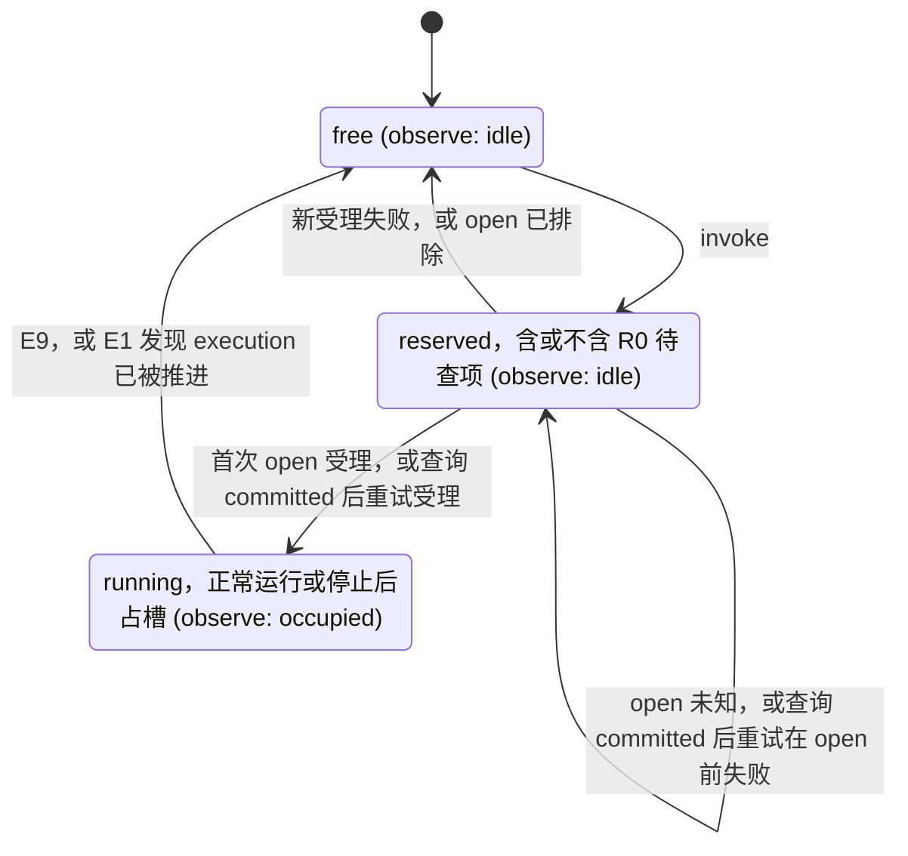

PACKAGE_TEMPLATE_DRAFT

# agent

## 职责与状态

不含 Cordis 的通用实现机制、配置与依赖聚合。设计已由[技术接受与产品采用决定](https://github.com/nemori-ai/omne-harness-lite/issues/384#issuecomment-6258475204)接受。根入口导出工厂的公开类型与 `createAgentRuntime`。工厂校验配置、绑定、登记句柄、必需依赖与共同提交，成功时返回 idle 的 provider。四个面的公开操作都先核对租户、再调用一次 `access.check`；`invoke` 走 Loop 正常路径的骨架（#502 1.2），`observe` 随实例状态的变化给出新状态；其他操作本体尚未实现，放行后返回具名的 `unavailable`。根入口另导出通用评估器 `agentEvaluator`，装配经 `AgentAdoptions` 为绑定的定义采用它。`./testing` 入口给测试装配：内存 Journal、各端口的可编排替身、可控时钟与 `createTestAgentDependencies`。

### 支持范围

档位的定义见[成员文档要求](../../../docs/member-documentation.md)，写法沿 [tool 的支持范围](../../tool/tool/README_ZH.md#支持范围)。验证范围只说明测试核对了什么，不说明测试范围之外的行为已成立。

| 档 | 本包的状态 | 入口 | 验证范围 |
| --- | --- | --- | --- |
| 公开类型已导出 | 已导出：`AgentRuntimeBinding`、`AgentConfiguration`、`AgentRuntimeOptions`、`AgentDependencies`（17 项依赖）与 `AgentProvider`，以及值 `agentEvaluator`（契约 `AgentEvaluator` 的实现）与它写入的 checkpoint 的 schema 采用 `agentCheckpointSchema`，形状见[入口设计](docs/public-api.md) | 根入口 | `tests/public-entry.spec.ts` 核对根导出名与 `./testing` 导出名、源码与产物的导入图、清单依赖与 Cordis 路径 |
| 纯契约函数已实现 | 本包没有。契约函数在 `agent-contract` | 无 | 无 |
| 独立执行已实现 | 无 | 无 | 无 |
| runtime 已实现的路径 | `createAgentRuntime` 的创建校验：配置七项越界或绑定字段非法返回 `invalid`（`field` 写配置项路径），登记句柄的 instance 与绑定不一致返回 `denied`，十项必需依赖缺席返回 `unavailable`（`diagnostic` 指名缺席的依赖），`jointCommits` 有一种未被 Journal 声明返回 `unsupported`。失败时不创建 runtime，不调用任何依赖的方法。成功得到 idle 的 provider。访问守卫：四个面的每个公开操作先核对 Access 的租户：缺租户或租户不是 legal-identity 签发的 `TenantId` 时返回 `invalid`，跨租户返回 `denied`，都不调用 `access.check`。`observe` 例外：契约没有 `invalid` 的结束原因，缺租户或租户非法都以 `denied` 结束（见下文待拥有者一项），再调用一次 `access.check`，不缓存 allowed，`denied` 与 `unavailable` 不放行。`observe` 放行后给出当前状态，状态变化时给出新状态，signal 中止时以 `closed` 结束。`invoke` 与 `observe` 之外的操作放行后返回 `unavailable`，`diagnostic` 写「<操作> is not implemented until #502 stage N」：这是阶段性临时做法，不是契约结果 | 根入口 | `tests/factory.spec.ts` 逐项核对四种创建失败与成功的 idle。`tests/provider-access.spec.ts` 对每个公开操作核对租户核对、`access.check` 三态与恰一次。`tests/assembly.spec.ts` 用测试装配得到 idle 的 provider，核对创建没有调用任何依赖。没有覆盖下面列出的未实现校验 |
| Loop 正常路径与受理 | `invoke` 让一条输入走无工具、无扩展的正常路径，`open` 受理后返回句柄。Loop 随后自行推进到 ended。同一操作以同一输入再次 `invoke` 取回原句柄。已记住的操作配另一输入时，若原 execution 占槽则返回 `conflict`。槽被占用时，新操作返回 `busy`。正常路径之外的结果使运行停止，停止的运行占住执行槽。步骤、图、受理、停止与槽的规则见 [Loop 正常路径](#loop-正常路径) | 根入口 | `tests/loop-transitions.spec.ts` 核对正常路径与节点表（C1），另核对 E1 的临时 `found-existing` 行。`tests/loop-evaluator.spec.ts` 核对评估器在 E4 与 I8 的决定、编码与正常路径之外的 `unsupported`，并以 500 个种子生成的 `LoopFacts` 核对同事实同结果、不改输入、每个步骤在表中有行（C1）。`tests/loop-invoke.spec.ts` 对脚本化 Model 与内存 Journal 走一条输入到 ended（C2），另核对受守卫的事件读取、多页回复与派生身份。`tests/loop-admission.spec.ts` 核对受理：同一操作再次调用（C1）、`accept` 回执丢失（C2）、`busy` 与 R0 待查项，用例名以节点验收表的行号开头。`tests/loop-slot.spec.ts` 核对槽的释放、`observe` 与登记投影。`tests/loop-port-failures.spec.ts` 核对路径上每个节点的端口失败都使运行停止，Journal 的 `position` 停在该节点。失败分支、等待与恢复没有用例 |
| 测试装配（`./testing`） | `createMemoryAgentJournal`：单进程、非耐久的内存 `AgentJournal`，按[同形清单](docs/architecture/mechanisms.md#两种实现必须同形的事实)第 1 至 15 条实现全部 18 个成员，参加者集合由选项给定，可在指定操作上编排 `unavailable` 与三种 `commit-unknown`。各端口的可编排替身、`createManualAgentClock` 与手写的 `ToolRuntime` 替身。`createTestAgentDependencies` 返回 17 项依赖（`registration` 为 null）与各替身的控制手柄，`models` 是 `model-contract/testing` 的脚本化提供者 | `./testing` | `tests/memory-journal.spec.ts` 按同形清单逐条核对，用例名带条目号。`tests/fixtures.spec.ts` 为每个编排接口各有一条用例。只有一个进程，耐久性、崩溃与跨进程没有覆盖 |
| 尚未交付的宿主与提供者 | 四个面中 `invoke`、`observe` 之外的操作本体，句柄的 `submit`（#502 的阶段表尚未分配）、`control` 与 `acknowledge`。自 E1 起 Loop 节点的精确提交点、等待与失败分支（#502 1.4 至 1.9），以及正常路径之外的节点：A、T、C、X 子图，F0、H0、Q5、M2、W0，以及 open 未定重试之外的 R0。评估器的 `decode`（阶段 5）。耐久 Journal 提供者 `agent-journal-local`。真实的 Context、HITL、授权、Session 适配器与材料存储 | 无 | 没有证据 |

### Loop 正常路径

runtime 受理一条输入，再推进 Loop 的正常路径。当前不运行工具或扩展。完整失败分支与后台等待尚未交付。

`invoke` 依次做下列步骤：

1. 过访问守卫。
2. 槽被占用时，新的 `invoke` 返回 `busy`（见下文「受理」）。否则预约单执行槽。
3. 经 `adoptions.resolve` 取绑定定义的评估器。采用了扩展时返回 `unavailable`（扩展属 #502 阶段 3）。
4. 走 U0、Q1、Q2、Q4、U0、E0：`handoff.accept` 准入输入，`open` 受理 execution。
5. 返回句柄，不等 Loop 结束。

Loop 随后自行推进：

- 从 E1 走到 E9。E9 之后 runtime 回 idle。
- 节点的去向只取 `src/loop/nodes.ts` 的转移表。正常路径的行依据节点表或其伪代码。E1 的 `found-existing` 行是阶段 1 的例外，见[临时做法](#临时做法)。
- E4 与 I8 的去向由纯评估器的 `Next` 决定。
- I2 以契约的 `encodeModelInvocationRef` 编码主调用的 `ModelInvocationRef`，I2 的提交在 M6 首次 admit 之前把它随 PendingCall 保存。M6、M1、M3 经 `resolveModelInvocationRef` 从它读回调用身份。
- 协调者向 Model 受理调用，观察到真实收场后读完结果，以 `recordResult` 走 processed 路径保管，再 `acknowledge`。
- Q1 不提交（NA-Q1-1）。候选的类型把来源与调用位置绑在一起：外部输入对应 U0，模型回复对应 I3。Q4 把每个接纳结果交回该位置一次。被拒收的候选（Q5）尚未交付，当前以具名的 `unavailable` 停止。
- 句柄的 `output.read` 与 `output.events` 经守卫读 Journal 的事件。事件只有 input-taken、producer、ended，序号从 1 连续。

下图是正常路径。粗边框的节点各写一次提交。Q1、Q2、Q4 走两次：一次在 `open` 之前准入输入，一次准入回复。菱形是决定点 E4 与 I8。

#### 受理

表内固定租户与 execution 身份。「同一操作」要求操作与 execution 两个身份都相同。内存中已记住的匹配优先于另一操作的 R0 待查项。其余情形存在 R0 待查项时，优先读该列，不读「本 execution 占槽」列。

| 输入 | 本 execution 占槽 | 另一 execution 占槽 | 槽空闲 | 存在 R0 待查项 |
| --- | --- | --- | --- | --- |
| 同一操作，同一输入 | 已记住时返回 handle，槽不变。首次受理尚未返回时答 busy，预约不变。 | 已记住时返回 handle。否则走 Journal 查找。当前槽不变。 | 已记住时返回 handle，槽仍为空闲。否则预约后返回 Journal 结果。成功变为 running，E1 发现修订号已推进则回 free。失败释放预约。open 未知则保留 reserved。 | 操作与 execution 都匹配时查 R0。返回与预约见 [R0 重试](#r0-重试)。已记住的原句柄仍可直接返回，预约不变。 |
| 同一操作，另一输入 | 已记住时返回 conflict，不查询 Journal，槽不变。首次受理尚未返回时答 busy，预约不变。 | 走 Journal 查找。原记录输入不同时返回 conflict。当前槽不变。 | 走 Journal 受理。原记录输入不同时返回 conflict，释放临时预约。 | 操作与 execution 都匹配时查 R0。查询为 committed 或 excluded 后由 Journal 核对输入。预约见 [R0 重试](#r0-重试)。 |
| 新操作 | Busy，槽不变。 | 走 Journal 查找。没有原记录时答 busy，当前槽不变。 | 走 Journal 受理。成功返回 handle，槽变为 running。失败释放预约。open 未知则保留 reserved。 | 本 execution 答 busy。另一 execution 走 Journal 查找。原预约不变。 |

Journal 查找先调用 `query`。查询为 committed 时复用幂等 `handoff.accept` 与 `open`，返回原句柄或端口结果。查询为 excluded 或 denied 时答 `busy`。其他失败原样返回。查询为 unknown 时返回带本次 invoke 操作身份的 `commit-unknown`。查找不预约槽，也不驱动原 execution。

查找前，访问守卫已核对租户与主体资格。SPEC 第 61 行把对象「不存在」隐藏为 `denied`。这里将其读作没有原记录，新 invoke 遇到占用的槽，按 SPEC 646 答 `busy`。

Journal 受理先预约槽，再走 U0 至 E0。成功返回句柄，槽变为 running。新受理在 `open` 之前失败时释放预约。`open` 未知时保留预约。幂等 open 可能认回修订号已推进的 execution。E1 的处理见[临时做法](#临时做法)。

#### R0 重试

E0 `open` 未知时留下 R0 待查项，包含操作与 execution 身份。只有两个身份都匹配的重试才进入这条 R0 路径。换一个 execution 时走 Journal 查找，原预约不变。

- `committed`：再次调用同一 `open`，取回原回执与 Authority，从 E1 继续。重试在 `open` 之前失败时保留 R0 待查项与预约。
- `excluded`：以同一身份重新受理。重试在 `open` 之前失败时释放预约。
- `unknown`：返回带 invoke 操作身份的 `commit-unknown`，预约保留。查询失败时原样返回失败，同样保留预约。

当前没有定时器检查 R0 待查项。后台等待尚未交付。

Q2 `handoff.accept` 回执未知时，invoke 返回带本次操作身份的 `commit-unknown`。新受理此时尚无 execution，因此释放槽。同一操作再次调用即是查询。U0、Q2 以同一操作身份与同一候选再次调用 `accept`，取回原结果（#558 S-13）。

这是阶段 1 对节点表「Q2 的 commit-unknown 转 R0，未定则等待」的读法。当前由调用方重试，因为后台等待尚未交付。外部输入的接纳回执按 #558 S-13 不另存。

停止：

- 正常路径之外的结果使运行停在该节点。停止不当作成功。
- 停止之后执行槽保持占用，`observe` 显示 occupied。Journal 保留最后一次提交的 `position`。新的 `invoke` 返回 `busy`。
- 协调者在内部返回停止及其失败，保留失败的 `owner`（#558 S-14）：端口失败保留端口的 `owner`，`@omne-harness/agent` 表示由后续卡处理的结果，`@omne-harness/agent#defect` 表示协调者自身的缺陷。停止后没有可读原因。等待尚未交付。

槽的规则：

- 槽只有三种状态：空闲、预约、运行。预约可携带 R0 待查项。停止的运行仍占住槽，槽状态仍为 `running`。
- `observe` 只投影已存在的 execution。空闲与预约显示 idle，运行显示 occupied。
- 受理失败与回执未知的槽变化见 [R0 重试](#r0-重试)。
- 登记句柄只接收投影。`report` 抛出时被丢弃，`invoke` 照常返回，槽与 `observe` 不变。待拥有者：`report` 返回 void，契约没有给它的失败通道。

下图是执行槽的状态，括号里是 `observe` 显示的状态。

工厂没有实现下列创建校验，因为工厂收到的输入判定不了它们。它们留给拥有者或后续的卡：

- 待拥有者：绑定的租户与安全作用域是否一致（`denied`）。`scope` 是 `Evidence`，不携带租户，也没有依赖端口能在创建时判定它。
- 待拥有者：精确采用 `binding.definition` 与 `loopGuardPolicy` 能否解析（`unavailable`），以及经定义判定 tools、admission 与 extensions 是否必需。`AgentAdoptions.resolve` 要求 `Access`，工厂不接收 Access。`loopGuardPolicy` 由循环判断这一受信系统扩展解析。#502 的 3.7 只在该位置接空实现，真实守卫由 7.1（阶段 7）实现。
- 待 #558 M04-3：外部协调者的参加怎样声明。工厂只比对 `capabilities.participants` 能表达的 `CallerCommit` 种类。独立装配（`jointCommits` 为空）照常创建。
- 待拥有者：`observe` 的 Access 缺租户或租户非法时，契约没有 `invalid` 的结束原因。当前实现不调用 `access.check`，以 `denied` 结束（失败即关闭）。

#### 临时做法

以下条目说明阶段 1 的读法与尚未交付的机制。完整行为由节点表拥有。测试覆盖见 [tests/README](tests/README.md)。

- 临时简化，1.3–1.9 按节点表收紧：骨架对写 checkpoint 的节点，在结束时各提交一次。提交把 `position` 前移到下一节点，不区分节点表规定的精确提交点。U0 至 Q4 在 execution 存在之前运行，不提交；E1、E2、E4 只读，不提交，否则会覆盖 E4 要读的 `position`；F3 用 `tryFinish`；ended 之后 Journal 拒绝提交，F4、O0、E9 只用各自的记录方法。
- 待 #558 M04-1：producer 事件由 M3 的 `recordResult` 之后紧随的一次提交承载。
- 待 #558 M04-8（本读法）：input-taken 事件由 I0 的提交承载。
- 待 #558 M04-7：`open` 不写事件。
- 待 #558 M04-5：独立装配下 `recordResult.transfer` 取 processed，没有声明参加者。
- Q2 回执采用 [R0 重试](#r0-重试)中的阶段 1 读法。按 #558 S-13，以同一操作与同一候选再次调用 `accept` 即是查询。
- E1 发现 Journal 修订号已超过原 open 回执时返回 `found-existing`。转移表正常结束本次协调，避免为已受理的同一操作启动第二个 Loop。节点表 E1 行没有这个去向。这是阶段 1 的读法。
- 已 open 而修订号尚未推进的 execution，仍会由新 runtime 使用原 Authority 驱动。两个存活 runtime 因此可能同时驱动它。`attach` 围栏尚未交付。
- 阶段 1 在 free、reserved、running 三种槽状态下，都不将同一操作换 execution 识别为同一次受理。槽空闲时可建立第二个执行。槽被占用时按现有路由处理，通常答 busy。识别这种复用需要跨 execution 的操作索引。索引属 Journal 提供者，不在阶段 1。
- I1 把 `prepare` 返回的 assembled 或 ready 都转 P0（伪代码 `prepareRequest`）；节点表 I1 行只为 `resume` 写了 ready。
- 最终请求记录在 `JournalCommit` 中没有字段（M04-2），M0 不写它。E1 不重核 Access（1.4）。循环判断这一受信系统扩展不在 M4 运行（阶段 3、7）。

内存 Journal 对三项待裁定的事实取下列临时做法。每项在源码注释、测试名与本表都写明「临时做法，待 #558 裁定」，裁定后同波修改。

- M04-4：`commit` 与六个记录方法（`submit`、`control`、`acknowledge`、`recordResult`、`recordControl`、`recordTerminalObservation`）成功写入时都推进 revision。同操作的重试认回原回执，不推进。
- M04-5：`recordResult.transfer` 为 custody 或 processed 时，没有声明对应参加者，提供者也自行建立保管或完成依据。`commit.caller` 的非 none 种类没有声明时返回 `unsupported`，不保存任何部分。
- M04-7：`open` 不追加事件。第一个事件来自之后的一次提交。

下列做法同样是「临时做法，待 #558 裁定」：

- M04-1 的读法：`control` 与 `recordControl` 按 SPEC [六个阶段](../agent-contract/SPEC.md#六个阶段)把阶段事实投影为 control 事件。同一阶段以同一依据在新的操作身份下再次登记时，认回原回执，不推进 revision，不重复投影。ended 之后，`recordControl` 照常记录阶段事实，但不投影事件：ended 事件是 execution 的最后一个事件。
- `tryFinish` 的 blocked：按 operations（本 execution 有未定的写入）、controls（某个适用阶段登记为 unresolved）、inputs（普通终结时有未被已取批次覆盖的受理输入；取消终结不因此受阻）、custody（结果既无保管依据也无完成依据）的次序检查。SPEC 没有写明条件的地方取更严格的读法。passages 不检查：终态前经过是否完成并绑定本候选，是协调者的事实，Journal 从自己的记录判断不了。

内存 Journal 不实现没有类型承载的写入（最终请求记录、退避时刻与下一检查时刻，见 M04-2），也不投影 stream 与 producer 事件（M04-1）。任何方法都不在 ended 事件之后追加事件。每个返回 `commit-unknown` 的调用都留下 `query` 可判定的记录：写入生效为 committed，没有写入为 excluded，无人能定时为未定（列在 `unresolved`，由 `attach` 围栏排除或由 `settle` 判定）。操作记录与未定写入都按租户保存：其他租户的写入在任何编排故障之前就返回 denied，不进入未定集合；`unresolved`、`attach` 的围栏、`tryFinish` 的 operations 检查与 `settle` 都只看本 execution 所属租户的记录；`query` 不向其他租户透露 execution 是否存在。

## 使用

根入口提供 `createAgentRuntime` 与 `agentEvaluator`。装配为绑定的定义在 `AgentAdoptions` 中采用 `agentEvaluator`，工厂校验装配并返回 idle 的 provider；`invoke` 受理一条输入，返回句柄，经句柄读事件。现在只走无工具、无扩展的正常路径。后继消费形状见[入口设计](docs/public-api.md)。测试把 `@omne-harness/agent/testing` 作为入口：`createTestAgentDependencies()` 返回 `dependencies` 与 `controls`，测试经 `controls` 中每个替身的 `Script` 设定回答（`always` 设定常设回答，`once` 设定下一次回答，`calls` 记录每次输入），经 `controls.journal.failNext` 在指定写操作上制造 `unavailable` 或 `commit-unknown`。替身只供测试，不能装配进生产。

## 契约

[SPEC](SPEC.md) 拥有行为，公开形状与现有导出见 [入口设计](docs/public-api.md)。

## 设计

[架构](docs/architecture/README.md) 拥有机制和依赖理由，其他主题从 [文档索引](docs/index.md) 进入。

## 配置与运行

不把业务身份放入配置。本包不依赖 Cordis 或具体宿主。

## 验证

在仓库根运行 `pnpm turbo run test --filter=@omne-harness/agent`，在本目录运行 `pnpm typecheck`。turbo 先构建本包及其依赖。只跑快层用 `pnpm turbo run test:fast --filter=@omne-harness/agent`。本目录里的 `pnpm test` 只运行 Vitest，不构建，而导入图测试读取本包及其依赖的构建产物。测试核对以下内容：

- 公开入口、导入图与清单依赖。
- 工厂的四种创建失败与 idle，以及四个面的访问守卫。
- 内存 Journal 的同形清单、三项临时做法及各替身的编排接口。
- 转移表、评估器与一条输入到 ended 的正常路径。
- 受理的 C1、输入冲突、busy、commit-unknown 与 R0 重试路由。
- 输入的规范化等价性，以及 E1 found-existing 正常结束协调。

测试不证明正常路径之外的运行能力已经支持。测试的组织见 [tests/README](tests/README.md)。

## 维护

修改公开承诺同步真实消费者、SPEC 和验证；实现机制不反向改变契约。组内责任见 [组入口](../README.md)。

## 目录结构与文档职责

完整骨架沿源码包模板；六个主题及其子页见 [docs](docs/README.md)。源码、测试、schema、verification、adr、examples、resources 与 acceptance 各有索引。空资源目录保留草稿说明，不授予模板采用或业务接受。
