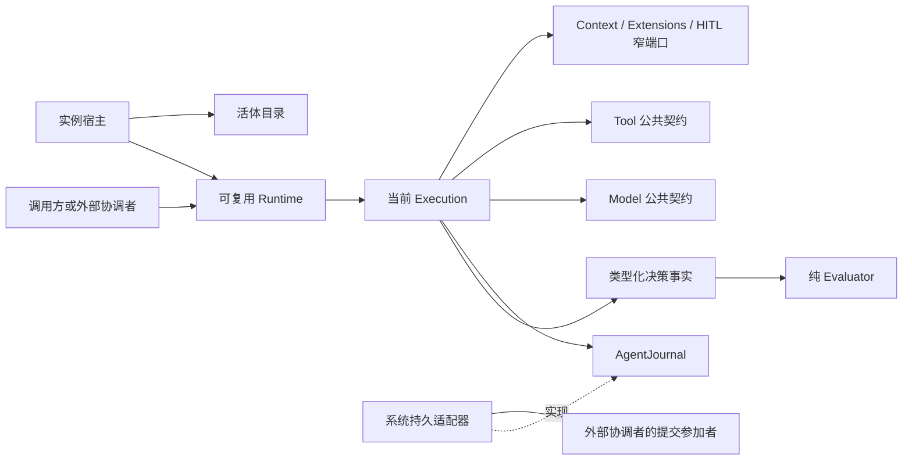

# Agent 内部架构

本包提供组合式实现。公开操作、失败和行为归 [agent-contract](../../../agent-contract/SPEC.md)，[工厂](../public-api.md) 聚合构造依赖。运行实现尚未落地。

## 模块与状态责任

| 角色 | 拥有内容 | 变化边界 |
| --- | --- | --- |
| Runtime coordinator | 单执行槽、控制调度、实例状态和可重建缓存 | 顺序复用，不缓存跨 execution 授权 |
| Execution coordinator | 当前 checkpoint 投影、原调用及事件交接 | 权威在 Journal，执行挂接更换不丢原身份 |
| Pure evaluator | 下一步及显式状态转移 | 只读本域决策事实，不解释外部协调者的状态、授权模式或生产者完整编码 |
| Producer fact projection | 将 Model/Tool 公开状态映射为具名决策事实 | 内部协调角色，保留原引用与 unknown，不新增通用运行状态服务 |
| Passage evaluator / batch coordinator | 有序扩展、卡片及整批屏障 | 不把部分允许提前发成 Tool |
| Journal adapter | execution 条件提交、操作去重、可靠事件及具名调用方交接 | 存储可替换，不能削弱共同成立 |
| Instance host | 协程、实例登记和资源交接 | 退出不取消 Model/Tool |

## 机制与设计理由

Model/Tool 的查询、流读取和 ACK 由效果协调层消费。纯求值只见原调用在途、已收场、已确认后台等必要事实；不读取外域私有状态或自行驱动重试。Context 转换通过其公开承诺交接，权限决定仍在实际操作边界成立。Journal 的通用实现只拥有执行事实，与外部协调者的共同提交保证由声明了提交参加者的集成适配器兑现。

[Loop 完整算法](loop-algorithm.md)拥有完整 Loop 图、节点表、伪代码、不变量、复杂度与进展假设。[机制](mechanisms.md)细化调度、状态和交接，并引用算法页的节点 ID。[对象模型](../../../agent-contract/docs/object-model.md)是对象责任与状态的唯一源。内部角色可以是模块与闭包，不要求每个角色为公开 class 或 Cordis Service。

## 包与安装边界

本包只依赖纯契约及必要通用能力。外部协调者的适配不进入本包，Cordis 集成由 [agent-host-local](../../../agent-host-local/README.md) 承担。根入口当前为空；设计接口可连接不表示生产提供者已实现。
