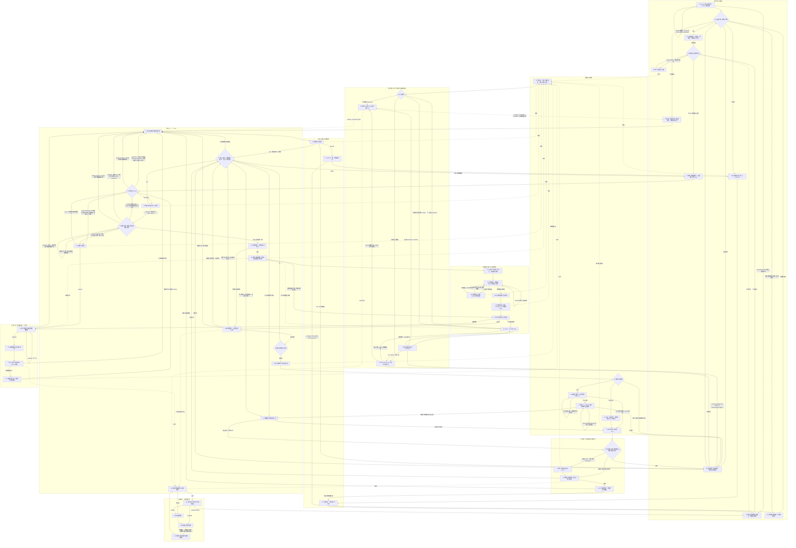

# Agent Loop 完整算法

状态：设计已由[技术接受与产品采用决定](https://github.com/nemori-ai/omne-harness-lite/issues/384#issuecomment-6258475204)接受，算法未运行。本页是完整 Loop 图、节点表、伪代码与不变量的唯一拥有者。产品页的 CAP-AG08 与 CAP-AG09 仍为未核实，本页不据此宣称已实现或已验证。

本页拥有节点、节点次序、执行位置、复杂度与进展假设。行为归 [SPEC](../../../agent-contract/SPEC.md)，公开形状归[公开接口页](../../../agent-contract/docs/public-api/README.md)，扩展作者可见的输入与输出归[扩展作者协议](../../../agent-contract/docs/public-api/extensions.md)，对象状态与迁移归[对象模型](../../../agent-contract/docs/object-model.md)，实现机制归[内部机制](mechanisms.md)。节点只引用这些页拥有的行为与形状，不另写屏障条件、台账迁移或端口形状。外部可观察的保证归[公开推进保证](../../../agent-contract/docs/flows/loop.md)，该页引用本页节点。

## 读图约定

一次主 iter 对应一个 step：一次主模型请求的准备、该调用及其动作承接。iter 不是持久身份。一次 iter 可以跨多次调度、挂起和实例接续。Model 内部重试、压缩步骤调用和扩展内部调用不创建新的主 iter。主回复被准入拒收后，新请求使用新的 step 与新的调用身份，原否决历史不清零。

E0 至 E9 是执行开启与接续，F0 至 F4、O0、H0 是控制、终态与长期责任，都不是每轮必跑的业务步骤。I0 至 I8 及其调用的 C、M、A、T 子图构成一次主 iter。Q 是所有消息来源共用的准入入口，X 是全部九处位置共用的扩展调用协议。R0 只恢复原节点，不自动回 I0。原节点由 E4 按下文“恢复入口与回归点”的映射选出。图中 R0 到 E4 的虚线只表示回到 E4 已选出的原节点，不再次选择，所以 E4 与 R0 之间没有循环。W0 只等待原责任，不表示工作结束。本页的 L0 至 L4 只指守卫处置阶梯，不是节点。

实线表示转移。虚线标有“调用”时表示调用同图的共享子程序 M0、Q1 或 X0。共享子程序的返回由调用时保存的返回去处决定：M5 回 I3、C1 或 X2，Q4 回调用位置，X5 回原扩展节点。调用节点之后的实线只在子程序返回后执行。

四条约定不从每个节点重复画边。

1. 所有业务节点在提交和外部发起前重核 E1 的当前资格与控制。E1 的五条非常态边适用于每个节点。
2. 任一提交回执未知先走 R0。依赖不可用或原等待未满足走 W0。已提交事实、外部效果和原责任不因此回滚。
3. 任一扩展节点取得 `stopped` 效果时，Agent 记录以该扩展为真实来源的控制请求。`terminal` 为 `cancelled` 时经 E1 转 F0，为 `failed` 时转 F1。图以 X5 到 F0 与 F1 的两条虚线代表这条路径。
4. 任一扩展节点取得 `asked` 效果时，等待发生在 X4，唤醒后经 E1、E2、E4、R0 回原扩展节点。

## 完整图

下图是唯一完整流程图。它覆盖九个子图与子图外 R0、W0 在内的全部 56 个节点与全部非常态边：无工具（I4 为空）、全拒（A1 到 A3）、压缩受阻（C0 的否决与 P1 的第二入口）、模型拒收退避（I3 到 I8）、扩展等待（X4）、后台结果（T1 与 I8）、落终态之前阻止（F2 的否决）、落终态之后只观察（F4），以及四种控制入口。每条边的两端都是本图的节点。节点的读写与返回见下文“节点表”。



## 节点表

每个节点一行。“写什么”列含该节点写出的事件，事件种类只取 SPEC [事件流与读取](../../../agent-contract/SPEC.md#事件流与读取)与公开接口页 `AgentEventBody` 的七种：input-taken、message、producer、stream、waiting、control、ended。执行记录操作只取公开接口页[执行记录端口](../../../agent-contract/docs/public-api/README.md#执行记录与调用方交接端口)的五组：开启与挂接、提交与记录、终结、终态后观察登记、读取。终态提交只用 `tryFinish`。最终请求的记录是 M0 的一次执行记录提交。

| 节点 | 读什么 | 写什么 | 何时提交 | 何时等待 | 如何返回 | 并发与次序 | 终止或进展条件 |
| --- | --- | --- | --- | --- | --- | --- | --- |
| E0 | invoke 的受理输入与推进资格依据，或 resume 的恢复依据与快照中旧挂接状态 | `open` 保存输入内容与初始 checkpoint，或 `attach` 授予新挂接。接管路径带 takeover 依据 | 预约单执行槽之后立即提交。回执未知保留预约，转 R0 查原操作 | 不等待 | 取得 Authority 转 E1。失败按[逐操作表](../../../agent-contract/SPEC.md#逐操作及输入分类)返回调用方 | 单执行槽。并发的新 invoke 返回 busy。runtime 停用中返回 unavailable | 恢复或接管的路径由提供者选择，见[恢复与接管](../../../agent-contract/SPEC.md#恢复与接管) |
| E1 | 当前 Access 的资格核验结论、控制记录、执行状态、挂接状态 | 不写业务状态。取消意图成立的阶段事实由 F0 记录 | 不提交 | 资格核验不可用时转 W0 | 允许转 E2。有效取消转 F0。已终态转 F4。挂接被取代转 E9。有效暂停或实例停用保存接续后转 E9 | 每个节点在提交或外部发起前都重核本节点 | 五条非常态边的优先级为取消、终态、取代、暂停或停用、未知。规则见[主体资格核验](../../../agent-contract/SPEC.md#主体资格核验)与[四种控制](../../../agent-contract/SPEC.md#四种控制) |
| E2 | `load` 的同修订快照、`query` 未定操作、`inputs` 的水位线、`readReplyAdmissions` 的投影、Model 与 Tool 的公开状态、原卡片的 `lookup` 与 `read` | 不写。认回结果进入 LoopFacts | 不提交 | 投影缺页或查询不可用时转 W0 | 转 E4 | 只读。生产者查询可并行 | 未定操作只阻塞其依赖路径，不阻塞控制与保管 |
| E3 | 新执行身份与当下条件依据 | 该位置的 Passage。合法 inject 经 Q 进入历史。经过结束时 `position` 前移到下一节点：有扩展调用时随效果提交；没有适用扩展时在 E3 结束时单独提交，提交之前重入 E3 不产生扩展调用 | 有扩展调用时随 X 协议提交；没有适用扩展时 E3 结束时单独提交 | X4 等待 | 效果采纳或单独提交后转 E4 | 初始 checkpoint 的 `position` 是本节点，所以每个新逻辑执行经过一次。该位置的扩展调用提交之前崩溃时，恢复者由 E4 回到本节点接续同一次经过，这不是第二次经过。扩展调用已提交后，resume、重挂接、换代都不再经过 | `stopped` 按读图约定三处理 |
| E4 | checkpoint 的 `position`、`step`、`calls`、`passages`、`batch`、`compaction`、`requestPreparation`、`inputBatch` | 不写 | 不提交 | 不等待 | `position` 为 E3（该位置的经过尚未结束）转 E3。新 iter 或原输入边界转 I0。已有续点转 R0 | 单一决策段 | 映射见下文“恢复入口与回归点” |
| E9 | 本挂接持有的本地责任 | `detach` 保存原位置与责任并撤销挂接。被取代时不写，只交出本地资源 | 交接依据保存成功后 runtime 回 idle | 不等待 | runtime 回 idle 并保持登记。被取代一方不再推进该执行 | 与 `attach` 同一排序 | 行为见[交接与停用](../../../agent-contract/SPEC.md#交接与停用) |
| I0 | 水位线以内已受理的全部合格普通输入、当前条件 | checkpoint 的 `inputBatch` 与新 `step`。事件 input-taken | 固定输入批与 step 后一次提交 | 不等待 | 转 I1 | 只在原位置允许承接时进入。分块读取不改变批次 | 工具结果、全拒事实或有效继续依据也可在空输入批下支持下一 iter。无业务依据不新建执行 |
| I1 | 历史依据、输入批、`CurrentConditions.read`、`ModelSelection.select`、`ModelContextReader.read`、`RequestPreparation.prepare` 或 `resume` 的结果 | checkpoint 的 `requestPreparation`。`compaction` 不在本节点写入，计划由 C1 记录 | 准备结果取得后提交 | 读取端口不可用时转 W0 | assembled 转 P0。`resume` 返回 ready 转 P1，这时 original 的调模型之前位置经过非空。needs-compaction、本准备尚未进入计划且压缩准入未被 C0 关闭时转 C0。cannot-fit 或已进入计划后再次 needs-compaction 转 F1，按真实原因记失败候选，后者附 Context 原结果与计划身份。压缩准入已被 C0 关闭时，沿同一 needs-compaction 转 F1，失败候选为 cannot-fit（after-compaction）并附否决依据。`prepare` 或 `resume` 返回 invalid（field 为 request）转 F1，失败候选为 request-rejected 并附 Model 的原结果 | 同一 execution 同一时刻至多一个未记录的准备 | 压缩准入已被 C0 关闭时不再调用 prepare，沿同一结果转 F1，原因 after-compaction 并附否决依据。resume 返回 ready 时不再经过 P0，由 `completedPassages` 保证 |
| P0 | assembled 的请求 | 该位置的 Passage 与改写依据 | 随 X 协议提交 | X4 等待 | proceed 转 P1。veto 转 I8 | 已完成的经过复用，不重跑 | 同一次经过不自触发，由 `completedPassages` 保证 |
| P1 | 改写依据、`select` 的再选择结果、必要时的再读取、`prepare` 带 previous 与经过 | checkpoint 的 `requestPreparation` 替换为 ready；第二入口的 needs-compaction 也写入 `requestPreparation` | 每次复核结果取得后提交 | 不等待 | ready 且再选择一致转 I2。再选择不一致重新读取并重新准备，留在 P1。needs-compaction 且本 step 尚无计划转 C0。cannot-fit，或本 step 已有计划后再次 needs-compaction，转 F1。`prepare` 返回 invalid（field 为 request）转 F1，失败候选为 request-rejected 并附 Model 的原结果 | 串行 | 复核规则见[调模型之前的复核与最终请求](../../../agent-contract/SPEC.md#调模型之前的复核与最终请求) |
| I2 | ready 准备 | `calls` 中用途为 main 的 PendingCall，返回去处 I3 | 调用 M0 前随 M0 的最终请求记录提交 | 不等待 | 调用 M。M5 返回后转 I3 | 一次只有一个主调用在途 | 观察流不授权执行工具。新输入不改写已记录的请求 |
| I3 | M5 带回的真实收场、原调用的 resultVersion | Q2 提交 ModelReplyAdmission 与接续。拒收时另写退避时刻 | 准入结论与接续在同一次提交 | 退避期间转 I8 后由 W0 等待 | 准入成功转 I4。拒收转 I8。中断或部分结果且无新动作转 I8。最终失败且无有效回复转 F1 | 串行 | 原调用照常收场。拒收不交给重试，规则见[消息准入](../../../agent-contract/SPEC.md#消息准入) |
| I4 | 已准入回复中的工具调用部件 | checkpoint 的 `batch`：ActionBatch 与每个 Action 的原参数与身份 | 固定完整动作批后提交 | 不等待 | 空转 I8。有动作转 A0 | 串行 | 参数块未完整到达不解析 |
| I8 | 完整事实、模式、checkpoint 的守卫事实 `guard`、未完责任、迟到结果 | checkpoint 的 `position`。新 step 开始时 `compaction` 清空 | 决定去向后提交 | 需等待转 W0 | 有合法继续依据转 I0。P0 或 F2 否决之后，只有否决之后出现的新依据（新输入、条件变化、控制或迟到结果）才算继续依据；没有时转 W0，不重新提出被否决的请求或完成候选。完成候选或失败候选转 F1。后台迟到结果转 T1 | 单一决策段 | 无动作、空队列、流 EOF 都不直接终结。I8 只读最新守卫事实，不追加消息：`level` 为 3 时形成失败候选（guard，`basis` 取守卫事实的 `basis`）转 F1，L4 不记为守卫事实：它的人工等待在 M4 的扩展调用之内经 X4 完成，I8 不另开等待；卡片呈现确定失败时守卫事实保持上一次的值。其他级别或 null 不改变去向。L1、L2 的干预消息已在 M4 经 X5 进入历史。连续拒收不设次数上限 |
| C0 | needs-compaction 的准备与计划进度 | 该位置的 Passage | 随 X 协议提交 | X4 等待 | proceed 转 C1。veto 关闭本准备的压缩准入并转 I1 | 一次准备只经过一次 | 否决后果见[无法装下](../../../agent-contract/SPEC.md#无法装下)第 3 条 |
| C1 | `CompactionState` 的进度与自持的已发起步数、`derive` 的返回、压缩用途的 `select` | checkpoint 的 `compaction`：首次进入计划时置初值，之后写进度、下一步 `stepRequest`、已发起步数。每步的 PendingCall，用途 compaction，返回去处 C1 | 每步结果交 `derive` 之后，新进度与下一步效果意图在同一次提交 | 步骤调用在 M1 等待 | continue 留在 C1。transition 转 C2。cannot-fit 或耗尽转 F1，失败候选为 cannot-fit。进度不符转 F1，失败候选为 compaction-invalid。步骤请求在 M0 被否决时经 M5 回到本节点，再转 F1，失败候选为 cannot-fit 并附否决依据 | 步骤串行，同一计划同时至多一步在途 | 不发起序号不小于 bound 的步骤。认回同一步不重复计数。不递归压缩压缩请求 |
| C2 | `derive` 返回的 PreparedContextTransition | 不写 | 不提交 | 不等待 | 转 C3 | 串行 | 转换消息与 commitment 绑定 |
| C3 | 转换消息、Context 的 commitment | Q2 以 context-transition 共同提交消息、范围转换与接续。事件 message | 共同提交成功才算压缩完成 | 不等待 | 成功转 C4。消息被拒收转 F1，失败候选为 cannot-fit（after-compaction），`rejection` 为拒收依据。转换非法转 F1，失败候选为 compaction-invalid | 与 Journal.commit 同一排序 | 提交未知先查原操作，不用未提交的派生冒充已压缩 |
| C4 | 已提交的转换 | 该位置的 Passage。`compaction.ended` 记 committed | 随 X 协议提交 | X4 等待 | 转 I1：先经 `CurrentConditions.read` 读当前条件，再重新选择，再带转换依据读取，再 `resume` | 一次计划只经过一次 | 只面对已提交事实，不改写摘要与范围 |
| A0 | 每个动作的生效参数、定义采用、私有权限输入 | 每条链的 Passage。链末官方准入经 `ActionAdmission.admit` 写入该动作的 ActionJudgment | 随 X 协议提交，判断随 checkpoint 的 `batch` 提交 | 链内 ask 在 X4 等待 | 转 A1 | 链间并行，链内按声明顺序串行。链间不读取对方 Conclusion | 规则见[整批判断屏障与动作准入](../../../agent-contract/SPEC.md#整批判断屏障与动作准入)第 1、2 条 |
| A1 | `ActionBarrier` 的 judging 与 asked 列表、每轮卡片状态 | checkpoint 的 `batch.barrier`。open 时另写 `batchDecision` 依据 | 屏障状态变化时提交 | 有链在判断或在等人时转 W0 | all-denied 转 A3。open 转 A2 | 本轮卡片在每条链到达最终 Conclusion 或合法等待后一次呈现 | 打开与全拒的条件只由 SPEC 同节第 4、9 条拥有，本页不另写 |
| A3 | 每个动作的拒绝依据 | checkpoint 的 `batch.slots`：按原顺序建立 denied 槽位 | 槽位建立后提交 | 不等待从未发起的工具 | 转 T2 | 串行 | 全拒不触发 T4。拒绝事实经回复消息与执行事实到达后续位置 |
| A2 | 获准动作的准入证据、生效参数、当前权限 | `calls` 中用途为 action 的 PendingCall，`effects` 的效果意图。Tool 受理后槽位为 dispatched | 效果意图先提交，再向 Tool 受理 | 超出工具并行上限的动作按原顺序等名额 | Tool 受理转 T0。Tool 受理时拒绝建 denied 槽位转 T2 | 并行上限是[工厂配置](../public-api.md#工厂配置)的 toolConcurrency | Tool 在受理与启动围栏两处再核，规则见 SPEC 同节第 8 条 |
| T0 | Tool 的 observe 与 readWait、控制能力 | 事件 stream（Tool 先保存后发布的增量）。中断类控制的阶段事实经 recordControl 写 control 事件 | 阶段事实成立时记录 | 原 Tool 在途时转 W0 | 真实结果或确认的后台占位转 T1 | 各槽位独立等待，不互相阻塞 | Tool 内部 Ask 只投影为 waiting human，不出卡。查询失败保持未知 |
| T1 | 原结果或占位、原动作身份 | `slots` 的 result 或 background 分支。recordResult 的 custody 或 processed。事件 producer | 保管依据保存后才解除该结果的生产责任 | 不等待 | 真实结果或拒绝转 T2。后台占位转 T3。迟到结果转 I8 | 逐槽独立 | 后台占位只释放占位这一版本的前台交付。迟到结果不改原槽位、不重开批次 |
| T2 | 槽位的 outcome 与候选消息 | 每个槽位的 `each` Passage，改写后的 `candidate` | 随 X 协议提交 | X4 等待 | 转 T3 | 各槽位的单结果经过不等待其他槽位 | 含结果卸载这一受信系统扩展。后台占位不经过本节点 |
| T3 | 本批全部槽位与各槽位的 `each` | 不写 | 不提交 | 有槽位缺失或单结果经过未结束时转 W0 | 齐备且至少一个槽位曾为 dispatched 转 T4。齐备且没有已发起的动作转 T5 | 等待并发名额的获准动作尚无槽位时不成立 | 条件归[工具执行与结果承接](../../../agent-contract/SPEC.md#工具执行与结果承接)第 4 条 |
| T4 | 本批全部 outcomes | `batchPass` 的 Passage。合法 inject 经 Q | 随 X 协议提交 | X4 等待 | 转 T5 | 一批只经过一次 | 只 observed、inject、stop、ask。不修改候选 |
| T5 | 各槽位的 `candidate` 与 `handoff` 进度 | Q2 提交消息。`slots[].handoff` 记回执。事件 message | 每个候选接纳后随 checkpoint 提交 | 不等待 | 全部完成转 I8。拒收转 H0 | 按原动作顺序串行 | 恢复时不重复提交已接纳的候选 |
| M0 | 本用途的准备、改写依据、覆盖 | 主请求：FinalRequest 与 adoptedContext 的采用、effects 的效果意图与预编码 PendingCall.model.reference，一次提交。压缩步骤：该用途的调模型之前 Passage 与提交前引用 | 向 Model 受理之前提交 | X4 等待 | 转 M6。压缩用途被否决时步骤请求不发出，转 M5，由 M5 按返回去处回 C1 | 主请求的位置已在 P0 完成时只复用。用途为 extension 时不经过位置 | 记录之后不再改写 |
| M6 | 原 PendingCall.model.reference 与固定输入；reference 在首次 admit 前已保存 | 不写。Model 保存受理并返回同一 reference | 不提交 | 不等待 | 转 M1 | 真实发出前 Model 核资格与围栏 | 同一原调用只受理一次 |
| M1 | Model 的 observe、凭原 reference 与当前资格的受理查询、中断类控制 | 事件 stream。中断阶段事实经 recordControl 写 control 事件 | 阶段事实成立时记录 | 原调用在途时等待，可挂起或交还资源 | 首内容前可重试失败转 M2。整调用真实收场转 M3 | 一个原调用一个等待 | 用户中断后该响应未发出的工具建议不执行 |
| M2 | 失败事实、Model 的重试请求 | 该位置 failure 维度的 Passage | 随 X 协议提交 | X4 等待 | retry 结论交 Model 的重试策略，回 M1。没有 retry 时 Model 按不再重试收场，回 M1 | 只在首内容前 | 不建新调用。规则见扩展作者协议的[输出](../../../agent-contract/docs/public-api/extensions.md#输出) |
| M3 | 整调用的真实收场、结果与费用 | recordResult 的 custody 或 processed。事件 producer。Model 的交付责任在合法消费者保管后解除 | 保管依据保存后 | 不等待 | 转 M4 | 串行 | 最终失败不再进入 M2 |
| M4 | 结果或最终失败。循环判断另经执行历史读取能力读本执行的原始工作事实 | 该位置 complete_reply 或 failure 维度的 Passage。合法 inject 经 X5 交 Q。循环判断的守卫判断记入其 Passage 的 `guard` 操作，效果采纳时写 checkpoint 的 `guard` | 随 X 协议提交 | X4 等待 | 转 M5 | 一次调用一次 | 用途为 extension 时不经过位置。failure 维度在这里是原调用最终失败的触发，`retry` 输出不合法，按报错处置。循环判断这一受信系统扩展在主请求的 complete_reply 维度运行，按 `loopGuardPolicy` 的策略形成守卫事实。守卫 L1、L2 的干预消息由它返回 inject，经 X5 交 Q 进入历史一次。L4 由它返回 ask，不记为守卫事实，答复到达后以 replay 重新判断；卡片呈现确定失败时它的结论取报错分支、输出 observed，守卫事实保持上一次的值。它不可用时 Conclusion 记不可用，checkpoint 的 `guard` 沿用上一次，不伪造判断。规则见 SPEC 的[循环守卫](../../../agent-contract/SPEC.md#循环守卫) |
| M5 | 保存的返回去处，或 M0 的否决 | 不写 | 不提交 | 不等待 | 主请求回 I3。压缩步骤回 C1。扩展能力操作回 X2 | 不隐式进入主回复解析 | 内部用途的结果不进入主回复序列 |
| U0 | 外部输入候选 | 不写 | 不提交 | 不等待 | 转 Q1 | 在 invoke 或 submit 的受理之内 | 拒收回受理方，接纳才进入可承接输入 |
| Q1 | 候选、来源、当前位置 | 不写 | 不提交 | 不等待 | 合法转 Q2。不合法转 Q5 | 同一 execution 的候选按来源节点次序串行 | 没有扩展位置 |
| Q2 | `MessageHandoff.accept` 的结果、所需共同事实 | 消息与共同事实的条件提交：主回复加 ModelReplyAdmission 与接续，压缩加 context-transition，其他来源加 message。事件 message | 接纳回执随 checkpoint 提交 | 不等待 | accepted 转 Q4。rejected 转 Q5。commit-unknown 转 R0 | 与 Journal.commit 同一排序 | 以同一操作身份与同一候选重新调用即是查询 |
| Q4 | 返回去处 | 不写 | 不提交 | 不等待 | 回固定调用位置：I3、C3、T5、X5 或 U0 | 不重试 | 外部输入仅准入成功才进入可承接输入 |
| Q5 | 拒收依据 | 拒收事实随来源节点保存 | 随来源节点提交 | 不等待 | 转 Q4，由 Q4 回调用位置：外部输入回受理方。模型回复回 I3。压缩候选回 C3。工具结果与拒绝消息回 T5，再转 H0。系统提醒回 X5 | 不统一重试 | 后果按来源，见[消息准入](../../../agent-contract/SPEC.md#消息准入) |
| X0 | 位置、维度、用途、声明、精确采用、输入依据、返回去处 | 不写 | 不提交 | 原实现或材料不可用时具名等待 | 转 X1 | 同位置按装配顺序 | 已开始的扩展调用保留精确采用 |
| X1 | Passage 的 `progress` 与各轮卡片状态 | 首次调用前，按对象模型的[扩展调用与卡片轮次](../../../agent-contract/docs/object-model.md#扩展调用与卡片轮次)提交该扩展调用的初始迁移 | 提交确认前不调用 | 已询问且未答复时转 X4 | 已有最终 Conclusion 转 X5。无结论提交 requested 后转 X2。已询问且答复齐备以 replay 转 X2 | 恢复次序按作者协议的[结构换代与未完成判断](../../../agent-contract/docs/public-api/extensions.md#结构换代与未完成判断) | 已有最终 Conclusion 的扩展调用永不再调用 |
| X2 | 回放绑定的 `control`、注入能力 | `operations` 的 producer、read 与 guard 操作，迁移按对象模型的[扩展调用与卡片轮次](../../../agent-contract/docs/object-model.md#扩展调用与卡片轮次)写入：操作先提交再发出，结果先提交再交回 | 每项操作发出前提交 | 能力等待原操作 | 返回转 X3 | 第一次锁存之后能力不再发出新操作 | 能力按经过身份加序号认回原操作，不重复计费 |
| X3 | 调用结果 | Conclusion，以及按对象模型的[扩展调用与卡片轮次](../../../agent-contract/docs/object-model.md#扩展调用与卡片轮次)对应的迁移。`ask` 的迁移含新一轮 CardRound | 结果校验后提交 | controlUnavailable 或 replay 下 notStartedUnavailable 保持原状态转 W0 | 最终 Conclusion 转 X5。ask 转 X4。结果未知以 replay 转 X2 | 串行 | 处置表见作者协议的[调用协议](../../../agent-contract/docs/public-api/extensions.md#调用协议) |
| X4 | CardRound 的状态、`DecisionCards.present`、`lookup`、`read` | 按对象模型的[扩展调用与卡片轮次](../../../agent-contract/docs/object-model.md#扩展调用与卡片轮次)迁移写入。事件 waiting | 呈现条件满足时呈现。受整批屏障约束时等 A1 的呈现条件 | 等待答复转 W0 | 答复齐备以 replay 转 X2。present 确定失败以 Agent 代写的结论转 X5，输出按 SPEC 整批判断屏障第 11 条或循环守卫第 5 条确定 | 同一轮只呈现一次 | present 确定失败的处置归 SPEC 的[整批判断屏障与动作准入](../../../agent-contract/SPEC.md#整批判断屏障与动作准入)第 11 条。调模型之后位置上循环判断的卡片见 SPEC 的[循环守卫](../../../agent-contract/SPEC.md#循环守卫)第 5 条 |
| X5 | 链上全部 Conclusion | 效果采纳后，按对象模型的[扩展调用与卡片轮次](../../../agent-contract/docs/object-model.md#扩展调用与卡片轮次)提交采纳迁移。合法 inject 经 Q 进入历史一次 | 效果采纳时提交 | 不等待 | 返回原扩展节点。stopped 按读图约定三 | 聚合是纯归约 | 效果为 proceed、vetoed、stopped、asked、retry 之一 |
| F0 | 取消命令、当前资格 | ControlRecord 的阶段事实经 recordControl。事件 control。请求中断前台调用 | 阶段成立时记录 | 不等待生产者物理停止 | 转 F1 | 与 tryFinish 同一排序 | 阶段见[六个阶段](../../../agent-contract/SPEC.md#六个阶段) |
| F1 | 完成、失败或取消的依据 | 执行状态 settling 与 FinishIntent 候选，失败候选的 `failure` 记录 | 候选固定后提交 | 不等待 | 转 F2 | 串行 | 失败候选形状见公开接口页的 `FailureCandidate` |
| F2 | 候选终态与完整依据 | 该位置的 Passage，`FinishIntent.beforeTerminal` 依据 | 随 X 协议提交 | ask 转 W0 | proceed 转 F3。veto 转 I8 | 一个候选一次经过 | 不能否决已生效取消 |
| F3 | FinishIntent、expected 修订、终结授权 | `tryFinish`：终态、ended 事件、终态后观察责任与原操作结果共同提交 | 唯一终态提交点 | 不等待 | ended 转 F4。changed、blocked 或 commit-unknown 转 R0 | 与 submit、control、attach 同一排序 | 规则见[条件终结](../../../agent-contract/SPEC.md#条件终结) |
| F4 | 已成立终态、TerminalObservation 台账 | recordTerminalObservation 登记完成 | 观察完成时登记 | 不等待人 | 转 O0 | 由长期协调者逐项处理，不要求推进权 | 只 observed。观察故障不撤终态 |
| O0 | 未确认事件、未交清结果责任、控制回执 | recordResult、acknowledge 的处理、控制回执 | 各责任交清时记录 | 不等待 | 转 E9 | 不运行终态扩展 | 原执行未终态时也可独立处理这些责任 |
| H0 | 拒收依据、当前推进资格 | 失败候选或只保管的决定 | 决定形成后提交 | 不等待 | 仍有推进资格转 F1。无推进资格或已终结只保管转 O0 | 串行 | 后果见[消息准入](../../../agent-contract/SPEC.md#消息准入)的工具结果与被拒绝的动作两行 |
| R0 | 原操作槽、持久帧、返回去处 | 不写 | 不提交 | 原操作未定时等待 | 回原节点，经 E4 | 不重做原效果 | 细节由[内部机制](mechanisms.md)与恢复切点表拥有 |
| W0 | 等待依据、Journal 修订、生产者与卡片游标 | 执行状态 waiting。事件 waiting | 等待保存后提交 | 登记监听后重读，进度未变才休眠 | 唤醒后转 E1 | 每段处理有限额，之后让出调度 | 超时不是取消或未执行的证明。人的等待没有默认期限 |

## 九位置与节点

位置集合与触发边界归系统页[扩展位置与干预力](../../../../../docs/architecture/runtime/loop-extensions.md#扩展位置与干预力)，位置输出表归作者协议的[位置输出表](../../../agent-contract/docs/public-api/extensions.md#位置输出表)，受信系统扩展所在的位置归系统页[不可用、报错与系统扩展](../../../../../docs/architecture/runtime/loop-extensions.md#不可用报错与系统扩展)。本表只写每个位置经过的节点、维度与返回去处。

| 位置 | 节点 | 维度与用途 | 效果的返回去处 |
| --- | --- | --- | --- |
| 执行开始之后 | E3 | 无 | proceed 转 E4 |
| 压缩之前 | C0 | 无 | proceed 转 C1。vetoed 转 I1 |
| 压缩之后 | C4 | 无 | proceed 转 I1 |
| 调模型之前 | P0、M0 | P0 用途 main。M0 用途 compaction。用途 extension 不经过 | P0：proceed 转 P1，vetoed 转 I8。M0：proceed 转 M6，vetoed 经 M5 回 C1 |
| 调模型之后 | M2、M4 | M2 只 failure 维度的重试决定。M4 为 complete_reply 与最终 failure。循环判断这一受信系统扩展在 M4 的主请求 complete_reply 维度运行 | M2：retry 回 M1。M4：proceed 转 M5。循环判断的守卫判断在效果采纳时写入 checkpoint 的 `guard`；它对守卫 L1、L2 返回 inject，干预消息经 X5 交 Q 进入历史，对 L4 返回 ask |
| 执行动作之前 | A0 | 无 | 链结论进入 A1 |
| 执行动作之后 | T2、T4 | T2 维度 each。T4 维度 batch | T2 转 T3。T4 转 T5 |
| 落终态之前 | F2 | 无 | proceed 转 F3。vetoed 转 I8 |
| 落终态之后 | F4 | 无 | observed 后转 O0 |

`stopped` 与 `asked` 效果在全部位置的去处按读图约定三与四。

## 正常路径伪代码

下面的函数是完整算法的投影。每个函数标明覆盖的节点。省略的分支指向节点表。名称与公开接口页一致：端口是 `journal`、`conditions`、`selection`、`modelContext`、`requests`、`extensions`、`cards`、`admission`、`handoff`、`models`、`tools`，操作名取各自契约页。Model 与 Tool 的受理、观察与确认操作以各自契约页的名称为准。

```text
runExecution(entry):                                  // E0 至 E4、I8、F1 至 F4、E9
  authority = entry 为 invoke ? journal.open(...) : journal.attach(...)   // E0
  loop:
    facts = reconcile(authority)                      // E1、E2
    按 E1 分流：有效取消转 settle(cancelled)；已终态转 observeTerminal；
      挂接被取代交出本地资源转 E9，不 detach；有效暂停或实例停用保存接续后 journal.detach 转 E9；资格未知转 wait
    若 checkpoint.position 为 E3（经过尚未结束）：runPassages(execution_started, facts)   // E4 回 E3，再回 E4
    next = evaluator.next(facts)                      // E4
    switch next.kind:
      take-inputs      → runIter(facts)               // I0 至 I8
      reconcile、consume → 回原节点                      // R0
      wait             → wait(next.waiting)           // W0
      try-finish       → settle(next.conclusion)      // F1 至 F3
      stop             → cancelled 转 F0，terminal 转 F4，superseded 与 suspended 转 E9

settle(conclusion):                                   // F1 至 F4
  intent = fixCandidate(conclusion)                   // F1
  effect = runPassages(before_terminal, intent)       // F2
  若 effect 为 vetoed：回 I8
  result = journal.tryFinish(authorization, expected, intent)   // F3
  若 result 为 ended：observeTerminal()               // F4，再转 O0、E9
  否则：回 R0

runIter(facts):                                       // I0 至 I8
  batch = takeInputs(facts)                           // I0：journal.inputs，提交 input-taken
  prepared = prepareRequest(batch, purpose = main)    // I1、P0、P1、C0 至 C4
  reply = callModel(prepared, returnTo = I3)          // I2、M0 至 M5
  admission = admitMessage(model-reply, reply)        // I3、Q1、Q2、Q4
  若 admission 为 rejected：记录退避，回 I8 开新 step
  actions = actionsFrom(reply)                        // I4
  若 actions 为空：回 I8
  decided = judgeActions(actions)                     // A0、A1
  executeActions(decided)                             // A2、A3、T0 至 T5
  回 I8

prepareRequest(batch, purpose):                       // I1、P0、P1、C0 至 C4
  conditions = conditions.read(previous)
  selected = selection.select(purpose, history, conditions, alterations = [])
  context = modelContext.read(selected.recipient, history, adopted, transition = null)
  preparation = requests.prepare(..., beforeModelCall = null)             // I1
  若 preparation 为 needs-compaction 且 本准备尚未进入计划 且 压缩准入未被 C0 关闭：
    preparation = compact(preparation)                // C0 至 C4，回 I1。original 的经过为 null，装得下时为 assembled。C0 否决时原样返回并关闭压缩准入
  若 preparation 为 cannot-fit，再次为 needs-compaction，或 压缩准入已被 C0 关闭：进入失败候选 cannot-fit   // F1
  若 prepare 或 resume 返回 invalid(request)：进入失败候选 request-rejected          // F1
  effect = runPassages(before_model_call, preparation)                   // P0
  若 effect 为 vetoed：回 I8
  selected = selection.select(purpose, history, conditions, effect.alterations)   // P1
  若 收件模型变化：context = modelContext.read(...)
  preparation = requests.prepare(..., previous, effect.alterations, beforeModelCall = passages)
  若 preparation 为 needs-compaction 且 本 step 尚无计划：
    preparation = compact(preparation)                // 第二入口：C0 至 C4，回 I1。resume 返回 ready 时转 P1，不再经过 P0
  若 prepare 或 resume 返回 invalid(request)：进入失败候选 request-rejected          // F1
  若 preparation 不是 ready：进入失败候选 cannot-fit    // F1
  再选择一次并比较。不一致则重新读取、重新准备          // P1 自环
  返回 preparation

compact(original):                                    // C0 至 C4，有限多步
  effect = runPassages(before_compaction, original)   // C0
  若 effect 为 vetoed：关闭本准备的压缩准入，回 I1
  progress = original.progress
  result = null
  首次进入计划：提交 compaction 初值                   // C1
  loop:                                               // C1
    advance = requests.derive(original, progress, result)
    若 advance 为 cannot-fit：进入失败候选 cannot-fit
    核对 plan 与 bound 不变、completed 不减少
    若 result 不为 null：核对 completed 比上一次恰好加一
    若 advance 为 continue：核对 completed 小于 bound
    任一核对不成立：进入失败候选 compaction-invalid
    若 advance 为 continue：
      已发起步数加一并提交
      result = callModel(advance.stepRequest, purpose = compaction, returnTo = C1)   // M0 至 M5
      若 M0 否决该步：经 M5 回 C1，进入失败候选 cannot-fit，附否决依据
      progress = advance.progress
    若 advance 为 transition：break                   // C2
  admitted = admitMessage(context-transition, advance.value)   // C3，经 Q
  若 admitted 为 rejected：进入失败候选 cannot-fit，rejection 为拒收依据
  若 共同提交返回转换非法：进入失败候选 compaction-invalid
  runPassages(after_compaction, advance.value)        // C4
  conditions = conditions.read(previous)
  selected = selection.select(main, history, conditions, alterations)
  context = modelContext.read(..., transition = admitted.admission)
  返回 requests.resume(original, transition, selected, context)   // 回 I1

callModel(preparation, purpose, returnTo):            // M0 至 M5
  若 purpose 为 compaction：runPassages(before_model_call, preparation)   // M0。vetoed 时不发出，经 M5 回 C1
  若 purpose 为 main：journal.commit(FinalRequest 采用、adoptedContext、效果意图)   // M0
  call = models 受理固定请求                          // M6
  loop:                                               // M1
    outcome = models 观察原调用
    若 outcome 为 首内容前可重试失败：
      decision = runPassages(after_model_call/failure, outcome)   // M2
      交 Model 的重试策略，继续等待原调用
    若 outcome 为 真实收场：break
  保管结果与费用，解除生产责任                          // M3
  runPassages(after_model_call/complete_reply 或 failure, outcome)   // M4。主请求的 complete_reply 含循环判断：读原始事实，记守卫事实，L1、L2 返回 inject，L4 返回 ask
  按 returnTo 返回                                     // M5

judgeActions(actions):                                // A0、A1
  并行每条链：runPassages(before_action, action)，链末 admission.admit   // A0
  等待屏障打开或全拒                                   // A1：条件归 SPEC 整批节

executeActions(decided):                              // A2、A3、T0 至 T5
  若 屏障为 all-denied：按原顺序建 denied 槽位           // A3
  否则 按原顺序、按工具并行上限：tools 受理原动作        // A2
  并行每个槽位：
    等待结果或确认的后台占位                           // T0
    按原动作身份保管                                   // T1
    若 槽位不是后台占位：runPassages(after_action/each, slot)   // T2
  等待本批每个动作都有槽位且单结果经过全齐               // T3
  若 至少一个槽位曾为 dispatched：runPassages(after_action/batch, slots)   // T4
  按原动作顺序：admitMessage(tool-result 或 action-denied, slot.candidate)   // T5
  拒收转 H0

admitMessage(source, candidate):                      // Q1、Q2、Q4、Q5
  result = handoff.accept(source, candidate)
  accepted：随 checkpoint 提交回执与 message 事件，回调用位置   // Q2、Q4
  rejected：按来源返回拒收                             // Q5

runPassages(position, subject):                       // X0 至 X5
  对该位置的每个扩展，按声明顺序：
    按台账判定：已有最终 Conclusion 则复用               // X1
    否则提交 requested，invoke(input, signal, fresh 或 replay)   // X2
    校验输出并提交 Conclusion                           // X3
    ask：呈现卡片，等待答复，答复齐备后 replay          // X4
  聚合为 proceed、vetoed、stopped、asked 或 retry       // X5
```

## 请求准备与压缩节点

I1、P0、P1、C0 至 C4、M0 的次序按 SPEC 的[请求准备与压缩](../../../agent-contract/SPEC.md#请求准备与压缩)与[调模型之前的复核与最终请求](../../../agent-contract/SPEC.md#调模型之前的复核与最终请求)。

1. I1 先经 `CurrentConditions.read` 取当前条件，再经 `ModelSelection.select` 选择模型，再经 `ModelContextReader.read` 读取，最后调用 `RequestPreparation.prepare`。读取端口需要实际收件模型，所以选择在读取之前。
2. 压缩是有限多步计划。C1 每步先调用 `derive`，再以用途 compaction 调用 M0 至 M5。每步进度与下一步的效果意图在同一次提交。Agent 自持的已发起步数随 checkpoint 持久，崩溃后以它认回同一步。
3. 压缩步骤的请求只经过压缩用途的调模型之前位置，即 M0。它不经过 P0，也不经过 prepare。压缩用途的调模型之前位置被否决时，该步骤请求不发出，M0 经 M5 回 C1，C1 转 F1，原因 cannot-fit（after-compaction）并附否决依据，不回同一步。
4. C3 的共同提交成功后，C4 经过压缩之后位置。然后 I1 先经 `CurrentConditions.read` 读当前条件，再重新选择模型，再带压缩转换依据读取 Runtime Context，最后调用 `RequestPreparation.resume`。选择的输入含当前条件，所以读条件在选择之前。
5. 调模型之前位置改写后的重新准备在 P1 进行。这次 prepare 返回 needs-compaction 且本 step 尚无计划时，P1 转 C0。这条路径是本 step 尚无计划时的第二入口。计划提交后回 I1，`resume` 因 original 的调模型之前位置经过非空而返回 ready，I1 转 P1 复核，不再经过 P0。P0 不重跑由 `completedPassages` 保证。已接受的系统页[输入来源与组装](../../../../../docs/architecture/runtime/request-context.md#输入来源与组装)把压缩画在调模型之前位置之前，第一入口与它一致。第二入口已接受，系统页的[模态表示与完整输入限制](../../../../../docs/architecture/runtime/request-context.md#模态表示与完整输入限制)写明扩展改写请求之后的重新组装可以进入一次压缩计划。
6. 需要压缩且本准备已进入过计划时，I1 与 P1 都转 F1，原因 after-compaction，并附 Context 原结果与计划身份。同一次准备以主请求的 step 为身份，checkpoint 的 `compaction` 记录该 step 的计划，新 step 开始时清空。
7. P1 在记录最终请求之前再选择一次模型。实际收件模型与 ready 不一致时重新读取、重新准备，留在 P1。一致时转 I2，由 M0 以一次执行记录提交记录 FinalRequest 与采用的覆盖。
8. Model 的请求准备确定拒绝时，`prepare` 或 `resume` 返回 invalid，field 为 request。I1 与 P1 都转 F1，失败候选为 request-rejected，并附 Model 的原结果。规则见 SPEC 的[请求接缝的逐操作要素](../../../agent-contract/SPEC.md#请求接缝的逐操作要素)。

## 消息准入节点

U0、Q1、Q2、Q4、Q5 只做非扩展的消息准入。行为归 SPEC 的[消息准入](../../../agent-contract/SPEC.md#消息准入)，端口形状归公开接口页的 `MessageHandoff`。I3、C3、A3、T5 经 Q 的调用不经过任何扩展位置。

- 外部输入在 U0 进入，在 invoke 或 submit 的受理之内完成。拒收回受理方，不进入可承接输入。
- 模型完整回复在 I3 进入。拒收形成 rejected 的 ModelReplyAdmission，原调用照常收场。I3 保存退避时刻后转 I8，I8 以新 step 转 I0。
- 压缩转换消息在 C3 进入，以 context-transition 共同提交。
- 工具结果消息与被拒绝动作的拒绝消息在 T5 进入，按原动作顺序。拒收转 H0。
- 系统提醒由 X5 在采纳 inject 时进入一次。拒收不改变该扩展的 Conclusion。

全部动作被拒收时没有已执行动作。A3 为每个动作建立 denied 槽位，每个槽位在 T2 各自经过执行动作之后的单结果范围，再由 T3 直接转 T5，不经过 T4。拒收事实经回复消息与 `execution` 事实到达后续位置。后续位置的 `earlier` 只含同一次经过、同一条链上前序扩展的 Conclusion，不扩到跨位置。T5 完成后转 I8。这条边界归系统页，见[位置表](../../../../../docs/architecture/runtime/loop-extensions.md#扩展位置与干预力)。

## 工具结果节点

T0 至 T5 为逐槽结果保管加整批准入。行为归 SPEC 的[工具执行与结果承接](../../../agent-contract/SPEC.md#工具执行与结果承接)，槽位形状归公开接口页的 `ActionSlot` 与 `ActionBatch`。

- T0 等原 Tool。Tool 内部等待与后台转换由 Tool 拥有，Agent 不接管 Tool 的协程。
- T1 按原动作身份把真实结果或 Tool 确认的后台占位保管到该槽位。真实结果保管后解除该结果的生产责任。后台占位只释放占位这一版本的前台交付。
- T2 对结果槽位与拒绝槽位各自运行单结果范围，含结果卸载这一受信系统扩展的改写。后台占位不经过 T2，其候选消息由占位直接形成。
- T3 在本批每个动作都有槽位、全部槽位齐备、全部单结果经过结束时成立。等待并发名额的获准动作尚无槽位时不成立。
- T4 只产生 observed、inject、stop、ask，没有候选改写。只在至少一个槽位曾为 dispatched 时经过。
- T5 按原动作顺序把候选消息交消息准入，进度随 checkpoint 保存。

后台最终结果以原 PendingCall 的 consumption 到达。本执行仍在推进时，I8 把它转 T1 保管，T1 不改原槽位、不重开批次，再回 I8 由评估器以 consume 消费。执行已无推进资格或已终结时，O0 只保管与对账。

## 控制入口

四种控制的种类、范围与六个阶段归 SPEC 的[取消、退出与结构变更](../../../agent-contract/SPEC.md#取消退出与结构变更)。本节只写作用节点与后续。

| 控制 | 作用节点 | 后续 |
| --- | --- | --- |
| interrupt（单调用） | M1 或 T0 的具名原调用 | 不改变执行状态。阶段事实经 recordControl 记录。后续按原调用的真实收场继续：M1 转 M3，T0 转 T1 |
| cancel（执行） | 任一节点在提交或外部发起前经 E1 核到有效取消 | 转 F0。F0 保存控制、阻止新效果、请求中断前台调用，再经 F1、F2、F3 以取消授权终结。对 suspended 的执行，收束由下一次合法挂接从 E0 开始执行 |
| suspend | E1 读到有效暂停 | 保存接续后经 E9 以 detach 交还挂接。执行不终结，由合法接手者经 E0 resume |
| quiesce（实例） | 不属于单个执行的节点。E0 拒绝新 invoke 与 resume | 在途执行经 E1 的暂停路径到 E9 交接，交清后撤登记。行为见[交接与停用](../../../agent-contract/SPEC.md#交接与停用) |

插队不是第五种控制。urgent 输入沿原执行受理后，Agent 对 M1 或 T0 的前台调用使用中断类控制，规则见 SPEC 的[插队](../../../agent-contract/SPEC.md#插队)。

## 不变量表

SPEC 拥有行为，本页拥有执行位置。每条不变量列出执行它的节点与 SPEC 条款。

| 编号 | 不变量 | 执行它的节点 | SPEC 条款 |
| --- | --- | --- | --- |
| I1 | 同一原动作不能因恢复得到第二个调用身份 | A2、M6、X2、C1：效果意图先提交。Model 在首次 admit 前保存 reference，再受理；R0 沿原引用与固定输入认回，Tool 保持原协议 | [身份、范围与归属](../../../agent-contract/SPEC.md#身份范围与归属)的登记表 |
| I2 | 已失效挂接不得提交新业务或实际发出 | E1、E9、F3、Q2、A2、M6：提交核围栏与修订号，发出前核资格 | [并发与提交](../../../agent-contract/SPEC.md#并发与提交)、[恢复与接管](../../../agent-contract/SPEC.md#恢复与接管) |
| I3 | 责任交接前原结果一直有耐久保管者 | T1、M3、H0、O0：保管依据保存后才解除生产责任 | [持久性与交付责任](../../../agent-contract/SPEC.md#持久性与交付责任) |
| I4 | unknown 不推导 absent、failed 或 finished | E2、R0、T0、M1、Q2、X3：查询未知保持未知，先查原操作 | [并发与提交](../../../agent-contract/SPEC.md#并发与提交)、[提交与保管](../../../agent-contract/SPEC.md#提交与保管) |
| I5 | 同批必要判断和卡片处理未齐，任何获准工具不得提前发出 | A1、X4、A2：屏障打开之前不发起 | [整批判断屏障与动作准入](../../../agent-contract/SPEC.md#整批判断屏障与动作准入)第 4 条 |
| I6 | 同一扩展调用的已成立最终结论不重跑 | X1、X3：已有最终 Conclusion 直接复用，结果未知以 replay 重调 | [扩展、卡片与材料](../../../agent-contract/SPEC.md#扩展卡片与材料) |
| I7 | 输入先受理时，旧完成候选不得越过它 | F3：tryFinish 与 submit、control、attach 共同排序 | [条件终结](../../../agent-contract/SPEC.md#条件终结) |
| I8 | ended 不恢复业务推进 | E1、F4、O0、H0：终态后只观察、保管与对账 | [终态后与 ended](../../../agent-contract/SPEC.md#终态后与-ended) |
| I9 | 压缩不删除推进事实、不递归压缩自身 | I1、C1、C3、C4：同一次准备至多一个计划，步骤请求不经过 prepare | [请求准备与压缩](../../../agent-contract/SPEC.md#请求准备与压缩)第 4、5 条 |
| I10 | 逻辑终态、物理停止、外部效果和非常态交接分别表达 | F0、F3、E9、O0：阶段事实分别记录 | [六个阶段](../../../agent-contract/SPEC.md#六个阶段) |
| I11 | 每个事实和操作都沿原租户与合法消费位置 | E0、E1、U0、M6、A2、X2：每次操作核租户与资格，不只在创建时检查 | [租户与作用域绑定](../../../agent-contract/SPEC.md#租户与作用域绑定)、[主体资格核验](../../../agent-contract/SPEC.md#主体资格核验) |
| I12 | 流内容重交不产生第二次业务执行，外部交付未知不当作未执行 | M1、M3、T0、T1、O0：生产者先保存后发布，消费者按原身份对账 | [事件身份与序号](../../../agent-contract/SPEC.md#事件身份与序号)、[持久性与交付责任](../../../agent-contract/SPEC.md#持久性与交付责任) |

这是归纳论证的目标。初始状态无外部效果。每个节点只生成符合上表前提的候选变更，提交者在权威边界再次核验前提，效果执行者在发出边界核验当前资格。崩溃只删除内存与观察缓存，不删除已确认的事实。该论证是设计证明草图，不是对实现的机械证明。

## 阶段与节点范围

执行状态的名称归公开接口页的 `ExecutionState`，迁移归对象模型的[状态与转移](../../../agent-contract/docs/object-model.md#状态与转移)。下表写每个状态名对应的节点范围。

| 执行状态 | 节点范围 |
| --- | --- |
| reconciling | 新挂接之后的 E0（open 或 attach 之后）、E1、E2，直到 E2 首次认回完成 |
| advancing | E3、E4、I0 至 I4、I8、P0、P1、C0 至 C4、A0、A1（打开或全拒的判定）、A2、A3、T1、T2、T3（齐备的判定）、T4、T5、H0 |
| waiting | W0，以及进入 W0 的等待节点：E1 资格核验不可用、E2 投影缺页或查询不可用、A1 未齐、T0 在途、T3 未齐、M1 在途、X4 等答复、F2 等人 |
| settling | F0 至 F3。F2 否决转 I8 时回到 advancing |
| suspended | E9 完成 detach 之后。没有节点运行，下一次 E0 resume 回 reconciling |
| ended | F4、O0，以及 O0 之后的 E9 |

共享子程序 M0 至 M6、Q1、Q2、Q4、Q5 与 X0 至 X5 处于调用它的节点所在的状态。例如 I2 与 C1 调用的 M 节点处于 advancing，F2 调用的 X 节点处于 settling，F4 调用的 X 节点处于 ended。其中 M1 在途与 X4 等答复按上表处于 waiting。U0 在 invoke 或 submit 的受理之内运行，不改变执行状态。E1、E2、E4、R0 本身不改变执行状态：新挂接之后到首次认回完成这一段属于 reconciling；其他任何进入（W0 唤醒、E3 之后、E4 读到已有续点、Q2 或 F3 的提交回执未知、F3 返回 changed 或 blocked）都保持进入 W0 之前或调用节点所在的状态。这些进入都不是新挂接，回到 reconciling 的转换只由恢复、接管，以及 W0 唤醒后回到被打断的首次认回这三种情形引起；首次认回期间 E1 资格核验不可用或 E2 投影缺页经 W0 等待时按上表处于 waiting。

控制的六个阶段对应的节点如下。阶段的定义归 SPEC 的[六个阶段](../../../agent-contract/SPEC.md#六个阶段)。

| 阶段 | 节点 |
| --- | --- |
| 受理 | control 操作的受理，在任一节点之外 |
| 意图成立 | E1 |
| 推进资格撤销 | F0（取消）、E9（暂停与停用） |
| 生产者确认与物理停止 | M1、T0 |
| 责任释放 | O0、E9 |

## 复杂度、上界与进展

设 A 为当前动作数，P 为活动扩展调用及其仍需恢复的操作条目数，C 为原调用与结果责任数，I 为本次承接输入数，B 为实际读取或输出字节数，H 为需补齐的投影尾部长度。

- 冷恢复（E0 至 E4）至少为 O(A+P+C+I+H+B)。内存取决于同时使用的活动部分与页大小。公开 `load` 返回完整快照，分页是提供者内部实现，所以在分页契约公开之前不能承诺内存只与单页有关。
- 整批屏障检查（A1）为 O(A+卡片数)，也可从带来源的计数投影取得。
- 一次 iter 的提交次数与动作数、扩展调用数和压缩步数成线性关系。每次提交是条件提交，changed 之后重读。
- 长期读取按所需范围与可重建投影组织，不假设每步遍历全部历史。规则见[事实投影与长期读取](mechanisms.md#事实投影与长期读取)。

并行与缓冲上界只引用[工厂配置](../public-api.md#工厂配置)的取值项名称，本页不另定数值。

| 上界 | 作用节点 | 取值项 |
| --- | --- | --- |
| 工具并行 | A2 同时在途的 Tool 调用数 | toolConcurrency |
| 每段处理限额 | R0 与 W0 每个处理段对账或重读的未决项数 | reconciliationBatchLimit |
| 活体订阅缓冲 | O0 与读取方的订阅 | observerBufferBytes |
| 拒收后退避 | I3 转 I8 后开新 step 之前 | denialBackoffMs |
| 对账间隔 | R0 与 W0 的重查间隔 | reconciliationDelayMs |
| 压缩步数 | C1 | Context 计划的 bound，不是 Agent 配置 |
| 守卫阈值 | M4 的循环判断 | loopGuardPolicy 的精确采用携带，不是数值配置项 |

进展与公平的假设如下。调度器在可运行项之间公平选择。某个生产者未知只阻塞其依赖路径。Journal 提交未知阻塞依赖该提交的后继，不阻塞具有独立资格的控制与保管。活性假定最终有合法持有者、必要存储可用、有限竞争以及公平调度。人永不答复、持续未知或无限合法新输入时，不承诺业务会终结。没有统一延迟、吞吐或恢复时限承诺。模型计算、网络、磁盘和人答复分别决定等待成本。

## 接口增量

下列增量是完整算法对公开接口提出的变化，随设计一并接受。每项标明拥有者，不宣称已导出。

| 增量 | 决定 | 拥有者 |
| --- | --- | --- |
| D1 帧与纯转移 | 持久帧就是 checkpoint 的既有分面字段，不新增字段。纯转移只约束评估器内部求值。映射见下文“恢复入口与回归点” | 本页 |
| D2 可找回操作与接管屏障 | 稳定操作槽、可枚举的未定操作、attach 排除旧晚到写入 | [内部机制](mechanisms.md)与宿主 |
| D3 宿主持久发现与等待 | 租户范围的待办读取、游标、退避与周期扫描 | [内部机制](mechanisms.md)与宿主 |
| D4 有限压缩计划 | Context 交出计划身份、bound 与 completed，Agent 逐步执行并持久记录 | Context 的请求准备接缝，缺口登记在[实施差异](../../../agent-contract/verification/coverage.md#实施差异) |
| D5 可靠外部交接 | 终态后仍可交付，接收方去重与保存证据 | [内部机制](mechanisms.md)的恢复切点表 |
| D6 扩展时序与批次结果 | C4 在共同提交之后；T2 逐结果、T4 整批后再由 T5 提交消息 | [扩展作者协议](../../../agent-contract/docs/public-api/extensions.md) |

## 恢复入口与回归点

本节只写 R0、W0、E4 的入口条件与回归节点。恢复切点表由[内部机制](mechanisms.md)拥有。

| 入口 | 入口条件 | 回归节点 |
| --- | --- | --- |
| R0 | 任一提交回执未知，E4 读到已有续点，F3 返回 changed、blocked 或 commit-unknown，Q2 返回 commit-unknown | 查原操作槽：已提交则采用原结果并回原节点的后继，未定则等待，可靠排除才重新求值。经 E4 回原节点 |
| W0 | E1 资格未知，I8 需等待，A1 未齐，T0 在途，T3 未齐，X3 认回不可用，X4 等答复，F2 等人或依赖 | 保存等待依据与检查时刻，登记监听后重读，进度未变才休眠。唤醒后转 E1，经 E2、E4 回原节点 |
| E4 | E2 对账完成 | 按 checkpoint 选择原节点，映射见下表 |

checkpoint 字段到接续节点的映射如下。字段归公开接口页的 `AgentCheckpoint`。最后一行的执行状态来自执行快照，不是 checkpoint 字段。

| checkpoint 字段 | 接续节点 |
| --- | --- |
| `position` | 原节点的名称，E4 据此选择。初始 checkpoint 的 `position` 是 E3：经过尚未结束时回 E3，这是同一次经过的接续，已有扩展调用的按 `passages` 一行接续。经过结束时 `position` 已前移，E4 不再回 E3 |
| `step` | 当前 iter。新 step 从 I0 开始 |
| `inputBatch` | 非空且尚未准备时回 I1 |
| `requestPreparation` | assembled 回 P0。ready 回 P1，由 P1 复核后转 I2。I1 的 `resume` 结果与 P1 的复核结果都按此处理。最终请求已记录时由 `calls` 决定。needs-compaction 且 `compaction` 为空时：C0 的经过尚未结束回 C0，C0 的经过为 vetoed 回 I1 转 F1。needs-compaction 且 `compaction` 非空时按 `compaction` 一行。cannot-fit 回 F1 |
| `compaction` | 为空表示本 step 尚未进入计划，C1 首次进入计划时才写入。`ended` 为空时回 C1：C1 以已保存的进度与最后一步的保管结果再次调用 `derive`，同一输入得到同一返回。返回 transition 时经 C2 转 C3，C3 的提交回执未知时先经 R0 查原操作。`ended` 为 committed 回 C4 之后的 I1。`ended` 为 failed 回 F1 |
| `calls` | 用途 main 回 M1 经 I3。用途 compaction 回 M1 经 C1。用途 action 回 T0。用途 extension 回 X2 |
| `passages` | requested 回 X2。asked 回 X4 或 X2。resolved 回 X5。applied 回原扩展节点的后继 |
| `batch` | 屏障 closed 回 A1。open 回 A2 或 T 子图的原槽位。all-denied 回 T2、T3 或 T5 |
| `adoptedContext` | 不决定节点。作为下一次 `ModelContextReader.read` 的 adopted 传入 |
| `completedPassages` | 防止同一次经过再次自触发，P0、C0、C4 等位置据此复用 |
| `priorConditions` | 作为下一次 `CurrentConditions.read` 的 previous 传入 |
| `guard` | 不决定节点。I8 读它决定 L3 的失败候选；L4 的等待按 `passages` 回 X4。恢复后读到的值与中断前相同，M4 的循环判断不可用时保持原值 |
| 执行状态 settling | `ExecutionState` 的 `intent` 已在 F1 提交。F2 的经过未完成回 F2，已完成回 F3。F3 的提交回执未知先经 R0 查原操作 |

## 派生简图

下图只含正常路径，从完整图派生，不独立定义状态转换。它省略 E0 至 E4 的开启与对账、C 子图、M 与 X 子图的内部、全部非常态边、四种控制入口、R0 与 W0，以及 H0 与 O0。

```mermaid
flowchart LR
    I0[I0 承接输入] --> I1[I1 请求准备]
    I1 --> P0[P0 调模型之前]
    P0 --> P1[P1 复核最终请求]
    P1 --> I2[I2 主模型调用]
    I2 --> I3[I3 回复准入]
    I3 --> I4{I4 有动作}
    I4 -->|有| A0[A0 执行动作之前链]
    A0 --> A1[A1 屏障]
    A1 --> A2[A2 发起]
    A2 --> T0[T0 等原 Tool]
    T0 --> T1[T1 逐槽保管]
    T1 --> T2[T2 each]
    T2 --> T3[T3 全齐]
    T3 --> T4[T4 batch]
    T4 --> T5[T5 消息准入]
    T5 --> I8[I8 本 iter 结束]
    I4 -->|无| I8
    I8 -->|继续| I0
    I8 -->|完成候选| F1[F1 终态候选]
    F1 --> F2[F2 落终态之前]
    F2 --> F3[F3 tryFinish]
    F3 --> F4[F4 落终态之后]
```



## 旅程与持续验证

能力与旅程到本页节点的追踪归[产品能力与设计覆盖](../../../agent-contract/verification/coverage.md)。本页节点的验收场景归[持续验证场景](../../../agent-contract/verification/scenarios.md)。这些是持续验证义务，不是已运行的证据。
