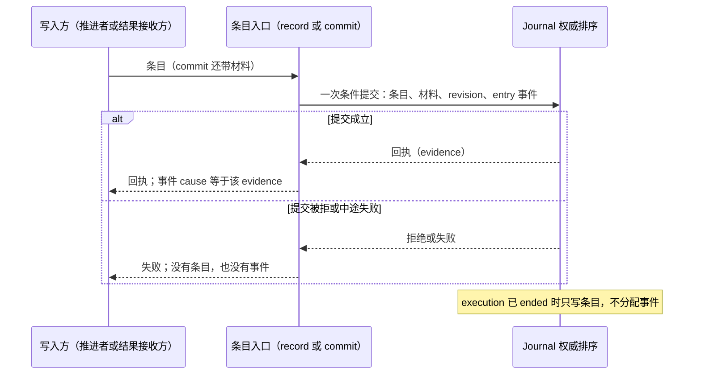

# Agent 定义与工作推进的内部设计

本页在正式维护位置保存已接受的技术设计，接受依据见[技术接受与产品采用决定](https://github.com/nemori-ai/omne-harness-lite/issues/384#issuecomment-6258475204)。设计接受不等于阶段选择或实现支持。成员已初始化。声明判断的实现位于 agent-contract，推进运行接口和验证仍待完成。

领域角色读[责任交接](../../../../../docs/domains/agent-progression/architecture.md)，工程邻接读[组设计](../../../docs/architecture.md)。本页与[SPEC](../../../agent-contract/SPEC.md)及原具名行为专题分别维护机制与行为，不据当前实现降低承诺。

## 从定义到有效构成

AgentDefinition 的能力身份、定义类型和专有继承声明由 Agent 能力解释。assembly 消费这些声明与调用方的执行类型要求，再使用共同资产规则确定合法身份和实现。不得把声明开放范围当作实现覆盖范围，也不得逐字段合并被替换定义的继承声明。

调用方固定定义身份。新的 execution 采用同身份当时的合法胜出版本，普通恢复与接管沿原 execution 已采用的版本，不升级。定义、Loop 或已捕获扩展发生结构换代时，通过采用交接替换推进实例，规则见 SPEC 的[采用交接](../../../agent-contract/SPEC.md#采用交接)。Skill 正文、工具 schema、MCP 动作清单、模式取值或 Context 内容在稳定入口内合法更新，不据此推断必须重建 Loop。

旧清单和实际调用输入继续可追溯。候选校验失败不能发布半份新构成。实际必需入口已失效时不能靠保存旧数据假报可运行；合法定义存在但执行实现暂不可用时可保留能力位置并返回不可用原因。

## 执行槽与条件提交

每个 runtime 以状态联合保存 idle、occupied、draining 或 disposed。invoke 先预约单执行槽，再由 Journal.open 幂等受理；未知保持预约并查询原操作。open 明确未提交才释放预约。重复受理先认回原记录，不能只查看内存当前槽。resume 认回原记录并经 Journal.attach 排除旧挂接，不重新初始化 checkpoint。这两条路径是 [Loop 完整算法](loop-algorithm.md)的 E0 节点，回执未知转 R0。

一次决策段读取有版本的执行快照和当前条件（E1、E2），由协调层投影具名生产者状态、控制及消费事实后交纯 next 求值（E4），然后用原 operation、expected revision 与当前 authority 提交。并发输入或控制造成 changed 时重读。外部效果先写稳定 intent。M6 按 Model 原 reference 查询或受理，A2 按完整 Tool 原请求与 consumer invoke，已取得引用后保存 associated 并 lookup。对账不是一次失败后立即换 ID 重试，提交回执未知先走 R0。

控制和结果回执分别保留原 execution/attachment。事件循环在外部等待期间继续处理控制，不持有覆盖网络等待的全局锁。状态修改串行只能保护本进程内存；围栏、耐久及撤权顺序继续由实际边界提供者保护。

### 操作身份的确定派生

每次条件提交、效果意图、结果保管、控制记录与终结都带一个操作身份，公开形状是 `ExecutionMutation.operation`（见[公开接口页](../../../agent-contract/docs/public-api/README.md#托管协调与运行实例)）。操作身份由五项稳定要素确定派生：租户、execution、原持久前驱 revision、转移种类、原帧中的稳定槽位。稳定槽位取自 checkpoint 的既有分面：step、inputBatch、action、call、PassageId 加操作序号、round、consumption，以及压缩计划身份加步序号。语义输入的摘要另行绑定该身份，同一身份配不同输入返回 conflict。身份不依赖尚未保存的随机值、墙钟或调用返回值，所以崩溃前后对同一帧与同一转移派生出同一身份。精确编码、规范化与摘要算法归[通用实现](../public-api.md)的工厂，边界拒绝含运行对象的输入。

结果未知时先按原身份查询（`AgentExecutionRecovery.query`，R0）。committed 时取原结果，回原节点的后继。rejected 只来自 recordControl 的矛盾证据：保留原固定的 conflict、审计与责任，不当作成功、排除或未知。unknown 时等待原操作，重查间隔是[工厂配置](../public-api.md#工厂配置)的 reconciliationDelayMs。excluded 必须排除原写入与迟到提交，不是查无记录。只有 excluded 才允许以同一帧重新求值。当前事实已变而需要不同语义的请求时，先以独立的重新求值转移条件提交新的帧版本，再从新 revision 派生新身份。不在同一槽位换输入，不用新的随机身份重试，不把查不到当作排除证明。Journal 提供者在 attach 成功时保证旧推进者可能提交的写入已进入可读前缀或已被围栏排除，已受理而未定的操作可以从持久索引枚举并查询。幂等身份只认回逻辑操作，不保证供应商在现实世界只执行一次。规则的行为句见 SPEC 的[并发与提交](../../../agent-contract/SPEC.md#并发与提交)与[提交与保管](../../../agent-contract/SPEC.md#提交与保管)。

### Model 独立接收与采用

Model 的完整交付由实例外接收方保管。接收方持有原消费绑定查询与显式状态，在每次 push 中核当前资格、原调用与完整 dispatch 集合，然后通过同一提供者的 received 端口共同提交材料、条目和 saved。提交结果与未知映射消费 [J02](../../../agent-contract/SPEC.md#结果接收)，不在 loop 内重复实现。

M1 只等 Journal 中的匹配结果，M3/I3 从同一提供者的完整材料继续；恢复不向 Model 重领全文。接收提交可以增加 execution revision，但不改变 attachment；loop 重新读取后以新修订条件提交。账目出站与 blocked/unknown 状态归宿主接收方，Model 自己取得 ACK。 saved 在共同提交、材料核对与入队完成后返回，不等待 outlet。宿主持有独立任务及驱动代；重装配不撤销真实在途交接，旧代不能发出后继待办。维护的授权工作集、取消与报告范围见[公开入口](../public-api.md#独立-model-接收入口)。

### 交付责任解除的两条路径与保管者更替

本节的两条旧交接路径适用于仍使用 recordResult 的 Tool 等消费者，不用于 Model received 路径。本节不适用于 Tool 的推送路径：推送路径下 Tool 宿主收到 saved 后自己解除，见开放问题 [AGENT-M05](open-questions.md#agent-m05)。每个这样的 ProducedResult 在 execution 内有一条 ResultResponsibility，身份是结果项加 consumption。它在结果登记时为待释放，经 recordResult 的 transfer 保存保管依据或完成依据，最后以含原生产者确认依据的 release 进入已释放。已释放表示生产侧交付责任解除（英文 ACK）。解除只有两条路径，条件归 SPEC 的[持久性与交付责任](../../../agent-contract/SPEC.md#持久性与交付责任)。两条路径对应 Tool 契约的[可靠交接与处理的两条路径](../../../../tool/tool-contract/SPEC.md#可靠交接与处理的两条路径)：Agent 的先保管后处理（custody 路径）对应 Tool 的先保管后处理，Agent 的先处理后保存完成依据（processed 路径）对应 Tool 的先完成处理。本节只写每条路径经过的端口与保管者的更替。

- custody 路径：消费者先经 `AgentMaterials.preserve` 把内容或有效可恢复引用保存到材料拥有者，再经 Journal 的 custody 交接绑定原版本、位置与责任。
- processed 路径：生产者在处理期间继续保管原结果。消费者完成必要处理后，经 Journal 的 processed 交接保存足以恢复已完成结果及责任的完成依据。

保管者按生产者、材料拥有者或消费侧完成依据的次序更替。任一时刻恰有一个耐久保管者，双方不能同时放弃，也不能重复逻辑承接。Model ACK 的对账属于 Model 自己，Agent 不执行。Tool 只在原 ToolOperationRef 可取得时查询，可靠否定后才可明确重入 releaseDelivery；引用丢失且 lookup.delivery 未证明释放时保留未知。Model 与 Tool 各自的解除条款见 Model 的 [ACK 的前提与效果](../../../../model/model-contract/SPEC.md#ack-的前提与效果)与 Tool 的[卸载与全文读取](../../../../tool/tool-contract/SPEC.md#卸载与全文读取)。

后台占位是一个独立的结果版本，与最终结果共享同一个 consumption，各有自己的结果项与释放记录。占位保管后只解除占位这一版本的前台交付，原 consumption 的 ResultResponsibility 保持待释放，`reconcile` 返回的 `remaining` 仍含该 consumption。最终结果以同一 consumption 到达时，按两条路径之一保管并解除，该消费关系在最终结果的责任已释放时闭合。所以没有“已释放又回转”的状态。Tool 的失联结果与晚到原全文是同一 consumption 下的两个版本，同理处理。节点是 T1 与相关 O0 保管入口，行为见 SPEC 的[持久性与交付责任](../../../agent-contract/SPEC.md#持久性与交付责任)与[工具执行与结果承接](../../../agent-contract/SPEC.md#工具执行与结果承接)第 2、8 条。

## 提交点与聚合边界

本节把 [Loop 完整算法](loop-algorithm.md#节点表)中每个写入节点的提交点集中列出。内存 `AgentJournal` 替身与耐久后端按同一份清单实现，同一套测试适用于两者。按节点补“何时提交”的实施卡也从这里查本节点的方法与分面。本节不新增行为。类型与方法以 [journal.ts](../../../agent-contract/src/journal.ts)、[execution.ts](../../../agent-contract/src/execution.ts)、[evaluation.ts](../../../agent-contract/src/evaluation.ts) 与 [SPEC](../../../agent-contract/SPEC.md) 为准，节点语义以节点表为准。本节与它们不一致时，以它们为准。开放问题页 [U-15](open-questions.md#journal-联合表达的具名缺口) 列出的写入还没有类型承载，在类型落地之前这些行以 SPEC 正文为准。

### 聚合与分层

唯一的聚合是 execution。Agent 经 Journal 写入的事实都属于某一个 execution，由同一个 Journal 提供者保存。Journal 写入的位置分四类。

1. checkpoint 的分面：`AgentCheckpoint` 的 `schema`、`definition`、`step`、`position`、`calls`、`passages`、`batch`、`inputBatch`、`requestPreparation`、`compaction`、`adoptedContext`、`guard`、`completedPassages` 与 `priorConditions`。槽位 `slots` 属于 `batch`。持久帧就是这些既有分面，见接口增量表的 [D1](loop-algorithm.md#接口增量)。
2. checkpoint 之外的快照字段：`ExecutionSnapshot` 的 `state`、`inputWatermark`、`history`、`replyAdmissions`、`executionAttachment`、`unresolved`、`controls`、`results`、`entries`、`effects`、`terminalObservations` 与 `output`。
3. 事件：Journal 在提交中为事件分配序号，规则见 SPEC 的[事件身份与序号](../../../agent-contract/SPEC.md#事件身份与序号)。
4. 快照之外、按身份读取的记录：
   - 受理时保存的输入内容，经 `inputs` 读取，见 SPEC 的[输入内容与水位线](../../../agent-contract/SPEC.md#输入内容与水位线)。
   - 主回复准入的事实页，经 `readReplyAdmissions` 读取，见公开接口页的[身份、原位置与纯求值](../../../agent-contract/docs/public-api/README.md#身份原位置与纯求值)。
   - 原操作结果，是 `query` 的依据。
   - 挂接的围栏记录，保留到 execution 的保留期结束，见对象模型[对象与生命周期](../../../agent-contract/docs/object-model.md#对象与生命周期)的 ExecutionAttachment 行。
   - 最终请求记录，它在 checkpoint 被取代之后仍承载自己的事实，见 SPEC 的[终态后与 ended](../../../agent-contract/SPEC.md#终态后与-ended)。

不经 Journal 的事实由各自的拥有者保存。其他材料由材料拥有者经 `AgentMaterials` 保存；Model received 材料与 Journal 条目由同一提供者共同发布。消息的长期保存归历史拥有者，Agent 经 `MessageHandoff.prepare` 固定准入结果。真实历史分三路提交：工具结果、拒绝消息、系统提醒与压缩转换消息由 Journal 的应用操作 Ja 与准入结果同次提交，外部输入随原 open 或 submit 提交，主回复经 Ja 的 replyAdmission 提交，见 SPEC 的[消息准入](../../../agent-contract/SPEC.md#消息准入)。卡片与答复归人在回路领域，Agent 经 `DecisionCards` 读取。

分层沿用对象模型的三层，见[跨域概念与内部可见范围](../../../agent-contract/docs/object-model.md#跨域概念与内部可见范围)：纯 Evaluator、效果协调层、宿主集成层。各层内的角色见[模块与状态责任](README.md#模块与状态责任)。纯 Evaluator 只读决策事实并返回下一步，它不调用 Journal。效果协调层的 Runtime coordinator、Execution coordinator 与 Passage evaluator / batch coordinator 调用 Journal。宿主集成层的 Journal adapter 提供 Journal。声明了提交参加者时，共同提交由集成适配器兑现。父卡 [#502](https://github.com/nemori-ai/omne-harness-lite/issues/502) 用领域层、应用层、基础设施层作分层尺子，它们依次对应纯 Evaluator 与纯转移、效果协调层的 runtime 协调者、宿主集成层的 Journal 提供者与适配器。

### 提交类型

每个写入属于下列六种提交类型之一。

| 提交类型 | 方法 | 成立条件 | 依据 |
| --- | --- | --- | --- |
| 条件提交 | `commit` | 带 operation 与 expected revision。一次提交原子覆盖 checkpoint、执行状态、效果意图、事件与操作结果。状态与事件不含 ended | SPEC 的[提交与保管](../../../agent-contract/SPEC.md#提交与保管) |
| 按原操作幂等的记录 | `submit`、`control`、`acknowledge`、`recordResult`、`recordControl`、`recordTerminalObservation`、`recordHandoff` | 带 operation，不带 expected revision。同一操作同一输入认回原结果 | SPEC 的[逐操作及输入分类](../../../agent-contract/SPEC.md#逐操作及输入分类) |
| 挂接 | `open`、`attach`、`detach` | 授予或撤销执行挂接。`open` 与 `attach` 条件核对修订号与围栏。`detach` 的修订号核对以逐操作表 `AgentExecutionRecovery.detach` 行的 changed 为依据 | SPEC 的[受理与单执行槽](../../../agent-contract/SPEC.md#受理与单执行槽)、[恢复与接管](../../../agent-contract/SPEC.md#恢复与接管)、[交接与停用](../../../agent-contract/SPEC.md#交接与停用) |
| 条件终结 | `tryFinish` | 带授权、expected revision 与 FinishIntent。唯一能写 ended 的方法 | SPEC 的[条件终结](../../../agent-contract/SPEC.md#条件终结) |
| 终结准备与收束记录 | `prepareFinish`、`commitSettlement` | 带 operation。`prepareFinish` 与 `commitSettlement` 的候选、迁移和判断变体另带终结授权与 expected revision；保管变体不带 expected，在当前事实之上合入。都不改 checkpoint，不发事件，不能写 ended | SPEC 的[终结责任清单](../../../agent-contract/SPEC.md#终结责任清单)与[commitSettlement 的变体](../../../agent-contract/SPEC.md#commitsettlement-的变体) |
| 只读 | `load`、`inputs`、`readReplyAdmissions`、`query`、`output.read`、`output.events`，以及属性 `capabilities` | 不写。读取失败保持未知 | SPEC 的[并发与提交](../../../agent-contract/SPEC.md#并发与提交) |

revision 在保留期内单调递增，不复用。每次建立新 execution 事实的原子 mutation 分配恰好一个新 revision，只保存认回索引的操作不分配，逐操作的规则见 SPEC 的[执行修订](../../../agent-contract/SPEC.md#执行修订)。终结责任清单由 `prepareFinish` 发行，取消候选、判断、迁移与终态后保管的记录由 `commitSettlement` 的六个变体承载，两者都带 operation，按 SPEC 的[终结责任清单](../../../agent-contract/SPEC.md#终结责任清单)与[commitSettlement 的变体](../../../agent-contract/SPEC.md#commitsettlement-的变体)写入。

四种返回的含义各有唯一来源。

- changed：expected 已过期，本操作没有提交，调用方重读后重新求值。来源是 SPEC 的[提交与保管](../../../agent-contract/SPEC.md#提交与保管)。tryFinish 另在新输入先成立或候选依据变化时返回它，见[条件终结](../../../agent-contract/SPEC.md#条件终结)。attach 另在原版本已变化或缺 takeover 依据时返回它，见[恢复与接管](../../../agent-contract/SPEC.md#恢复与接管)。
- conflict：同一操作身份配上不同的语义输入。来源是 SPEC 的[提交与保管](../../../agent-contract/SPEC.md#提交与保管)与本页的[操作身份的确定派生](#操作身份的确定派生)。
- commit-unknown：结果无法确定。调用方保留原操作，先 query，不换身份重试。来源同上。
- stale-advance：发出操作的挂接已被取代。来源是 SPEC 的[恢复与接管](../../../agent-contract/SPEC.md#恢复与接管)与[交接与停用](../../../agent-contract/SPEC.md#交接与停用)。

### 提交点总表

下表为 44 个节点逐一列出提交点：节点表中“写什么”不以“不写”开头的 42 个节点，以及“写什么”以“不写”开头但另经 `recordControl` 写入的 T0 与 M1。一个节点写入多处时占多行。“随 X 协议提交”的写入由 X1 至 X5 的 `commit` 承载，Passage 的迁移见对象模型的[扩展调用与卡片轮次](../../../agent-contract/docs/object-model.md#扩展调用与卡片轮次)。“参加者”一列写 `CallerCommit` 种类或其他参加方式，“无”表示 `caller` 为 none 且不需要参加者。没有类型承载的写入不列为已成立的写入，只指向 [AGENT-M04](open-questions.md#agent-m04-journal-契约与节点表的出入)；U-15 列出的正文先于类型的写入除外。

| 节点 | 写入的分面或记录 | 方法 | 提交类型 | 参加者 | 依据 |
| --- | --- | --- | --- | --- | --- |
| E0 | 受理输入的内容，初始 checkpoint（`position` 为 E3），新挂接 `executionAttachment`。`open` 不追加事件，execution 的第一个事件由 open 之后首次产生事件的提交分配，见 SPEC 的[逐操作及输入分类](../../../agent-contract/SPEC.md#逐操作及输入分类) | `open` | 挂接 | grant 非空时，外部协调者的提交参加者核对 grant 与来源依据。不是 `CallerCommit` 种类 | SPEC 的[受理与单执行槽](../../../agent-contract/SPEC.md#受理与单执行槽)、[输入内容与水位线](../../../agent-contract/SPEC.md#输入内容与水位线) |
| E0 | 新挂接，恢复依据或 takeover 依据。换代时转换后的接续 | `attach` | 挂接 | 同上 | SPEC 的[恢复与接管](../../../agent-contract/SPEC.md#恢复与接管) |
| E3 | `passages`（执行开始之后），`position` 前移 | `commit`。有扩展调用时随 X 协议提交，没有时在 E3 结束时单独提交 | 条件提交 | 无 | 节点表 E3 |
| E9 | `state` 为 suspended 并带交接依据，`executionAttachment` 撤销。被取代时不写。暂停的责任释放阶段不在节点表的“写什么”中，见 AGENT-M04 | `detach` | 挂接 | 无 | SPEC 的[交接与停用](../../../agent-contract/SPEC.md#交接与停用) |
| I0 | `inputBatch`、`step`，事件 input-taken | `commit`。批次先经 `inputs` 读取 | 条件提交 | 无 | SPEC 的[输入内容与水位线](../../../agent-contract/SPEC.md#输入内容与水位线) |
| I1 | `requestPreparation` | `commit` | 条件提交 | 无 | 节点表 I1 |
| P0 | `passages`（调模型之前，用途 main） | `commit`，随 X 协议 | 条件提交 | 无 | 节点表 P0 |
| P1 | `requestPreparation`（ready，或第二入口的 needs-compaction） | `commit` | 条件提交 | 无 | 节点表 P1 |
| I2 | `calls`（用途 main 的 PendingCall） | `commit`，与 M0 的主请求记录为同一次 | 条件提交 | 无 | 节点表 I2 与 M0 |
| I3 | ModelReplyAdmission（`JournalCommit.replyAdmission`，投影到 `replyAdmissions`）与接续。拒收退避在进程内计时，恢复后重新计足，依据 [#558 的阶段 1 决定](https://github.com/nemori-ai/omne-harness-lite/issues/558#issuecomment-6307768802) | `commit`，经 Q2，一次提交 | 条件提交 | 不是 `CallerCommit` 种类，见[提交参加者](#提交参加者) | 本页的[主回复准入事实与否决投影](#主回复准入事实与否决投影) |
| I4 | `batch`（ActionBatch 与各 Action 的原参数与身份） | `commit` | 条件提交 | 无 | 节点表 I4 |
| I8 | `position`。新 step 开始时 `compaction` 清空 | `commit` | 条件提交 | 无 | 节点表 I8 |
| C0 | `passages`（压缩之前） | `commit`，随 X 协议 | 条件提交 | 无 | 节点表 C0 |
| C1 | `compaction`（初值、进度、`stepRequest`、已发起步数 `initiated`），`calls`（用途 compaction），`effects` | `commit`。新进度与下一步效果意图为同一次 | 条件提交 | 无 | SPEC 的[请求准备与压缩](../../../agent-contract/SPEC.md#请求准备与压缩) |
| C3 | 转换消息、范围转换、新 epoch 与接续，committed 的转换依据，事件 message | `commit` 带 `handoff.resolve`，经 Q2，即 Ja。提供者声明了 context-transition 时 `caller` 为 context-transition。未声明时 `caller` 为 none，Journal 的固定历史组合在同一事务兑现同样的核心历史义务 | 条件提交 | 声明时为 Context 参加者；未声明时为工厂前固定的历史组合 | SPEC 的[请求准备与压缩](../../../agent-contract/SPEC.md#请求准备与压缩)第 7 条，[消息准入](../../../agent-contract/SPEC.md#消息准入) |
| C4 | `passages`（压缩之后），`compaction.ended` 为 committed | `commit`，随 X 协议 | 条件提交 | 无 | 节点表 C4 |
| A0 | 每条链的 `passages`，`batch.actions` 中的 ActionJudgment | `commit`，随 X 协议 | 条件提交 | 无 | SPEC 的[整批判断屏障与动作准入](../../../agent-contract/SPEC.md#整批判断屏障与动作准入)第 1、2 条 |
| A1 | `batch.barrier`。open 时确定发起请求（`ToolInvokeRequest`）的 `batchDecision` | `commit` | 条件提交 | 无 | 同上第 8 条 |
| A3 | `batch.slots`（按原顺序建立 denied 槽位） | `commit` | 条件提交 | 无 | 节点表 A3 |
| A2 | 完整原 ToolInvokeRequest facts 材料，`calls` 的 Tool intent、fixed、position 及 `effects`。引用已证明后改为 associated | 材料 preserve，再 commit 原意图；关联保存另沿 commit | 条件提交，未知先查原 Journal operation | 无 | [两态登记与完整原请求](../../../agent-contract/SPEC.md#两态登记与完整原请求)，节点仍待实现 |
| A2 | `batch.slots`：accepted 保存 associated 后为 dispatched，rejected 且无历史受理或未决才为 denied，否则保留原 pending、完整请求、consumer、effect intent 与 open 屏障；两类未知先保留原责任并对账 | `commit` | 条件提交 | 无 | 节点表 A2 |
| T0 | 中断类控制的阶段与可选 toolOperation，原 toolInvocation 已在接受时保存 | recordControl | 相同完整输入按原操作认回，新引用由后继的 recording operation 实际写入 | 无 | [Recording operation 与阶段事实](../../../agent-contract/SPEC.md#recording-operation-与阶段事实)，不重复阶段事件 |
| T0 | 没有事件。Agent 不投影 Tool 的过程流，观察者经 Tool 契约的 `current` 直接观察 | 无写入 | 无 | 无 | SPEC 的[流引用与自身事件](../../../agent-contract/SPEC.md#流引用与自身事件) |
| T1 | 第一步：`results`（ResultResponsibility 的保管或完成依据） | `recordResult`，transfer 为 custody 或 processed，用自己派生的操作身份 | 按原操作幂等的记录 | 见[提交参加者](#提交参加者)的 custody 与 processed 行 | SPEC 的[提交与保管](../../../agent-contract/SPEC.md#提交与保管)、[持久性与交付责任](../../../agent-contract/SPEC.md#持久性与交付责任) |
| T1 | 第二步：`batch.slots` 的 result 或 background 分支。result 分支的 `custody` 取第一步的依据 | `commit`，用另一个派生的操作身份。`recordResult` 不能修改 checkpoint。第一步已成而绑定未知时经 R0 查原操作，见[恢复切点表](#恢复切点表)“Tool 材料已保存、责任绑定未知”行 | 条件提交 | 无 | SPEC 的[提交与保管](../../../agent-contract/SPEC.md#提交与保管) |
| T1 | 事件 producer | 第二步的 `commit`。`recordResult` 自身不追加 producer 事件，由后继有资格的条件提交承担投影 | 条件提交 | 无 | SPEC 的[提交与保管](../../../agent-contract/SPEC.md#提交与保管)与[执行修订](../../../agent-contract/SPEC.md#执行修订) |
| T2 | 每个槽位的 `passages`（each），`batch.slots` 的 `each` 与改写后的 `candidate` | `commit`，随 X 协议 | 条件提交 | 无 | 节点表 T2 |
| T4 | `passages`（batch），`batch.batchPass` | `commit`，随 X 协议 | 条件提交 | 无 | 节点表 T4 |
| T5 | 候选消息，`batch.slots` 的 `handoff` 记 H 的引用，事件 message | `commit` 带 `handoff.resolve`，经 Q2，即 Ja。提供者声明了 message 时 `caller` 为 message。未声明时 `caller` 为 none，Journal 的固定历史组合在同一事务兑现同样的核心历史义务 | 条件提交 | 声明时为 message 的参加者；未声明时为工厂前固定的历史组合 | SPEC 的[工具执行与结果承接](../../../agent-contract/SPEC.md#工具执行与结果承接)第 5 条，[消息准入](../../../agent-contract/SPEC.md#消息准入) |
| M0 | 主请求：最终请求记录，`adoptedContext`，`effects`。与 I2 的 `calls` 为同一次。ready 的 `requestPreparation` 保存最终请求，`PendingCall.fixed` 引用它，这次提交即构成最终请求记录，`JournalCommit` 不另设字段 | `commit` | 条件提交 | 无 | SPEC 的[调模型之前的复核与最终请求](../../../agent-contract/SPEC.md#调模型之前的复核与最终请求)第 4 条 |
| M0 | 压缩步骤：`passages`（调模型之前，用途 compaction） | `commit`，随 X 协议 | 条件提交 | 无 | 节点表 M0 |
| M1 | 中断阶段事实（`controls`），事件 control | `recordControl` | 按原操作幂等的记录 | 无 | SPEC 的[六个阶段](../../../agent-contract/SPEC.md#六个阶段) |
| M1 | 无 | 无写入。读取 Journal received，不投影 Model stream | 无 | 无 | SPEC 的[结果接收](../../../agent-contract/SPEC.md#结果接收) |
| M2 | `passages`（failure 维度） | `commit`，随 X 协议 | 条件提交 | 无 | 节点表 M2 |
| M3 | producer 事件 | `commit`。读取接收方已提交的 received 与完整材料（J02）。receiver 推进 revision 时重读，真实撤权时停止 | 条件提交 | 无 | SPEC 的[结果接收](../../../agent-contract/SPEC.md#结果接收) |
| M4 | `passages`（complete_reply 或 failure），循环判断的 `guard` 操作记入 Passage 的 `operations`，效果采纳时写 `guard` | `commit`，随 X 协议 | 条件提交 | 无 | SPEC 的[循环守卫](../../../agent-contract/SPEC.md#循环守卫) |
| Q1 | 内部来源的完整 PendingHandoff，`currentHandoff` 设为 H。外部输入不写 Journal，由准入提供者保存受理前记录 | `commit` 带 `handoff.prepare`，即 P，可与冻结候选的来源提交合并。P 提交后才调用 `MessageHandoff.prepare` | 条件提交 | 无 | SPEC 的[消息准入](../../../agent-contract/SPEC.md#消息准入) |
| Q2 | 原 H 的 HandoffOutcome 与真实历史、来源接续同次提交，事件 message。主回复带 `replyAdmission`。压缩与其他来源在提供者声明对应种类时带 context-transition 或 message，否则 `caller` 为 none 且固定历史组合在同一事务兑现。外部输入由原 open 或 submit 的真实受理承载 | 内部来源：`commit` 带 `handoff.resolve`，即 Ja。外部输入：原 `open` 或 `submit` | 条件提交；外部输入按原 open 或 submit 的提交类型 | 按 `caller` 的种类；none 时为固定历史组合 | SPEC 的[消息准入](../../../agent-contract/SPEC.md#消息准入)、[卡片与准入端口的逐操作要素](../../../agent-contract/SPEC.md#卡片与准入端口的逐操作要素) |
| Q5 | rejected 的原拒收随来源节点的 Ja 保存：主回复为 rejected 的 `replyAdmission` 与原 handoff 引用。压缩不提交转换。工具结果与拒绝消息经 T5 转 H0。外部输入不写入，invoke 或 submit 返回 invalid。系统提醒不写入 Passage。当前不能推进时由 O0 的 Rh 保管 | 来源节点的 Ja；无推进时 `recordHandoff` | 条件提交；Rh 为按原操作幂等的记录 | 随来源节点 | SPEC 的[消息准入](../../../agent-contract/SPEC.md#消息准入) |
| X1 | Passage 的初始迁移（requested） | `commit` | 条件提交 | 无 | 对象模型的[扩展调用与卡片轮次](../../../agent-contract/docs/object-model.md#扩展调用与卡片轮次) |
| X2 | Passage 的 `operations`（producer、read、guard）：发出前提交 requested，结果先提交再交回 | `commit` | 条件提交 | 无 | 本页的[扩展协议的边界](#扩展协议的边界) |
| X3 | Passage 的 Conclusion。ask 时含新一轮 CardRound | `commit` | 条件提交 | 无 | 对象模型的[扩展调用与卡片轮次](../../../agent-contract/docs/object-model.md#扩展调用与卡片轮次) |
| X4 | CardRound 的迁移，事件 waiting | `commit` | 条件提交 | 无 | 同上 |
| X5 | 采纳迁移（applied）。合法 inject 经 Q2 | `commit` | 条件提交 | 无 | 同上 |
| F0 | ControlRecord 的阶段事实（`controls`），事件 control | `recordControl` | 按原操作幂等的记录 | 无 | SPEC 的[六个阶段](../../../agent-contract/SPEC.md#六个阶段) |
| F1 | `state` 为 settling，带 FinishIntent 候选与其 `failure` | `commit` | 条件提交 | 无 | SPEC 的[条件终结](../../../agent-contract/SPEC.md#条件终结) |
| F2 | `passages`（落终态之前），`FinishIntent.beforeTerminal` | `commit`，随 X 协议 | 条件提交 | 无 | 同上 |
| F3 | `state` 为 ended，ended 事件，`terminalObservations` 的完整集合，原操作结果 | `tryFinish` | 条件终结 | 装配有参加者时，外部协调者的提交参加者在同一次提交中核对。不是 `CallerCommit` 种类 | 同上 |
| F4 | `terminalObservations` 的 `observed` | `recordTerminalObservation` | 按原操作幂等的记录 | 无 | SPEC 的[终态后与 ended](../../../agent-contract/SPEC.md#终态后与-ended) |
| O0 | `results`（保管、完成与释放） | `recordResult` | 按原操作幂等的记录 | 同 T1 | SPEC 的[提交与保管](../../../agent-contract/SPEC.md#提交与保管) |
| O0 | `output.acknowledgedThrough`。确认由读取方经公开操作 `output.acknowledge` 发起，O0 不发起它，只处理其结果 | `acknowledge` | 按原操作幂等的记录 | 无 | SPEC 的[确认](../../../agent-contract/SPEC.md#确认) |
| O0 | 控制回执：责任释放阶段（`controls`），事件 control | `recordControl`，stage 为 duty-released | 按原操作幂等的记录 | 无 | SPEC 的[六个阶段](../../../agent-contract/SPEC.md#六个阶段)第 6 条 |
| O0 | `handoffs` 的未清责任：原准入结果或排除合入 execution | `recordHandoff`，即 Rh。先经 `MessageHandoff.lookup` 读原结果；内部 H 的取消围栏经 `MessageHandoff.exclude`，不写 Journal | 按原操作幂等的记录，根与后继稳定派生 | 无 | SPEC 的[准入结果保管](../../../agent-contract/SPEC.md#准入结果保管) |
| W0 | `state` 为 waiting（`waits`），事件 waiting。检查时刻由进程内计时承载，恢复立即重读 | `commit` | 条件提交 | 无 | 本页的[等待、唤醒与公平](#等待唤醒与公平) |

### 方法表

`AgentJournal` 的每个成员都由宿主集成层的 Journal 提供者提供。调用层写效果协调层或宿主集成层中的具体调用者。纯 Evaluator 不出现在调用层。宿主集成层的长期执行记录适配器经恢复入口调用时，在实际执行处以同一端口核验主体，见 SPEC 的[主体资格核验](../../../agent-contract/SPEC.md#主体资格核验)。

| 方法 | 端口组 | 调用层 | 提供层 | 提交类型 | 失败与幂等的依据 |
| --- | --- | --- | --- | --- | --- |
| `open` | 开启与挂接 | 效果协调层的 Runtime coordinator，在 invoke 之内（E0） | Journal 提供者 | 挂接 | SPEC 逐操作表的 `AgentJournal.open、attach` 行与[受理与单执行槽](../../../agent-contract/SPEC.md#受理与单执行槽) |
| `attach` | 开启与挂接 | Runtime coordinator，在 resume 之内（E0） | Journal 提供者 | 挂接 | 同上，另见[恢复与接管](../../../agent-contract/SPEC.md#恢复与接管) |
| `detach` | 开启与挂接 | Runtime coordinator（E9 的暂停与停用）。宿主恢复入口经 `AgentExecutionRecovery.detach` | Journal 提供者 | 挂接 | SPEC 逐操作表的 `AgentExecutionRecovery.detach` 行与[交接与停用](../../../agent-contract/SPEC.md#交接与停用) |
| `commit` | 提交与记录 | Execution coordinator 与 Passage evaluator / batch coordinator；`handoff` 的 prepare、resolve 与 retire 由 Execution coordinator 在 Q1、Q2 与 E4 的退役路径提交 | Journal 提供者 | 条件提交 | SPEC 逐操作表的 `AgentJournal.commit` 行、[提交与保管](../../../agent-contract/SPEC.md#提交与保管)、[提交参加者协议](../../../agent-contract/SPEC.md#提交参加者协议)与[消息准入](../../../agent-contract/SPEC.md#消息准入) |
| `submit` | 提交与记录 | 效果协调层，在公开操作 `input.submit` 之内。宿主集成层的长期执行记录适配器（经恢复入口） | Journal 提供者 | 按原操作幂等的记录 | SPEC 逐操作表的 `input.submit` 行与[输入内容与水位线](../../../agent-contract/SPEC.md#输入内容与水位线) |
| `control` | 提交与记录 | 效果协调层，在公开操作 `control` 之内。宿主集成层的长期执行记录适配器（经恢复入口） | Journal 提供者 | 按原操作幂等的记录 | SPEC 逐操作表的 `control` 行 |
| `acknowledge` | 提交与记录 | 效果协调层，在公开操作 `output.acknowledge` 之内。宿主集成层的长期执行记录适配器（经恢复入口） | Journal 提供者 | 按原操作幂等的记录，只确认单调的连续前缀 | SPEC 逐操作表的 `output.acknowledge` 行与[确认](../../../agent-contract/SPEC.md#确认) |
| `recordResult` | 提交与记录 | Execution coordinator（T1）。不要求挂接的合法保管方与宿主的长期保管者（O0、reconcile） | Journal 提供者 | 按原操作幂等的记录 | SPEC 逐操作表的 `AgentJournal.recordResult` 行与[提交与保管](../../../agent-contract/SPEC.md#提交与保管) |
| `recordControl` | 提交与记录 | Execution coordinator（F0、M1、T0、O0） | Journal 提供者 | 按原操作幂等的记录 | SPEC 逐操作表的 `AgentJournal.recordControl` 行 |
| `recordHandoff` | 提交与记录 | 不要求挂接的长期保管者与宿主的长期保管者（O0、reconcile），先经 `MessageHandoff.lookup` 读原结果 | Journal 提供者 | 按原操作幂等的记录，根与后继稳定派生 | SPEC 逐操作表的 `AgentJournal.recordHandoff` 行与[准入结果保管](../../../agent-contract/SPEC.md#准入结果保管) |
| `prepareFinish` | 终结 | Execution coordinator（F3，在 `tryFinish` 之前） | Journal 提供者 | 终结准备与收束记录 | SPEC 逐操作表的 `AgentJournal.prepareFinish` 行与[终结责任清单](../../../agent-contract/SPEC.md#终结责任清单) |
| `tryFinish` | 终结 | Execution coordinator（F3） | Journal 提供者 | 条件终结 | SPEC 逐操作表的 `AgentJournal.tryFinish` 行与[条件终结](../../../agent-contract/SPEC.md#条件终结) |
| `commitSettlement` | 终结 | 保管变体：不要求挂接的长期保管者与宿主的长期保管者（O0、reconcile）。候选、迁移与判断变体：取消收束链在 `prepareFinish` 之前调用，节点表尚未给出它们的调用节点 | Journal 提供者 | 终结准备与收束记录 | SPEC 逐操作表的 `AgentJournal.commitSettlement` 行与[commitSettlement 的变体](../../../agent-contract/SPEC.md#commitsettlement-的变体) |
| `recordTerminalObservation` | 终态后观察登记 | 宿主集成层的长期协调者（F4） | Journal 提供者 | 按原操作幂等的记录 | SPEC 逐操作表的 `AgentJournal.recordTerminalObservation` 行与[终态后与 ended](../../../agent-contract/SPEC.md#终态后与-ended) |
| `load` | 读取 | Execution coordinator（E2）。宿主恢复入口经 `AgentExecutionRecovery.load` | Journal 提供者 | 只读 | SPEC 逐操作表的 `AgentExecutionRecovery.load` 行与本页的[事实投影与长期读取](#事实投影与长期读取) |
| `inputs` | 读取 | Execution coordinator（I0） | Journal 提供者 | 只读，同一水位线返回同一批 | SPEC 逐操作表的 `AgentJournal.inputs、readReplyAdmissions` 行 |
| `readReplyAdmissions` | 读取 | Execution coordinator（E2） | Journal 提供者 | 只读 | 同上 |
| `query` | 读取 | Execution coordinator（E2、R0）。宿主恢复入口经 `AgentExecutionRecovery.query` | Journal 提供者 | 只读，返回 committed、rejected、excluded 或 unknown | SPEC 逐操作表的 `AgentExecutionRecovery.query` 行、[查询的四种结论与持久拒绝](../../../agent-contract/SPEC.md#查询的四种结论与持久拒绝)与本页的[操作身份的确定派生](#操作身份的确定派生) |
| `output.read` | 读取 | 效果协调层，在公开操作 `output.read` 之内。宿主集成层的长期执行记录适配器（经恢复入口） | Journal 提供者 | 只读 | SPEC 逐操作表的 `output.read、output.events` 行与[读取、游标与缺口](../../../agent-contract/SPEC.md#读取游标与缺口) |
| `output.events` | 读取 | 效果协调层，在公开操作 `output.events` 之内。宿主集成层的长期执行记录适配器（经恢复入口） | Journal 提供者 | 只读 | 同上，另见[订阅、背压与关闭](../../../agent-contract/SPEC.md#订阅背压与关闭) |
| `capabilities` | 属性 | 工厂在创建时比对 `coordination` 与 `participants`。runtime 在保存任何状态之前核对 `commit.caller` 的种类。Journal 的每次直接调用在写入前核对绑定模式与所需支持 | Journal 绑定在构造时固定 `coordination` 与 `participants` | 只读，不是操作 | SPEC 的[提交参加者协议](../../../agent-contract/SPEC.md#提交参加者协议)与公开接口页的[执行记录与调用方交接端口](../../../agent-contract/docs/public-api/README.md#执行记录与调用方交接端口) |

### 提交参加者

`CallerCommit` 有四种需要参加者的种类。`capabilities.participants` 是这四种的集合，`none` 不在其中。

| 种类 | 产生的节点 | 方法与字段 | 参加者 | 未声明时 |
| --- | --- | --- | --- | --- |
| message | Q2：T5 的工具结果与拒绝消息，X5 的系统提醒 | `commit` 的 `caller`，与 `handoff.resolve` 同一次提交 | 外部协调者作为参加者时在同一次提交中写自己的消息行 | `caller` 为 none。Journal 的固定历史组合在同一事务内兑现同样的核心历史义务：不省略 `handoff.resolve`，不把 prepared 当作已写历史。组合在工厂开始之前固定历史拥有者 Adoption、原准入记录 resolver、共享事务域与提交处理器，缺实际组合时工厂返回 unsupported，见 SPEC 的[消息准入](../../../agent-contract/SPEC.md#消息准入) |
| context-transition | C3 经 Q2 | `commit` 的 `caller`，与 `handoff.resolve` 同一次提交 | Context 参加者，它核验并共同保存实际范围与排除名单 | `caller` 为 none，规则与 message 一行相同。SPEC 的[请求准备与压缩](../../../agent-contract/SPEC.md#请求准备与压缩)第 7 条写转换由 Ja 与 Journal 的 context-transition 交接同次保存，独立装配由其固定的历史组合在同一事务兑现 |
| custody | T1、O0 | `recordResult` 的 `transfer`。类型上也可作 `commit` 的 `caller` | 外部协调者作为参加者时，在同一次提交中登记自己的保管依据。材料先经 `AgentMaterials.preserve` 保存到材料拥有者，见本页的[交付责任解除的两条路径与保管者更替](#交付责任解除的两条路径与保管者更替) | 提供者自己建立保管依据，见[交接清单](../../../agent-contract/docs/context.md#交接清单)第 3 项与 SPEC 的[提交与保管](../../../agent-contract/SPEC.md#提交与保管) |
| processed | T1、O0 | `recordResult` 的 `transfer`。类型上也可作 `commit` 的 `caller` | 外部协调者作为参加者时，在同一次提交中登记自己的处理依据 | 提供者自己建立完成依据，依据同上 |

装配者在[工厂配置](../public-api.md#工厂配置)的 `jointCommits` 列出本装配会用到的种类。工厂创建时把每一种与 `capabilities.participants` 比对，缺一种返回 unsupported，不创建 runtime，也不保存状态。独立调用的装配列空表。runtime 遇到 `commit.caller` 中未声明的种类，在保存任何状态之前返回 unsupported，规则见 SPEC 的[提交参加者协议](../../../agent-contract/SPEC.md#提交参加者协议)。这条规则只约束 `commit.caller`，不约束 `recordResult.transfer`：transfer 为 custody 或 processed 时，提供者在自己的共同提交边界建立依据，见公开接口页的[执行记录与调用方交接端口](../../../agent-contract/docs/public-api/README.md#执行记录与调用方交接端口)与 SPEC 的[提交与保管](../../../agent-contract/SPEC.md#提交与保管)。

下列共同成立的事实不是 `CallerCommit` 种类。

- 每个来源的准入结果随 `JournalCommit.handoff.resolve` 在一次 `commit` 中与真实历史、来源接续一起提交（Q2 的 Ja）。它是 Journal 自身的提交；`caller` 的种类只说明外部参加者是否在同一次提交中写自己的行，见 SPEC 的[消息准入](../../../agent-contract/SPEC.md#消息准入)。
- 主回复准入随 `JournalCommit.replyAdmission` 在一次 `commit` 中与接续一起提交（I3 经 Q2）。它是 Journal 自身的提交，见[主回复准入事实与否决投影](#主回复准入事实与否决投影)。
- `open` 与 `attach` 的 grant 非空时，coordinated 绑定在同一次提交中共同核对 grant，核对失败返回 denied；standalone 绑定在写前返回 unsupported。见 SPEC 的[受理与单执行槽](../../../agent-contract/SPEC.md#受理与单执行槽)。
- `open` 与 `submit` 受理带非空来源依据的输入时，coordinated 绑定在同一次提交中核对来源依据；standalone 绑定在写前返回 unsupported。见 SPEC 的[输入内容与水位线](../../../agent-contract/SPEC.md#输入内容与水位线)。
- `tryFinish` 在同一次条件提交中核对参加者的事实。外部协调者已受理而尚未交给 Agent 的输入，由参加者以冲突响应报告，`tryFinish` 返回 changed。无法兑现共同提交的装配被拒绝，不以先结束一方再结束另一方代替。见 SPEC 的[条件终结](../../../agent-contract/SPEC.md#条件终结)。

这四项参加由 Journal 绑定的 `capabilities.coordination` 声明：coordinated 绑定支持 `open`、`attach`、`submit` 与 `tryFinish` 的完整协调协议，standalone 绑定收到非空 grant 或来源依据时在写前返回 unsupported；工厂核对配置 `coordination` 与绑定声明严格相等，见 SPEC 的[提交参加者协议](../../../agent-contract/SPEC.md#提交参加者协议)。参加者一方的终态先成立时，参加者先记录自己的终态，Agent 再以已保存的取消依据收束 execution，见 SPEC 的[提交参加者协议](../../../agent-contract/SPEC.md#提交参加者协议)。未交清的保管责任使 `tryFinish` 返回 blocked，`reason` 为 custody。终结之后，原结果的保管与释放仍经 `recordResult` 继续（O0）。

参加者对一次共同提交有四种响应。下表写每种响应由谁产生、谁转换为返回、谁消费。来源是 SPEC 提交参加者协议的响应表。

| 响应 | 参加者 | Journal 提供者 | Agent |
| --- | --- | --- | --- |
| 参加 | 自己的事实与 Agent 的事实在同一次提交中成立 | 在一个权威提交序列中保存双方事实，返回回执 | 取得回执后继续 |
| 失败 | 当前不能完成自己的部分 | 不保存任何一方的事实，返回 unavailable。结果无法确定时返回 commit-unknown | 以同一操作重试。commit-unknown 时先按原操作查询 |
| 冲突 | 报告自己的当前事实与这次提交的前提不一致 | 本次提交不成立，返回 changed 并给出依据。同一操作身份配不同输入时返回 conflict | 重读事实后重新求值 |
| 不支持 | 不能兑现这种共同提交 | 返回 unsupported，不保存任何一半 | 工厂创建时拒绝装配。运行时在保存任何状态之前得到 unsupported |

### 两种实现必须同形的事实

内存替身与耐久实现对下列可观察事实必须给出相同结果。同一套测试按这些事实断言。

1. 条件提交：`commit` 在 expected 过期时返回 changed，并且不保存本次的任何部分。成功时 checkpoint、执行状态、效果意图、事件与操作结果一起成立。来源是 SPEC 的[提交与保管](../../../agent-contract/SPEC.md#提交与保管)。
2. 原操作幂等：同一操作同一语义输入返回原结果，不同输入返回 conflict。这适用于每个带 operation 的写方法。来源同上，另见[操作身份的确定派生](#操作身份的确定派生)。
3. 结果未知：调用方得到 commit-unknown 后用原操作调用 `query`。两种实现对同一操作给出同一种结论。来源同上。
4. query 的四种结论：committed 带原回执，含合法认回的成功；rejected 带原固定的 conflict、审计依据与 revision，只来自 recordControl 的矛盾证据；unknown 不推导结论；excluded 带依据。excluded 必须排除原写入及迟到提交，不能只是查无记录。来源是 SPEC 的[查询的四种结论与持久拒绝](../../../agent-contract/SPEC.md#查询的四种结论与持久拒绝)与[操作身份的确定派生](#操作身份的确定派生)。
5. 围栏：`attach` 成功时，旧挂接可能提交的写入已进入可读前缀，或已被围栏排除。之后旧挂接的 `commit`、带推进授权的 `prepareFinish`、`tryFinish` 与 `detach` 返回 stale-advance。已受理而未定的操作可以枚举并查询。来源同上，另见 SPEC 的[恢复与接管](../../../agent-contract/SPEC.md#恢复与接管)。
6. 修订：revision 在 execution 的保留期内严格递增，不复用。每次建立新 execution 事实的原子 mutation 分配恰好一个新 revision；同操作同输入的认回，以及只增加认回索引的新操作认回，不分配。`load` 返回同一修订的完整快照，不返回不完整的数组，不能完成一致读取时返回 unavailable。来源是 SPEC 的[执行修订](../../../agent-contract/SPEC.md#执行修订)与[原操作认回与恢复](../../../agent-contract/SPEC.md#原操作认回与恢复)。
7. 事件序号与游标：序号在同一 execution 内从 1 连续编号，没有空洞，按数值比较。`open` 与 `attach` 不追加事件。序号 1 属于 `open` 之后首次产生事件的提交中的第一个事件。`read` 的 after、next、caughtUp 与缺口按 SPEC 的语义返回，缺口不等于空页。确认只接受单调的连续前缀。来源是 SPEC 的[事件身份与序号](../../../agent-contract/SPEC.md#事件身份与序号)、[读取、游标与缺口](../../../agent-contract/SPEC.md#读取游标与缺口)与[确认](../../../agent-contract/SPEC.md#确认)。
8. 输入：同一水位线返回同一批，内容来自受理时保存的内容。同一输入身份配不同内容返回 conflict。来源是 SPEC 的[输入内容与水位线](../../../agent-contract/SPEC.md#输入内容与水位线)。
9. 绑定声明：`capabilities.coordination` 与 `capabilities.participants` 在构造后不变。`commit.caller` 中未声明的种类返回 unsupported，并且在保存任何状态之前返回。standalone 绑定收到非空 grant 或非空来源依据时，在写前返回 unsupported。四种响应按上表返回。来源是 SPEC 的[提交参加者协议](../../../agent-contract/SPEC.md#提交参加者协议)。
10. 唯一的终态提交：`commit`、`recordResult`、`recordControl`、`prepareFinish`、`commitSettlement` 与 `detach` 不能创建 ended。`tryFinish` 返回 ended、changed 或 blocked，与 `submit`、`control`、`attach` 处在同一排序。相同操作的重试认回原终结。来源是 SPEC 的[条件终结](../../../agent-contract/SPEC.md#条件终结)。
11. 结果责任：`recordResult` 不要求旧挂接有效，ended 之后仍可调用，不修改 checkpoint。每条责任的保管依据、完成依据与释放互相一致，结果项、版本、消费位置与 transfer 不一致时拒绝。release 为 confirmed 时必须带原生产者的确认依据。来源是 SPEC 的[提交与保管](../../../agent-contract/SPEC.md#提交与保管)。任一时刻恰有一个耐久保管者是整个系统的性质，由[交付责任解除的两条路径与保管者更替](#交付责任解除的两条路径与保管者更替)与协调者的次序（[不变量表](loop-algorithm.md#不变量表)的 I3）保证，不由 Journal 单独兑现。
12. 终态后观察登记：`recordTerminalObservation` 只为既有待观察项登记，同值认回，异值返回 conflict，不追加事件。来源是 SPEC 的[终态后与 ended](../../../agent-contract/SPEC.md#终态后与-ended)。
13. 主回复准入投影：同一 call 与 resultVersion 的重试认回原序号，不增加计数。同一原回复配不同结论返回 conflict。rejected 使连续数与累计数各加一，admitted 使连续数归零，累计数保留。投影带 through 与 rule。来源是公开接口页的[身份、原位置与纯求值](../../../agent-contract/docs/public-api/README.md#身份原位置与纯求值)与本页的[主回复准入事实与否决投影](#主回复准入事实与否决投影)。
14. denied 分支：`open` 与 `attach` 的推进资格依据缺失或核对失败返回 denied。`recordResult` 的调用方不是当前合法保管方或处理方时返回 denied。`recordTerminalObservation` 的调用方没有观察与记录资格时返回 denied。`prepareFinish` 的当前资格被拒绝，或 `commitSettlement` 的调用方没有该变体要求的 settle、migrate-cancellation 或 reconcile 资格时，返回 denied。denied 不写入任何状态。来源是 SPEC 的[逐操作及输入分类](../../../agent-contract/SPEC.md#逐操作及输入分类)与[主体资格核验](../../../agent-contract/SPEC.md#主体资格核验)。
15. terminal 分支：对已 ended 的 execution，`attach` 返回 terminal，`submit` 返回 terminal，`control` 只认回终态；没有 supersession 时，新 `commit`、新 `detach`、新 `tryFinish` 与新 `prepareFinish` 返回 terminal；`recordControl` 在 ended 之后只保存三种合法迟到阶段，新建立意图、撤销资格或其他终态前效力返回 terminal。来源是 SPEC 的[判定次序与失败映射](../../../agent-contract/SPEC.md#判定次序与失败映射)与逐操作表。
16. 条目的事件投影：`AgentJournalEntries.record` 与 `AgentReceivedCommits.commit` 在写入条目的同一次提交里分配一个 `entry` 事件，挂接取最近建立的挂接，cause 取该次提交回执的 evidence。ended 之后只写条目，不追加事件。同一操作的重放与同一交付的重复推送认回原回执，不重复分配事件。`AgentJournal.commit` 的 `events` 不含 `entry` 与 `ended`；内存实现对带其中任一种事件体的 commit 返回 invalid，field 为 `events`，reason 写明哪一种由 Journal 分配。事件的 `schema` 由内存 Journal 在创建时按配置 `eventSchema` 或默认值固定一份，所有 execution 的所有事件共用，见 SPEC 的[事件身份与序号](../../../agent-contract/SPEC.md#事件身份与序号)。来源是 SPEC 的[日志条目](../../../agent-contract/SPEC.md#日志条目)第 6 条与[逐操作表](../../../agent-contract/SPEC.md#逐操作及输入分类)的 commit 行。
17. 控制事实的原子边界：`control` 的受理事实及其 control 事件，`recordControl` 的每个新适用阶段事实及其 control 事件，与可查询的原操作结果在同一原子边界成立；它们与 `tryFinish` 共用权威排序，ended 不越过尚未成立的对应事件。矛盾证据按 SPEC 的持久拒绝保存审计并推进 revision，query 返回 rejected。来源是 SPEC 的[六个阶段](../../../agent-contract/SPEC.md#六个阶段)与[查询的四种结论与持久拒绝](../../../agent-contract/SPEC.md#查询的四种结论与持久拒绝)。

条目与 `entry` 事件在同一次提交里成立的时序：

下列事实不要求同形。

- 耐久边界：进程崩溃、操作系统崩溃与断电后仍可读取的保证只属于耐久实现，见 SPEC 的[持久性与交付责任](../../../agent-contract/SPEC.md#持久性与交付责任)。内存替身不承担这项保证。
- 进程范围：内存替身的围栏与排序只在单进程内成立。跨进程接管由 7.4 的耐久实现取证。
- 存储与事务机制：事务域、写连接、锁与刷新前提由耐久实现的存储提供者决定，见系统页的[事务与一致性](../../../../../docs/architecture/data-and-state.md#事务与一致性)。
- 围栏的实现方式与 commit-unknown 的产生方式：两种实现只须给出第 3 至 5 条的可观察结果。
- 分页与保留政策的取值：`load` 的内部分页属于提供者，事件与结果的保留期限是提供者声明的可配置政策。本节不定数值。

### 契约与节点表的出入

本节发现的出入登记在 [AGENT-M04](open-questions.md#agent-m04-journal-契约与节点表的出入)，由各自的拥有者裁定。实施时不自行补定。

- M04-11：节点表 E9 的“写什么”缺少暂停的责任释放阶段。#730 已采用，写回状态见开放问题页的 AGENT-M04。

## 终结与输入排序

普通 commit 不能写 ended。完成适用的落终态之前位置（F2）后，协调者把 FinishIntent、expected revision 和当前资格交 tryFinish（F3）。输入、控制或条件先变化则重读；提交未知查原 operation（R0）。结束事实和末事件共同保管后即可释放执行槽，不等待观察者在线。

独立 Journal 提供者保护本执行的输入受理与结束。有提交参加者的提供者在同一次提交中登记外部协调者的输入引用与业务事实，唤醒延迟不产生盲区。它在同一权威序列参加外部协调者的终结，Agent 不知道外部协调者的业务规则。外域附加校验和原子参加者不能藏在纯 next 中，协议见 SPEC 的[提交参加者协议](../../../agent-contract/SPEC.md#提交参加者协议)。

终态后观察由 tryFinish 固定耐久责任，长期协调者读取原终态与精确采用，纯求值后经 recordTerminalObservation 记录完成（F4、O0）。恢复按原扩展调用的身份（PassageId）认回；此路径不要求旧推进权，不发新效果，也不通过普通 commit 把 ended 改回推进态。

## 外部事实的投影

Model 查询在途含内部重试，真实整调用收场才产生 model-settled；Tool 的内部等待、结果及确认后台占位分别投影。未知不变成空集合。原结果版本、原调用和保管证明必须与 PendingCall 一致。supportedControls 只说明能力，操作时仍核当前权限。

CurrentConditions 将合法协作设置投影为 evaluate-completion 或 continue，附可追溯依据。它不将权限模式交 Evaluator 解释。请求/工具固定输入保留环境采用，环境选择规则由原提供者拥有。若相关依据缺失，返回明确不可用，不猜测默认允许。

Context 的 derive 返回实际候选消息和具名 commitment（C2）。压缩候选不可改写：没有任何扩展位置能改写它，转换消息经消息准入后与 Context 转换共同提交（C3），压缩之后位置（C4）只面对已提交的事实。规则见 SPEC 的[请求准备与压缩](../../../agent-contract/SPEC.md#请求准备与压缩)第 7、8 条。压缩记录由 Context 参加者共同提交，提交前历史持有者按消息成员的 `judgeCompaction` 核对它与历史对得上。Agent 不解析 commitment 内部结构。

## 故障分层

恢复决策先分层。下表写每一层的主路径、本层能处理或正常交回的情形、本层无法继续时的去向、恢复拥有者，以及 Agent 的动作。表不是全系统故障分类。Agent 只读取下层公开的结果、可恢复性、原身份与效果确定性，不解释供应商或工具内部的错误码。节点 ID 归 [Loop 完整算法](loop-algorithm.md#节点表)。

| 层与主路径 | 本层处理或正常交回 | 本层无法继续时 | 恢复拥有者 | Agent 的动作 |
| --- | --- | --- | --- | --- |
| Model 调用取得原用途的回复 | 首内容前的合法重试或回退仍在原调用内。输出限额截断是真实完成加提醒 | 不可重试或策略耗尽时，整调用以失败收场交原消费者。本地保存故障不伪装成供应商失败 | Model，见[重试与策略](../../../../model/model-contract/SPEC.md#重试与策略)与[故障交接](../../../../model/model-contract/SPEC.md#故障交接) | 在 M1 继续等待原调用。failure 维度每次调用触发两种：每次首内容前的发出失败触发一次（M2），这里 `retry` 合法，结论交 Model 的重试策略；最终失败触发一次（M4），这里 `retry` 不合法。首内容前最终没有有效回复时，I3 以失败候选 no-reply 转 F1，不调用一个不存在的模型判断。首内容后按原部分内容与提醒处理，不重发 |
| Model 的主动控制 | 中断保留已到内容与费用 | 实际停止未确认时，物理停止阶段记为 unresolved | Model，见[控制、取消与晚到事实](../../../../model/model-contract/SPEC.md#控制取消与晚到事实) | 不记为上游故障。不执行该回复尚未发出的工具建议。不连带取消无关的工具。阶段事实在 M1 经 recordControl 记录 |
| Tool 调用形成可解释结果 | 完成、失败、不可用、转后台、被中断、等不到应答都是正常的语义返回 | 执行、环境或存储损坏使结果无法可靠形成时，Tool 向其外层责任者上交身份、阶段与分类，保留原调用与未结责任 | Tool，见[结果与失败范围](../../../../tool/tool-contract/SPEC.md#结果与失败范围) | 普通失败是可消费的结果（T1、T2）。Agent 可以改参数或换方法，不自动结束 execution。观察或读取失败保持未知，不伪造 failed 的结果 |
| Tool 或 Model 自身失联 | 由自身拥有者可信确认，并给出原调用的恢复结论 | 效果未知必须保留。当前查询失败不构成失联 | Model，见[重试、失联与恢复](../../../../model/model-contract/SPEC.md#重试失联与恢复)。Tool，见[接续原调用与确认自身失联](../../../../tool/tool-contract/SPEC.md#接续原调用与确认自身失联) | Tool 失联后不自动重放。Model 首内容前的恢复重发由 Model 策略与原用途处理，首内容后不重发。Agent 只消费拥有者给出的收场：Model 在 M1 等 received、在 M3 采用同源材料；Tool 在 T0 等待、在 T1 保管 |
| Agent step 完成观察、判断、动作与承接 | 消费工具的正常语义结果，重新规划，按明确策略继续 | 没有可用模型、请求无法装下、必需能力缺失等形成具名的失败候选（F1） | Agent | 不统一变成“再调一次模型”。压缩与扩展内部调用回原位置，由该位置处理失败 |
| Agent execution 继续原工作 | 合法重挂接、接续原操作、有限压缩、依赖恢复 | 已有明确失败条件时形成失败候选。需要外部能力的事项保留为未交清责任 | Agent，本页与 [SPEC](../../../agent-contract/SPEC.md#恢复与接管) | tryFinish 只终结 execution。事件与结果责任的交付可以在终结后继续（O0）。上交不是第四种终态 |
| 外部协调者边界 | 协调者按自己的规则决定业务是否继续、是否换推进者、何时取消 | 协调者的业务失败或结束由它自己记录 | 外部协调者 | Agent 不保存协调者的业务状态，不解释其内部。协调者的取消经 control 进入 Agent，协调者的输入受理与终结经提交参加者参加。协调者的业务结束不自动终结 execution，execution 的终结也不自动结束协调者的业务 |

人的拒绝、明确不回答、合法等待、模型中断、工具转后台与实例更换都不是故障。守卫 L3 按已有规则形成失败候选，不因此制造一件向上交的故障。故障、控制、未知、依赖等待与业务结果分别保存。

“未定”有两种。查询未知表示目前没有可信结论，保持未知。执行已经可靠收场且标明外部效果未知，是一份可以交回的真实结果，Agent 消费它，不假装它还在执行。

## 流式输出后的不可逆边界

生产者执行、流内容保管、观察者交付与消费者业务效果分别有自己的事实。请求未收场不表示没有外部效果。展示过的文本或播放过的语音无法撤回，外部发送报错也不能证明对方没有收到。恢复先认回原事实，再由相应拥有者决定后续动作。下表写五种情形各自的保留、消费与禁止。

| 情形 | 生产者保留什么 | Agent 消费什么 | 禁止 | 拥有者条款 |
| --- | --- | --- | --- | --- |
| Model 首内容前的可重试失败 | 原调用、各次真实发出与可能的费用。在首内容为 none-proven、原策略与当前资格都允许时准备下一次发出，仍属原调用 | 在 M1 继续等待同一调用。M2 的 retry 结论交 Model 的重试策略 | 因一次发出失败另建调用。抹去旧发出的可能费用 | Model 的[流式和首内容](../../../../model/model-contract/SPEC.md#流式和首内容)与[重试与策略](../../../../model/model-contract/SPEC.md#重试与策略) |
| Model 已有内容，或首内容无法排除 | 原部分内容与失败事实，以 runtime-lost 或真实失败收场 | 宿主共同保存原部分内容、失败事实与费用后，M3 从 received 材料采用。M4 经过 failure 维度。主请求回 I3，以中断或部分结果处理，不解析未完整到达的工具建议 | 透明重发同一逻辑回复。拼接另一份生成内容冒充原流。执行未完成的工具建议 | Model 的[流式和首内容](../../../../model/model-contract/SPEC.md#流式和首内容)与[重试、失联与恢复](../../../../model/model-contract/SPEC.md#重试失联与恢复) |
| Model 或 Tool 的观察连接中断 | 生产者继续保管原流。已发布的内容先经保存确认 | 观察者按原流身份重新取得当前快照与后续游标。Agent 的事件流不含生产者内容，没有要按流游标去重的事件 | 用观察失败推断执行失败。把累计快照再次当作增量追加。重新生成内容或重新运行工具 | Model 的[展示、诊断与实施证据](../../../../model/model-contract/SPEC.md#展示诊断与实施证据)，Tool 的[过程帧的观察契约](../../../../tool/tool-contract/SPEC.md#过程帧的观察契约) |
| Tool 已产生进度或业务效果后失败 | 真实收场与已知或未知的效果 | 在 T1 保管该结果，含 failed 终局与 unknown 效果。T2 经过单结果范围，T5 交消息准入 | 以未得到完整结果或未调用 emit 为由自动重跑 | Tool 的[结果与失败范围](../../../../tool/tool-contract/SPEC.md#结果与失败范围)与[接续原调用与确认自身失联](../../../../tool/tool-contract/SPEC.md#接续原调用与确认自身失联) |
| 消费者已尝试外部动作，完成回执未知 | 消费者及其外部适配器保存动作身份、原事件范围、接收方与固定输入 | Agent 不消费这类动作。Agent 只保证事件的四个层次与业务接受层的区分 | 换身份重送。把本地没有完成记录解释为外部未发生 | 消费者（外部协调者或独立调用方）。Agent 侧见 SPEC 的[事件交付的四个层次](../../../agent-contract/SPEC.md#事件交付的四个层次) |

Model 在可能接收供应商内容之前持久打开接收窗口，窗口把尚无首内容的状态从 none-proven 改为 uncertain。首内容的判断发生在 Model 接收供应商内容的边界，早于最终用户的展示。所以“用户没有看到”不是重试许可。无法完整恢复的窗口保持 uncertain，不因数据库中缺少片段而重发。Tool 的 emit 只产生给人观察的过程内容，不构成工具业务效果的边界：工具可能先修改外部资源再 emit，也可能完全不 emit。观察发送失败不单独使原执行失败。

观察恢复按原流身份、块身份、序号与游标解释内容，不按文本相同去重。累计快照替换该位置的当前表示，不能再次当作增量追加。已展示或播放的片段不因重新订阅而当作新业务输出再次发送。

消费者若根据事件发送消息、播放语音或执行其他外部动作，须为该动作先保存稳定身份、原事件或范围、实际接收方、固定输入与后续责任。恢复时查询原动作的结果。已确认完成则复用完成事实。结果未知则保留对账责任。外部接收方支持同身份去重时，可以按其协议重送相同输入。单独写入本地完成标志不能消除“外部已成功、本地提交前崩溃”的窗口。外部渠道没有查询或去重能力时，协议必须保留未知并交相应业务拥有者裁定，不能承诺自动恢复恰好一次。这些要求归消费者自己的契约，Agent 不写消费者内部。

Agent 消费原部分结果与失败事实。之后若需要再请求模型、补偿工具效果或执行替代动作，必须以新的明确业务意图、新身份与当前准入推进，并关联原失败及已发生的效果。新请求不冒充原流恢复，也不能用自动新建调用绕过“首内容后不重发”。原业务已终态时只保管与对账，后续新业务由调用方另行合法发起。部分回复的采用仍走原消息准入。

在途展示内容在生产者 runtime 失联后的逐片耐久，归 Model 与 Tool 契约。两者都自述尚未验证断电耐久。Agent 只依赖“先保存后发布”这一承诺，不伪称交付责任解除已经解决逐片耐久。未解决状态登记在[外域依赖](open-questions.md#外域依赖)。

## Step 与历史

一个 step 从准备一次主模型调用开始（I0），覆盖该调用及其动作判断、人工等待和所需工具结果承接，到 I8 结束。下一次主模型请求取得新 step；压缩步骤的调用（CompactionAdvance 的 `stepRequest`）与扩展内部调用保留该 step，但各有独立 action/call。一次请求准备以主请求的 step 为身份，checkpoint 的 `compaction` 记录该 step 进入的计划，新 step 开始时清空。完整回复被消息准入拒收后，后续主模型调用使用新 step/action/call，否决历史仍累积在原 execution 的工作事实中。恢复和 Model 内部重试不新建 step。

step/action/passage 等非确定身份在形成效果或可恢复的扩展调用前提交；Evaluator 接收它们，不内部生成随机值。计数与守卫只读已保存原事实，runtime 复用、压缩和执行挂接更换不清零。同一主模型调用不能因查询不可用再分配 step 重发。

### 主回复准入事实与否决投影

完整主模型回复经过消息准入（I3 经 Q1、Q2、Q4，拒收时 Q5）后，形成唯一 ModelReplyAdmission。execution 内以原 call/resultVersion 去重，step/action 与准入结论的依据同时固定。消息准入不经过扩展，所以这项事实不记录扩展调用，保存的是准入提供者返回的 prepared 依据或 rejected 依据，并指向原 H。同一候选只有一次准入结论，不能计成多个回复；工具结果、压缩回复与扩展内部回复不计入主回复序列。没有完整回复的模型失败也不算一次准入成功或拒收。

Journal 在更新接续的同一提交内追加该事实并更新投影。重试同一事实认回原序号，不增加计数；同一原回复的异结论拒绝。连续否决按最终事实顺序计算，rejected 加一，admitted 结束当前连续段，累计历史保留。新输入、实例切换、重装配、压缩及 Model 内部 retry 均不清零。新 execution 有自己的历史，旧执行事实仍按保留责任存在。

计数投影带规则采用和 through 范围。Evaluator 使用与当前执行快照匹配的投影；循环守卫可引用更广的原事实与策略，不将连续否决数直接当作守卫阶梯。本设计不设置次数上限或统一退避、预算阈值。

## 推进次序与事实固定

Loop 的完整输入由端口取得，包括调用方历史与有效执行投影、原调用和消费位置、当前条件以及所采用规则。相同完整输入与相同规则得到相同下一步；相同日志而当前授权或执行状态不同，不是假装同输入。

正常、全拒与等待分支见 [F-AG02](../../../agent-contract/docs/flows/scenarios.md#f-ag02)，人工答复和后继出卡见 [F-AG03](../../../agent-contract/docs/flows/scenarios.md#f-ag03)。

流程只表达职责和次序。完整节点与次序归 [Loop 完整算法](loop-algorithm.md)。控制可优先打断相应路径，不等待普通队列清空。I0 只在原位置允许承接后消费当时全部普通输入，分块读取不改变产品批次。

模型完整回复先由 Agent 进行消息准入（I3），再形成动作（I4）。不同动作可并行判断，同动作同位置按声明顺序处理（A0）。整批尚有未完判断、未交回答复或未处理完的卡片时，不发出已获准部分（A1）。发起前仍检查当前推进权、工作状态、授权依据和实际绑定（A2）；不能以“参数与绑定没变就永远按旧允许执行”为由绕过已生效撤权。

## 扩展协议的边界

作者协议归[扩展作者协议](../../../agent-contract/docs/public-api/extensions.md)。位置集合与触发边界归[系统页](../../../../../docs/architecture/runtime/loop-extensions.md#扩展位置与干预力)。本节只写协调器怎样兑现这两份正文，不另定义作者接口。

一次经过是 Loop 到达一个位置的一次。一次扩展调用是该经过里对一个扩展的调用，由一个 Passage 记录。两个词的定义见作者协议页首。

作者调用是有副作用的 `invoke`。协调器在调用前把扩展调用的身份与调用模式提交为已请求。调用返回 `ask` 时，协调器把非最终 Conclusion 与本轮卡片提交为已询问。调用返回其他合法输出，或形成报错、不可用分支时，协调器把最终 Conclusion 提交为已结论。Loop 采纳最终效果后，协调器提交已采纳。协调器内部用纯归约计算一条链上各扩展调用的状态与聚合效果（proceed、vetoed、stopped、asked、retry）。这个归约是实现手段：它从已保存的 Conclusion 与原 `subject` 重算，不调用扩展，也不代替任何一次有副作用的调用。相同的 Conclusion 序列得到相同的聚合效果，这使恢复时的重算安全。

协调器把注入能力绑定到执行、扩展调用与操作序号。能力的每次使用先把操作记入 Passage.operations 为已请求，再向 Model 或读取提供者发出；结果先保存为已结论，再交回扩展。重放时能力按同一序号比对操作种类与原输入依据，相同时认回原操作并返回原结果，不发第二次调用。作者可声明的注入能力只有模型调用与两项读取，扩展不发起工具调用；来源上限为 observe 的扩展只取得读取能力。守卫判断记录能力只绑定给循环判断这一受信系统扩展，它的操作记入 Passage.operations 的 `guard` 种类，效果采纳时写入 checkpoint 的守卫事实，见下文“[循环守卫、费用与投影不重置](#循环守卫费用与投影不重置)”。扩展用途的模型调用回原扩展调用，不进入主回复序列。能力不出卡，卡片只由 `ask` 输出产生。

调模型之后的失败分支包含首内容前单次发出结束后的重试判断，触发不以整项调用终局为前提。有效的 `retry` 结论回原 Model 调用，由 Model 继续发出或真实收场，主 Loop 不提前消费结果。重试策略的执行不依赖原 Agent 实例持续存活。

共同动作准入是安全权威，扩展只可增加限制。工作区扩展的干预力上限为只观察。实际位置与来源进一步收窄声明能力。系统扩展有装配方指定的保守兜底，非系统扩展的不可用与报错分别按声明的策略处理。

## 扩展经过与精确采用接续

Passage 固定位置、维度、用途、链序号、原动作、原输入依据、有效输入依据与精确 `implementation` 采用。`operations` 只保存扩展经注入能力产生的有序 producer、read 与 guard 操作，每项有稳定 action、ordinal、输入依据及 requested/resolved/applied 状态。卡片不在 `operations` 中，所以卡片轮次不占用能力操作的序号。每轮卡片是 `progress` 中的一个 CardRound，round 是稳定 action，后继轮次取得新 action，不能用 PassageId 单独区分所有轮次。扩展调用的状态是 requested、asked、resolved、applied，卡片轮次的状态是 requested、presented、answered、processed，形状见[公开接口页](../../../agent-contract/docs/public-api/README.md#扩展人工卡片与材料)，迁移见[扩展调用的台账](../../../agent-contract/docs/public-api/extensions.md#扩展调用的台账)。

协调次序如下。各步对应 [Loop 完整算法](loop-algorithm.md)的 X0 至 X5 节点。

1. 以精确采用解析实现（X0）。`ExtensionImplementations.resolve` 只按原 `implementation` 匹配，不按名称取最新版本。
2. 首次调用之前，提交扩展调用为 requested，内容是扩展调用的身份、位置、维度、用途、原输入依据与调用模式。提交未知先查原 operation；未确认提交前不调用。
3. `replay` 调用之前，按台账判定回放绑定的 `control`。原输入依据、已记录的操作与各轮答复都已认回时为 `valid`。认回所需的查询暂不可用时为 `unavailable`。记录与本次回放的输入不一致时为 `replayInconsistent`。
4. 调用 `invoke`。调用期间扩展经注入能力发起的每项操作先记入 `operations` 为 requested，再向 Model 或读取提供者发出。结果先保存为 resolved，再交回扩展。`replay` 模式下能力按同一序号比对种类与原输入依据：
   - 相同且原操作有结果时，返回原结果。
   - 相同且原操作在途时，按原 PendingCall 等待原结果。
   - 相同而查询结果未知或查询不可用时，操作保持 requested，能力向扩展返回暂不可用的失败，协调器把本次调用锁存为 `controlUnavailable`。
   - 不同时，能力向扩展返回失败，协调器把本次调用锁存为 `replayInconsistent`。

   第一次锁存之后，本次调用内能力对后续每个请求一律返回失败，不记入 `operations`，不发出新操作，不再比对或锁存；本次调用的结果是第一次锁存的值。`control` 不是 `valid` 时，能力从一开始就不发出新操作。锁存的结果优先于扩展返回的结果。
5. 校验返回。合法的 `ask` 包装为非最终 Conclusion，与新一轮卡片（该轮为 requested）一起提交，扩展调用进入 asked。其他合法输出包装为最终 Conclusion，与 resolved 状态一起提交。报错、`replayInconsistent` 与 `fresh` 下的不可用按声明策略形成对应分支的最终 Conclusion。`notStartedUnavailable` 与 `controlUnavailable` 在 `replay` 下不形成 Conclusion，扩展调用保持原状态，由下一次合法推进重试。
6. 扩展调用为 asked 时，Loop 采纳聚合效果 `asked`（算法页的 X4 节点）：协调器经卡片端口呈现本轮卡片，该轮记为 presented；受整批判断屏障约束时，呈现要等作者协议[整批判断屏障](../../../agent-contract/docs/public-api/extensions.md#整批判断屏障与动作准入)的呈现条件满足。每次聚合为 `asked` 都采纳一次。每张卡片的唯一有效答复都到达后，该轮记为 answered。本轮答复齐备后，协调器以 `replay` 携带全部轮次的答复调用原精确采用，回到第 3 步。得到最终 Conclusion 时，全部轮次记为 processed。又得到 `ask` 时，开出新一轮。processed 之前整批屏障保持。
7. Loop 采纳最终效果后提交 applied。

第一次随机身份若只在内存生成而尚未提交，失败后可以丢弃；已经提交的扩展调用、action、round 和请求身份必须认回。协调器的归约可以重算，已发调用、已呈现卡片和已捕获事实不重新产生。

RegisteredReads 的 captured 结果在返回前已耐久保存。返回丢失时 lookup 取同一内容，未知不再次采样当前数据。排除原捕获及迟到写入后，只有原协议允许重建同一输入才能重试；否则保留 dependency wait。当前访问被撤回时可以拒绝读取历史内容，但不能把拒绝当作原结果不存在。结果已 captured、尚未写入 Passage 的期间由读取提供者继续保管。写入结果未知不触发清理；清理须有原接续已耐久保管相同内容或全部消费责任终结的证明。

恢复与换代按下表的次序判定，取第一条匹配的行。次序与作者协议的[结构换代与未完成判断](../../../agent-contract/docs/public-api/extensions.md#结构换代与未完成判断)相同。

| 次序 | 原扩展调用的状态 | 恢复及换代处理 |
| --- | --- | --- |
| 1 | 执行终结 | 禁止新业务效果，不调用扩展；卡片失效，原结果终局交给其拥有者处理；终态后观察沿独立台账 |
| 2 | 当前推进失效（取消生效、挂接被取代或实例停用），执行未终结 | 本推进者禁止新业务效果，不调用扩展，不改变台账与卡片；下一个合法推进者按本表接续 |
| 3 | asked，最后一轮 answered | 以 `replay` 携带全部轮次的答复调用原精确采用；不重出同卡，不重跑已记录的操作。asked 只持有非最终 Conclusion，第 6、7 行的不再调用不适用于它 |
| 4 | asked，最后一轮 requested 或 presented | 不调用扩展。requested 时按原 passage、round、original 与完整请求身份集合 lookup 原呈现；presented 时按原卡片读取答复 |
| 5 | requested，Conclusion 未定 | 以 `replay` 调用原精确采用；能力先按序号与原输入依据认回已记录的 producer、read 与 guard 操作；不运行新版本以生成替代操作 |
| 6 | resolved，Loop 未采纳 | 认回原最终 Conclusion 并继续采纳；不再调用 |
| 7 | applied | 直接使用原最终 Conclusion 及出处；当前动作准入另核，不重新求值 |
| 8 | 尚未开始 | 从当前合法采用建立新 Passage；适用既有扩展缺席与报错策略 |

第 3 行与第 5 行需要调用原精确采用。原实现或必要材料不可用时，暂停原扩展调用并报告具体依赖；继续允许合格保管者保存原结果，不默认跳过、重问或作废卡片。适配器声明其方言能否携带回放绑定。不能携带的实现，其 `ask` 按不合法输出处理，不出卡；它的调用结果未知时，`replay` 返回 `replayInconsistent`，按报错处置形成最终 Conclusion，该扩展调用不再运行。这是单一回放模式的代价，恢复表第 5 行对这类实现只走这一条路径。

普通恢复要求原精确采用。显式换代可以更换 runtime 和外层 continuation 编码，handover 取得完整的 ExecutionSnapshot 与原 continuation，验证编码一致、原引用可解析为各自的原精确采用以及目标能解释原活动 Passage 的 `implementation`；任何原调用、卡片、已得判断或输入语义改变都拒绝交接。成功证明绑定原 execution 与修订号、源和目标编码摘要及目标采用。attach 在同一条件提交核源修订并保存新接续；期间事实改变则重读重验。这里不提供自动迁移、等价语义猜测或按新采用重判的协议。新的精确采用只用于后续尚未开始的扩展调用，并须符合位置、链顺序与当前合法装配。

缺实现的活动扩展调用不能套用“未开始的可选扩展缺席可跳过”。停止新采用与保留旧材料是不同动作；保留旧版本也不授予当前执行资格。Agent 消费装配方给出的合法可用性，不决定插件保留政策。外部协调者一侧的换代与推进资格协调归该协调者自己的文档。

## 等待、消费与退出

等待是可恢复的业务位置（W0 及其进入节点）。它可以由仍有效实例挂起，也可以交还执行资源（E9）。同一 execution 和执行挂接的挂起不创建新的推进身份。换挂接时，外部协调者自己的业务关联由它自己记录，Agent 只授予新的执行挂接。execution 完成后 runtime 可以回 idle 并供后续 execution 复用。人的等待没有超时答案，也不靠持续轮询消耗计算。

可靠承接有两条路径：先保管后处理，或先处理后保存完成依据。两条路径均须满足原消费契约，才能解除生产侧对应的交付责任。路径的条件、保管者更替与后台占位的闭合见上文[交付责任解除的两条路径与保管者更替](#交付责任解除的两条路径与保管者更替)。

Agent 失去资格后不能提交新推进。原执行仍可以记录真实结果和费用，新的合法推进者可在原 execution 尚可推进时继续业务消费；外部协调者路径还须由协调者保持自己的推进资格依据有效。execution 终结后，只进行允许的事实保管、费用结算及交付（O0），不恢复已终结工作。结果保管与释放的节点是 T1 与相关 O0 保管入口。

### 等待、唤醒与公平

W0 是一次执行之内唯一的等待节点。进入 W0 时，Agent 先记录等待所依赖的事实：Journal 的 revision、生产者与卡片的游标、待办键。这些业务等待依据随执行状态 waiting 与 waiting 事件一起提交。检查时刻按 AgentClock.now 与 reconciliationDelayMs 在进程内计算，不持久化。恢复时立即重读，再建立本地计时，依据 [#558 的阶段 1 决定](https://github.com/nemori-ai/omne-harness-lite/issues/558#issuecomment-6307768802)。然后启动本地观察，再重读这些来源。观察端口没有登记就绪回执，重放、初始快照与定时重读共同覆盖窗口。进度已变就立即重新调度，未变才休眠。外域的变化不会增加 Journal 的 revision，所以还要检查生产者的原游标或查询。本地订阅只是低延迟提示。通知只唤醒，不作为恢复事实源。外域提供的变更通知，例如 Tool 的 `call-changed`，由宿主按同样的规则接入，见[本地宿主的 Cordis 装配](../../../agent-host-local/docs/cordis.md#局部依赖与可选依赖)。

唤醒后经 E1、E2、E4 回原节点。E1、E2、E4 本身不改变执行状态，执行回到进入等待之前的状态。回到 reconciling 的转换只由恢复、接管，以及唤醒后回到被打断的首次认回这三种情形引起。规则见算法页的[阶段与节点范围](loop-algorithm.md#阶段与节点范围)与[恢复入口与回归点](loop-algorithm.md#恢复入口与回归点)。

一次执行之内的兜底是持久重读：等待依据已保存，监听丢失或通知先于监听到达时，Agent 按[工厂配置](../public-api.md#工厂配置)的 reconciliationDelayMs 重读来源。查询暂不可用的原项在进程内计算下一检查时刻，按同一间隔重查。零间隔仍让出事件循环。原条件提交未定，或原结果已确认但快照暂不可读时，保留原 operation、expected 与责任，不另写会改变其条件的 waiting 提交。每段处理的待办数与同步工作量受[工厂配置](../public-api.md#工厂配置)的 reconciliationBatchLimit 约束，之后让出调度机会。调度器在可运行项之间公平选择。控制通道独立于普通输入队列，控制与结果保管不被长 I/O 饿死。取消可以打断技术等待，但超时不代表取消已被生产者执行。人的等待没有默认期限。退避与限额都是可配置策略，默认值只是配置初值，本页不定数值。活性假设见算法页的[复杂度、上界与进展](loop-algorithm.md#复杂度上界与进展)。

跨执行与跨实例的发现归外部协调者或装配宿主：分页读取租户范围内待推进与未交清责任的索引，判定业务是否继续，候选失败后的退避与租户间的公平调度，以及决定何时调用 resume。索引若只是缓存，须可从权威记录重建。一轮空页不表示永远没有工作。Agent 为此提供下列能力：`AgentExecutionRecovery.query`、`load` 与 `reconcile` 按 execution 查到并读取原记录与剩余责任，`AgentRuntime.resume` 为原 execution 取得新的执行挂接，以及每一步都经 `AgentAccessCheck` 核验主体资格。两个发现者同时发现同一候选时，由 attach 的条件提交与 takeover 资格裁定唯一的合法推进者。接管结果未知时查原接管操作，不释放预约槽去接另一份工作。规则见 SPEC 的[恢复与接管](../../../agent-contract/SPEC.md#恢复与接管)，宿主一侧的消费见[宿主发现之后的恢复与接管](../../../agent-contract/docs/context.md#宿主发现之后的恢复与接管)。

## 控制与故障交接

四种控制的种类、范围与六个阶段归 SPEC 的[取消、退出与结构变更](../../../agent-contract/SPEC.md#取消退出与结构变更)。作用节点归算法页的[控制入口](loop-algorithm.md#控制入口)。本节只写崩溃、晚到与竞争下的处置。阶段事实只在实际成立时记录，未知单独标记为 unresolved。恢复后新挂接以原 ControlRecord 认回已记录的阶段，不重发控制命令。control 带操作身份，同一操作的重试认回原受理。

| 竞争 | 排序与裁定 | 阶段事实 | 禁止 | 节点 | 验收场景 |
| --- | --- | --- | --- | --- | --- |
| 单调用中断与真实收场 | 中断作用于具名调用。Model 或 Tool 可能在中断到达之前已真实收场。以生产者报告的真实收场为准：先收场则物理停止阶段记为 reached 并带收场依据，中断不改变结果 | 受理、意图成立、生产者确认、物理停止、责任释放各自记录。生产者确认未知时记 unresolved | 把中断请求当作已停止。执行被中断回复中尚未发出的工具建议。把中断记为上游故障 | M1、T0。中断后 I3 以中断或部分结果转 I8 | SC-AG-186 |
| 取消与普通完成竞争 | tryFinish 与 control 处于同一权威排序。取消意图先成立时，普通完成返回 changed，Agent 以取消授权终结。终态先成立时，control 返回 terminal，只认回终态 | 取消的六个阶段。终态与 ended 事件共同提交 | 落终态之前位置否决已生效的取消。借取消凭据提交 complete。取消复活 ended | E1 转 F0，再 F1、F2、F3。完成先成立时 control 不进入任何节点 | SC-AG-187、SC-AG-196 |
| 对 suspended 的执行取消 | 没有有效挂接。受理与意图成立照常记录，推进资格撤销已经成立。收束由下一次 attach 的新挂接执行：E1 读到有效取消转 F0 | 受理与意图成立在 suspended 期间记录。其余阶段在恢复后记录 | 设立没有挂接的终结主体。在 suspended 期间写 ended | E0、E1、F0 | SC-AG-26 |
| 换代与取消竞争 | 取消先成立：新候选 attach 后 E1 读到取消转 F0，不恢复推进。候选先成立：取消经 control 进入新挂接。attach 条件核对原 revision，修订变化返回 changed，旧证明不接管新状态 | 取消的阶段。attach 的恢复依据或 takeover 依据 | 兼容证明授予推进权。较早的候选覆盖较新的选择 | E0（attach）、E1 | SC-AG-188 |
| 旧挂接晚到写入（stale-advance） | 旧挂接的 commit、tryFinish、detach 等带 advance 的操作返回 stale-advance，这是它得知被取代的唯一途径。它的晚到回执只归原操作，不改变新挂接下的位置。原生产者仍可保存真实的迟到结果 | 不写阶段。旧 runtime 交出本地资源后从 occupied 回 idle。正在停用时留在 draining，该执行不计入剩余的交接 | 旧挂接发新效果。因旧资格无效丢弃真实费用与结果。把取代通知当作前提 | E1（挂接被取代）转 E9 | SC-AG-181、SC-AG-189、SC-AG-196 |
| 终态竞争：tryFinish 返回 changed 或 blocked，或落终态之前位置否决 | changed 表示输入先受理、控制先成立或候选依据变化。经 R0 回 E4 重读后重新求值，回 I8 或 F1。blocked 带具名的未交清责任：inputs、controls、operations、passages 或 custody。Agent 先交清对应责任（承接输入、记录控制阶段、查原操作、完成当前必要处置并固定由存续保管方接续的卡片责任、保管结果），再重新提出候选。落终态之前位置否决时回 I8，只有否决之后出现的新依据才算继续依据，没有新依据时 I8 转 W0，不重提被否决的候选，也不当作完成 | 不写阶段 | 把依赖故障或查询未知伪装成 blocked。换操作身份重试。重跑终态前的效果。否决后原样重提同一候选 | F3 转 R0，经 E4 回 I8 或 F1。F2 否决转 I8 | SC-AG-190 |
| 停用时在途交接未知 | detach 回执未知时，quiesce 返回 unresolved 并列出剩余的 execution，不宣称 drained。同一操作的重试继续交接并返回当前的剩余。被接管的执行不计入剩余 | 停用的阶段由 draining、各执行的 detach 依据与 quiesce 的返回承载 | 宣称 drained。撤登记早于交接完成。停用取消 Model 与 Tool 的独立执行 | E0 拒绝新的 invoke 与 resume。E1 转 E9 | SC-AG-191 |
| 控制命令回执丢失 | control 带操作身份。同一操作的重试认回原受理。受理未知时先查原操作 | 受理阶段按原记录认回 | 以新的操作身份重发控制。把未受理当作已受理 | 任一节点之外的受理 | SC-AG-187 |

插队沿 SPEC 的[插队](../../../agent-contract/SPEC.md#插队)：urgent 输入受理后，Agent 对 M1 或 T0 的前台调用使用中断类控制。Tool 不允许后台时请求该工具允许的中断并保留已发生的效果。人工等待不受插队影响，卡片没有默认答案。验收场景是 SC-AG-192。上表与本段的场景编号归[持续验证场景](../../../agent-contract/verification/scenarios.md)。

## 恢复切点表

本表承接每个崩溃或失联位置的处置。每行写切点、可观察事实与耐久依据、下一动作、禁止行为、回归节点与验收场景。回归节点引用算法页的 [R0、W0、E4 入口](loop-algorithm.md#恢复入口与回归点)与原节点，checkpoint 字段到接续节点的映射也在该节，本表不另写守卫与去向。切点归 Model、Tool 或消费者自身恢复协议时，在切点列标出拥有者并链接其条款，Agent 只写自己消费什么。验收场景归[持续验证场景](../../../agent-contract/verification/scenarios.md#流式失败崩溃与控制竞争后接续)。

| 组 | 切点 | 可观察事实与耐久依据 | 下一动作 | 禁止行为 | 回归节点 | 验收场景 |
| --- | --- | --- | --- | --- | --- | --- |
| 发起前后 | 输入已受理、尚未唤醒 | 权威输入水位线与受理时保存的内容（Journal.inputs）。有提交参加者时还有参加者的共同绑定 | 外部协调者或宿主发现后 resume。E2 读水位线，E4 回 I0 承接 | 因内存队列空提前完成。用调用方另存的副本代替受理内容 | E4 回 I0 | SC-AG-160、SC-AG-161 |
| 发起前后 | 等待已保存，通知丢失或先于监听到达 | Waiting 列表随执行状态 waiting 提交。检查时刻在进程内计算，恢复立即重读，见[等待、唤醒与公平](#等待唤醒与公平) | 唤醒后重读来源。进度已变即重新调度。到检查时刻按 reconciliationDelayMs 重读 | 把没有通知当作没有进展。把唤醒写成新挂接 | W0 回 E1、E2、E4 | SC-AG-161、SC-AG-185 |
| 发起前后 | 纯求值后、意图未提交 | 没有合法外部效果。checkpoint 停在上一个 revision | 重读并重算。相同输入得到相同下一步 | 认为内存计算已完成业务 | E4 按 `position` 回原节点 | SC-AG-160、SC-AG-164 |
| Model 发起前后 | 意图已存、尚未 admit | 原 Model reference、固定输入与 effect intent | inspect 原引用。可信 not-accepted 且当前合法才沿原身份受理 | 分配第二调用身份 | R0 回 M6 | SC-AG-160、SC-AG-162 |
| Tool 发起前后 | 完整材料与 intent 已存、尚未 invoke | fixed 指向完整 ToolInvokeRequest facts，原 consumer 与 effect intent | 当前资格下重入原 invoke，consumer 四字段不变 | 预造 call/admission，按最新 catalog 重建 | R0 回 A2 | SC-AG-160、SC-AG-216 |
| Model 发起前后 | 受理回执丢失 | 受理前原 reference 与固定输入 | inspect 原引用，原调用在 M1 等待 | 超时推断未发出 | M6 转 M1 | SC-AG-162 |
| Tool 发起前后 | accepted 或 commit-unknown 带引用 | 保存 associated、原引用及已知原回执 | lookup 当前状态。not-accepted 不排除来源续做，沿原 invoke 接续 | 用查询覆盖原回执，换 consumer 发新调用 | R0 回 A2 或 T0 | SC-AG-162、SC-AG-216 |
| Tool 发起前后 | association-unknown 无引用 | intent 与完整请求、consumer 保留 | 当前资格下重入原 invoke | 猜 ID，进入 associated-only 视图 | R0 回 A2 | SC-AG-217 |
| 提交回执丢失 | Journal 提交回执丢失 | 原操作身份、持久索引与接管围栏 | query 原操作。committed 取原结果回后继。unknown 等待。excluded 才重新求值 | 用新的随机身份重试。把查无记录当作 excluded | R0 回 E4 | SC-AG-163 |
| 提交回执丢失 | 准入或应用的回执未知（Q1、Q2） | P、H、Ja、Rh 各有稳定身份。P 保存完整 PendingHandoff 与 `currentHandoff`，提供者按 Ki 或 H 耐久保存原结果 | H 以 `MessageHandoff.lookup` 查。prepared 认回原结果。rejected 按来源分流：主回复、压缩与系统提醒先提交该来源的 rejected Ja，再回 I3、C3 或 X5；只有工具结果与拒绝消息（T5）转 H0。excluded 时，retire 未发出则在当前合法位置提交同一个 retire Ja，回执未知时查该 Ja。unknown 时，当前合法推进者用同一 H 与同一完整 request 重调 prepare；没有 advance 的一方只做 lookup、合法的 exclude 或 Rh 保管。P 与 Ja 以 Journal query 查：Ja 为 committed 后读原 receipt，不再次 prepare 或追加历史 | 换候选或换 H 重新 prepare。把 unknown、excluded 当作 rejected。把 prepared 当作已写历史 | Q1、Q2 转 R0，再 Q4 | SC-AG-163 |
| 提交回执丢失 | P 已提交，提供者尚无 H，取消已成立 | P 的完整 H、request 与取消 control | 当前合法收束者调用 `MessageHandoff.exclude`，墓碑先成立则迟到的 prepare 不能进入。Rh 把 excluded 合入闭包 | 以空查询结清责任。以进程锁或取消 RPC 当作排除证明 | O0 | 待登记 |
| 提交回执丢失 | prepared 或 rejected 已固定，Ja 未提交，随后 ended 或撤权 | 提供者的原结果，lookup 返回完整原 request 与 origin | 当前保管者以 `recordHandoff` 保管原结果：prepared 按原终态处置记为 retained，rejected 的 history 为 not-applicable。rejected 由 H0 只读路由，无推进时不写 F1 | 发布消息或生成 message 事件。把 Rh 的 committed 当作 Ja 已发布 | O0；H0 转 O0 | 待登记 |
| 提交回执丢失 | 内部 H 已 excluded，retire 未确认 | 原排除与 Ja 的完整请求 | 查 Ja，committed 后由 E4 从原来源节点重新求值并建带 `predecessorHandoff` 的新 P | 凭 `currentHandoff` 已空猜提交。另建 H′ 或重跑 Tool | R0 回 E4 | 待登记 |
| 提交回执丢失 | C3 的 Ja 已提交，资格重签或 C4 之前崩溃 | 原 Ja、committed 的转换依据与新 epoch | 先认回 Ja、重签读取资格并读当前完整快照，再进入 C4 与 resume。参加者一侧的查询桥接原 Ja | 以派生键查空判未提交。拼接旧 epoch 页与当前页 | R0 回 C4 | 待登记 |
| 输出后 | Model 已接收首片、保存窗口未确认。拥有者 Model，见[重试、失联与恢复](../../../../model/model-contract/SPEC.md#重试失联与恢复) | 接收窗口把首内容状态置为 uncertain。preserve 关闭窗口 | Model 按其协议收场：无法证明没有内容时保持 uncertain，以 runtime-lost 收场。Agent 在 M1 等待该收场对应的 Journal received | 以未保存首片或用户没有看到为由重新请求。Agent 产生新的调用 | M1 转 M3 | SC-AG-165 |
| 输出后 | Model 已有部分输出后供应商失败。拥有者 Model，见[流式和首内容](../../../../model/model-contract/SPEC.md#流式和首内容) | 原部分内容、失败事实与费用 | 宿主接收方共同提交 received 与完整材料后，M3 采用。M4 经过 failure 维度。M5 回原用途。主请求在 I3 以部分结果处理转 I8 | 自动再生成并接在旧输出后。执行未完成的工具建议 | M3、M4、M5，回 I3 转 I8 | SC-AG-166 |
| 输出后 | 流批次保存回执未知、尚未发布。拥有者 Model 与 Tool，见[展示、诊断与实施证据](../../../../model/model-contract/SPEC.md#展示诊断与实施证据)与[过程帧的观察契约](../../../../tool/tool-contract/SPEC.md#过程帧的观察契约) | 生产者先保存后发布。游标只指向已保存事实 | 生产者查原保存操作，确认后发布原批次。Model 的观察者只读已发布事实；Agent 的 M1 不投影 Model stream。Tool 事件保持原协议 | 未确认先展示。为取得同内容重新运行生产者 | M1、T0 | SC-AG-167 |
| 输出后 | 原内容已发布、观察者断线或崩溃 | 原流身份、块身份、序号与游标 | 观察者按原流身份取当前快照与后续游标。Agent 的读取方按事件身份去重重连 | 把累计快照再次追加。把观察失败当作工具执行失败 | Model 观察者在 loop 外。T0 读取方沿 SPEC 的[订阅、背压与关闭](../../../agent-contract/SPEC.md#订阅背压与关闭) | SC-AG-167 |
| 输出后 | Tool 已产生业务效果但没有 emit。拥有者 Tool，见[接续原调用与确认自身失联](../../../../tool/tool-contract/SPEC.md#接续原调用与确认自身失联) | Tool 保存真实收场与已知或未知的效果 | 按原执行与效果证据核实。真实失联由 Tool 以失败与异常中断收场。Agent 在 T1 保管收场 | 以没有过程输出认定没有业务效果。自动重放 | T0 转 T1 | SC-AG-168 |
| 输出后 | 消费者外部发送已尝试、确认丢失。拥有者是消费者 | 消费者保存的动作身份、原事件范围、接收方与固定输入 | 消费者查询原动作，或由接收方按同身份认回。不能核定时保留未知 | 换身份重送。因本地未记完成推断外部未发生 | 不在 Agent 节点内。Agent 的事件四层不变 | SC-AG-169 |
| 结果取得 | Model 结果已产生、尚未共同保存 | Model 保管原载荷；宿主保存原接收 operation 与消费绑定 | 接收方按原 operation 查询 unknown；committed 认回原 received、完整材料与 saved；excluded 不换号重做 | loop 用 inspect 生成结果或提前返回 saved | 宿主接收方；M1 继续等待 | SC-AG-170 |
| 结果取得 | Tool 结果已产生、尚未被消费 | Tool 保管。原 consumption 去重 | 新推进者在 T1 按原 consumption 保管，走 Tool 的两条路径之一 | 先解除交付责任再补保存 | R0 回 T1 | SC-AG-170 |
| Tool 结果取得 | Tool 材料已保存、责任绑定未知 | 材料拥有者按 identity 认回 preserve。custody 交接有操作身份 | 保留材料，query 原绑定操作。确认后继续 | 超时删除。用孤立材料的存在当作保管交接完成 | T1 转 R0 | SC-AG-171 |
| 结果取得 | 后台占位已保管，最终结果以同一 consumption 迟到 | 占位版本的前台交付已解除。原 consumption 的责任待释放 | 本执行推进中时 I8 转 T1 保管，回 I8 以 consume 消费。没有推进资格时 O0 只保管 | 改写原槽位。重开批次。把占位的释放当作最终结果已交付 | I8、T1、I8，或 O0 | SC-AG-172 |
| 结果取得 | 一批中一个结果先到、另一个仍等待。T5 部分提交后崩溃 | 槽位的 `each`、`candidate`、`handoff` 进度随 checkpoint | 先到者完成 T1、T2 并解除生产责任。T3 未齐则 W0。T5 按各槽位的 H 认回，只对尚未进入历史的候选提交 Ja | 重跑已结束的单结果经过。重新提交已进入历史的消息。重跑工具或整批经过 | T3 转 W0。T5 | SC-AG-173 |
| Tool 确认前后 | 消费侧保管已成、解除回执丢失 | recordResult 的 release 操作身份。Tool 的确认依据 | 以原 release 操作对账，需要时重认幂等确认。确认后从消费侧继续 | 重新执行 Tool。再次处理同一份结果 | T1、O0 | SC-AG-174 |
| Model 确认前后 | received 与材料共同保存，生产者 ACK 未完成 | 原 received、材料、接收 operation 与 saved | Model 自己认回 ACK；loop 从原 received 材料继续。宿主独立驱动原账目 handoff | Agent 查询或执行 Model ACK；以 outlet 未完撤回 saved | M1 转 M3；宿主出站 | SC-AG-174 |
| 确认前后 | 生产侧责任已解除、消费端交付未完成 | Model 用原 received 与完整材料；Tool 用 custody 材料或 processed 完成依据 | 新消费者从各自消费侧依据继续 | 向 Model 索取全文。重新执行工具 | E2、E4 回原消费位置 | SC-AG-175 |
| 卡片答复与处理 | 扩展调用停在 requested、asked、resolved 或 applied | Passage 的 `progress` 与 `operations`。CardRound 的状态 | 按上文[扩展经过与精确采用接续](#扩展经过与精确采用接续)的表取第一条匹配行。方言不能携带回放绑定的实现，结果未知时 `replay` 返回 `replayInconsistent`，按报错处置，不再运行 | 用新版本解释原判断。重问卡片。重跑已记录的操作。对不能携带回放绑定的实现再运行一次 | E4 按 `passages` 直接回 X2、X4 或 X5。applied 回原扩展节点的后继 | SC-AG-176，另见 SC-AG-100 至 SC-AG-103、SC-AG-110 |
| 卡片答复与处理 | 人已答复、尚未 processed | 卡片端口按原 round 读到唯一有效答复。该轮为 answered | 以 `replay` 携带全部轮次的答复调用原精确采用。整批屏障保持 | 把 answered 当作全部处理完成。发出已获准的动作 | X4 转 X2 | SC-AG-177，另见 SC-AG-101 |
| 卡片答复与处理 | 卡片已呈现、回执丢失 | present 的幂等身份是 passage 加 round 加完整请求身份集合 | lookup 认回原呈现。unknown 时不重出卡 | 再次 present | X4 | SC-AG-45 |
| 压缩中断 | 压缩步骤之间崩溃，或步骤结果已保管而进度未提交 | checkpoint 的 `compaction`：进度、`stepRequest` 与自持的已发起步数。步骤的 PendingCall | C1 以已保存的进度与最后一步的保管结果再次调用 `derive`。认回同一步不重复计数 | 重新花费模型调用生成另一份摘要。从零开始 | E4 回 C1，或经 M1 回 C1 | SC-AG-178，另见 SC-AG-74 |
| 压缩中断 | 转换已派生、共同提交回执丢失 | context-transition 的操作身份。Context 参加者的事实 | R0 查原操作。committed 则 C4 经过后 I1 调用 `resume`。unknown 等待 | 仅凭摘要存在判断压缩记录与接续已提交。用未提交的派生冒充已压缩。用另一条消息配原 commitment | C3 转 R0，再 C4 | SC-AG-179，另见 SC-AG-46 |
| 终态与接管 | tryFinish 已成、回执丢失 | 原终结的操作身份。ended 与末事件共同提交 | query 原终结。load 读终态。F4、O0 继续 | 重开执行。重复终态。重跑终态前的效果 | F3 转 R0，再 F4 | SC-AG-180 |
| 终态与接管 | 旧实例被取代后迟到 | stale-advance。superseded 的挂接 | 旧挂接拒绝业务写与发出。合格保管者仍可以记录真实结果与费用 | 因旧资格无效丢弃真实结果 | E1 转 E9。O0 保管 | SC-AG-181、SC-AG-189 |
| 依赖与生产者状态 | Model 或 Tool 的查询暂不可用。拥有者 Model 与 Tool，见[换代、恢复和耐久](../../../../model/model-contract/SPEC.md#换代恢复和耐久)与[中断与失联](../../../../../docs/architecture/runtime/tool-runtime.md#中断与失联) | 原状态未定 | 保留技术待办，按 reconciliationDelayMs 重查 | 自动报告生产者失联。重发 | W0 回 E1，再回原节点 | SC-AG-182 |
| 依赖与生产者状态 | Model 或 Tool 自身确认失去连续性。拥有者 Model 与 Tool，见[重试、失联与恢复](../../../../model/model-contract/SPEC.md#重试失联与恢复)与[接续原调用与确认自身失联](../../../../tool/tool-contract/SPEC.md#接续原调用与确认自身失联) | 拥有者的连续性证据与收场 | 沿其自身恢复协议：Model 以 runtime-lost 收场不重发，只有首内容为 none-proven 且窗口可靠闭合时按原政策恢复发出。Tool 失败收束不重放。Model 收场由宿主共同保存后在 M3 采用；Tool 收场在 T1 保管 | 用 Agent 崩溃推导生产者也崩溃 | M1 转 M3。T0 转 T1 | SC-AG-183 |
| 依赖与生产者状态 | 存储损坏或原精确材料不可读 | load 返回 unavailable。resolve 缺原实现 | 明确报告依赖不可用或损坏，保留诊断与恢复候选。缺原实现保持具名等待 | 以空快照、零费用或新执行掩盖丢失 | E2 转 W0。X0 具名等待 | SC-AG-184 |

同一原请求的重送还要遵守原生产者协议对新资格与固定语义的处理。生产者不支持原身份在新挂接下合法认回或继续时，保持不可用并交提供者补足，不自行把新 authority 填进旧固定请求伪装相同操作。

## 长期读取、观测与验证

### 循环守卫、费用与投影不重置

推进投影和循环计数可以持久缓存，但必须标出事实进度并可从原事实重建。守卫阶梯的唯一计算者是调模型之后位置上的循环判断这一受信系统扩展。它经执行历史读取能力读原始工作事实（模型调用与回复、回复准入结论、动作批与结果、它自己以往卡片轮次的结果、费用、step），不读压缩后的模型投影；检测算法与阈值由 `loopGuardPolicy` 的精确采用确定，通用实现提供默认实现，阈值随采用携带，不写死数值。判断经守卫判断记录能力记入其 Passage 的 `guard` 操作，效果采纳时成为 checkpoint 的守卫事实 `guard`。压缩、崩溃、接续、挂接更换与实例换代都不清零守卫事实、费用与读取进度：恢复后 E2 读到的守卫事实与换挂接前相同，新 step 不清零否决历史，runtime 顺序复用不沿用上一执行的状态。循环判断不可用时 Conclusion 记不可用，守卫事实保持上一次的值，不伪造判断。I8 只读守卫事实决定 L3 的失败候选；L4 不记为守卫事实，它的等待是该扩展调用的卡片等待，L1、L2 的干预消息由该扩展以 inject 给出。规则见 SPEC 的[循环守卫](../../../agent-contract/SPEC.md#循环守卫)。实现须证明优化读取没有遗漏新输入、原等待或取消意图。阶梯的产品规则在 [J-AG08](../../../../../.meta_harness/design/product/agent-progression/design.md#j-ag08)，能力记录在产品页的 [CAP-AG10](../../../../../.meta_harness/design/product/agent-progression/design.md#能力定义与实现状态记录表)，守卫与费用的执行节点见算法页的 I8、M4 与 M3、T1。

费用由原执行拥有者记账，Agent 维护原调用和用途关联（M3、T1），外部协调者在自己一侧保存其业务关联与原执行的映射，不因换消费实例重复记账。费用未知保留待核实责任，不填零。诊断关联实际采用版本、扩展位置、调用、发起与消费尝试，数据外传继续遵守隐私规则。

验证覆盖正常推进、整批屏障、授权变化、卡片答复竞争、实例退出后原位置接续、终态前后扩展、迟到效果、结构交接和长期读取。旅程映射及持续验证入口见[目标成员规格](../../../agent-contract/SPEC.md#旅程验证入口)，具体操作与测试资源继续由成员细化，不据图宣称行为验证已通过。

## 事实投影与长期读取

Journal.load 的 snapshot 固定一个 execution revision，包含当前 checkpoint、所有未完操作和消费责任、输入边界、控制、终态观察责任及主回复准入投影。它是 E2 的读取对象。提供者内部可分页，但在所有必要页属于同一 revision 且完整以前，不返回可供推进的 ExecutionSnapshot。缺页、游标失效、存储故障不能以空数组代替。已经结束且与当前接续无关的历史可由原身份索引读取，不要求每轮载入整段历史。复杂度与长期读取的尺度假设归 [Loop 完整算法](loop-algorithm.md#复杂度上界与进展)。

权威事实按执行顺序保存；投影固定 through 与 rule。读取时核投影范围，补齐从旧 through 到目标 revision 的连续尾部。发现 gap 则从可核验的起点重建；缺重建依据时返回不可用，不从零猜测。readReplyAdmissions 提供固定范围的原事实页，重复游标返回同一事实，跨执行或跨范围游标拒绝。

输入、控制、经过和责任来自同一 Journal 快照。Model/Tool 当前公开事实可在边界外获取，带原来源并保留未知；它们不伪装成 Journal 事务中的强一致快照。最终写入及发出仍核当前 authority、revision 和实际生产者准入。读取完整也不能预授后续权限。

所需索引按 execution/operation、原 action/call/resultVersion、Passage/round 和未交清责任定位；它们是机制要求，不指定数据库结构。active checkpoint 只携当前接续必要材料；历史按身份查询，必要摘要投影与源事实关联。输出的交付责任解除不删除仍供计数、恢复、原调用查询或责任验证使用的事实。Context 压缩不裁剪这些原始推进事实；存储归档必须保持可读取、可重建和保留责任，未采用等价归档协议前不得以缓存替代唯一依据。

后继验证至少覆盖原回复重复提交、准入提交回执丢失、read 已捕获但 Passage 未记录、卡片已呈现但回执丢失、answered 未 processed、缺原解释器、投影尾部缺页、旧挂接晚到和终态后继续保管。逐切点的场景见[持续验证场景](../../../agent-contract/verification/scenarios.md#流式失败崩溃与控制竞争后接续)。负载验证分别测必要活跃责任数量、历史页大小和恢复尾部，不从接口设计承诺统一吞吐或恢复时限。

## 待细化范围

对象、公开操作、step、稳定调用、原位置交接及条件提交归 [对象模型](../../../agent-contract/docs/object-model.md)和 [公开入口](../../../agent-contract/docs/public-api/README.md)。Agent 自有的接续、提交、恢复切点、控制竞争与读取设计已在本页及公开契约写明。实际剩余的是提供者与行为验证。

- 提供者：Journal 的独立提供者与带提交参加者的提供者、材料拥有者、读取提供者、卡片与准入端口的适配器都尚未建立。操作身份的精确编码、规范化与摘要算法由通用实现的工厂落地。
- 行为验证：存储事务、实际发出围栏、断电耐久、故障注入、投影分页完整性与负载尺度都需要实现取证。五个状态空间模型只是登记，没有验证结果，见[形式模型登记](../../../agent-contract/verification/models/README.md)。

调度采用单 runtime 的有限决策段和可让出的异步等待，存储与执行提供者可替换。具体数据库和线程模型不由对象模型指定。扩展报错可以有类别细则，但不能扩大干预力或弱化共同兜底。在途展示内容的逐片耐久归 Model 与 Tool 契约，Agent 不为完整候选消除这项未知。

## 后续设计入口

自有设计结论、剩余验证及外部前提见[技术闭合与验证责任](open-questions.md)，产品影响及阶段选择见[产品第四块](../../../../../.meta_harness/design/product/agent-progression/design.md#未决问题与待定事项)。

## Tool 引用保存与阶段事件

A2 材料成功、Journal 未知时保留材料并查原 Journal operation。checkpoint 更换不丢完整原请求。schema 是精确 Adoption，恢复经 judgeToolInvokeRequest 校验，具体 schema 与生产材料后端仍由后继 A2 方案提供。

Tool control 接受先核当前资格，再认回原 control operation 或因异输入 conflict；只有新的 control operation 在当前租户下先按 kind 再按 call 匹配 associated pending，保存 toolInvocation 与初始 null 的 toolOperation。recordControl 的迟到引用以原记录校验 tenant、call、admission，不重新定位当前 checkpoint。recordControl 先核当前资格与附件租户，以规范身份认回原 recording operation 或判异输入 conflict，之后才核新 target、原引用与 stage。外租户先 denied；原 recording operation 新增畸形或非 Tool 附件先 conflict。新 recording operation 的畸形与非 Tool 附件分别映射 invalid(toolOperation)，保留引用损坏映射 unavailable 或 denied，精确 reason、owner、diagnostic 与次序见 SPEC。非 Tool 控制不能附引用。规则由 [SPEC](../../../agent-contract/SPEC.md#控制接受与迟到引用)拥有。

相同 recording operation 的输入增加引用冲突。后继的 recording operation 可以在阶段相同的情况下附引用，并原子推进 revision、保存它自己的回执。不重发阶段事件，不替换原阶段回执。引用冲突先于阶段认回。本例的 revision 要求不裁定其他写操作的全部机制，Q11/Q13 更广问题仍待后续处理。

Tool releaseDelivery 未知只有原 ToolOperationRef 可取得时查询。可靠否定后可以明确重入，lookup.delivery 可证明当前已释放。丢引用且未证明释放时保持未知，pending 不能可靠否定旧操作。本页不增加跨重启 release 引用保管协议。
