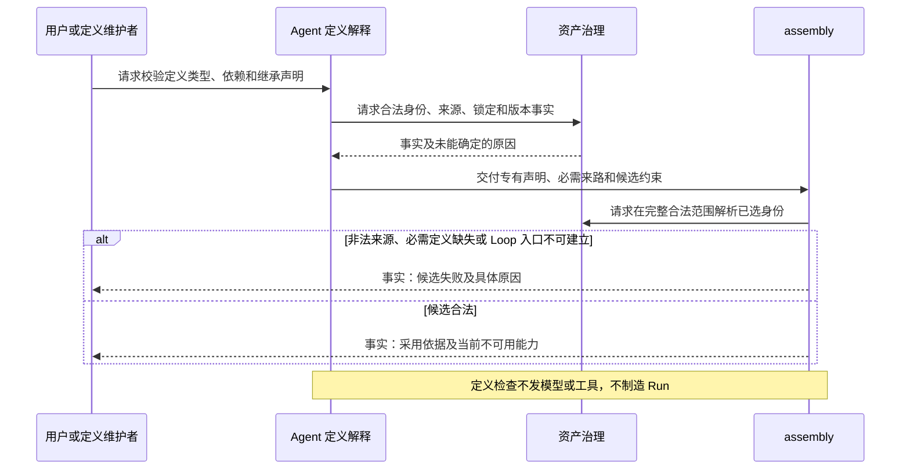
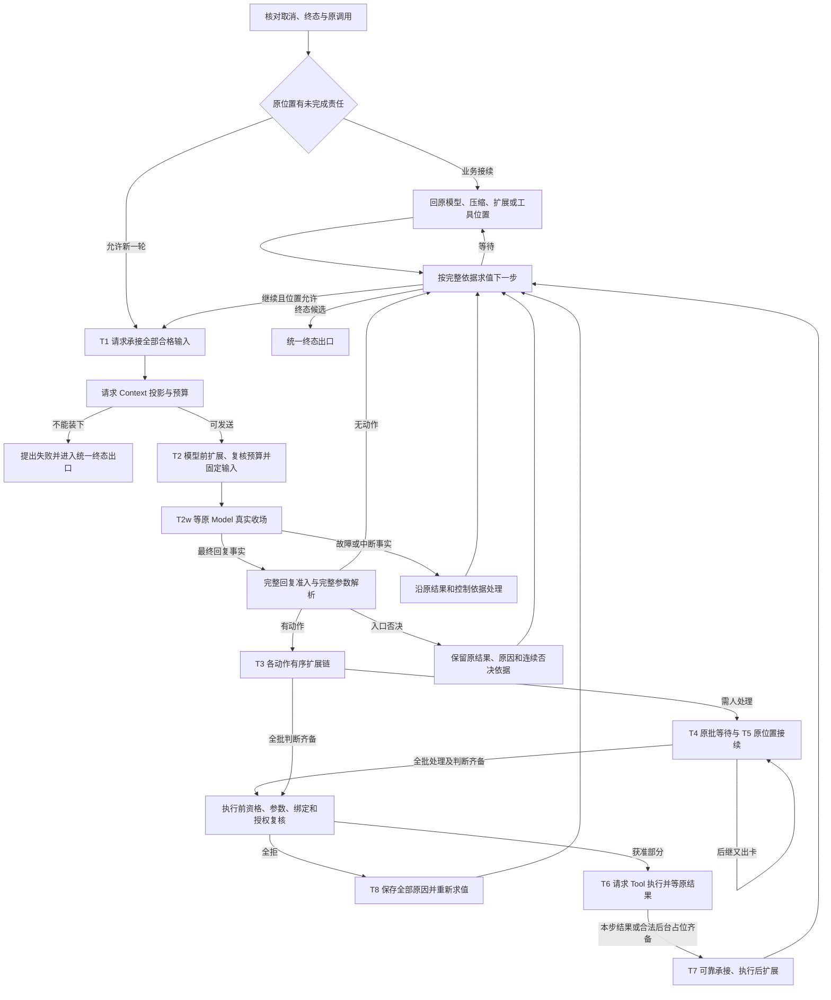
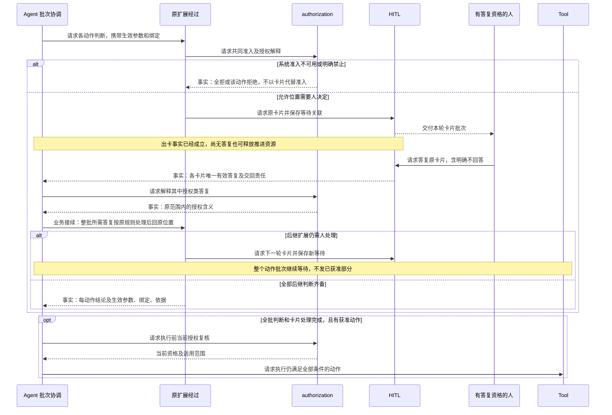
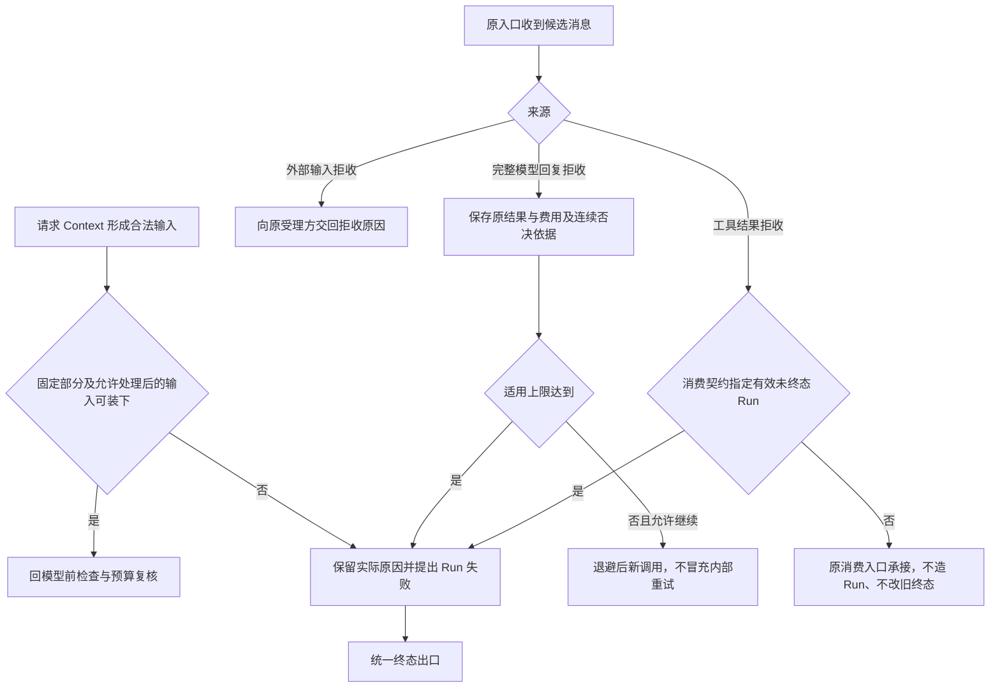
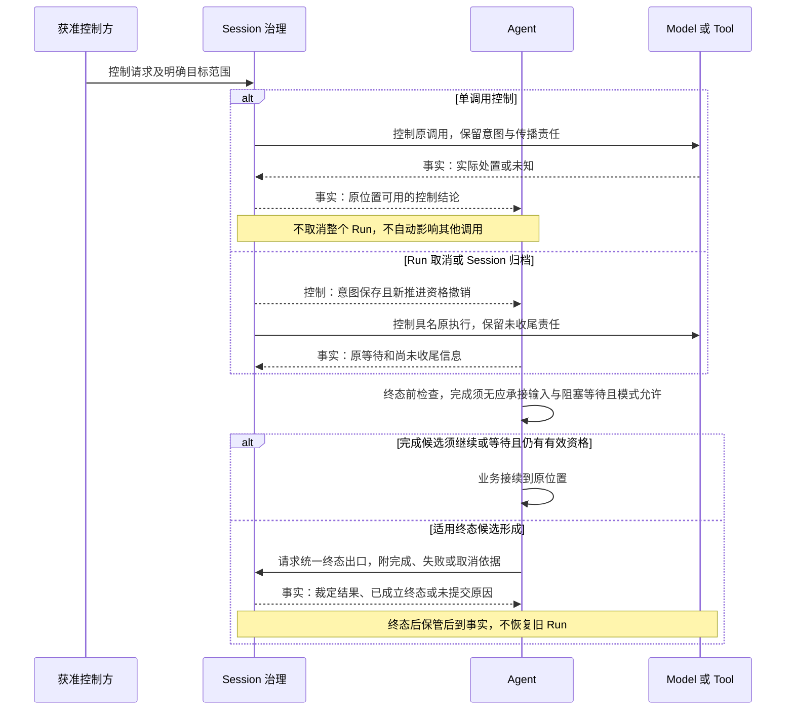
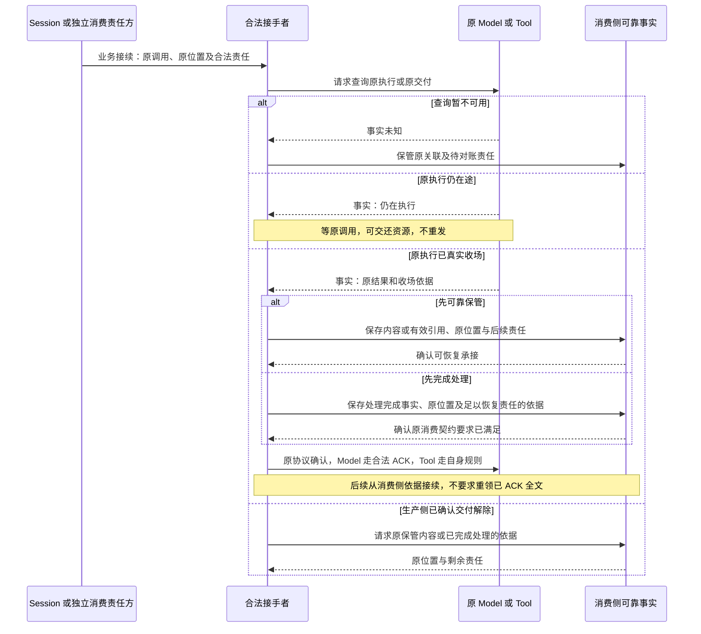
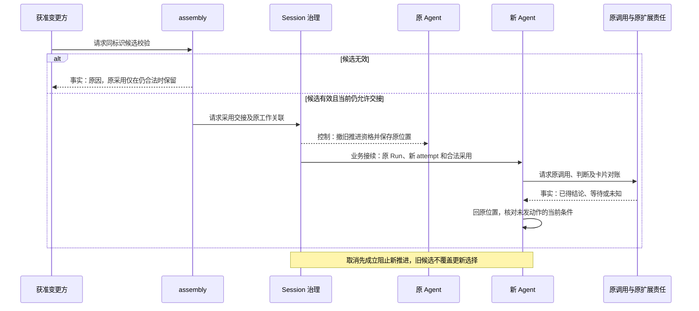
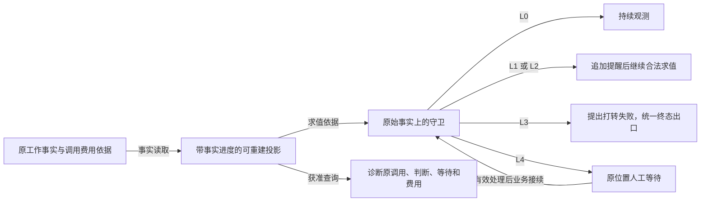

# Agent 推进的关键协作流程

状态为候选，待用户确认。本页把[产品旅程](../../../../.meta_harness/design/product/agent-progression/design.md#关键用户旅程)落实为逻辑角色间的次序和交接。Agent 拥有 Loop 下一步、原扩展经过、参数绑定和整批判断。Session 拥有工作身份、推进资格与唯一终态；Model、Tool 拥有原执行；Context 拥有输入投影与预算；HITL 拥有卡片和唯一答复；authorization 解释授权；assembly 拥有候选采用和结构交接。

共同规则继续由[主架构](../../../../docs/domains/agent-progression/architecture.md)、[成员 SPEC](../SPEC.md)及三个主题拥有。T1 至 T8 的精确文档含义只在 [Loop 转移定位](../loop.md#t1-t8)维护。本页使用这些定位号，不创建 Session 状态机或公开阶段枚举。Session 的状态、事件与提交守卫仍读[原状态表](../../../session/session/docs/session-state-transitions.md)。

图表达逻辑请求、事实、控制、保管与业务接续，箭头文字区分用途。异步答复和原调用没有共同物理寿命。flowchart 仅为活动示意，不是严格 UML 或算法证明。所有新推进都以有效资格为前提；取消、归档和既有终态先于新发起，迟到事实仍可按原责任保管。

## F-AG01 定义选入和装配结果

对应 [J-AG01](../../../../.meta_harness/design/product/agent-progression/design.md#j-ag01)，行为及验证归[定义专题](../definition.md#旅程与持续验证)。用户与定义维护者提供具有合法来源的选择和声明，Agent 解释其专有含义，assembly 求值采用。创建 Session 和取得 Run 资格不由本图代办。

继承来源仅决定额外身份，已选身份的实现仍在完整合法范围解析。候选失败不能发布混合构成；恢复对账原候选，不以旧采用证明新条件成立。合法定义存在但执行不可用时保留已知身份，后续动作可取得逻辑不可用结果。精确校验与来源版本协议由 Agent 定义、assets 和 assembly 对齐，缺项见[协议细化拥有者](#protocol-gaps)。

## F-AG02 正常推进及全批拒绝

对应 [J-AG02](../../../../.meta_harness/design/product/agent-progression/design.md#j-ag02)。下图从已经具备资格的 Agent 开始。原等待优先于新输入；只有原位置允许时才向 Session 请求承接当时全部合格普通输入。

T2w 中的单次真实发出失败可能进入模型后失败分支，由有效策略把结论交回原 Model。原调用尚未终局时不交最终结果、不 ACK、不跳入主流程动作处理。原 Model 真实收场才交最终结果；流 finish 或完整块也不证明 Run 终结。最终失败和用户中断沿各自原因处理，不把所有故障画成内部重试。

T6 消费前台结果或符合 Tool 声明的后台占位。后台是等待消费方式，不能另建 Tool。dummy logical execution 使用原动作和不可用结果，不假报物理启动。结果先在原消费位置可靠承接，再执行动作后扩展；解除生产责任另按 [F-AG06](#f-ag06) 的两条合法路径判断。跨实例恢复时回 Old 所指原位置，不一律回 T1。验证归[Loop 旅程验证](../loop.md#旅程与持续验证)。

## F-AG03 整批判断、人工答复和后继出卡

对应 [J-AG03](../../../../.meta_harness/design/product/agent-progression/design.md#j-ag03)。同动作同位置按采用顺序判断，不同动作可以并行。以下图以整批已到结论或合法等待为起点，卡片只出自允许位置。

出卡、答复交回和扩展接续是异步三段，不要求共同一次提交。卡片答完不等于整批已经处理完成。只有全批判断与所需答复处理都齐备，才进入执行前复核；图中 opt 还受 Run 未终态、当前推进权、环境与资源的共同守卫约束。全拒回 F-AG02 的 T8。

明确不回答返回没有答案，不授予动作，不重复原问题。当前参数、绑定或相关授权依据已变则不能复用旧批准；无关变更不机械重问。暂停、物理退出和查询失败不使卡片失效，原逻辑执行确定终局才失效。撤除扩展仍须保留原语义，具体接续见 AGENT-M02。十一处位置及不可用、报错、系统兜底的完整规则仍见[扩展专题](../extensions.md#十一处位置)，验证见其[旅程验证](../extensions.md#旅程与持续验证)。

## F-AG04 输入失败与按来源拒收

对应 [J-AG04](../../../../.meta_harness/design/product/agent-progression/design.md#j-ag04)。Context 拥有预算与压缩，Agent 消费它的明确结论并给 Session 提交失败候选。扩展拒绝压缩时可以不压，但不能因此发送仍超限的请求。

固定部分超限与处理后仍超限保留不同原因，不自动分叉、改模型、删除历史或循环压缩。新模型调用前仍核当前资格，取消先成立则不得继续。Tool 原结果、效果和费用由原拥有者保管，否决不重跑工具。旁路拒收的精确后果未定时由原消费拥有者细化，不能默认挂后继 Run。必要保存未知时按原身份对账，不把图上的下一条箭头当作已经成功提交。验证见[Loop 旅程验证](../loop.md#旅程与持续验证)。

## F-AG05 统一终态出口及控制范围

对应 [J-AG05](../../../../.meta_harness/design/product/agent-progression/design.md#j-ag05)。Agent 提出候选，Session 裁定并记录唯一终态，具体状态及提交守卫只读[Session 状态表](../../../session/session/docs/session-state-transitions.md)。

终态前扩展由 Agent 在提交前协调。完成候选可被要求继续、等待或否决；失败、取消按其适用检查和依据收束，扩展不能借否决恢复已撤推进资格。没有 Agent 实例时，Session 仍承担持久控制传播和终态责任，不能等待图中某实例复活才取消。

Run 取消涉及原模型与前台工具，不自动停止后台、子方或无关调用。优雅取消可有尚未收尾期间，真实停止和逻辑取消分别记录。归档取消本会话的原工作等待与投递资格，级联责任归 Session；不以物理全停为前提。撤销归档只回休眠，不恢复旧调用或卡片。精确控制传播与竞争提交由 AGENT-M03 及 Session 协调者细化。验证见[Loop 旅程验证](../loop.md#旅程与持续验证)。

## F-AG06 接手原工作及可靠交付两条路径

对应 [J-AG06](../../../../.meta_harness/design/product/agent-progression/design.md#j-ag06)。新推进者取得原身份与当前资格后，先查询原执行和消费责任。原 Run 无效时，不继续业务推进，但获准保管者仍可保存真实结果。独立消费者不必制造 Session 或 Run。

任一路径都须能在停机后判明谁负责，不能让双方都丢弃责任。先完成处理不强制再保存一份可重领全文；尚未处理完且依赖后续消费则须可靠保管必要内容。模型 ACK 只针对真实收场且有当前合法消费者的调用。观察、开始处理或单次发出失败都不能提前 ACK。ACK 生效、清理和费用结算分别可见；工具全文不套用模型清理规则。

若生产方确认自身失联，按 Model 或 Tool 自己的恢复结论回原位置。Agent 退出或查询失败不证明失联，工具未知效果不自动重放。准确的资格与交接共同边界、ACK 对账和提交未知由 AGENT-M03 的协调者补齐；在途内容耐久缺项见 AGENT-N01。验证见 [SPEC 旅程验证入口](../SPEC.md#旅程验证入口)。

## F-AG07 定义换代与在途语义交接

对应 [J-AG07](../../../../.meta_harness/design/product/agent-progression/design.md#j-ag07)。定义身份固定，版本采用可变。普通恢复保持原采用，新 Run 可取同标识合法发布版本。显式 reload 的逻辑次序如下。

模型选择、模式、权限、Context 或稳定入口内部数据变化不自动换定义或 attempt，已发请求保持原固定内容。旧模型建议与当前工具约定不兼容时，Agent 返回具体原因供新的决定使用，不暗换实现或参数。已得扩展结论不重跑，不同语义新判断不冒用旧结论。撤除后能否合法继续的精确协议由 AGENT-M02 的 Agent 与 assembly 拥有者确定，缺协议时保留等待和责任，不能宣布接续完成。验证见[定义专题](../definition.md#旅程与持续验证)与[扩展专题](../extensions.md#旅程与持续验证)。

## F-AG08 长期读取、守卫及因果解释

对应 [J-AG08](../../../../.meta_harness/design/product/agent-progression/design.md#j-ag08)。守卫只读原事实与可重建投影，压缩后的模型输入不成为计数权威。

上述阶梯是既有行为含义，不规定算法、阈值或必经每一级。取消仍先撤新推进，恢复继续使用原事实范围，不以重启或压缩清零。投影落后或查询未知须可识别，不能以缓存为空证明没有工作。诊断不默认复制正文、附件或秘密；账目由原执行拥有者记账，Agent 保持原用途关联，遥测采样不是费用全量依据。性能尺度与策略配置的精确协议沿 AGENT-M01、AGENT-M03 细化，验证见[Loop 旅程验证](../loop.md#旅程与持续验证)。

## 协议细化拥有者

以下缺项限定实现与验证接受，不阻止表达以上已明业务路径。公开操作、Schema、提供者和锁未在图中选定。

| 流程中的待细化点 | 责任及原问题 | 必须保留的可观察后果 |
| --- | --- | --- |
| F-AG01、F-AG07 的定义校验、版本读取与候选采用接口 | Agent 定义与 assembly，见[定义规格末段](../definition.md#交接结果与验证义务) | 非法候选不采用，标识固定，合法旧采用与失效旧条件可区分 |
| F-AG02、F-AG04、F-AG08 的 step、连续回复否决与策略边界 | Agent Loop，[AGENT-M01](../../../../.meta_harness/design/product/agent-progression/design.md#agent-m01) | 新调用不冒充内部重试，跨 attempt 不清零 |
| F-AG03、F-AG07 的稳定经过、非确定输入、卡片接续及撤除 | Agent 扩展与 assembly，HITL 和 authorization 提供原决定，[AGENT-M02](../../../../.meta_harness/design/product/agent-progression/design.md#agent-m02) | 三段异步责任可认回，旧结论不重跑，后继卡片不越过批屏障 |
| F-AG02、F-AG05、F-AG06 的围栏、认领、跨域有效边界、控制传播与 ACK 对账 | Agent 推进协调与 Session、原执行及保管拥有者，[AGENT-M03](../../../../.meta_harness/design/product/agent-progression/design.md#agent-m03) | 旧资格不推进，原事实可迟到保存，确认未知不重做副作用 |
| F-AG04 的后台、Run 外及旧 Run 结果否决后果 | 原消费拥有者与 Agent 入口，见[Loop 入口失败链](../loop.md#消息入口的失败链) | 不造 Run，不改终态，不为取消业务重授入队资格 |
| F-AG06 的在途展示内容跨生产 runtime 失联耐久 | Model 流式与消费存储拥有者，[AGENT-N01](../../../../.meta_harness/design/product/agent-progression/design.md#agent-n01) | 不从收场后 ACK 推断逐片耐久，不宣布允许丢失 |
| F-AG08 的长期读取尺度、策略配置资格和生效协议 | Agent Loop 策略、事实与查询拥有者，[AGENT-M01](../../../../.meta_harness/design/product/agent-progression/design.md#agent-m01)、[AGENT-M03](../../../../.meta_harness/design/product/agent-progression/design.md#agent-m03) | 缓存进度可查且可重建，守卫及账目不因优化丢失 |

本页只有候选逻辑流程和持续验证入口。没有运行真实装配、故障或性能实验，没有据 Mermaid 图授予行为正确性或接受。
