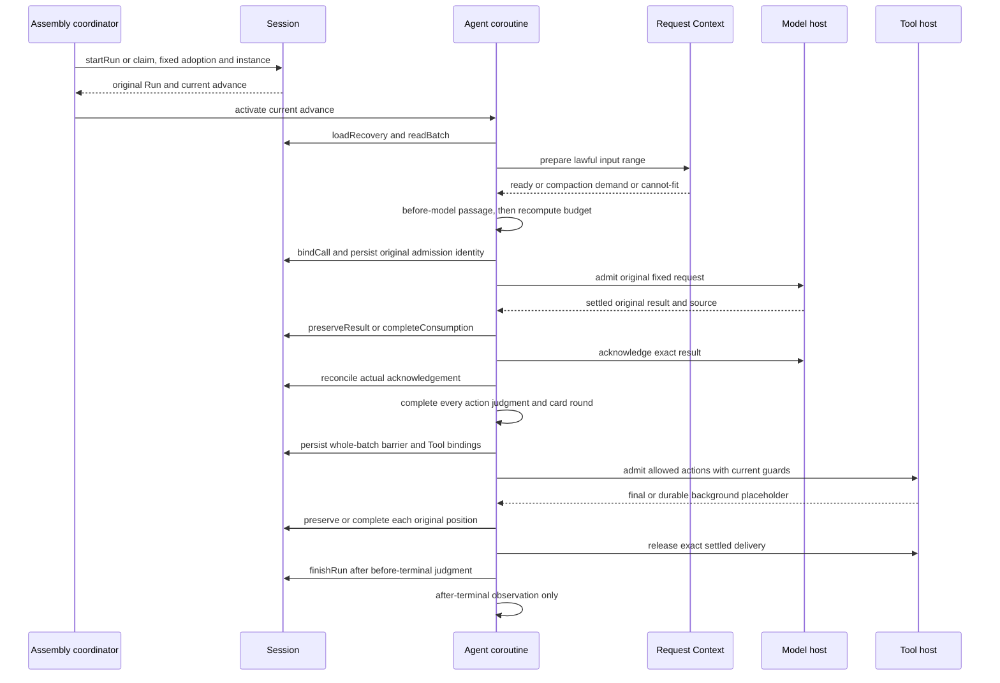

# Agent 的四成员消费链

本页消费 [Agent 候选](runtime-contract.md)、[Session 候选](../../../session/session/docs/runtime-contract.md)、[Model 候选](../../../model/model/docs/runtime-contract.md)和 [Tool 已接受契约](../../../tool/tool/docs/public-api.md)。顺序是协议要求；尚未运行生产提供者，不能把图当作耐久或外部效果验证。

## 从输入到原结果

每次变更使用独立操作身份；同一原操作的重试保持身份及语义参数。Agent 的每个 PendingCall 保存生产者 admission，回执丢失先 inspect/lookup，不用新 operation 重新受理。Model 一次内部重试仍是同 call，策略回原 Model，主 Loop 继续等待整调用真实收场。

压缩分支由 Request Context 指定原用途、范围和候选请求。Agent 经压缩前经过、登记独立模型调用并保管原结果，再调用 derive 取得实际候选消息及摘要/排除共同依据。压缩后经过和消息落盘前准入完成后，Session.commitDerived 提交共同事实，RequestPreparation.resume 使用原提交 source 重新预算。它不把压缩结果作为主流程回复，不让内部调用共用主流程 action。

## 两条交接路径

retained 路径先经 AgentMaterials 独立保管内容或可靠引用，再经 Session.preserveResult 保存原版本、位置和责任，才请求生产者确认。Model ACK 后，从材料拥有者读取，不再要求 Model 给全文。Tool 的 retained 可以使用自身长期保留的原全文引用；解除 delivery 不删除全文。

processed 路径在生产者仍保管结果时完成必要判断和业务处理，Session.completeConsumption 原子保存完成依据及后续位置，再确认。必要处理尚未完成、保存未知或当前资格失效时不得提前确认。处理完成证据无需包含业务不再需要的全文。

Tool 的 V1 失联结果和 V2 晚到原全文分开保管及确认。同 call 的两个版本共享原消费绑定，具有不同结果项和 delivery。旧确认晚到不解除新责任，旧 Run 终态不改变。

## 场景判据

| 交错或失败 | 必须结果 | 后继验证观察点 |
| --- | --- | --- |
| 重复唤醒同一 advance | 一条有效 Agent 协程，不新 Run/attempt | Session 资格及宿主实例数 |
| bind 后、admit 前进程退出 | readRequest + 原 admission 恢复同一次受理 | 原 call、request摘要和真实发起次数 |
| Model 已 ACK 后 Agent 退出 | 消费侧原材料/完成依据接续 | 不调用 Model 新全文领取，不重发 |
| 三动作中一项等人 | 全批不启动，答复到达后还需原规则处理 | Tool 实际启动为零直到屏障成立 |
| 后继扩展再次出卡 | 原动作批继续等待，旧问题不重问 | 卡片原身份、经过及轮次 |
| HITL 呈现成功但回执丢失 | lookup 按原请求集合认回卡片，unknown 不再出卡 | 原需求和创建排除证明 |
| 压缩共同提交回执丢失 | queryOperation 认回原 source 后 resume，不重发压缩模型 | 同一摘要/排除批与原 preparation |
| 压缩后扩展将摘要 A 改成 B | derive 接收 B 和原改写依据重验，得到匹配 B 与原合法排除范围的证明再提交 | 旧证明不能配 B，不能扩大排除集合 |
| 只变无关配置或当前授权收窄 | 前者不重问；后者旧允许不能启动 | 执行点当前守卫及参数采用 |
| Tool 内部 Ask 答复 | 交 Tool 原 wait/decision，非扩展卡片 | 同一执行/等待不重跑 |
| 前台合法转后台 | 同 call、同名额、一个耐久占位，后续真实结果另交 | 原占位不被最终结果改写 |
| 旧 Agent 退出或依赖换代 | 先交还自己，Model/Tool 寿命独立 | 各实例宿主及目录贡献 |
| reload 与取消竞争 | Session 唯一裁定，取消先成立则无新 advance | 终态、旧资格和实际启动围栏 |
| 原 Run 结束后迟到结果 | 保管/账目和版本对账继续，无旧业务推进 | 多结果项、当前承接者和原终态 |
| 当前请求缺模态/预算资料 | 明确失败或未知，不发假完整请求 | 完整实际输入与失败来源 |
| 外部输入准入否决 | 返回发送方拒收，不报告可靠受理 | 原受理操作及消息不存在 |
| 模型回复消息准入否决 | 保存真实回复/费用，退避后新调用，不归原重试 | 不设置连续否决次数上限 |
| 有效 Run 的 Tool 结果准入否决 | 原结果保留，按指定消费契约提出失败 | 不重执行 Tool、不伪造替身成功 |

## 当前证据的意义

临时类型消费将四份候选声明连接到相同真实共同类型，只验证接口可连接和明确误用会被拒绝。已有 Model 交接、首内容、Session 推进及 Tool 名额有限模型覆盖其具名交错。整批扩展、真实提供者、实际消息准入、HITL 与 Cordis 需要分别验证；未跑的场景保留为后继接受输入。
