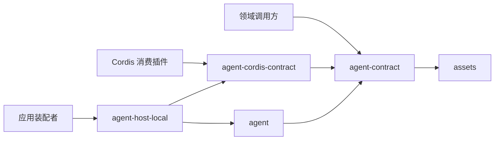

# Agent 定义与工作推进组的工程关系

本页在正式维护位置保存已接受的技术设计，接受依据见[技术接受与产品采用决定](https://github.com/nemori-ai/omne-harness-lite/issues/384#issuecomment-6258475204)。设计接受不等于阶段选择或实现支持。成员已初始化。两个契约包已经实现并有测试，通用实现、具体装配、提供者与实际运行验证仍待完成。

## 成员分解与邻接协作

定义解释向 assembly 交专有声明；外部协调者供给原输入与推进资格依据，并作为提交参加者参加输入受理与终结提交；推进协调者向 Context、Model、Tool 和 HITL 请求能力并认回原位置。单成员内部流程由成员拥有，跨组资格和事实交接分别由原责任方维护。

本组不维护第二份状态机、错误集合或精确承接协议。完整机制见[成员内部设计](../agent/docs/architecture/mechanisms.md)，责任与事实归属见[领域角色](../../../docs/domains/agent-progression/architecture.md)。

## 安装与源码依赖



纯契约及通用实现均不依赖 Cordis。Definitions 的绑定只从 `./cordis` 导出，根入口不加载绑定。具体提供者注入纯工厂，不反向决定契约。定义校验位于 agent-contract。装配消费者直接依赖该包。agent-contract 依赖 assets，并向 assets 的类别注册表登记正文契约，assets 不依赖 agent-contract。推进接口的设计已接受，类型已在 agent-contract，实现尚未提供。外部协调者经提交参加者适配 AgentJournal 和 execution 操作；纯 Agent 不导入任何外部协调者的服务或身份类型。独立执行自行条件终结，不要求调用方批准。纯求值、效果协调和宿主集成的概念可见范围见[对象模型](../agent-contract/docs/object-model.md#跨域概念与内部可见范围)。

工厂配置与依赖聚合归 [agent](../agent/docs/public-api.md)；领域操作与提供者端口归 [agent-contract](../agent-contract/README.md)。

## 主题与唯一拥有者

本节登记每个设计主题的唯一规范拥有者，不复制规则。读者需要某条规则时，打开拥有者页面。

规则如下。

- 一个主题只有一个可独立修改的有效规范。
- 其他位置只能引用拥有者，或标明为非规范摘要。
- 一个文件可以拥有多个主题。一个主题不能有两个拥有者。
- 修改一个主题的规则时，修改拥有者页面。引用页面只在链接或摘要失效时同步修改。
- 状态列的“现存”表示拥有者页面和指定的节都已经存在。需要新增主题时，先创建拥有者页面，再登记一行。本表不登记尚未创建的页面。
- “其他位置允许的内容”一列约束拥有者以外的页面。拥有者页面自身的写法由拥有者页面维护。
- 成员的 `architecture.md`、`flows.md`、`object-model.md`、`public-api.md`、`context.md`、`cordis.md` 中，不在下表列为拥有者的页面，只写本成员特有的事实，或一到两句指向拥有者的说明，不复述规则。
- 旧版本、评审记录、探针和快照是历史材料，不是当前规则的依据。

### 产品、统一语言与领域对象

| 主题 | 唯一规范拥有者 | 其他位置允许的内容 | 状态 |
| --- | --- | --- | --- |
| 产品能力、业务后果与阶段支持 | [Agent 定义与工作推进产品页](../../../.meta_harness/design/product/agent-progression/design.md) | 引用能力 ID 和适用范围。不复述产品规则，也不另写产品规则 | 现存 |
| Agent 相关词条 | [统一语言索引](../../../.meta_harness/design/ubiquitous_language/index.md)及其分卷词条 | 正文使用词条名。词条只写概念层定义：身份、拥有者、与邻近词的区别。生命周期和协议归下列拥有者 | 现存 |
| Agent 领域对象条目 | [领域对象清单](../../../.meta_harness/design/domain_objects/objects.md) | 包对象模型引用对象名与宿主，不重复身份与生灭的判定依据 | 现存 |
| Agent 领域对象待裁登记 | [待裁清单](../../../.meta_harness/design/domain_objects/pending.md) | 其他页引用待裁项名称，不另写裁决状态 | 现存 |

### 系统与领域

外域概念的含义与当前资格不归本组，下表不登记它们。这些概念归各自成员的公开规格：[Model](../../model/model-contract/SPEC.md)、[Tool](../../tool/tool-contract/SPEC.md)、[Runtime Context](../../context/runtime-context-contract/SPEC.md)、[Request Context](../../context/request-context-contract/SPEC.md)、[HITL](../../human-intervention/human-intervention/SPEC.md)、[授权](../../identity/authorization/SPEC.md)和[装配](../../assembly/assembly/SPEC.md)。外部协调者的概念不归本组，Agent 页用通用角色指它。Agent 页只写“消费哪些公开事实、谁负责当前资格”，不定义这些概念的含义。

| 主题 | 唯一规范拥有者 | 其他位置允许的内容 | 状态 |
| --- | --- | --- | --- |
| 领域语义依赖原则 | [分层与依赖：领域语义依赖与模型边界](../../../docs/architecture/layers-and-dependencies.md#领域语义依赖与模型边界) | AGENTS 与领域入口保留简短投影和链接 | 现存 |
| 系统级 runtime 关系 | [Agent runtime](../../../docs/architecture/runtime/agent-runtime.md) | 领域图说明本域消费视角，不独立裁定其他领域内部职责 | 现存 |
| 扩展位置集合、触发边界、干预力含义、逐位置的否决与等待限制、有序组合 | [Loop extensions](../../../docs/architecture/runtime/loop-extensions.md) | 作者协议页引用位置名，并给出各位置的输出合法性表。作者协议页不另写位置的触发边界。输出合法性表必须与系统页现行的逐位置否决与等待限制一致。后置位置的 stop 与 ask 已在系统页中规定。发现新的不一致时，在输出合法性表中标明，并以系统页修改提案提交，提案接受前以系统页为准 | 现存 |
| 控制、取消与恢复的系统关系 | [控制与恢复](../../../docs/architecture/runtime/control-and-recovery.md) | 公开推进保证页引用，不复述系统顺序 | 现存 |
| 流式到达、消费与 ACK 的系统关系 | [流式与消费](../../../docs/architecture/runtime/streaming-and-consumption.md) | 成员页引用，不另写 ACK 语义 | 现存 |
| 定义选入、实现解析与装配换代的系统关系 | [装配与变更](../../../docs/architecture/runtime/assembly-and-change.md) | 定义专题只写 Agent 专有声明的解释 | 现存 |
| 会话路径与 Agent 的系统关系 | [会话与 Run](../../../docs/architecture/runtime/session-and-run.md) | 会话概念不归本组，本表不登记。Agent 成员页用通用角色指外部协调者，不点名或定义会话概念。系统页和领域页可以点名各域来说明系统关系 | 现存 |
| 跨 runtime 共同对象 | [共同对象模型](../../../docs/architecture/runtime/runtime-contract-model.md) | 成员页引用共同身份与关系，不另定义。成员的状态机和生命周期归成员页 | 现存 |
| 跨 runtime 共同集成 | [共同集成](../../../docs/architecture/runtime/runtime-contract-integration.md) | 成员页引用共同集成前提与适用范围，不另写。具体服务定义和宿主归 Cordis 成员页 | 现存 |
| 跨 runtime 共同交接 | [共同交接](../../../docs/architecture/runtime/runtime-contract-handoff.md) | 成员页引用共同交接义务，不另写。成员自己的交接协议归成员页 | 现存 |
| Agent 领域责任 | [Agent 领域架构](../../../docs/domains/agent-progression/architecture.md) | 系统页和包页引用职责，不复制技术细节。同目录[范围页](../../../docs/domains/agent-progression/README.md)只写范围、模块角色导航和阅读入口 | 现存 |
| 共同 Cordis 规则 | [Cordis 集成约定](../../../docs/architecture/cordis-integration-conventions.md) | 本域的符合性映射和特有机制归下文 agent-cordis-contract 一组的拥有者，不另抄一套 IC 条文 | 现存 |

### 组级

| 主题 | 唯一规范拥有者 | 其他位置允许的内容 | 状态 |
| --- | --- | --- | --- |
| 包角色、依赖与安装边界 | 本页的“成员分解与邻接协作”和“安装与源码依赖”两节 | 包 README 介绍自身角色。项目[包组织](../../../docs/package-organization.md)登记实际成员 | 现存 |
| 主题与唯一拥有者 | 本页本节 | 其他文件不另设拥有者索引 | 现存 |
| 组级关键协作入口与按读者选择的阅读路径 | [关键流程入口](key-flows.md) | 只导航到成员的流程页与规格页，不写流程和规则 | 现存 |
| 封存件的逐文件去向 | 本页的“迁移清单”一节 | 其他页只引用本节，不另列文件的去向 | 现存 |

### agent-contract

| 主题 | 唯一规范拥有者 | 其他位置允许的内容 | 状态 |
| --- | --- | --- | --- |
| 对象身份及生命周期 | [对象模型](../agent-contract/docs/object-model.md) | 公开操作引用对象语义。其他页不另画对象状态图 | 现存 |
| 独立消费与外部协调 | [消费与系统定位](../agent-contract/docs/context.md) | 外部协调者自己维护其业务适配协议，不回写为 Agent 必须理解的概念 | 现存 |
| 包公开必要行为 | [SPEC](../agent-contract/SPEC.md) | 接口页只描述形状与使用，引用 SPEC 的行为，不另写行为规则。完整算法归 Loop 算法页 | 现存 |
| 输入内容的受理与保存、恢复与接管两条重挂接路径、执行记录提交、条件终结（tryFinish）、共同提交的落点、settling、ended 之后的保留与释放、detach、quiesce 与 handover 的行为，以及登记的发布语义与撤除结果 | [SPEC](../agent-contract/SPEC.md) 的“托管协调与运行实例”节 | 公开接口页只留这些操作的形状，加一句指向 SPEC。内部机制页只写实现机制并引用 SPEC。对象模型页只保留对象状态名与转移，不写条件、排序与 ACK 规则。三处都不另写行为散文。控制类型与六阶段归下一行的“取消、退出与结构变更”节，detach 与 quiesce 的交接与撤登记结果归本行的节，两行互相引用 | 现存 |
| Agent 事件流语义：序号、游标、缺口、背压、订阅关闭、重连、确认，以及耐久提交、出口接收、消费者处理、业务接受四个层次的区分 | [SPEC](../agent-contract/SPEC.md) 的“事件流与读取”节 | 公开接口页只留类型形状并引用 SPEC。流程页只画消费顺序。对象模型页只保留对象状态名与转移，不写条件、排序与 ACK 规则 | 现存 |
| 租户与作用域绑定、跨租户拒绝、经 AgentAccessCheck 的主体资格核验，诊断与日志的隐私（私有权限块、秘密和无权内容不外泄） | [SPEC](../agent-contract/SPEC.md) 的“身份、范围与归属”节（“租户与作用域绑定”“主体资格核验”小节）和“性能、诊断与维护”节 | 对象模型只写对象层身份，不另写绑定、核验与拒绝规则。工厂页只登记该依赖的必需性、缺席与换代行为 | 现存 |
| Context、压缩与模型请求中 Agent、Context、Model 的职责划分，Runtime Context 的消费、拉取时点与受众隔离，以及最终请求的定型 | [SPEC](../agent-contract/SPEC.md) 的“请求、扩展和材料接缝”节 | Loop 算法页拥有对应节点的次序，引用 SPEC 的职责划分。与已接受的 Runtime Context 系统页读取规则不一致的项，不在本页自定，以修改提案提交系统页拥有者，提案接受前以系统页为准 | 现存 |
| 四种控制（interrupt、cancel、suspend、quiesce）、插队对前台调用的处理，以及受理、意图成立、资格撤销、生产者确认、物理停止、责任释放六个阶段 | [SPEC](../agent-contract/SPEC.md) 的“取消、退出与结构变更”节（“四种控制”“插队”“六个阶段”小节） | 公开接口页只留控制类型的形状，包括 AgentRuntimeControl。对象模型页只引用。Loop 算法页拥有控制入口节点，引用 SPEC 的阶段。detach 与 quiesce 的交接与撤登记结果归上一行的“托管协调与运行实例”节，两行互相引用 | 现存 |
| 提交参加者协议：参加、失败、冲突、不支持四种响应，以及 Agent 拒绝不合格装配 | [SPEC](../agent-contract/SPEC.md) 的“并发与提交”节（“提交参加者协议”小节） | 消费与系统定位页写外部协调者视角的前提，并引用 SPEC | 现存 |
| 消息准入与来源特定拒收的行为 | [SPEC](../agent-contract/SPEC.md) | 准入的公开形状在[公开接口页](../agent-contract/docs/public-api/README.md)。Loop 算法页拥有准入节点的位置与次序，引用 SPEC 的拒收后果。流程页引用结果，不重述三种来源的拒收后果 | 现存 |
| Agent 公开操作的设计形状，扩展作者接口的类型除外 | [公开接口页](../agent-contract/docs/public-api/README.md) | 其他页引用操作名和类型名，不另写签名或字段。扩展作者接口的类型归下文扩展规格一行，公开接口页只列其名称并链接到扩展规格。类型的唯一声明在源码，其他页以导出名为准 | 现存 |
| Definition 专题 | [定义规格](../agent-contract/docs/public-api/definition.md) | 主入口只指路 | 现存 |
| 扩展作者协议及其接口类型（公开接口页声明位置表所列的类型）、位置输出合法性表与判断屏障的作者可见语义 | [扩展规格](../agent-contract/docs/public-api/extensions.md) | 主入口、内部恢复器和架构页只引用，不各自定义作者接口。公开接口页只列这些类型的名称并链接到扩展规格；`Subject`、`CardAnswer` 等共用类型仍归公开接口页。屏障打开与全拒的条件只由 SPEC 写，扩展规格与对象模型引用。Loop 算法页拥有 A0 与 A1 节点的次序。位置输出合法性表与系统页逐位置限制的关系见上文扩展位置一行 | 现存 |
| 公开推进保证 | [Loop 的公开推进保证](../agent-contract/docs/flows/loop.md) | 其他页引用保证条目，不另写外部保证。每条保证引用算法页节点 ID。转移表和状态机只在完整 Loop 算法页维护 | 现存 |
| 产品旅程的公开消费投影 | [关键协作流程](../agent-contract/docs/flows/scenarios.md) | 能力覆盖页和验收场景页引用 F 编号，不另画消费顺序图，不另写业务规则 | 现存 |
| 契约包的依赖方向与值行为分界 | [agent-contract 架构](../agent-contract/docs/architecture.md) | 组页和其他成员页引用本包分界，不复述 | 现存 |
| 能力与旅程追踪、实施差异、实现交接清单与接受事项 | [产品能力与设计覆盖](../agent-contract/verification/coverage.md) | 各页只引用能力 ID，不复制矩阵。交接清单只在“实现交接与接受事项”节维护 | 现存 |
| 实施验收场景 | [持续验证场景](../agent-contract/verification/scenarios.md) | 流程页和规格页引用场景编号，不复制场景表 | 现存 |
| 验证命令与证据拥有者 | [验证责任](../agent-contract/verification/README.md) | 单次执行记录不在本仓库保存快照 | 现存 |

### agent

| 主题 | 唯一规范拥有者 | 其他位置允许的内容 | 状态 |
| --- | --- | --- | --- |
| 完整 Loop 图、节点表、伪代码与不变量 | [Loop 完整算法](../agent/docs/architecture/loop-algorithm.md) | 公开流程页是消费视图，机制页引用节点 ID。派生简图标明省略范围，不独立定义状态转换 | 现存 |
| 算法复杂度、最坏输入、进展与公平假设 | [Loop 完整算法](../agent/docs/architecture/loop-algorithm.md)的“复杂度、上界与进展”节 | 机制页引用，不另写复杂度或进展假设 | 现存 |
| 工具并行、后台占位与迟到结果的推进 | [Loop 完整算法](../agent/docs/architecture/loop-algorithm.md)的“工具结果节点”节 | 公开推进保证页只写外部可观察的保证，并引用算法页 | 现存 |
| 执行槽、提交、接续、保管与长期读取的实现机制 | [内部机制](../agent/docs/architecture/mechanisms.md) | 开放问题页记录剩余责任，不重写规范。这些操作的行为归 SPEC 的“托管协调与运行实例”节 | 现存 |
| 通用实现的内部模块与状态责任 | [agent 架构入口](../agent/docs/architecture/README.md) | 包 README 只介绍角色 | 现存 |
| 技术未决项与外域依赖 | [开放问题](../agent/docs/architecture/open-questions.md) | 其他页引用条目编号，不复述条目内容 | 现存 |
| 通用工厂、参数与依赖注入 | [通用工厂](../agent/docs/public-api.md) | 对象图只引用其依赖角色 | 现存 |
| 可配置政策与资源上界的取值项：工具并行上限、每段处理限额、缓冲上界与退避，以及各项的单位、默认值和校验。事件读取窗口的上限由 Journal 提供者声明，压缩的预算与计划归 Context，都不在此登记 | [通用工厂](../agent/docs/public-api.md) 的“工厂配置”节，含 `AgentConfiguration` 及其校验规则 | Loop 算法页和机制页引用配置名，不另定单位或默认值 | 现存 |
| 通用实现的兑现责任与资源替换 | [agent SPEC](../agent/SPEC.md) | 其他页引用兑现责任，不复述。公开契约的行为归 agent-contract 的 SPEC | 现存 |

### agent-cordis-contract 与 agent-host-local

| 主题 | 唯一规范拥有者 | 其他位置允许的内容 | 状态 |
| --- | --- | --- | --- |
| Cordis 服务定义与注册协议 | [Cordis 服务定义](../agent-cordis-contract/docs/cordis.md) | 具体插件引用同一服务定义和根操作形状，不另写服务键或操作形状 | 现存 |
| 服务定义的唯一性与生命周期行为 | [agent-cordis-contract SPEC](../agent-cordis-contract/SPEC.md) | 其他页引用这些行为，不另写。类型表只在 Cordis 服务定义页维护 | 现存 |
| 本域对 IC-1 至 IC-19 的符合性映射 | [Cordis 服务定义](../agent-cordis-contract/docs/cordis.md#符合性映射)的符合性映射节 | 本地宿主装配页只写具体插件特有的项，并引用本映射 | 现存 |
| 本地宿主的依赖、fiber、撤除、候选发行行与插件配置 | [本地宿主装配](../agent-host-local/docs/cordis.md) | 系统集成页只写共同保证与适用前提 | 现存 |
| 本地宿主提供者责任 | [agent-host-local SPEC](../agent-host-local/SPEC.md) | 其他页引用提供者责任，不复述。纯契约保证归 agent-contract 的 SPEC | 现存 |

## 迁移清单

本节给阶段 1 至 7 的实施者一张逐文件的去向表。实施者按文件名查去向，不再自己判断是否读封存件。

范围是封存目录 [`packages.0.0.1.legacy`](../../../packages.0.0.1.legacy/README.md) 中五个包的 `src/` 源码，共 53 个文件，版本是父分支提交 `453f7498`。五个包是 `core/agent-definition`、`core/loop-extension`、`core/agent-loop`、`core/loop-extension-runner` 与 `agent-loop/loop-extension-runner-local`。

判据来自 [#502](https://github.com/nemori-ai/omne-harness-lite/issues/502) 与 [#504](https://github.com/nemori-ai/omne-harness-lite/issues/504) 的“目标与范围”，原文如下：

> 迁／改／弃看新领域边界和契约，不看 legacy 的结构；凡编码了 legacy 领域边界的代码一律弃，不论能否运行。

封存件编码的旧领域边界有四类。

1. Session 的 attempt 直接当推进资格。
2. Session 的访问与范围当授权边界。系统页[Loop extensions 的依据](../../../docs/architecture/runtime/loop-extensions.md#依据)写明，Agent 不要求也不解释 Session、Run、attempt。
3. 三个旧扩展位置。`attempt_started` 由按 Agent 执行触发的 `execution_started` 取代。`before_persist_message` 与 `after_persist_message` 不属于 Agent，归会话的业务流程拓展点。九处位置与两种消息持久化位置的归属见同一节的已作出的设计决定，九处位置的名称见契约包的 `POSITIONS`。
4. 日志即 Journal。

下表的理由引用这四类边界、契约包已经重写的事实，或现行拥有者的具体条款。

| 类 | 含义 | 实施者怎样使用 |
| --- | --- | --- |
| 迁 | 原样可用，且不编码任何 legacy 领域边界。行内写明这一点 | 直接迁入 |
| 改 | 保留算法，按新边界改写后进入新包。行内写明新包与节点 | 按行内的新包与节点改写 |
| 弃 | 编码 legacy 领域边界，或已由契约包重写，或其事实已由现行拥有者规定，或属于旧装配 | 不读该文件 |
| 取证 | 只读其算法事实作参考，不复制类型、边界与依赖。行内写明子卡与节点，事实用 ①②… 逐条编号，一行供两个节点时每条事实标明节点 | 只读该行编号的事实 |

“去向”列的写法如下：取证行写“供〈子卡〉（〈节点〉）取证”，改行写新包与节点，其他行写“无”。子卡编号见 #502 的“阶段与子任务”。节点 ID 见 Loop 算法页的[节点表](../agent/docs/architecture/loop-algorithm.md#节点表)。

封存件中的算法事实与下列现行拥有者不一致时，以拥有者为准：agent-contract 的 [SPEC](../agent-contract/SPEC.md)、[扩展作者协议](../agent-contract/docs/public-api/extensions.md)、Loop 算法页的[节点表](../agent/docs/architecture/loop-algorithm.md#节点表)、Loop 实现的[机制页](../agent/docs/architecture/mechanisms.md)、系统页 [Loop extensions](../../../docs/architecture/runtime/loop-extensions.md)，以及契约源码 [judge-output.ts](../agent-contract/src/judge-output.ts) 中的 `judgeExtensionOutput` 与 `POSITION_OUTPUTS`。拥有者已经写明的事实，引用拥有者的条款，不从封存件取。拥有者尚未规定的行为，不从封存件反推。本清单不评价代码质量，也不决定新接口。

### 汇总

| 类 | 行数 |
| --- | --- |
| 迁 | 0 |
| 改 | 0 |
| 弃 | 53 |
| 取证 | 0 |
| 合计 | 53 |

在仓库根目录用 bash 运行下面四条命令核对。第一条数封存件的源码文件，第二条数本节的文件行，两者都应输出 53。第三条比对封存件的文件集合与本节的文件列，应没有输出。第四条按类统计本节的文件行，各类之和应为 53。

```sh
git ls-tree -r --name-only 453f7498 packages.0.0.1.legacy/core/agent-definition/src packages.0.0.1.legacy/core/loop-extension/src packages.0.0.1.legacy/core/agent-loop/src packages.0.0.1.legacy/core/loop-extension-runner/src packages.0.0.1.legacy/agent-loop/loop-extension-runner-local/src | grep -c '\.ts$'
sed -n '/^## 迁移清单/,$p' packages/agent/docs/architecture.md | grep -c '^| `[^`]*\.ts` |'
diff <(git ls-tree -r --name-only 453f7498 packages.0.0.1.legacy/core/agent-definition/src packages.0.0.1.legacy/core/loop-extension/src packages.0.0.1.legacy/core/agent-loop/src packages.0.0.1.legacy/core/loop-extension-runner/src packages.0.0.1.legacy/agent-loop/loop-extension-runner-local/src | grep '\.ts$' | sed -E 's#^packages\.0\.0\.1\.legacy/(.*)/src/#\1/#' | LC_ALL=C sort) <(sed -n '/^## 迁移清单/,$p' packages/agent/docs/architecture.md | awk '/^### /{p=$2; sub(/（.*/,"",p)} /^\| `[^`]*\.ts` \|/{split($0,a,"`"); print p"/"a[2]}' | LC_ALL=C sort)
sed -n '/^## 迁移清单/,$p' packages/agent/docs/architecture.md | grep '^| `[^`]*\.ts` |' | cut -d'|' -f3 | LC_ALL=C sort | LC_ALL=C uniq -c
```

### core/agent-definition（3）

| 文件 | 类 | 去向 | 理由 |
| --- | --- | --- | --- |
| `index.ts` | 弃 | 无 | 定义正文的判定已由契约包的 `judgeAgentDefinition` 重写。 |
| `schema-inputs.ts` | 弃 | 无 | 它把旧定义 schema 与旧资产、身份 schema 绑成一张图，定义判定已由契约包重写。 |
| `schema.ts` | 弃 | 无 | 它只调用旧定义 schema 的生成校验器，定义判定已由契约包重写。 |

### core/loop-extension（11）

| 文件 | 类 | 去向 | 理由 |
| --- | --- | --- | --- |
| `body.ts` | 弃 | 无 | 它向旧资产模型登记扩展正文，正文契约已由契约包重写并向 assets 登记。 |
| `declarations.ts` | 弃 | 无 | 它的位置枚举含三个旧扩展位置，声明判定已由契约包的 `judgeLoopExtensions` 重写。 |
| `index.ts` | 弃 | 无 | 它只重新导出本包的声明、schema 与判定，这些都已由契约包重写。 |
| `json.ts` | 弃 | 无 | 键序无关的相等已由 SPEC“扩展输出判断”第 7 步规定，十进制数值比较与同节第 3、7 步的普通数据结构相等不一致，不取。 |
| `judge.ts` | 弃 | 无 | 它判定十一处位置的输入、输出与结论，含三个旧扩展位置，输出判定已由契约包的 `judgeExtensionOutput` 重写。 |
| `rewrite.ts` | 弃 | 无 | 可改写字段之外逐一比较已由 SPEC“扩展输出判断”第 7 步与 `POSITION_OUTPUTS` 规定，被拒动作的结果整体不可改写与扩展作者协议“位置与作者可见的 subject”中 `after_action` 单结果范围可改写 `candidate.blocks` 不一致，不取。 |
| `schema-inputs.ts` | 弃 | 无 | 它把旧扩展 schema 与旧消息、资产、身份等 schema 绑成一张图，扩展判定已由契约包重写。 |
| `schema.ts` | 弃 | 无 | 它只调用旧扩展 schema 的生成校验器，扩展判定已由契约包重写。 |
| `tables.ts` | 弃 | 无 | 它的位置表含三个旧扩展位置，位置与输出表已由契约包的 `POSITIONS` 与 `POSITION_OUTPUTS` 重写。 |
| `types.ts` | 弃 | 无 | 它的主体类型带 Session 的 attempt 身份与三个旧扩展位置的主体，扩展类型已由契约包重写。 |
| `values.ts` | 弃 | 无 | 它把旧表示转换为本包的旧扩展类型，含三个旧扩展位置的主体。 |

### core/agent-loop（7）

| 文件 | 类 | 去向 | 理由 |
| --- | --- | --- | --- |
| `capabilities.ts` | 弃 | 无 | 交回未完成时责任不解除已由 SPEC“持久性与交付责任”与节点表 O0 行（`recordResult`、`acknowledge` 在各责任交清时记录）规定，能力闭包的预先捕获属于旧 attempt 能力集，没有新的对应。 |
| `decision.ts` | 弃 | 无 | 它以 Run 的 attempt 与 continuation 判断能否推进，编码了 Session 的 attempt 当推进资格。 |
| `drive-input.ts` | 弃 | 无 | 它捕获的驱动输入带 `AttemptPermit`，编码了 Session 的 attempt 当推进资格。 |
| `drive-result.ts` | 弃 | 无 | 它按 Session 日志的源令牌核对驱动结果，编码了日志即 Journal。 |
| `drive.ts` | 弃 | 无 | 它以 `AttemptPermit` 驱动每一步，编码了 Session 的 attempt 当推进资格。 |
| `index.ts` | 弃 | 无 | 它只重新导出本包的决策与驱动，这些文件都已弃。 |
| `types.ts` | 弃 | 无 | 它的事实与能力类型绑定 `AttemptPermit` 与 Session 日志的源令牌，编码了旧领域边界。 |

### core/loop-extension-runner（18）

| 文件 | 类 | 去向 | 理由 |
| --- | --- | --- | --- |
| `action-types.ts` | 弃 | 无 | 它的动作请求带 Session 的访问、范围与 attempt 身份，编码了旧领域边界。 |
| `admission-digest.ts` | 弃 | 无 | 它只为旧 runner 的准入令牌计算参数摘要，新边界下准入证据由 `ActionAdmission` 以 `DurableEvidence` 提供。 |
| `conclusion-codec.ts` | 弃 | 无 | 它把扩展结论编码为 Session 日志条目，编码了日志即 Journal。 |
| `cordis.ts` | 弃 | 无 | 它注册旧 runner 的 Cordis 服务，属于旧装配。 |
| `effect.ts` | 弃 | 无 | 纯归约、否决结束链与 ask 暂停链已由[机制页“扩展协议的边界”](../agent/docs/architecture/mechanisms.md#扩展协议的边界)、系统页“有序组合与参数改写”和扩展作者协议“调用协议”规定，`stop`、`retry` 是否结束链、是否必须是最后一条，拥有者尚未规定，不取，select_model 替换主体与 SPEC“模型选择”第 5 条不一致，不可用即否决漏掉扩展作者协议“不可用与报错”中干预力被收窄时跳过的分支，这两条也不取。 |
| `implementation-registry-types.ts` | 弃 | 无 | 它声明旧 runner 的实现与官方准入登记接口，接口参数是 Session 的访问与范围。 |
| `index.ts` | 弃 | 无 | 它只重新导出本包的类型与函数，这些文件都已弃。 |
| `keys.ts` | 弃 | 无 | 它生成 Session 日志条目的去重键，编码了日志即 Journal。 |
| `pass-history-types.ts` | 弃 | 无 | 它的经过历史从 Session 日志条目读取，编码了日志即 Journal。 |
| `reminder-log-types.ts` | 弃 | 无 | 它声明把系统提醒写入旧日志的适配器，编码了日志即 Journal。 |
| `retry-history.ts` | 弃 | 无 | 它从 Session 日志条目读回重试结论，编码了日志即 Journal。 |
| `run-log-types.ts` | 弃 | 无 | 它声明把扩展结论写入旧日志的适配器，编码了日志即 Journal。 |
| `run-pass-types.ts` | 弃 | 无 | 它的端口类型以 Session 日志条目读写结论，编码了日志即 Journal。 |
| `runner-admission-token.ts` | 弃 | 无 | 它把准入令牌编码为指向旧日志键的定位符，新边界下准入证据由 `ActionAdmission` 以 `DurableEvidence` 提供。 |
| `runner-chain-types.ts` | 弃 | 无 | 它从 Session 范围的装配清单与 Session 租户服务取扩展链的来源，编码了旧领域边界。 |
| `runner-chain.ts` | 弃 | 无 | 它按 Session 读装配清单头与资产历史取扩展链，新边界下扩展调用使用装配给出的精确采用。 |
| `service-types.ts` | 弃 | 无 | 它的服务宿主接口以 attempt 与 Session 日志的绑定定义调度范围，编码了旧领域边界。 |
| `task-owner-types.ts` | 弃 | 无 | 它声明旧物理日志的任务所有者，编码了日志即 Journal。 |

### agent-loop/loop-extension-runner-local（14）

| 文件 | 类 | 去向 | 理由 |
| --- | --- | --- | --- |
| `action-batch.ts` | 弃 | 无 | 官方准入在每条链末尾、链间并行而链内串行、准入不可用时整批不放行、等全部链结论后才放行，已由 SPEC“整批判断屏障与动作准入”第 1、2、4 条规定。 |
| `action-request.ts` | 弃 | 无 | 参数块未完整到达不解析已由节点表 I4 行规定，把不可解析或不完整的调用排除在动作批之外，拥有者尚未规定，不取。 |
| `action-round.ts` | 弃 | 无 | 对整批调用一次准入、结果条数与批次不等时按不可用，与逐动作的 `ActionAdmission.admit` 及 SPEC“整批判断屏障与动作准入”第 1 条不一致，不取，任一候选不可用时整批不放行与等全部链结论已由同节第 2、4 条规定。 |
| `admission-pass-source.ts` | 弃 | 无 | 准入所用参数在本轮固定已由 SPEC“整批判断屏障与动作准入”第 7 条（准入、卡片与发起使用同一份生效参数）规定，准入轮次记录的回读与鉴权在逐动作的 `ActionAdmission.admit` 下没有对应。 |
| `cordis.ts` | 弃 | 无 | 它以 Session 日志与 Session 访问服务注册旧 runner 插件，属于旧装配。 |
| `implementation-registry.ts` | 弃 | 无 | 调用开始前撤回映射为 `notStartedUnavailable`、`invoke` 抛出异常时怎样分类，拥有者尚未规定，不取（系统页“不可用、报错与系统扩展”对不可用与报错的定义只是推断时的参考，不是规则），调用中撤回得到 `errored` 与扩展作者协议“结构换代与未完成判断”的“已开始的扩展调用保留精确采用”和“新采用只影响尚未开始的扩展调用”不一致，关闭或取消得到 `controlUnavailable` 与“调用协议”对 `controlUnavailable` 和 `signal` 的规定不一致，按名称登记与精确采用不一致，这些都不取。 |
| `index.ts` | 弃 | 无 | 它只重新导出本包的旧 runner 装配，这些文件都已弃。 |
| `pass-history.ts` | 弃 | 无 | 它从 Session 日志条目重建经过历史，编码了日志即 Journal。 |
| `reminder-log.ts` | 弃 | 无 | 它把系统提醒写入 Session 日志，编码了日志即 Journal。 |
| `run-log.ts` | 弃 | 无 | 它把扩展结论绑定到一代 Session 日志，编码了日志即 Journal。 |
| `run-pass.ts` | 弃 | 无 | 它以 Session 日志执行一次经过并含三个旧扩展位置的分支，报错与不可用的处置已由扩展作者协议重写。 |
| `service-ports.ts` | 弃 | 无 | 它为每个动作把结论与提醒端口绑定到 Session 日志，编码了日志即 Journal。 |
| `service.ts` | 弃 | 无 | 它以 Session 访问与 Session 日志装配旧 runner 服务，属于旧装配。 |
| `task-owner.ts` | 弃 | 无 | 它持有旧物理日志的读写任务与恢复，编码了日志即 Journal。 |
