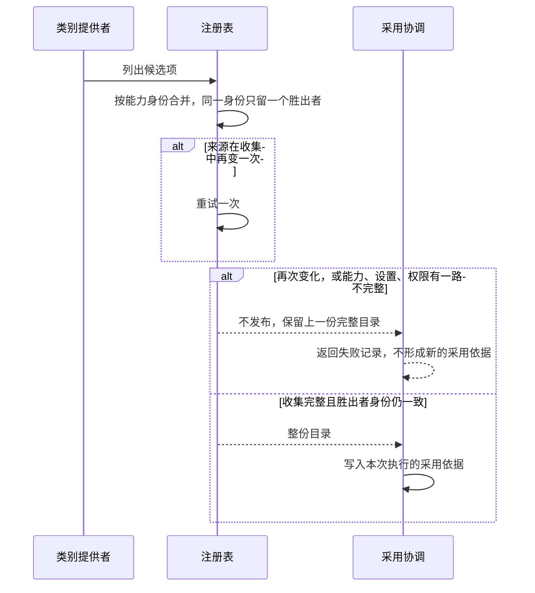

# 定义求值与装配交接行为规格

本目录是 workspace 包 `@omne-harness/assembly`。下面从「一组租约」到「就绪、撤除和远端中断」的关闭行为，已由 [部分接受记录](https://github.com/nemori-ai/omne-harness-lite/issues/222#issuecomment-6162745308) 接受，是该范围的现行契约。[采用与重装](#adoption)已由 [技术接受](https://github.com/nemori-ai/omne-harness-lite/issues/264#issuecomment-6186685166) 接受。求值快照、绑定生效、缺依赖失败和旧新推进权以该节为现行行为。关闭协议的报告种类不在该节改写。

谁必须关闭、配置代际如何留在原提供者，以及同级 Cordis effect 的完成顺序不是关闭顺序，只写在[Cordis 装配与服务生命周期](../../../docs/architecture/deployment/cordis-and-lifecycle.md)。改那些句子只改该页。改下面的报告结果只改本页。

## 一组租约

一个协议实例关闭一个进程里的一组租约。资源拥有者换代时再建一个实例。本页不打开代际，也不把租约迁到另一个提供者。

远端不可用不是停止准入。本地代理仍在时，调用方不调用 `close`。

进程在 `close` 完成之前死亡时，这次调用不产生 `closed`、`failed` 或 `timed-out`。崩溃后的恢复归部署页所说的进程外监督。

步骤失败或报告为超时，不回滚已经发生的外部效果。

调用方提供步骤列表、排空超时和时钟。协议不选择关闭哪个后端。

排空超时小于 0 时，构造失败，错误文本是 `drain timeout is negative`。此时还没有任何租约。等待集合在关闭开始时为空，即使排空超时是 0，步骤仍执行。

## 报告

`closed` 只列出 `run` 已经完成的步骤。它没有失败列表。

`failed` 列出同样这些已完成的步骤、每一项失败 `{ step, message }`，以及被跳过的步骤名。抛错的步骤在 `failures` 里，不在 `steps` 里。

`timed-out` 按 `admit` 的顺序列出仍在等待的名字。名单不包含被排除的调用方。步骤不执行。之后的 `release` 不改写这份报告对象。

## admit

调用方传入租约名字。没有默认调用方、租户或账号。

准入为 `open` 时，空名字抛出 `lease name is empty`。这次调用不新增持有。已有租约保持不变。尚未持有的非空名字返回新的 id 并持有它。已经持有的名字返回同一个 id。

准入为 `stopped` 时，`admit` 抛出 `admission stopped`，并且不新增持有。这也包括 `admit('')`。停止期间不使用空名字错误。

当前 id 被 `release` 之后，再次 `admit` 同一个名字会返回新的 id。

`admit` 返回时，该租约已被持有。不发出事件。

## release

调用方传入租约 id。任何状态下都可以调用 `release`。这包括准入仍开放、正在排空、步骤正在执行，以及报告已经是 `closed`、`failed` 或 `timed-out`。

该 id 是这个名字当前持有的租约时，`release` 移除这个名字。否则 `release` 什么也不做。同一个 id 再次 `release` 什么也不做。上一个 id 的 `release` 不会移除同名的新租约。

`release` 不让这次 `close` 的 promise 确定。`close` 观察剩余的持有集合。报告已经确定之后，`release` 不改写报告。

不发出事件。

## held

调用方不传入参数。返回当前仍被持有的名字。顺序与这些名字进入持有集合的 `admit` 顺序相同。

这次调用不释放租约，不停止准入，也不让 `close` 的 promise 确定。

名字被当前 id 的 `release` 移出之后，不再出现在返回值里。旧 id 不能拆掉同名新租约时，这个名字仍然出现。

不发出事件。

## detachObserver

调用方不传入参数。这次调用不释放租约，不停止准入，也不让 `close` 的 promise 确定。再调用一次仍然什么也不做。不发出事件。

观察者离开不取消已持有的租约。

## close

调用方可以传入 `{ caller: leaseId }`。第一次调用建立唯一的关闭 promise。之后的调用，包括传入另一个 `caller`，以及从步骤或 `clock.delay` 里同步再次调用，都返回同一个 promise，不另起一次关闭。被排除的调用方由第一次调用固定。

第一次的 `caller` 当时已被持有时，排空不等待它。该 id 当时未被持有时，排空等待每一个已持有的租约。

`close` 在返回 promise 之前把准入设为 `stopped`。这发生在排空等待之前，也发生在任何步骤之前。此后的 `admit`，包括排空期间的 `admit`，抛出 `admission stopped`。

排空接着等待，直到每个被等待的租约都被释放，或注入的时钟走完排空超时。关闭开始时等待集合非空，并且排空超时是 0，报告就是 `timed-out`。这次关闭不调用 `clock.delay`。时钟走完时等待集合已经为空，步骤执行。等待集合仍非空，报告是 `timed-out`。

`clock.delay` 拒绝时，关闭 promise 以该错误拒绝。报告不是 `timed-out`，也不是 `failed`。准入保持 `stopped`。

步骤按列表顺序执行。一个步骤是 `{ name, run, when }`。`when` 是 `always` 或 `if-no-failure`。

前面的步骤抛错之后，`always` 步骤仍然执行。`if-no-failure` 步骤被跳过，名字写入 `skipped`。

步骤抛错，或其 promise 拒绝，记为 `{ step: name, message }`。值是 `Error` 时，`message` 取 `Error.message`。否则取 `String(error)`。

任一步骤抛错，或任一步骤被跳过，报告是 `failed`。否则报告是 `closed`。

关闭不取消租约。超时时仍被持有的租约，一直持有到 `release`。

不发出事件。promise 就是结果。这个 promise 只在本进程内有效。它不是跨进程决定。

## 两个实例

换代再建一个协议实例。新实例接受新租约。旧实例看不见它们。

旧实例的 `close` 只等待它自己持有的租约。新实例上的租约不会让这次 `close` 继续等待。旧实例的报告确定之后，新实例仍然可以 `admit`。

旧关闭不释放新实例的租约，也不停止新实例的准入。

## 退出

资源拥有者把退出工作按这个顺序放进步骤列表。在途结果的交接先于关闭后端。

`close` 在第一步执行前停止准入。步骤可以观察到新的 `admit` 抛出 `admission stopped`。

交接步骤失败之后，标成 `always` 的后端步骤仍然执行，报告是 `failed`。标成 `if-no-failure` 的后端步骤被跳过，名字记入 `skipped`。

## 就绪、撤除和远端中断

就绪不是准入 `open`。部署页说明 fiber 处于 `ACTIVE` 并不表示存储可写或远端可达。

撤除本地提供者，是对该实例调用 `close`。远端不可用时，本地实例留在原处。调用方不调用 `close`，也不把准入设为 `stopped`。

## 验证

`tests/close-protocol.spec.ts` 从 `@omne-harness/assembly` 核对关闭行为。`tests/public-entry.spec.ts` 从包名核对公开导出。

在工作树根目录执行：

`pnpm --filter @omne-harness/assembly test`

`verification/close-protocol.test.ts` 与 `verification/process-kill.test.ts` 导入生产模块 `src/close-protocol.ts`。在本目录执行：

`node --experimental-strip-types --test verification/close-protocol.test.ts verification/process-kill.test.ts`

2026-10-14 在 Node v26.0.0 上跑过这两条命令。包测试 28 项通过。目录里的 node 测试 21 项通过。进程杀死试验观察到子进程收到 SIGKILL，并且没有写出关闭报告。本交付接受 Node v26.0.0 作为验证环境。仓库 engines 仍是 `>=24.18.0 <25`。本次接受不修改 engines。

这些测试没有覆盖真实后端，也没有覆盖远端中断。没有可启动的网络、MCP、执行环境或数据库成员，因此没有做这些试验。Cordis 4.0.4 的依赖换代、调用方 Context、清理顺序和异常传播，用 `packages.0.0.1.legacy/core/kernel-basis` 里已有的 basis 探针核对，不把该旧包当成新的辅助层。

## 采用与重装

状态：已由 [技术接受](https://github.com/nemori-ai/omne-harness-lite/issues/264#issuecomment-6186685166) 接受，是该节的现行行为。从「一组租约」到「就绪、撤除和远端中断」的已接受句子保持原样。关闭协议的报告种类不在本节改写。

### 记录

一次求值被采用时，持久记录是本次执行的采用依据。它包含资产与定义版本、装配清单、固定的请求输入、适用执行条件。装配清单保存这次求值和采用依据。清单不是可持久化的活体句柄。装配提供者说明求值来源、锁定规则、版本和失败原因。失败记录不是采用依据，也不是关闭报告。

未写明版本的新求值采用当时的合法胜出者。写明版本则固定为该版本。固定版本不豁免合法性、资格、锁定或撤权。同一次执行从采用依据读取已记下的正文，不改写该正文。尚未发出的 Tool 或 MCP 调用仍可按合法刷新看到新的定义和可用性。Skill 已记录的正文保持不变。尚未取用的 Skill 正文，后续取用读取当时的合法版本。

候选失败时不发布新的采用依据。调用方得到失败记录。旧的合法采用保持不变。

失败记录有四项：种类、身份、原因、旧采用是否保持。种类只允许下表五行，不另设成功种类。从未取得必需能力的合法定义，或 runtime 自身必要依赖无法建立，都用第一行。未知类别用最后一行。

| 种类 | 结果 | 旧采用 |
| --- | --- | --- |
| 缺合法定义 | 装配失败。这不是已采用。 | 保持。从未有过合法采用时写不适用。 |
| 实现暂不可用 | 合法定义和必要绑定已经具备时，形成采用依据，并在依据中标明该能力暂不可用。这不是装配失败。 | 已有旧采用时保持。首次装配没有旧采用时写不适用。新的采用依据仍然形成。 |
| 候选被拒绝 | 返回原因。这不是已采用。 | 保持。从未有过合法采用时写不适用。 |
| 来源未知 | 不用猜测补齐定义。这不是已采用。 | 保持。从未有过合法采用时写不适用。 |
| 无类别拥有者 | 不解释、不采用。 | 保持。从未有过合法采用时写不适用。 |

资产发布、装配成功、运行使用、旧实例退出是四件分开的事。`closed` 只表示该协议实例的排空和步骤结果。

首次装配没有旧采用，失败记录里的旧采用写不适用。必需能力已经有合法定义、资格和本地稳定入口，只是某个 Tool 的远端暂时不可用。调用方得到一份新的采用依据。依据列出该 Tool，并标明暂不可用。这不是装配失败。若 runtime 自身的必要依赖无法建立，调用方得到失败记录，种类用第一行，不得到新的采用依据。这种情况不是实现暂不可用。

### 发布

注册表在同一次求值作用域内合并候选项，只校验公共字段。能力身份是类别加 name。同一个能力身份只留一个胜出者。不同类别下的相同 name 是两个身份，都保留。注册表不解释正文。只有这一份注册表，不按类别再拆一份。

一次收集有一个修订号。身份是主体与范围、来源层序、修订号。这不是存储主键。收集过程中来源变了一次，重试一次。再变，这次结果不完整，不缓存，也不替换上一份完整目录。能力、设置、权限分路求值。一次请求不混合旧模型档案、新工具 schema 和旧实现。任一路不完整，整份不发布。发布是整份替换，或完全不发布。发布前核对胜出者身份与所选候选项一致。不一致则这次目录失效，不采用。取消优先于迟到候选。较新的完整快照胜过较早的完整快照。不完整的快照不胜出。不把某种数据库或 Cordis 布局写成产品要求。

### 入口

新 Run 开始时，比较当前采用依据和这次求值。已变化才重装。未变化则保持当前组合。这次重装是该 Run 的装配。Run 执行中，租户通过系统 slash command 显式要求 reload。该命令不新增资产类别。文件变化或 Git 同步本身不触发重装。没有走到这两个入口时，新的选择可以保存。保存的选择不是采用依据。正在运行的组合保持不变，并告知调用方新选择尚未采用。

候选通过校验前不得取得业务推进资格。新旧并存期间，两者的服务可见范围分开。

重装失败时保持旧的合法采用，并返回原因。候选失败不调用旧实例的 `close`。有效切换撤销旧推进权，并保存接续依据。原执行不因此销毁。新推进者取得原 Run、新 attempt 和候选装配。有效切换也不调用旧实例的 `close`。新候选兑现该能力的必要条件之前，不切换新准入。在此之前，旧租约和必需依赖留在原提供者。

旧实例退出是另一步。资源拥有者对那一组租约调用 `close`。装配协调者编排计划退出的次序。先停相应的新准入，再交接或终结在途责任，再撤除依赖分支，最后关闭共享后端。各资源拥有者关闭自己那一代的协议实例。装配不因此拥有这些资源。`dispose()`、卸载完成或改写当前指针不表示业务收场、结果交接、资源释放或外部效果撤回，也不是 `close`。

本范围的收场证据是 `closed`、`failed`、`timed-out`。超时不是成功收场。进程在 `close` 完成前死亡，则没有报告，不算成功。跨进程关闭尚未定义。更细的报告分类仍由 LIFECYCLE-T01 对账。这三种结果不表示已经满足架构页对关闭报告的全部分类。

原调用归旧的执行拥有者，直到收场或可靠交接。迟到结果须已有仍有效的接收方或可靠记录。旧推进者不得推进新工作。装配不接收、不保存、不重放该结果。协作协议的具体接口归 #262。

runtime 启动前取得已校验的装配依据。同一位置的扩展按装配声明的顺序执行。本节不指定 AgentDefinition 的包拥有者，也不新造扩展接口。
