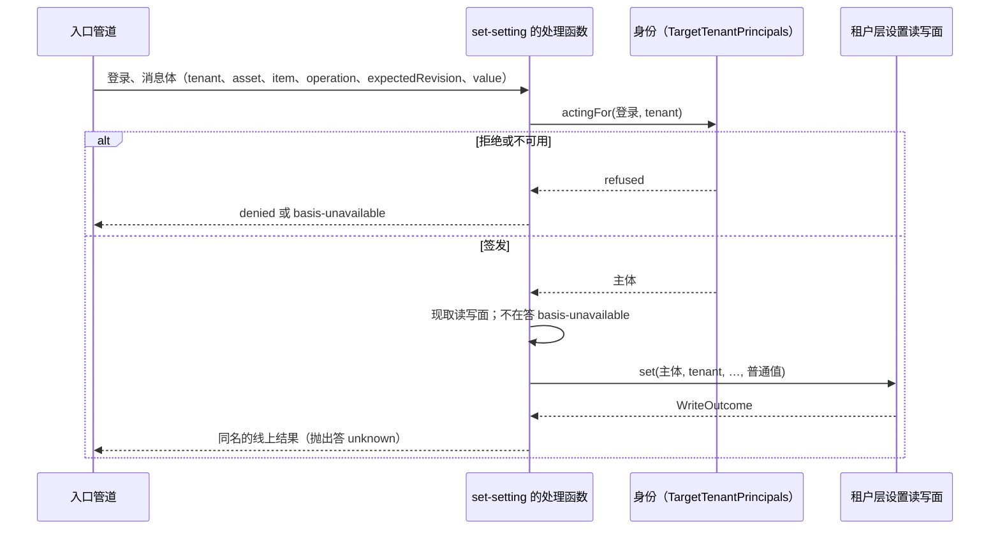

# 关键流程

本文件用可维护的文本图源描述本包的关键业务流程与数据流：参与者、调用时序、数据来源与去向、状态变化、失败分支与生命周期。图旁写前提与边界，不编造流程。

## 一次设置

列出、查看、清除走同样的三步。读的那两个在读写面抛出时答 `basis-unavailable`。

## 失败与生命周期

每一步每种情形的答复见 [SPEC.md](../SPEC.md#全化表)。插件卸载时协议随作用域撤下；在途的调用由入口的信号中止，本包不持有要释放的东西。认回不另走流程：调用者用同一个 `operation` 原样再送，读写面答原来的结果。
