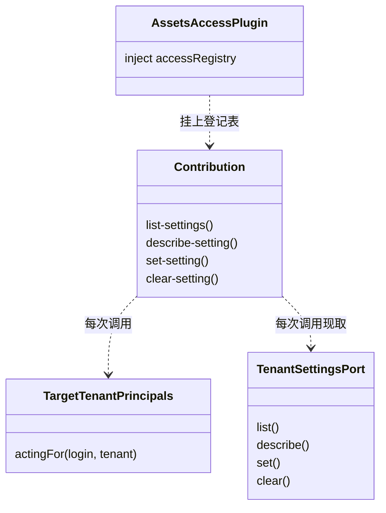

# 对象模型

本文件描述本包内部对象的职责、身份、状态、关联、组合、继承与生命周期，配类图。它不强迫实现改成 class；纯函数或值包写实际模型与不适用项。

## 对象与关系

本包没有有状态的对象。贡献是一组闭包，读装配给的两个端口；插件是一个 Cordis 插件对象。

## 生命周期

插件在作用域装上时挂协议，作用域卸载时撤下。端口不由本包持有：主体端口在插件装上时构造一次，设置端口每次调用现取。
