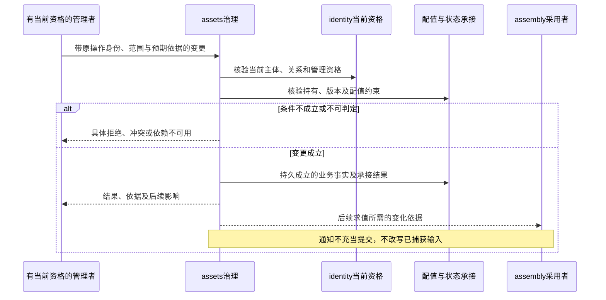
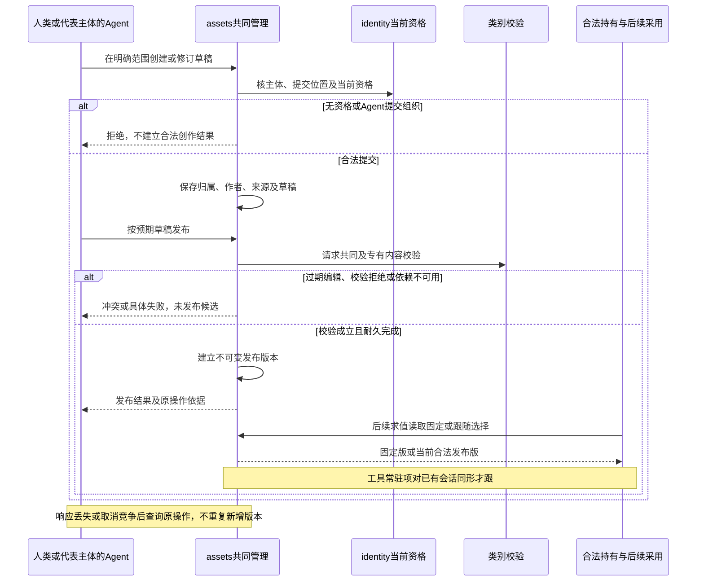
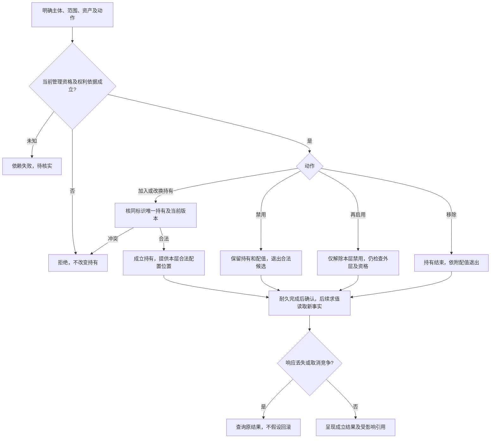
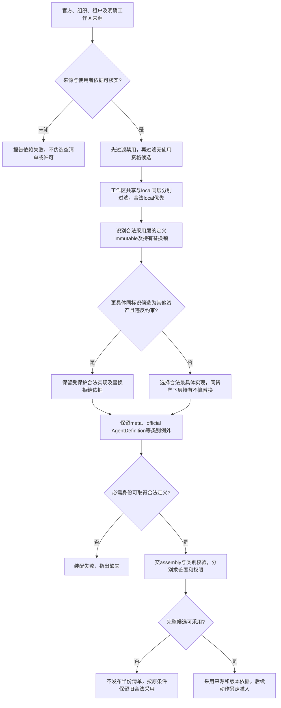
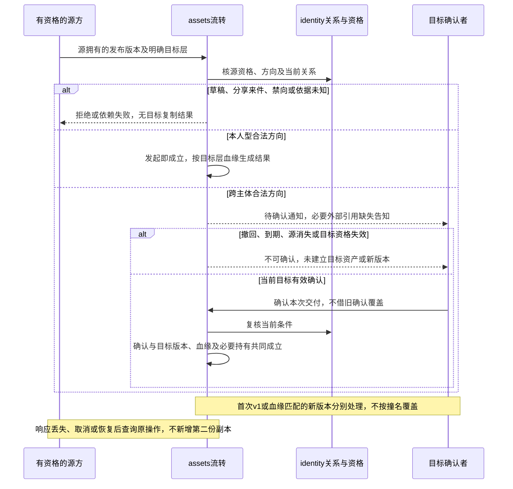
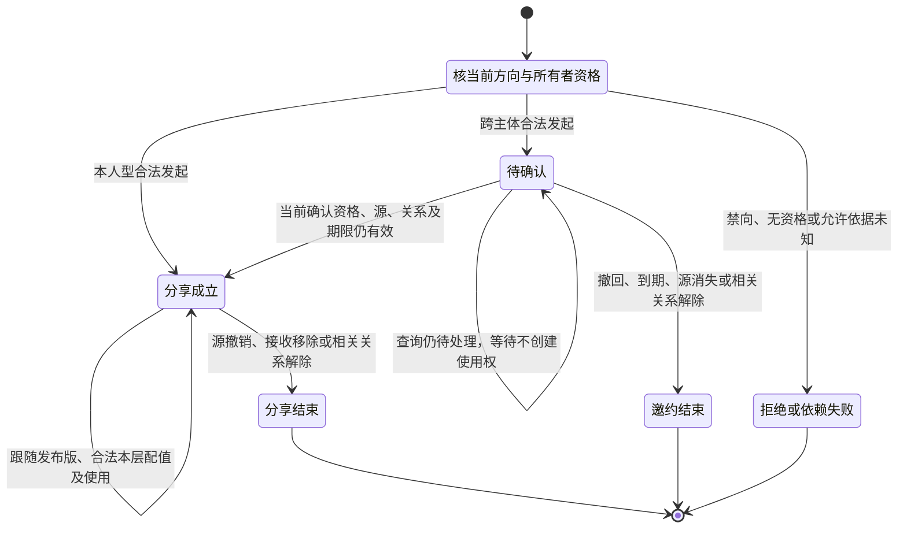
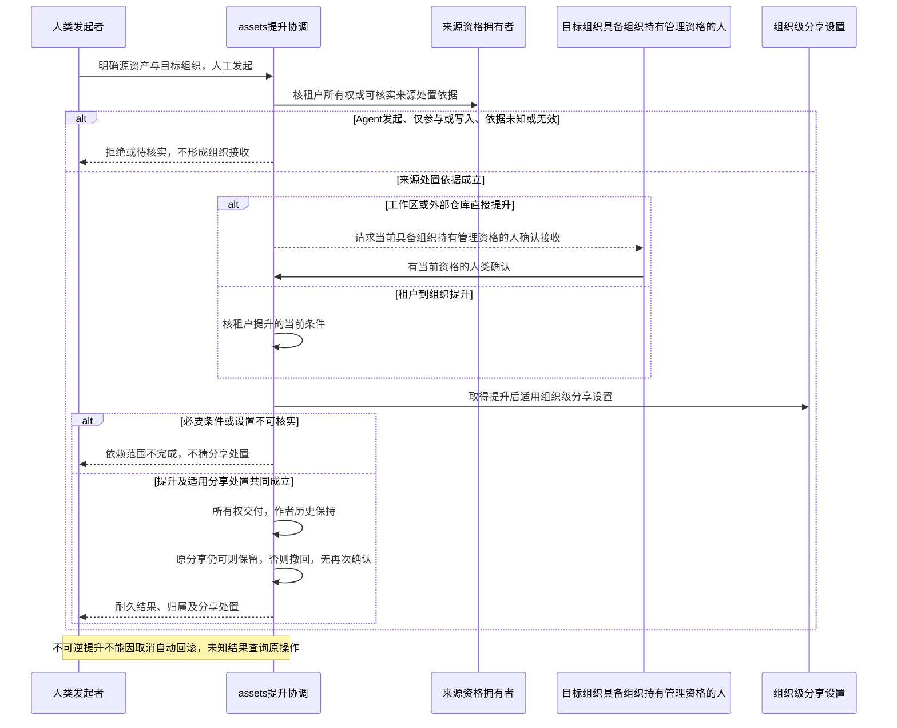

# assets 内部设计

状态为待审技术设计。正式维护位置不授予技术接受、实施或支持；精确公开形状仍待定义。

## 求值责任细化

定义不可替换声明随本次合法采用的资产定义提供，持有层替换锁由具资格的持有管理者设置。两者均由 assets 执行其候选约束，设置值锁和权限允许集合由各自成员求值。被禁用或无使用资格的定义不能锁住其他合法候选；下级声明不能限制上级，同一资产在下级继续持有不属于替换。精确行为归 [assets 候选规格](../SPEC.md#candidate-resolution)。

## 状态、资源与版本

持久业务事实包括资产身份、草稿、发布版本、所有者和作者历史、持有与配值、复制血缘、邀约及分享关系。当前求值结果是由这些事实和当前资格产生的投影；它不能反过来成为原事实的唯一依据。

发布版本不可变，草稿和当前版本选择可演进。定义的 immutable 不自动冻结设置、权限或引用能力，也不把合法发布新版本、禁用或移除变成不允许。能力标识、具体资产、发布版本和持有关系各自可辨；同名不证明同源血缘。源资产更新、选用目标变化与实际调用输入变化是不同事件。

定义数据、执行实现、供给服务分别变化。assets维护其可采用关系，类别拥有者保证当次采用内容与实现匹配。Cordis的插件、作用域和disposer管理装配资源，不能代替资产归属、分享资格、持久提交或实际副作用责任。

合法更新可以影响后续使用，不递归冻结整次Run的所有下级数据。已发模型或工具调用保留原输入与绑定。工作区读取沿实际装配或显式reload；MCP等动态能力刷新沿其类别及调用契约，不能套用旧“attempt内动作集绝不变化”的全局规则。

## 提供方缝

状态：已由 [技术接受](https://github.com/nemori-ai/omne-harness-lite/issues/264#issuecomment-6186685166) 接受。本节的接受状态独立于上文。

注册表若导入每个类别的实现包，共同治理就要识别每一种专有正文。扩展指导不允许这种分支。提供者自己登记。注册表只接收候选项，并按版本取回正文。Tool 与 Skill 的正文形状不同。缝在登记操作上。

## 管理提交与并发交接

0.0.0 -> 0.1.0 的定义发布、持有及配值变更均须保护当前资格、版本和完成事实，不能只在纯计算中校验后就报告系统操作成功。具体原子边界、操作身份和恢复读取协议由相应规格承接，不据图指定分布式事务。

长期流转路径中，分享确认与使用权建立，复制确认与目标版本及血缘建立，提升与分享资格切换，都必须在自身完成语义下共同成立。并发确认、撤回、关系解除和到期不能产生既结束又可用的同一关系。这些路径的阶段归属沿上表，不扩大为九项阶段交付的前置条件。

settings和permissions依赖持有及类别形状。与持有移除竞争的配值不能脱离持有成立，类别项删除后旧配值不能继续生效。较旧求值或更新结果不能覆盖已明确生效的新选择。恢复按原操作查询确认事实，不能依靠重新执行一次副作用“补齐”未知结果。

## 撤销、失败与接续

分享结束、禁用、移除及撤权分别改变自身事实，后续准入读取当前有效依据。它们不自动停止三个独立runtime，也不撤销已发生的费用或外部效果。Session负责逻辑治理；assets只给其后续选入与采用提供合法状态，不能因某个runtime销毁而删除持有或分享。

会话历史中的已知Tool、Skill、MCP由会话与能力拥有者保留，当前资产候选过滤不抹掉该历史身份。对已撤权方停止交付新定义和私有内容，仍保留合法执行方的收场责任。

依赖暂不可用时不产出伪造空清单、许可或管理成功。能核实的拒绝分支仍可拒绝；需要允许依据而无法取得时暂停该依赖范围。先前合法装配可按原采用条件保留，不意味着它可以无限使用过期授权。普通故障恢复保留已确认事实；灾后回退不能以旧分享或旧管理员状态重新开放。

## 尚需细化

直接人工提升由资产拥有者协调来源处置资格与目标组织具备“组织持有管理”资格者的接收确认。身份、组织角色及适用授权依据仍由原拥有者提供；工作区参与或仓库写入资格不能替代资产处置资格。未经目标确认不呈现已接收的组织资产，Agent没有发起或确认入口。托管工作区的发起资格来自治理所有者或其明确授权；外部仓库的资格来自可核实的资产处置权或明确授权。访问、参与、写入或作者身份本身不构成处置资格，无法核实依据时不得确认合法提升。

公开扩展及类型契约、共同完成的原子协议、查询与恢复接口、来源及采用版本键、缓存失效和类别兼容校验尚需机制设计。它们是完整实施前须补齐的技术表达，不将已选能力降为文档或类型交付。直接提升的提交、确认及恢复机制与组织创作委托分别细化，不凭产品路径选择补出公开API或默认资格。连接件范围继续搁置。

## 创作、发布与版本选用

对应 [AR-J01](../../../../.meta_harness/design/product/assets-and-rules/design.md#ar-j01)。共同契约把能力标识、具体资产、草稿、发布版本、持有及配值分开。类别通过共同声明与校验契约接入，专有内容和实际使用由类别继续拥有；新类别接入不证明其专有业务已经支持。精确行为归 [assets 定义与版本](../SPEC.md#definition-and-version)。

人类所有者映射及历史作者沿 assets 规格，Agent 产出只归合法提交的租户或工作区，不能从会话归属反推组织所有。固定版与跟随版在持有上分别记录，分享只能跟随。版本变化作用于后续采用，不改写已发调用输入。例外：跟随版对已有会话的工具常驻项只在同形时才跟，见 Tool 契约的[会话常驻规则](../../../tool/tool-contract/SPEC.md#会话常驻规则r1r5)。普通成员组织创作委托及上架制度仍沿 [ASSET-N01](../../../../.meta_harness/design/product/assets-and-rules/design.md#未决问题与待定事项)，不由归属映射补资格；公共草稿发布仍是阶段内完整行为。

## 持有层的加入、禁用与移除

对应 [AR-J02](../../../../.meta_harness/design/product/assets-and-rules/design.md#ar-j02)。assets 协调持有，settings 与 permissions 分别承接依附配值，精确行为归 [持有](../SPEC.md#holding)及[设置配值](../../settings/SPEC.md#assignment)。

图不把持有映射为运行资源。移除与配值写入必须在各自完成语义下符合当前持有，不能留下脱离持有的有效配值。同标识新记录可并存，加入或保存不能暗换旧持有。禁用不等于某项操作权限不允许；禁用、移除或取消管理请求均不证明独立调用停止。受影响引用不能被默认级联删除。

## 同标识选择与不可替换约束

对应 [AR-J03](../../../../.meta_harness/design/product/assets-and-rules/design.md#ar-j03)。精确算法归 [assets 候选](../SPEC.md#candidate-resolution)，共同使用资格归 [permissions](../../permissions/SPEC.md#usable-by)。assembly 使用候选解析选入身份的实现，身份名单来源与完整合法实现范围分开。

immutable 在该定义合法采用的层向更具体层阻止同标识其他资产替换，不要求另加持有锁，不反向限制上级。被过滤的定义或持有不能凭锁截断合法回退。定义 immutable、持有替换锁、设置值锁和权限上界分别执行，定义不可替换不冻结属性，也不阻止合法新版本、禁用或移除。

替换不搬原具体资产设置与凭据，能力身份的锁定权限界和主动配置的不允许操作值仍约束替换件。少声明受限项不能逃出关口；约束匹配未知时不放行。已知 Tool、Skill、MCP 的身份与不可用解释由 Session 及类别保留，候选过滤不删历史。失败保留旧采用不等于旧授权无限有效，恢复时须核当前允许依据。

## 复制与同源更新

对应 [AR-J07](../../../../.meta_harness/design/product/assets-and-rules/design.md#ar-j07)，精确规则归 [assets 复制](../SPEC.md#copy)。这是 CAP-AR12 的长期路径。资产流转入口由 assets 协调当前方向、源权利及目标层确认，不把完整相邻身份治理搬入此域。

首次复制有目标独立所有权及 v1，不搬源配值；无同标识持有才同时加入，有则并存。重复匹配目标层同源血缘，全量生成并采用新版本，不混目标本地内容、不覆盖目标配值；删项退出、新项默认、未变项保留。源后续改动不自动传播，旧目标发布版仍可查询回退。本人型、组织型及禁止方向沿[产品原规则](../../../../.meta_harness/design/product/assets-and-rules/design.md#circulation)核验，团队资产不能进个人组织或流出隶属树，导出等路径不得旁路。未知结果不报失败再复制，完成需达到耐久确认边界。

## 分享的确认、使用与结束

对应 [AR-J08](../../../../.meta_harness/design/product/assets-and-rules/design.md#ar-j08)，精确规则归 [assets 分享](../SPEC.md#sharing)。这是 CAP-AR13 的长期路径。下图仅表示邀请与分享的逻辑事实，不发明独立公开状态类型。

已确认分享没有自动到期或暂停，邀请时长与它分开。给组织由目标管理员确认和移除，给租户由本人确认和移除，普通成员不能代组织接收。接收方只获使用权、跟随版本及合法本层配值，可合法替换或移除，不能编辑、复制、提升或再分享。分享终局不会因成员重入、重新隶属或恢复旧备份而复活，重新发起是新关系。

确认与撤回、到期及关系变化竞争时须有符合当前条件的单一事实，不可既结束又建立可用权利。撤回待确认邀请不等于撤销已成立分享，取消或失联先查询原结果。关系结束只改变后续采用与准入，独立执行继续按自身收场。时限事实或资格未知不默认批准；通知送达不是分享完成。某确认者失去管理员资格只拒绝该人的确认，不据此结束组织的整个邀请；其他仍有资格的管理员可在邀请仍有效时确认。

## 人工提升与组织接收

对应 [AR-J09](../../../../.meta_harness/design/product/assets-and-rules/design.md#ar-j09)，精确规则归 [assets 提升](../SPEC.md#promotion)。这是 CAP-AR14 的长期路径。源处置资格与目标接收分别成立，不把普通成员创作委托补成通用提升资格。

租户提升保留原持有及配值，组织不自动新增持有。直接工作区或仓库路径不要求先转租户；托管工作区治理所有者或明确授权者、外部仓库具可核实资产处置权或明确授权者才可发起，目标组织当前具备“组织持有管理”资格的人确认前不能宣称已接收。访问、参与、仓库写入和 Agent 作者身份均不足。原分享按组织级设置判断，不一律结束，也不新设重新确认。直接来源的源侧处置与持有细节不套用租户提升，精确核实、确认、恢复仍由 ASSET-M01 和 assets 规格细化，图不补新的等待时限或接收对象。

## ASSET-M01 完成与来源协议

阶段内草稿发布、持有与配值修改可能和当前资格、定义及来源变化竞争，确认成立后可能丢失响应。assets 协调自己的定义、持有及长期流转结果，settings 与 permissions 各自承接配值提交，身份及实际执行拥有者提供可信资格和准入边界。

相应机制设计须明确原操作身份、版本依据、提交与结果查询接口。同一原逻辑操作可查询结果，治理事实与确认共同成立，旧编辑不能覆盖确认新事实，未知来源与许可依据不得允许。0.0.0 -> 0.1.0 的公共操作仍须完整支持；流转协议仅在对应长期复制、分享或提升能力开展时补齐，未选流转不阻塞九项公共治理。

权限分档的顺序与距离表示由 [permissions 机制](../../permissions/docs/internals.md#asset-m01-权限机制细化)细化。公共协议未定，不选择数据库、锁或公开 API，实施依赖它的路径须先形成精确交接。
