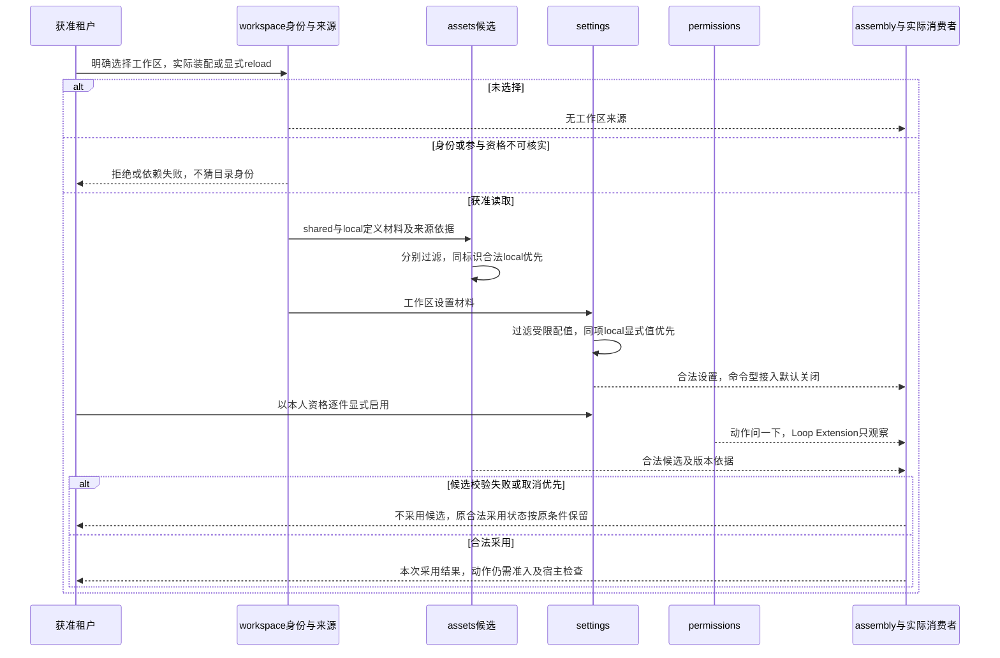
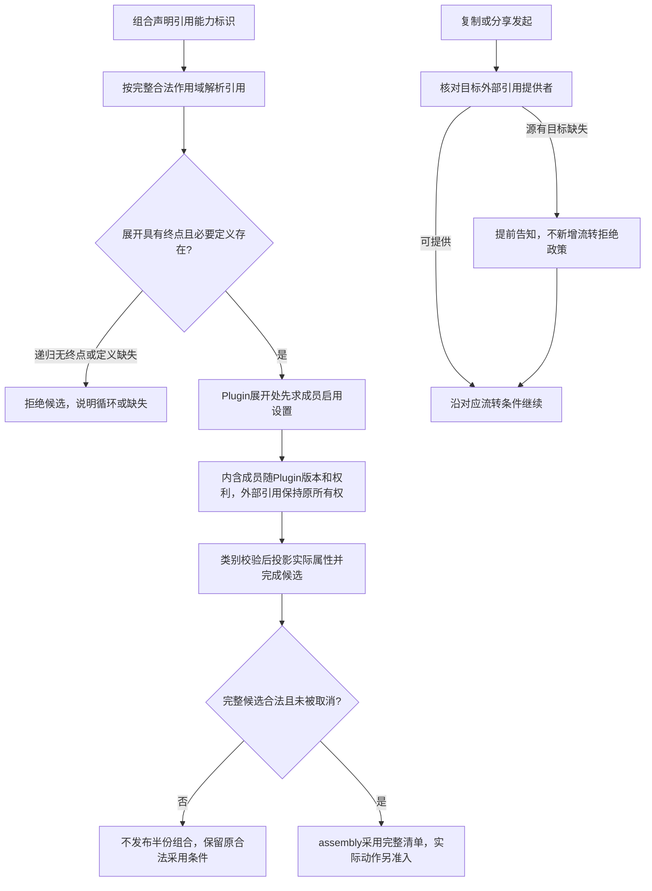

# 资产组关键协作

状态为待审技术设计。正式维护位置不授予技术接受、实施或支持；精确公开形状仍待定义。

## 求值责任细化

1. 取得明确作用域内可访问的持有及当前资格，保留来源与精确版本依据。
2. 先禁用过滤，再使用资格过滤，最后按合法同标识层序选择实现，遵守定义不可替换声明及持有层替换锁。工作区共享与local在同层内部过滤及择取。
3. assembly按会话类型要求、定义显式依赖、三类能力的继承声明及排除规则选入。能力身份来源与最终实现来源分别记录。
4. 类别拥有者确认专有内容，settings与permissions分别投影并求值。模型档案等专用路由规则不被共同资产算法替换。
5. assembly发布合法清单，实际动作仍须准入与环境检查。可读取定义或已完成装配不能证明动作获准。

## 工作区的共享、本地覆盖与显式启用

对应 [AR-J04](../../../.meta_harness/design/product/assets-and-rules/design.md#ar-j04)。workspace 提供身份及访问关系，来源读取在实际装配或显式 reload 时发生。assets 择取实现，settings 做同层设置合成与逐件启用，permissions 提供保守权限。精确规则分别归 [候选](../assets/SPEC.md#candidate-resolution)、[工作区设置](../settings/SPEC.md#workspace)和[保守权限](../permissions/SPEC.md#workspace)。

shared 与 local 是同一层，共用实例中的 local 不属于任何租户私域。完整 local 替换与仅覆盖共享实现设置分别处理，前者不叠加后者的配值。工作区自己的落点声明及定义 immutable 不等于给其他资产覆盖落点或写治理锁，受限配值过滤不能误删合法定义声明。工作区只能禁用自己提供的资产，不能授予授权或权限配值；仓库不得替用户逐件启用命令。文件编辑、Git 同步和下一 Run 均不自动刷新；刷新取消与交接由 assembly 沿现行协议处理，普通恢复不能重新猜来源或启用状态。

## 组合、内含成员与外部引用

对应 [AR-J06](../../../.meta_harness/design/product/assets-and-rules/design.md#ar-j06)，精确规则归 [assets 组合](../assets/SPEC.md#composition)和 [settings 展开时点](../settings/SPEC.md#adoption)。assembly 协调整体展开，类别拥有专有组合语义；此路径属于 CAP-AR06 的长期范围。

Skill 与 Tool 配套互引不等于无终点递归展开。外部引用不能因打包、复制或分享变成目标所有，Plugin 内含成员没有独立顶层卸载。依赖不可用须可辨，不把未知当不存在而替用户决定流转。取消不回滚已成立流转，恢复读取原操作和采用依据，不自动重做；未知类别组合及兼容协议沿原规格补齐，不能以开放契约宣称任意组合已采用。
