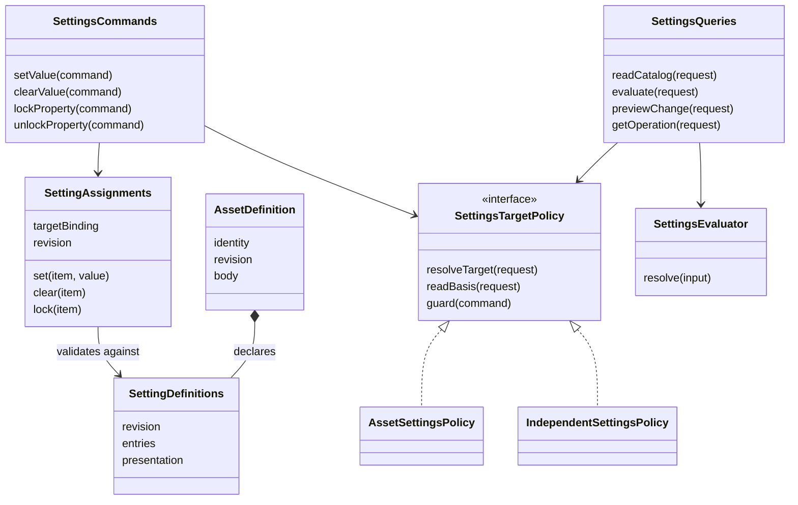

# 设置的独立使用、资产组合与动态目录

动态贡献与授权的共同生命周期增量见[治理贡献合同](governance-contributions.md)。该 HJ0 候选细化精确租约、管理/运行目录、采用围栏与重装配，不替代本页的配值规则。

本页维护资产与设置协作所需的数理模型、领域分解与对象责任。产品依据为[设置组合](../../../.meta_harness/design/product/assets-and-rules/design.md#settings-composition)。设置可独立使用，也可组合进资产；技术类型在下文仅为设计名称，不是现有公开导出。精确 wire Schema、持久化提供者及跨域装配仍须由实现提交兑现。

## 责任与边界

| 事实 | 唯一拥有者 | 设置如何消费 |
| --- | --- | --- |
| 资产身份、固定定义、持有、发布与替换 | Assets | 资产接入策略提供不可变声明来源与当前目标守卫 |
| 配置含义、合法值、可配置部分、业务采用时点 | 功能或资产类别 | 版本化声明、专有验证和消费适配 |
| 配值、清除、属性锁、共同求值、目录聚合 | Settings | 独立应用服务，不内置 Calendar、Schedule、Tool 等业务分支 |
| 可信主体、关系、管理动作准入 | Identity、Permissions 及目标拥有者 | 当前资格与条件提交参与者；目标 ID 不充当认证 |
| 资产选择、组合展开、运行采用 | Assembly 与实际消费者 | 明确选择依据，完整采用；设置保存不代表运行已改变 |
| 注册资源、服务生命周期 | Cordis 装配提供者 | 注入窄服务接口；注册不创建业务持有，撤除不删除持久配值 |

独立设置使用明确的定义命名空间和配置目标，不必创建资产。目标策略描述自己的管理资格、允许来源和生命周期，不允许普通贡献者更改租户隔离、秘密保护或资产的既定治理规则。资产接入是其中一种组合：资产包含设置声明，持有提供资产配值资格。独立目标的来源链不能直接套用资产的默认、组织、租户、工作区和会话链。

部署参数继续沿发行层与运维者层插件树。账号偏好的存储和 U03 组织影响范围继续由原拥有者处理；统一目录可通过公开适配显示，不复制权威事实。贡献登记与域内业务实例生命周期不同，不能要求运行工具后才能配置工具。

## 数理模型与全化

令 `C` 为受信调用上下文，`T` 为配置目标，`D` 为带版本的声明集合，`B` 为固定依据，`A` 为来源配值。`B` 含目标、定义、资格、来源及选择版本；其版本向量不自行证明各事实曾同时成立。取得一致依据由读取协议负责。

`TargetPolicy(C,T,B)` 返回管理资格、允许来源及目标有效性，或具名失败。资产策略消费合法持有；独立策略消费其目标的实际管理关系。两种策略都不授予执行许可。

`Declarations(C,T,B)` 返回该目标获准可见的固定声明。资产路径只能从选中定义派生，不能由另一份全局字段目录补项。登记的提供者负责解析能力，不因此把字段授予所有用户。

`Project(mode,C,T,D,B)` 形成设置视图：

- `management` 读取可配置目标及可见项，包含可合法配置但尚未启用的资产。
- `runtime` 仅针对调用方提供并核验的实际选择；不自行选择资产或从 fiber 清单猜测租户身份。

对每项 `d`，先按类别与目标策略过滤合法来源，再归约：

`Resolve(d,A,B) = Fold(d.rule, FilterLegal(d,A,B))`。

普通项在允许来源次序上选择最具体的合法显式值，并受上层属性锁约束。工作区先在同层选 local 显式值，否则 shared；跨层禁用另用逻辑或。缺省、显式 false 和声明允许的 null 是不同值。秘密项只返回安全绑定描述，不把明文加入普通结果。

`Evaluate(C,T,D,A,B,K)` 的全化结果为：

```text
Complete(snapshot)
| InvalidInput(details)
| Rejected(reason)
| Unavailable(dependency)
| IncompatibleDefinition(item)
| BasisChanged(retryBasis)
| LimitExceeded(budget)
```

这覆盖有界、可解析请求及纯求值的所有分支。合法无项是 `Complete` 的空集合，依赖失败不是空集合。普通求值不将缺失项或不兼容旧值默默当默认值。预算 `K` 限制声明数、嵌套深度、值大小与步骤；外部调用的截止、取消和未知提交结果由应用协议处理，不由数学函数掩盖。

组合为带来源标签的不交并 `D = ⨆ D_i`，键由目标、声明来源身份和项标识确定。相同 key / 版本的不同内容拒绝，不能 last-write-wins。不同资产显示名称相同不合并；显示组不是配值身份或授权范围。资产组合递归先处理已知成员开关，再按有限依赖图展开；循环或预算不足返回失败，不重复试算到“稳定”。

## 面向产品的统一目录

应用服务 `readCatalog` 是统一读取入口。输入为受信调用身份、明确部署/逻辑服务范围、目标范围、管理或运行视图、语言偏好、筛选和分页游标。租户不能通过改变范围字符串读取其他租户或运维私有配置；“当前服务端”不是所有节点和所有身份的无条件全集。

一次目录快照聚合当前已装配、可解析且对调用者合法可见的贡献，并投影相应目标声明。执行实例尚未启动不使可管理项消失。服务提供者暂不可用与合法移除分别呈现；没有权限的项不通过“错误详情”泄漏其存在。目录可以展示明确授权的局部不可用状态，但必须标明不完整；不完整目录不能作为运行采用快照。

分页游标绑定目录快照、调用范围、筛选、排序和授权依据。后续页在该快照上读取，无法继续满足依据时返回过期/重建提示，不能混入新一代字段。获取后续页仍核验访问资格；撤权后不能凭旧游标继续读取。目录有快照寿命和大小预算，不要求无限保留所有版本。一次接口族统一读取，不等于一次无限大响应。

### 声明中的语义与展示信息

| 信息 | 定义提供者必须说明 | 求值或目录服务补充 |
| --- | --- | --- |
| 身份与归组 | 稳定项标识、组标识、定义版本、组/项人可读名称与说明 | 来源、目标、目录快照、冲突或退役状态 |
| 含义与取值 | 用途、类型、约束；单位/枚举含义/范围在适用时必填 | 当前合法取值域与不可选原因；动态依赖失败不伪造选项 |
| 初值与缺省 | 是否必填、默认值或无默认、清除覆盖的后果 | 当前是否显式设置、生效值及实际来源 |
| 修改后果 | 使用时点、影响范围、是否需显式 reload/后续运行 | 已保存与已采用分别报告，不伪造消费者回执 |
| 安全与可操作性 | 敏感性、是否秘密、专有依赖和约束 | 可读/可写/锁定状态和允许披露的原因 |
| 语言与格式 | 文案 key 及可读后备文本；安全示例按需提供 | 语言回退结果，标准控件提示，不执行任意 HTML/JS |

数据类型不足以表达 UX。例如数字还须解释单位、边界与修改效果；枚举不能只有内部代码。秘密项不提供真实凭据示例、默认明文或普通读回值。前端使用 Schema 与语义元数据生成可理解的界面，但服务端仍执行全部校验。客户端条件显示不承担授权。复杂业务交互保留由产品专用界面承接，不能为了自动表单把含义压成任意字符串。

分组只负责呈现，可以按功能、子系统或工具组组织。允许多层组时须无环、有深度上限并使用稳定路径；排序不能参与配置优先级。同组项可以来自不同目标，跨目标批量保存不自动具有事务原子性。

## DDD：聚合、值对象与服务

本表描述技术责任，不把每个类变成独立业务对象或数据表。

| 模型 | 性质与拥有者 | 不变量及生命周期 |
| --- | --- | --- |
| 资产定义与发布版本 | Assets 的现有模型 | 已发布字节不变；组合声明不因配值而改写 |
| 设置声明集 `SettingDefinitions` | 功能拥有者提供的不可变值 | 版本/摘要固定，项 key 唯一，语义元数据完整；资产路径来源必须为该资产定义 |
| 配置目标绑定 `SettingsTargetBinding` | 目标策略提供的值 | 目标、范围、策略身份分离；引用本身不授予资格 |
| 配值集合 `SettingAssignments` | Settings 的写入聚合 | 限于一个支持的配置目标和提交范围；保存 revision、值与属性锁，不能越权写任意目标 |
| 设置目录/求值结果 | 不可变投影 | 固定来源依据与视图模式；动态更新形成新快照，不原地修改已采用结果 |
| 操作结果账 | 应用持久化责任 | 原操作身份与请求摘要绑定；相同请求重试返回同一终态，不同内容拒绝 |
| 贡献登记 | 装配资源 | 固定提供者版本及租约；撤除停止新使用，不删除业务配值或复活已撤销权利 |

资产持有不是 Settings 的聚合子实体。资产删除/持有结束与配值失效的协调通过当前性协议实现，不通过跨包修改对象内部字段。反过来，独立设置不能为了复用这个聚合而制造假持有。

## OOP 组合与 SOLID



- **单一职责**：声明描述含义；聚合保护自己的配值；纯求值计算结果；应用服务安排读取与提交；资产策略解释持有；采用者处理运行变更。没有包揽全部步骤的 `SettingsManager`。
- **开闭原则**：新功能通过版本化声明提供者接入。公共求值核不新增“如果是 Calendar/Tool”分支。新增治理语义仍须由公共契约拥有者接受，不允许扩展者覆盖共同安全规则。
- **里氏替换**：目标策略必须兑现相同的当前性、可辨失败和隔离要求。能力不同在调用前显式声明；不能用空成功冒充不支持锁或强提交。不同策略的合法来源不同，这种差异是契约输入，不是隐藏前置条件。
- **接口隔离**：目录查询、命令、贡献登记、秘密使用与提交参与者分别为窄端口。查询消费者不取得秘密写入或登记权限；纯计算不要求加载存储。
- **依赖倒置**：应用服务依赖声明、目标、来源和提交端口；local 提供者实现端口。Cordis 通过 inject/provide 装配，核心不依赖 Context、具体数据库或 Assets 私有类。

`AssetDefinition` 组合设置声明，不继承 `Settings`。独立使用直接将声明与合法目标交给相同服务。先按真实调用实现接口；不为每个值对象生成基类、工厂或继承树。纯函数可作为对象内部实现，不为 OOP 形式引入可变全局状态。

## 应用协议与并发边界

声明版本、配值 revision、来源采用计数、目录快照和消费者采用序号是不同轴。不能把它们压成一个没有共同提交保证的全局 version。共同命令输入至少携带原操作身份、请求摘要、明确目标、项、声明版本及预期配值 revision；调用者身份从受信边界取得。

`previewChange` 是只读演算，不预留资格。`setValue/clearValue/lockProperty/unlockProperty` 在提交边界重新核对目标有效性、资格、声明、允许来源、锁及预期 revision。相同操作身份/摘要幂等，不同摘要拒绝；取消不能回滚已提交事实；未知结果走 `getOperation`。一个提交范围内的配值变化、来源计数、原操作结果与可恢复通知共同持久成立。

来源计数计原始配值和属性锁的变化，即使它当前被更具体来源遮蔽也须增加。纯幂等重试不再增加。通知丢失后消费者可以通过计数及合法重读恢复，不依靠每条通知恰好收到一次。

local 强提交需要集成协调器与目标拥有者共同实现事务参与接口：所有改变同一当前性条件的写入在同一受支持事务边界更新/核验 fence。Settings 不读外域私表。这个集成前提必须覆盖撤权、持有移除、定义删项和锁变化的真实写者；漏一个就不能声称守住竞态。

跨进程使用相同数据契约，但提供者须兑现等价的条件提交和一致读取。版本向量、签名、重试和本地 mutex 都不替代协调协议。暂不选定分布式事务技术；不支持保证时明确报不支持/不可用，不静默退化。共享服务不等于共享数据库。

## 性质与证明义务

| 性质 | 条件与推论 | 验证拥有者 |
| --- | --- | --- |
| P1 声明与配值分离 | 配值命令不改变固定定义；资产组合与独立使用使用同一设置核 | Settings / Assets；纯函数与公开入口符合性 |
| P2 合法投影 | 管理/运行模式只包含该模式合法可见项；注册不授予持有或权限 | 目标策略、目录服务；越权、未启用资产与缺提供者反例 |
| P3 求值全化 | 有界声明/来源/预算上每个分支有明确结果；未知不变成缺省 | 纯核心；表驱动、性质测试、具名变异 |
| P4 当前提交 | 写入在线性化点满足目标、资格、声明和预期 revision | 集成参与者；撤权/删项/旧编辑交错及故障注入 |
| P5 完整采用 | 同一采用序列不让晚到旧结果替换新结果；已经捕获输入不改写 | Settings 依据 + Assembly 消费者；有限模型及真实采用测试 |
| P6 可靠完成 | 已确认配值、计数、操作结果与待通知事实共同持久；重试不重复写 | local / Storage；断响应、进程/OS/断电恢复另行验证 |
| P7 保密与隔离 | 无权主体不影响/读取别人的私有值；普通目录不含秘密明文 | 所有托管边界；跨租户与泄漏负例 |
| P8 一致目录 | 分页绑定同一快照和权限范围；撤权后不继续交付旧页 | 目录服务；换代、过期、撤权、分组冲突和大小预算 |

对固定依据与有界来源链，P3 可按折叠步数归纳：初始值只有声明默认/无值；每步只接受合法来源，显式值和缺省分开；锁定后的不允许覆盖保持前值；每步保存来源。因此最终值来自合法且未被锁截断的来源。禁用逻辑另行归纳，不推广为全部布尔项规则。

P4/P5/P6 的有限交错模型放在 [Settings 验证资源](../settings/verification/README.md)。模型证明范围、提供者前提、负控及实现映射分别记录。数学推导和 TLC 完成不证明真实提供者或部署已正确；尚无实现映射时明确未完成。

## 实施与接受边界

Settings 已有声明、纯求值、变更决定及应用服务公开入口。Assets 类别契约可从固定正文派生设置声明，投影保留具体资产与版本，注册本身不创建持有。托管 SQL、持有生命周期与真实资格组合仍需独立接受。精确类型与 Schema 归源码，行为归 SPEC，机制归 internals；本页不成为第二套手写类型定义。

共同治理设计与模型验证不解除缺少 Settings 提供者的运行阻塞。跨领域实现、最终 UI 和集成轨道采用分别验收，不由这份模型自动授予。

## 本地实现映射与采用边界

当前实现以 settings 的纯函数和应用端口为核心，settings-local 提供本地事务、目录捕获、独立目标与维护能力，assets-local 提供资产发布和持有事实。Identity 公共资格预留负责跨域撤权协调。架构与真实源码映射见 [本地架构](../settings-local/docs/architecture.md)。

读取是一次被资格预留保护的快照捕获，不保留将来写权。后续写命令重新预留并检查目标当前事实。贡献卸载影响目录可用性，但不会撤销拥有者的配置授权，也不会删除配值。显式重新采用属于受信部署维护能力，不能从普通配值权推导其权限。

固定模型枚举与生产符合性是不同证据。有限模型不覆盖完整目录、分页或物理故障。实际反例沿 [验证映射](../settings/verification/README.md)，最终 UI、秘密托管、远程服务和执行采用不在本地纵切内。
