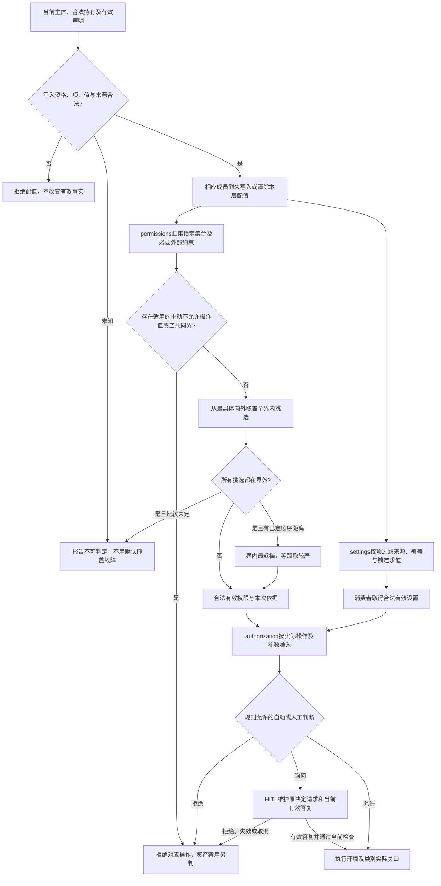

# permissions 内部设计

状态为待审技术设计。正式维护位置不授予技术接受、实施或支持；精确公开形状仍待定义。

## 求值责任细化

组织、租户或会话主动配成“不允许执行该权限控制的操作”的权限值不可被下层放宽，即使未加锁；作者默认不允许仅为最外层挑选。permissions 提供这一约束，assets 的同标识替换及 identity、HITL 和实际执行均不能解除它。资产禁用是另一项持有治理事实，不与操作权限限制互换。精确求值归 [permissions](../SPEC.md#bounds-and-picks)。

## 设置求值、权限求值与实际准入

对应 [AR-J05](../../../../.meta_harness/design/product/assets-and-rules/design.md#ar-j05)。settings 拥有 [声明](../../settings/SPEC.md#declaration)、[配值](../../settings/SPEC.md#assignment)及[采用](../../settings/SPEC.md#adoption)，permissions 拥有[上界与挑选](../SPEC.md#bounds-and-picks)、[权限写入](../SPEC.md#writes)及[实际准入依据](../SPEC.md#admission-and-revocation)。类别提供真实权限项和执行关口，不能由作者自拟无人检查的项。

设置缺省、false、合法 null 和清除分别沿项声明，清除本层值后重新沿当前来源求值。普通设置选最具体合法值，禁用独立采用跨层任一 true 规则，shared 与 local 同层显式值规则先行。设置值锁不自动锁替换，替换也不移交设置值。

权限默认、组织、租户、会话四层配值之外，AgentDefinition 等拥有者的适用约束仍共同构成上界，不能另造配值层或遗漏约束。组织、租户、会话主动配置的不允许具体操作值即使未锁也不可放宽；作者出厂默认不允许只是挑选。HITL 与模式不能覆盖主动禁止、工作区保守规则或执行环境。用户明确要求租户全局允许时，authorization 核表达范围与写入资格，permissions 再核当前上界后写租户值；单次或会话批准不走这条持久写入路径。

等待、排队、取消和恢复跨越当前资格变化，动作准入沿原操作条件复核。实际执行和效果归类别，准入通过不是执行成功，撤权不是停止。配值确认丢失或取消竞争时查询原结果；对已成立修改不能用撤销请求声称自动回滚。分档表示、缓存条件及原子准入仍由 ASSET-M01 和相应规格细化。

## ASSET-M01 权限机制细化

permissions 须形成权限分档顺序与距离的精确表示、实际约束匹配、缓存有效条件及原子准入、版本协议。未有已定比较关系时不得猜最近档，必要约束来源未知时不得放行。公开权限形状及语义错误仍待设计。

成员将可信权限依据交给 authorization 与实际执行边界，由各自拥有者核当前实际动作及参数。配值提交和查询遵守 [ASSET-M01 完成协议](../../assets/docs/internals.md#asset-m01-完成与来源协议)，不能以集合计算通过证明实际边界已兑现。连续治理变化、持有移除、等待和恢复的组合验证沿 SPEC 及组验证责任承接。
