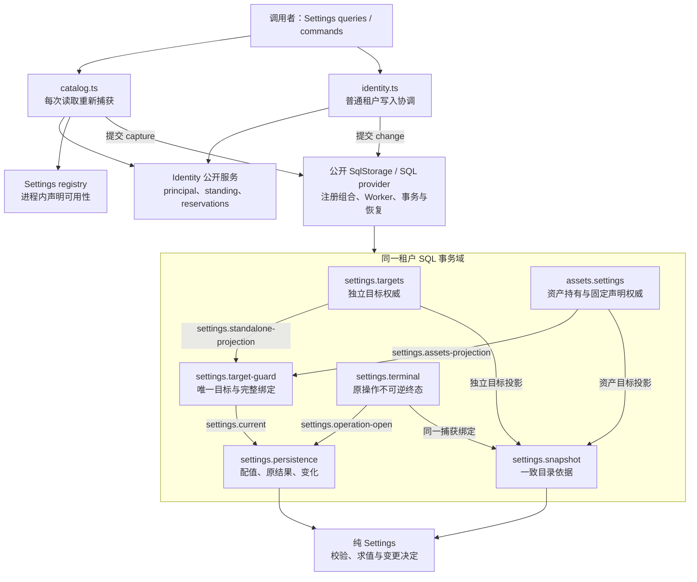
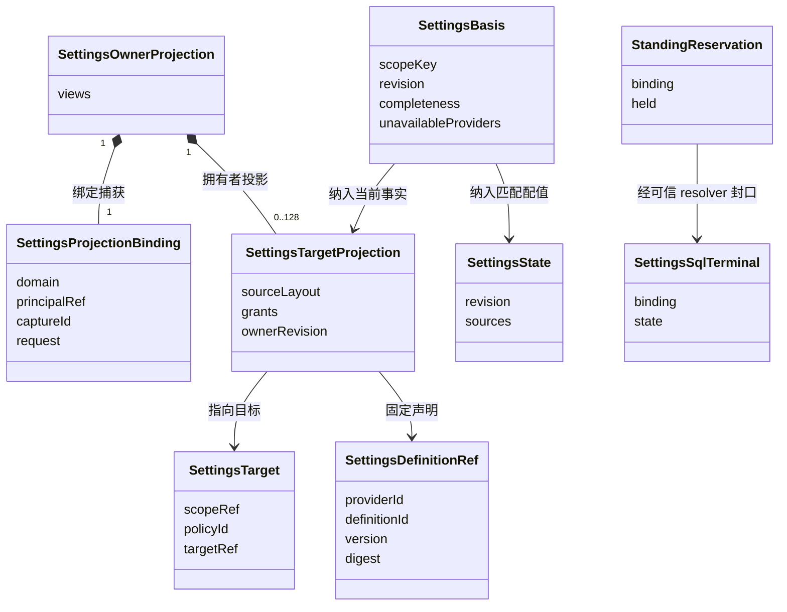
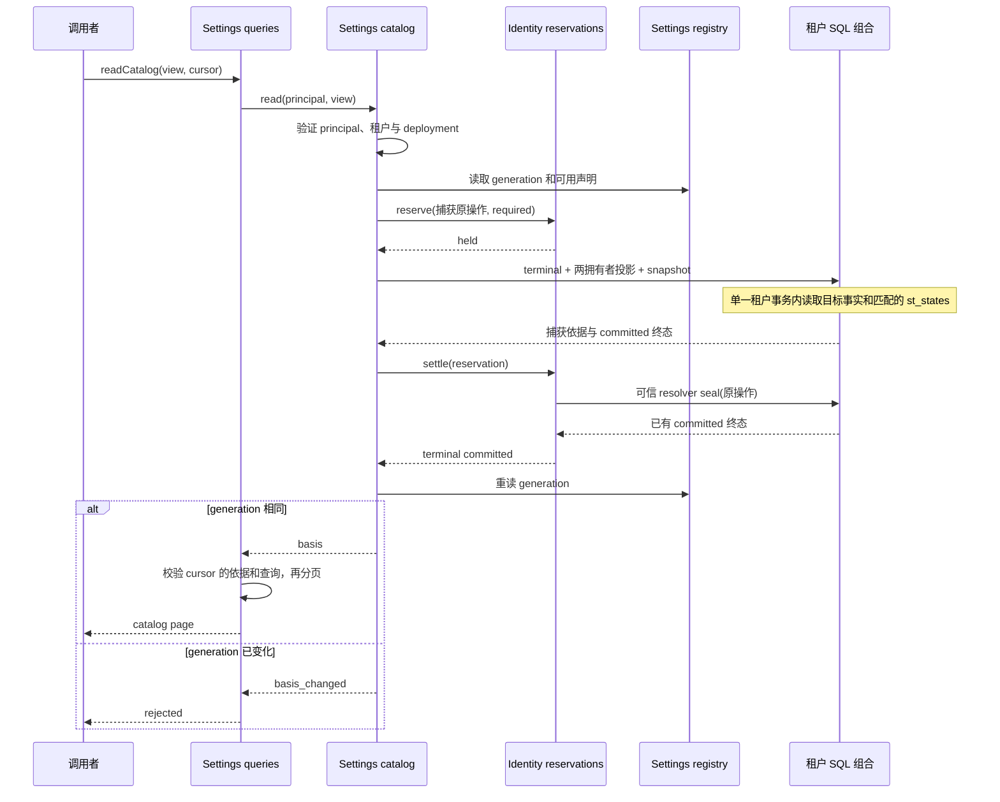
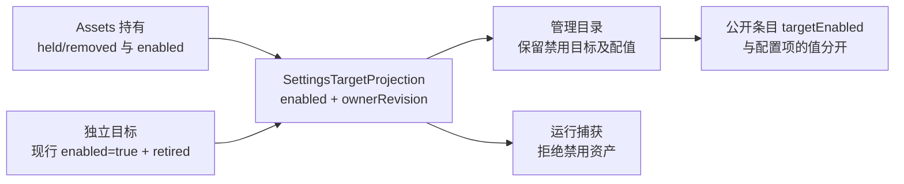
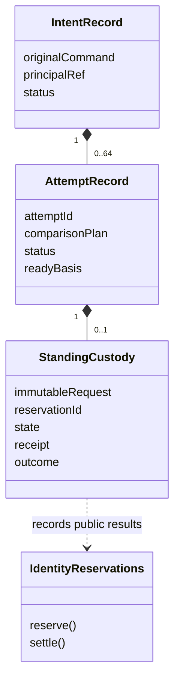
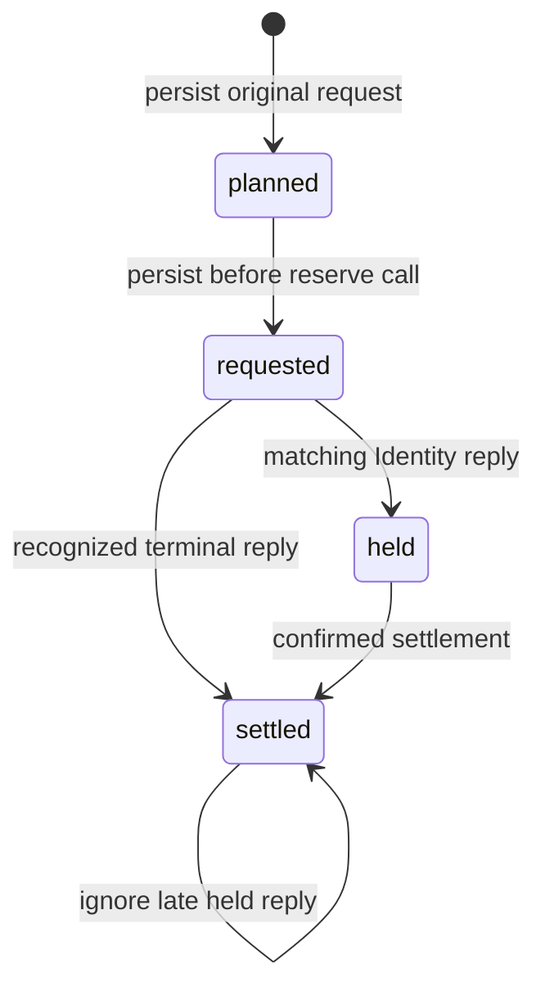
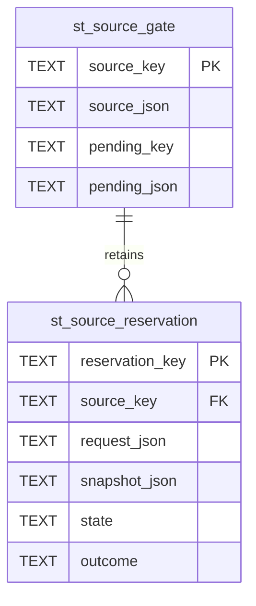
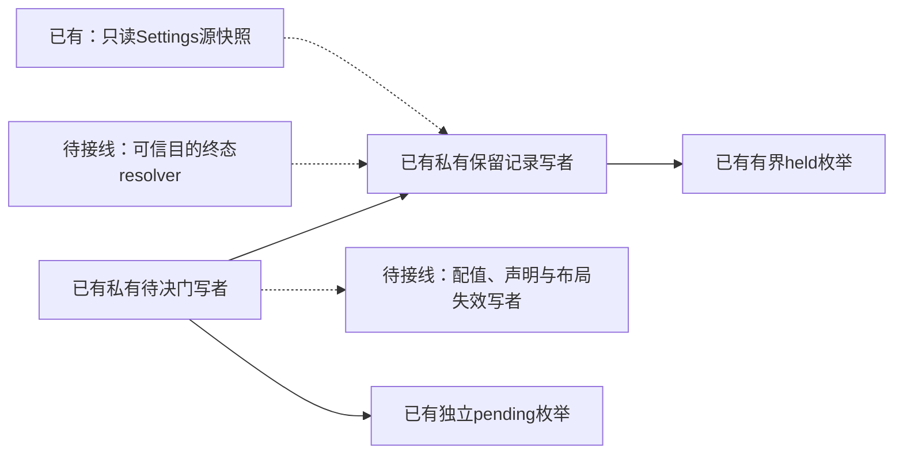
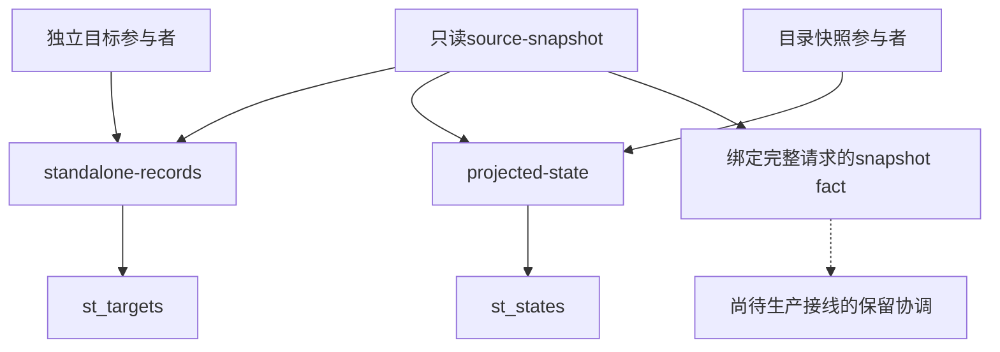

# Settings local 的拥有者与一致读取

本包把两件事组合起来：Settings 保存和解释配值，目标拥有者决定这份配值属于谁、使用哪份声明以及允许哪些来源。独立目标由本包拥有；资产目标由 Assets 拥有。Identity 另行决定当前租户资格。把这几条责任分开，Settings 就能独立使用，也能消费真实资产持有，而不复制外域的权威状态。

本页解释当前源码怎样兑现 [SPEC](../SPEC.md)。图为 Mermaid 文本图源，分别回答模块关系、数据关联和调用顺序。类图表达 TypeScript 值和接口，不表示实现必须使用 class。各图只列本次机制涉及的成员，旁文提供不依赖图形的阅读路径。

## 结构图：各自读取自己的事实

纯 [Settings](../../settings/README.md) 不依赖 Assets、SQL 或 Cordis。它拥有声明校验、来源求值、变更决定、重新采用决定和查询分页。本包提供 SQL 参与者、目标投影、目录捕获及本地协调。SQL 的引擎、Worker 和事务由公共存储包实现。

图中两条投影的协议都是 `settings-projection/1`。每条事实有一个生产者，中央守卫要求两条事实的完整 binding 都与请求相同，并拒绝重复的完整 target。没有 Assets 的装配安装 `settings.without-assets`，只产生空的 Asset 投影。它不是资产权威的替身。

直接独立持久化还支持 `standaloneSettingsGuards`。这种装配使用默认 `settingsStandaloneMaterials()`，由独立目标参与者直接产生 `settings.current`。采用图中的中央守卫时必须传入 `{ settingsGuard: false }`，避免两个生产者争用同一事实。材料登记方法见 [README](../README.md#choose-and-register-an-assembly)。

Identity 保留自己的系统事务域，不加入租户 SQL 事务。两域通过持久预留和目标终态协调，精确条件归 [coordination.md](coordination.md)。这不是跨库共同事务，也不要求 Settings 读取 Identity 私表。

## 对象图：声明、目标与配值分别有身份

`SettingsTarget` 的完整身份由 scope、policy 和 target reference 组成。独立目标使用 `independent` policy，资产目标使用 `asset` policy。声明 reference 另带 provider、definition、version 和 digest。目标拥有者的 revision 与 Settings 配值 revision 各自变化，不能互换。

类型唯一源是 [projection.ts](../src/projection.ts)、[Settings 公开入口](../../settings/src/index.ts)和 [terminal-schema.ts](../src/terminal-schema.ts)。图中的关联说明运行时组合关系，不新增数据库外键或序列化字段。

独立目标参与者拥有 `st_targets` 和 `st_definitions`。前者保存当前目标投影与 retired 状态，后者阻止同一声明版本被不同内容覆盖。持久化参与者拥有 `st_states`、`st_operations` 和 `st_changes`。终态参与者拥有 `st_terminals`。目录参与者没有私有表，只在受支持的事务组合中读取 Settings 自己的 `st_states`。

Assets 的 `al_domain`、`al_assets`、`al_versions`、`al_holdings` 由 [assets-local](../../assets-local/README.md)拥有。Settings 仅消费其公开投影事实。表名说明所有权，不表示 Settings 可以直接读取这些表。

## 时序图：一页也要重新取得资格与依据

下面画管理目录的成功路径。运行视图会在捕获前另行解析可信选择，核对 principal、deployment 和完整 targets。选择只证明消费意图，不能替代资格或目标拥有权。

[目录协调](../src/catalog.ts)每次生成新的捕获身份。`settings.snapshot` 在事务中读取两拥有者事实与匹配配值，并生成依据摘要。它不增加配值 revision，也不产生写权限，但会留下协调终态和公共 SQL 回执。失败或未知响应不会成为释放预留的证明；可信 resolver 必须先确定目标终态。

下一页不读取旧内存快照，而是重新走这条路径。依据摘要覆盖目标拥有者事实、配值、registry generation、实例 incarnation、过期 epoch 和选择摘要。查询层再核对 view、filter、locale、pageSize 与 offset。数据、拥有者 revision 或声明可用性发生变化时，旧游标不能继续拼出混代目录。

`cursorLifetimeMs` 按时间 epoch 计算，不是每个游标独立计时。跨过 epoch 后，游标可能在不足一个完整 lifetime 时失效。目录实例保留观察到的最大墙钟值，因此已经观察到的过期不能随墙钟回拨恢复。重启更换 incarnation。未观察到的时间推进不受这个进程内机制保证。

## 可用性、失效与维护各有入口

声明 registry 是进程内可用性清单。卸载声明会让管理目录报告部分结果，让需要完整依据的求值失败。重新加载同一精确声明后，仍可读取原配值。卸载不删除持久值，也不是和写入共用事务的撤权操作。一个已经通过读取检查的写入，仍可能在目标 guard 有效时提交。

真正的目标失效由拥有者完成。独立目标使用不可逆 retire；资产目标使用真实持有变更。拥有者失效写者与 Settings guard 在同一租户事务域竞争，所以目标变化与配值提交有可判定的先后顺序。Identity 撤权则使用另一域的预留排空和终态封口。

声明版本或来源布局变化后，旧状态不能继续成为当前目录的求值依据。重新采用由 `createSettingsMaintenance` 执行。调用方必须指定旧新精确 reference、预期 revision，并为每个已有赋值明确选择 retain 或 discard。保留值仍要通过新声明的求值校验。没有按名称猜测、静默删值或隐式转换。

维护入口是可信部署拥有者能力，使用固定的 `maintenance/<ownerRef>` 身份，刻意绕过普通租户 Identity 资格路径。装配必须保护这个对象，不把它转发为用户或工具命令。它仍消费当前目标拥有者投影及不可逆终态，不能绕过已 retire 或已移除的目标。持久化 `readState` 是另一个受权原始检查入口，返回存储 reference 与状态，不等于当前目录求值成功。

## 维护与证据范围

模块修改按拥有者推进。配值与求值规则先改纯 Settings，目标生命周期改真实目标拥有者，捕获绑定同时核对两个投影生产者与中央消费者。源码入口为 [catalog.ts](../src/catalog.ts)、[target-guard.ts](../src/target-guard.ts)、[snapshot-participant.ts](../src/snapshot-participant.ts)、[standalone-participant.ts](../src/standalone-participant.ts)和 [maintenance.ts](../src/maintenance.ts)。

[测试说明](../tests/README.md)给出真实 SQLite、真实 Identity、独立目标和资产组合的归属。图解释当前实现，不证明独立接受或最终系统采用。本包没有最终 UI、tools 或 Cordis 插件，也没有 Calendar 消费证明。秘密项只提供安全元数据，值保持 absent，普通秘密配值不支持，目录与回执不返回秘密明文。

## 目标启禁的实际投影

启禁由 Assets 持有拥有者写入，Settings 不创建另一份启禁配置。snapshot 和 catalog 保留投影字段。禁用不改变 st_states 或原业务回执；真实 SQL 测试覆盖禁用、关闭重开、重新启用后的值保留。此图只描述已接入的目录路径。运行采用和实际动作仍须在 C3b/C4/C5 的当前性关口消费拥有者事实。

## 准备保管的私有实现

准备流程先保存根命令和一次attempt，再保存完整Identity请求。Settings负责请求与回执的本地记录，Identity负责资格和保留的实际有效性。当前私有模块通过真实SQL测试使用，公共准备服务尚未接线。来源保留和ready提交仍待实现。

图中的对象是持久记录，不要求运行时class。三张关系表同属settings.persistence。外键只连接同一拥有者的表；Settings不读取Identity私表。保管查询按根、精确attempt和保管主键查找，最多读取三行。

requested表达不确定的调用进度，不能推断外部没有held。settled是已确认结果的保管事实，不能据此绕过Identity的释放前提。迟到回执按原attempt归档，不改变后继attempt。测试中的终态夹具不授予生产恢复已完成的结论。

## 来源保留的关系边界

一个来源门保护完整Settings目标。配值、锁、声明和布局都影响消费者如何解释规则，因此它们共享这把门。保留记录存储读取时的不可变快照，业务写入仍只有st_states一份事实源。

两张表归settings.source-retention。根意图和attempt属于settings.persistence，二者通过受信事实协调，不能跨拥有者写表。来源门的完成与根终结必须同提交。取消更新可开放新保留，但仍保管旧held；后继更新继续排空它们。

实线仅表示已实现的私有关系操作。测试装配提供快照和终态夹具。图中的生产适配及当前来源保证尚未交付。恢复索引只枚举元数据，实际保留快照在按需精确认回时读取。

只读source-snapshot现在直接读取本成员的st_targets和st_states。standalone-records与projected-state分别复用目标解码/投影和配值相容性检查，普通目录也使用同一条配值读取逻辑。事实携带完整目的请求，消费者必须核对绑定。

source-snapshot不拥有表，也不依赖写者产生的fact。登记组合必须包含实际表拥有者。该结构允许先读取，再由来源门和写者推进事务，避免读者等待写者、写者又等待来源门。当前测试通过具名消费者使用该事实，真实资格和全部写者围栏仍未交付。
