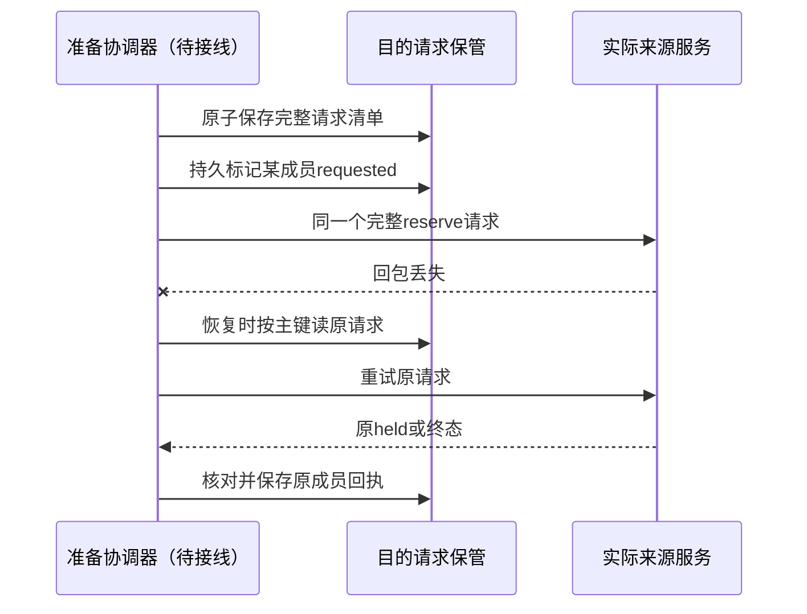
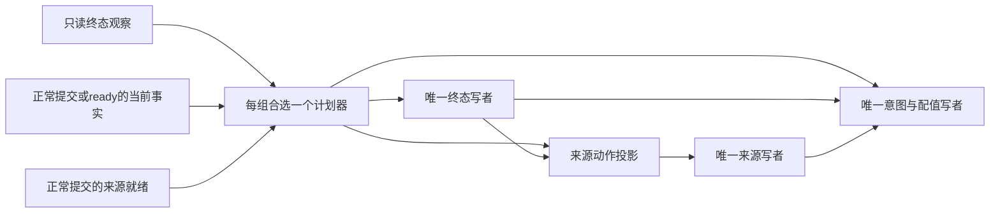

# 身份资格与设置提交的协调

本页拥有 `settings-local/identity` 的本地写入协调与目录捕获共用的资格协调前提。Identity 的成员规则、资格预留和治理恢复归 Identity；设置项与求值归 Settings；目标持有和声明有效性归目标拥有者。精确接口归 [identity.ts](../src/identity.ts)。

## 适用范围与装配

底层 `createSettingsSqlBackend` 消费注入的资格端口，不自行验证 Identity。普通租户装配使用 `createIdentityQualifiedSettings`，要求当前 acting-for-tenant principal 的成员关系及装配指定的既有具名资格。适配器不解释角色，不增加资格名称，也不把成员资格当作登录有效期或 permit 租约。

装配提供可信 PrincipalVerifier、TenantStandingSource、StandingReservations、目标访问策略、目标 SQL 组合与固定 destination。目标域必须是该租户的域；目标的 scopeRef 必须等于 tenantCodec 编码。`principalRef` 使用 Identity 的 `standingPrincipalRef`，不是客户端自由文本。

`createSettingsStandingDestination` 只交给 Identity 的可信恢复装配。它只接受 owner=settings、固定 destination、完整租户、目标、原操作和摘要绑定。它调用目标的终态封口，不接受调用方声称“已经结束”。普通用户和工具不得获得 SQL 存储、目标 resolver 或装配写权限。多个目的地由装配静态路由，不接受客户端模块路径。

必须先将 `settingsSqlMaterials()` 与真实目标 guard 材料登记到同一目标域，再发布服务。声明了材料不等于已经登记。真实目标 guard 必须与其全部失效写者共享该域的事务；不能拿调用前的访问检查代替这一点。Identity 保持独立的系统事务域，不参加租户 SQL 事务。目录组合还须安装两拥有者投影和中央守卫，具体材料与唯一事实生产者见 [装配入口](../README.md#choose-and-register-an-assembly)。

当前实现是注入式本地后端。串行化的数据绑定可被后续远程适配采用，但现有进程内 PrincipalVerifier 和对象能力不是远程认证。没有交付远程提供者。

## 提交与终态

1. 适配器冻结合法命令，核对 principal、租户、当前读取资格和目标访问策略。原操作绑定包含目标、主体、operationId 与命令摘要；摘要不包含传输 requestId。
2. Identity 原子核对当前成员与资格，保存 held 预留。它若已有成员变更待决门，拒绝新的预留。获得 held 后才发送设置事务。
3. 设置事务包含 `settings.terminal`、真实目标 guard 和 `settings.persistence`。终态参与者提供绑定原操作的 `settings.operation-open`；持久化参与者同时要求它和 `settings.current`。状态、原结果、变更和 committed 终态共同提交或回滚。
4. 协调器请求 Identity settle。Identity 经可信 resolver 调用 seal。seal 仅将 absent 变成 aborted，或返回已存在的 committed/aborted；它不会删除设置或覆盖终态。
5. 只有匹配终态允许 Identity 释放 held。客户端超时、取消观察、查询暂未提交、提供者停止均不是释放依据。目标不可用时保留预留，撤权仍未完成。

原操作先提交时，后来的 seal 返回 committed。seal 先提交时，所有迟到的原操作写入在目标事务内失败。相同操作身份换内容是 operation_conflict，不会得到新的有效预留或终态。

`getOperation` 每次重新授权。已有业务回执保留原业务结果；只有 aborted 封口且没有此前业务回执时，返回 rejected/basis_changed。当前无权读取时可以拒绝披露，不能因此删除历史成功。

`close` 停止协调器准入，等待已接受调用，再关闭内部设置后端。共享 SQL 和 Identity 生命周期归装配拥有者。未完成的预留由 Identity 的持久恢复继续负责；disposer 不能把它视作已释放。

## 目录捕获与历史读取

`createSettingsCatalog` 对每次捕获验证 principal、固定 deployment 与同租户目标。它为本次读取生成独立原操作，并向 Identity 申请短暂 held。捕获事务消费终态、要求两个目标拥有者的绑定投影，再读取 Settings 状态。它不增加配值 revision，也不授予写权限。

Identity 通过同一可信 destination resolver 封口捕获原操作。只有匹配的 committed 终态完成 settlement 后，目录才可交回捕获依据；捕获被先行封口或 settlement 未完成时不能交回成功依据。这里的“短暂”描述预期用途，不承诺故障下的释放期限。目标不可用时，预留仍由 Identity 恢复负责。

每一页都重新执行捕获，不用旧游标的权限。目录捕获前后核对 registry generation，分页依据包含实例、过期 epoch 与当前目标和配值。完整边界见 [SPEC 的目录条款](../SPEC.md#coherent-catalog-capture)。运行显式选择只证明消费意图，不替代 Identity 或目标资格，也不证明执行采用。

`readState`、`getOperation` 和 `readChanges` 是重新授权的存储检查及历史恢复入口。它们不是当前目录求值或采用凭据。`readState` 可向仍获目标权限的可信调用者返回旧 definitionRef 和原状态；目录不会把不匹配的旧值当作当前有效结果。后来的撤权可以拒绝历史披露，不能推翻已经成功的效果。

Registry 卸载影响声明可读性并保留配值。它不与设置写入共用事务，不能替代目标拥有者的失效操作。独立目标 retire 与资产持有变更各自通过拥有者事务守卫生效。

## 可信维护能力不属于租户资格路径

`createSettingsMaintenance` 仅交给可信部署拥有者。它使用固定 `maintenance/<ownerRef>` 身份，刻意不经过本页的 principal、standing 和 reservation 路径。这项能力不能暴露为普通租户或工具命令，不能把它当成对租户授权政策的扩展。部署拥有者负责对象能力的持有、路由与 retain/discard 权限。

重新采用仍在同一租户事务中取得原目标拥有者的当前事实，并消费不可逆终态。它要求精确旧新 reference、预期配值 revision 和完整赋值处置，事务行为归 [SPEC 的维护条款](../SPEC.md#trusted-deployment-rebase)。本页下述资格保持论证适用于获得 Identity 预留的租户写入和目录捕获，不适用于这项部署维护能力。

## 原子关系的证明义务

令 H(o) 表示 Identity 中原操作 o 的 held，T(o) 表示目标终态，Q 表示资格仍满足。两个存储域各自提供原子提交。

- 预留保持：reserve 成功建立 H(o) 与 Q；所有改变该资格的真实 Identity 写者，在相关 H 非空时不能完成变化。
- 释放前提：H(o) 只能在 T(o) 为 committed 或 aborted 时结束。T 不可逆，且绑定唯一原操作内容。
- 目标写前提：设置效果与 T(o)=committed 由同一事务建立，前提是该原操作尚无终态。若 T(o)=aborted，则该事务不能成功。

由此，若设置在时刻 t 新提交，H(o) 不能已结束：如果已结束，目标此前必有终态，而新提交要求尚无终态，矛盾。H(o) 在 t 仍保持 Q，所以该设置提交没有使用已经撤销的资格。若撤权先完成，则没有可用 held 允许之后的新提交。撤权不会推翻先前已经完成的设置效果。

待决门另保护进展：撤权开始排空后不再接受重叠的新预留。在目标最终恢复、恢复调度公平且工作集有限的前提下，已有预留可到终态，治理操作可进行最终授权判断。这里不承诺永久存储故障下的有限撤权延迟。

这些论证依赖所有真实写者参与、不可伪造的装配能力、完整绑定核对和存储原子性。有限模型只检查抽象交错；实际源码、旧组合退役与恢复尝试代际需要真实 SQL 测试和独立评审。模型与具名负控归 [验证资源](../../settings/verification/README.md#资格协调模型)。

## 验证与采用边界

本包已有真实 Identity SQL 与 Settings 两域组合场景，也有持久独立目标、目录和终态的真实 SQLite/Worker 场景。默认 guard 夹具与真实目标拥有者须分开判断；真实资产、设置、Identity 三者组合的场景由 assets-local 拥有。命令、资源和限制见 [测试说明](../tests/README.md)。

上述资源不授予独立接受、系统采用或轨道集成。最终 UI、tools 与 Cordis 插件、Calendar 消费、远程认证和物理断电恢复不在本包交付声明内。

## 已采用的准备操作恢复边界

本节规定动态治理提交需要满足的恢复边界。上文描述的现行提供者尚未实现根操作与准备 attempt 分离，不能据本节声称该保证已经可用。动态采用与来源保留的共同责任归[治理贡献协议](../../docs/governance-contributions.md)。

Settings 区分目录捕获、业务根命令和一次准备 attempt。目录捕获只取得受保护读数，不创建配值根或源修改门。change 与维护 rebase 都必须绑定一个不可变根命令，并通过精确 attempt 提交。维护主体仍归部署拥有者；维护能力不能绕过当前目标、采用与来源事实。

Settings-local 在 Identity 的 opaque targetRef 中编码版本化恢复引用。引用使用封闭种类区分 capture 和 attempt。Identity 只保存、核对和交回该引用，不拥有 Settings 操作种类。普通目标可以合法使用 catalog 这个 policyId，因此 resolver 不得从 policyId 或 ID 前缀推断操作。

capture 的外层 operationId 是 captureId。attempt 的外层 operationId 是提供者分配并持久保存的精确 attempt ID，其引用还绑定根操作、根命令摘要、命令种类及目标。values 与 authority 的区别由捕获输入摘要绑定。重新准备不得改变原命令的 expectedRevision、来源、目标或内容。

Identity 的去重身份不含 destination。因此单独注册两个 destination 不能证明两个操作已经隔离。Settings 的逻辑终态键必须区分域、主体、操作种类和精确操作身份。同键异绑定应当冲突；存储缩短为摘要时仍核对保存的完整绑定。这个约束同时作用于正常提交、封口、原操作查询和重启恢复。

恢复入口只接受匹配固定装配的持久预留。合法 capture 进入独立捕获封口，合法 attempt 进入根操作终结组合。未知协议或种类、额外字段、非规范编码、不一致绑定及不可用存储均不能转入旧封口作为回退。入口返回 unavailable 时，Identity 继续保留 held。

attempt 封口必须在一次物理提交中先读取 terminal observation，再由独立只读 seal-plan 生成精确计划，随后组合 terminal、source-retention 和 persistence。持有组织源门的修改被封口时，其根和 attempt 共同终结，并清除精确属于该根的门。源修改身份来自持久根及目标拥有者事实，不能由客户端布尔参数决定。旧 attempt 或旧 resolver 不能释放后继根的门。普通根的旧 attempt 明确 aborted 且根仍 pending 后，可以沿原命令重新准备。unknown 不授予分配后继 attempt 的依据。

组织目的域固定为 system.settings 时，StandingBinding.scopeRef 仍保持真实主体的 tenantCodec 编码。组织适配器核验当前 organization-settings-manage 资格及目标所属组织。resolver 按持久绑定核对组织关系，不要求已撤权成员重新取得资格才允许封口。它是可信恢复能力，不能交给普通客户端。

切换恢复格式前，旧提供者必须停止受理，并由原 resolver 排空仍由它负责的 held。未能证明终结时不得宣称切换完成。不得猜测旧裸 targetRef 的操作种类，不得把旧终态改写为新 attempt，也不得删除仍有责任的记录。已确认业务结果和配值的迁移需单独验证。当前阶段不因此引入长期双协议兼容路径。

逻辑键的不同分量保证不同种类、主体、域和 attempt 不混同。该论证依赖规范编码、摘要抗碰撞、完整绑定核对和可信路由。既有来源保留模型固定了身份；它不能替代上述绑定精化义务。实现验收应分别制造去掉 kind、换 attempt、跨域、同名 catalog 目标、旧 resolver 清新门和 unknown 分配后继的反例，并用真实数据库观察效果。

恢复引用的内部编解码现位于 recovery-reference.ts。它严格接受 settings-recovery/1 的 capture/attempt 形状，要求规范 JSON，并按 Identity 的16384 UTF-8字节上限拒绝超限输入。恢复键区分完整域、主体、种类及精确操作身份。准备服务的 attempt resolver 已使用新编码及终态命名空间；现行应用中的 capture 与旧写入路线仍待迁移。解码成功不证明资格或持久尝试存在。

目标投影现携带 enabled。Assets 的禁用目标保留管理读取及配值管理能力，运行捕获拒绝该目标。独立 Settings 目标在现行提供者中投影 enabled=true；retire、声明撤除和运行采用仍由各自状态决定，不能以该字段替代。snapshot 和 catalog 保留字段，公共条目以 targetEnabled 展示，避免与同名配置项混淆。

### 准备阶段与终态写入顺序

提供者必须先在目的事务保存根及preparing尝试，再向Identity或来源服务发起保留。该记录包含精确恢复地址、不可变命令及固定准备计划。活跃唯一性覆盖preparing、prepared和submitted。所有外部请求按原绑定认回；回执丢失不授予分配新attempt的权限。准备中的held检查点是保管事实，不是许可。最终ready事务须重新取得本域当前事实并核验完整保留绑定。

ready只读检查业务terminal仍开放，不能复用consume写入committed。正常业务提交先由只读commit-plan消费当前事实和本域状态，决定apply、abort-root或abort-attempt，再由terminal、source-retention和persistence共同落实。已确认业务失败属于这次事务成功保存的aborted结果，不能返回SQL conflict回滚后声称根已经终结。原配值决定继续复用Settings纯函数。

来源门的只读readiness投影先进入commit-plan，实际检查和清门由后续source-retention负责。同一事务内不允许它们之间插入另一写入。外部seal使用不依赖当前治理或来源就绪的独立seal-plan，再经同一终态、来源与持久写入链。ready、commit和seal组合分别选择一个plan生产者，不能把它们同时登记进一个组合。终态只读观察不依赖终态写入fact，因此不会与计划成环。各写者继续独占自己的表；不能拆成两个争用同一表的写者。数组排列不等于SqlStorage执行顺序。

checkpoint、ready、commit 和恢复事务组合已接通正式参与者。checkpoint 保存分配、Standing 和来源保管记录；源更新根与精确来源门共同建立。原操作认回不重新起门，迟到回执只能归入原 attempt；settled 记录须匹配该 attempt 的终态。公开准备服务及真实 Identity 资格/保留协调已接通；实际应用 current 生产者、组织来源与消费者切换尚未完成。

### Identity请求与回执的持久保管

准备计划保存Settings比较依据。保管记录另保存完整Identity请求，包含固定destination、真实tenant scope、原principal、精确attempt、恢复封套、命令摘要和资格集合。两者不能互相替代。planned表示请求已保存，requested表示外部调用可能已经发生。持久化requested成功后，协调器才能发出reserve。

回包丢失后，协调器读回并重试同一个请求。Identity决定它是原held、已settled还是拒绝。Settings只核对并保存该结果。旧attempt结束后仍能接收其迟到回执，但不能恢复准备、修改后继attempt或重新授予权限。已有settled记录不接受迟到held回退，也不接受矛盾的终态。

保管模块不对外暴露客户端写接口。它消费可信参与者从Identity实际取得的回执；回执形状和可计算ID都不是授权证据。Identity的释放动作仍要求目的终态，保管写入不能替代该验证。当前测试覆盖真实reserve与丢失回包后的重试，终态回执和旧attempt场景使用夹具。完整终态路由与生产协调尚须组合验收。

### 来源门与保留的关系实现

来源保留以完整Settings目标及固定存储域为身份。它不按配置项或继承sourceId分门，避免换声明、布局、锁或首次配值绕过保留。settings.source-retention只拥有st_source_gate和st_source_reservation，同拥有者外键连接两表。原命令和attempt仍由settings.persistence拥有。

新保留要求该源没有待决修改，且held少于128。同一保留重试先认回原快照或终态，不因为开始排空就丢失原结果。源修改只有一个待决根，清门核对完整根绑定。成功修改要求held清零，取消修改可直接清门，但不得删除held。迟到的旧根清理不能影响后继根的门。

保留恢复枚举只返回请求与路由，不搬运设置值。待决门使用独立索引枚举，所以零held的待决修改仍会恢复。页长最多100，排序键来自完整身份摘要，点查继续核对完整绑定。数据库查询计划测试确认实际使用部分索引，不据此声称具体吞吐或延迟。

真实source-snapshot和来源保留参与者已接通，赋值、rebase及独立目标写者遵守held/pending。关系测试中的终态仍由夹具提供。业务提交组合已实现根结果与精确源门的共同终结。组织来源准入、目的 resolver 和完整公开协调仍未完成。只有完成这些组合后，才能声称SettingsSourceRetention模型的全部前提由实现兑现。

来源保留的目的身份还显式包含ownerRef。相同域、根和attempt属于不同目的拥有者时，应产生不同的保留身份。路由属于完整绑定，但不能替代拥有者身份。模型中的不同destination在源码中精化为这些身份分量的元组，索引摘要之外仍核对完整请求。摘要碰撞应冲突，不能认作另一拥有者的held。目的拥有者隔离由真实SQL测试检查，有限来源模型没有单独枚举摘要碰撞。

source-snapshot现已从本成员的目标和配值表生成绑定请求的只读事实。它复用独立拥有者与目录的读取函数，读取不到合法目标时不把失败改成无配值。材料依赖没有指向目标变更参与者的fact，因此不会与其后续源门守卫构成相互等待。SQL组合仍必须登记这些表的真实拥有者。

当前真实快照保管与直接Settings写者已组合验证。生产资格、组织源适配和完整准备提交仍未接线。snapshot只证明这次源事务读到什么，持久held加全部失效写者才负责后续稳定性。恢复结算不得以重新取得当前snapshot为条件。

### 目的侧的来源请求清单

一个attempt可以依赖多个来源。目的侧先把完整请求集合写入不可变清单，同时创建每个成员的planned记录。事务完成前不能调用来源服务。输入顺序不重要；增删来源或改变某个请求的恢复路由会冲突。明确的空清单表示没有来源依赖，缺失清单不能这样解释。

每个成员独立经过planned、requested、held、settled。requested是“调用可能已经发生”的持久检查点。丢失响应后仍重试同一请求；来源服务返回的原held或终态只写回该成员。旧attempt可以接收迟到回执，但不能再开始外部请求，也不能改变后继attempt。

单条读回使用根、attempt和成员的三个点查。恢复页按attempt和source_key读取请求元数据，最多64条，不加载快照。完整来源集合最多1024项，另受字节预算约束。逐项持久保管已实现，准备完成条件、可信来源准入和生产恢复循环仍须接线。

### 固定依赖下的计划与写入

不同阶段使用固定登记的组合，分别选择ready-plan、commit-plan或seal-plan。每个组合只有一个最终计划fact生产者。正常提交读取当前事实和来源就绪；封口读取原持久绑定，不需要当前治理、当前来源或再次取得资格。所有计划和写入仍处于同一个物理事务。

ready的终态动作仅观察，不写committed；来源动作为none，不清门。非终态观察不能满足成功提交，no-action不能授予write-open。实际写者必须核对动作种类及完整绑定。合成描述符已通过真实manifest校验，但真实组合和上述行为仍须在完整提供者中验证。

`source-readiness`只读实际来源门和held数量，返回绑定完整根、命令及精确attempt的事实。它没有上游fact依赖，也不清门或释放保留。它要求组合登记来源表拥有者；登记不表示执行写者。真实SQL测试检查pending、held、零held重开、无关目标和错绑消费者，源门就绪事实已进入业务提交计划；源更新准入和公开协调仍未完成。

### 根与尝试的终结写入

私有 `intent-settlement.ts` 在持久写者内落实已决定的 commit、最终业务拒绝、精确 attempt seal 和根取消。它只消费可信事务计划及来源写者的结果，不做准入、当前依据检查或配值计算。恢复与业务提交的正式持久参与者均消费该模块。

每个 attempt 事件核对持久根的命令种类、语义摘要和精确 attempt 身份。preparing 不能成功提交。普通 seal 只将该 attempt 标为 aborted，根继续开放；已 aborted 的旧 attempt 不触碰后继。取消也可结束没有活跃 attempt 的开放根。已终结根保留原结果，不能再次分配。最终业务拒绝保存为 aborted，不能把它当成 SQL 冲突回滚。

源修改根还要求来源写者的 finished 结果。结果必须匹配完整来源、原主体、根操作、命令摘要及终态，且根保存的 sourceKey 必须一致。这个形状检查不证明清门已经发生。生产持久参与者必须通过声明的事务 fact 取得结果，不能从客户端输入构造它；terminal、精确清门及本写者必须在同一 SQL 提交内完成。

当前关系测试通过真实 Worker 调用该私有写者，覆盖竞争顺序、旧 attempt、回滚及重开。prepared 状态和来源 finished 结果仍由具名夹具构造。因此这些测试只证明根与 attempt 的关系变迁，不证明真实 ready、来源清门、业务写入或恢复路由已经接通。

### 精确恢复封口组合

私有 `settingsRecoveryMaterials` 为准备提供者选择唯一的 terminal 和 persistence 写者，取代同目录旧材料中的对应描述符。它不把两个写者同时登记到同一个表上。当前默认公开工厂仍走原路径；只有完整提供者切换并排空旧 held 后才能退出旧实现。

实际依赖链为 terminal-observation、recovery-plan、terminal、source-finalization、source-retention、persistence。观察者只读取终态表，计划者只读取持久根和尝试。该组合不要求当前治理、来源快照或再次取得资格。SqlStorage依据事实依赖排序，调用数组顺序不构成正确性前提。

attempt终态仍由st_terminals承载，但新记录带attempt标签与完整绑定，键采用包含域、主体、种类和精确attempt ID的恢复身份。查询后再次核对完整绑定。当前模块只实现attempt恢复，不猜测capture或旧记录的含义。根终态和精确attempt终态不是同一个结果；恢复调用者必须使用精确attempt终态回应其外部保留，不能把后继已提交的根结果当成旧attempt提交成功。

内部取消请求携带受保护读回的当前attempt选择。没有活跃尝试时可以传null；若选择已过期，整个事务拒绝且不清门。协调器应重新读回同一根并重试取消，不能替换原业务操作。seal则始终绑定精确attempt，重复旧seal只认回原终态。

来源终结投影验证计划与terminal结果，随后向唯一来源写者发出精确动作。其finalized结果不满足直接写入所需的open事实。持久写者核验来源finished结果后再修改根和attempt。源根取消允许仍有held，但不释放这些保留；它们须由各自目的终态另行结算。

真实组合测试覆盖封口认回、当前选择冲突、旧attempt隔离、根和精确门共同终结以及下游故障后的整组回滚。根分配和起始来源门由夹具设置，六个恢复参与者采用生产模块。公开 prepare/commit 和 attempt resolver 已消费这些组合；应用中的 resolver 路由装配、capture 迁移与旧 held 排空尚未完成。

### preparing发布为prepared

私有 `intent-ready.ts` 只更新精确attempt的basis及prepared状态。它核对原命令、活跃attempt、准备计划和当前basis相等，以及绑定相同attempt的开放终态观察。它不写业务值或terminal，不清来源门，也不释放外部保留。当前事实与开放观察必须由可信事务生产者提供；ready 事务组合已消费该模块；公开准备服务已消费该路径；实际应用 current 生产者与消费者切换尚未完成。

普通change要求完整Identity请求及回执仍为held，destination、真实scope和资格集合须匹配当前要求。受信维护rebase使用显式维护权威分支，普通change不能以该分支跳过Identity。该分支的权威真实性归维护适配器，Schema不授予资格。

来源必须有明确的完整清单。缺失清单不等于空集合；planned、requested或settled成员均不满足held要求。读取者核对清单摘要、完整请求向量和全部成员状态。一次主键范围查询最多返回1025条请求元数据，不加载快照，也不为每个来源重复读取根。展开后的请求向量同样受现有节点和字符串字节预算约束。空集合没有外部请求，改变空集合的路由不改变语义；非空集合的完整请求包含路由。

当前真实Worker关系测试覆盖缺保留、部分保留、settled、显式空集合、绑定或basis变化、回滚、重开及封口后迟到ready。当前依据、开放终态观察和外部回执由具名夹具提供。这些测试不是动态治理current事实、真实外部保留或公开prepareChange的验收。

## 公开准备协调与明确回滚

preparation 子入口将 service 与 control 分开。service 接收 Settings 的业务命令和准备引用；control.destination 只交给 Identity 的可信恢复路由。构造时固定域、事务注册、当前依据生产者和外部保留端口，普通客户端不能选择这些材料。

公开服务按原命令认回根与活跃 attempt，先持久记录 requested 再调用外部服务。getOperation 只读；commit 读取持久原命令并取得新的事务依据。已知业务结果不会因为事后 settlement 暂不可用而被改写，未清的保管义务仍留在持久记录中。

SqlStorage 会保存明确 rolled_back 回执。因此该 SQL attempt 不能在原身份下改成成功提交。协调者在取得这份证据后封住精确 attempt，再按既有规则结算保留。普通根仍可接受下一次显式 prepare；源更新根遵守原有 seal 规则，同时终结并清理自己的门。结果 unknown 时不走该清理路径，也不自动换 attempt。

真实 Identity 测试覆盖先撤权后提交、先提交后撤权，以及 SQL 受理前暂停提交时完成撤权。恢复直接核对持久 Standing 请求和终态，不重新申请已撤回资格。应用的 current 组装、组织来源、capture 迁移及旧调用者切换仍是未完成的集成义务。
