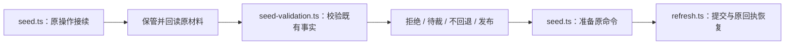

# 日历内部设计

本页解释 [SPEC](../SPEC.md) 的完整目标设计，公开值和端口形状归[公开 API 设计](public-api-design.md)。A1 已有本域实现，源码入口见[公开索引](../../calendar-contract/docs/public-api.md)。真实跨域接线留待 M2 之后，图不替代运行证据。

## 身份、版本与时间

CalendarId 表达业务适用范围，CalendarVersionId 表达不可变知识，publicationGeneration 表达当前指针的提交代际。内容 hash、供应 operation、契约版本、来源版本、运行 providerGeneration 分开。版本保存 coverage、weeklyDefault、overrides、knowledgeAsOf、synthesizedAt、provenance；半日信息作为备注，不扩大全天分类。无独立 displayName/region 持久身份，不从国家名猜范围。

日期只使用 ISO LocalDate；日历原始分类不依赖当前时间。时区运算按[技术基础](../../../../docs/architecture/technical-foundations.md)显式使用已采用 @js-temporal/polyfill 0.5.1，运行版本仍需记录 Node/ICU/tzdb。纯日期函数无 I/O，缓存键含 immutable version 与全部影响输入；租户生效选择/受保护投影再含 owner 和资格。缓存不授发布权，也不能用陈旧 latest 隐藏新发布。

## 查询动作链

CalendarQueries 先核可信上下文与当前读取资格，再解析明确日历或有效环境。latest 一次捕获 publicationGeneration 和 versionId，pinned 只读该版，不随 current 变更；随后在同不可变快照内计算并携带实际依据。有效环境必须是原子 revision 的 timezone/calendar，不拼两次读。list 不要求用户已有生效选择；get 不触发供应刷新；resolve 不修改设置或 Schedule。

missing_environment、unknown_calendar_version、coverage_insufficient、合法 empty、provider_failure 分开。范围内旧版可读与供应健康差可以并存。读请求取消只停本次观察；已运行存储读是否物理中断依存储真实契约，不提前复用资源。分页和投影标 observedAt/revision，不将一次读外推为跨多请求永久快照。

## 供应、校验与发布

来源角色为 truth、oracle、exceptionFeed、horizonProbe。SourceAdapter 只实现 probe/acquire，纯 parser 在 core 的 supply 模块解析贡献，不写版本库、不控制 Schedule、不发用户通知。配置含 sourceId、role、adapterKind、provenanceClass、lineage、transport、decoding、parsing、probeCadence、licenseNote。

| 首批日历 | 时区与语义 | 来源与节奏 | 余量政策 |
|---|---|---|---|
| cn-legal-holidays | Asia/Shanghai，中国法定节假日与补班 | lanceliao holidayAPI 的 gov.cn 回链/CompDays 为 truth；cg-zhou 为 oracle/horizon；10–12 月每日，其余每周 | 12-20 warning，1-1 critical；沿源完整政策解释年份 |
| jp-legal-holidays | Asia/Tokyo，日本国民祝日 | 内阁府 CP932 CSV truth；Vacanza 独立 oracle；每日 HEAD，1/20–2/20 加密，变化 GET/hash | warning 300 天，critical 270 天 |
| us-federal-holidays | America/New_York，美国联邦范围 | 法律规则计算 truth；OPM ICS oracle；Federal Register EO 例外；规则季度、OPM 月度、FR 每日 | warning 365 天，critical 180 天 |

本域精确政策由 [policies.ts](../src/supply/policies.ts)维护，保留配置 hash。来源阈值、历史统计、锚点和时段对照固定源 [calendar_supply_configs.py](https://github.com/nemori-ai/omne-next/blob/a7dbd98f9c5c7a8ead6afbd18896777f0cf1ecd0/omne_harness/libs/omne_harness_state/omne_harness_state/application/calendar_supply_configs.py)，已按本域政策适配，配置 hash 写入供应记录。表格不替代完整声明。首批 roster 仅三历；dormant Saudi 配置不启用。美国 federal 不扩大为 national，CN 半天/地方节日等限制保留在 semanticBoundary。

CN 覆盖余量按 coverageEnd 与 asOf 的 civil date 差解释，critical 为 `<0`，warning 为 `<=11`，对应 1-1 和 12-20。JP/US 保持各自 floor 的 inclusive 比较，不增加已知覆盖。

CN 的 chinese-days@1.5.9 MIT 静态材料仅补充 inLieu 的 subset 与 near-zero-sum 校验，不是新的独立 oracle，不替代 gov.cn 回链。lanceliao 原文与补充原文同封套保留，校验版本、覆盖、hash 和逐日一致性。缺材料、超出补充覆盖或与 truth 冲突仍未知或失败。

US 分开解释 OPM 制品修订、固定法条版本和有界 Federal Register 公布语料。OPM 只在无 METHOD 且完整 DTSTAMP 合法时采用组件修订时点。FR 截止依赖完成的有界扫描，不能用 HTTP Date、下载或安装时间填知识截至。具体窗口和摘要由种子发行元数据唯一保存，见[本地资源](../../calendar-local/resources/README.md)。

校验至少包含格式、日期唯一性、覆盖连续性、关键锚点、补班合理性、来源血统、oracle 差异、与当前版重叠变化及 coverage 不收缩。相同规范内容是 noChange。无新出处的静默重叠修改进入 withheld，保留原文/hash/差异，不覆盖旧版。来源确有新权威修订才按政策发布。

发布提交原子写入不可变版本、provenance、publication pointer、generation、operation receipt 和发布后 outbox。前置 generation 变化则重校验/冲突。不能先返回成功再补版本。反应失败只重试 outbox，不重铸版本。acknowledgementKey 表示一次获准的确认意图，首次发出前由调用方保管；未知沿原 key 查询。重新获准的新确认使用新 key，不能自动换 key 掩盖未知。同 key 异 payload 拒绝，重复确认不重复发布。

发行种子至少覆盖发版日期所在自然年及当时权威已发布更远覆盖。安装先同步校验并落地种子，损坏则明确失败；再由装配发起一次 best-effort 联网刷新。离线不阻止已有覆盖内查询。重复初始化不回退当前版，不把安装时刻当知识截至。

发行闸按每历实际政策：任一 critical 不得发行；warning 必须显式声明；政策或状态 unknown 不能报通过。生产发布前必须补 runtime 真网、故障、重启、真实 SQLite 耐久和发行门禁证据。

## 供应应用的内部职责

[seed.ts](../src/supply-application/seed.ts)保管导入意图，先沿原操作身份接续，再保存材料、准备命令和提交。[seed-validation.ts](../src/supply-application/seed-validation.ts)核对材料、发行覆盖、历史版本身份及重叠区间，按拒绝、待裁、不回退、发布的顺序形成处置。校验模块读取既有事实，但不提交发布；编排模块不能跳过校验直接发布。

[health.ts](../src/supply-application/health.ts)分别投影可查询覆盖和供应日志状态，因此旧版本可读与供应失败可以同时成立。[refresh.ts](../src/supply-application/refresh.ts)核对固定版本的原发布材料，再准备新的刷新意图。[recovery.ts](../src/supply-application/recovery.ts)逐项核对归属并交付反应，失败时保留原责任。

## 初始化、停止与恢复

初始化先核合法配置和离线种子，校验/保存完成后发布查询就绪；装配再发起 best-effort 网络刷新。种子失败不能注册一个假就绪服务。供应 timer 只用于唤醒，真实 due/probe 状态在存储，联网失败保留原快照及恢复责任。

提供者停止先停供应新准入，按原 operation 认回候选、已提交发布、未知及 outbox。旧方保管到可靠移交，不能因 fiber 消失丢责任。只撤自身注册、listener、timer、fetch 观察和存储租约；dispose 不回滚发布、下载或通知。两代清理交错只释放自己的 token，晚到结果回原 operation。共享存储 Worker 由其拥有者关闭，本域不能销毁其他租户资源。

## 持久化与实际限制

CalendarRepository 从[真实 sql-contract](../../../storage/sql-contract/SPEC.md)读取不可变版本，PublicationParticipant 在同事务域具名命令中保存版本、provenance、pointer/generation、receipt 与 outbox。I/O、解析和业务校验在事务外，提交内复核 expected publicationGeneration 和资格。snapshot.provenanceRefs 保存来源 authority 引用，本机 rawReference 独立保管，不成为可移植 seed 身份。发布时将 version 精确关联原 candidate，readCurrent 先固定 versionId，再读该版本的原发布材料并核 source、lineage、authority、原文 hash 和两个时点。不能用后来 noChange/rejected 的 current 回执替代原材料。关联或材料缺失明确失败，不降成空贡献。

新发布已提交后再恢复反应，不重抓/重铸。query unknown 用完整原身份认回，不能把 read 空页当未提交。

calendar-local 已提供发布存储与供应材料/运行记录的迁移、参加者和恢复查询，消费 sql-contract，由装配选择提供者。这不扩大 [sqlite-provider](../../../storage/sqlite-provider/SPEC.md#已知限制) 的保证。L-1 的 check→commit 授权窗口不满足额外强撤权承诺；L-4 不保证跨进程排除。全部 L-1–L-11 对本域采用的影响及门槛见[日程存储约束表](../../../schedule/schedule/docs/internals.md#实际存储能力与未闭合保证)，不因两包同进程宣称它们消失。断电耐久须真实介质 SQL-T01 证据，Node26探针不是Node24验收。

## 后续技术采用

下列编号继续供现有消费者定位。已确认产品范围不待重选；只保留实现与证据义务。

### Q-CA02 公开形状、算法与日历计算消费映射

唯一设计已在[公开 API](public-api-design.md)明确。实现者写公开类型/schema、CalendarQueries 与纯计算，用补班/observed/跨年缺覆盖/正负零工作日/闭区间 golden 验证直接调用和装配内等价，不另设候选 API。

### Q-CA03 供应发布一致性与耐久恢复

采用真实 sql-contract 组合提交方向，实现本域 participant、迁移、原操作查询、outbox 与 generation guard。供应三历完整 policy 逐字段对照固定源 calendar_supply_configs.py，保留 policy hash。发布竞争与提交前后故障必须无半指针/重复版本；当前存储不足与未验证项如实报告。实现不能只抓文件即称已发布。

### Q-CA04 设置、供应治理及生命周期集成

设置/授权拥有者提供原子有效环境及合法资格守卫，Calendar 不存第二份偏好。Cordis 绑定、独立 tools、配置生效、旧引用与卸载按[公开 API](public-api-design.md#cordis-与独立工具)实现。供应来源/解析库与许可证仍需锁定和真网、坏字节、截断、304/429/503 等验证；库选型不能降低来源/覆盖规则。

## 社区库与验证范围

各功能的社区首选、系统公共依赖、采用前验证和自有责任由[复用规划](../../docs/reuse-plan.md)统一维护。Temporal 沿上层技术基础采用，CSV、ICS 和规范化的已采用版本及其余候选状态见复用规划。完整日历来源、覆盖和发布规则不由库默认行为决定。

持续验证归 V-CA01–V-CA18；完整来源 AC 映射归 [Schedule SPEC](../../../schedule/schedule/SPEC.md#来源与目标验收映射)。独立 API、工具/HTTP映射、真实供应、SQLite故障、发行闸与生命周期分别取证。public-entry、queries、supply、supply-application 与 local 持续用例分别验证本域接缝；夹具和本域测试不证明外域提供者已接入或最终验收通过。
