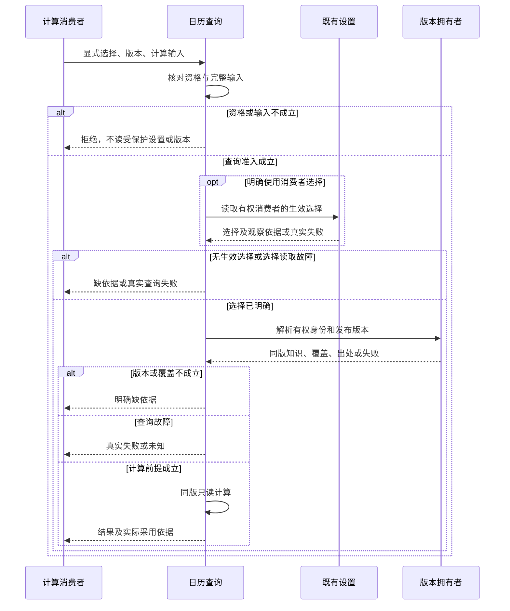
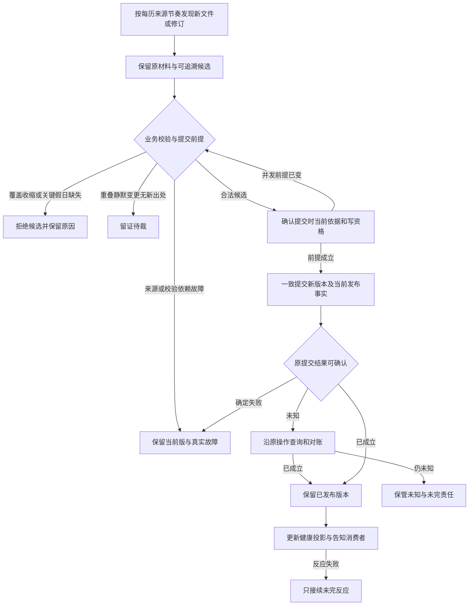

# 日历协作设计候选

本页保存尚待技术采用的设计，不表示实现、产品接受或阶段承诺。完整必要行为见[calendar/calendar SPEC](../SPEC.md)，产品范围见[产品正文](../../../../.meta_harness/design/product/calendars/design.md)。

## F-CA01 解析并完成只读计算

覆盖 J-CA01–J-CA04、J-CA08，保护 INV-CA01–INV-CA08、INV-CA14、INV-CA16。

1. 查询入口核对资格和必要输入。目录可不筛选，准入后返回有权目录及观察位置，不要求选择单个日历或版本；单历查询/计算再核对显式日历选择、版本选择和日期/规则输入。
2. 选择为消费者上下文时只读既有设置；无生效选择明确缺依据。捕获实际日历身份和指定/当前发布版本。
3. 取同版知识、覆盖和出处；必要日期缺覆盖返回不足，提供者故障返回真实故障，两者不变成空日期。
4. 在该版本内分类、增减、含端点计数或提供有界日历计算，返回结果及依据。Schedule 整体预览留日程。
5. 取消只终止该请求；超时或退出不改发布事实。恢复查询明确同版；改用新的“当前”是一次新的依据选择。

下图表示单历查询/计算分支；目录分支不解析消费者选择。

## F-CA04 发现、校验、提交并恢复供应

覆盖 J-CA06–J-CA08，保护 INV-CA01、INV-CA02、INV-CA08、INV-CA10–INV-CA13、INV-CA15。

下载成功不代表校验通过，待裁不作发布。发布者保护内容/覆盖/出处与当前发布事实一致，旧版保持；其他日历不进入本历并发提交范围。回执未知不重铸版本，发布已成立后告知失败只恢复告知。取消在提交前确认成立才阻止该次发布；已提交不撤回，竞争未知查原操作。来源何时会发布不是系统可保证的进展前提。

## F-CA06 停止实例、保管责任与换代

覆盖 J-CA06–J-CA09，保护 INV-CA08、INV-CA11、INV-CA13、INV-CA15–INV-CA18。

维护实例停止新准入，辨认尚未提交、提交未知、已发布待反应的原操作，按各自状态取消、查询、排空或可靠交接。保管发布依据、待裁证据及未完责任后，撤本实例登记/计时器/监听，释放自己的句柄与共享使用权。部分失败汇报真实残留，旧清理不能删新实例或他方状态。晚到结果回原操作，不重新发布失效入口。实例退出不下架或删除历史版本，也不停止、取消或重建日程 Job。
