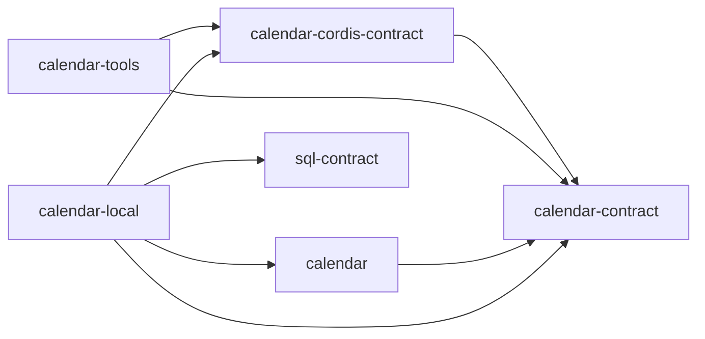
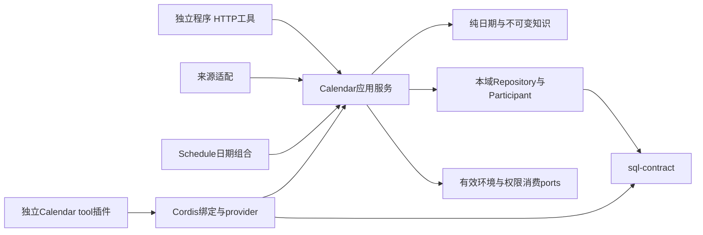

# 日历能力组工程关系

本组包含 calendar-contract、calendar-cordis-contract、calendar、calendar-local、calendar-tools 五个成员，均为初始化草稿。完整目标设计已确认，运行实现和验收未完成。本页解释成员与外部工程关系，不重复成员状态机或错误集合。

## 安装边界

`calendar-contract` 拥有可替换服务协议与公共值。`calendar` 拥有无 Cordis 的领域算法和应用服务工厂。`calendar-cordis-contract` 唯一拥有绑定定义。`calendar-local` 承接本机存储、恢复和适配装配，`calendar-tools` 只消费契约与服务定义。

箭头表示允许的安装依赖，不表示当前已经实现运行调用。tools 不依赖 core 或 local，绑定定义不依赖实现。公共消费不能要求同机、同进程或共享数据库；未来远程客户端可实现同一服务定义，本次不建立远程提供者包。

持久化参加者是 local 内部适配协议，不是服务间 wire 协议。跨域资格和发布版本的强保证仍须由对应拥有者协议兑现；当前快照不能代替动作发生时所需的有效性证明。具体限制见[部署边界](../../../docs/package-organization.md#日历与日程的安装和部署边界)。

## 本组工程分解与公开依赖

calendar 成员拥有纯日历计算、不可变版本知识、供应发布和查询应用服务。供应与查询可用不同运行实例，但消费同一公开契约，不新增事实拥有者。环境/授权由原拥有者提供公共值与守卫，Calendar不写用户偏好；存储适配只消费sql-contract，不能依赖选定SQLite后端。通知通过耐久意图接续实际维护消息。

箭头表示消费公开定义或注入接缝，不表示同事务。Calendar不依赖Schedule、Session、Agent或Tool领域来计算；独立查询不要求装载会话。Cordis负责绑定、依赖变化和生命周期，不提供租户授权、发布原子性或外部效果撤销。

## 验证与交付限制

[成员SPEC](../calendar/SPEC.md#持续验证义务)分配日期、来源、发布、查询、种子和生命周期场景。[内部存储设计](../calendar/docs/internals.md#持久化与实际限制)记录当前SQL能力与差额；已存在storage不等于本域participant已实现。源S04–S06、环境组合S07及目标N08/N10/N12/N23均保留独立验收。当前没有真实供应、发行闸、断电、Node24或完整工具证据。

## 机制与流程导航

- [身份、版本与时间](../calendar/docs/internals.md#身份版本与时间)。
- [查询动作链](../calendar/docs/internals.md#查询动作链)。
- [供应、校验与发布](../calendar/docs/internals.md#供应校验与发布)。
- [初始化、停止与恢复](../calendar/docs/internals.md#初始化停止与恢复)。
- [公开API与Cordis/tools](../calendar/docs/public-api-design.md)。
- [F-CA01 解析并完成只读计算](../calendar/docs/key-flows.md#f-ca01-解析并完成只读计算)。
- [F-CA02 消费者选择](../../../docs/domains/calendars/key-flows.md#f-ca02-保存消费者选择并继续解析)。
- [F-CA03 离线种子](key-flows.md#f-ca03-离线种子初始化或升级)。
- [F-CA04 供应发布](../calendar/docs/key-flows.md#f-ca04-发现校验提交并恢复供应)。
- [F-CA05 健康与发行](../../../docs/domains/calendars/key-flows.md#f-ca05-健康观察与发布物把关)。
- [F-CA06 实例换代](../calendar/docs/key-flows.md#f-ca06-停止实例保管责任与换代)。

## 维护

组页维护真实成员、允许依赖与组合验证责任。行为和API变更回各成员唯一源，库升级与来源政策变更需精确版本/许可证及golden/真网证据，不用社区报告代替采用。后续技术义务继续定位到Q-CA02–Q-CA04。
