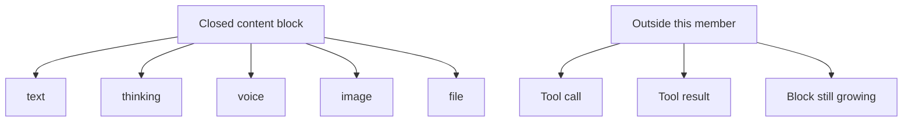

# @omne-harness/content-block

[中文](README_ZH.md)

Closed content blocks for text, thinking, voice, image, and file.

## Responsibility and status

This member publishes one closed content block and `judgeContentBlock`. A closed block is text, thinking, voice, image, or file, with its id, visibility, and media type. Tool calls, tool results, and a block that is still growing are not values of this package. Tenant, standing, and causality stay off the block.

Consumers are message, stream-arrival, and every member that emits, executes, logs, or projects blocks. The package does not own those facts. It also publishes the judge of a block id and visibility, and the head keys of each kind. Message and stream-arrival use both, so no other package keeps a copy.

## Usage

```ts
import { judgeContentBlock } from '@omne-harness/content-block'

judgeContentBlock({
  kind: 'text',
  id: 'b1',
  visibility: { toHuman: true, toModel: true },
  text: 'hello',
})
```

There is no Cordis entry. Build deletes `dist` before `tsc`.

## Contracts

`judgeContentBlock` returns `{ ok }` or `{ rejected }`. `rejected` is `kind`, `extra`, `id`, `visibility`, `text`, `media`, `file`, `ref`, `storage`, `key`, `mediaType`, `bytes`, `digest`, or `transcript`. An unknown key on the block, or inside `visibility` or `ref`, is `extra`. A successful value contains only the keys of that kind. `CONTENT_BLOCK_KINDS` is `text`, `thinking`, `voice`, `image`, `file`.

An own `ref` key selects the reference form. Only `voice`, `image`, and `file` have it. Other kinds with `ref` are `kind`. A reference block has only `kind`, `id`, `visibility`, `ref`, and `transcript`. Inline data, text, or a second location on it is `extra`. A `ref` that is not an object is `ref`.

The other reference tokens name the field that fails. `storage`, `key`, and `digest` must be non-empty strings. `mediaType` must be a string. `bytes` must be a non-negative decimal integer string without leading zeros. `transcript` must be present and must be a string or `null`. The check is shape only. It does not prove that the content exists, who owns it, or who may read it.

`judgeBlockIdentity` judges the `id` and `visibility` of any value and ignores its other keys. It returns `{ ok: { id, visibility } }` or `{ rejected }`. `rejected` is `extra`, `id`, or `visibility`. An unknown key inside `visibility` is `extra`, and it is reported before a bad `id`. The returned `visibility` is a new object. `judgeContentBlock` uses it for blocks with and without `ref`.

`CONTENT_BLOCK_HEAD_KEYS` maps each kind to the keys it has except its body field: `kind`, `id`, `visibility` for text and thinking, plus `mediaType` for voice and image, plus `storage`, `key`, `mediaType` for file. The body field is `text` for text and thinking, `inline` for voice and image, and file has none. The table is derived from the table that `judgeContentBlock` uses, so the two cannot differ.

## Design

The [reference-block design](docs/public-api.md) adds explicit media references for Tool message content. `src/index.ts` implements `ContentReference`, `ReferenceContentBlock`, and their shape check in `judgeContentBlock`. Tool projection belongs to Tool. Send-time loading belongs to Model. Attachment addresses remain text; only Model loads selected content references at send time.

`src/index.ts` owns the kinds, the block types, `judgeBlockIdentity`, `CONTENT_BLOCK_HEAD_KEYS`, and `judgeContentBlock`.

A closed block is one of five kinds. A tool call, a tool result, and a block that is still growing stay outside this member.



## Configuration and operation

The package reads no environment and has no defaults. The caller passes the value.

## Verification

`pnpm --filter @omne-harness/content-block test` runs `tests/public-entry.spec.ts` and the type test `tests/reference-block.spec-d.ts`. The first file is the unit test and the contract test. It checks admit and reject results from the public entry. This package holds pure values, so it has no storage integration test and no user-journey end-to-end test.

## Maintenance

Tool execution fields stay in the tool package.
