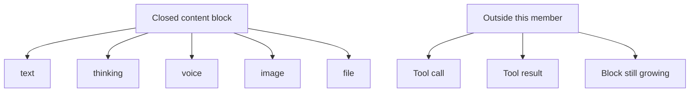

# @omne-harness/content-block

[中文](README_ZH.md)

Closed content blocks for text, thinking, voice, image, and file.

## Responsibility and status

This member publishes one closed content block and `judgeContentBlock`. A closed block is text, thinking, voice, image, or file, with its id, visibility, and media type. Tool calls, tool results, and a block that is still growing are not values of this package. Tenant, standing, and causality stay off the block.

Consumers are model, tool, session, and request projection. The package does not own those facts.

## Usage

```ts
import { judgeContentBlock } from '@omne-harness/content-block'

judgeContentBlock({
  kind: 'text',
  id: 'b1',
  visibility: { toHuman: true, toModel: true },
  text: 'hello',
})
```

There is no Cordis entry. Build deletes `dist` before `tsc`.

## Contracts

`judgeContentBlock` returns `{ ok }` or `{ rejected }`. `rejected` is `kind`, `extra`, `id`, `visibility`, `text`, `media`, or `file`. An unknown key on the block, or inside `visibility`, is `extra`. The judge does not return `ok` by dropping that key. `CONTENT_BLOCK_KINDS` is `text`, `thinking`, `voice`, `image`, `file`.

## Design

`src/index.ts` owns the kinds, the block types, and `judgeContentBlock`.

A closed block is one of five kinds. A tool call, a tool result, and a block that is still growing stay outside this member.



## Configuration and operation

The package reads no environment and has no defaults. The caller passes the value.

## Verification

`pnpm --filter @omne-harness/content-block test` runs `tests/public-entry.spec.ts`. That file is the unit test and the contract test. It checks admit and reject results from the public entry. This package holds pure values, so it has no storage integration test and no user-journey end-to-end test.

## Maintenance

Tool execution fields stay in the tool package.
