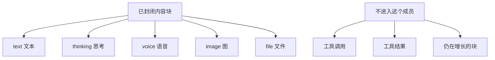

# @omne-harness/content-block

[English](README.md)

已经封闭的内容块。只含文本、思考、语音、图、文件。

## 职责与状态

本成员发布一条已封闭内容块和 `judgeContentBlock`。已封闭的块是文本、思考、语音、图或文件，并带块身份、可见性和媒体类型。工具调用、工具结果和仍在增长的块不是本包的值。租户、效力和因果不放在块上。

消费者是模型、工具、会话和请求投影。本包不拥有那些事实。

## 使用

```ts
import { judgeContentBlock } from '@omne-harness/content-block'

judgeContentBlock({
  kind: 'text',
  id: 'b1',
  visibility: { toHuman: true, toModel: true },
  text: 'hello',
})
```

没有 Cordis 入口。`build` 在 `tsc` 之前删除 `dist`。

## 契约

`judgeContentBlock` 返回 `{ ok }` 或 `{ rejected }`。`rejected` 是 `kind`、`extra`、`id`、`visibility`、`text`、`media` 或 `file`。块上或 `visibility` 里的未知键是 `extra`。判断不靠丢掉该键来返回 `ok`。`CONTENT_BLOCK_KINDS` 是 `text`、`thinking`、`voice`、`image`、`file`。

## 设计

`src/index.ts` 拥有种类、块类型和 `judgeContentBlock`。

已封闭的块是下面五种之一。工具调用、工具结果和仍在增长的块留在本成员外面。



## 配置与运行

包不读环境，也没有默认值。调用方传入值。

## 验证

`pnpm --filter @omne-harness/content-block test` 运行 `tests/public-entry.spec.ts`。这份测试同时承担单元和契约。它从公开入口核对接受和拒绝。本包是纯值，没有存储集成测试，也没有用户旅程的端到端测试。

## 维护

工具执行字段留在工具包。
