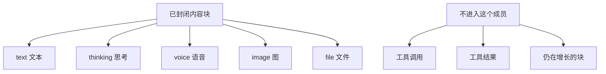

# @omne-harness/content-block

[English](README.md)

已经封闭的内容块。只含文本、思考、语音、图、文件。

## 职责与状态

本成员发布一条已封闭内容块和 `judgeContentBlock`。已封闭的块是文本、思考、语音、图或文件，并带块身份、可见性和媒体类型。工具调用、工具结果和仍在增长的块不是本包的值。租户、效力和因果不放在块上。

消费者是消息、流式到达，以及发出、执行、记录或投影块的任何成员。本包不拥有那些事实。本包还发布块身份与可见性的判定，以及每种块的开块头键表。消息和流式到达都用它们，别的包不留副本。

## 使用

```ts
import { judgeContentBlock } from '@omne-harness/content-block'

judgeContentBlock({
  kind: 'text',
  id: 'b1',
  visibility: { toHuman: true, toModel: true },
  text: 'hello',
})
```

没有 Cordis 入口。`build` 在 `tsc` 之前删除 `dist`。

## 契约

`judgeContentBlock` 返回 `{ ok }` 或 `{ rejected }`。`rejected` 是 `kind`、`extra`、`id`、`visibility`、`text`、`media` 或 `file`。块上或 `visibility` 里的未知键是 `extra`。成功值只含该种类的已知键。`CONTENT_BLOCK_KINDS` 是 `text`、`thinking`、`voice`、`image`、`file`。

`judgeBlockIdentity` 判定任意值的 `id` 和 `visibility`，不看其他键。它返回 `{ ok: { id, visibility } }` 或 `{ rejected }`，`rejected` 是 `extra`、`id` 或 `visibility`。`visibility` 里的未知键是 `extra`，并且先于 `id` 的错误报告。返回的 `visibility` 是新建的对象。`judgeContentBlock` 使用它，它的结果没有变。

`CONTENT_BLOCK_HEAD_KEYS` 把每种块映射到除正文字段以外的键：text、thinking 是 `kind`、`id`、`visibility`，voice、image 另有 `mediaType`，file 另有 `storage`、`key`、`mediaType`。正文字段对 text、thinking 是 `text`，对 voice、image 是 `inline`，file 没有。这张表由 `judgeContentBlock` 使用的那张表派生，两者不会不一致。

## 设计

`src/index.ts` 拥有种类、块类型、`judgeBlockIdentity`、`CONTENT_BLOCK_HEAD_KEYS` 和 `judgeContentBlock`。

已封闭的块是下面五种之一。工具调用、工具结果和仍在增长的块留在本成员外面。



## 配置与运行

包不读环境，也没有默认值。调用方传入值。

## 验证

`pnpm --filter @omne-harness/content-block test` 运行 `tests/public-entry.spec.ts`。这份测试同时承担单元和契约。它从公开入口核对接受和拒绝。本包是纯值，没有存储集成测试，也没有用户旅程的端到端测试。

## 维护

工具执行字段留在工具包。
