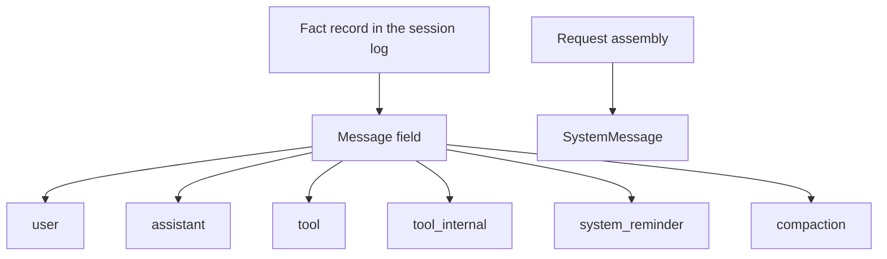

# @omne-harness/message

[中文](README_ZH.md)

The message field inside a fact record, plus parse and equality for `MessageId`.

## Responsibility and status

A message is a field of one fact record in the session log. It is not the log entry. `SystemMessage` is a request view and is not one of the six log roles.

This package parses and compares ids. The session mints `msg_` plus 16 unguessable bytes when it accepts a message into the log. Projection stays with the session. This package exports no mint function. This initialization stops at the role list, parse, and equality. The full message payload stays with a later owner.

## Usage

```ts
import { parseMessageId, messageIdEquals } from '@omne-harness/message'

const parsed = parseMessageId('msg_abcdefghijklmnopqrstuv')
if (parsed.ok) messageIdEquals(parsed.value, parsed.value)
```

There is no Cordis entry.

## Contracts

`LOG_MESSAGE_ROLES` is `user`, `assistant`, `tool`, `tool_internal`, `system_reminder`, `compaction`. `parseMessageId` rejects an empty string, a missing `msg_` prefix, and a body outside `[A-Za-z0-9_-]{22,64}`. `messageIdEquals` is exact string equality.

## Design

`src/index.ts` owns the role list, the brand, `parseMessageId`, and `messageIdEquals`.

The message field sits on a fact record in the session log. `SystemMessage` is assembled for a request and stays off that log.



## Configuration and operation

The package reads no environment. The session owns entropy and the admission key.

## Verification

`pnpm --filter @omne-harness/message test` runs `tests/public-entry.spec.ts`. That file is the unit test and the contract test. It checks parse, exact equality, and the absence of a mint export. This package holds pure values, so it has no storage integration test and no user-journey end-to-end test.

## Maintenance

Minting stays in session.
