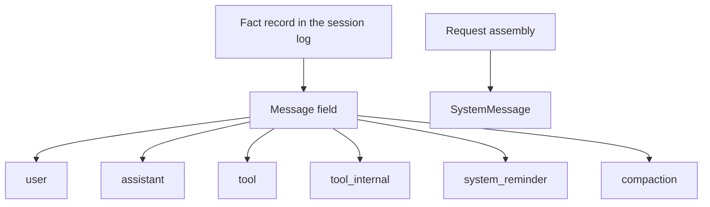

# @omne-harness/message

[中文](README_ZH.md)

The message field inside a fact record, plus parse and equality for `MessageId`.

## Responsibility and status

A message is a field of one fact record in the session log. It is not the log entry. `SystemMessage` is a request view and is not one of the six log roles.

This package publishes the message value and `judgeMessage`. A message is `{ id, role, blocks }`. `id` is a string `parseMessageId` accepts. `role` is one of the six log roles. `blocks` is a non-empty array of parts in arrival order. A part is a closed content block, or a tool part whose `kind` is `tool_call` or `tool_result`. A tool part needs a non-empty `callId`. The judge keeps the tool part's other own keys. It does not invent tool outcome codes.

The session mints `msg_` plus 16 unguessable bytes when it accepts a message into the log. This package exports no mint function.

## Usage

```ts
import { judgeMessage } from '@omne-harness/message'
```

```json
{
  "id": "msg_abcdefghijklmnopqrstuv",
  "role": "assistant",
  "blocks": [
    {
      "kind": "text",
      "id": "b1",
      "visibility": { "toHuman": true, "toModel": true },
      "text": "hello"
    }
  ]
}
```

`judgeMessage` admits the object above. `parseMessageId` and `messageIdEquals` stay on the same entry.

There is no Cordis entry.

## Contracts

`LOG_MESSAGE_ROLES` is `user`, `assistant`, `tool`, `tool_internal`, `system_reminder`, `compaction`. `parseMessageId` rejects an empty string, a missing `msg_` prefix, and a body outside `[A-Za-z0-9_-]{22,64}`. `messageIdEquals` is exact string equality.

`judgeMessage` returns `{ ok }` or `{ rejected }`. A part failure also returns `blockIndex`. `rejected` is `shape`, `missing`, `null`, `empty`, `unknown`, `extra`, `prefix`, `body`, `callId`, `json`, or a content-block rejection. An unknown key such as `tenant` is `extra`. A part that is not JSON is `json`. JSON is null, a boolean, a string, a finite number, or an array or plain object of JSON values. The judge copies own keys. An own `__proto__` key stays an own key. A successful value contains only `id`, `role`, and `blocks`.

## Design

`src/index.ts` owns the role list, the brand, `parseMessageId`, `messageIdEquals`, `Message`, `judgeMessage`, and `judgePart`.

The message field sits on a fact record in the session log. `SystemMessage` is assembled for a request and stays off that log.



## Configuration and operation

The package reads no environment. The session owns entropy and the admission key.

## Verification

`pnpm --filter @omne-harness/message test` runs `tests/public-entry.spec.ts` and `tests/message.spec.ts`. Those files are the unit tests and the contract tests. They check parse, exact equality, the absence of a mint export, and which message fields are accepted or rejected. This package holds pure values, so it has no storage integration test and no user-journey end-to-end test.

## Maintenance

Minting stays in session.
