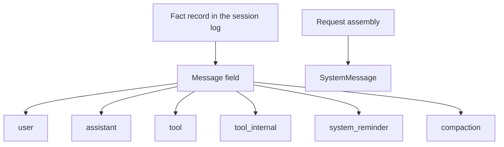

# @omne-harness/message

[中文](README_ZH.md)

The message field inside a fact record, plus parse and equality for `MessageId`.

## Responsibility and status

A message is a field of one fact record in the session log. It is not the log entry. `SystemMessage` is a request view and is not one of the six log roles.

This package publishes the message value, `judgeMessage`, and `judgeCompaction`. A message is `{ id, role, blocks }`; a `compaction` message also has `covers`, `retained`, and `derivation`. `id` is a string `parseMessageId` accepts. `role` is one of the six log roles. `blocks` is a non-empty array of parts in arrival order. A part is a closed content block, or one of four tool parts: `tool_call`, `tool_call_incomplete`, `tool_call_unparsed`, `tool_result`. A tool part has a block `id` and a block `visibility` like a content block. Its keys are closed: any other own key is `extra`. The package does not invent tool outcome codes, and a part cannot carry an executor, a handle, or a private result object. `docs/public-api.md` has the meaning of each part and the example table.

The session mints `msg_` plus 16 unguessable bytes when it accepts a message into the log. This package exports no mint function.

## Usage

```ts
import { judgeMessage } from '@omne-harness/message'
```

```json
{
  "id": "msg_abcdefghijklmnopqrstuv",
  "role": "assistant",
  "blocks": [
    {
      "kind": "text",
      "id": "b1",
      "visibility": { "toHuman": true, "toModel": true },
      "text": "hello"
    }
  ]
}
```

`judgeMessage` admits the object above. `parseMessageId` and `messageIdEquals` stay on the same entry.

There is no Cordis entry.

## Contracts

`LOG_MESSAGE_ROLES` is `user`, `assistant`, `tool`, `tool_internal`, `system_reminder`, `compaction`. `parseMessageId` rejects an empty string, a missing `msg_` prefix, and a body outside `[A-Za-z0-9_-]{22,64}`. `messageIdEquals` is exact string equality.

A `compaction` message also carries `covers`, `retained`, and `derivation`. `judgeMessage` reads these keys only when `role` is exactly the string `compaction`. For any other role they are `extra`. `judgeCompaction` checks the rules that depend on history. `message.role === 'compaction'` narrows an admitted message to `CompactionMessage`, and `parseRecordEntryRef` makes a non-empty entry reference. [SPEC.md](SPEC.md) has the shape, the rules, and the order of checks.

`judgeMessage` returns `{ ok }` or `{ rejected }`. A part failure also returns `blockIndex`. `rejected` is `shape`, `missing`, `null`, `empty`, `unknown`, `extra`, `prefix`, `body`, `callId`, `name`, `arguments`, `partial`, `raw`, `json`, `tool-blocks`, `duplicate-id`, `covers`, `retained`, `derivation`, or a content-block rejection. An unknown key such as `tenant` is `extra`. A part that has an accessor, a non-enumerable own key, or a prototype that is not plain is `json`, and no getter on the part's own keys is called. Nested values (`visibility`, `arguments`) are read by their own judges. The message itself is read differently: for every role, `judgeMessage` calls the accessor of a top-level field, at most once per field, and uses that one value for the key set, the checks, and the copy. A missing field of a tool part is reported by its name. A successful value contains only `id`, `role`, and `blocks`, and for the `compaction` role also `covers`, `retained`, and `derivation`, each a frozen copy.

A `tool_call` has `kind`, `id`, `visibility`, `callId`, `name`, `arguments`. `callId` and `name` are not empty. `arguments` is a value tree that `judgeJsonValue` of `@omne-harness/json-text` accepts, and every failure of that judge is `arguments`. The kept `arguments` is the frozen copy that the judge returns, and it does not share data with the caller. A `tool_call_incomplete` has `partial` text in place of `arguments`, and both `visibility` bits are false. A `tool_call_unparsed` has `raw` text. For both variants `callId` is not empty and `name` is any string. `partial` and `raw` are strings and may be empty. Nothing is `null`. A `tool_result` has `kind`, `id`, `visibility`, `callId`. It is a marker: the content blocks after it in the same message are the result body.

Role rules: the first block of a `tool` message is a `tool_result`, and the other blocks are not tool parts. A `tool_result` is only in a `tool` message. The three call parts are only in an `assistant` message. A broken role rule is `tool-blocks` with `blockIndex`. A block id that is used twice in one message is `duplicate-id`. `judgeMessage` returns the first failure in this order: the fields of the message, the three compaction keys, each part, the role rules, block identity.

## Design

`src/message.ts` owns the role list, the brand, `parseMessageId`, `messageIdEquals`, `MessageRoleMap`, the six role message types, `Message` (the union of the six, told apart by `role`), and `judgeMessage`. The `blocks` of each role type hold only the parts that the role allows, and at least one block: content blocks for `user`, `tool_internal`, `system_reminder`, and the `compaction` summary; content blocks and the three call parts (`CallPart`) for `assistant`; a `tool_result` marker, then content blocks, for `tool`. `src/compaction-shape.ts` owns the entry reference, the types of `covers` and `derivation`, and `judgeCompactionKeys`, which judges the three keys. `src/compaction.ts` owns `judgeCompaction` and the types `CoveredEntry`, `CompactionContext`, `CompactionRejection`, and `CompactionJudgment`. `src/parts.ts` owns the tool part types and `judgePart`. `src/values.ts` reads a closed plain object by key name and detects repeated items. `src/index.ts` only exports them. The block identity rules and the value tree rules are not here: they come from content-block and json-text.

The message field sits on a fact record in the session log. `SystemMessage` is assembled for a request and stays off that log.



## Configuration and operation

The package reads no environment. The session owns entropy and the admission key.

## Verification

`pnpm --filter @omne-harness/message test` runs the files in `tests/`. They are the unit tests and the contract tests. `public-entry.spec.ts` and `message.spec.ts` check parse, exact equality, the absence of a mint export, and which message fields are accepted or rejected. `tool-parts.spec.ts` and `tool-roles.spec.ts` check each failure of the four tool parts, the role rules, block identity, the copy of `arguments`, and the use with json-text. `part-kind.spec.ts` checks a part that is not an object, a missing or non-string kind, and a part without a prototype. `tool-part-types.spec-d.ts` checks the tool part types, and `message-types.spec-d.ts` checks the union of the six role types. `compaction.spec.ts` and `compaction-types.spec-d.ts` check the compaction inputs that a table cell cannot write, and the compaction types. `normative.spec.ts` runs every row of the example table and of the compaction table in `docs/public-api.md`. This package holds pure values, so it has no storage integration test and no user-journey end-to-end test.

## Maintenance

Minting stays in session.
