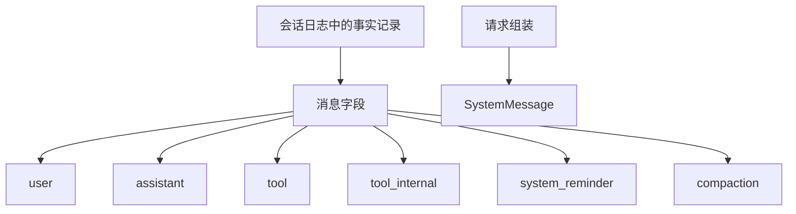

# @omne-harness/message

[English](README.md)

事实记录里的消息字段，以及 `MessageId` 的解析和相等。

## 职责与状态

消息是会话日志里一条事实记录的字段，不是日志条目本身。`SystemMessage` 是请求视图，不在六种日志角色里。

本包发布消息值和 `judgeMessage`。一条消息是 `{ id, role, blocks }`。`id` 是 `parseMessageId` 接受的字符串。`role` 是六种日志角色之一。`blocks` 是按到达顺序排列的非空部件数组。部件是一条已封闭内容块，或 `kind` 为 `tool_call`、`tool_result` 的工具部件。工具部件需要非空 `callId`。判断保留工具部件上的其他自有键，不发明工具结果码。

会话在把消息受理进日志时铸造 `msg_` 加 16 字节不可猜文本。本包不导出铸造函数。`SystemMessage` 仍是请求视图。

## 使用

```ts
import { judgeMessage } from '@omne-harness/message'
```

```json
{
  "id": "msg_abcdefghijklmnopqrstuv",
  "role": "assistant",
  "blocks": [
    {
      "kind": "text",
      "id": "b1",
      "visibility": { "toHuman": true, "toModel": true },
      "text": "hello"
    }
  ]
}
```

`judgeMessage` 接受上面这个对象。`parseMessageId` 和 `messageIdEquals` 仍在同一个入口。

没有 Cordis 入口。

## 契约

`LOG_MESSAGE_ROLES` 是 `user`、`assistant`、`tool`、`tool_internal`、`system_reminder`、`compaction`。`parseMessageId` 拒绝空串、缺少 `msg_` 前缀，以及不在 `[A-Za-z0-9_-]{22,64}` 里的正文。`messageIdEquals` 是逐字相等。

`judgeMessage` 返回 `{ ok }` 或 `{ rejected }`。部件失败还返回 `blockIndex`。`rejected` 是 `shape`、`missing`、`null`、`empty`、`unknown`、`extra`、`prefix`、`body`、`callId`，或内容块的拒绝码。`tenant` 这类未知键是 `extra`。判断不靠丢掉该键来返回 `ok`。

## 设计

`src/index.ts` 拥有角色表、品牌、`parseMessageId`、`messageIdEquals`、`Message`、`judgeMessage` 和 `judgePart`。

消息字段挂在会话日志里的事实记录上。`SystemMessage` 在请求组装时现算，不进入这份日志。



## 配置与运行

包不读环境。会话拥有随机源和受理键。

## 验证

`pnpm --filter @omne-harness/message test` 运行 `tests/public-entry.spec.ts` 和 `tests/message.spec.ts`。这些测试同时承担单元和契约。它们核对解析、逐字相等、没有导出铸造函数，以及消息判断 M1 到 M7。本包是纯值，没有存储集成测试，也没有用户旅程的端到端测试。

## 维护

铸造留在会话。
