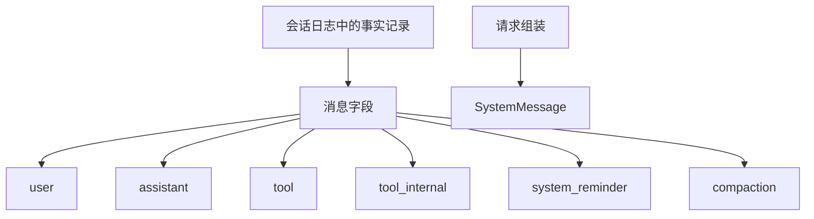

# @omne-harness/message

[English](README.md)

事实记录里的消息字段，以及 `MessageId` 的解析和相等。

## 职责与状态

消息是会话日志里一条事实记录的字段，不是日志条目本身。`SystemMessage` 是请求视图，不在六种日志角色里。

本包发布消息值、`judgeMessage` 和 `judgeCompaction`。一条消息是 `{ id, role, blocks }`，`compaction` 角色的消息另带 `covers`、`retained`、`derivation`。`id` 是 `parseMessageId` 接受的字符串。`role` 是六种日志角色之一。`blocks` 是按到达顺序排列的非空部件数组。部件是一条已封闭内容块，或四种工具部件之一：`tool_call`、`tool_call_incomplete`、`tool_call_unparsed`、`tool_result`。工具部件与内容块一样带块身份 `id` 和块标注 `visibility`，键是闭合的，多出任何自有键都是 `extra`。本包不发明工具结果码，部件也不能携带执行者、句柄或私有结果对象。每种部件的含义和示例表在 `docs/public-api.md`。

会话在把消息受理进日志时铸造 `msg_` 加 16 字节不可猜文本。本包不导出铸造函数。`SystemMessage` 仍是请求视图。

## 使用

```ts
import { judgeMessage } from '@omne-harness/message'
```

```json
{
  "id": "msg_abcdefghijklmnopqrstuv",
  "role": "assistant",
  "blocks": [
    {
      "kind": "text",
      "id": "b1",
      "visibility": { "toHuman": true, "toModel": true },
      "text": "hello"
    }
  ]
}
```

`judgeMessage` 接受上面这个对象。`parseMessageId` 和 `messageIdEquals` 仍在同一个入口。

没有 Cordis 入口。

## 契约

`LOG_MESSAGE_ROLES` 是 `user`、`assistant`、`tool`、`tool_internal`、`system_reminder`、`compaction`。`parseMessageId` 拒绝空串、缺少 `msg_` 前缀，以及不在 `[A-Za-z0-9_-]{22,64}` 里的正文。`messageIdEquals` 是逐字相等。

`compaction` 角色的消息另带 `covers`、`retained`、`derivation`。只有 `role` 恰好是字符串 `compaction` 时，`judgeMessage` 才读这三个键，其他角色带它们是 `extra`。`judgeCompaction` 判相对历史的规则。`message.role === 'compaction'` 把已受理的消息收窄成 `CompactionMessage`，`parseRecordEntryRef` 生成非空的记录条目引用。形状、规则和判定顺序在 [SPEC.md](SPEC.md)。

`judgeMessage` 返回 `{ ok }` 或 `{ rejected }`。部件失败还返回 `blockIndex`。`rejected` 是 `shape`、`missing`、`null`、`empty`、`unknown`、`extra`、`prefix`、`body`、`callId`、`name`、`arguments`、`partial`、`raw`、`json`、`misplaced-part`、`duplicate-id`、`covers`、`retained`、`derivation`，或内容块的拒绝码。`tenant` 这类未知键是 `extra`。带访问器、非枚举自有键或非普通原型的部件是 `json`，部件自身键上的 getter 不被调用；嵌套位置（`visibility`、`arguments`）由各自的判定读取。消息本身的读法不同：对所有角色，`judgeMessage` 会调用顶层字段的访问器，每个字段至多一次，键集、校验和复制都用这一次读到的值。工具部件缺字段时报该字段名。成功值只含 `id`、`role` 和 `blocks`，`compaction` 角色另含 `covers`、`retained`、`derivation`，各是冻结的副本。

`tool_call` 有 `kind`、`id`、`visibility`、`callId`、`name`、`arguments`。`callId` 和 `name` 非空。`arguments` 是 `@omne-harness/json-text` 的 `judgeJsonValue` 接受的值树，该判定的任一失败都是 `arguments`。保存的 `arguments` 是该判定返回的冻结副本，与调用者不共享数据。`tool_call_incomplete` 用 `partial` 文本代替 `arguments`，且 `visibility` 两位都为 false。`tool_call_unparsed` 有 `raw` 文本。两个变体的 `callId` 非空，`name` 是任意字符串，`partial` 与 `raw` 是字符串，可为空，任何字段都不是 `null`。`tool_result` 有 `kind`、`id`、`visibility`、`callId`，是关联标记：同一条消息里它后面的内容块是结果正文。

角色规则：`tool` 消息的第一块是 `tool_result`，其余块是不含 `thinking` 的内容块。`tool_result` 只在 `tool` 消息里。三种调用部件和 `thinking` 块只在 `assistant` 消息里。部件不在角色允许的集合里是 `misplaced-part`，带第一个放错的块的 `blockIndex`。同一条消息里重复使用的块身份是 `duplicate-id`。`judgeMessage` 按这个顺序返回第一个失败：消息自己的字段、`compaction` 角色的三个键、逐个部件、角色规则、块身份。

## 设计

`src/message.ts` 拥有角色表、品牌、`parseMessageId`、`messageIdEquals`、`MessageRoleMap`、六个角色的消息类型、`Message`（六个类型的联合，按 `role` 判别）和 `judgeMessage`。每个角色类型的 `blocks` 只含该角色允许的部件，也至少有一块：`user`、`tool_internal`、`system_reminder` 和 `compaction` 的摘要是不含 `thinking` 的内容块（`MessageContentBlock`），`assistant` 是全部内容块和三种调用部件（`CallPart`），`tool` 先是一个 `tool_result` 标记，其后是 `MessageContentBlock`。`src/compaction-shape.ts` 拥有记录条目引用、`covers` 与 `derivation` 的类型，以及判三个键的 `judgeCompactionKeys`。`src/compaction.ts` 拥有 `judgeCompaction` 和类型 `CoveredEntry`、`CompactionContext`、`CompactionRejection`、`CompactionJudgment`。`src/parts.ts` 拥有工具部件类型、`CallPart`、`MessageContentBlock` 和 `judgePart`。`src/values.ts` 按键名读取闭合的普通对象并检测重复项。`src/index.ts` 只做导出。块身份规则和值树规则不在这里，来自 content-block 和 json-text。

消息字段挂在会话日志里的事实记录上。`SystemMessage` 在请求组装时现算，不进入这份日志。



## 配置与运行

包不读环境。会话拥有随机源和受理键。

## 验证

`pnpm --filter @omne-harness/message test` 运行 `tests/` 里的文件，同时承担单元和契约。`public-entry.spec.ts` 与 `message.spec.ts` 核对解析、逐字相等、没有铸造导出，以及消息字段的接受和拒绝。`tool-parts.spec.ts` 与 `tool-roles.spec.ts` 核对四种工具部件的每个失败、角色规则、块身份、`arguments` 的副本，以及与 json-text 的组合。`part-kind.spec.ts` 核对不是对象的部件、缺失或非字符串的 `kind`，以及没有原型的部件。`tool-part-types.spec-d.ts` 核对工具部件的类型，`message-types.spec-d.ts` 核对六个角色类型的联合。`compaction.spec.ts` 与 `compaction-types.spec-d.ts` 核对表格单元写不出的压缩输入和压缩类型。`normative.spec.ts` 逐行执行 `docs/public-api.md` 的示例表和压缩用例表。本包是纯值，没有存储集成测试，也没有用户旅程的端到端测试。

## 维护

铸造留在会话。
