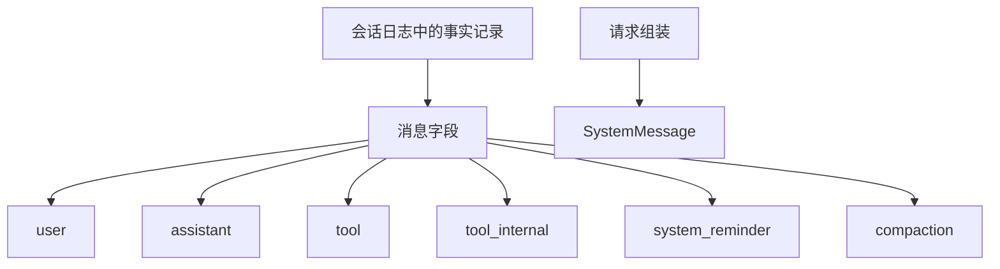

# @omne-harness/message

[English](README.md)

事实记录里的消息字段，以及 `MessageId` 的解析和相等。

## 职责与状态

消息是会话日志里一条事实记录的字段，不是日志条目本身。`SystemMessage` 是请求视图，不在六种日志角色里。

本包解析并比较身份。会话在把消息受理进日志时铸造 `msg_` 加 16 字节不可猜文本。投影仍归会话。本包不导出铸造函数。这次初始化停在角色表、解析和相等。完整消息载荷仍留给后续拥有者。

## 使用

```ts
import { parseMessageId, messageIdEquals } from '@omne-harness/message'

const parsed = parseMessageId('msg_abcdefghijklmnopqrstuv')
if (parsed.ok) messageIdEquals(parsed.value, parsed.value)
```

没有 Cordis 入口。

## 契约

`LOG_MESSAGE_ROLES` 是 `user`、`assistant`、`tool`、`tool_internal`、`system_reminder`、`compaction`。`parseMessageId` 拒绝空串、缺少 `msg_` 前缀，以及不在 `[A-Za-z0-9_-]{22,64}` 里的正文。`messageIdEquals` 是逐字相等。

## 设计

`src/index.ts` 拥有角色表、品牌、`parseMessageId` 和 `messageIdEquals`。

消息字段挂在会话日志里的事实记录上。`SystemMessage` 在请求组装时现算，不进入这份日志。



## 配置与运行

包不读环境。会话拥有随机源和受理键。

## 验证

`pnpm --filter @omne-harness/message test` 运行 `tests/public-entry.spec.ts`。这份测试同时承担单元和契约。它核对解析、逐字相等，以及没有导出铸造函数。本包是纯值，没有存储集成测试，也没有用户旅程的端到端测试。

## 维护

铸造留在会话。
