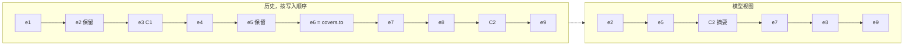
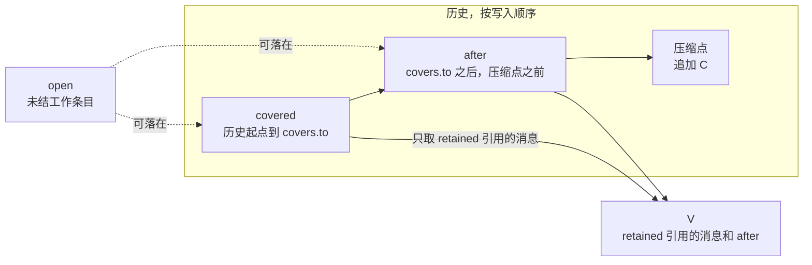

# @omne-harness/message 行为规格

本文件拥有 `@omne-harness/message` 中压缩变体与推理续接状态在公开类型以外的必要行为。公开形状以 [src/](src) 为准，公开定义的导航在 [docs/public-api.md](docs/public-api.md)。工具部件、角色规则与块身份的行为在 [docs/public-api.md](docs/public-api.md) 的「语义」「判定顺序」两节和 [README](README.md#contracts) 的契约节，本文件不重复。

本成员没有状态、资源或异步行为，下面的义务都是纯函数的输入输出关系。

## 范围与依据

本文件定义压缩记录 `CompactionMessage` 的形状、模型视图规则，以及两层判定：`judgeMessage` 判形状，`judgeCompaction` 判相对历史的规则。它不定义何时压缩、怎样写摘要、保留哪些消息，这些归压缩策略的拥有者。它也不定义历史怎样存放、怎样提交，这些归历史持有者。

本文件还定义 assistant 消息里的推理续接状态部件和消息上的回放描述 `replay`，见[推理续接状态](#推理续接状态)。它不定义哪个模型能消费哪段状态、怎样把状态写进请求体，这些归 [Model 契约](../../model/model-contract/SPEC.md#推理回放)。

状态：压缩变体已实现，设计待接受，接受由[任务卡 #581](https://github.com/nemori-ai/omne-harness-lite/issues/581) 的 D-02 决定；公开形状以 [src/](src) 为准。推理续接状态已实现，设计已由[任务卡 #605](https://github.com/nemori-ai/omne-harness-lite/issues/605) 的 D-03 接受；公开形状以 [src/](src) 为准，规则与判定顺序归本文件「推理续接状态」一节。

依据如下。

- 产品规则 [运行感知与一次模型请求 §7](../../../.meta_harness/design/product/runtime-context/design.md#7-压缩保留历史与未完工作)（rev 3）：覆盖范围从历史起点开始；压缩之后，模型看到的历史依次是保留名单里的消息、压缩记录和覆盖范围之后的全部模型可读消息；未结工作要么进保留名单，要么留在覆盖范围之后；工具调用和结果在模型视图里同时出现或同时不出现。
- 统一语言 [压缩记录](../../../.meta_harness/design/ubiquitous_language/terms/record-and-context.md#ul-compaction-record--压缩记录--compaction-record)、[压缩覆盖范围](../../../.meta_harness/design/ubiquitous_language/terms/record-and-context.md#ul-compacted-range--压缩覆盖范围--compacted-range)、[保留名单](../../../.meta_harness/design/ubiquitous_language/terms/record-and-context.md#ul-retained-set--保留名单--retained-set)、[记录条目](../../../.meta_harness/design/ubiquitous_language/terms/record-and-context.md#ul-record-entry--记录条目--record-entry)。
- 产品规则 [模型调用：推理状态的续接](../../../.meta_harness/design/product/model-invocation/design.md#推理状态的续接)（rev 3）：可读推理与推理状态分成两种块，每条回复记下推理回放范围，每次发出只带能消费的推理状态。
- 统一语言 [推理续接状态](../../../.meta_harness/design/ubiquitous_language/terms/record-and-context.md#ul-reasoning-state--推理续接状态--reasoning-state)、[推理回放](../../../.meta_harness/design/ubiquitous_language/terms/record-and-context.md#ul-reasoning-replay--推理回放--reasoning-replay)、[推理回放范围](../../../.meta_harness/design/ubiquitous_language/terms/record-and-context.md#ul-reasoning-replay-scope--推理回放范围--reasoning-replay-scope)。
- 块标注的 `toModel` 位归 `@omne-harness/content-block`，本文件只读它，不改它的含义。

本文件不出现任何调用方的类型。记录条目引用由历史持有者给出，派生证据由派生方给出，本成员都不解释其内部。

## 结果与不变量

### 用语

- **历史**：一个历史持有者保存的记录条目序列，按写入顺序排列。条目可以带消息，也可以不带（标注、控制事实）。
- **压缩点**：压缩记录 C 本身被追加到历史中的位置。C 写入之前，压缩点之前的全部条目都已存在。
- **模型可读消息**：角色不是 `tool_internal`，且至少有一块 `visibility.toModel` 为真的消息。

### 形状

`Message` 是按 `role` 判别的联合，六种角色各有一个类型，每个类型的 `blocks` 只含该角色允许的部件，也至少有一块。`thinking` 块只在 `assistant` 消息里允许。`user`、`tool_internal`、`system_reminder`、`compaction` 的块全是不含 `thinking` 的内容块，`assistant` 是全部内容块（含 `thinking`）、三种调用部件和推理续接状态部件，`tool` 的第一块是标记、其余是不含 `thinking` 的内容块。类型的定义和每个角色的部件见 [docs/public-api.md](docs/public-api.md#定义索引)。`CompactionMessage` 是 `role` 为 `compaction` 的那一种，另有三个必需键。`AssistantMessage` 另有可选键 `replay`。推理续接状态部件与 `replay` 见[推理续接状态](#推理续接状态)。

| 键 | 含义 |
| --- | --- |
| `blocks` | 摘要正文。至少一块，全部是不含 `thinking` 的内容块，不含工具部件。摘要就是消息的块，不另设键 |
| `covers` | 压缩覆盖范围 `{ from, to }`：被摘要的那段历史的首条与末条记录条目引用。`from` 是历史的第一条，`to` 在压缩点之前，可以早于压缩点前一条。范围连续，包含之前的压缩记录和它们的保留项。`from` 可以等于 `to` |
| `retained` | 保留名单：范围内仍原样交给模型的消息引用，按原历史顺序排列，可以为空 |
| `derivation` | 派生证据 `{ owner, record, revision, digest }`，四项都是非空字符串，证明摘要与 `covers`、`retained` 出自同一次派生 |

`RecordEntryRef` 是非空字符串，按字符串全等比较。`parseRecordEntryRef` 对空串返回 `null`，对其他字符串原样返回带品牌的值，不检查内部格式。

`compaction` 角色的消息必须带齐这三个键。其他角色的消息不带这三个键。类型上也是这样：缺任一个键的 `compaction` 值、带 `covers` 的 `user` 值都赋不给 `Message`。消费者用 `message.role === 'compaction'` 把 `judgeMessage` 的成功值收窄成 `CompactionMessage`。

### 模型视图

**CM-01 模型视图。**有压缩记录 C 时，模型看到的会话历史依次是：

1. `C.retained` 引用的消息，按原历史顺序；
2. C 本身；
3. 位置晚于 `C.covers.to`、早于 C 的模型可读消息，以及晚于 C 的模型可读消息，都按原历史顺序。

下图中，覆盖范围是 e1～e6，保留名单是 e2、e5，C1 是更早的一条压缩记录，C2 是新追加的压缩记录，写在 e8 之后。

e1、e3（C1）、e4、e6 只以 C2 的摘要出现。e7、e8 在覆盖范围之后、压缩点之前，照常出现。

视图里的每条消息仍按块的 `toModel` 位过滤：`toModel` 为假的块不给模型，保留一条消息不会让它的这类块进入视图。块级过滤与其他投影规则归组装视图的一方。

只有最近一条压缩记录决定视图。更早的压缩记录落在新记录的覆盖范围内，按普通消息对待：被保留就作为一条消息出现，否则进入新摘要。

**CM-02 多次压缩。**新一次压缩的覆盖范围从历史起点开始，到压缩点之前结束，并且必须包含上一条压缩记录；因为范围从起点开始，上一条记录的保留项也都在新范围内。范围在上一条压缩记录之前结束时，`judgeCompaction` 判 `range`，见下文第 2 步。新记录可以把它们再次列入 `retained`；没有列入的，进入新摘要。保留名单在压缩时固定，之后不变。

**CM-03 调用与结果同进同出。**配对按 `callId` 在历史内就近确定：一条 `tool` 消息 T 与位置在 T 之前、离 T 最近、带同一 `callId` 的 `tool_call` 或 `tool_call_unparsed` 的 `assistant` 消息 A 配成一对。同一个调用被几条 `tool` 消息回答时，每条各与 A 配成一对。找不到这样的 A（`callId` 只出现在 `tool_call_incomplete` 上，或根本没出现）的 T 不参与配对。设 V 为 `retained` 引用的消息加上覆盖范围之后的消息。每一对里，A 在 V 里当且仅当 T 在 V 里。

**CM-04 未结工作不得被摘要。**历史持有者把本历史的未结工作映射到对应的消息条目，给出这些条目的引用集合。未结工作至少包括：最近一次模型请求之后写入、模型尚未读取的输入；待处理的输入；等待中的执行；后台占位；结果未知的操作。等待、后台执行与未知操作对应的是表达它们的占位消息或调用消息。集合里落在覆盖范围内的条目，必须出现在 `retained` 里；集合里落在范围之后的条目不受影响。某项未结工作没有任何对应消息、只有不带消息的条目时，持有者把那条条目放进集合，覆盖范围就必须在它之前结束，因为不带消息的条目不能保留（CM-05），落在范围内必然判 `open-work`。

**CM-05 只能保留范围内的模型可读消息。**`retained` 的每一项都必须引用覆盖范围内一条模型可读消息。范围内不带消息的条目（标注、控制事实）不能保留。同一引用不出现两次，顺序与原历史顺序一致。

**CM-06 对人的历史视图不受影响。**`retained` 只决定模型视图。对人的历史视图怎样标出摘要范围和保留项，归历史持有者。

### `judgeMessage` 对压缩变体的判定

`judgeMessage` 的「消息自己的字段」一步按下面的顺序检查，返回第一个失败。输入不是对象或是数组时，先判 `shape`。顶层不检查原型。

1. **多余键。**合法键集是 `id`、`role`、`blocks`；输入的 `role` 自有属性严格等于字符串 `compaction` 时，再加 `covers`、`retained`、`derivation`；严格等于字符串 `assistant` 时，再加可选键 `replay`（见[推理续接状态的判定](#judgemessage-与-judgepart-的判定)）。此时角色还没有校验，未知角色、非字符串角色和其余四种角色都只用前三个键。有键不在合法键集里：`extra`。只看自有的可枚举字符串键，所以 symbol 键和不可枚举键不触发 `extra`。
2. **缺键。**必需键集与第 1 项的合法键集相同。按 `in` 判定，继承来的键也算存在。缺任一个：`missing`。
3. **null。**合法键集里任一个键的值为 `null`：`null`。
4. **类型。**`id`、`role` 不是字符串，或 `blocks` 不是数组：`shape`。
5. **身份。**`id` 不合法：空串是 `empty`，缺 `msg_` 前缀是 `prefix`，`msg_` 之后的正文不在 `[A-Za-z0-9_-]{22,64}` 里是 `body`。
6. **角色。**`role` 不是六种角色之一：`unknown`。
7. **空块。**`blocks` 为空数组：`empty`。
8. **覆盖范围。**仅 `compaction` 角色。`covers` 不是普通对象，自有键不恰好是 `from`、`to`，或任一端不是非空字符串：`covers`。
9. **保留名单。**仅 `compaction` 角色。`retained` 不是数组；自有键不只是下标和 `length`（有访问器元素、不可枚举元素、symbol 键或其他命名键）；有元素不是非空字符串；或有两个元素相同：`retained`。稀疏数组的空位按非字符串处理。访问器不被调用。
10. **派生证据。**仅 `compaction` 角色。`derivation` 不是普通对象，自有键不恰好是 `owner`、`record`、`revision`、`digest`，或任一项不是非空字符串：`derivation`。

`covers` 与 `derivation` 必须是普通对象：原型是 `Object.prototype` 或 `null`，自有键恰好是所列的键，且都是可枚举的字符串数据属性。带访问器、不可枚举自有键或 symbol 键时，判各自的拒绝值（`covers` 或 `derivation`），不调用 getter。这比部件的规则更严：部件只检查字符串名的自有键，不拒绝 symbol 键。

字段通过后，依次判每个部件、角色规则和块身份唯一，规则见 [docs/public-api.md](docs/public-api.md#判定顺序)。

成功值是新对象。`covers`、`retained`、`derivation` 是新的冻结副本，不与输入共享。消息对象和 `blocks` 数组不冻结，各部件是新对象也不冻结；工具调用的 `arguments` 是 `judgeJsonValue` 返回的冻结副本。

对所有角色，`judgeMessage` 读顶层字段的访问器，每个合法键至多调用一次：`role` 先读，其余键在通过「多余键」「缺键」两项后读。键集、校验和复制都用这一次读到的值，所以访问器不会让同一次判定前后不一致。这与「部件自身的键不调用 getter」不同。`judgeMessage` 只看这一条消息，不判断引用是否落在范围内，也不判断 CM-02 至 CM-04。

### `judgeCompaction`

下图把历史切成三段，并标出每段对应的 `context` 字段，以及 CM-03 用来配对的集合 V。

`covered` 与 `after` 由历史持有者按顺序给出，`covered` 的首项是历史的第一条，本函数不核对这一点。`open` 里落在 `covered` 的条目必须在 `retained` 里（CM-04），落在 `after` 的条目不受影响。

`judgeCompaction(message, context)` 判相对历史的规则。`context` 由历史持有者给出：

| 字段 | 含义 |
| --- | --- |
| `covered` | 覆盖范围内的全部条目，按历史顺序。每项是 `{ ref, message }`，不带消息的条目 `message` 为 `null`。首项是历史的第一条，这一点由持有者保证，本函数无法核对 |
| `after` | 覆盖范围之后、压缩点之前的全部消息，按历史顺序 |
| `open` | CM-04 的未结工作条目引用 |

`covered` 与 `after` 里的消息是已经写入历史的消息，持有者保证它们曾通过 `judgeMessage`。本函数不重判它们。

按下面的顺序检查，返回第一个失败。`ref` 指出违规的条目，没有条目可指时为 `null`。第 2～5 步和成功值都使用第 1 步 `judgeMessage` 的成功值 M，不再读原始输入。

1. **消息本身。**`message` 通不过 `judgeMessage`，或它的成功值 M 的 `role` 不是 `compaction`：`message`，`ref` 为 `null`。形状失败的具体拒绝值不随 `message` 返回。
2. **范围。**下列任一情形：`range`，`ref` 为 `null`。
   - `covered` 为空；
   - 首项的 `ref` 不等于 `covers.from`，或末项的 `ref` 不等于 `covers.to`；
   - `covered` 里有重复的 `ref`；
   - `after` 里有 `compaction` 角色的消息（上一条压缩记录落在了范围之后，违反 CM-02）。
3. **保留名单。**按 `retained` 的顺序逐项检查，`ref` 是当前这一项：
   - 引用不在 `covered` 里：`retained-outside`；
   - 在 `covered` 里的位置不晚于前一项：`retained-order`；
   - 对应条目的 `message` 为 `null`，或不是模型可读消息：`retained-not-model`。
4. **配对。**按 CM-03 找出 `covered` 与 `after` 里的全部配对，按 T 在历史中的位置从早到晚逐对检查。第一对 A、T 不同时在 V 里时返回 `pairing`。`ref` 取这一对里位于 `covered` 中的那一条；两条都在 `covered` 中时，取已保留的那一条。
5. **未结工作。**按 `covered` 的顺序，找第一条引用在 `open` 里、却不在 `retained` 里的条目：`open-work`，`ref` 是这条的引用。

全部通过时返回 `{ ok: M }`。函数不读取任何外部状态，相同输入返回相同结论。

## 推理续接状态

推理模型的供应商可能交回两种推理内容：一段可读的推理文字，比如推理摘要；一段加密或签名的推理状态。下一次请求原样带回这段状态，供应商那边的推理才能接上。这段状态只有特定的模型能消费，同一段历史又可能先后由几个模型产出。本节给这段状态一个位置，并让消费者不解析块就能知道它属于谁、在哪里。

### 用语

- **推理续接状态部件**：`kind` 为 `reasoning_state` 的部件，装一段供应商交回的不透明推理状态。
- **回放描述**：assistant 消息上的 `replay` 键，说明这条消息的推理内容由谁产出、是什么格式、续接状态部件在 `blocks` 的哪些位置。
- **回放范围**：`replay.scope`，即统一语言的推理回放范围，一个不透明字符串。本节的「回放」都指推理回放，不是 Agent 接续时的回放。哪些模型能消费哪个范围，由 Model 契约的档案声明，本成员不解释。

### 形状

推理续接状态部件与工具部件同形：带块身份 `id` 和块标注 `visibility`，键闭合。

| 键 | 含义 |
| --- | --- |
| `kind` | 固定为 `reasoning_state` |
| `id` | 块身份，由 `content-block` 的 `judgeBlockIdentity` 判定 |
| `visibility` | 块标注。`toHuman` 必须为 false。`toModel` 不限：为 false 时这段状态不给任何模型 |
| `payload` | 不透明载荷，非空字符串，长度不超过 `REASONING_STATE_PAYLOAD_MAX_LENGTH`（1048576 个 UTF-16 码元）。本成员不读取其内容 |
| `pairs` | 与它配对的块的身份，按块身份全等比较。每项是同一条消息里一个不是推理续接状态部件的块，比如它对应的 `thinking` 块，或签名挂在上面的调用部件。可以为空；不重复 |

回放描述 `replay` 只能出现在 `assistant` 角色的消息上，是可选键。

| 键 | 含义 |
| --- | --- |
| `scope` | 回放范围，非空字符串，长度不超过 `REPLAY_TAG_MAX_LENGTH`（256 个 UTF-16 码元） |
| `format` | 这条消息推理内容的格式与版本，非空字符串，长度上限同 `scope`。由产出它的适配器给出，本成员不解释 |
| `at` | 全部推理续接状态部件在 `blocks` 中的下标，严格递增；消息里没有这类部件时为空数组 |

assistant 的 `blocks` 在内容块和三种调用部件之外，可以含推理续接状态部件。其他五种角色的 `blocks` 不能含它。

### 规则

**RS-01 两种推理分开存放。**`thinking` 块只装可读的推理文字，推理续接状态部件只装不透明状态。供应商的一项推理同时带两种内容时，产出方写一个 `thinking` 块和一个推理续接状态部件，后者的 `pairs` 指向前者。只有加密状态、没有可读文字时，只写推理续接状态部件，`pairs` 为空。一个状态对应几段可读文字时，`pairs` 列出全部。

**RS-02 一条 assistant 消息只属于一个模型。**一条 assistant 消息来自一次已完成的发出，所以它的全部推理内容出自同一个模型，`replay` 对整条消息成立。这一点由产出消息的一方保证，本成员无法核对。

**RS-03 何时带 `replay`。**消息含推理续接状态部件时必须带 `replay`。消息只含 `thinking`、不含续接状态时可以带 `replay`，`at` 为空；不带时，它的推理文字来源未知。消息既没有 `thinking` 也没有续接状态时不能带 `replay`。

**RS-04 位置索引可信。**`at` 恰好列出全部推理续接状态部件的下标，由 `judgeMessage` 在受理时核对。消息写入后不变，压缩只整条保留或整条摘要，所以历史里的消息下标一直有效。通过 `judgeMessage` 的消息，消费者按 `at` 取部件，不需要扫描 `blocks` 查找它们。

从一条消息去掉块、形成新消息值的投影方（例如按块的 `toModel` 位过滤的请求组装方），必须按剩余推理续接状态部件的新下标重写 `at`，`replay` 的其余两项不变；剩余部件的 `pairs` 指向已去掉的块时，从 `pairs` 删去这些项，其余项保持原顺序；去掉全部续接状态部件、也没有剩下 `thinking` 块时，去掉 `replay`。这样投影后的值仍通过 `judgeMessage`，下游照样按 `at` 取部件。

**RS-05 不对人展示，不进摘要。**推理续接状态部件的 `toHuman` 恒为 false。压缩记录的 `blocks` 不能含它（判 `misplaced-part`），所以被摘要的消息的续接状态随之退出模型视图；被保留的消息原样保留它的续接状态和 `replay`。

**RS-06 本成员不解释内容。**`scope`、`format`、`payload` 都按原样保存和比较。用量与费用不在消息里，归模型调用的账目。哪个模型能消费哪个范围、不能消费时怎样处理、怎样把载荷写进请求体，归 [Model 契约的推理回放](../../model/model-contract/SPEC.md#推理回放)。

### `judgeMessage` 与 `judgePart` 的判定

`judgePart` 对 `kind` 为 `reasoning_state` 的部件，按工具部件的顺序判：先查键是否闭合（多键判 `extra`，缺键报缺的字段名），再依次判 `id`、`visibility`、`payload`、`pairs`。

- **`visibility`。**先由 `judgeBlockIdentity` 判；`toHuman` 不为 false 时判 `visibility`。
- **`payload`。**不是字符串、是空串或超过长度上限：`payload`。只读长度，不读内容。
- **`pairs`。**不是数组；自有键不只是下标和 `length`（有访问器元素、不可枚举元素、symbol 键或其他命名键）；有元素不是非空字符串；或有两个元素相同：`pairs`。稀疏数组的空位按非字符串处理。访问器不被调用。

`judgeMessage` 在「消息自己的字段」一步增加下列检查。

- **多余键。**输入的 `role` 自有属性严格等于字符串 `assistant` 时，合法键集另加 `replay`。其他角色的消息有自有可枚举键 `replay` 时判 `extra`。
- **是否带 `replay`。**`replay` 不在必需键集里。自有属性 `role` 严格等于 `assistant` 的输入按 `in` 有 `replay` 时（`replay` 可以是继承来的），与其他合法键一样读一次它的值（访问器至多调用一次）。读到 `undefined` 时视为不带，成功值里没有这个键；读到 `null` 时判 `null`；其他值进入下一项。
- **回放描述的形状。**排在「空块」之后判。`replay` 不是普通对象；自有键不恰好是 `scope`、`format`、`at`；`scope` 或 `format` 不是非空字符串或超过长度上限；`at` 不是数组、自有键不只是下标和 `length`（括注与空位规则同 `pairs`）、有元素不是非负安全整数、或不严格递增：`replay`。普通对象的含义与 `covers` 相同，访问器不被调用。

部件、角色规则与块身份唯一都通过之后，`judgeMessage` 再判下面两项。

- **配对。**按块的顺序，找第一个推理续接状态部件，其 `pairs` 有一项不是本消息里某个块的身份，或指向任何推理续接状态部件（含它自己）：`pairs`，`blockIndex` 指向这个部件。
- **位置索引。**按下列次序检查，返回第一个成立的情形，拒绝值都是 `replay`：
  1. 带 `replay`，而消息既没有 `thinking` 块也没有推理续接状态部件：不带 `blockIndex`。
  2. 消息含推理续接状态部件而不带 `replay`：`blockIndex` 指向第一个这类部件。
  3. 按 `at` 的顺序逐项看，在第一个不合格的项上停下：它的下标不小于块数时不带 `blockIndex`；它指向的块不是推理续接状态部件时，`blockIndex` 是这个下标。例如块数为 2、`at` 为 `[0, 5]` 且第 0 块不是推理续接状态部件时，结论是 `blockIndex` 0。
  4. 按块的顺序，第一个下标不在 `at` 里的推理续接状态部件：`blockIndex` 指向它。

推理续接状态部件放在非 `assistant` 角色的消息里，由角色规则判 `misplaced-part`。

成功值里 `replay` 与 `replay.at` 是新的冻结副本；推理续接状态部件是新对象，其 `pairs` 是新的冻结副本。判定不读取 `payload` 的内容，只读长度。

## 所有权、失败与生命周期

在前置条件成立时，判定失败是返回值，不抛异常。`context` 里的消息违反前置条件（没有通过 `judgeMessage`）时，`judgeCompaction` 的结果未定义。形状失败与历史规则失败分开报告，调用者能区分「这条消息写错了」与「它和这段历史对不上」。

本成员不保存历史，不提交压缩，也不铸造记录条目引用或派生证据。`covered`、`after`、`open` 的真实与完整由历史持有者负责，包括 `covered` 从历史第一条开始；把不完整的范围交给 `judgeCompaction`，得到的通过结论只对交来的输入成立。

`judgeCompaction` 的代价与 `covered`、`after` 的条目数和块数之和成线性，范围总从历史起点开始，所以随历史长度增长。它在每次提交压缩记录时运行一次。压缩何时发生归压缩策略的拥有者，见[单次模型请求的上下文](../../../docs/architecture/runtime/request-context.md#模态表示与完整输入限制)。

压缩记录写入历史之后不变。之后的压缩不修改它，只能在新的覆盖范围里保留它或摘要它。

推理续接状态的载荷是租户数据。本成员不加密、不截断、不记录它；它随所在消息保存和保留，隐私与保留规则跟随历史持有者。一条消息的 `replay` 与部件写入后不变，换模型不会让它改写或删除。

## 组合与验证

### 消费者

- 压缩策略的拥有者按 CM-01 至 CM-05 生成压缩记录，消费规则见[单次模型请求的上下文](../../../docs/architecture/runtime/request-context.md#压缩与历史保留)。
- 历史持有者在提交压缩记录之前调用 `judgeCompaction`，失败就拒绝提交，规则见[压缩记录的提交](../../../docs/architecture/runtime/session-and-run.md#压缩记录的提交)。`judgeCompaction` 自己先跑 `judgeMessage`，形状失败只报 `message`；需要具体形状拒绝值的持有者，可以先单独调用 `judgeMessage`，再用 `role` 收窄。
- 模型的适配器产出推理续接状态部件和 `replay`，组成 assistant 消息的一方把它们写进同一条消息；Model 契约在每次发出时按 `replay.scope` 决定带不带这些部件，规则见 [Model 契约的推理回放](../../model/model-contract/SPEC.md#推理回放)。

### 验证

[docs/public-api.md](docs/public-api.md#压缩用例表) 的压缩用例表把上面每条规则的正反例写成行，由 [tests/normative.spec.ts](tests/normative.spec.ts) 逐行执行，并固定每条规则必须展示的极性与行数。`judgeMessage` 的三个键判定对应 `compaction.` 开头的规则，`judgeCompaction` 对应 `history.` 开头的规则。JSON 写不出的输入（符号键、非普通原型、非枚举键、访问器、稀疏数组）和成功值不与输入共享，由 [tests/compaction.spec.ts](tests/compaction.spec.ts) 锁定。公开类型由 [tests/compaction-types.spec-d.ts](tests/compaction-types.spec-d.ts) 锁定。

[docs/public-api.md](docs/public-api.md#推理续接状态用例表) 的推理续接状态用例表把「`judgeMessage` 与 `judgePart` 的判定」各项，以及 RS-03、RS-04（含投影重写 `at` 后仍合法）、RS-05 的正反例写成行，由 `tests/normative.spec.ts` 逐行执行并固定每条规则必须展示的极性与行数；JSON 写不出的边界输入（访问器、不可枚举键、symbol 键、非普通原型、稀疏数组）、顶层 `replay` 的读取次数和成功值的冻结副本，由 [tests/reasoning.spec.ts](tests/reasoning.spec.ts) 锁定，公开类型由 [tests/reasoning-types.spec-d.ts](tests/reasoning-types.spec-d.ts) 锁定。RS-01、RS-02 约束产出方，RS-06 约束消费方，本成员给不出它们的反例，由 Model 契约的[推理回放场景](../../model/model-contract/verification/README.md#推理回放场景)覆盖。
