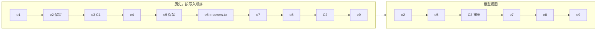

# @omne-harness/message 行为规格

本文件拥有 `@omne-harness/message` 中压缩变体在公开类型以外的必要行为。公开形状与运行时校验归 [src/index.ts](src/index.ts)，公开定义的导航归 [docs/public-api.md](docs/public-api.md)。工具部件、角色规则与块身份的行为仍在 [docs/public-api.md](docs/public-api.md) 的「语义」「判定顺序」两节和 [README](README.md#contracts) 的契约节，本文件不重复。

本成员没有状态、资源或异步行为，下面的义务都是纯函数的输入输出关系。

## 范围与依据

本文件定义压缩记录 `CompactionMessage` 的形状、模型视图规则，以及两层判定：`judgeMessage` 判形状，`judgeCompaction` 判相对历史的规则。它不定义何时压缩、怎样写摘要、保留哪些消息，也不定义历史怎样存放、怎样提交。这些归压缩策略的拥有者和历史持有者。

状态：**候选，未实现**。本文件与 [docs/public-api.md](docs/public-api.md#候选压缩变体) 的候选签名是本包实现压缩变体的依据。实现之前，`src/` 里的 `judgeMessage` 对 `compaction` 角色仍只认 `id`、`role`、`blocks`，见到 `covers`、`retained`、`derivation` 判 `extra`；`judgeCompaction`、`isCompactionMessage`、`parseRecordEntryRef` 尚未导出。

依据如下。

- 产品规则 [运行感知与一次模型请求 §7](../../../.meta_harness/design/product/runtime-context/design.md#7-压缩保留历史与未完工作)（rev 3）：覆盖范围从历史起点开始；压缩之后，模型看到的历史依次是保留名单里的消息、压缩记录和覆盖范围之后的全部模型可读消息；未结工作要么进保留名单，要么留在覆盖范围之后；工具调用和结果在模型视图里同时出现或同时不出现。
- 统一语言 [压缩记录](../../../.meta_harness/design/ubiquitous_language/terms/record-and-context.md#ul-compaction-record--压缩记录--compaction-record)、[压缩覆盖范围](../../../.meta_harness/design/ubiquitous_language/terms/record-and-context.md#ul-compacted-range--压缩覆盖范围--compacted-range)、[保留名单](../../../.meta_harness/design/ubiquitous_language/terms/record-and-context.md#ul-retained-set--保留名单--retained-set)、[记录条目](../../../.meta_harness/design/ubiquitous_language/terms/record-and-context.md#ul-record-entry--记录条目--record-entry)。
- 块标注的 `toModel` 位归 `@omne-harness/content-block`，本文件只读它，不改它的含义。

本文件不出现任何调用方的类型。记录条目引用由历史持有者给出，派生证据由派生方给出，本成员都不解释其内部。

## 结果与不变量

### 用语

- **历史**：一个历史持有者保存的记录条目序列，按写入顺序排列。条目可以带消息，也可以不带（标注、控制事实）。
- **压缩点**：压缩记录 C 本身被追加到历史中的位置。C 写入之前，压缩点之前的全部条目都已存在。
- **模型可读消息**：角色不是 `tool_internal`，且至少有一块 `visibility.toModel` 为真的消息。

### 形状

`CompactionMessage` 是 `role` 为 `compaction` 的 `Message`，另有三个必需键。

| 键 | 含义 |
| --- | --- |
| `blocks` | 摘要正文。至少一块，全部是内容块，不含工具部件。摘要就是消息的块，不另设键 |
| `covers` | 压缩覆盖范围 `{ from, to }`：被摘要的那段历史的首条与末条记录条目引用。`from` 是历史的第一条，`to` 在压缩点之前，可以早于压缩点前一条。范围连续，包含之前的压缩记录和它们的保留项。`from` 可以等于 `to` |
| `retained` | 保留名单：范围内仍原样交给模型的消息引用，按原历史顺序排列，可以为空 |
| `derivation` | 派生证据 `{ owner, record, revision, digest }`，四项都是非空字符串，证明摘要与 `covers`、`retained` 出自同一次派生 |

`RecordEntryRef` 是非空字符串，按字符串全等比较。`parseRecordEntryRef` 对空串返回 `null`，对其他字符串原样返回带品牌的值，不检查内部格式。

`compaction` 角色的消息必须带齐这三个键。其他角色的消息不带这三个键。`isCompactionMessage(message)` 在 `message.role` 为 `compaction` 且三个键都存在时返回 `true`，用于把 `judgeMessage` 的成功值收窄成 `CompactionMessage`；它不重做形状判定。

### 模型视图

**CM-01 模型视图。**有压缩记录 C 时，模型看到的会话历史依次是：

1. `C.retained` 引用的消息，按原历史顺序；
2. C 本身；
3. 位置晚于 `C.covers.to`、早于 C 的模型可读消息，以及晚于 C 的模型可读消息，都按原历史顺序。

下图中，覆盖范围是 e1～e6，保留名单是 e2、e5，C1 是更早的一条压缩记录，C2 是本次压缩记录，在 e8 之后追加。

e1、e3（C1）、e4、e6 只以 C2 的摘要出现。e7、e8 在覆盖范围之后、压缩点之前，照常出现。

视图里的每条消息仍按块的 `toModel` 位过滤：`toModel` 为假的块不给模型，保留一条消息不会让它的这类块进入视图。块级过滤与其他投影规则归请求组装。

只有最近一条压缩记录决定视图。更早的压缩记录落在新记录的覆盖范围内，按普通消息对待：被保留就作为一条消息出现，否则进入新摘要。

**CM-02 多次压缩。**新一次压缩的覆盖范围从历史起点开始，到压缩点之前结束，并且必须包含上一条压缩记录；因为范围从起点开始，上一条记录的保留项也都在新范围内。范围在上一条压缩记录之前结束时，`judgeCompaction` 判 `range`，见下文第 2 步。新记录可以把它们再次列入 `retained`；没有列入的，进入新摘要。保留名单在压缩时固定，之后不变。

**CM-03 调用与结果同进同出。**配对按 `callId` 在历史内就近确定：一条 `tool` 消息 T 与位置在 T 之前、离 T 最近、带同一 `callId` 的 `tool_call` 或 `tool_call_unparsed` 的 `assistant` 消息 A 配成一对。同一个调用被几条 `tool` 消息回答时，每条各与 A 配成一对。找不到这样的 A（`callId` 只出现在 `tool_call_incomplete` 上，或根本没出现）的 T 不参与配对。设 V 为 `retained` 引用的消息加上覆盖范围之后的消息。每一对里，A 在 V 里当且仅当 T 在 V 里。

**CM-04 未结工作不得被摘要。**历史持有者把本历史的未结工作映射到对应的消息条目，给出这些条目的引用集合。未结工作至少包括：最近一次模型请求之后写入、模型尚未读取的输入；待处理的输入；等待中的执行；后台占位；结果未知的操作。等待、后台执行与未知操作对应的是表达它们的占位消息或调用消息。集合里落在覆盖范围内的条目，必须出现在 `retained` 里；集合里落在范围之后的条目不受影响。某项未结工作没有任何对应消息、只有不带消息的条目时，持有者把那条条目放进集合，覆盖范围就必须在它之前结束，因为不带消息的条目不能保留（CM-05），落在范围内必然判 `open-work`。

**CM-05 只能保留范围内的模型可读消息。**`retained` 的每一项都必须引用覆盖范围内一条模型可读消息。范围内不带消息的条目（标注、控制事实）不能保留。同一引用不出现两次，顺序与原历史顺序一致。

**CM-06 对人的历史视图不受影响。**`retained` 只决定模型视图。对人的历史视图怎样标出摘要范围和保留项，归历史持有者。

### `judgeMessage` 对压缩变体的判定

`judgeMessage` 的「消息自己的字段」一步按下面的顺序检查，返回第一个失败。第 1～7 项是现行检查，压缩变体只改变第 1、2 项用到的键集，并加上第 8～10 项。

1. **多余键。**合法键集是 `id`、`role`、`blocks`；输入的 `role` 自有属性严格等于字符串 `compaction` 时，再加 `covers`、`retained`、`derivation`。此时角色还没有校验，未知角色、非字符串角色和其他五种角色都只用前三个键。有键不在合法键集里：`extra`。
2. **缺键。**必需键集与第 1 项的合法键集相同。缺任一个：`missing`。
3. **null。**合法键集里任一个键的值为 `null`：`null`。
4. **类型。**`id`、`role` 不是字符串，或 `blocks` 不是数组：`shape`。
5. **身份。**`id` 不合法：`empty`、`prefix` 或 `body`，同现行规则。
6. **角色。**`role` 不是六种角色之一：`unknown`。
7. **空块。**`blocks` 为空数组：`empty`。
8. **覆盖范围。**仅 `compaction` 角色。`covers` 不是普通对象，自有键不恰好是 `from`、`to`，或任一端不是非空字符串：`covers`。
9. **保留名单。**仅 `compaction` 角色。`retained` 不是数组，有元素不是非空字符串，或有两个元素相同：`retained`。稀疏数组的空位按非字符串处理。
10. **派生证据。**仅 `compaction` 角色。`derivation` 不是普通对象，自有键不恰好是 `owner`、`record`、`revision`、`digest`，或任一项不是非空字符串：`derivation`。

这里的普通对象沿用部件的规则：原型是 `Object.prototype` 或 `null`，自有键都是可枚举的字符串数据属性。带访问器、不可枚举自有键或 symbol 键时，判该键各自的拒绝值（`covers` 或 `derivation`），不调用 getter。

字段通过后，按现行顺序判部件、角色规则和块身份。

成功值是新对象。`covers`、`retained`、`derivation` 各复制成新的冻结对象或冻结数组，不与输入共享。消息对象本身和其他字段的复制、冻结规则与现行相同，不因压缩变体改变。

`judgeMessage` 只看这一条消息，不判断引用是否落在范围内，也不判断 CM-02 至 CM-04。

### `judgeCompaction`

`judgeCompaction(message, context)` 判相对历史的规则。`context` 由历史持有者给出：

| 字段 | 含义 |
| --- | --- |
| `covered` | 覆盖范围内的全部条目，按历史顺序。每项是 `{ ref, message }`，不带消息的条目 `message` 为 `null`。首项是历史的第一条，这一点由持有者保证，本函数无法核对 |
| `after` | 覆盖范围之后、压缩点之前的全部消息，按历史顺序 |
| `open` | CM-04 的未结工作条目引用 |

`covered` 与 `after` 里的消息是已经写入历史的消息，持有者保证它们曾通过 `judgeMessage`。本函数不重判它们。

按下面的顺序检查，返回第一个失败。`ref` 指出违规的条目，没有条目可指时为 `null`。第 2～5 步和成功值都使用第 1 步 `judgeMessage` 的成功值 M，不再读原始输入。

1. **消息本身。**`message` 通不过 `judgeMessage`，或它的成功值 M 使 `isCompactionMessage` 为假：`message`，`ref` 为 `null`。形状失败的具体拒绝值不随 `message` 返回。
2. **范围。**下列任一情形：`range`，`ref` 为 `null`。
   - `covered` 为空；
   - 首项的 `ref` 不等于 `covers.from`，或末项的 `ref` 不等于 `covers.to`；
   - `covered` 里有重复的 `ref`；
   - `after` 里有 `compaction` 角色的消息（上一条压缩记录落在了范围之后，违反 CM-02）。
3. **保留名单。**按 `retained` 的顺序逐项检查，`ref` 是当前这一项：
   - 引用不在 `covered` 里：`retained-outside`；
   - 在 `covered` 里的位置不晚于前一项：`retained-order`；
   - 对应条目的 `message` 为 `null`，或不是模型可读消息：`retained-not-model`。
4. **配对。**按 CM-03 找出 `covered` 与 `after` 里的全部配对，按 T 在历史中的位置从早到晚逐对检查。第一对 A、T 不同时在 V 里时返回 `pairing`。`ref` 取这一对里位于 `covered` 中的那一条；两条都在 `covered` 中时，取已保留的那一条。
5. **未结工作。**按 `covered` 的顺序，找第一条引用在 `open` 里、却不在 `retained` 里的条目：`open-work`，`ref` 是这条的引用。

全部通过时返回 `{ ok: M }`。函数不读取任何外部状态，相同输入返回相同结论。

## 所有权、失败与生命周期

在前置条件成立时，判定失败是返回值，不抛异常。`context` 里的消息违反前置条件（没有通过 `judgeMessage`）时，`judgeCompaction` 的结果未定义。形状失败与历史规则失败分开报告，调用者能区分「这条消息写错了」与「它和这段历史对不上」。

本成员不保存历史，不提交压缩，也不铸造记录条目引用或派生证据。`covered`、`after`、`open` 的真实与完整由历史持有者负责，包括 `covered` 从历史第一条开始；把不完整的范围交给 `judgeCompaction`，得到的通过结论只对交来的输入成立。

`judgeCompaction` 的代价与 `covered`、`after` 的条目数和块数之和成线性，范围总从历史起点开始，所以随历史长度增长。它在每次提交压缩记录时运行一次。压缩何时发生归请求组装，见[单次模型请求的上下文](../../../docs/architecture/runtime/request-context.md#模态表示与完整输入限制)。

压缩记录写入历史之后不变。之后的压缩不修改它，只能在新的覆盖范围里保留它或摘要它。

## 组合与验证

### 消费者

- 压缩策略的拥有者按 CM-01 至 CM-05 生成压缩记录，消费规则见[单次模型请求的上下文](../../../docs/architecture/runtime/request-context.md#压缩与历史保留)。
- 历史持有者在提交压缩记录之前调用 `judgeCompaction`，失败就拒绝提交，规则见[压缩记录的提交](../../../docs/architecture/runtime/session-and-run.md#压缩记录的提交)。`judgeCompaction` 自己先跑 `judgeMessage`，形状失败只报 `message`；需要具体形状拒绝值的持有者，可以先单独调用 `judgeMessage`，再用 `isCompactionMessage` 收窄。

### 本文件生效后改变的现行条款与用例

压缩变体实现后，下列现行正文与用例不再成立，要随实现一起改。

- [docs/public-api.md](docs/public-api.md) 的「语义」一节写「调用与结果的配对完整性也不在本包判定」：改为只在 `judgeCompaction` 核对压缩记录时判定，其他场合仍不判定。
- 同页「定义索引」说 `judgePart` 的拒绝值是 `MessageRejection` 的子集：`covers`、`retained`、`derivation` 与 `tool-blocks`、`duplicate-id` 一样只由整条消息的判定给出。
- 同页示例表 `role.calls-only-in-assistant` 的 `compaction` 反例只有 `blocks`：实现后先判 `missing`，要补齐三个键才能继续示范 `tool-blocks@1`。
- `tests/message.spec.ts` 与 `tests/tool-roles.spec.ts` 中构造 `compaction` 角色消息的用例：同样要补齐三个键。
- `tests/normative.spec.ts` 只读五列示例表，传不了三个新键和 `context`：压缩用例另起一张表，列为规则、极性、消息、`context`、结论，由同一个文件逐行执行。结论列写 `ok`、`rejected:<拒绝值>` 或 `rejected:<拒绝值>@<ref>`；「getter 未被调用」「成功值不变且已冻结」这类附加断言写在同一格，用分号分隔，由该文件逐项断言。
- 运行时导出增加 `judgeCompaction`、`isCompactionMessage`、`parseRecordEntryRef`，`tests/public-entry.spec.ts` 同步。
- [README](README.md) 与 [README_ZH](README_ZH.md) 契约节「成功值只含 `id`、`role`、`blocks`」：改为对 `compaction` 角色另含三个键，并删去候选说明。

### 验收对照

实现时把下表逐行写成上面那张压缩用例表。在那之前，下表只是候选反例，测试不执行它。历史里的条目记作 e1、e2……，按写入顺序；「输入要点」里的 after 指 `context.after`，即范围之后的消息。

| 规则 | 极性 | 输入要点 | 结论 |
| --- | --- | --- | --- |
| `compaction.keys` | 正 | `compaction` 角色，带齐三个键，`retained` 为空 | `ok` |
| `compaction.keys` | 反 | `compaction` 角色，缺 `derivation` | `rejected:missing` |
| `compaction.keys` | 反 | `assistant` 角色，带 `covers` | `rejected:extra` |
| `compaction.keys` | 反 | `role` 为 `bogus`，带 `covers` | `rejected:extra` |
| `compaction.keys` | 反 | `compaction` 角色，`covers` 为 `null` | `rejected:null` |
| `compaction.order` | 反 | `compaction` 角色，`id` 为 `bad`，`retained` 为 `"x"` | `rejected:prefix` |
| `compaction.order` | 反 | `compaction` 角色，`blocks` 为空，`retained` 为 `"x"` | `rejected:empty` |
| `compaction.covers` | 反 | `covers` 是字符串 | `rejected:covers` |
| `compaction.covers` | 反 | `covers` 多一个键 `size` | `rejected:covers` |
| `compaction.covers` | 反 | `covers.to` 为空串 | `rejected:covers` |
| `compaction.covers` | 反 | `covers.from` 是 getter | `rejected:covers`，getter 未被调用 |
| `compaction.retained` | 反 | `retained` 是字符串 | `rejected:retained` |
| `compaction.retained` | 反 | `retained` 含重复引用 `["e2","e2"]` | `rejected:retained` |
| `compaction.retained` | 反 | `retained` 含空串 | `rejected:retained` |
| `compaction.derivation` | 反 | `derivation` 缺 `digest` | `rejected:derivation` |
| `compaction.derivation` | 反 | `derivation.digest` 为空串 | `rejected:derivation` |
| `compaction.copy` | 正 | 判定后修改输入的 `retained` 数组 | 成功值的 `retained` 不变，且已冻结 |
| `history.message` | 反 | `message` 的 `role` 是 `assistant` | `rejected:message`，ref `null` |
| `history.range` | 正 | `covers` 为 e1～e1，`covered` 只有 e1 | `ok` |
| `history.range` | 反 | `covered` 为空 | `rejected:range`，ref `null` |
| `history.range` | 反 | `covered` 首项是 e2，`covers.from` 是 e1 | `rejected:range`，ref `null` |
| `history.range` | 反 | `covered` 末项与 `covers.to` 不同 | `rejected:range`，ref `null` |
| `history.range` | 反 | `covered` 里 e2 出现两次 | `rejected:range`，ref `null` |
| `history.range` | 反 | after 里有一条 `compaction` 角色的消息 | `rejected:range`，ref `null` |
| `history.outside` | 反 | `retained` 含 `covered` 之外的引用 e9 | `rejected:retained-outside`，ref e9 |
| `history.order` | 反 | `retained` 为 `["e3","e2"]` | `rejected:retained-order`，ref e2 |
| `history.not-model` | 反 | `retained` 引用不带消息的条目 e4 | `rejected:retained-not-model`，ref e4 |
| `history.not-model` | 反 | `retained` 引用全部块 `toModel` 为假的消息 e5 | `rejected:retained-not-model`，ref e5 |
| `history.not-model` | 反 | `retained` 引用 `tool_internal` 消息 e6 | `rejected:retained-not-model`，ref e6 |
| `history.pairing` | 正 | e2 带 `tool_call` k，e3 回答 k，两条都保留 | `ok` |
| `history.pairing` | 反 | 保留 e2（带调用 k），e3 回答 k 在范围内未保留 | `rejected:pairing`，ref e2 |
| `history.pairing` | 反 | 保留 e3（回答 k），e2（带调用 k）未保留 | `rejected:pairing`，ref e3 |
| `history.pairing` | 反 | e2 带调用 k 在范围内未保留，回答 k 的消息在 after 里 | `rejected:pairing`，ref e2 |
| `history.pairing` | 正 | e2 带调用 k 已保留，回答 k 的消息在 after 里 | `ok` |
| `history.pairing` | 正 | e2/e3 与 e7/e8 两次复用 `callId` k，只保留 e7、e8 | `ok` |
| `history.pairing` | 反 | e2 带 `tool_call_unparsed` k，e3 回答 k，只保留 e2 | `rejected:pairing`，ref e2 |
| `history.pairing` | 正 | e3 回答 k，历史里 k 只出现在 `tool_call_incomplete` 上，保留 e3 | `ok` |
| `history.open-work` | 反 | `open` 含范围内的 e4，未保留 | `rejected:open-work`，ref e4 |
| `history.open-work` | 正 | `open` 里的条目都在 after 里 | `ok` |
| `history.open-work` | 反 | `open` 为 `["e6","e4"]`，两条都在范围内、都未保留 | `rejected:open-work`，ref e4 |
| `history.repeat` | 正 | 上一条压缩记录在范围内并被保留 | `ok` |
| `history.first-failure` | 反 | `retained` 为 `["e9"]`，且 `open` 含范围内未保留的 e4 | `rejected:retained-outside`，ref e9 |
