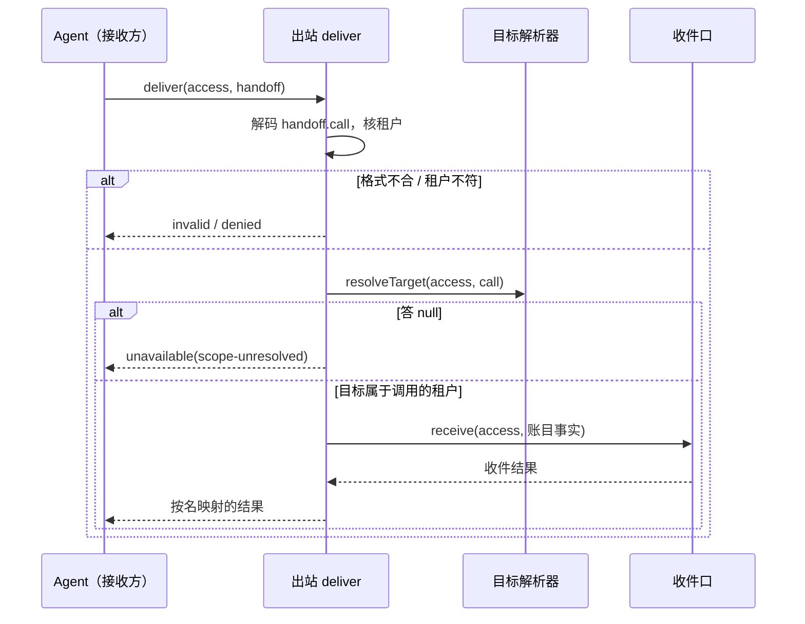

# 关键流程

本文件用可维护的文本图源描述本包的关键业务流程与数据流：参与者、调用时序、数据来源与去向、状态变化、失败分支与生命周期。图旁写前提与边界，不编造流程。

## 流程

一次账目出站（SPEC 的[账目出站](../SPEC.md#outlet)）。参与者：Agent（接收方，持有 `received` 条目）、出站、目标解析器、`contextAccountingInbox`（账目投影）。

本波的真实装配里解析器总是答 `null`，所以流程止于 `unavailable(scope-unresolved)`，收件口不会被调用。接收方保留账目待办，按自己的退避重试，与 `saved` 互不等待。

## 失败与生命周期

- 解析器或收件口抛出：分别答 `unavailable(scope-resolver-failed)` 与 `unknown`。不重试，不记待办，待办在接收方。
- 依赖缺席：插件停在 `PENDING`，没有 `agentAccountOutlet` 键，接收方构造不出出站端口，这由装配处理，不是 `deliver` 的失败。
- 插件的 fiber 结束：被持有的旧引用答 `unavailable(outlet-closed)`。
- 账目投影淘汰了目标：收件口答 `uninitialized`，出站转成 `unavailable`，接收方保留待办（[ACCT-EVICT-ACTIVE](../SPEC.md#已知限制)）。
