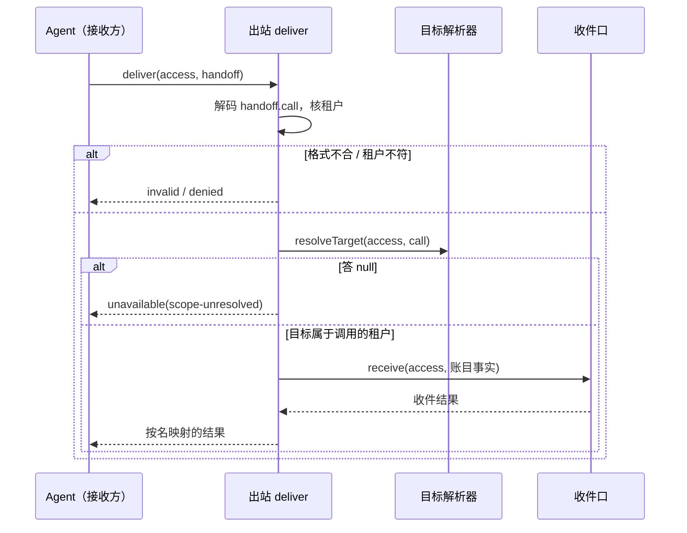
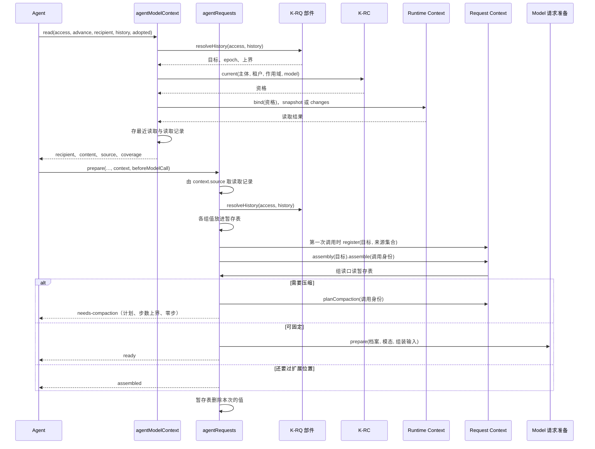
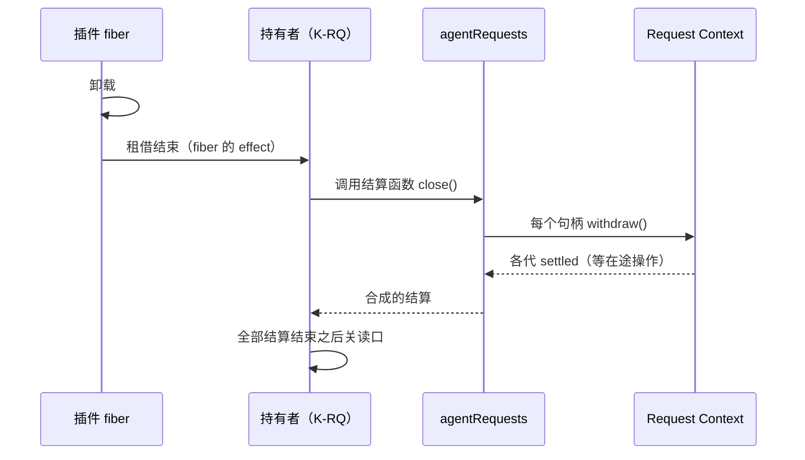

# 关键流程

本文件用可维护的文本图源描述本包的关键业务流程与数据流：参与者、调用时序、数据来源与去向、状态变化、失败分支与生命周期。图旁写前提与边界，不编造流程。

## 流程

### 账目出站

一次账目出站（SPEC 的[账目出站](../SPEC.md#outlet)）。参与者：Agent（接收方，持有 `received` 条目）、出站、目标解析器、`contextAccountingInbox`（账目投影）。

本波的真实装配里解析器总是答 `null`，所以流程止于 `unavailable(scope-unresolved)`，收件口不会被调用。接收方保留账目待办，按自己的退避重试，与 `saved` 互不等待。

### 一轮主请求：读取与准备

一次读取和随后的准备（SPEC 的[可读上下文读取](../SPEC.md#model-context)与[请求准备](../SPEC.md#requests)）。参与者：Agent、本包、K-RQ 部件、K-RC、Runtime Context、Request Context、Model 请求准备。

前提：同一 execution 同一时刻至多一个在途准备，由 Agent 的单执行槽保证。增量读取只在同一执行挂接、同一收件模型、已采用覆盖与固定事实一致时发生。

### 插件停止与结算

## 失败与生命周期

- 解析器或收件口抛出：分别答 `unavailable(scope-resolver-failed)` 与 `unknown`。不重试，不记待办，待办在接收方。
- 依赖缺席：插件停在 `PENDING`，没有对应的键，接收方或宿主构造不出端口，这由装配处理，不是操作的失败。
- 插件的 fiber 结束：被持有的旧引用答 `unavailable`，出站的诊断是 `outlet-closed`，上下文插件的诊断是 `agent-context-closed`。
- 账目投影淘汰了目标：收件口答 `uninitialized`，出站转成 `unavailable`，接收方保留待办（[ACCT-EVICT-ACTIVE](../SPEC.md#已知限制)）。
- 读取材料丢失：下一次读取做完整读取。带着丢失记录的 `prepare` 或 `resume` 答 `unavailable(context-material-lost)`，Agent 按拉取时点重读即可恢复。
- 计划材料丢失：`derive` 与 `resume` 答 `unavailable(compaction-plan-lost)`（[COMPACTION-PATH](../SPEC.md#已知限制)）。
