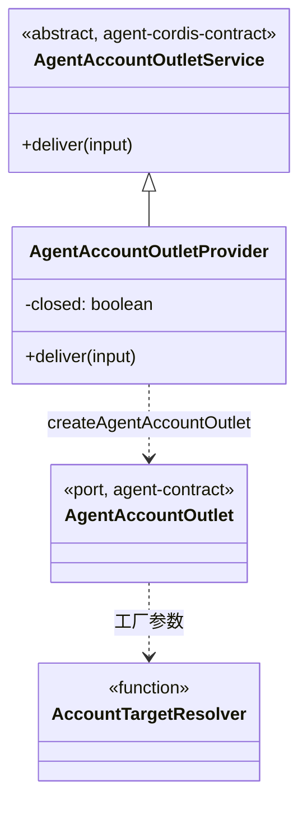

# 对象模型

本文件描述本包内部对象的职责、身份、状态、关联、组合、继承与生命周期，配类图。它不强迫实现改成 class；纯函数或值包写实际模型与不适用项。

## 对象与关系

出站由工厂返回，是闭包上的一个函数对象，只引用收件口、采用身份与解析器三个参数，没有自己的状态。插件类只多一个 `closed` 标记。没有 ID，没有集合。

## 生命周期

工厂返回值随调用方存在，无需释放。插件的 `closed` 在构造时为假，在 fiber 的 effect 撤除时变真，不再变回。Cordis 在收件口的提供者换代时重跑插件体，得到新的实例与新的 `closed`。
