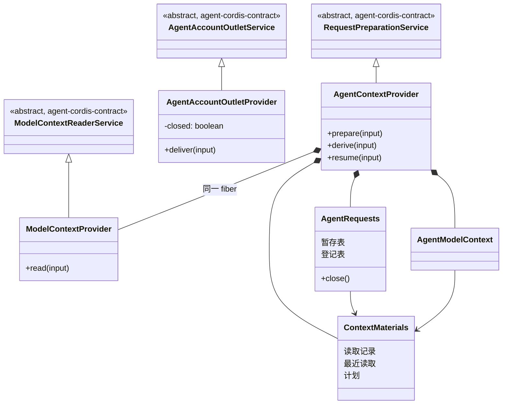

# 对象模型

本文件描述本包内部对象的职责、身份、状态、关联、组合、继承与生命周期，配类图。它不强迫实现改成 class；纯函数或值包写实际模型与不适用项。

## 对象与关系

| 对象     | 身份                                  | 状态                                                   |
| -------- | ------------------------------------- | ------------------------------------------------------ |
| 出站     | 无。闭包上的一个函数对象              | 无                                                     |
| 材料库   | 实例标识（随机 UUID）                 | 三张有界表，按最久未用淘汰                             |
| 读取记录 | 读取来源证据的记录与摘要              | 第三组材料、目标、历史依据、转换依据。不可变           |
| 最近读取 | （租户，作用域，execution，执行挂接） | 资格、读者、游标、块材料、收件模型。增量读取只更新游标 |
| 计划材料 | 计划证据的记录与摘要                  | 计划、计划进度、当前步、进入计划时的各组值。每步更新   |
| 暂存项   | （租户，候选身份）                    | 一次调用的各组值。不可变                               |
| 登记项   | （租户，作用域）                      | 登记的结果，成功时是句柄                               |

## 生命周期

- 出站的工厂返回值随调用方存在，无需释放。出站插件的 `closed` 在构造时为假，在 fiber 的 effect 撤除时变真，不再变回。
- 上下文插件在构造时创建材料库、取 K-RQ 租借、创建两个工厂的返回值。fiber 结束时租借结束，`close()` 撤除登记，材料库结束读者并清空。Cordis 在任一依赖的提供者换代时重跑插件体，得到新的材料库与新的登记。
- 暂存项在一次操作开始时出现，在 `finally` 里消失。登记项在第一次调用时出现，登记失败时消失，`close()` 时全部消失。
- 最近读取的项被替换或淘汰时，它的读者结束。读取记录与计划材料被淘汰后，指向它们的证据只能得到「丢失」的答复。
