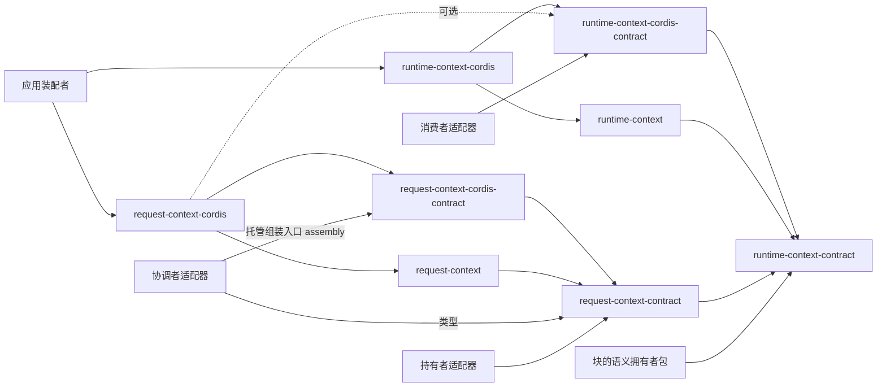

# Context 组的工程关系

本页维护本组八个成员的分解、依赖方向与各设计主题的唯一拥有者。领域责任归[领域页](../../../docs/domains/runtime-context/architecture.md)，系统关系归[系统页 Runtime Context](../../../docs/architecture/runtime/runtime-context.md)与[系统页 Request Context](../../../docs/architecture/runtime/request-context.md)。本页不维护第二份状态机、错误集合或承接协议。

## 成员分解

两块支撑能力各四段。切分依据是变化原因：契约随语义变，Cordis 定义随装配约定变，机制实现随算法变，Service 实现随进程内装配变。

| 块 | 纯契约 | Cordis 定义 | 机制实现 | Service 实现 |
| --- | --- | --- | --- | --- |
| Runtime Context | `runtime-context-contract` | `runtime-context-cordis-contract` | `runtime-context` | `runtime-context-cordis` |
| Request Context | `request-context-contract` | `request-context-cordis-contract` | `request-context` | `request-context-cordis` |

第四段名 `-cordis` 而不是 `-host-local`：两块都不绑定机器本地资源（凭据、进程、文件系统），单机才成立的部分只有进程内表与 isolate 绑定。

## 安装与源码依赖

- 纯契约与机制实现不导入 `@deepseek-ai/cordis`。Cordis 绑定只从 `-cordis-contract` 与 `-cordis` 的 `./cordis` 导出。
- `request-context-contract` 依赖 `runtime-context-contract` 的读取结果类型与块声明的 `volatility`。它另外依赖 model-contract、tool-contract、content-block、message 的公开值。
- 两块的契约都不依赖 agent-contract、session-contract 或 execution-environment 的契约。要供给块的成员依赖 `runtime-context-contract` 并导出自己的块声明；要读块的成员经适配器依赖 `runtime-context-cordis-contract`；要组装请求的协调者经适配器依赖 `request-context-contract`。
- 提供者注入纯工厂，不反向决定契约。两个 `-cordis` 成员的根入口不导出任何东西；独立路径从机制成员取工厂。
- `request-context-cordis` 对 `runtime-context-cordis-contract` 是可选依赖（虚线）：它在 `ctx.inject(['runtimeContext'], …)` 的子 fiber 里登记 `context.compaction-settings` 与 `context.window-usage` 的生产者。Runtime Context 不在场时两块读到缺项，到场后再登记。它不 `inject` 作用域持有者或模型侧的服务；历史源读口、计量端口与转换件结果端口由调用方经 `assembly(scope, ports)` 逐次交入。
- 协调者的组装入口有两条：托管路径经 `request-context-cordis-contract` 的 `assembly(scope, ports)`；不装配 Cordis 时经 `request-context` 的机制工厂。

## 主题与唯一拥有者

一个主题只有一个可独立修改的有效规范；其他位置只能引用拥有者或标明为非规范摘要。各成员的 `architecture.md`、`flows.md`、`object-model.md`、`public-api.md`、`context.md`、`cordis.md` 中，不在下表列为拥有者的页面只写本成员特有的事实。

| 主题 | 唯一规范拥有者 |
| --- | --- |
| 产品能力、业务后果与阶段支持 | [产品页](../../../.meta_harness/design/product/runtime-context/design.md) |
| 词条 | [统一语言索引](../../../.meta_harness/design/ubiquitous_language/index.md)及其分卷 |
| 领域对象条目与待裁 | [领域对象清单](../../../.meta_harness/design/domain_objects/objects.md)、[待裁清单](../../../.meta_harness/design/domain_objects/pending.md) |
| 领域语义依赖原则与集成原则 | [分层与依赖](../../../docs/architecture/layers-and-dependencies.md#领域语义依赖与模型边界) |
| 系统级关系 | 两张系统页 |
| 领域责任与事实拥有者 | [领域页](../../../docs/domains/runtime-context/architecture.md) |
| Runtime Context 的公开行为 | [runtime-context-contract SPEC](../runtime-context-contract/SPEC.md) |
| Request Context 的公开行为 | [request-context-contract SPEC](../request-context-contract/SPEC.md) |
| 两个服务键、intercept 配置与事件 | [runtime-context-cordis-contract](../runtime-context-cordis-contract/docs/cordis.md)、[request-context-cordis-contract](../request-context-cordis-contract/docs/cordis.md) |
| 供给机制与缓存 | [runtime-context](../runtime-context/docs/architecture.md)、[request-context](../request-context/docs/architecture.md) |
| Service 实现、撤除与资源清理 | [runtime-context-cordis](../runtime-context-cordis/docs/cordis.md)、[request-context-cordis](../request-context-cordis/docs/cordis.md) |
| Cordis 集成约定 | [IC 约定](../../../docs/architecture/cordis-integration-conventions.md) |
